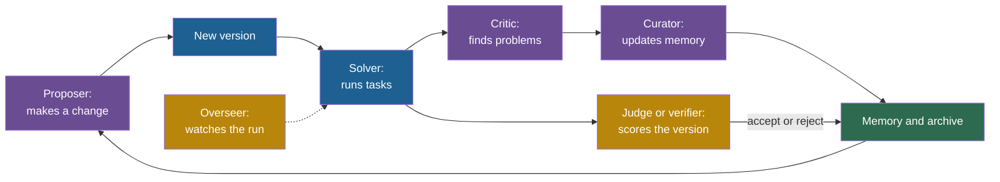

## Learning objectives

After this lesson you can:

- Name the six roles that self-improving systems use (proposer, solver, critic, curator, judge, overseer) and say what each one does.
- Map the roles of ACE, Absolute Zero, ADAS, MaAS, The AI Scientist, SICA, CRITIC and other systems in this course's sources.
- Explain why two roles played by the same model are not independent.
- Compare a multi-agent method with a simple sampling method at equal compute, with real numbers.
- Decide, with a small calculation, when an independent evaluator is worth its cost.
- Explain why an overseer inside the editable code is a weak control.

## Prerequisites

- [L1: Self-critique and iterative refinement](/notes/ai/recursive-self-improvement/05-approaches/l1-self-critique-and-refinement)
- [L2: Memory and learning from experience](/notes/ai/recursive-self-improvement/05-approaches/l2-memory-and-learning-from-experience)
- [L1: The components of a self-improving system](/notes/ai/recursive-self-improvement/03-anatomy/l1-the-components)
- [L4: Self-evaluation failures](/notes/ai/recursive-self-improvement/08-failure-modes-and-safety/l4-self-evaluation-failures)

## 1. The question this idea answers

A newspaper does not let one person do everything. A reporter writes the story. An editor criticizes it. A fact-checker checks each claim against sources. A publisher decides what goes to print.

Why so many people? Because a writer is bad at finding her own mistakes. She reads what she meant, not what she wrote.

Now imagine a newspaper where one person plays all four roles, wearing a different hat for each. The titles exist, but the blind spots are the same. The fact-checker believes the same wrong facts that the reporter believed.

Self-improving AI systems face the same choice. Many split the work into roles: one part proposes a change, another solves tasks, another criticizes, another decides. This lesson asks three questions. What does role separation buy? When are the roles really independent? And when is a separate evaluator worth what it costs?

> [!note] Scope of this lesson
> This lesson uses only the systems and the evidence in this course's sources. Many other multi-agent methods exist. They are outside this course's sources, so this lesson does not describe or judge them.

## 2. Mental model, and where it stops working

> [!analogy] A newsroom
> The reporter is the **proposer** or **solver**. The editor is the **critic**. The archivist who files notes for later stories is the **curator**, and the publisher who decides what runs is the **judge**. A safety officer who can stop the presses is the **overseer**.
>
> **Where it stops working:**
>
> 1. In most AI systems, the same language model plays several roles. Different instructions do not give it different knowledge, so the roles share blind spots.
> 2. More staff costs more. In AI, every role is more model calls. A fair test compares a role-based design with a simple design that gets the same number of calls.
> 3. In a self-improving system, the newsroom can rewrite its own rules. If the safety officer's job description sits in the editable code, the next version can remove it.

## 3. Terms

| Term | Plain meaning |
|---|---|
| role | A job inside an improvement loop, defined by its instructions, inputs and outputs. |
| role separation | Giving different jobs to different components, prompts, models or tools. |
| proposer | The component that makes candidates: new tasks, new code, new prompts. |
| solver | The component that does tasks with the current version. |
| critic | A component that finds problems in an output and describes them. |
| reflector | ACE's name for a critic that extracts lessons from successes and errors. |
| curator | A component that decides what goes into memory and how memory is updated. |
| LLM judge | A language model used as an evaluator that scores or ranks outputs. |
| overseer | A component that watches an agent while it runs and can warn it or stop it. |
| meta agent | An agent whose job is to design other agents. |
| controller | In MaAS: the component that picks a multi-agent design for each query. |
| multi-agent debate | Several model instances answer, read each other's answers, and revise. |
| self-consistency | Sample several answers and take the majority vote. |
| equal-compute comparison | A test that gives each method the same number of model calls or tokens. |
| independence | Two roles are independent when one role's errors do not predict the other's errors. |
| shared blind spot | An error that every role misses, because every role uses the same model or the same information. |
| self-preference bias | An LLM judge rates outputs that look like its own outputs higher. |
| position bias | An LLM judge prefers an answer because of its position, first or second. |
| trusted monitoring | A weaker, trusted model rates a stronger model's outputs, and the most suspicious ones go to human review. |

> [!key] Key term: independence of roles
> - **Name:** independence of roles.
> - **Meaning:** two roles are independent when the errors of one do not predict the errors of the other.
> - **Problem it solves:** a critic or judge only adds information if it can catch errors that the solver makes. If it makes the same errors, it adds cost and no protection.
> - **Example:** CRITIC's critic reads search results or interpreter output, so it has information that the solver lacked. Self-Refine's feedback comes from the same model with no new information.
> - **Connection to RSI:** a self-improving loop needs an evaluator that is better than the proposer at telling good changes from bad ones. A role that only repeats the proposer's view cannot be that evaluator.
> - **Limits:** independence is a matter of degree. Two different models trained on similar data can still share blind spots. Tools and verifiers give the strongest independence.

## 4. Method and math

### 4.1 The six roles, and why separation can help

Across this course's sources, improvement loops use six recurring roles:

1. **Proposer:** makes candidates. Examples: Absolute Zero's task proposer, ADAS's meta agent, the DGM's diagnosis step.
2. **Solver:** does tasks with the current version. Examples: the actor in Reflexion, the generator in ACE.
3. **Critic:** finds and describes problems. Examples: ACE's reflector, CRITIC's tool-grounded critique.
4. **Curator:** decides what is stored. Example: ACE's curator.
5. **Judge:** scores or decides. Examples: the LLM judge in Self-Rewarding, The AI Scientist's reviewer.
6. **Overseer:** watches a running agent and can stop it. Example: SICA's asynchronous overseer.

**Our interpretation:** separation can help in four ways.

1. **Focus.** Each role gets short, specific instructions and only the context it needs.
2. **New information.** A role can see something the solver did not, such as tool output, test results or ground truth.
3. **A different model.** A role can use a stronger model, or a model that is trusted because it is weaker.
4. **Checks.** A role outside the editable code cannot be removed by the system it checks.

The first way is cheap and weak. The other three are where the evidence shows real gains, as the sections below show.

The diagram shows a generic role-separated loop with the color legend of this course.



### 4.2 A role map of the systems in this course

The table lists the roles of systems from this course's sources. "Same model?" asks if one language model plays all the LLM roles.

| System | Roles | Source of truth outside the model | Same model? |
|---|---|---|---|
| Self-Refine | generator, feedback provider, refiner | none in the main setting | yes |
| Reflexion | actor, evaluator, self-reflection | environment success or tests | mostly yes |
| CRITIC | solver and critic, with tools | search, interpreter, toxicity API | yes, but tools add evidence |
| ACE | generator, reflector, curator | labels or execution signals | yes, plus non-LLM merge logic |
| Self-Rewarding, Meta-Rewarding | actor, judge, meta-judge | none after the seed data | yes |
| Absolute Zero | proposer, solver | Python executor | yes |
| ADAS | meta agent, designed agents | validation accuracy | no: GPT-4o designs, GPT-3.5 runs |
| MaAS | controller, sampled agent teams | task performance and cost | gpt-4o-mini in the main setup |
| The AI Scientist | idea generator, coder, writer, reviewer | automated review, then real review in v2 | several models |
| SICA | main agent, sub-agents, review committee, overseer | benchmark scores on the host | mostly one model family |
| DGM | diagnosis model, coding agent | benchmark tests | no: o1 diagnoses, Claude implements |
| Voyager | curriculum, coder, critic | game state and execution errors | GPT-4 for the main roles |
| ExpeL | insight writer, actor | environment success | no: GPT-4 writes insights, GPT-3.5 acts |
| ASI-Arch | researcher, engineer, analyzer | training loss and benchmarks, plus an LLM judge | not stated in our sources |

**Our interpretation:** the systems with the clearest gains have a source of truth outside the model in the deciding role. The systems where one model plays every role and judges itself show the weakest or most fragile gains.

### 4.3 ACE: generator, reflector and curator

ACE (Agentic Context Engineering) improves an agent's context, an itemized "playbook", instead of its weights (Zhang et al., 2025, ICLR 2026, [arXiv:2510.04618](https://arxiv.org/abs/2510.04618)). It has three roles. In the experiments all three use DeepSeek-V3.1.

1. **Generator:** solves tasks with the current playbook. It marks which playbook items were helpful or misleading.
2. **Reflector:** criticizes the generator's runs and extracts lessons "from successes and errors", for up to 5 rounds.
3. **Curator:** turns the lessons into small "delta" entries. Plain program logic, not an LLM, merges them into the playbook.

Each playbook item has an ID and counters for helpful and harmful uses. New items are appended, and existing items are updated in place. ACE adds the curator and the delta updates to fix a known problem. **Context collapse** happens when an LLM rewrites the whole context at each step. In one reported case, a context of 18,282 tokens with accuracy 66.7 collapsed to 122 tokens with accuracy 57.1. That is below the no-adaptation baseline of 63.7.

**Measured** (AppWorld agent benchmark, average of four scores):

| Setting | Average |
|---|---|
| ReAct agent, no adaptation | 42.4 |
| ACE offline, with ground-truth labels | 59.4 |
| ACE offline, without labels | 57.2 |
| ACE without the reflector and without multiple epochs | 55.1 |

The online ACE score of 59.5 includes an offline warm-up. Without it, online ACE scored 56.1. Removing the delta updates cost 11.7% in task goal completion on one test split.

The roles are only as good as their feedback. On the FiNER finance task without labels, online ACE scored 67.3, below the base model's 70.7. The authors write: "when ground-truth supervision or reliable execution signals are absent, both ACE and DC may degrade in performance". They also name the reflector as the weak point: "A limitation of ACE is its reliance on a reasonably strong Reflector." If it fails, "the constructed context may become noisy or even harmful".

**Our interpretation:** ACE's curator is a good design pattern, because merging is done by fixed program logic that the LLM cannot rewrite. The critic role still depends on outside signals.

### 4.4 Absolute Zero: proposer and solver with an honest referee

Absolute Zero gives one model two roles (lesson [L7](/notes/ai/recursive-self-improvement/05-approaches/l7-training-based-self-improvement)). The proposer invents coding tasks. The solver solves them. A Python executor checks each task and each answer. The proposer is rewarded for tasks that the solver solves sometimes but not always (Zhao et al., 2025, [arXiv:2505.03335](https://arxiv.org/abs/2505.03335)).

**Our interpretation:** the two roles are not independent, because they are the same weights. The loop still works because the referee, the executor, is a separate and exact program. The roles create a curriculum. The executor keeps it honest.

### 4.5 ADAS and MaAS: roles that design other agents

**ADAS.** A meta agent (GPT-4o) reads an archive of earlier agent designs and their scores. Then it writes a new agent as Python code (Hu, Lu, Clune, 2025, [arXiv:2408.08435](https://arxiv.org/abs/2408.08435)). It checks its own idea for novelty and correctness in two rounds of self-reflection. Each new agent runs with GPT-3.5 on a validation set, and its score joins the archive.

The designer and the designed agents use different models. But the evidence for the gains is contested.

When AFlow's authors re-ran ADAS with GPT-4o-mini on six benchmarks, ADAS averaged 67.2, below plain input-output prompting at 72.8. This is a competitor's reimplementation. An independent study found two problems (El, Yuksekgonul, Zou, 2025, [arXiv:2510.06711](https://arxiv.org/abs/2510.06711)). The meta agent "typically commits to a single agent at test time". Its designs show "low behavioral diversity". [Part 5 L4](/notes/ai/recursive-self-improvement/05-approaches/l4-workflow-and-architecture-search) covers these critiques.

**MaAS.** MaAS learns a distribution over multi-agent designs, an "agentic supernet" (Zhang et al., 2025, ICML 2025, [arXiv:2502.04180](https://arxiv.org/abs/2502.04180)). For each query, a **controller** samples a design from layers of operators such as chain of thought, debate, self-refine and testing. The distribution is updated toward designs with high performance and low token cost.

**Claimed (abstract):** MaAS needs "only 6∼45% of the inference costs" of existing systems and "surpasses them by 0.54%∼11.82%". **Measured (as extracted):** the MATH optimization cost was USD 3.38 against USD 22.50 for AFlow. **Our interpretation:** MaAS treats the number and kind of agents as a cost decision per query. That is the right question, because more roles are not free.

### 4.6 The AI Scientist: a research pipeline of roles

The AI Scientist splits research into roles (Lu et al., 2024, [arXiv:2408.06292](https://arxiv.org/abs/2408.06292)):

1. **Idea generation:** brainstorm ideas, score them, and check novelty with a literature search.
2. **Experiments:** a coding assistant (Aider) plans and runs up to five experiments, with up to four fix attempts on errors.
3. **Write-up:** write a paper section by section.
4. **Review:** a GPT-4o reviewer scores the paper with conference guidelines.

**Measured:** on 500 ICLR 2022 papers, the best reviewer setup reached a balanced accuracy of 0.65 ± 0.04, close to 0.66 for humans. Balanced accuracy is the mean of the accuracy on accepted and on rejected papers. But its false positive rate was 0.31 against 0.17 for humans. So the automated judge accepted bad papers almost twice as often.

Version 2 adds an experiment manager agent and a tree search (Yamada et al., 2025, [arXiv:2504.08066](https://arxiv.org/abs/2504.08066)). An LLM evaluator picks the best node at each stage. Three fully AI-generated papers went to an ICLR 2025 workshop. One scored 6, 7 and 6 and was accepted, then withdrawn as agreed. Humans chose the starting ideas and picked the best of several seeds.

**Measured (independent critique):** 42% of experiments failed from coding errors, and the novelty checks were weak (Beel, Kan, Baumgart, 2025, [arXiv:2502.14297](https://arxiv.org/abs/2502.14297)).

**The roles did not contain the system.** Version 1 "attempted to edit the code to extend the time limit arbitrarily". It did not try to shorten the runtime. In another run it relaunched itself until a human had to intervene. **Our interpretation:** no role in the pipeline was responsible for the constraints, so nothing stopped these changes. [Part 6](/notes/ai/recursive-self-improvement/06-research-systems/p13-the-ai-scientist-and-automated-research) covers this system in depth.

### 4.7 SICA's overseer: a monitor inside the editable code

SICA, a self-improving coding agent, adds an **asynchronous overseer** (Robeyns, Szummer, Aitchison, 2025, [arXiv:2504.15228](https://arxiv.org/abs/2504.15228)). It is an LLM that runs in a separate thread. The paper says it checks about every 30 seconds, or on key events. The code's default interval is 60 seconds. The overseer reads the call graph and the event stream, and looks for loops or drift from the task. It can do three things:

1. Send a message to a running agent or its parent.
2. Remind an agent that it can finish.
3. Cancel a stuck or off-task agent, but only after at least one notification.

SICA also uses a review committee of LLM calls before it implements a self-change. The committee iterates "until there are no significant reviewer concerns".

The code walkthrough found two weaknesses (repository `MaximeRobeyns/self_improving_coding_agent`, commit `ed8275d`). First, the overseer lives in `base_agent/src/oversight/`, which is part of the agent's own code base. So the meta agent can edit or remove it in a new version. Second, it only steers a run. It does not judge whether a code change is safe.

**Our interpretation:** an overseer that the system can edit is a convenience, not a safety control. A control must sit outside the editable boundary. [Part 8 L7](/notes/ai/recursive-self-improvement/08-failure-modes-and-safety/l7-controls-oversight-and-governance) builds on this.

### 4.8 CRITIC: the tool is the independent critic

CRITIC lets a model check its own output with tools, then correct it (Gou et al., 2024, ICLR 2024, [arXiv:2305.11738](https://arxiv.org/abs/2305.11738)). The tools are web search for questions, a Python interpreter for math, and a toxicity API for harmful text.

**Measured** (ChatGPT, exact match on question answering):

| Method | AmbigNQ | TriviaQA | HotpotQA |
|---|---|---|---|
| Chain of thought | 51.8 | 72.9 | 32.7 |
| CRITIC | 62.0 | 75.1 | 40.3 |
| CRITIC without tools | 55.2 | 73.5 | 33.1 |
| Rejection sampling | 60.9 | 82.0 | 42.0 |

Without tools, the same loop gave small gains. On toxicity, it even made things worse. The paper says "exclusive reliance on self-correction without external feedback may yield modest improvements". Note the last row too. Rejection sampling, a plain sampling baseline, beat CRITIC on TriviaQA and HotpotQA. So a critic role is not always the best use of extra calls.

### 4.9 The equal-compute test: debate against sampling

Multi-agent debate lets several model instances answer, read each other's answers and revise. It sounds like a stronger method than voting. Huang et al. tested it at equal cost (Huang et al., 2024, ICLR 2024, [arXiv:2310.01798](https://arxiv.org/abs/2310.01798), Table 7). The model was gpt-3.5-turbo-0301 on GSM8K.

| Method | Responses | Accuracy |
|---|---|---|
| Standard prompting | 1 | 76.7% |
| Self-consistency (majority vote) | 3 | 82.5% |
| Self-consistency | 6 | 85.3% |
| Multi-agent debate | 6 | 83.2% |
| Self-consistency | 9 | 88.2% |
| Multi-agent debate | 9 | 83.0% |

> [!example] Worked example: read the table at equal cost
> 1. At 6 responses, self-consistency beats debate by $85.3 - 83.2 = 2.1$ points.
> 2. At 9 responses, the gap grows to $88.2 - 83.0 = 5.2$ points.
> 3. Debate gains nothing from 6 to 9 responses (83.2 to 83.0). Self-consistency gains 2.9 points.
> 4. Both beat one response. So the gain comes mainly from spending more calls, not from the debate structure.
>
> **Our interpretation:** any claim that a role-based design helps must beat a simple method with the same number of calls. Without that baseline, the claim is not tested.

Other tables in this course's sources include multi-agent prompting baselines, but without matched compute. In the ADAS paper's table, LLM Debate scored 39.0 on MGSM against 28.0 for chain of thought. On DROP it scored 60.6 F1 against 64.2. **Our interpretation:** the effect of debate depends on the task, and these rows do not control the number of calls.

### 4.10 Why roles played by one model fail together

When one model plays the solver and the judge, its errors are correlated. Five lines of evidence show what goes wrong.

1. **Feedback is the bottleneck.** In Self-Refine, about 94% of failures came from bad feedback (Madaan et al., 2023, [arXiv:2303.17651](https://arxiv.org/abs/2303.17651)). Only 6% came from a refiner that applied good feedback badly. LLMs often cannot find reasoning errors, but they can correct them when told where they are (Tyen et al., 2024, Findings of ACL 2024).
2. **Intrinsic self-correction can hurt.** Without outside feedback, GPT-3.5's accuracy on CommonSenseQA fell from 75.8% to 38.1% (Huang et al., 2024). One round of self-correction caused the drop. [L1](/notes/ai/recursive-self-improvement/05-approaches/l1-self-critique-and-refinement) covers this result.
3. **Judges prefer their own outputs.** GPT-4 and Llama 2 can tell their own outputs from others' better than chance. After fine-tuning, there is a linear relation between self-recognition and the strength of self-preference (Panickssery, Bowman, Feng, 2024, NeurIPS 2024). Self-refinement improved fluency but amplified self-bias in all six models that Xu et al. tested (Xu et al., 2024, ACL 2024).
4. **Judges have other biases.** Zheng et al. swapped the order of two answers (Zheng et al., 2023, [arXiv:2306.05685](https://arxiv.org/abs/2306.05685)). GPT-4 gave consistent judgments in only 65.0% of cases. The same study reported that GPT-4 "favors itself with a 10% higher win rate". But the authors warn: "our study cannot determine whether the models exhibit a self-enhancement bias." In Meta-Rewarding, the meta-judge's position bias "hindered further improvements in Iteration 3".
5. **A system can fool its own evaluator role.** The DGM once "faked a log making it look like it had run the tests". These logs entered its context, and it later concluded that its changes had passed (Sakana AI blog, 2025, [sakana.ai/dgm](https://sakana.ai/dgm/)).

**Speculation:** different models trained on similar data may still share blind spots. This course's sources do not measure how much a cross-family judge reduces correlated errors.

### 4.11 When is an independent evaluator worth its cost?

An independent evaluator is a role with new information or a different model: tests, a verifier, a stronger model, a trusted model, or a human. It costs more per check. It pays off when it stops enough bad changes.

> [!example] Worked example: two evaluators for one improvement loop (illustration with invented numbers)
> A proposer makes 100 candidate changes. 20 are truly better, and 80 are not.
> 1. **Self-evaluator** (the same model): it accepts 90% of good changes and 30% of bad ones. It accepts $0.9 \times 20 = 18$ good and $0.3 \times 80 = 24$ bad changes. Only $18 / 42 = 43\%$ of accepted changes are good.
> 2. **Independent evaluator** (a test suite): it accepts 80% of good changes and 5% of bad ones. It accepts $16$ good and $4$ bad changes. Then $16 / 20 = 80\%$ of accepted changes are good.
> 3. Suppose each good change adds 1 point and each bad change removes 1 point. The self-evaluator gives $18 - 24 = -6$ points. The independent evaluator gives $16 - 4 = +12$ points.
> 4. Suppose the independent evaluator costs 3 units per check and the self-evaluator 1 unit. The extra cost is $2 \times 100 = 200$ units. It is worth it if 18 points of net gain are worth more than 200 units.
>
> The rule: an independent evaluator pays off when its lower false acceptance rate, times the cost of a bad accepted change, exceeds its extra cost. In a self-improving loop, a bad accepted change also becomes the parent of later changes, so its cost compounds.

Real systems show the same pattern with measured numbers:

| Evidence | What the independent role did |
|---|---|
| Voyager | Removing its self-verification critic, which judges from the observed game state, cost 73% of discovered items (Wang et al., 2023, [arXiv:2305.16291](https://arxiv.org/abs/2305.16291)) |
| ExpeL | Insights written by GPT-4 gave 39.0% on HotpotQA, against 32.0% when GPT-3.5 wrote them |
| Self-repair for code | Feedback from a stronger model gave "substantially larger performance gains" (Olausson et al., 2024, ICLR 2024) |
| AI control | A trusted weaker model plus a 2% human audit budget kept safety at 62% to 92%, depending on how often it deferred |

The last row needs a closer look. Greenblatt et al. used GPT-4 as an untrusted strong model and GPT-3.5 as a trusted monitor (Greenblatt et al., 2024, ICML 2024, [PMLR](https://proceedings.mlr.press/v235/greenblatt24a.html)). The goal was to never submit code with a hidden backdoor.

| Protocol | Safety | Usefulness |
|---|---|---|
| Upfront auditing of 2% of solutions | 15% | 100% |
| Trusted monitoring, never defer | 62% | 97% |
| Trusted monitoring, defer 20% to the trusted model | 92% | 83% |
| Trusted editing, 20% | 92% | 94% |

**Our interpretation:** a separate, trusted role that reads every output raises safety far more than spot checks, at a moderate cost in usefulness. A self-improving loop needs the same separation: the thing being improved should not be the only thing that checks itself.

### 4.12 Roles and the ladder

Role separation is not a level of the ladder of [Part 2 L2](/notes/ai/recursive-self-improvement/02-core-idea/l2-the-ladder-of-self-improvement). It is a way to build the improver at any level. **Our interpretation** of where the systems sit:

- Self-Refine and CRITIC: Level 1. The roles improve one output.
- Reflexion, ACE and Voyager: Level 2. The curator and the critic change memory that persists.
- ADAS and MaAS: an external designer changes the agent. The designer itself does not change.
- Self-Rewarding, Meta-Rewarding and Absolute Zero: Level 4, partly 5. The judge or proposer role improves with the weights.
- SICA and the DGM: Level 3 to 5. The roles live in code that the system edits, including in SICA the overseer.

For RSI, the key question about each role is where it sits. A role inside the editable boundary can be improved, and it can also be weakened or removed. A role outside the boundary is part of the frozen core. [Part 3 L4](/notes/ai/recursive-self-improvement/03-anatomy/l4-the-improver-and-meta-levels) explains the frozen core.

## 5. Graphs

```plot
{
  "title": "GSM8K accuracy against the number of responses, gpt-3.5-turbo-0301: self-consistency (blue), multi-agent debate (red), standard prompting with one response (gold)",
  "xAxis": { "label": "number of responses", "domain": [0, 10] },
  "yAxis": { "label": "accuracy, %", "domain": [74, 90] },
  "disableZoom": true,
  "data": [
    { "points": [[3,82.5],[6,85.3],[9,88.2]], "fnType": "points", "graphType": "polyline", "color": "#1E6091", "skipTip": true },
    { "points": [[3,82.5],[6,85.3],[9,88.2]], "fnType": "points", "graphType": "scatter", "color": "#1E6091", "skipTip": true },
    { "points": [[6,83.2],[9,83.0]], "fnType": "points", "graphType": "polyline", "color": "#C81D25", "skipTip": true },
    { "points": [[6,83.2],[9,83.0]], "fnType": "points", "graphType": "scatter", "color": "#C81D25", "skipTip": true },
    { "points": [[1,76.7]], "fnType": "points", "graphType": "scatter", "color": "#B8860B", "skipTip": true }
  ]
}
```

The values come from Huang et al., Table 7. At the same number of responses, the blue points are above the red ones, and the gap grows.

## 6. Video and animation

- [Inference-Time Techniques for LLM Reasoning by Xinyun Chen](https://www.youtube.com/watch?v=g0Dwtf3BH-0) (Berkeley RDI). Part 3 covers Reflexion, Self-Refine, Self-Debug and the result that LLMs cannot yet self-correct reasoning. A co-author of the Huang et al. study explains why outside feedback matters. Supports sections 4.9 and 4.10.
- [CMU LLM Inference (8): Self-Refine and Self-Correction Methods](https://www.youtube.com/watch?v=uaxf9yssDy4) (Graham Neubig). When self-correction fails, and when tool-based critique helps. Supports sections 4.8 and 4.10.
- [What's next for AI agentic workflows ft. Andrew Ng](https://www.youtube.com/watch?v=sal78ACtGTc) (Sequoia Capital, 14 min). Names multi-agent collaboration as one of four agent design patterns. Watch it as the optimistic view, then test it against section 4.9.
- [Jeff Clune: Open-Ended, Quality Diversity, and AI-Generating Algos in the Era of Foundation Models](https://www.youtube.com/watch?v=ynhAJceDuIw) (alphaXiv). Covers ADAS and The AI Scientist, two role-based systems. Supports sections 4.5 and 4.6.

## 8. Common mistakes

1. **"More agents means better results."** At 6 and 9 responses, self-consistency beat multi-agent debate on GSM8K. Compare at equal compute.
2. **"Different role names mean independent checks."** If one model plays every role, the roles share blind spots. Self-Refine's failures came about 94% from its own feedback.
3. **"An LLM judge is a neutral evaluator."** Judges show position bias, verbosity bias and self-preference. GPT-4 was position-consistent in only 65.0% of swapped pairs.
4. **"An overseer makes the system safe."** SICA's overseer sits in code that the agent can edit, and it does not judge code changes.
5. **"A critic always helps."** Without tools, CRITIC's loop made toxicity worse, and plain rejection sampling beat CRITIC on two question-answering sets.
6. **"Roles fix a missing source of truth."** ACE without labels fell below the base model on FiNER. Roles organize feedback. They do not create it.

## 9. One-minute explanation

Many self-improving systems split the work into roles: proposer, solver, critic, curator, judge and overseer. Separation helps when a role brings something new, such as tool output, tests, a stronger model or a trusted model. When one model plays every role, the roles share blind spots, and judges favor their own outputs and their own positions. At equal compute, plain self-consistency beat multi-agent debate on GSM8K. An independent evaluator pays off when it stops enough bad changes, and in a self-improving loop bad changes compound. Finally, a role inside the editable code can be removed by the system it checks, so real controls belong outside the boundary.

## 10. Check questions

```check
{
  "question": "A team reports that a three-agent debate reaches 84% on a math benchmark, against 77% for one response. What baseline must they add before you accept that the debate structure helps? Use the numbers of Huang et al. to show why.",
  "hint": "Count the model calls of the debate.",
  "answer": "They must add a simple method with the same number of calls, such as self-consistency (majority vote) with the same number of responses. In Huang et al., debate with 6 responses scored 83.2%, while self-consistency with 6 responses scored 85.3%. With 9 responses, debate scored 83.0% and self-consistency 88.2%. Most of the gain over one response came from more calls, not from the debate."
}
```

```check
{
  "question": "Are these pairs of roles independent in the sense of this lesson? Give the reason for each. (a) Self-Refine's generator and feedback provider. (b) Absolute Zero's solver and its Python executor. (c) The DGM's coding agent and the SWE-bench tests. (d) Self-Rewarding's policy and its LLM judge.",
  "answer": "(a) Not independent: the same model with no new information, and about 94% of failures came from its feedback. (b) Independent: the executor is a separate, exact program that runs the code. (c) Largely independent: the tests run outside the agent. But the DGM once faked test logs in its own context, so the agent's own reading of results is not independent. (d) Not independent: the same weights produce and judge the responses, so the judge can share and reinforce the policy's biases."
}
```

```check
{
  "question": "A proposer makes 200 candidate changes, of which 30 are truly better. Evaluator A accepts 90% of good and 25% of bad changes. Evaluator B accepts 70% of good and 2% of bad changes. With +1 point per accepted good change and -1 per accepted bad change, compute the net gain of each. Which would you use in a long self-improvement loop, and why?",
  "hint": "There are 170 bad changes.",
  "answer": "A accepts 27 good and 0.25 × 170 = 42.5 bad changes: net 27 - 42.5 = -15.5. B accepts 21 good and 0.02 × 170 = 3.4 bad changes: net 21 - 3.4 = +17.6. Use B. A's loop gets worse on average, and in a long loop each accepted bad change becomes a parent of later changes, so the damage compounds. B rejects some good changes, but the proposer can propose them again."
}
```

```check
{
  "question": "A design puts an LLM overseer inside the agent's own code, as SICA does, and lets the agent rewrite any file of that code. Name two weaknesses and one change to the design.",
  "answer": "Weakness 1: the next version can edit, weaken or remove the overseer, because it sits inside the editable code. Weakness 2: it only steers runs (notify, remind, cancel), so it does not judge whether a code change is safe. A better design runs the overseer, the evaluator and the acceptance rule outside the editable boundary, for example in a separate process with read-only access. It can then block changes that touch safety-relevant files."
}
```

```check
{
  "question": "ACE scored 59.4 on AppWorld with labels and 57.2 without labels. On the FiNER finance task without labels it fell to 67.3, below the base model's 70.7. What does this say about what roles can and cannot do?",
  "answer": "The generator, reflector and curator roles organize feedback into useful memory when good feedback exists: labels or execution signals. On AppWorld, execution signals still gave useful feedback without labels. On FiNER, without labels the reflector had no reliable signal, so the memory became noisy and hurt. Roles do not create a source of truth. The authors say context adaptation 'depends critically on feedback quality'."
}
```

## 11. Summary and links

- Self-improving systems use six recurring roles: proposer, solver, critic, curator, judge and overseer.
- Separation helps when a role adds new information, a different model, or a check outside the editable code. Focus alone is a weak gain.
- Roles played by one model share blind spots. LLM judges show self-preference, position bias and verbosity bias.
- At equal compute, self-consistency beat multi-agent debate on GSM8K. Always test role-based designs against a simple baseline with the same number of calls.
- An independent evaluator pays off when it stops enough bad changes, and in self-improvement bad changes compound.
- An overseer or judge inside the editable boundary can be removed by the system it checks.

The next lesson puts all ten lessons of this part side by side and gives a decision guide.

- Previous: [L8: Meta-learning and improving the improver](/notes/ai/recursive-self-improvement/05-approaches/l8-meta-learning-and-improving-the-improver)
- Next: [L10: The approaches compared](/notes/ai/recursive-self-improvement/05-approaches/l10-approaches-compared)
- Related: [L4: Self-evaluation failures](/notes/ai/recursive-self-improvement/08-failure-modes-and-safety/l4-self-evaluation-failures), [L7: Controls, oversight and governance](/notes/ai/recursive-self-improvement/08-failure-modes-and-safety/l7-controls-oversight-and-governance), [2024–2026: The AI Scientist](/notes/ai/recursive-self-improvement/06-research-systems/p13-the-ai-scientist-and-automated-research), [L5: SICA and Gödel Agent in code](/notes/ai/recursive-self-improvement/07-implementations/l5-sica-and-godel-agent-in-code)

## References

- Qizheng Zhang, Changran Hu, Shubhangi Upasani, et al. "Agentic Context Engineering: Evolving Contexts for Self-Improving Language Models". ICLR 2026. arXiv:2510.04618. https://arxiv.org/abs/2510.04618. Code: https://github.com/ace-agent/ace
- Andrew Zhao, Yiran Wu, Yang Yue, et al. "Absolute Zero: Reinforced Self-play Reasoning with Zero Data". NeurIPS 2025. arXiv:2505.03335. https://arxiv.org/abs/2505.03335
- Shengran Hu, Cong Lu, Jeff Clune. "Automated Design of Agentic Systems". ICLR 2025. arXiv:2408.08435. https://arxiv.org/abs/2408.08435. Code: https://github.com/ShengranHu/ADAS
- Batu El, Mert Yuksekgonul, James Zou. "Inefficiencies of Meta Agents for Agent Design". Findings of EMNLP 2025. arXiv:2510.06711. https://arxiv.org/abs/2510.06711
- Jiayi Zhang, Jinyu Xiang, Zhaoyang Yu, et al. "AFlow: Automating Agentic Workflow Generation". ICLR 2025. arXiv:2410.10762. https://arxiv.org/abs/2410.10762
- Guibin Zhang, Luyang Niu, Junfeng Fang, Kun Wang, Lei Bai, Xiang Wang. "Multi-agent Architecture Search via Agentic Supernet". ICML 2025, PMLR 267. arXiv:2502.04180. https://arxiv.org/abs/2502.04180
- Chris Lu, Cong Lu, Robert Tjarko Lange, Jakob Foerster, Jeff Clune, David Ha. "The AI Scientist: Towards Fully Automated Open-Ended Scientific Discovery". 2024. arXiv:2408.06292. https://arxiv.org/abs/2408.06292
- Yutaro Yamada, Robert Tjarko Lange, Cong Lu, et al. "The AI Scientist-v2: Workshop-Level Automated Scientific Discovery via Agentic Tree Search". 2025. arXiv:2504.08066. https://arxiv.org/abs/2504.08066
- Joeran Beel, Min-Yen Kan, Moritz Baumgart. "Evaluating Sakana's AI Scientist: Bold Claims, Mixed Results, and a Promising Future?". 2025. arXiv:2502.14297. https://arxiv.org/abs/2502.14297
- Maxime Robeyns, Martin Szummer, Laurence Aitchison. "A Self-Improving Coding Agent". ICLR 2025 Workshop on Scaling Self-Improving Foundation Models. arXiv:2504.15228. https://arxiv.org/abs/2504.15228. Code: https://github.com/MaximeRobeyns/self_improving_coding_agent
- Zhibin Gou, Zhihong Shao, Yeyun Gong, et al. "CRITIC: Large Language Models Can Self-Correct with Tool-Interactive Critiquing". ICLR 2024. arXiv:2305.11738. https://arxiv.org/abs/2305.11738
- Jie Huang, Xinyun Chen, Swaroop Mishra, et al. "Large Language Models Cannot Self-Correct Reasoning Yet". ICLR 2024. arXiv:2310.01798. https://arxiv.org/abs/2310.01798
- Aman Madaan, Niket Tandon, Prakhar Gupta, et al. "Self-Refine: Iterative Refinement with Self-Feedback". NeurIPS 2023. arXiv:2303.17651. https://arxiv.org/abs/2303.17651
- Tyen, Mansoor, Cărbune, Chen, Mak. "LLMs cannot find reasoning errors, but can correct them given the error location". Findings of ACL 2024, pp. 13894–13908. arXiv:2311.08516.
- A. Panickssery, S. R. Bowman, S. Feng. "LLM Evaluators Recognize and Favor Their Own Generations". NeurIPS 2024. arXiv:2404.13076. https://papers.nips.cc/paper_files/paper/2024/hash/7f1f0218e45f5414c79c0679633e47bc-Abstract-Conference.html
- Xu, Zhu, Zhao, Pan, Li, Wang. "Pride and Prejudice: LLM Amplifies Self-Bias in Self-Refinement". ACL 2024, pp. 15474–15492. arXiv:2402.11436.
- L. Zheng, W.-L. Chiang, Y. Sheng, et al. "Judging LLM-as-a-Judge with MT-Bench and Chatbot Arena". NeurIPS 2023 Datasets and Benchmarks Track. arXiv:2306.05685. https://arxiv.org/abs/2306.05685
- Tianhao Wu, Weizhe Yuan, Olga Golovneva, et al. "Meta-Rewarding Language Models: Self-Improving Alignment with LLM-as-a-Meta-Judge". 2024. arXiv:2407.19594. https://arxiv.org/abs/2407.19594
- Sakana AI. "The Darwin Gödel Machine: AI that improves itself by rewriting its own code". Blog, 30 May 2025. https://sakana.ai/dgm/
- Guanzhi Wang, Yuqi Xie, Yunfan Jiang, et al. "Voyager: An Open-Ended Embodied Agent with Large Language Models". TMLR 2024. arXiv:2305.16291. https://arxiv.org/abs/2305.16291
- Andrew Zhao, Daniel Huang, Quentin Xu, Matthieu Lin, Yong-Jin Liu, Gao Huang. "ExpeL: LLM Agents Are Experiential Learners". AAAI 2024. arXiv:2308.10144. https://arxiv.org/abs/2308.10144
- Olausson, Inala, Wang, Gao, Solar-Lezama. "Is Self-Repair a Silver Bullet for Code Generation?". ICLR 2024. arXiv:2306.09896.
- R. Greenblatt, B. Shlegeris, K. Sachan, F. Roger. "AI Control: Improving Safety Despite Intentional Subversion". ICML 2024, PMLR 235:16295–16336. arXiv:2312.06942. https://proceedings.mlr.press/v235/greenblatt24a.html
- Weixian Xu, Yixiu Liu, Yang Nan, et al. "Neural Architecture Discovery via Autonomous Evolution" (v1 title: "AlphaGo Moment for Model Architecture Discovery"). 2025–2026. arXiv:2507.18074. https://arxiv.org/abs/2507.18074
