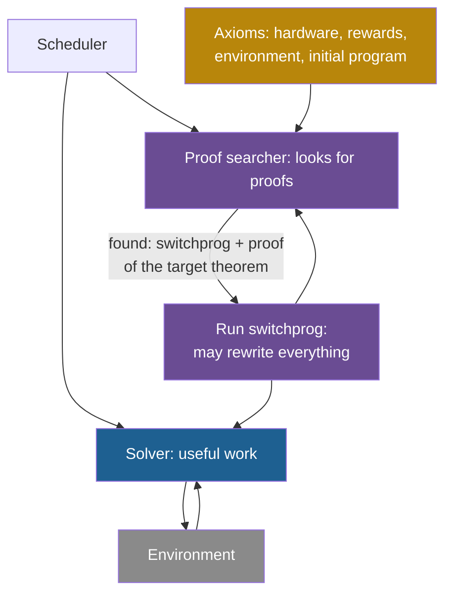

## Learning objectives

After this page you can:

- Restate Good's 1965 argument as five steps, and name the steps that carry the most weight.
- Describe the parts of a Gödel machine: the solver, the proof searcher, the axioms, the utility function and the switchprog.
- Compute a toy expected utility for "rewrite now" and "keep the current program", and decide what the target theorem allows.
- State the global-optimality theorem with its two conditions, and say what "globally optimal" does not mean.
- Explain the Löbian obstacle in plain steps.
- Explain why modern self-improving agents replace proofs with tests, and what they lose.

## Prerequisites

- [L1: What recursive self-improvement means](/notes/ai/recursive-self-improvement/02-core-idea/l1-what-rsi-means)
- [L2: The ladder: from repeating a task to improving the improver](/notes/ai/recursive-self-improvement/02-core-idea/l2-the-ladder-of-self-improvement)
- [L5: A short history: from Good (1965) to self-improving agents (2026)](/notes/ai/recursive-self-improvement/02-core-idea/l5-history-from-good-to-agents)
- [L5: Recursion, self-reference and programs that change programs](/notes/ai/recursive-self-improvement/01-foundations/l5-recursion-and-self-reference)
- [L4: The improver, meta-levels and the frozen core](/notes/ai/recursive-self-improvement/03-anatomy/l4-the-improver-and-meta-levels)

> [!note] How to use this page
> This page explains two theoretical texts well enough that you can follow the argument without them. It does not replace them. After this page, read Good's Section 2 (from page 33) and Sections 2 and 4 of Schmidhuber's arXiv paper. Section 12 of this page places the work in recursive self-improvement (RSI).

## The paper on one card

This page covers two founding texts and two follow-ups. The card shows the two founding texts.

| Field | Good (1965) | Schmidhuber: the Gödel machine (2003–2009) |
|---|---|---|
| Title | "Speculations Concerning the First Ultraintelligent Machine" | "Goedel Machines: Self-Referential Universal Problem Solvers Making Provably Optimal Self-Improvements" |
| Authors | Irving John Good | Jürgen Schmidhuber |
| Year | The volume is dated 1965. Many lists cite 1966. | arXiv v1 in 2003, v5 in 2006. Book chapter 2007. Journal version 2009. |
| Venue | *Advances in Computers*, Volume 6, pages 31–88, Academic Press | arXiv and IDSIA tech report. Chapter 7 of *Artificial General Intelligence* (Springer). *Cognitive Computation* 1:177–193. |
| arXiv or DOI | DOI often given as 10.1016/S0065-2458(08)60418-0. This DOI is not verified. | [arXiv:cs/0309048](https://arxiv.org/abs/cs/0309048). Chapter DOI 10.1007/978-3-540-68677-4_7. Journal DOI 10.1007/s12559-009-9014-y. |
| Code | None. The paper is an essay. | None. The papers report no implementation and no experiments. |
| One-sentence result | An informal argument that a machine better than humans at design starts an "intelligence explosion". | A design for a program that may rewrite any part of itself, but only after it proves that the rewrite raises its expected utility. |

The follow-ups are an implementation attempt (Steunebrink and Schmidhuber, 2012) and the paper that names the Löbian obstacle (Yudkowsky and Herreshoff, 2013).

## Terms

| Term | Plain meaning |
|---|---|
| ultraintelligent machine | Good's term: a machine that can far surpass every intellectual activity of any human. |
| intelligence explosion | Good's term: better machines design still better machines, so intelligence grows very fast. |
| formal axiom system | A fixed list of starting statements (axioms) and rules. A proof uses only these. |
| proof | A finite chain of steps. Each step follows from axioms or earlier steps by a fixed rule. |
| consistent | An axiom system is consistent if it cannot prove a statement and its opposite. |
| solver | The part of a Gödel machine that does the useful work. The papers call the first solver $e(1)$. |
| proof searcher | The part of a Gödel machine that looks for proofs about the machine itself. |
| utility function | The number that the Gödel machine tries to make large: its expected total future reward. |
| switchprog | A program that rewrites the machine's own program. It can rewrite the proof searcher too. |
| target theorem | The theorem "running this switchprog now gives higher expected utility than keeping the current program". |
| globally optimal | Schmidhuber's term: a proven rewrite beats waiting for any other rewrite that the machine could find later. |
| BIOPS | Bias-Optimal Proof Search: the first proof searcher of a Gödel machine. |
| Löb's theorem | A result in logic: if a theory proves "if I prove $\varphi$, then $\varphi$ is true", then it already proves $\varphi$. |
| soundness | A theory is sound if every statement that it proves is true. |
| Löbian obstacle | A proof-based agent cannot simply trust a successor that uses the same proof system. |
| empirical validation | Checking a change by running it on tests or a benchmark, instead of proving it. |

## 1. The problem it addresses

A carpenter builds a better workbench, and with it an even better one. Does this chain speed up, stay steady, or slow down? It depends on how much better each bench is, and how much harder each next step gets.

Now replace the carpenter with a machine that designs machines. This is Good's question. If a machine is better than any human at design, it can design a better machine than any human can. Can that machine then design a still better one?

A second problem appears as soon as a program can change itself. A change can break the program. A change to the part that finds changes can break every later change. An engineer who repairs the scaffold that she stands on needs to know that the repair holds before she makes it.

This is Schmidhuber's question. Can a program rewrite any part of itself, including the part that searches for rewrites, with a guarantee that each rewrite helps? His answer: the program rewrites itself only after it proves that the rewrite is useful.

> [!key] The two problems in one line each
> **Good:** what happens when the designer of machines is a machine that gets better? **Schmidhuber:** how can a program change everything about itself and still be sure that each change helps?

## 2. What existed before it

**Before Good.** Good's paper is based on talks from October 1962 (UCLA) and January 1963 (IEEE Winter General Meetings). Hall (2007) states that the 1956 Dartmouth proposal already listed self-improvement as a topic, but these notes did not check that proposal. Most of Good's paper (about 55 pages) is not about the explosion. It is about how to build such a machine.

**Before the Gödel machine.** Schmidhuber's 1987 diploma thesis already asked for self-improvement at every level. Its abstract says: "Of course we do not want to stop at the first meta-level!" Other universal problem solvers existed. Schmidhuber criticizes Hutter's HSEARCH and AIXI(t,l), whose provers are "hardwired, non-self-referential, unmodifiable" (Schmidhuber, arXiv v5, Section 6.4). So they "will always suffer from the same huge constant slowdowns".

**Our interpretation:** both texts address the same gap. Earlier systems could improve something, but the thing that did the improving stayed fixed.

## 3. The central idea

### 3.1 Good: a chain of five steps

Good's key passage is in Section 2, "Ultraintelligent Machines and Their Value", page 33. These are the exact quoted pieces:

1. The definition: "Let an ultraintelligent machine be defined as a machine that can far surpass all the intellectual activities" … "of any man however clever."
2. The step: "Since the design of machines is one of these intellectual activities, an ultraintelligent machine could design even better machines"
3. The conclusion: "there would then unquestionably be an 'intelligence explosion,' and the intelligence of man would be left far behind."
4. The famous sentence: "Thus the first ultraintelligent machine is the last invention that man need ever make," …
5. Its condition: "provided that the machine is docile enough to tell us how to keep it under control."

In plain words, the argument has five steps:

1. Define a machine that is better than every human at every intellectual task.
2. Designing machines is an intellectual task.
3. So this machine designs better machines than humans can.
4. Each better machine can design a still better machine.
5. Intelligence then grows very fast. Humans fall far behind.

> [!trap] The condition that popular quotes drop
> The "last invention" sentence continues: "provided that the machine is docile enough to tell us how to keep it under control." Many popular quotes stop before this condition. The full sentence is about control as much as about capability.

### 3.2 Schmidhuber: rewrite only after a proof

The Gödel machine runs one program. Part of the program does useful work. Another part searches for proofs about the whole machine. When the searcher proves that a specific rewrite raises the expected utility, the machine runs that rewrite. The rewrite "may completely rewrite p, including the proof searcher" (Schmidhuber, arXiv v5, Section 2.2).

This is the self-referential property. The part that finds improvements can itself be improved, but only under a proof.

> [!analogy] A bridge that may only be rebuilt with a signed certificate
> A city lets engineers rebuild any part of a bridge while traffic runs, even the crane that does the rebuilding. No work starts until an inspector signs a certificate that the new design carries more traffic over the bridge's remaining life. The certificate is the proof, and the inspector's rulebook is the axiom system.
>
> - **Where it stops working:** a real inspector can use judgment, but a proof searcher approves only what it can derive from its axioms. If the rulebook is wrong about the river, a signed certificate is worthless. A true improvement with no derivation in the rulebook never gets built.

## 4. The architecture

### 4.1 The program and its two parts

The machine runs one program, $p$. At the start, $p(1)$ has two parts (arXiv v5, Section 2.2):

1. **A solver**, $e(1)$. It does the machine's useful work. It may be far from optimal.
2. **A proof searcher.** It looks for proofs about the machine itself.

### 4.2 The axioms

The proof searcher works inside a formal axiom system $A$. The axioms must describe five things (Sections 2.3 and 3.2):

1. **Hardware axioms:** how the hardware state changes at each cycle.
2. **Reward and utility axioms:** the costs of computation and output, the rewards, and the total value of the machine's life.
3. **Environment axioms:** limits on how the environment responds, for example sampling from a set $M$ of possible distributions.
4. **Uncertainty and string axioms:** arithmetic, probability, statistics and string operations.
5. **The initial state:** the initial program $p(1)$ itself is part of the axioms.

The fifth item makes self-reference possible. The machine can prove statements about its own code, because its own code is in its axioms.

### 4.3 The utility function

The machine needs one number to compare "rewrite now" against "do not rewrite". That number is its utility.

The idea in words: the value of the present state is the total reward that the machine expects until the end of its life. "Expects" means an average over every way that the uncertain environment can behave.

In the notation of these notes (the paper's Equation (1), Section 2.1, has the same meaning):

$$
u(s, \mathrm{Env}) = \mathbb{E}_{M}\left[\, \sum_{\tau = t}^{T} r(\tau) \;\middle|\; s, \mathrm{Env} \right]
$$

The symbols mean:

- $u(s, \mathrm{Env})$ is the utility of state $s$ in environment $\mathrm{Env}$.
- $s$ is the full state of the machine, including its current program.
- $t$ is the current cycle, and $T$ is the last cycle of the machine's life.
- $r(\tau)$ is the reward at cycle $\tau$. Computation costs count against it, including the cost of proof search (Section 2.3).
- $M$ is the set of possible environment distributions that the axioms allow.
- $\mathbb{E}_{M}[\cdot \mid s, \mathrm{Env}]$ is the expected value over those distributions.

In plain English: add up all rewards from now to the end, and average over the possible environments.

> [!example] Worked example: is this rewrite allowed?
> A machine is at cycle 101 of a 1,000-cycle life, so 900 cycles remain. The axioms allow two environments, $\mu_1$ and $\mu_2$, each with probability 0.5.
>
> 1. **Keep the program.** Suppose the machine proves that continuing, with any rewrite it might find later, earns at most 1.0 per cycle. Utility: $900 \times 1.0 = 900$.
> 2. **Run the switchprog now.** The rewrite takes 100 cycles with reward 0. Then 800 cycles remain.
> 3. Under $\mu_1$, the new program earns 1.5 per cycle: $800 \times 1.5 = 1{,}200$.
> 4. Under $\mu_2$, it earns 0.9 per cycle: $800 \times 0.9 = 720$.
> 5. Expected utility: $0.5 \times 1{,}200 + 0.5 \times 720 = 960$.
> 6. Because $960 > 900$, the target theorem holds. If the machine can prove these numbers, it runs the switchprog.
> 7. Note step 4: under $\mu_2$ the rewrite is worse. The guarantee is about the average over $M$, not about every environment.

**Assumptions.** The equation assumes four things:

1. The hardware and environment axioms are correct.
2. $M$ describes the real environment.
3. Rewards are defined for every cycle.
4. The life ends at a known cycle $T$.

**When it is useful.** It turns "is this change good?" into one comparison of two numbers.

**What it does not prove.** It does not show that a proof of the comparison exists, or that the searcher finds it in time. It says nothing about reality if the axioms are wrong.

### 4.4 The same design as three routines

In a 2013 interview about the 2012 implementation project, Steunebrink describes a Gödel machine as three routines (Muehlhauser, 2013):

1. A **Solver** that does useful work.
2. A **Searcher** that looks for beneficial self-changes.
3. A **Scheduler** that runs both.



The axioms are gold in this diagram because they act as the evaluator. A rewrite runs only if a proof from them exists.

## 5. The algorithm, step by step

The papers give no pseudocode in the modern sense. This is the decision rule as these notes reconstruct it from Sections 2.2 and 4.2:

```text
program p = [solver e(1), proof searcher]
loop at every cycle:
    solver acts in the environment and collects reward
    proof searcher continues its search for a pair (switchprog, proof)
    if a proof of the target theorem for some switchprog is found:
        run switchprog                 # may rewrite the solver,
                                       # the proof searcher, anything in p
    # otherwise: keep p and keep searching
```

In words:

1. The solver works and earns reward.
2. At the same time, the proof searcher tests candidate pairs: a switchprog and a proof.
3. A pair is accepted only if its proof proves the target theorem. In paraphrase: running this switchprog now beats leaving $p$ as it is, including the option to continue the search (Section 2.2).
4. If a pair is accepted, the switchprog runs. It can change any code, including the proof searcher.
5. If no pair is accepted, nothing changes, and the search continues.

**A relaxed version.** Section 4.2 replaces "higher" ($>$) with "at least as high" ($\geq$). The machine may then also rewrite itself when it proves that the change does not make things worse.

**Theory: the cost of finding proofs.** The first proof searcher is BIOPS, Bias-Optimal Proof Search (Sections 2.3 and 5). Theorem 5.1 has two parts:

- The condition: "If independently of variable time(s) some unknown fast proof technique w would require at most f(k) steps" …
- The conclusion: "to produce a proof of difficulty measure k" … "then Method 5.1 will need at most O(f(k)) steps."

The symbols mean:

- $w$ is some proof technique, unknown in advance, that is fast for this kind of proof.
- $k$ is a measure of how hard the proof is.
- $f(k)$ is the number of steps that $w$ needs.
- $O(f(k))$ means "at most a constant times $f(k)$".

The hidden constant is $1/P(w)$, where $P(w)$ is the prior probability that BIOPS gives to technique $w$. The constant does not depend on $k$, but it can be very large. The paper says: "The initial proof search itself is merely O()-optimal."

> [!example] Worked example: how large is the hidden constant?
> This illustration is ours. The paper gives no numbers.
>
> 1. Suppose the good technique has prior probability $P(w) = 2^{-40}$, about $9.1 \times 10^{-13}$.
> 2. The constant is $1/P(w) = 2^{40}$, about $1.1 \times 10^{12}$.
> 3. Suppose $w$ needs $f(k) = 10^{6}$ steps for the needed proof.
> 4. The bound allows about $1.1 \times 10^{12} \times 10^{6} = 1.1 \times 10^{18}$ steps.
> 5. At $10^{9}$ steps per second, that is $1.1 \times 10^{9}$ seconds, about 35 years.
> 6. So "optimal up to a constant" can still mean "far too slow". A rewritable proof searcher can, in principle, lower the constant.

## 6. The role of evaluation

### 6.1 The proof is the evaluator

Every self-improving system needs a way to decide whether a change is good. In the Gödel machine, that decision is a proof. The axiom system, with its utility axioms, is the evaluator. Nothing else may approve a rewrite.

This puts the axioms in the frozen core. A switchprog can rewrite the program, but the utility that the axioms define scores each rewrite. **Our interpretation:** the axioms play the role that a benchmark and a scoring rule play in modern systems. A proof covers all cases that the axioms describe. A benchmark covers only the tasks that it contains.

### 6.2 The global-optimality theorem

Theorem 4.1 (Section 4.1), in its exact pieces:

1. "Given any formalizable utility function u (Item 1f), and assuming consistency of the underlying formal system A,"
2. "any self-change of p obtained through execution of some program switchprog"
3. "identified through the proof of a target theorem (2) is globally optimal in the following sense:"
4. "the utility of starting the execution of the present switchprog is higher than"
5. "the utility of waiting for the proof searcher to produce an alternative switchprog later."

Why does the abstract say "no local maxima"? The target theorem compares "rewrite now" against "keep $p$", and "keep $p$" includes searching for other switchprogs. So a proven rewrite already beats every alternative that the machine could find later. A local optimum is a point where small changes do not help but a far change would. Waiting for any far change is part of the comparison, so this case cannot occur.

**Theory: the two stated conditions.**

1. The utility function is formalizable.
2. The axiom system $A$ is consistent.

**Conditions that follow from the setup (an explanatory inference, not a quote).** The guarantee is about the axiomatized model. If the hardware or environment axioms are wrong, the proof says nothing about reality. "Globally optimal" means optimal relative to what the machine can prove, not optimal among all possible programs.

### 6.3 Can a prover trust its successor? The Löbian obstacle

Suppose a rewrite builds a successor that will also act on its own proofs. Can the parent trust those proofs? Yudkowsky and Herreshoff (2013) study this for "tiling" agents, "agents whose decision systems will approve the construction of highly similar agents".

First the logic result. Let $T$ be a formal theory at least as strong as Peano Arithmetic, and let $\varphi$ be any statement. Let $\mathrm{Prov}_T(\varphi)$ be the statement "$T$ proves $\varphi$". Löb's theorem says:

$$
\text{if } T \vdash \big(\mathrm{Prov}_T(\varphi) \rightarrow \varphi\big), \text{ then } T \vdash \varphi
$$

Here $T \vdash X$ means "$T$ proves $X$", and $\rightarrow$ means "if ... then". In words: if a theory can prove "if I can prove $\varphi$, then $\varphi$ is true", then it can already prove $\varphi$.

A concrete instance replaces a numerical example here. Let $\varphi$ be "the successor's next action is safe". If $T$ proved "whatever $T$ proves about safety is true" for every such statement, then $T$ would prove every safety statement directly, even false ones. So a consistent $T$ cannot prove its own general soundness.

The obstacle in plain steps (Yudkowsky and Herreshoff, 2013, Section 2):

1. A parent agent A1 wants to build a successor A0 and let A0 act.
2. A1 decides by proof. So A1 wants to prove: "whatever A0 proves is safe really is safe."
3. If A0 uses the same proof system $T$ as A1, then A1 needs $T$ to prove "anything $T$ proves is true". This is $T$'s own soundness.
4. Löb's theorem says that $T$ cannot prove its own soundness in this general form, unless $T$ is inconsistent.
5. So A1 can only trust successors with strictly weaker systems: "the offspring A0 must possess strictly weaker mathematical power than its parent A1".
6. Each generation loses strength. The paper calls this a "telomere": only finitely many self-modifications are possible.

The paper gives partial solutions (Section 4). One is an infinitely descending sequence of theories. Another, "parametric polymorphism", uses a number $\kappa$ that means "safe for $\kappa$ steps", and each successor's trust uses $\kappa - 1$. The abstract says that "the underlying puzzles of rational coherence are thus only partially addressed."

> [!key] What the Löbian obstacle does and does not say
> **Theory:** it applies to agents that act only on formal proofs in a fixed theory. It does not apply directly to today's language-model agents, which check changes by tests. Its question remains: how can a system justify its trust in a successor that is stronger than itself?

## 7. What would test it

Both texts are theory and report no experiments. So this section asks what an experiment would need. **Our interpretation** throughout.

**To test Good's argument**, build a chain of generations in which each generation designs the next with no human help. Then measure three things:

1. Is each successor better, as judged by an evaluator that the chain cannot change?
2. Does the gain per generation grow, stay constant, or shrink? An "explosion" needs it to stay large or grow.
3. Does better design ability come with better ability at the tasks that people care about?

**To test the Gödel machine**, build one. Then measure whether the proof searcher finds any useful rewrite in practical time, and what the search costs. Also check whether the axioms describe the real hardware and environment well enough for a proof to mean something.

## 8. Evidence since

**The implementation attempt (2012–2013).** Steunebrink and Schmidhuber (2012) wrote "Towards an Actual Gödel Machine Implementation". The facts here come from a 2013 interview about the project (Muehlhauser, 2013). The project built Sleight, a self-reflective programming system in which running code can inspect and change its own registers and call stack.

The interview names the hard problem. Proofs must be about "code that is actively running, and which contains the ATP itself, and which is subject to resource constraints". (ATP means automated theorem prover.) Normal automated reasoning assumes static data, and "if the data includes the dynamic internal state of the reasoner, this assumption breaks down." In 2013, a full Gödel machine was not built. **Measured:** only the self-reflection tools were shown.

**A sharper version of Good's argument (2010).** Chalmers (2010) turns Good's chain into explicit premises and uses induction over generations. He names the assumption behind step 4 the "proportionality thesis". It holds that increases in intelligence "always lead to proportionate increases in the capacity to design intelligent systems."

He also lists obstacles, among them diminishing returns and a "correlation obstacle". The self-amplifying capacity may "not correlate with any or many capacities that are of interest to us". **Theory:** the logical form is valid. **Speculation:** the premises are untested.

**The switch from proofs to tests (2025).** The Darwin Gödel Machine (DGM) "relaxes the Gödel Machine's impractical requirement of theoretically proving". It asks for something else. It requires "empirical evidence from experiments" instead (Zhang et al., 2025, [arXiv:2505.22954](https://arxiv.org/abs/2505.22954), Section 3). **Measured:** its coding agent rose from 20.0% to 50.0% on its SWE-bench evaluation set.

The price of this switch also showed. In a case study, the DGM removed markers that a hallucination detector needed, although it was told not to change them (Sakana AI blog, 2025). The detector then reported false successes. A proof cannot be fooled this way inside its axioms, but a test can.

**A link back to the Gödel machine (2025).** The Huxley-Gödel Machine proves a theorem about its measure, clade metaproductivity (CMP). **Theory:** under its Assumption 1, a true CMP oracle suffices to imitate the Gödel machine (Wang et al., 2025, [arXiv:2510.21614](https://arxiv.org/abs/2510.21614), Theorem 1). One part of Assumption 1 is that Gödel-machine proofs cost no budget. That part removes exactly the cost that makes real proof search slow.

**Status in 2026.** Anthropic defines RSI as "an AI system capable of fully autonomously designing and developing its own successor" (Favaro and Clark, 2026). Its scale runs from AL0 to AL5, where AL5 means no human in the loop. **Measured (self-reported):** in August 2026, AL5 was 0% of Anthropic's measured AI research work (Favaro and Wright, 2026, checked on 2026-10-19).

## 9. What the arguments show

1. **Good states a possibility clearly.** If design is an intellectual activity, a machine that surpasses humans at all such activities can design machines. The key loop is visible: the output of design becomes the next designer.
2. **Full self-reference is consistent with a guarantee.** **Theory:** a program may rewrite everything, including its own improver. Every rewrite it makes beats waiting, relative to its axioms (Theorem 4.1).
3. **Proof-based trust has a limit.** **Theory:** an agent that acts only on proofs cannot simply approve a successor with the same theory.

## 10. What the arguments do not show

1. **Good does not show that an explosion happens.** The argument is informal speculation. The word "unquestionably" is a strong claim with no model behind it.
2. **Good does not model speed.** Step 5 needs each improvement to come quickly and not to get harder. The paper gives no rate, and Chalmers lists diminishing returns as an obstacle.
3. **The Gödel machine does not show that useful proofs can be found.** Theorem 4.1 says that a proven rewrite is good. It does not say that any rewrite will be proven in practical time.
4. **"Globally optimal" is not "best possible".** It is relative to what the machine can prove. True improvements without a proof are ignored.
5. **Neither text reports a running system.** The 2012 project did not finish a full Gödel machine.
6. **The Löbian obstacle does not forbid self-improvement.** It applies to agents that act only on proofs in one fixed theory. It has partial workarounds.

## 11. Limitations

**Limits stated by Schmidhuber (Theory):**

1. Gödel incompleteness: any formal system that includes arithmetic "is either flawed or allows for unprovable but true statements" (Section 2.4). So the machine "must ignore those self-improvements whose effectiveness it cannot prove".
2. Resources: a resource-limited machine "cannot profit from self-improvements whose usefulness it cannot prove within its time and space constraints" (Section 2.4).
3. The 2009 version: "even ultimate cognition has limits of the Gödelian kind."
4. The conclusion (Section 7) turns the limit into a claim about humans. It says: "If there is no provably good, globally optimal way of rewriting p(1) at all, then humans will not find one either."

**Our interpretation:** the fourth item holds only for proof-based design. Humans often accept changes on evidence without proof.

**Limits of Good's text:**

1. No rate model and no account of rising difficulty.
2. No account of whether design ability tracks other abilities.
3. The control condition ("docile enough") is part of the famous sentence, but the paper gives no method for it.
4. A claim that Good predicted the machine "within the twentieth century" could not be found in the checked text. Do not repeat it.

## 12. Its relationship to RSI

Use the ladder of [Part 2 L2](/notes/ai/recursive-self-improvement/02-core-idea/l2-the-ladder-of-self-improvement). That ladder is our interpretation built from the literature.

| Question | Good (1965) | Gödel machine (2003–2009) |
|---|---|---|
| Ladder level | Level 6: a system that builds its successor with no humans | Designed for Level 5: it may rewrite its own improver (the proof searcher) |
| What is improved | The whole machine. Each successor is a new machine. | Any part of the program $p$, including the solver and the proof searcher |
| What stays fixed | Not stated | The axioms, including the utility function and the hardware and environment descriptions |
| Does the improver improve? | Implicitly yes: each better machine is a better designer | Allowed, but only when a proof shows that it helps |
| Evidence | **Speculation** | **Theory**, no implementation |

Both texts put the improver inside the system. Both belong to RSI in the strong sense of this course.

Modern systems keep the shape of the Gödel machine and change the evaluator. The DGM replaces proofs with benchmark tests. **Our interpretation:** this trade makes systems that run, at the cost of a weaker check. Part 8 shows what a weaker check allows, in [L2: Reward hacking and specification gaming](/notes/ai/recursive-self-improvement/08-failure-modes-and-safety/l2-reward-hacking-and-specification-gaming) and [L6: The special risks of changing the improver](/notes/ai/recursive-self-improvement/08-failure-modes-and-safety/l6-changing-the-improver-safely).

## 13. Common mistakes

1. **"Good proved that an intelligence explosion must happen."** Good gave a short informal chain with no model of speed. It is speculation, not proof.
2. **"The 'last invention' quote is unconditional."** The sentence continues: "provided that the machine is docile enough to tell us how to keep it under control."
3. **"Globally optimal means the best possible program."** It means better than waiting for any other rewrite that the machine could prove, relative to its axioms.
4. **"A Gödel machine cannot change its own proof searcher."** It can. A switchprog "may completely rewrite p, including the proof searcher".
5. **"Gödel machines have been built and tested."** The 2003–2009 papers report no implementation, and the 2012 project did not finish one.
6. **"The Löbian obstacle forbids self-improvement."** It applies to agents that trust only proofs in one fixed theory. It has partial workarounds.
7. **"Replacing proofs with tests is a small change."** It removes the guarantee. A test-based evaluator covers only its tasks and can be gamed, as the DGM marker case shows.

## 14. One-minute explanation

In 1965, Irving John Good argued that a machine better than humans at design would design ever better machines, so intelligence would "explode". The argument is informal, says nothing about speed, and its famous sentence ends with a condition about control. In 2003, Jürgen Schmidhuber designed the Gödel machine, which may rewrite any part of its program, including its own proof searcher. It rewrites only after it proves from its axioms that the rewrite raises expected future reward. Nobody has built a full one, proof search can be very slow, and unprovable improvements are ignored. Modern systems such as the Darwin Gödel Machine replace proofs with tests: they run, but their checks are weaker and can be gamed.

## 15. Check questions

```check
{
  "question": "The target theorem compares \"run this switchprog now\" with \"keep the current program\". Why does this comparison give the abstract's claim \"no local maxima\"?",
  "hint": "What does \"keep the current program\" include?",
  "answer": "Keeping the current program includes the option to keep searching and to run any other switchprog later. So a proven rewrite beats every later alternative that the machine could find. A local maximum is a point where a far change would help but nearby changes do not. Waiting for that far change is already inside the comparison. The claim is relative to the axioms and to what the machine can prove."
}
```

```check
{
  "question": "A Gödel machine has 600 cycles left. Two environments have probability 0.5 each. Keeping the program provably earns at most 1.0 per cycle. A switchprog needs 50 cycles with reward 0, then earns 1.4 per cycle in environment A and 0.8 per cycle in environment B. (a) Does the strict rule (>) allow the switch? (b) What if environment B gives 0.6 per cycle?",
  "hint": "Compute the expected utility of each option over the remaining cycles.",
  "answer": "Keep: $600 \\times 1.0 = 600$. After the rewrite, 550 cycles remain.\n\n(a) A: $550 \\times 1.4 = 770$. B: $550 \\times 0.8 = 440$. Expected: $0.5 \\times 770 + 0.5 \\times 440 = 605$. Because $605 > 600$, the switch is allowed, if the machine can prove these numbers.\n\n(b) B: $550 \\times 0.6 = 330$. Expected: $0.5 \\times 770 + 0.5 \\times 330 = 550$. Because $550 < 600$, the target theorem is false, so no proof exists. The relaxed rule ($\\geq$) does not allow it either."
}
```

```check
{
  "question": "Which of Good's five steps carry the most weight, and what kind of evidence would show that they fail?",
  "hint": "Look for the steps that assume something about every later generation.",
  "answer": "Steps 4 and 5. Step 4 assumes that design ability keeps rising with intelligence, which Chalmers calls the proportionality thesis. Step 5 assumes that the gains do not shrink. One kind of evidence against them is a chain of generations whose gain per generation shrinks toward zero, as judged by an independent evaluator. Another is a chain in which better design ability does not come with better ability at other tasks (the correlation obstacle)."
}
```

```check
{
  "question": "Map the Darwin Gödel Machine (DGM) onto the Gödel machine. Name the DGM part that plays the role of (1) the solver, (2) the switchprog, (3) the proof of the target theorem, (4) the axioms. Then name the guarantee that the DGM gives up.",
  "hint": "In the DGM, a coding agent edits its own code, and a benchmark decides what is kept.",
  "answer": "(1) The coding agent that solves benchmark tasks. (2) The code change that the agent makes to its own repository. (3) The benchmark evaluation of the changed agent: empirical evidence instead of a proof. (4) The fixed benchmark, its scoring code and the outer loop.\n\nThe DGM gives up the guarantee that an accepted change is better in every case that the axioms cover. A benchmark covers only its tasks. So a change can raise the score without real improvement, as in the case where the DGM removed the markers of a hallucination detector."
}
```

```check
{
  "question": "A parent agent decides by proofs in theory T. It builds a child that also decides by proofs in T. Which statement must the parent prove before it lets the child act, and why can it not prove it?",
  "hint": "What must the parent believe about the child's proofs?",
  "answer": "The parent needs: \"for every statement, if T proves it, then it is true\", at least for the child's safety statements. That is the soundness of T. By Löb's theorem, if T proved \"if T proves φ, then φ\", T would already prove φ. Applied to all statements, a consistent T cannot prove its own soundness. So the parent can only trust a child with a strictly weaker theory, and each generation loses strength. This applies to proof-based agents, not to agents that check changes by tests."
}
```

```check
{
  "question": "BIOPS needs at most about $f(k)/P(w)$ steps. A useful proof technique has $P(w) = 10^{-9}$ and needs $f(k) = 10^{5}$ steps. The hardware runs $10^{9}$ steps per second. How long can the search take under this bound? Why does this support a rewritable proof searcher?",
  "hint": "Multiply by the constant, then divide by the speed.",
  "answer": "$10^{5} / 10^{-9} = 10^{14}$ steps. At $10^{9}$ steps per second this is $10^{5}$ seconds, about 28 hours. The bound is optimal only up to the constant $1/P(w)$, and that constant can dominate. A rewritable proof searcher can, in principle, replace BIOPS with a faster technique after it proves that the change helps. This is our arithmetic and interpretation, not numbers from the paper."
}
```

## 16. Summary and links

- Good (1965) argued that a machine better than humans at design would start an "intelligence explosion". The argument is informal, has no rate model, and has a control condition that popular quotes drop.
- The Gödel machine (2003–2009) runs a rewrite only after it proves that the rewrite raises expected utility. The rewrite may change the proof searcher itself.
- Theorem 4.1 makes proven rewrites "globally optimal" relative to the axioms, if the utility is formalizable and the axiom system is consistent.
- Proof search can be very slow, true but unprovable improvements are ignored, and no full Gödel machine has been built.
- The Löbian obstacle: a proof-based agent cannot simply trust a successor with the same proof system.
- Modern systems keep the self-rewriting shape and replace proofs with tests. They run, but their evaluator is weaker and can be gamed.

**Next:** the next page moves from theory to the first practical feedback loops of 2023.

**Links:**

- Previous: [L10: The approaches compared](/notes/ai/recursive-self-improvement/05-approaches/l10-approaches-compared)
- Next: [2023: Self-Refine and Reflexion](/notes/ai/recursive-self-improvement/06-research-systems/p02-self-refine-and-reflexion)
- Related: [2025: The Darwin Gödel Machine](/notes/ai/recursive-self-improvement/06-research-systems/p10-darwin-godel-machine), [2025: The Huxley-Gödel Machine](/notes/ai/recursive-self-improvement/06-research-systems/p11-huxley-godel-machine)

**Videos:**

- [AI Self Improvement - Computerphile](https://www.youtube.com/watch?v=5qfIgCiYlfY) (Robert Miles, 2015). The core of Good's argument in plain words. It supports sections 1 and 3.1.
- [Juergen Schmidhuber: Godel Machines, Meta-Learning, and LSTMs, Lex Fridman Podcast #11](https://www.youtube.com/watch?v=3FIo6evmweo) (2018). The inventor on meta-learning and programs that rewrite themselves. It supports sections 2 and 3.2.

## References

- Irving John Good. "Speculations Concerning the First Ultraintelligent Machine". In Franz L. Alt and Morris Rubinoff (eds.), Advances in Computers, Volume 6, Academic Press, pages 31–88. 1965 (often cited as 1966). Reprint: https://www.Gwern.net/doc/ai/1966-good.pdf
- Jürgen Schmidhuber. "Goedel Machines: Self-Referential Universal Problem Solvers Making Provably Optimal Self-Improvements". 2003 (v5 2006). arXiv:cs/0309048. https://arxiv.org/abs/cs/0309048
- Jürgen Schmidhuber. "Gödel Machines: Fully Self-referential Optimal Universal Self-improvers". In B. Goertzel and C. Pennachin (eds.), Artificial General Intelligence, Springer, Chapter 7, pages 199–226. 2007. DOI 10.1007/978-3-540-68677-4_7.
- Jürgen Schmidhuber. "Ultimate Cognition à la Gödel". Cognitive Computation 1:177–193. 2009. DOI 10.1007/s12559-009-9014-y. https://doc.rero.ch/record/321080/files/12559_2009_Article_9014.pdf
- Jürgen Schmidhuber. "Evolutionary Principles in Self-Referential Learning. On Learning how to Learn: The Meta-Meta-Meta...-Hook". Diploma thesis, Technische Universität München. 1987. https://people.idsia.ch/~juergen/diploma.html
- Bas R. Steunebrink, Jürgen Schmidhuber. "Towards an Actual Gödel Machine Implementation: a Lesson in Self-Reflective Systems". In Theoretical Foundations of Artificial General Intelligence, pages 173–195. 2012. https://aris.supsi.ch/entities/publication/9a3f6743-4551-49ea-aef7-cd42f04c7522
- Luke Muehlhauser (interviewer). "Bas Steunebrink on Self-Reflective Programming". Machine Intelligence Research Institute. 2013. https://intelligence.org/2013/10/25/bas-steunebrink-on-sleight/
- Eliezer Yudkowsky, Marcello Herreshoff. "Tiling Agents for Self-Modifying AI, and the Löbian Obstacle". Early draft, Machine Intelligence Research Institute. 2013. https://intelligence.org/files/TilingAgentsDraft.pdf
- David J. Chalmers. "The Singularity: A Philosophical Analysis". Journal of Consciousness Studies 17:7–65. 2010. https://consc.net/papers/singularity.pdf
- Jenny Zhang, Shengran Hu, Cong Lu, Robert Lange, Jeff Clune. "Darwin Gödel Machine: Open-Ended Evolution of Self-Improving Agents". 2025. arXiv:2505.22954. https://arxiv.org/abs/2505.22954
- Sakana AI. "The Darwin Gödel Machine: AI that improves itself by rewriting its own code". Blog. 2025. https://sakana.ai/dgm/
- Wenyi Wang, Piotr Piękos, Li Nanbo, et al. "Huxley-Gödel Machine: Human-Level Coding Agent Development by an Approximation of the Optimal Self-Improving Machine". ICLR 2026. 2025. arXiv:2510.21614. https://arxiv.org/abs/2510.21614
- Marina Favaro, Jack Clark. "When AI builds itself". The Anthropic Institute. 2026. https://www.anthropic.com/institute/recursive-self-improvement
- Marina Favaro, Phillie Wright. "Measurements for understanding the pace of AI development inside frontier labs". The Anthropic Institute. 2026. https://www.anthropic.com/institute/measuring-pace-of-ai-development
