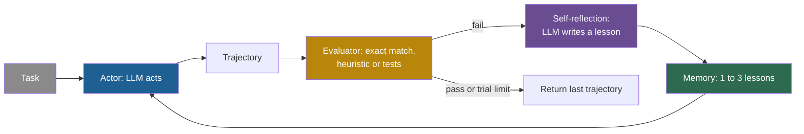

## Learning objectives

After this page you can:

- Trace one Self-Refine loop and one Reflexion loop with concrete data.
- Name the source of feedback in each experiment, and classify it as intrinsic, external or oracle.
- Read the main result tables and say what each number measures: a preference share, an accuracy or a pass rate.
- Explain three critiques: oracle feedback on HotPotQA, a weak first prompt, and unequal compute.
- Place both methods on the ladder of self-improvement.

## Prerequisites

- [L1: Self-critique and iterative refinement](/notes/ai/recursive-self-improvement/05-approaches/l1-self-critique-and-refinement)
- [L2: Agents: actions, state, memory, tools and environment](/notes/ai/recursive-self-improvement/01-foundations/l2-agents-actions-state-tools-environment)
- [L7: What "improvement" means, and how to measure it](/notes/ai/recursive-self-improvement/01-foundations/l7-measuring-improvement)

> [!note] How to use this page
> This page explains both papers well enough that you can follow their methods and results without the PDFs. It does not replace them. Read Algorithm 1 and Table 1 of each paper after this page. Section 12 of this page places the work in recursive self-improvement (RSI).

## The paper on one card

| Field | Self-Refine | Reflexion |
|---|---|---|
| Title | "Self-Refine: Iterative Refinement with Self-Feedback" | "Reflexion: Language Agents with Verbal Reinforcement Learning" |
| Authors | Aman Madaan, Niket Tandon, Prakhar Gupta, et al. (16 authors) | Noah Shinn, Federico Cassano, Edward Berman, Ashwin Gopinath, Karthik Narasimhan, Shunyu Yao |
| Year | 2023 | 2023 |
| Venue | NeurIPS 2023 | NeurIPS 2023. The proceedings page lists five authors, without Edward Berman. |
| arXiv | [arXiv:2303.17651](https://arxiv.org/abs/2303.17651) (v2 used here) | [arXiv:2303.11366](https://arxiv.org/abs/2303.11366) (v4 used here) |
| Code | [madaan/self-refine](https://github.com/madaan/self-refine), via [selfrefine.info](https://selfrefine.info/) | [noahshinn024/reflexion](https://github.com/noahshinn024/reflexion) |
| One-sentence result | One model drafts, critiques and rewrites its own output, with large gains on open-ended tasks and almost none on math. | An agent writes a short lesson after each failed attempt and reads it on the next attempt, and reaches 91.0% pass@1 on HumanEval. |

## Terms

| Term | Plain meaning |
|---|---|
| large language model (LLM) | A very large model that predicts the next token of text. |
| feedback | Information about an output that is used to change the next output. |
| intrinsic feedback | Feedback that the same model writes about its own output, with no outside information. |
| external feedback | Feedback from outside the model: a test run, a tool, the environment or a person. |
| oracle feedback | Feedback that uses the correct answer. A deployed system does not have it. |
| few-shot prompt | A prompt that contains a few worked examples of the wanted behavior. |
| refine | Rewrite an output with the help of feedback. |
| trial | One full attempt at a task. Reflexion runs several trials of the same task. |
| actor | The Reflexion role that produces text and actions. |
| self-reflection | A short text that the agent writes about why an attempt failed and what to do next. |
| episodic memory | Stored self-reflections that the agent reads in its next trial. |
| verbal reinforcement | Reflexion's name for learning from feedback written in words, with no weight change. |
| pass@1 | The share of problems that the first submitted solution solves. |
| preference share | The share of comparisons in which an evaluator prefers one output. It is not an accuracy. |
| false positive (of a test set) | Wrong code that passes its own tests. |
| cost-matched baseline | A simpler method that gets the same number of model calls as the method under test. |

## 1. The problem it addresses

A writer finishes a first draft. She reads it again, notes what is weak, and rewrites. The second draft is usually better. No teacher was involved: the writer was her own critic.

A student fails a practice quiz. Before the retake, he writes one sentence on a card: "I mixed up the units in question 3." He reads the card before the retake and avoids the same error.

Self-Refine asks whether an LLM can act like the writer. LLMs "do not always generate the best output on their first try" (Madaan et al., 2023, abstract). Can the same model improve its own output at test time, with no training and no extra data?

Reflexion asks whether an LLM agent can act like the student. Agents act in environments and often fail. Learning from failure with reinforcement learning needs many samples and changes to the weights. This is expensive, and it is impossible for a model that is reachable only through an interface. Reflexion asks whether a written lesson can replace the weight change.

## 2. What existed before it

**Before Self-Refine**. Earlier refinement methods needed a separately trained refiner, a reward model, or human feedback. Self-Refine positions itself against methods that need "supervised training data, additional training, or reinforcement learning" (abstract). The simple alternative was one-pass generation with the same model.

**Before Reflexion**. Language agents such as ReAct and chain-of-thought agents did not learn between attempts. Each attempt started from zero. Classic reinforcement learning learned from scalar rewards, but it did so by updating weights.

## 3. The central idea

**Self-Refine:** one LLM plays three roles. The abstract says it "uses a single LLM as the generator, refiner, and feedback provider." The loop is: generate, critique the output, rewrite with the critique, repeat.

**Reflexion:** "verbal reinforcement". The agent learns "not by updating weights, but instead through linguistic feedback" (Shinn et al., 2023, abstract). After a failed attempt, it writes a short reflection on what went wrong. It stores the reflection and reads it on the next attempt at the same task.

> [!analogy] A red pen and a sticky note
> Self-Refine is a writer with a red pen: the same person writes, marks and rewrites one page. Reflexion is a student with a sticky note: after a failed quiz, he writes one lesson and reads it before the retake.
>
> - **Where it stops working:** a writer who cannot see her own error marks the wrong sentence. A student who never saw his score does not know that he failed. Both methods depend on the signal that says "this is wrong", and the evaluation section below shows that this signal decides most results.

## 4. The architecture

### 4.1 Self-Refine

Self-Refine has one model $M$ and three few-shot prompts (Section 2):

1. $p_{\text{gen}}$ asks for a first output.
2. $p_{\text{fb}}$ asks for feedback. Its examples are "input-output-feedback triples". It asks for feedback that is "actionable and specific".
3. $p_{\text{refine}}$ asks for a new output. It receives every earlier output and every earlier feedback.

### 4.2 Reflexion

Reflexion has three roles and two kinds of memory:

1. The **actor** $M_a$: an LLM that produces text and actions. The paper tests it with chain-of-thought and ReAct prompting.
2. The **evaluator** $M_e$: it scores a trajectory. The variants are exact match, hand-written heuristics, or an LLM judge.
3. The **self-reflection model** $M_{sr}$: an LLM that turns the score, the trajectory and the memory into written feedback.
4. **Short-term memory:** the current trajectory.
5. **Long-term memory:** the stored reflections, capped at $\Omega$ items, "usually set to 1-3". The cap is 3 for ALFWorld and HotPotQA, and 1 for programming.



Self-Refine has the same shape without the memory box and without an evaluator outside the model. The model gives its own feedback, and nothing is stored after the task.

## 5. The algorithm, step by step

### 5.1 Self-Refine (Algorithm 1, as printed)

```text
1: y0 = M(p_gen ∥ x)
2: for iteration t ∈ 0, 1, ... do
3:   fb_t = M(p_fb ∥ x ∥ y_t)
4:   if stop(fb_t, t) then
5:     break
6:   else
7:     y_{t+1} = M(p_refine ∥ x ∥ y0 ∥ fb0 ∥ ... ∥ y_t ∥ fb_t)
8:   end if
9: end for
10: return y_t
```

The symbol $\Vert$ means "join these texts into one prompt". Line by line:

1. Line 1: the model reads the generation prompt and the input $x$. It writes a first output $y_0$.
2. Line 3: the model reads the feedback prompt, the input and the current output. It writes feedback $fb_t$.
3. Line 4: a stop rule looks at the feedback. It stops at a fixed iteration, or when the feedback contains a stop signal, for example a score.
4. Line 7: if the loop does not stop, the model reads every earlier output and every earlier feedback. It writes a new output $y_{t+1}$.
5. Line 10: the last output is the answer.

The paper runs "up to a maximum of 4 iterations" (Section 3.1). Each refinement costs two calls, one for feedback and one for the rewrite, on top of the first call.

> [!example] Worked example: one Self-Refine run (our illustration)
> The task is constrained generation: write one sentence that uses the words "dog, frisbee, park, catch, owner".
>
> 1. $y_0$: "A dog runs across the park with a frisbee." (1 call)
> 2. $fb_0$: "The sentence lacks 'owner' and 'catch'. Add who throws the frisbee." (2 calls)
> 3. $y_1$: "In the park, the owner throws a frisbee and the dog jumps to catch it." (3 calls)
> 4. $fb_1$: "All five words are present. No change needed." The stop rule fires. (4 calls)
>
> The task suits self-feedback: checking a word list is easy. The results section shows that the same loop gives almost nothing on math word problems.

**From the code**. The released GSM8K loop is `iterative_gsm()` in `src/gsm/run.py`, at commit `9a206d4`. It stops when the feedback contains the phrase "it is correct", or after 4 attempts. In the acronym task, a filter whose comment says "only iterate over things that are improving" accepts every non-negative score, so it does not filter. This is an observation from reading the code, not a confirmed bug.

### 5.2 Reflexion (Algorithm 1, paraphrased)

1. Start the actor, the evaluator and the self-reflection model. The memory is empty.
2. Trial 0: the actor produces a trajectory $\tau_0$. The evaluator scores it. The self-reflection model writes reflection $sr_0$. Add $sr_0$ to memory.
3. While the evaluator does not pass the trajectory and $t$ is below the trial limit: the actor produces $\tau_t$ with the memory in its prompt. Evaluate, reflect, add to memory, and add 1 to $t$.
4. Return the last trajectory.

> [!example] Worked example: one Reflexion run on a coding task (our illustration)
> The task: write `count_vowels(s)`.
>
> 1. The agent writes its own tests, among them `count_vowels("AEIOU") == 5`.
> 2. Trial 0: the code checks only lowercase vowels. The test fails: the code returns 0.
> 3. Reflection: "My code ignores uppercase letters. Next time, convert the string to lowercase first."
> 4. Trial 1: the agent reads the reflection and adds `s = s.lower()`. All its own tests pass, so it stops.
> 5. Only now do the hidden tests decide whether the problem counts as solved.
>
> If the agent's own tests had missed the uppercase case, trial 0 would have passed them. The agent would have stopped with wrong code. This is a false positive.

**From the code**. The programming loop is `run_reflexion()` in `programming_runs/reflexion.py`, at commit `218cf0e`. It passes only the latest reflection to the next attempt, although it logs all of them. The ALFWorld runs keep the last 3 reflections. Generated code runs with `exec` inside the main process. A thread-based timeout raises an error but cannot stop the thread, and there is no sandbox.

## 6. The role of evaluation

The source of the "this is wrong" signal is the most important fact about each experiment. Classify every source on this page into three kinds:

1. **Intrinsic:** the same model evaluates its own output.
2. **External and realistic:** a test run, the environment, or a tool gives the signal. A deployed system can have it.
3. **Oracle:** the signal uses the correct answer. A deployed system cannot have it.

**Self-Refine**. The feedback is intrinsic in the main setting: no tool, no tests, no ground truth. The final evaluation is separate. It uses human preference, GPT-4 preference ("we use GPT-4 as a proxy for human preference", Section 3.2), or task metrics. For preference tasks, the numbers are shares of wins, and ties count in neither column (Appendix J). So "36.2" means "preferred in 36.2% of comparisons", not "36.2% correct".

**Reflexion**. The signal differs by task:

| Task | Signal between trials | Kind |
|---|---|---|
| ALFWorld (text household tasks) | A hand-written heuristic (same action repeated more than 3 cycles, or more than 30 actions) or an LLM classifier, plus the environment's success signal | External |
| HotPotQA (question answering) | "exact match answer grading using the environment to give a binary success signal" | Oracle: it compares with the correct answer |
| Programming | The agent's own tests, up to 6 per problem, filtered by a syntax check. Hidden tests decide only the final score. | External but self-written |

For programming, the authors say that self-written tests keep the method "eligible for pass@1 accuracy reporting". The quality of those tests limits the gains. The next section shows the numbers.

> [!key] The bottleneck is the feedback
> Self-Refine's own failure analysis traced 33% of failures to feedback that put the error in the wrong place. Another 61% came from feedback that suggested a wrong fix. Only 6% came from a refiner that did not follow good feedback. A later survey states the general lesson: "the bottleneck is in the feedback generation" (Kamoi et al., 2024).

## 7. The experimental setup

**Self-Refine** (paper settings):

- Models: GPT-3.5 (`text-davinci-003`), ChatGPT (`gpt-3.5-turbo`) and GPT-4. Codex for some code tasks. Vicuna-13B as a weak-model test.
- Seven tasks: Sentiment Reversal, Dialogue Response, Code Optimization, Code Readability, Math Reasoning (GSM8K), Acronym Generation, and Constrained Generation (CommonGen-Hard).
- Metrics: preference shares for four tasks, percent of programs optimized, percent of math problems solved, and percent of required words covered.

**Reflexion** (paper settings):

- ALFWorld: 134 environments, 6 task types, 12 trials, a GPT-3 model.
- HotPotQA: 100 questions, with `text-davinci-003`, `gpt-3.5-turbo` and `gpt-4`.
- Programming: HumanEval and MBPP (Python and Rust) and LeetcodeHardGym, with GPT-4.
- WebShop (simulated shopping): 100 environments.
- The maximum number of trials for programming is not stated in the text read for these notes.

## 8. The reported results

### 8.1 Self-Refine

**Measured** (Madaan et al., 2023, Table 1, base then with Self-Refine):

| Task | GPT-3.5 | ChatGPT | GPT-4 |
|---|---|---|---|
| Sentiment Reversal | 8.8 → 30.4 | 11.4 → 43.2 | 3.8 → 36.2 |
| Dialogue Response | 36.4 → 63.6 | 40.1 → 59.9 | 25.4 → 74.6 |
| Code Optimization | 14.8 → 23.0 | 23.9 → 27.5 | 27.3 → 36.0 |
| Code Readability | 37.4 → 51.3 | 27.7 → 63.1 | 27.4 → 56.2 |
| Math Reasoning | 64.1 → 64.1 | 74.8 → 75.0 | 92.9 → 93.1 |
| Acronym Generation | 41.6 → 56.4 | 27.2 → 37.2 | 30.4 → 56.0 |
| Constrained Generation | 28.0 → 37.0 | 44.0 → 67.0 | 15.0 → 45.0 |

The abstract reports "improving by ~20% absolute on average in task performance". **Claimed:** this is an average across metrics of different kinds, so it is not one meaningful quantity.

**Measured:** most of the gain comes in the first refinement. The plot shows the averages over the three models after 0 to 3 refinements (Figure 4).

```plot
{
  "title": "Self-Refine score after 0 to 3 refinements, approximate values from Figure 4: Constrained Generation (blue), Sentiment Reversal (red), Code Optimization (gold)",
  "xAxis": { "label": "number of refinements", "domain": [-0.2, 3.2] },
  "yAxis": { "label": "score", "domain": [0, 60] },
  "disableZoom": true,
  "data": [
    { "points": [[0, 29.0], [1, 40.3], [2, 46.7], [3, 49.7]], "fnType": "points", "graphType": "polyline", "color": "#1E6091", "skipTip": true },
    { "points": [[0, 29.0], [1, 40.3], [2, 46.7], [3, 49.7]], "fnType": "points", "graphType": "scatter", "color": "#1E6091", "skipTip": true },
    { "points": [[0, 33.9], [1, 34.9], [2, 36.1], [3, 36.8]], "fnType": "points", "graphType": "polyline", "color": "#C81D25", "skipTip": true },
    { "points": [[0, 33.9], [1, 34.9], [2, 36.1], [3, 36.8]], "fnType": "points", "graphType": "scatter", "color": "#C81D25", "skipTip": true },
    { "points": [[0, 22.0], [1, 27.0], [2, 27.9], [3, 28.8]], "fnType": "points", "graphType": "polyline", "color": "#B8860B", "skipTip": true },
    { "points": [[0, 22.0], [1, 27.0], [2, 27.9], [3, 28.8]], "fnType": "points", "graphType": "scatter", "color": "#B8860B", "skipTip": true }
  ]
}
```

Four more measured results:

1. **Feedback quality** (Table 2). Code Optimization: 27.5 with Self-Refine feedback, 26.0 with generic feedback, 24.8 with no feedback. Sentiment Reversal: 43.2, 31.2 and 0. Specific feedback beats generic feedback, which beats none.
2. **Math with an oracle** (Appendix H.1). Gains rise if the model refines only answers that are known to be wrong. GPT-3.5 goes from 64.06 to 68.9, ChatGPT from 74.8 to 76.2, and GPT-4 from 92.9 to 93.8. The paper says gains are "much bigger (5%+) if an external source can identify if the current math answer is incorrect."
3. **Failure analysis**. As in the evaluation section: 33% wrong location, 61% wrong fix, 6% bad rewrite.
4. **Weak model**. Vicuna-13B "struggles significantly with the refinement process". When ChatGPT gives the feedback and refines Vicuna-13B's first output, Math rises from 24.18% to 40.5%.

### 8.2 Reflexion

**Measured** (Shinn et al., 2023, Table 1, pass@1):

| Benchmark | Previous best | GPT-4 | Reflexion |
|---|---|---|---|
| HumanEval (Python) | 65.8 | 80.1 | 91.0 |
| HumanEval (Rust) | – | 60.0 | 68.0 |
| MBPP (Python) | 67.7 | 80.1 | 77.1 |
| MBPP (Rust) | – | 70.9 | 75.4 |
| LeetcodeHard (Python) | – | 7.5 | 15.0 |

MBPP (Python) got worse: 80.1 → 77.1. The authors link this to the self-written tests. On MBPP (Python), the false-positive rate of those tests was 0.16, against 0.01 on HumanEval (Python) (Table 2). Wrong code passed its own tests more often, so the agent stopped too early.

**Ablation** (Table 3, the 50 hardest HumanEval Rust problems, GPT-4). The scores are: base 0.60, no test generation 0.52, no self-reflection 0.60, full Reflexion 0.68. Both parts are needed.

**HotPotQA** (Table 5, 100 questions, baseline then Reflexion). "CoT (GT)" is the paper's label for a chain-of-thought setting, and ReAct is an agent that alternates reasoning and actions:

| Setting | Baseline | Reflexion |
|---|---|---|
| CoT (GT), `text-davinci-003` | 0.60 | 0.77 |
| CoT (GT), `gpt-3.5-turbo` | 0.57 | 0.71 |
| CoT (GT), `gpt-4` | 0.68 | 0.80 |
| ReAct, `text-davinci-003` | 0.30 | 0.55 |
| ReAct, `gpt-3.5-turbo` | 0.26 | 0.38 |
| ReAct, `gpt-4` | 0.39 | 0.51 |

Further measured results:

1. **ALFWorld:** ReAct with Reflexion completes 130 of 134 tasks, a 22% absolute improvement within 12 trials. The baseline curves are only in a figure.
2. **Self-reflection beyond memory:** reflection adds "an 8% absolute boost" over episodic memory alone on HotPotQA.
3. **Weak model:** starchat-beta on HumanEval (Python) stays at 0.26. **Claimed:** the authors say self-correction "is an emergent quality of stronger, larger models."
4. **WebShop:** the authors stopped after 4 trials with no clear improvement. They say Reflexion struggles where tasks need "substantial diversity and exploration".

## 9. What the results show

1. **With a strong model, self-feedback improves open-ended outputs**. Style, coverage and preference tasks gain, where the model can see what is missing.
2. **Specific feedback beats generic feedback, which beats none**. The feedback content matters, not only the extra call.
3. **A reliable success signal can be turned into a useful lesson**. If something outside the model says "failed", a strong LLM can turn that one bit into useful advice for the next attempt.
4. **Self-written tests can serve as an evaluator for code**. Their quality sets the limit: with few false positives (HumanEval) the gain is large, and with more (MBPP) the score falls.

## 10. What the results do not show

1. **Self-Refine does not show that a model can fix its own reasoning errors**. Math gains are 0 to +0.2 points without an oracle. With an oracle they are +0.7 to +4.8, but an oracle is not deployable.
2. **Much of Self-Refine's gain depends on a weak first prompt**. Huang et al. (2023, Table 8) wrote a stronger first prompt for CommonGen-Hard. It reached 81.8 with one call. Self-Refine's self-correction on top lowered it to 75.1, with 7 calls. Madaan et al. had reported 44.0 → 67.0. With a strong start, the gain became a loss.
3. **The comparison is not cost-matched**. Self-Refine uses several calls, and Table 1 compares it with one call. Kamoi et al. (2024, Table 4) also classify Self-Refine as using "Unfairly weak or wrong instructions or few-shot demonstrations for initial response generation".
4. **Many Self-Refine numbers are preferences, not correctness**. Humans or GPT-4 chose the better output. An LLM evaluator can prefer longer or more confident text.
5. **Reflexion's HotPotQA gains use an oracle signal**. The signal between trials is exact match against the correct answer. Kamoi et al. describe it as: "Feedback is the exact match between the responses and ground-truth answers". Huang et al. say such results "can only be regarded as indicative of an oracle's performance."
6. **Reflexion does not show transfer to new tasks**. The reflections are about one task. Nothing carries to a different task in the main design.
7. **Reflexion's headline baseline is not clean**. The 80.1 GPT-4 baseline has no cited source in Table 1, and the text elsewhere says 82%. Do not teach "GPT-4 = 80%" as an outside fact.
8. **"Reinforcement learning" is a metaphor here.** No weights change in either method.

## 11. Limitations

**Stated by the authors**. Self-Refine needs base models with strong few-shot and instruction-following ability, uses closed paid models, and covers English only. Reflexion can get stuck in "non-optimal local minima". Its memory is a short sliding window. Test-driven evaluation struggles with non-deterministic or concurrent code, and the method fails on WebShop.

**Found by later work** (all **Measured** in the cited settings):

1. **Intrinsic self-correction can hurt reasoning**. Without an oracle, GPT-3.5 on CommonSenseQA fell from 75.8 to 38.1 after one pass of self-correction. With an oracle, it rose to 89.7 (Huang et al., 2023, Tables 2 and 3).
2. **Self-refinement amplifies self-bias**. All six LLMs tested favored their own outputs. Self-refinement improved fluency but amplified this bias (Xu et al., 2024).
3. **Self-repair of code is often modest when cost is counted**. Gains "vary a lot between subsets of the data, and are sometimes not present at all" (Olausson et al., 2024).
4. **External verifiers work where self-critique fails**. On planning and puzzle tasks, GPT-4 showed "performance collapse with self-critique" but "significant performance gains with sound external verification" (Stechly et al., 2025).
5. **Models can fix errors that they cannot find**. Given the location of a mistake, correction improves results across five tasks (Tyen et al., 2024).

**Our interpretation:** every loop on this page that works has an outside source of truth, or a task where checking is easy.

## 12. Its relationship to RSI

Use the ladder of [Part 2 L2](/notes/ai/recursive-self-improvement/02-core-idea/l2-the-ladder-of-self-improvement), which is our interpretation built from the literature. Other teaching ladders number these levels differently.

| Question | Self-Refine | Reflexion |
|---|---|---|
| Ladder level | Level 1: reflect on an output inside one task | Level 2, at its low edge: a memory across attempts, but only for the same task |
| What changes | The output text | The plan of the next attempt, through stored reflections |
| What persists after the task | Nothing | One to three reflections for that task, and nothing across tasks |
| Who proposes the change | The same model | The self-reflection model |
| Who evaluates | The same model during the loop | Heuristics, exact match or self-written tests |
| What stays fixed | Model weights, all three prompts, the stop rule | Model weights, all prompts, the memory cap, the evaluator |
| Does the improver improve? | No | No |

Neither method changes the procedure that makes improvements. The feedback prompt and the reflection prompt are the same at the end as at the start. So neither is RSI in the strong sense. Duan et al. (2026) exclude self-refinement from RSI because it leaves persistent state unchanged. A survey of "self-evolving agents" includes in-task self-evolution (Gao et al., 2025).

**Our interpretation:** both methods are building blocks. A Self-Refine agent is one of the hand-designed starting agents in [ADAS (Automated Design of Agentic Systems)](/notes/ai/recursive-self-improvement/06-research-systems/p07-adas-meta-agent-search). Reflexion's idea of a written lesson from an outside signal returns in skill libraries such as [Voyager](/notes/ai/recursive-self-improvement/06-research-systems/p03-voyager).

## 13. Common mistakes

1. **"Self-Refine shows that LLMs can correct their own mistakes"**. It shows gains on open-ended tasks. On math, gains are 0 to +0.2 points without an oracle.
2. **"A preference share of 74.6 means 74.6% correct"**. It means that the evaluator preferred that output in 74.6% of comparisons, without ties.
3. **"Reflexion learns like reinforcement learning"**. No weights change. The agent stores one to three sentences and reads them on the next attempt.
4. **"Reflexion's HotPotQA gains show self-improvement without supervision"**. The signal between trials compares with the correct answer. That is an oracle.
5. **"More refinement is always better"**. Gains shrink after the first refinement, and with a strong first prompt self-correction can lower the score.
6. **"Comparing one call with seven calls is fair"**. A fair comparison gives a simpler method, such as sampling several answers and voting, the same number of calls.
7. **"Self-written tests are as good as hidden tests"**. Their false positives stop the agent too early, which is why MBPP (Python) fell from 80.1 to 77.1.

## 14. One-minute explanation

Self-Refine lets one LLM write an answer, criticize it and rewrite it, up to four times, with no training and no outside help. It helps on open-ended tasks, gives almost nothing on math, and can turn into a loss after a strong first prompt. Reflexion lets an agent write a short lesson after a failed attempt and read it on the next attempt at the same task. It reaches 91.0% pass@1 on HumanEval with its own tests, but its HotPotQA gains use the correct answer as the failure signal. In both papers, the source of the "this is wrong" signal decides the result. Neither method changes the procedure that makes improvements, so neither is recursive self-improvement in the strong sense.

## 15. Check questions

```check
{
  "question": "Classify each feedback source as intrinsic, external and realistic, or oracle. (a) Self-Refine's feedback on Dialogue Response. (b) Reflexion's signal between trials on HotPotQA. (c) Reflexion's self-written tests on HumanEval. (d) Self-Refine on math when it refines only answers known to be wrong.",
  "hint": "Ask: does the signal use the correct answer, something outside the model, or only the model's own opinion?",
  "answer": "(a) Intrinsic: the same model evaluates its own output. (b) Oracle: exact match against the correct answer. (c) External and realistic: running the code on tests is outside the model, but the tests are self-written, so they can be wrong. (d) Oracle: knowing which answers are wrong needs the correct answers."
}
```

```check
{
  "question": "Reflexion raises HumanEval (Python) pass@1 from 80.1 to 91.0. Express the gain in absolute points and as a reduction in the failure rate. Which description is more informative here, and why?",
  "hint": "The failure rate is 100 minus the pass rate.",
  "answer": "Absolute gain: $91.0 - 80.1 = 10.9$ points. Failure rate: $19.9\\%$ before and $9.0\\%$ after. The reduction is $(19.9 - 9.0)/19.9 \\approx 55\\%$. Near the top of a scale, the failure view is more informative, because it shows that more than half of the remaining failures were removed. Both numbers rest on a baseline whose source the paper does not cite."
}
```

```check
{
  "question": "On MBPP (Python), Reflexion lowered pass@1 from 80.1 to 77.1. The false-positive rate of its self-written tests was 0.16 on MBPP and 0.01 on HumanEval. Explain the mechanism that turns a high false-positive rate into a lower score.",
  "hint": "When does the Reflexion loop stop?",
  "answer": "The loop stops when the code passes the agent's own tests. A false positive is wrong code that passes those tests. When this happens, the agent stops and submits wrong code, and the hidden tests then fail it. With a rate of 0.16, this happens often enough to remove the benefit of retrying. The evaluator inside the loop limits the method."
}
```

```check
{
  "question": "A team reports: \"Self-correction improved CommonGen-Hard coverage from 44.0 to 67.0.\" Using Huang et al.'s re-run, write two questions that a reviewer should ask, and say what the answers were in that case.",
  "hint": "Think about the first prompt and the number of calls.",
  "answer": "First: was the first prompt as strong as possible? No. A stronger first prompt reached 81.8 with one call. Second: does a method with the same number of calls do better? Self-correction on top of the strong prompt lowered the score to 75.1, with 7 calls. So the reported gain mostly measured a weak start, and the method did not beat a better single prompt."
}
```

```check
{
  "question": "You build an agent that writes SQL queries for a database. You want a Reflexion-style loop. Which evaluator would you put between trials, and which evaluator would you avoid? Give a reason from this page for each choice.",
  "hint": "Compare the feedback sources that helped with the ones that hurt.",
  "answer": "Use an external, realistic signal. Run the query on a test database, and check errors, row counts or known results that you can verify. External signals worked on this page, for example tests on HumanEval. Avoid the model's own opinion that the query \"looks correct\". Intrinsic critique did not fix reasoning errors and can make results worse. Also avoid any signal that uses the correct answer of the real task, because that is an oracle."
}
```

## 16. Summary and links

- Self-Refine: one model generates, critiques and rewrites, up to 4 times. Large gains on open-ended tasks, almost none on math, and the gain can vanish with a strong first prompt.
- Reflexion: an agent writes a lesson after each failure and reads it on the next attempt at the same task. 91.0% on HumanEval, but MBPP (Python) fell, and the HotPotQA signal is an oracle.
- The source of feedback decides the result: intrinsic feedback is weak on reasoning, external feedback helps, oracle feedback is not deployable.
- Fair comparisons need a strong first prompt and equal compute.
- Both methods leave the improvement procedure unchanged, so they are Levels 1 and 2 on the ladder, not strong RSI.

**Next:** Voyager keeps what it learns across tasks, as a library of verified code.

**Links:**

- Previous: [1965–2012: Good's intelligence explosion and the Gödel machine](/notes/ai/recursive-self-improvement/06-research-systems/p01-good-and-the-godel-machine)
- Next: [2023: Voyager](/notes/ai/recursive-self-improvement/06-research-systems/p03-voyager)
- Related: [L4: Self-evaluation failures](/notes/ai/recursive-self-improvement/08-failure-modes-and-safety/l4-self-evaluation-failures), [L7: What the code teaches](/notes/ai/recursive-self-improvement/07-implementations/l7-what-the-code-teaches)

**Videos:**

- [CMU LLM Inference (8): Self-Refine and Self-Correction Methods](https://www.youtube.com/watch?v=uaxf9yssDy4) (Graham Neubig, 2025). Both methods and the evidence on when self-correction fails. It supports sections 5, 10 and 11.
- [Inference-Time Techniques for LLM Reasoning](https://www.youtube.com/watch?v=g0Dwtf3BH-0) (Xinyun Chen, UC Berkeley, 2025). Part 3 covers Reflexion, Self-Refine and "LLMs cannot self-correct reasoning yet". It supports section 11.
- [Reflection Agents](https://www.youtube.com/watch?v=v5ymBTXNqtk) (LangChain, 2024). A hands-on build of a basic reflection agent and of Reflexion. It supports section 5.

## References

- Aman Madaan, Niket Tandon, Prakhar Gupta, et al. "Self-Refine: Iterative Refinement with Self-Feedback". NeurIPS 2023. arXiv:2303.17651. https://arxiv.org/abs/2303.17651. Code: https://github.com/madaan/self-refine
- Noah Shinn, Federico Cassano, Edward Berman, Ashwin Gopinath, Karthik Narasimhan, Shunyu Yao. "Reflexion: Language Agents with Verbal Reinforcement Learning". NeurIPS 2023. arXiv:2303.11366. https://arxiv.org/abs/2303.11366. Code: https://github.com/noahshinn024/reflexion
- Jie Huang, Xinyun Chen, Swaroop Mishra, et al. "Large Language Models Cannot Self-Correct Reasoning Yet". ICLR 2024. arXiv:2310.01798. https://arxiv.org/abs/2310.01798
- Ryo Kamoi, Yusen Zhang, Nan Zhang, Jiawei Han, Rui Zhang. "When Can LLMs Actually Correct Their Own Mistakes? A Critical Survey of Self-Correction of LLMs". Transactions of the Association for Computational Linguistics 12:1417–1440. 2024. arXiv:2406.01297. https://aclanthology.org/2024.tacl-1.78
- Xu, Zhu, Zhao, Pan, Li, Wang. "Pride and Prejudice: LLM Amplifies Self-Bias in Self-Refinement". ACL 2024. arXiv:2402.11436. https://arxiv.org/abs/2402.11436
- Olausson, Inala, Wang, Gao, Solar-Lezama. "Is Self-Repair a Silver Bullet for Code Generation?". ICLR 2024. arXiv:2306.09896. https://arxiv.org/abs/2306.09896
- Stechly, Valmeekam, Kambhampati. "On the Self-Verification Limitations of Large Language Models on Reasoning and Planning Tasks". ICLR 2025. arXiv:2402.08115. https://arxiv.org/abs/2402.08115
- Tyen, Mansoor, Cărbune, Chen, Mak. "LLMs cannot find reasoning errors, but can correct them given the error location". Findings of ACL 2024. arXiv:2311.08516. https://arxiv.org/abs/2311.08516
- Huan-ang Gao, Jiayi Geng, Wenyue Hua, et al. "A Survey of Self-Evolving Agents: What, When, How, and Where to Evolve on the Path to Artificial Super Intelligence". 2025. arXiv:2507.21046. https://arxiv.org/abs/2507.21046
- Yi Duan, Ying Liu, Zirui Tang, et al. "The Last AI Built by Humans: Toward Genuine Recursive Self-Improvement". 2026. arXiv:2609.11873. https://arxiv.org/abs/2609.11873
