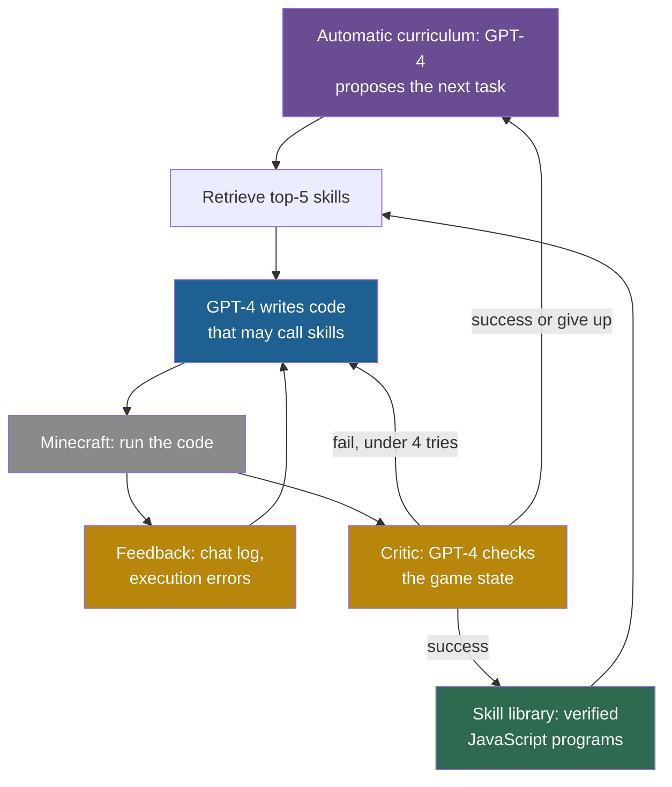

## Learning objectives

After this page you can:

- Describe Voyager's three parts (automatic curriculum, skill library, iterative prompting) and how they connect.
- Trace one task through the loop: propose, retrieve, write code, run, verify, store.
- Read the tech-tree and generalization tables and compute the reported speed-up ratios.
- Separate the effect of the skill library from the effects of the curriculum and of self-verification.
- Place Voyager on the ladder, and say what persists and what stays fixed.

## Prerequisites

- [L2: Memory and learning from experience](/notes/ai/recursive-self-improvement/05-approaches/l2-memory-and-learning-from-experience)
- [L3: The system boundary, the "self" and persistence](/notes/ai/recursive-self-improvement/02-core-idea/l3-system-boundary-and-persistence)
- [2023: Self-Refine and Reflexion](/notes/ai/recursive-self-improvement/06-research-systems/p02-self-refine-and-reflexion)

> [!note] How to use this page
> This page explains Voyager well enough that you can follow its design and results without the PDF. It does not replace the paper. Read its method section and Tables 1 and 2 after this page. Section 12 of this page places the work in recursive self-improvement (RSI).

## The paper on one card

| Field | Value |
|---|---|
| Title | "Voyager: An Open-Ended Embodied Agent with Large Language Models" |
| Authors | Guanzhi Wang, Yuqi Xie, Yunfan Jiang, Ajay Mandlekar, Chaowei Xiao, Yuke Zhu, Linxi Fan, Anima Anandkumar |
| Year | 2023 (arXiv v1 May 2023, v2 October 2023). Numbers here are from v2. |
| Venue | Transactions on Machine Learning Research (TMLR), 2024 |
| arXiv | [arXiv:2305.16291](https://arxiv.org/abs/2305.16291) |
| Code | [MineDojo/Voyager](https://github.com/MineDojo/Voyager), via the project page [voyager.minedojo.org](https://voyager.minedojo.org/) |
| One-sentence result | A GPT-4 agent that stores verified code skills found 63 unique items in 160 prompting iterations and reached diamond tools once in 3 runs. |

## Terms

| Term | Plain meaning |
|---|---|
| large language model (LLM) | A very large model that predicts the next token of text. |
| Minecraft | An open-world video game. The player gathers resources, crafts tools and explores. |
| embodied agent | An agent that acts through a body or avatar in a simulated or real environment. |
| Mineflayer | A JavaScript interface for programs that control a Minecraft player. |
| skill | A program that does one thing in the game, for example "craft a wooden pickaxe". |
| skill library | Voyager's store of verified skills. It persists across tasks. |
| automatic curriculum | The part that proposes the next task, based on what the agent has and has done. |
| embedding | A list of numbers that represents a text, so that texts with similar meaning get similar lists. |
| retrieval | Finding the stored skills whose embeddings are closest to the embedding of the new task. |
| iterative prompting | Write code, run it, return feedback to the LLM, and let it rewrite the code. |
| self-verification | A second GPT-4 call, the critic, that checks the game state and decides if the task succeeded. |
| prompting iteration | The paper's unit of agent work. Exploration runs get at most 160 of them. |
| tech tree | Minecraft's ladder of tools: wooden, then stone, then iron, then diamond. |
| ablation | An experiment that removes one part to measure what that part adds. |
| zero-shot generalization | Solving new tasks in a new setting with no extra training or examples. |

## 1. The problem it addresses

A cook in a new kitchen tries a dish, tastes it, fixes it, and finally writes the recipe on a card. Next month she does not start from zero: she combines old cards into new dishes. Over a year, her box of cards grows, and harder dishes become possible.

Voyager asks whether an LLM agent can work like that cook. The aim is an agent that keeps learning new skills in Minecraft for a long time. It must learn without human help and without fine-tuning. The abstract says that the method "bypasses the need for model parameter fine-tuning".

Two problems make this hard. First, nobody tells the agent what to try next, so it must choose its own tasks. Second, what it learns must persist after each task, in a form that later tasks can use.

## 2. What existed before it

Earlier LLM agents did not keep a growing set of skills. ReAct agents reason and act in a loop, but each task starts fresh. Reflexion, the previous page's method, keeps lessons only across retries of the same task. AutoGPT-style agents plan and act with an LLM, but they also do not keep verified code for later tasks.

The Voyager authors re-implemented these three agents for Minecraft and used them as baselines. **Our interpretation:** this matters for reading the results. The baselines are the authors' adaptations, not the original systems tuned by their own authors.

## 3. The central idea

Voyager has three parts (Wang et al., 2023):

1. **An automatic curriculum**. GPT-4 proposes the next task, aiming at "discovering as many diverse things as possible". It uses the agent's state and its lists of completed and failed tasks.
2. **A skill library**. Each successful skill is stored as executable JavaScript that uses the Mineflayer interface. Later code can call stored skills.
3. **Iterative prompting**. GPT-4 writes code, the code runs in the game, feedback comes back, and GPT-4 rewrites the code.

The key move is the form of memory. Reflexion stores sentences. Voyager stores programs that have passed a check. A stored program does the same thing every time it is called, and it can call other stored programs.

> [!analogy] A box of tested recipe cards
> Every card in the box describes a dish that the cook made successfully at least once. To make a new dish, she picks the five cards that sound most related and builds on them.
>
> - **Where it stops working:** a cook knows when a dish failed because she tastes it. Voyager's "taste test" is partly an LLM critic that reads the game state, and the paper reports that the critic sometimes misjudges. Also, the cook improves her own cooking skill over time. Voyager's model never changes. Only the box grows.

## 4. The architecture



**The skill library as a table**. Each entry has a key and a value. The key is the embedding of a short description of the skill, written by GPT-3.5. The value is the program. For a new task, retrieval returns the 5 skills whose keys are closest to the task.

> [!example] Worked example: how retrieval picks a skill (our illustration)
> Real embeddings have many numbers. Here each text gets only two, and "closest" means the largest cosine similarity.
>
> 1. Task "craft a stone axe": vector $(0.8, 0.6)$.
> 2. Skill A, "craft a stone pickaxe": vector $(0.9, 0.4)$. Skill B, "catch a fish": vector $(0.1, 1.0)$.
> 3. Cosine similarity is the dot product divided by the lengths. Task and A: $0.8 \times 0.9 + 0.6 \times 0.4 = 0.96$. The lengths are $1.0$ and $\sqrt{0.97} \approx 0.985$, so the similarity is about $0.97$.
> 4. Task and B: $0.08 + 0.6 = 0.68$, divided by $1.0 \times \sqrt{1.01} \approx 1.005$, gives about $0.68$.
> 5. Skill A ranks higher, so it is more likely to be among the top 5. The ranking uses the descriptions, not the code, so a wrong description can hide a useful skill.

**Models** (paper settings):

| Role | Model |
|---|---|
| Code writing, the critic and the curriculum | GPT-4 (`gpt-4-0314`) |
| Question answering, skill descriptions and task suggestions | GPT-3.5 (`gpt-3.5-turbo-0301`), chosen for cost |
| Embeddings | `text-embedding-ada-002` |
| Temperature | 0, except 0.1 for the curriculum |

## 5. The algorithm, step by step

The loop for one task:

1. The curriculum proposes a task.
2. The library returns the top-5 relevant skills.
3. GPT-4 writes a program for the task. The program can call the retrieved skills.
4. The program runs in Minecraft. Three kinds of feedback come back. They are environment feedback (for example a chat log that says "need 2 more planks"), execution errors, and the critic's verdict.
5. The critic is a separate GPT-4 call. It receives the agent's current state and the task, decides whether the task succeeded, and writes a critique if it failed. The paper motivates it like this: "Instead of manually coding success checkers for each new task…".
6. Repeat steps 3 to 5 up to 4 times. If the task succeeds, store the code: "if success: skill_manager.add_skill(code)". If the agent is still stuck after 4 tries, mark the task as failed and ask the curriculum for another task. Failed code is not stored.

The same loop as pseudocode (a paraphrase, not the released code):

```text
library = {}                      # description embedding -> program
completed, failed = [], []
for prompting budget:
    task = curriculum(state, completed, failed)        # GPT-4
    skills = top5(library, embed(task))
    for attempt in 1..4:
        code = write_code(task, skills, feedback)       # GPT-4
        feedback = run_in_minecraft(code)               # chat log, errors
        ok, critique = critic(state, task)              # GPT-4 reads the state
        if ok:
            library[embed(describe(code))] = code       # persists
            completed.append(task); break
        feedback = feedback + critique
    else:
        failed.append(task)                             # code is discarded
```

> [!example] Worked example: one task (our illustration, with the paper's message types)
> 1. The curriculum sees an inventory with wooden tools and proposes "craft a stone pickaxe".
> 2. Retrieval returns related skills, for example a skill that mines wood logs and a skill that crafts a wooden pickaxe.
> 3. GPT-4 writes code that mines stone with the wooden pickaxe and then crafts the new tool.
> 4. Attempt 1: the game chat says that more planks are needed. The craft fails.
> 5. Attempt 2: GPT-4 adds a call to the plank skill before the craft. The code runs without errors.
> 6. The critic reads the inventory, sees a stone pickaxe, and returns success.
> 7. The library stores the new program under the embedding of a description such as "craft a stone pickaxe from cobblestone and sticks".
>
> Next time a task needs stone tools, this program is one of the top-5 candidates. The agent does not rediscover it.

## 6. The role of evaluation

Voyager uses three feedback signals. Classify them as in the previous page:

| Signal | What it sees | Kind |
|---|---|---|
| Environment feedback | Game messages, for example a missing ingredient | External and grounded |
| Execution errors | Errors from the JavaScript interpreter | External and grounded |
| Self-verification | A GPT-4 critic that reads the agent's observed state, such as its inventory | An LLM judge, but grounded in the game state |

The critic is an LLM judge, but it does not judge from the code's own reasoning. It judges from what the game shows. **Our interpretation:** this places it between the intrinsic feedback of Self-Refine and a hand-written success test.

**Measured:** self-verification is "the most important among all the feedback types". Without it, Voyager found 73% fewer unique items (ablation).

The critic is also the acceptance rule of the skill library. A skill joins the library only if the critic says "success". So the critic decides what persists. **Our interpretation:** a wrong "success" stores a broken skill, and later tasks may call it. The paper reports that the critic can be wrong, for example when it did not recognize spider string as a success.

## 7. The experimental setup

1. **Budget:** at most 160 prompting iterations for exploration and tech-tree runs.
2. **Runs:** 3 runs per method.
3. **Baselines:** ReAct, Reflexion and AutoGPT, re-implemented by the authors for Minecraft.
4. **Ablations:** a random curriculum, no self-verification, no skill library, and GPT-3.5 instead of GPT-4 for code writing.
5. **Zero-shot generalization:** a new Minecraft world with a cleared inventory, four unseen tasks, and at most 50 iterations.
6. **Metrics:** the number of unique items found, the distance traveled, and the prompting iterations needed to reach each tech-tree level.

## 8. The reported results

**Exploration (Measured)**. Voyager discovered "63 unique items within 160 prompting iterations, 3.3× many novel items compared to its counterparts." It navigated "distances 2.3× longer compared to baselines". The per-baseline item counts are only in a figure.

**Tech tree (Measured, Table 1)**. Each cell shows the mean prompting iterations to reach the level, and the number of successful runs out of 3. "N/A" means that no run reached the level.

| Method | Wooden | Stone | Iron | Diamond |
|---|---|---|---|---|
| ReAct | N/A (0/3) | N/A (0/3) | N/A (0/3) | N/A (0/3) |
| Reflexion | N/A (0/3) | N/A (0/3) | N/A (0/3) | N/A (0/3) |
| AutoGPT | 92 ± 72 (3/3) | 94 ± 72 (3/3) | 135 ± 103 (3/3) | N/A (0/3) |
| Voyager without skill library | 7 ± 2 (3/3) | 9 ± 4 (3/3) | 29 ± 11 (3/3) | N/A (0/3) |
| Voyager | 6 ± 2 (3/3) | 11 ± 2 (3/3) | 21 ± 7 (3/3) | 102 (1/3) |

The paper reports speed-ups "up to 15.3x". These are AutoGPT's iterations divided by Voyager's: $92/6 \approx 15.3$ (wooden), $94/11 \approx 8.5$ (stone), $135/21 \approx 6.4$ (iron).

```plot
{
  "title": "Prompting iterations to reach each tech-tree level (Table 1): AutoGPT (red), Voyager without skill library (gold), Voyager (blue). 1 = wooden, 2 = stone, 3 = iron.",
  "xAxis": { "label": "tech-tree level", "domain": [0.8, 3.2] },
  "yAxis": { "label": "mean prompting iterations", "domain": [0, 150] },
  "disableZoom": true,
  "data": [
    { "points": [[1, 92], [2, 94], [3, 135]], "fnType": "points", "graphType": "polyline", "color": "#C81D25", "skipTip": true },
    { "points": [[1, 92], [2, 94], [3, 135]], "fnType": "points", "graphType": "scatter", "color": "#C81D25", "skipTip": true },
    { "points": [[1, 7], [2, 9], [3, 29]], "fnType": "points", "graphType": "polyline", "color": "#B8860B", "skipTip": true },
    { "points": [[1, 7], [2, 9], [3, 29]], "fnType": "points", "graphType": "scatter", "color": "#B8860B", "skipTip": true },
    { "points": [[1, 6], [2, 11], [3, 21]], "fnType": "points", "graphType": "polyline", "color": "#1E6091", "skipTip": true },
    { "points": [[1, 6], [2, 11], [3, 21]], "fnType": "points", "graphType": "scatter", "color": "#1E6091", "skipTip": true }
  ]
}
```

Study the plot before you read the speed-ups. The large gap is between AutoGPT and both Voyager versions. The gap between Voyager with and without the library is small up to iron.

**Ablations (Measured).**

1. A random curriculum instead of the automatic one: 93% fewer unique items.
2. No self-verification: 73% fewer unique items.
3. GPT-4 found 5.7 times as many unique items as GPT-3.5 for code writing.
4. Without the skill library, progress plateaus later in the run. The exact curve is only in a figure.

**Zero-shot generalization (Measured, Table 2)**. A new world, a cleared inventory, at most 50 iterations. Cells show mean iterations and successes out of 3.

| Method | Diamond Pickaxe | Golden Sword | Lava Bucket | Compass |
|---|---|---|---|---|
| ReAct, Reflexion, AutoGPT | 0/3 | 0/3 | 0/3 | 0/3 |
| AutoGPT with Voyager's skill library | 39 (1/3) | 30 (1/3) | N/A (0/3) | 30 (2/3) |
| Voyager without skill library | 36 (2/3) | 30 ± 9 (3/3) | 27 ± 9 (3/3) | 26 ± 3 (3/3) |
| Voyager | 19 ± 3 (3/3) | 18 ± 7 (3/3) | 21 ± 5 (3/3) | 18 ± 2 (3/3) |

Here the library matters more. Voyager with its library solves every task in all 3 runs and needs fewer iterations. The same library also lets AutoGPT solve tasks that it could not solve before.

## 9. What the results show

1. **A persistent library of verified code lets an agent reach harder goals faster**. The clearest evidence is the generalization table: with the library, all four new tasks succeed in 3 of 3 runs.
2. **The library transfers**. It works in a new world, and it even helps a different agent (AutoGPT).
3. **Grounded verification is essential**. Removing the critic costs 73% of the unique items.
4. **The curriculum drives exploration**. A random curriculum costs 93% of the unique items.
5. **The model's ability limits everything**. GPT-4 found 5.7 times as many items as GPT-3.5 in the code-writing role.

## 10. What the results do not show

1. **The results rest on 3 runs**. The variance is large: AutoGPT's wooden-level result is 92 ± 72.
2. **The diamond result is one run**. Voyager reached diamond in 1 of 3 runs, and no other method did. One success out of three is weak evidence (see check question 5).
3. **The 15.3× speed-up is not the skill library's effect**. It compares Voyager with AutoGPT. Against Voyager without the library, the tech-tree numbers are close. Wooden level: 6 against 7 iterations. Stone level: 11 against 9, so the version without the library is faster.
4. **The baselines were adapted by the authors**. ReAct, Reflexion and AutoGPT were re-implemented for Minecraft. Their 0/3 results may partly reflect the adaptation.
5. **The model does not improve**. Only the library and the curriculum record change. The gains depend on GPT-4.
6. **Nothing shows that the library scales without limit**. The paper gives no evidence that the curriculum or the library keeps working over much longer runs.
7. **"Unique items" is a proxy.** It measures exploration breadth, not the quality or the reliability of the stored skills.
8. **Cost is reported only roughly**. The authors say GPT-4 is about 15 times as expensive as GPT-3.5. No total cost per run is given in the material for these notes.

## 11. Limitations

**Stated by the authors:**

1. Cost: GPT-4 is about 15 times as expensive as GPT-3.5.
2. The agent sometimes gets stuck.
3. Self-verification can be wrong. One example: the critic did not recognize spider string as a success.
4. Hallucinations: the model wrote tasks or calls for things that do not exist. Examples are a "copper sword", cobblestone as fuel, and functions that are not in the Mineflayer interface.

**Our interpretation:** persistent memory can also persist mistakes. The critic is the only acceptance rule for the library. If it approves a broken skill, that skill stays and can be retrieved for later tasks. Nothing in the described loop re-tests old skills or removes them. Other memory systems in [L2: Memory and learning from experience](/notes/ai/recursive-self-improvement/05-approaches/l2-memory-and-learning-from-experience) show the same risk.

## 12. Its relationship to RSI

Use the ladder of [Part 2 L2](/notes/ai/recursive-self-improvement/02-core-idea/l2-the-ladder-of-self-improvement), our interpretation built from the literature.

| Question | Voyager |
|---|---|
| Ladder level | Level 2: persistent memory and skills across tasks |
| What changes | The skill library (code) and the curriculum's record of completed and failed tasks |
| What persists | Both of them, across tasks and into a new world |
| Who proposes | GPT-4: the curriculum proposes tasks, and the code writer proposes skills |
| Who evaluates | The game (messages and errors) and a GPT-4 critic that reads the game state |
| What stays fixed | Model weights, all prompts, the loop, the retrieval rule, the 4-try limit, and the rule "store if the critic says success" |
| Does the improver improve? | No |

Voyager writes code that its future self calls. **Our interpretation:** this is a step toward self-extension, because the agent adds tools to its own toolbox. But the agent's control loop, its prompts and its model never change. The way it learns is the same on the last task as on the first.

Compare the self-modifying code agents of [Part 6 p10](/notes/ai/recursive-self-improvement/06-research-systems/p10-darwin-godel-machine). The Darwin Gödel Machine edits the agent's own scaffold code, including the code that performs the next change. Voyager only adds callable skills.

Definitions disagree about this case. Surveys of "self-evolving agents" count memory and tool evolution (Gao et al., 2025, Fang et al., 2025). Definitions that require the improver to get "better at getting better" do not count it (Yampolskiy, 2015).

## 13. Common mistakes

1. **"Voyager learns, so its model improves"**. The weights never change. The library and the curriculum record change.
2. **"The 15.3× speed-up shows the value of the skill library"**. It compares Voyager with AutoGPT. The ablation without the library is much closer to Voyager on the tech tree.
3. **"Self-verification is an outside test, like a unit test"**. It is a GPT-4 critic that reads the game state. It is grounded, but it can be wrong.
4. **"Voyager reliably reaches diamond tools"**. It did so in 1 of 3 runs.
5. **"A growing library means unlimited improvement"**. The paper gives no evidence of indefinite scaling, and nothing re-checks stored skills.
6. **"Voyager improves its own way of learning"**. The curriculum prompt, the critic prompt and the storage rule are the same from start to end.

## 14. One-minute explanation

Voyager is a GPT-4 agent in Minecraft that keeps what it learns as code. For each task that a curriculum proposes, it retrieves five related skills, writes a program, and rewrites it with game feedback up to four times. If a GPT-4 critic sees success in the game state, the program joins a growing skill library. It found 3.3 times as many unique items as adapted baselines, and its library helped even AutoGPT solve new tasks in a new world. The evidence rests on 3 runs, and up to iron the version without the library was almost as fast. The model, the prompts and the learning loop never change, so Voyager is Level 2 memory, not an improver that improves itself.

## 15. Check questions

```check
{
  "question": "Compute the speed-up of Voyager over AutoGPT and over Voyager without skill library at the iron level, from Table 1. What does the comparison tell you about the source of the headline speed-ups?",
  "hint": "Iron: AutoGPT 135, Voyager without library 29, Voyager 21.",
  "answer": "Over AutoGPT: $135/21 \\approx 6.4$. Over Voyager without the library: $29/21 \\approx 1.4$. Most of the speed-up comes from the rest of Voyager's design (curriculum, iterative prompting, critic), not from the library. At the stone level the version without the library is even faster (9 against 11). The library's clearer benefit shows in the diamond result and in the new-world tasks."
}
```

```check
{
  "question": "Two ablations remove the automatic curriculum (93% fewer unique items) and self-verification (73% fewer). Explain in one or two sentences why each part matters for exploration.",
  "hint": "What does each part control in the loop?",
  "answer": "The curriculum chooses which task comes next. A random choice picks tasks that the agent cannot yet do, or tasks that teach nothing new, so exploration collapses. The critic decides whether a task succeeded, which decides both retries and what enters the library. Without it, failures are not detected and the agent builds on code that does not work."
}
```

```check
{
  "question": "Classify each item as persistent or not persistent after a Voyager run, and say where it lives. (a) The model weights. (b) A verified skill program. (c) The critic's critique of a failed attempt. (d) The list of completed and failed tasks.",
  "hint": "Ask what the next task can use.",
  "answer": "(a) Not changed at all: the weights are fixed. (b) Persistent: it lives in the skill library as code. (c) Not persistent: it is feedback inside the retries of one task, and failed code is discarded. (d) Persistent: it lives in the curriculum's state and shapes the next proposals."
}
```

```check
{
  "question": "Suppose the critic wrongly approves a broken skill for \"smelt iron\". Describe what can happen over the next tasks, and propose one control that would limit the damage.",
  "hint": "Where is the skill stored, and who calls it later?",
  "answer": "The broken skill enters the library. Later tasks about iron retrieve it among the top 5 and call it, so they fail or waste attempts. The curriculum may then mark iron-based tasks as failed and steer away from a whole branch. One control: re-test stored skills in a fresh game state from time to time, and remove skills that fail. Another: record which skills each failed task called, and flag skills that appear often in failures."
}
```

```check
{
  "question": "Voyager reached diamond in 1 of 3 runs. Under a simple model with independent runs and success probability $p$, the chance of exactly 1 success in 3 runs is $3p(1-p)^2$. Compute it for $p = 0.1$, $p = 0.5$ and $p = 0.9$. What can you conclude?",
  "hint": "Compute each value, then ask which values of p are ruled out.",
  "answer": "$p = 0.1$: $3 \\times 0.1 \\times 0.81 = 0.243$. $p = 0.5$: $3 \\times 0.5 \\times 0.25 = 0.375$. $p = 0.9$: $3 \\times 0.9 \\times 0.01 = 0.027$. One success in three is quite likely for a rate of 10% or 50%, and unlikely only for very high rates. So the result shows that diamond is possible, but it says little about how often. Three runs cannot separate a 10% method from a 50% method."
}
```

## 16. Summary and links

- Voyager = an automatic curriculum + a library of verified code skills + iterative prompting with game feedback and a GPT-4 critic.
- Skills persist as programs. Retrieval brings the 5 most related skills into each new task.
- Measured: 63 unique items in 160 iterations, 3.3 times the baselines. All new-world tasks solved in 3 of 3 runs. Diamond in 1 of 3 runs.
- The ablations show that the curriculum and the critic matter most for exploration. The library's clearest benefit shows in new tasks.
- The evidence rests on 3 runs and adapted baselines, and the model never improves.
- Voyager is Level 2: persistent memory across tasks with a fixed improvement procedure.

**Next:** Promptbreeder evolves prompts and also the prompts that change prompts, a first small step toward improving the improver.

**Links:**

- Previous: [2023: Self-Refine and Reflexion](/notes/ai/recursive-self-improvement/06-research-systems/p02-self-refine-and-reflexion)
- Next: [2023: Promptbreeder](/notes/ai/recursive-self-improvement/06-research-systems/p04-promptbreeder)
- Related: [L2: Memory and learning from experience](/notes/ai/recursive-self-improvement/05-approaches/l2-memory-and-learning-from-experience), [L5: Churn, bloat, lost behavior, drift and runaway cost](/notes/ai/recursive-self-improvement/08-failure-modes-and-safety/l5-churn-bloat-and-drift)

**Videos:** the course's verified video list has no talk about Voyager itself. For the agent loop with tools that Voyager builds on, watch [What's next for AI agentic workflows](https://www.youtube.com/watch?v=sal78ACtGTc) (Andrew Ng, 2024). It supports sections 3 and 4.

## References

- Guanzhi Wang, Yuqi Xie, Yunfan Jiang, et al. "Voyager: An Open-Ended Embodied Agent with Large Language Models". Transactions on Machine Learning Research. 2024. arXiv:2305.16291. https://arxiv.org/abs/2305.16291. Project: https://voyager.minedojo.org/. Code: https://github.com/MineDojo/Voyager
- Noah Shinn, Federico Cassano, Edward Berman, Ashwin Gopinath, Karthik Narasimhan, Shunyu Yao. "Reflexion: Language Agents with Verbal Reinforcement Learning". NeurIPS 2023. arXiv:2303.11366. https://arxiv.org/abs/2303.11366
- Huan-ang Gao, Jiayi Geng, Wenyue Hua, et al. "A Survey of Self-Evolving Agents: What, When, How, and Where to Evolve on the Path to Artificial Super Intelligence". 2025. arXiv:2507.21046. https://arxiv.org/abs/2507.21046
- Jinyuan Fang, Yanwen Peng, Xi Zhang, et al. "A Comprehensive Survey of Self-Evolving AI Agents: A New Paradigm Bridging Foundation Models and Lifelong Agentic Systems". 2025. arXiv:2508.07407. https://arxiv.org/abs/2508.07407v2
- Roman V. Yampolskiy. "From Seed AI to Technological Singularity via Recursively Self-Improving Software". 2015. arXiv:1502.06512. https://arxiv.org/abs/1502.06512
