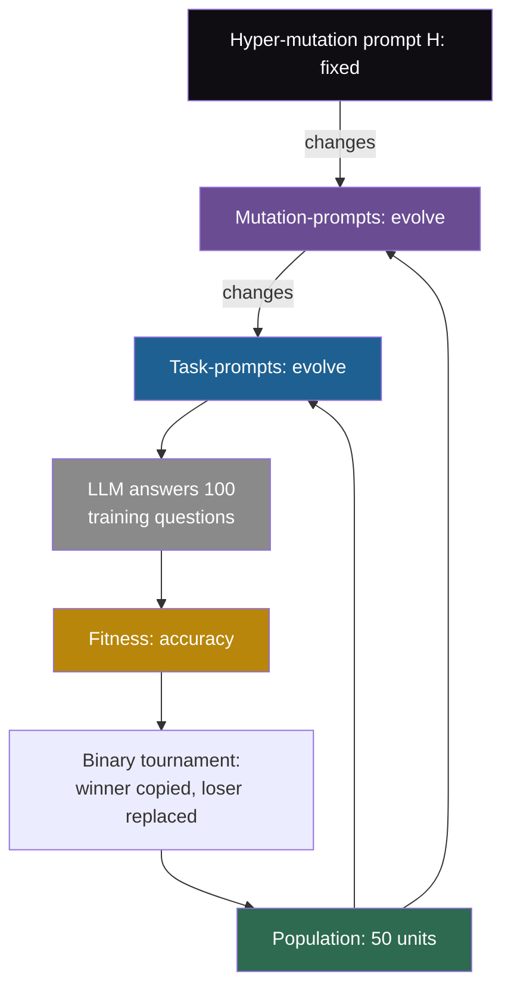

## Learning objectives

After this page you can:

- Explain the three layers of text in Promptbreeder: task-prompts, mutation-prompts and the fixed hyper-mutation prompt.
- Trace one binary tournament, including a hyper-mutation that changes a mutation-prompt.
- Name the five classes of mutation operators and give an example of each.
- Compute how noisy a fitness score on 100 training examples is, and what this means for a tournament.
- Say exactly where self-reference stops in Promptbreeder, and place it on the ladder.

## Prerequisites

- [L3: Prompt and instruction optimization](/notes/ai/recursive-self-improvement/05-approaches/l3-prompt-and-instruction-optimization)
- [L6: Evolutionary search, populations and open-endedness](/notes/ai/recursive-self-improvement/05-approaches/l6-evolutionary-and-population-methods)
- [L4: The improver, meta-levels and the frozen core](/notes/ai/recursive-self-improvement/03-anatomy/l4-the-improver-and-meta-levels)
- [L3: Evaluation under noise](/notes/ai/recursive-self-improvement/04-mathematics/l3-evaluation-under-noise)

> [!note] How to use this page
> This page explains Promptbreeder well enough that you can follow its method and results without the PDF. It does not replace the paper. Read Sections 3 and 5 and Table 1 after this page. All details here come from arXiv v1. The ICML camera-ready version was not compared. Section 12 of this page places the work in recursive self-improvement (RSI).

## The paper on one card

| Field | Value |
|---|---|
| Title | "Promptbreeder: Self-Referential Self-Improvement Via Prompt Evolution" (the ICML page writes "via") |
| Authors | Chrisantha Fernando, Dylan Banarse, Henryk Michalewski, Simon Osindero, Tim Rocktäschel |
| Year | 2023 (arXiv v1, the only version) |
| Venue | ICML 2024, PMLR 235:13481–13544 |
| arXiv | [arXiv:2309.16797](https://arxiv.org/abs/2309.16797) |
| Code | No code URL in the paper, and no official repository was found |
| One-sentence result | With PaLM 2-L, evolved prompts reached 83.9% on GSM8K, against 80.2% for OPRO, and the mutating prompts also evolve. |

## Terms

| Term | Plain meaning |
|---|---|
| large language model (LLM) | A very large model that predicts the next token of text. |
| task-prompt | The text that is put before a question to help the LLM answer it. |
| mutation-prompt | An instruction that tells the LLM how to change a task-prompt. |
| hyper-mutation prompt | A fixed instruction that tells the LLM how to change a mutation-prompt. The paper calls it H. |
| thinking-style | A short hint about a way of thinking. The paper lists 39 of them. |
| problem description | A plain statement of the task, written by a human. |
| unit of evolution | One member of the population: usually 2 task-prompts and 1 mutation-prompt. |
| population | The set of units that the search keeps. In Promptbreeder, 50 units. |
| fitness | The score of a unit: its accuracy on a random batch of 100 training questions. |
| binary tournament | Pick two units at random, keep the fitter one, and replace the other with a changed copy of the winner. |
| genetic algorithm | A search that keeps a population and makes new members by copying, mutating and mixing old ones. |
| mutation operator | One way of making a changed copy. Promptbreeder uses nine, grouped in five classes. |
| working-out | A correct step-by-step solution of a training question, used as a few-shot example. |
| self-referential | The improver changes part of itself, not only the thing that it improves. |

## 1. The problem it addresses

A teacher gives students a study method: "Summarize each chapter in five bullet points." A good teacher also changes the method when it stops working. A very good teacher also changes the way she changes methods. For example, she may start to ask students which method failed, before she invents the next one.

Prompts for LLMs have the same three layers. A prompt such as "Let's think step by step" helps the model answer. A prompt-optimization method changes such prompts automatically. But the way it changes them is fixed by its designers.

Promptbreeder asks: hand-designed strategies such as chain-of-thought and Plan-and-Solve are fixed. Methods such as APE and OPRO use a fixed way to make new prompts. Can the way of mutating prompts improve too?

## 2. What existed before it

1. **Hand-designed prompting strategies**. Chain-of-thought (CoT) prompting and Plan-and-Solve (PS and PS+) give the model a fixed way to approach a problem.
2. **APE, the Automatic Prompt Engineer** (Zhou et al., 2022). An LLM proposes many candidate instructions, and the method keeps the best by score. The APE paper concludes that "iterative generation provides marginal improvement", so its default does one round.
3. **OPRO, Optimization by PROmpting** (Yang et al., 2023). An LLM reads a list of earlier instructions with their scores and proposes better ones. Its default run evaluates 8 instructions per iteration for 200 iterations.
4. **Evolution with an LLM as the mutation operator**. Earlier work, such as ELM, used an LLM to make changed copies in an evolutionary search.
5. **Self-reference**. The paper cites Schmidhuber's 1993 self-referential weight matrix and Gödel-machine-style self-improvement.

In APE and OPRO, the instruction that asks for a new prompt is written once by a human and never changes. Promptbreeder targets exactly that instruction.

## 3. The central idea

Evolve two kinds of text at the same time:

1. **Task-prompts**, which help the LLM answer questions.
2. **Mutation-prompts**, which tell the LLM how to change task-prompts.

The mutation-prompts evolve too. The abstract calls this "a general-purpose self-referential self-improvement mechanism". Section 3 names the next layer: "The mutation operator for this meta-level algorithm is again an LLM, now conditioned on a hyper-mutation prompt H."

So there are three layers. The hyper-mutation prompt changes mutation-prompts. Mutation-prompts change task-prompts. Task-prompts help answer questions. Only the top layer is fixed.

> [!analogy] Recipes, editors and an editor's handbook
> A recipe is a task-prompt. An editor's note such as "make it simpler" is a mutation-prompt, and a handbook for writing editor's notes is the hyper-mutation prompt. Promptbreeder evolves recipes and editor's notes. Taste tests (fitness) decide which recipes survive. Editor's notes survive when the recipes they produce win.
>
> - **Where it stops working:** a real editor learns from feedback on her notes. Promptbreeder never scores mutation-prompts directly. They survive only because they belong to a unit that wins. And the handbook never changes.

## 4. The architecture

**Inputs (Section 3 and appendices):**

1. A problem description, for example: "Solve the math word problem, giving your answer as an arabic numeral."
2. A list of 39 thinking-styles (Appendix D).
3. A list of 56 initial mutation-prompts (Appendix C).
4. A training set of questions with answers.

**The unit of evolution**. Usually 2 task-prompts and 1 mutation-prompt. In the few-shot setting, a unit also holds 2 or 3 correct workings-out as examples. The population has 50 units.

**Initialization**. Each task-prompt starts as the LLM's continuation of three joined texts: a random mutation-prompt, a random thinking-style, and the problem description. This is done twice per unit, once for each task-prompt.



The fixed layer H is drawn in ink. Purple marks the part of the improver that evolves. Blue marks the thing being improved.

## 5. The algorithm, step by step

### 5.1 The main loop

The search is a binary tournament genetic algorithm (paraphrase of Section 3):

```text
population = 50 initialized units
repeat for about 20-30 generations:
    pick two units at random
    fitness = accuracy on a random batch of 100 training Q&A pairs
    winner = higher-fitness unit; loser = the other
    child = copy(winner)
    apply ONE mutation operator to child, sampled uniformly over the nine operators
    (prompt crossover with 10% chance after mutation; context list resampled with 10% chance)
    overwrite loser with child
```

In words:

1. Pick two units at random.
2. Score each unit by its accuracy on a random batch of 100 training questions.
3. The unit with the higher score wins.
4. Copy the winner. Change the copy with one mutation operator. The paper says: "we sample with uniform probability over the nine operators".
5. With a 10% chance, also replace one task-prompt by one from another unit (crossover). With a 10% chance, resample the few-shot examples.
6. The changed copy replaces the loser. The winner stays unchanged.

### 5.2 The mutation operators

Section 3.2 says that "there are nine operators falling into five broad classes". The detailed listing names ten mechanisms, because crossover and context shuffling are applied around the main mutation. Learn the five classes, and do not rely on an exact count of ten.

| Class | Mechanisms | What it does |
|---|---|---|
| 1. Direct mutation | Zero-order and first-order prompt generation | Zero-order: write a new task-prompt from the problem description and the text "A list of 100 hints:". First-order: apply the unit's mutation-prompt to the parent task-prompt. |
| 2. Estimation of distribution | EDA, EDA rank-and-index, lineage-based | Show the LLM a list of prompts from the population, or from the unit's own line of elite prompts, and let it continue the list. |
| 3. Hyper-mutation | Zero-order and first-order hyper-mutation | Write a new mutation-prompt. This is the self-referential part. |
| 4. Lamarckian mutation | "Working out to task-prompt" | Read a correct working-out and write the instruction that would produce it. |
| 5. Crossover and context shuffling | Prompt crossover, context shuffling | Take a task-prompt from another unit, or resample the few-shot examples. |

One detail of class 2 is unusual. In "rank-and-index", the list is ordered by fitness, but it carries a deliberately misleading "descending" label.

The hyper-mutation operators need a closer look, because they are the reason for the word "self-referential":

1. **Zero-order hyper-mutation:** "concatenate the original problem description to a randomly sampled thinking-style". The LLM writes a brand-new mutation-prompt from that.
2. **First-order hyper-mutation:** the LLM receives "Please summarize and improve the following instruction:" followed by the unit's current mutation-prompt. Its output becomes the new mutation-prompt. That new mutation-prompt is then used to change the task-prompt.

> [!example] Worked example: one tournament with a hyper-mutation (our illustration)
> The texts below are invented for teaching, except the quoted fixed phrase from the paper.
>
> 1. Unit A: task-prompts "Solve it in small steps." and "Check units before you answer." Mutation-prompt: "Make the instruction more specific." Fitness on its batch: 0.71.
> 2. Unit B: fitness 0.64 on its batch. A wins, so B will be overwritten.
> 3. Child = copy of A. The sampled operator is first-order hyper-mutation.
> 4. The LLM receives: "Please summarize and improve the following instruction: Make the instruction more specific."
> 5. It returns a new mutation-prompt: "Rewrite the instruction so that it names the first step to take."
> 6. The new mutation-prompt changes the child's first task-prompt. It becomes: "First write down every number in the question, then solve it in small steps."
> 7. The child, with its new mutation-prompt and new task-prompt, replaces B.
>
> Note what happened. The mutation-prompt changed, but nobody scored it. It will survive only if the child's task-prompts win later tournaments.

## 6. The role of evaluation

**The evaluator is fixed**. Fitness is accuracy on a random batch of 100 training questions. A human chose this rule, and no operator can change it. Appendix F says that Promptbreeder is "not self-referential (in a way that thought is)", because it does not invent new ways to evaluate mutants.

**Only task-prompts are scored directly**. A mutation-prompt has no score of its own. It is selected indirectly, through the units that it belongs to.

**The fitness score is noisy**. The idea in words: a score on 100 questions is an estimate. Another random batch of 100 would give a different score. The standard error (SE) says how much the score typically moves (Miller, 2024):

$$
\mathrm{SE} = \sqrt{\frac{p\,(1-p)}{n}}
$$

The symbols mean:

- $p$ is the unit's true accuracy on the whole training set.
- $n$ is the number of questions in the batch.
- $\mathrm{SE}$ is the typical size of the gap between the batch score and $p$.

In plain English: more questions give a smaller error, and accuracies near 50% are the noisiest.

> [!example] Worked example: can a tournament tell 80% from 82%?
> Unit A has true accuracy 0.82, and unit B has 0.80. Each is scored on its own random batch of 100 questions. This is our arithmetic, with a normal approximation.
>
> 1. SE of one score: $\sqrt{0.8 \times 0.2 / 100} = \sqrt{0.0016} = 0.04$, or 4 points.
> 2. SE of the difference between two independent scores: $\sqrt{2} \times 0.04 \approx 0.057$.
> 3. The true difference is 0.02. In units of the SE: $0.02 / 0.057 \approx 0.35$.
> 4. The chance that B scores higher than A is about the chance that a standard normal value is above 0.35: about 0.36.
> 5. So the worse unit wins about 36% of these tournaments.

**Assumptions**. The questions are independent, and each unit's batch is drawn at random. The research notes do not say whether both units in a tournament use the same batch. A shared batch would remove some of the noise, because both units would face the same questions.

**When it is useful**. It tells you how many questions a score needs before a small difference means something.

**What it does not prove**. It does not show that Promptbreeder selects badly. Over many tournaments, better units still win more often. It shows that single comparisons on 100 questions cannot separate units that differ by 2 points.

## 7. The experimental setup

1. **Model:** PaLM 2-L for Promptbreeder and for the same-model baselines.
2. **Benchmarks:** arithmetic word problems (MultiArith, SingleEq, AddSub, SVAMP, AQuA-RAT, GSM8K), two commonsense question sets (abbreviated SQA and CSQA in Table 1), and ETHOS hate-speech classification.
3. **Settings:** zero-shot (only the task-prompts) and few-shot (task-prompts plus workings-out).
4. **Population and budget:** 50 units, typically 20 to 30 generations, about 1,000 to 2,000 fitness evaluations per run (as extracted). The paper reports no cost in USD.
5. **Data splits:** fitness uses random batches of 100 training examples. The authors split MultiArith, SingleEq, AddSub and SVAMP 50/50 into training and test sets. The test split for GSM8K, CSQA, SQA and AQuA-RAT is not stated explicitly in the text read for these notes.

## 8. The reported results

**Measured** (Fernando et al., 2023, Table 1, arXiv v1). Values in parentheses come from the Plan-and-Solve paper and use a different model, `text-davinci-003` (td-003). The other rows use PaLM 2-L. The values come from a table extraction, so check them against the PDF before you quote them.

| Method | LLM | MultiArith | SingleEq | AddSub | SVAMP | SQA | CSQA | AQuA-RAT | GSM8K |
|---|---|---|---|---|---|---|---|---|---|
| CoT zero-shot | td-003 | (83.8) | (88.1) | (85.3) | (69.9) | (63.8) | (65.2) | (38.9) | (56.4) |
| PS+ zero-shot | td-003 | (91.8) | (94.7) | (92.2) | (75.7) | (65.4) | (71.9) | (46.0) | (59.3) |
| PS zero-shot | PaLM 2-L | 97.7 | 90.6 | 72.4 | 83.8 | 50.0 | 77.9 | 40.2 | 59.0 |
| PS+ zero-shot | PaLM 2-L | 92.5 | 94.7 | 74.4 | 86.3 | 50.1 | 73.3 | 39.4 | 60.5 |
| APE zero-shot | PaLM 2-L | 95.8 | 82.2 | 72.2 | 73.0 | 38.4 | 67.3 | 45.7 | 77.9 |
| OPRO zero-shot | PaLM 2-L | – | – | – | – | – | – | – | 80.2 |
| PB zero-shot | PaLM 2-L | 99.7 | 96.4 | 87.8 | 90.2 | 71.8 | 85.4 | 62.2 | 83.9 |
| Manual-CoT few-shot | td-003 | (93.6) | (93.5) | (91.6) | (80.3) | (71.2) | (78.3) | (48.4) | (58.4) |
| PB few-shot | PaLM 2-L | 100.0 | 98.9 | 87.1 | 93.7 | 80.2 | 85.9 | 64.6 | 83.5 |

PB stands for Promptbreeder. The plot compares Promptbreeder with the two same-model baselines that have values on every benchmark.

```plot
{
  "title": "Zero-shot accuracy with PaLM 2-L (Table 1): Promptbreeder (blue), APE (gold), PS+ (red). Benchmarks 1-8: MultiArith, SingleEq, AddSub, SVAMP, SQA, CSQA, AQuA-RAT, GSM8K",
  "xAxis": { "label": "benchmark number", "domain": [0.5, 8.5] },
  "yAxis": { "label": "accuracy (%)", "domain": [30, 102] },
  "disableZoom": true,
  "data": [
    { "points": [[1, 99.7], [2, 96.4], [3, 87.8], [4, 90.2], [5, 71.8], [6, 85.4], [7, 62.2], [8, 83.9]], "fnType": "points", "graphType": "polyline", "color": "#1E6091", "skipTip": true },
    { "points": [[1, 99.7], [2, 96.4], [3, 87.8], [4, 90.2], [5, 71.8], [6, 85.4], [7, 62.2], [8, 83.9]], "fnType": "points", "graphType": "scatter", "color": "#1E6091", "skipTip": true },
    { "points": [[1, 95.8], [2, 82.2], [3, 72.2], [4, 73.0], [5, 38.4], [6, 67.3], [7, 45.7], [8, 77.9]], "fnType": "points", "graphType": "polyline", "color": "#B8860B", "skipTip": true },
    { "points": [[1, 95.8], [2, 82.2], [3, 72.2], [4, 73.0], [5, 38.4], [6, 67.3], [7, 45.7], [8, 77.9]], "fnType": "points", "graphType": "scatter", "color": "#B8860B", "skipTip": true },
    { "points": [[1, 92.5], [2, 94.7], [3, 74.4], [4, 86.3], [5, 50.1], [6, 73.3], [7, 39.4], [8, 60.5]], "fnType": "points", "graphType": "polyline", "color": "#C81D25", "skipTip": true },
    { "points": [[1, 92.5], [2, 94.7], [3, 74.4], [4, 86.3], [5, 50.1], [6, 73.3], [7, 39.4], [8, 60.5]], "fnType": "points", "graphType": "scatter", "color": "#C81D25", "skipTip": true }
  ]
}
```

The lines join benchmarks only to make each method easy to follow. The benchmarks are separate, not a sequence.

**Other results:**

1. **ETHOS**. An evolved prompt pair reached 89%, against 80% for the hand-designed prompt "Determine whether a text contains hate speech." (as extracted).
2. **Ablation**. Section 5 says: "Removing any self-referential operator is harmful under nearly all circumstances, the greatest benefit being the initial re-description of task-prompts upon initialization." The numbers are in Appendix L, which was not read for these notes.

## 9. What the results show

1. **Measured:** with PaLM 2-L, evolved prompts beat the listed same-model baselines on these benchmarks. On GSM8K: 83.9 against 80.2 for OPRO and 77.9 for APE.
2. **Measured, per the authors:** removing self-referential operators hurts "under nearly all circumstances".
3. **An LLM can improve the instructions that it uses to improve other instructions**. Mutation-prompts can be changed by the same LLM, inside the same search.
4. **The largest gains are where the baselines are weakest**. On SQA, PS+ has 50.1 and Promptbreeder 71.8. On AQuA-RAT, PS+ has 39.4 and Promptbreeder 62.2.

## 10. What the results do not show

1. **Many gaps in Table 1 mix the method with the model**. The rows in parentheses use `text-davinci-003`, not PaLM 2-L. Fair same-model comparisons exist only against PS, PS+, APE and OPRO.
2. **The ablation does not isolate the evolved mutation-prompts**. The authors name "the initial re-description of task-prompts upon initialization" as the greatest benefit. That step uses the initial mutation-prompts and thinking-styles, not evolved ones. The numbers that would separate these effects are not in these notes.
3. **The self-reference stops at one level**. The hyper-mutation prompt H is fixed, and no third level is described.
4. **The search does not change its own evaluation or structure**. Appendix F: it is "not self-referential (in a way that thought is)". Section 6: "the topology of prompting remains fixed". Only prompt content changes.
5. **Test reporting is incompletely described**. For four benchmarks, the test split is not stated in the text read for these notes. Fitness uses training batches only.
6. **The few-shot setting is not uniformly better**. On GSM8K, few-shot Promptbreeder scored 83.5 and zero-shot 83.9. On AddSub, 87.1 against 87.8.
7. **No released code and no cost**. Nobody can rerun the exact search from the paper's materials, and the budget is given only in evaluations.

## 11. Limitations

**Stated by the authors:**

1. Unconstrained self-referential loops can derail or get stuck in attractors.
2. Preliminary experiments found that the LLM did not interpret fitness values usefully.
3. "PB remains limited compared to the open-endedness of human thought processes" (Section 6).
4. The topology of prompting is fixed.

**From other prompt-search papers:**

1. **Selection on small training batches overfits**. Other prompt-search methods show gaps between training and test scores, for example OPRO's "training accuracies are often 5%-20% higher than our test accuracies".
2. **The operator count is inconsistent**. The paper says nine operators but names ten mechanisms.

## 12. Its relationship to RSI

Use the ladder of [Part 2 L2](/notes/ai/recursive-self-improvement/02-core-idea/l2-the-ladder-of-self-improvement), our interpretation built from the literature. Promptbreeder sits on two levels at once.

| Question | Task-prompt evolution | Mutation-prompt evolution |
|---|---|---|
| Ladder level | Level 2: a persistent strategy (the prompt) is updated | Partly Level 5: part of the improver is itself improved |
| What changes | Task-prompts and few-shot examples | Mutation-prompts |
| Who proposes | The LLM, guided by a mutation-prompt | The LLM, guided by the fixed hyper-mutation prompt H |
| Who evaluates | Accuracy on 100 training questions | Nobody directly: selection through the unit's task-prompts |
| What stays fixed | LLM weights, fitness rule, operator types, tournament rule, prompt topology | H, plus everything in the left column |
| Does the improver improve? | Not at this level | Partly: one layer of the improver evolves |

**Our interpretation:** Promptbreeder is the clearest small example of "improve the improver". It is also the clearest example of where self-reference stops in practice. Every attempt to add a level needs a fixed level above it. Here that level is H, the operator list and the fitness rule.

Compare the next page. [STOP](/notes/ai/recursive-self-improvement/06-research-systems/p05-stop-self-taught-optimizer) does not evolve a few instructions inside a fixed algorithm. It lets the improver rewrite its whole program, and it scores the improver directly with a meta-utility.

## 13. Common mistakes

1. **"Promptbreeder improves everything about itself"**. Only task-prompts, mutation-prompts and few-shot examples change. H, the operators, the tournament and the fitness rule are fixed.
2. **"Mutation-prompts are scored"**. They are never scored directly. They survive only when their unit wins.
3. **"Promptbreeder beats CoT by 27 points on GSM8K"**. The CoT number (56.4) comes from a different model. Compare PaLM 2-L rows only.
4. **"The ablation proves that evolved mutation-prompts matter most"**. The authors name the initial re-description of task-prompts as the greatest benefit.
5. **"Self-reference here is unbounded"**. It reaches one level. The paper describes no third level.
6. **"A fitness of 0.71 against 0.64 proves that one unit is better"**. With 100 questions, one score has an SE of about 4 to 5 points, so single comparisons are noisy.

## 14. One-minute explanation

Promptbreeder evolves a population of 50 units, each with two task-prompts and one mutation-prompt. In each tournament, two units are scored on 100 training questions. The winner is copied, changed by one of nine operators, and put in place of the loser, and some operators change the mutation-prompt itself. A fixed hyper-mutation prompt guides those changes, so part of the improver evolves. With PaLM 2-L it reached 83.9% on GSM8K against 80.2% for OPRO, but many table rows use a different model. The self-reference stops at one level: the hyper-mutation prompt, the operators and the fitness rule form a fixed core that never changes.

## 15. Check questions

```check
{
  "question": "Name the three layers of text in Promptbreeder from bottom to top. For each layer, say what changes it and whether it can change.",
  "hint": "The top layer is the only fixed one.",
  "answer": "Bottom: task-prompts, which help the LLM answer questions. Mutation-prompts and other operators change them, and they evolve. Middle: mutation-prompts, which tell the LLM how to change task-prompts. Hyper-mutation operators, guided by H, change them, and they evolve. Top: the hyper-mutation prompt H, which tells the LLM how to change mutation-prompts. Nothing changes it, so it is fixed."
}
```

```check
{
  "question": "Two units have true accuracies of 0.75 and 0.85. Each is scored on its own random batch of 100 questions. Estimate the chance that the worse unit wins the tournament, with a normal approximation.",
  "hint": "Compute the SE of each score, then of their difference.",
  "answer": "SE of A: $\\sqrt{0.75 \\times 0.25/100} \\approx 0.043$. SE of B: $\\sqrt{0.85 \\times 0.15/100} \\approx 0.036$. SE of the difference: $\\sqrt{0.043^2 + 0.036^2} \\approx 0.056$. The true gap is 0.10, which is about 1.8 SE. The chance that a standard normal value exceeds 1.8 is about 0.04. So the worse unit wins about 4% of such tournaments. A 10-point gap is easy to see with 100 questions. A 2-point gap is not."
}
```

```check
{
  "question": "A blog post says: \"Promptbreeder improves GSM8K by 27.5 points over chain-of-thought.\" Find the error, and give the correct comparison from Table 1.",
  "hint": "Check which model each row uses.",
  "answer": "The 56.4 for zero-shot CoT comes from the Plan-and-Solve paper and uses text-davinci-003, not PaLM 2-L. So 83.9 minus 56.4 mixes a method effect with a model effect. The same-model comparisons on GSM8K are: PS 59.0, PS+ 60.5, APE 77.9, OPRO 80.2, against Promptbreeder 83.9. The gain over the strongest same-model baseline, OPRO, is 3.7 points."
}
```

```check
{
  "question": "Place Promptbreeder on the ladder. Then explain why adding a \"hyper-hyper-mutation prompt\" would not remove the need for a fixed layer.",
  "hint": "Ask what would change the new top layer.",
  "answer": "Task-prompt evolution is Level 2, a persistent strategy update. Mutation-prompt evolution is partly Level 5, because one layer of the improver evolves. A new top layer would let H evolve, but then the new layer would be fixed, unless yet another layer changes it. Each added level needs a level above it. The regress ends only with a fixed layer, or with a layer that changes itself, which brings back the problem of who checks it. Also, the fitness rule stays fixed at every level."
}
```

```check
{
  "question": "In the first-order hyper-mutation, the new mutation-prompt is used at once to change the task-prompt. Why does this design matter, given that mutation-prompts have no fitness of their own?",
  "hint": "How does a mutation-prompt ever get selected?",
  "answer": "A mutation-prompt is selected only through the task-prompts of its unit. If a new mutation-prompt were stored without being used, the unit's fitness would not reflect it, and selection could not act on it. Using it at once ties the new mutation-prompt to a new task-prompt, so the next tournaments test both together. Selection on mutation-prompts is still indirect and noisy, because a good task-prompt can carry a bad mutation-prompt along with it."
}
```

## 16. Summary and links

- Promptbreeder evolves task-prompts and the mutation-prompts that change them, in a population of 50 units with binary tournaments.
- Nine operators in five classes make changes. Hyper-mutation changes mutation-prompts, guided by a fixed prompt H.
- Fitness is accuracy on 100 training questions: fixed, noisy, and never applied to mutation-prompts directly.
- With PaLM 2-L: 83.9% on GSM8K against 80.2% for OPRO. Many other baselines use a different model.
- Self-reference stops at one level. H, the operators, the tournament and the fitness rule stay fixed.

**Next:** STOP lets an improver program rewrite its own code and scores it by how well it improves other programs.

**Links:**

- Previous: [2023: Voyager](/notes/ai/recursive-self-improvement/06-research-systems/p03-voyager)
- Next: [2023: STOP, the Self-Taught Optimizer](/notes/ai/recursive-self-improvement/06-research-systems/p05-stop-self-taught-optimizer)
- Related: [L8: Meta-learning and improving the improver](/notes/ai/recursive-self-improvement/05-approaches/l8-meta-learning-and-improving-the-improver), [L3: Evaluation failures](/notes/ai/recursive-self-improvement/08-failure-modes-and-safety/l3-evaluation-failures)

**Videos:**

- [Promptbreeder: Self-Referential Self-Improvement Via Prompt Evolution (Paper Explained)](https://www.youtube.com/watch?v=tkX0EfNl4Fc) (Yannic Kilcher, 2023). A paper review that walks through task-prompts, mutation-prompts and the operators. It supports sections 3 to 5.

## References

- Chrisantha Fernando, Dylan Banarse, Henryk Michalewski, Simon Osindero, Tim Rocktäschel. "Promptbreeder: Self-Referential Self-Improvement Via Prompt Evolution". ICML 2024, PMLR 235:13481–13544. 2023. arXiv:2309.16797. https://arxiv.org/abs/2309.16797. Proceedings: https://proceedings.mlr.press/v235/fernando24a.html
- Yongchao Zhou, Andrei Ioan Muresanu, Ziwen Han, et al. "Large Language Models Are Human-Level Prompt Engineers". ICLR 2023. arXiv:2211.01910. https://arxiv.org/abs/2211.01910
- Chengrun Yang, Xuezhi Wang, Yifeng Lu, et al. "Large Language Models as Optimizers". ICLR 2024. arXiv:2309.03409. https://arxiv.org/abs/2309.03409
- E. Miller. "Adding Error Bars to Evals: A Statistical Approach to Language Model Evaluations". 2024. arXiv:2411.00640. https://arxiv.org/abs/2411.00640
