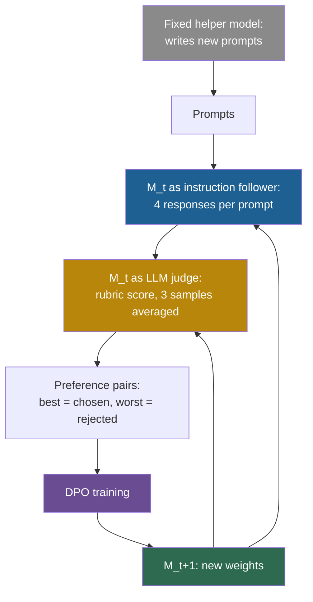

## Learning objectives

After this page you can:

- Explain why a frozen reward model limits a model trained with human feedback, and how Self-Rewarding tries to remove that limit.
- Trace one Self-Rewarding iteration: new prompts, four responses, judge scores, one preference pair, a training update.
- Read the results and compute the shrinking head-to-head margin from the paper's numbers.
- Explain what Meta-Rewarding adds, and why its extra level still saturates.
- Say what stays fixed in both methods, and place them on the ladder.

## Prerequisites

- [L7: Training-based self-improvement and synthetic data](/notes/ai/recursive-self-improvement/05-approaches/l7-training-based-self-improvement)
- [L6: How machine learning systems are trained and evaluated](/notes/ai/recursive-self-improvement/01-foundations/l6-how-ml-systems-are-trained-and-evaluated)
- [L4: Self-evaluation failures](/notes/ai/recursive-self-improvement/08-failure-modes-and-safety/l4-self-evaluation-failures)
- [L4: Improvement dynamics: rates, diminishing returns and plateaus](/notes/ai/recursive-self-improvement/04-mathematics/l4-improvement-dynamics)

> [!note] How to use this page
> This page explains Self-Rewarding Language Models, and the follow-up Meta-Rewarding, well enough that you can follow them without the PDFs. It does not replace them. Read the method description and Tables 1 and 4 of the Self-Rewarding paper after this page. Numbers here come from its arXiv v3 (March 2025). Version 1 may differ slightly. Section 12 of this page places the work in recursive self-improvement (RSI).

## The paper on one card

| Field | Self-Rewarding Language Models | Meta-Rewarding Language Models (follow-up) |
|---|---|---|
| Title | "Self-Rewarding Language Models" | "Meta-Rewarding Language Models: Self-Improving Alignment with LLM-as-a-Meta-Judge" |
| Authors | Weizhe Yuan, Richard Yuanzhe Pang, Kyunghyun Cho, Xian Li, Sainbayar Sukhbaatar, Jing Xu, Jason Weston | Tianhao Wu, Weizhe Yuan, Olga Golovneva, Jing Xu, Yuandong Tian, Jiantao Jiao, Jason Weston, Sainbayar Sukhbaatar |
| Year | 2024 (v1 January 2024, v3 March 2025) | 2024 |
| Venue | ICML 2024 | Not verified |
| arXiv | [arXiv:2401.10020](https://arxiv.org/abs/2401.10020) | [arXiv:2407.19594](https://arxiv.org/abs/2407.19594) |
| Code | No code URL in the material for these notes | No code URL in the material for these notes |
| One-sentence result | On Llama 2 70B, the AlpacaEval 2.0 win rate rose from 9.94% to 20.44%, and judge accuracy rose by 3 points. | A third role that judges the judge raised the length-controlled win rate from 22.92% to 39.44% in four iterations, before scores saturated. |

## Terms

| Term | Plain meaning |
|---|---|
| large language model (LLM) | A very large model that predicts the next token of text. |
| pretraining | Training on a very large amount of text to predict the next token, with no task labels. |
| supervised fine-tuning (SFT) | More training on examples of an input and the wanted output. |
| reward model | A model that gives a response a score that predicts human preference. |
| reinforcement learning from human feedback (RLHF) | Training a model against a reward model that was trained on human rankings. |
| preference pair | Two responses to one prompt: a chosen (better) one and a rejected (worse) one. |
| Direct Preference Optimization (DPO) | A training method that changes the weights so that chosen responses become more likely than rejected ones, with no separate reward model. |
| LLM judge | An LLM that is prompted to score or compare responses. The paper calls this "LLM-as-a-Judge". |
| rubric | A fixed list of criteria that a judge uses to give a score. Here the judge adds points up to 5. |
| IFT and EFT data | Seed examples: instruction-following examples (IFT) and examples of how to judge a response (EFT). |
| win rate | The share of comparisons in which an evaluator prefers a model's response to a reference model's response. |
| length-controlled (LC) win rate | A win rate that is adjusted so that longer answers do not win only because they are longer. |
| pairwise accuracy | How often a judge picks the same response of a pair as human rankings do. |
| meta-judge | The Meta-Rewarding role that compares two judgments and says which one is better. |
| saturation | The state in which scores sit near the top of a scale, so that further gains are hard to detect. |

## 1. The problem it addresses

A student writes practice essays and grades them herself with a rubric. At first her grading is rough. As she writes more, she also learns what good writing looks like, so her grading gets better. Better grading then shows her more precisely what to fix. Can both skills climb together, with no teacher?

Language models face the same question. In RLHF, humans rank model outputs, a reward model learns from those rankings, and the language model is then trained against the reward model. The reward model is trained once and then frozen. So its quality sets a ceiling: the language model cannot learn to be better than its judge can recognize.

Self-Rewarding Language Models ask whether the model can also be its own reward model (Yuan et al., 2024). Then both skills could improve together across iterations.

## 2. What existed before it

**RLHF** (Ouyang et al., 2022, InstructGPT) has three steps:

1. Fine-tune a pretrained model on human-written demonstrations (about 13,000 training prompts).
2. Humans rank 4 to 9 model outputs per prompt. Train a reward model to predict which output humans prefer (about 33,000 prompts).
3. Train the model with reinforcement learning against the reward model's score (about 31,000 prompts).

**Measured:** outputs from a 1.3B-weight InstructGPT model were preferred to outputs from the 175B GPT-3 model, in human evaluations on the authors' prompts. The human signal is expensive, and the reward model does not change after step 2.

**Constitutional AI** (Bai et al., 2022) replaced human preferences for harmlessness with "AI feedback". An AI model chose the less harmful of two responses under a sampled principle. Humans still wrote the principles and supplied helpfulness labels. The paper reports that "RL-CAI models can be over-trained, resulting in Goodharting behavior", for example boilerplate answers.

**Our interpretation:** both methods keep a fixed judge. Self-Rewarding makes the judge part of the model that is trained.

## 3. The central idea

One model plays two roles:

1. **The instruction follower:** it writes responses to prompts.
2. **The judge:** it scores responses, its own included, with "LLM-as-a-Judge prompting".

In each iteration, the model writes several responses, judges them, and turns the best and worst into a preference pair. Training on those pairs updates the weights. Because both roles live in the same weights, one training update can improve both skills. The abstract says the model also improves "the ability to provide high-quality rewards to itself".

> [!analogy] A student who grades her own work
> She writes four answers to each practice question, grades them, and studies the gap between her best and her worst answer. Her writing improves, and so does her eye for good writing.
>
> - **Where it stops working:** a student can compare her grades with a teacher's from time to time. The Self-Rewarding loop has no such check during training. If her rubric favors long answers, she will learn to write long answers and to grade long answers well, and both errors grow together.

## 4. The architecture

**The models:**

1. $M_0$: the base pretrained Llama 2 70B.
2. $M_1$: $M_0$ after SFT on seed data. The seed data has IFT examples and EFT examples, both derived from Open Assistant.
3. $M_2$, $M_3$: the models after the first and second self-rewarding iterations.

**A fixed helper**. New prompts come from a separate, fixed model: Llama 2-Chat 70B, prompted with 8 examples in the style of Self-Instruct. This helper does not change.



The weights (green) persist. The same weights then act both as the follower (blue) and as the judge (gold). This is the point of the method: the evaluator is inside the thing that changes.

## 5. The algorithm, step by step

**Start:** $M_1$ = SFT of $M_0$ on the IFT and EFT seed data.

**Each iteration $t$:**

1. **New prompts**. The fixed helper writes new prompts.
2. **Candidate responses**. $M_t$ samples $N = 4$ responses per prompt, at temperature 0.7 and top-p 0.9.
3. **Self-judging**. $M_t$ scores each response with an additive 5-point rubric. Each score is the average of 3 sampled judgments.
4. **Preference pairs**. For each prompt, the highest-scoring response is "chosen" and the lowest-scoring one is "rejected". Prompts where they tie are discarded.
5. **Training**. DPO on these pairs gives $M_{t+1}$.

The pair counts were 3,964 for training $M_2$ and 6,942 for training $M_3$.

> [!example] Worked example: from four responses to one pair (our illustration)
> Prompt: "Explain in two sentences why the sky is blue."
>
> 1. $M_t$ writes four responses: A, B, C and D.
> 2. It judges each one three times. A gets 4, 4 and 5, so its average is 4.33. B gets 2, 3 and 2, so 2.33. C averages 3.67, and D averages 4.0.
> 3. Chosen: A (4.33). Rejected: B (2.33). The pair (A, B) enters the training data. C and D are not used.
> 4. Second prompt: all four responses average 5.0. The highest equals the lowest, so this prompt gives no pair.
> 5. DPO then makes responses like A more likely, and responses like B less likely, for prompts like this one.
>
> Step 4 shows a quiet risk. When the judge gives top scores to everything, prompts stop producing pairs. Meta-Rewarding later reports this kind of score saturation.

**What DPO does, in plain words**. DPO takes a preference pair and adjusts the weights so that the model gives the chosen response a higher probability, relative to the rejected one. It needs no separate reward model. Here the "preference" comes from the model's own judgment, so the model trains on its own opinion of its own outputs.

## 6. The role of evaluation

Self-Rewarding has two very different evaluators, and they must not be confused.

**Inside the loop: the model judges itself**. The training signal comes from $M_t$'s own rubric scores. Humans supply only the seed data. So the evaluator changes at every iteration, because it is the model being trained. This is the method's strength, because the judge can improve. It is also its risk, because nothing outside the loop corrects the judge during training.

**Outside the loop: the reported benchmarks**. The paper measures the results with:

1. AlpacaEval 2.0: the win rate against GPT-4 Turbo.
2. Head-to-head comparisons between iterations, judged by GPT-4.
3. MT-Bench, a benchmark of multi-turn questions scored by an LLM judge.
4. Pairwise accuracy of the model's judgments against human rankings.

Most of these external evaluators are LLM judges too. **Measured** elsewhere: LLM judges have known biases. When the positions of two answers were swapped, GPT-4 gave consistent judgments in 65.0% of cases (Zheng et al., 2023, Table 2). The same study reports self-enhancement bias numbers, but its authors warn that their "study cannot determine whether the models exhibit a self-enhancement bias." A later study found that GPT-4 and Llama 2 can recognize their own outputs. After fine-tuning, self-recognition and self-preference are linearly related (Panickssery et al., 2024).

> [!trap] A judge that grades its own homework
> **Our interpretation:** a model that judges its own outputs, and is then trained to produce what it judged best, can learn its own biases. The paper itself observed "an increase in length in model generations", and length correlates with judged quality. If the judge likes length, the loop rewards length.

## 7. The experimental setup

**Self-Rewarding** (Yuan et al., 2024):

1. Base model: Llama 2 70B.
2. Seed data: IFT and EFT examples derived from Open Assistant.
3. Iterations: 3 models after SFT ($M_1$, $M_2$, $M_3$), in one setting.
4. Prompt source: the fixed Llama 2-Chat 70B helper.
5. Evaluation: AlpacaEval 2.0, GPT-4 head-to-head, MT-Bench, and pairwise accuracy against human rankings.

**Meta-Rewarding** (Wu et al., 2024) keeps one model in three roles:

1. **Actor:** it writes 7 responses per prompt.
2. **Judge:** it scores each response from 1 to 5 with a rubric, 11 times.
3. **Meta-judge:** it compares pairs of the judge's own judgments and says which judgment is better. Each pair is judged in both orders to reduce position bias. The wins feed an Elo-style score. The judgment with the highest score becomes "chosen", and the lowest becomes "rejected".
4. **Length control:** a setting $\rho$. In the top score tier, the shortest response is chosen. In the lower tier, the longest is rejected.
5. **Training:** 4 iterations of DPO with 5,000 prompts each. Iterations 1 and 2 train on actor pairs and judge pairs. Iterations 3 and 4 train on actor pairs only.
6. **Model:** Llama-3-8B-Instruct as the seed.

## 8. The reported results

**Self-Rewarding: AlpacaEval 2.0 win rate against GPT-4 Turbo (Measured, Table 1):**

| Model | Win rate |
|---|---|
| $M_1$ (SFT) | 9.94% |
| $M_2$ | 15.38% |
| $M_3$ | 20.44% |
| GPT-4 0314 (reference) | 22.07% |
| Claude 2 (reference) | 17.19% |
| Gemini Pro (reference) | 16.85% |
| GPT-4 0613 (reference) | 15.76% |

**Head-to-head, judged by GPT-4 (Measured, Figure 3):**

| Comparison | Wins | Ties | Losses |
|---|---|---|---|
| $M_2$ against $M_1$ | 55.5% | 32.8% | 11.7% |
| $M_3$ against $M_2$ | 47.7% | 39.8% | 12.5% |

**Judging ability: pairwise accuracy against human rankings (Measured, Table 4):** SFT baseline 65.1%, $M_1$ 78.7%, $M_2$ 80.4%, $M_3$ 81.7%.

**MT-Bench (Measured, Table 2):** SFT baseline 6.85, $M_1$ 6.78, $M_2$ 7.01, $M_3$ 7.25.

```plot
{
  "title": "Self-Rewarding across iterations M1 to M3: AlpacaEval 2.0 win rate (blue), judge pairwise accuracy (gold), GPT-4 0314 win rate as a reference (red line)",
  "xAxis": { "label": "model M1, M2, M3", "domain": [0.8, 3.2] },
  "yAxis": { "label": "percent", "domain": [0, 100] },
  "disableZoom": true,
  "data": [
    { "points": [[1, 9.94], [2, 15.38], [3, 20.44]], "fnType": "points", "graphType": "polyline", "color": "#1E6091", "skipTip": true },
    { "points": [[1, 9.94], [2, 15.38], [3, 20.44]], "fnType": "points", "graphType": "scatter", "color": "#1E6091", "skipTip": true },
    { "points": [[1, 78.7], [2, 80.4], [3, 81.7]], "fnType": "points", "graphType": "polyline", "color": "#B8860B", "skipTip": true },
    { "points": [[1, 78.7], [2, 80.4], [3, 81.7]], "fnType": "points", "graphType": "scatter", "color": "#B8860B", "skipTip": true },
    { "fn": "22.07", "color": "#C81D25", "skipTip": true }
  ]
}
```

**Meta-Rewarding (Measured, Wu et al., 2024)**. "Self-Rewarding + LC" is the Self-Rewarding method with length control, run as a baseline in the same setup.

| Metric | Seed | Iter 1 | Iter 2 | Iter 3 | Iter 4 |
|---|---|---|---|---|---|
| AlpacaEval 2 LC win rate, Meta-Rewarding | 22.92% | 27.85% | 32.66% | 35.45% | 39.44% |
| AlpacaEval 2 LC win rate, Self-Rewarding + LC | 22.92% | 26.93% | 30.38% | 34.87% | 35.49% |
| Arena-Hard, Meta-Rewarding | 20.6% | 25.1% | 27.4% | 27.6% | 29.1% |
| Arena-Hard, Self-Rewarding + LC | 20.6% | 23.2% | 26.3% | 28.2% | 27.3% |

```plot
{
  "title": "Arena-Hard score per iteration: Meta-Rewarding (blue), Self-Rewarding with length control (red)",
  "xAxis": { "label": "iteration (0 = seed)", "domain": [-0.2, 4.2] },
  "yAxis": { "label": "Arena-Hard (%)", "domain": [15, 35] },
  "disableZoom": true,
  "data": [
    { "points": [[0, 20.6], [1, 25.1], [2, 27.4], [3, 27.6], [4, 29.1]], "fnType": "points", "graphType": "polyline", "color": "#1E6091", "skipTip": true },
    { "points": [[0, 20.6], [1, 25.1], [2, 27.4], [3, 27.6], [4, 29.1]], "fnType": "points", "graphType": "scatter", "color": "#1E6091", "skipTip": true },
    { "points": [[0, 20.6], [1, 23.2], [2, 26.3], [3, 28.2], [4, 27.3]], "fnType": "points", "graphType": "polyline", "color": "#C81D25", "skipTip": true },
    { "points": [[0, 20.6], [1, 23.2], [2, 26.3], [3, 28.2], [4, 27.3]], "fnType": "points", "graphType": "scatter", "color": "#C81D25", "skipTip": true }
  ]
}
```

## 9. What the results show

1. **A model can create its own preference data and improve on LLM-judged benchmarks**. The AlpacaEval 2.0 win rate rose from 9.94% to 20.44% in two self-rewarding iterations, close to the GPT-4 0314 reference (22.07%).
2. **The judge improved too**. Pairwise accuracy against human rankings rose from 78.7% to 81.7%. **Our interpretation:** this is a weak but real form of the improver improving. The reward source got better, and it was produced by the loop itself.
3. **Judging the judge can add more**. With an explicit meta-judge, the length-controlled win rate reached 39.44% after 4 iterations, against 35.49% for Self-Rewarding with length control.
4. **Length control matters**. Meta-Rewarding added it as a direct response to the length increase that Self-Rewarding observed.

## 10. What the results do not show

1. **It does not show sustained improvement**. The paper "only ran three iterations in a single setting." It says the effect "likely saturates in real-world settings", but it did not test this.
2. **The margin between iterations shrinks**. From the head-to-head table: $M_2$ against $M_1$ has a net margin of $55.5 - 11.7 = 43.8$ points. $M_3$ against $M_2$ has $47.7 - 12.5 = 35.2$ points. Ties rose from 32.8% to 39.8%.
3. **Judge gains are small and slowing**. Pairwise accuracy rose by 1.7 points, then by 1.3 points. The large jump (65.1% to 78.7%) came from the human seed data in SFT, not from self-rewarding.
4. **The first step did not help everywhere**. On MT-Bench, $M_1$ (6.78) scored below the SFT baseline (6.85).
5. **Reward hacking was not tested**. Whether "so-called "reward-hacking" can happen within our framework" is left open.
6. **Length grew**. The paper observed "an increase in length in model generations". Some measured gain may come from length, which LLM judges tend to reward.
7. **The results are judged by other LLMs**. GPT-4 judged the head-to-head comparisons. LLM judges have position and length biases.
8. **The extra meta-level saturates too**. In Meta-Rewarding, Self-Rewarding with length control fell on Arena-Hard at iteration 4 (28.2% to 27.3%). Meta-Rewarding itself gained only 0.2 points at iteration 3 (27.4% to 27.6%).
9. **Not everything is self-made**. Prompts come from a fixed external model. The seed data, the rubric and the DPO procedure come from humans.

## 11. Limitations

**Stated by the Self-Rewarding authors (Section 6):** three iterations in one setting, longer generations, and an open question about reward hacking.

**Stated by the Meta-Rewarding authors (Section 5):**

1. Score saturation: "responses increasingly approached the maximum score, making further improvements difficult to detect."
2. Judge score inflation reduced the judge's ability to tell responses apart.
3. The meta-judge's position bias persisted and "hindered further improvements in Iteration 3."
4. Judge improvement on responses that the model did not write itself was limited.

**Plateaus in related loops (Measured)**. Iterative Reasoning Preference Optimization, by an overlapping group of authors, builds pairs from correct answers instead of self-judgment. Its GSM8K gains per iteration were 17.5, 4.9, 3.1 and 0.5 points. The authors write: "the gain decays across the iterations" (Pang et al., 2024, Section 3.1). Another study found that self-improvement "saturates after two or three rounds, regardless of the model's capacity" (Song et al., 2024, Section 5).

**Our interpretation:** a 5-point rubric is a short ruler. When most answers reach 4 or 5, the judge cannot separate them, so the loop loses its signal.

## 12. Its relationship to RSI

Use the ladder of [Part 2 L2](/notes/ai/recursive-self-improvement/02-core-idea/l2-the-ladder-of-self-improvement), our interpretation built from the literature.

| Question | Self-Rewarding | Meta-Rewarding |
|---|---|---|
| Ladder level | Level 4 (learning in the weights), with a partial step toward Level 5 | Level 4, with one more partial step toward Level 5 |
| What changes | The weights, which hold both the answering skill and the judging skill | The weights, with explicit training of the judging skill |
| What persists | The new weights | The new weights |
| Who proposes | The model, by sampling responses | The model, by sampling responses and judgments |
| Who evaluates during training | The model itself, as an LLM judge | The model as judge, and the model as meta-judge |
| What stays fixed | DPO, the rubric, the prompt generator, the seed data, the schedule | DPO, the rubric, the length rule, the schedule. There is no meta-meta-judge. |
| Does the improver improve? | Partly: the judge gets better (78.7% to 81.7%) | Partly, one more level, until scores saturate |

Two questions help here. Does the system make its own training signal? Yes: responses and rewards come from the model, and prompts come from a fixed helper. Does it improve the process that improves it? Partly: the judge improves, but the training method and the rubric do not.

The definitions disagree about whether this is RSI (see [Part 2 L1](/notes/ai/recursive-self-improvement/02-core-idea/l1-what-rsi-means)). Chen et al. (2026) describe open-ended RSI as changing "the criteria or machinery of improvement itself, with no fixed external anchor". Self-Rewarding moves part of the criteria (the judge) inside the loop, but it keeps fixed anchors: the rubric, the seed data and the training method.

**Our interpretation:** Meta-Rewarding is a concrete answer to "what if we add one more meta-level?" The extra level helped for a few iterations, then hit the same ceiling: a saturated scale and a biased judge. Adding a level did not make the loop unbounded.

## 13. Common mistakes

1. **"The model needs no human data"**. Humans supply the seed IFT and EFT data, the rubric and the training method, and a fixed external model writes the prompts.
2. **"The judge improves without limit because it trains on itself"**. It improved by 1.7 and then 1.3 points of pairwise accuracy, and Meta-Rewarding reports saturation.
3. **"A higher AlpacaEval win rate means a better model in every way"**. The win rate comes from an LLM judge, and generations grew longer. Length-controlled numbers exist for this reason.
4. **"Self-Rewarding is RSI in the strong sense"**. The training method, the rubric and the seed data stay fixed. Only the judging skill inside the weights changes.
5. **"Adding a meta-judge removes the ceiling"**. Meta-Rewarding gained for four iterations, then saturated, and it has no meta-meta-judge.
6. **"Ties are harmless"**. Ties are discarded, so a judge that gives everything top marks produces fewer training pairs and less signal.

## 14. One-minute explanation

Self-Rewarding Language Models let one model both answer prompts and judge answers. Each iteration, it scores four responses per prompt with a 5-point rubric and trains with DPO on the best and worst. Both skills live in the same weights, so the judge improves too. Judge agreement with humans rose from 78.7% to 81.7%, and the win rate from 9.94% to 20.44%. The evidence covers three iterations with shrinking gains, and the rubric, the seed data and the training method stay fixed. Meta-Rewarding adds a meta-judge, gains more, then saturates within four iterations: one more level did not remove the ceiling.

## 15. Check questions

```check
{
  "question": "Use the head-to-head table. Compute the net margin (wins minus losses) for M2 against M1 and for M3 against M2. Then name two explanations for the change, and say which result would support each one.",
  "hint": "Also check how the share of ties changes.",
  "answer": "M2 against M1: $55.5 - 11.7 = 43.8$ points. M3 against M2: $47.7 - 12.5 = 35.2$ points. Ties rose from 32.8% to 39.8%. Explanation 1: diminishing returns, so each iteration adds less. A fourth iteration with an even smaller margin would support it. Explanation 2: the GPT-4 judge cannot separate two strong models, so more comparisons end in ties. Human evaluation of the same pairs with fewer ties would support it."
}
```

```check
{
  "question": "For one prompt, M_t's averaged rubric scores for four responses are 3.0, 4.67, 4.67 and 2.33. For a second prompt, they are 4.0, 4.0, 4.0 and 4.0. Which preference pairs enter the training data?",
  "hint": "Chosen = highest, rejected = lowest, and ties between highest and lowest are discarded.",
  "answer": "First prompt: the highest score is 4.67, shared by two responses, and the lowest is 2.33. So one of the two 4.67 responses is chosen, and the 2.33 response is rejected. The research notes do not say how the method breaks a tie for first place. Second prompt: the highest equals the lowest (4.0), so the prompt is discarded. It produces no pair."
}
```

```check
{
  "question": "List what changes and what stays fixed in Self-Rewarding. Then answer: is the improver improved, and which part of the improver?",
  "hint": "Think of the improver as everything that turns the current model into the next one.",
  "answer": "Changes: the weights, and with them the answering skill and the judging skill. Fixed: the prompt-writing helper model, the seed data, the 5-point rubric, the sampling settings, the pair rule and DPO. The improver is partly improved. Its reward source, the model as judge, gets better (78.7% to 81.7%). Its other parts, the training method, the rubric and the prompt source, stay the same."
}
```

```check
{
  "question": "Self-Rewarding generations grew longer across iterations. Explain the mechanism that can cause this, and describe the control that Meta-Rewarding uses against it.",
  "hint": "Ask what the judge rewards and what DPO then makes more likely.",
  "answer": "If the model's judge gives higher scores to longer responses, the chosen response in each pair tends to be longer. DPO then makes longer responses more likely, and the next judge, trained in the same weights, may favor length too. Meta-Rewarding adds length control with a parameter $\\rho$. In the top score tier it chooses the shortest response, and it rejects the longest in the lower tier. It also reports length-controlled win rates."
}
```

```check
{
  "question": "From the Meta-Rewarding table, compute the Arena-Hard gain at each iteration for both methods. What pattern do you see, and why should you be careful about reading a single 0.9-point drop?",
  "hint": "Subtract each value from the next one.",
  "answer": "Meta-Rewarding: +4.5, +2.3, +0.2, +1.5. Self-Rewarding + LC: +2.6, +3.1, +1.9, -0.9. Both methods gain most early and little later, which is a sign of saturation. The single drop of 0.9 points comes from one run per iteration with no error bars in these notes, so it may be noise. The safer reading is the trend: gains shrink toward zero within four iterations."
}
```

## 16. Summary and links

- Self-Rewarding: one model answers and judges. Its best and worst answers per prompt become training pairs, and DPO updates the weights.
- Measured on Llama 2 70B: AlpacaEval 2.0 win rate 9.94% → 15.38% → 20.44%, and judge accuracy 78.7% → 81.7%.
- The judge improves, so the reward source improves. This is a partial step toward improving the improver.
- The gains shrink, generations get longer, and reward hacking was not tested. The rubric, the seed data, the prompt generator and DPO stay fixed.
- Meta-Rewarding adds a meta-judge and length control. It gains more, then saturates within four iterations.

**Next:** ADAS (Automated Design of Agentic Systems) moves from weights back to code: a meta agent writes whole new agents as programs.

**Links:**

- Previous: [2023: STOP, the Self-Taught Optimizer](/notes/ai/recursive-self-improvement/06-research-systems/p05-stop-self-taught-optimizer)
- Next: [2024: ADAS and Meta Agent Search](/notes/ai/recursive-self-improvement/06-research-systems/p07-adas-meta-agent-search)
- Related: [L2: Imperfect evaluators and evaluators that are optimized](/notes/ai/recursive-self-improvement/10-advanced/l2-imperfect-and-optimized-evaluators), [L8: Meta-learning and improving the improver](/notes/ai/recursive-self-improvement/05-approaches/l8-meta-learning-and-improving-the-improver)

**Videos:**

- [Learning to Reason with LLMs](https://www.youtube.com/watch?v=_MNlLhU33H0) (Jason Weston, UC Berkeley, 2025). A co-author of both papers moves from reflection to training-time self-improvement: Self-Rewarding, Iterative Reasoning Preference Optimization and Meta-Rewarding. It supports sections 3, 5 and 8.

## References

- Weizhe Yuan, Richard Yuanzhe Pang, Kyunghyun Cho, et al. "Self-Rewarding Language Models". ICML 2024. arXiv:2401.10020. https://arxiv.org/abs/2401.10020
- Tianhao Wu, Weizhe Yuan, Olga Golovneva, et al. "Meta-Rewarding Language Models: Self-Improving Alignment with LLM-as-a-Meta-Judge". 2024. arXiv:2407.19594. https://arxiv.org/abs/2407.19594
- Long Ouyang, Jeff Wu, Xu Jiang, et al. "Training language models to follow instructions with human feedback". NeurIPS 2022. arXiv:2203.02155. https://arxiv.org/abs/2203.02155
- Yuntao Bai, Saurav Kadavath, Sandipan Kundu, et al. "Constitutional AI: Harmlessness from AI Feedback". 2022. arXiv:2212.08073. https://arxiv.org/abs/2212.08073
- L. Zheng, W.-L. Chiang, Y. Sheng, et al. "Judging LLM-as-a-Judge with MT-Bench and Chatbot Arena". NeurIPS 2023 Datasets and Benchmarks Track. arXiv:2306.05685. https://arxiv.org/abs/2306.05685
- A. Panickssery, S. R. Bowman, S. Feng. "LLM Evaluators Recognize and Favor Their Own Generations". NeurIPS 2024. arXiv:2404.13076. https://papers.nips.cc/paper_files/paper/2024/hash/7f1f0218e45f5414c79c0679633e47bc-Abstract-Conference.html
- Richard Yuanzhe Pang, Weizhe Yuan, Kyunghyun Cho, et al. "Iterative Reasoning Preference Optimization". 2024. arXiv:2404.19733. https://arxiv.org/abs/2404.19733
- Yuda Song, Hanlin Zhang, Carson Eisenach, et al. "Mind the Gap: Examining the Self-Improvement Capabilities of Large Language Models". 2024. arXiv:2412.02674. https://arxiv.org/abs/2412.02674
- Mingguang Chen, Licheng Wang, Bo Qu. "Recursive Self-Improvement in AI: From Bounded Self-Refinement to Autonomous Research Loops". 2026. arXiv:2607.07663. https://arxiv.org/pdf/2607.07663
