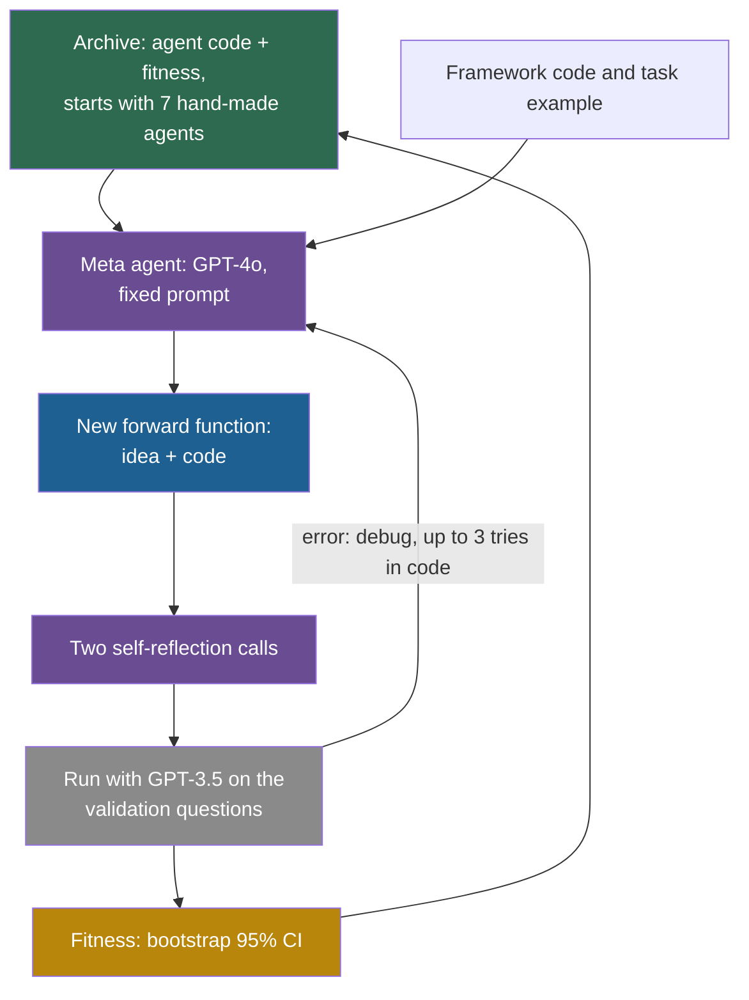

## Learning objectives

After this page you can:

- Explain the three components of automated agent design, and why ADAS (Automated Design of Agentic Systems) writes agents as code.
- Trace one iteration of Meta Agent Search, from the archive in the prompt to a new archive entry.
- Read the main results and separate the strong gains (DROP, MGSM) from the weak ones (MMLU, GPQA).
- Compute the noise of a score on 20 or 32 validation questions, and explain why small selection sets matter.
- Summarize four critiques: an independent replication, a competitor's re-run, transfer agents chosen by test accuracy, and a safety gap between paper and code.
- Place ADAS on the ladder, and explain why its improver does not improve.

## Prerequisites

- [L4: Workflow and architecture search](/notes/ai/recursive-self-improvement/05-approaches/l4-workflow-and-architecture-search)
- [L3: Archives: why keep more than the best version](/notes/ai/recursive-self-improvement/03-anatomy/l3-archives-and-search-over-versions)
- [L3: Evaluation under noise](/notes/ai/recursive-self-improvement/04-mathematics/l3-evaluation-under-noise)
- [2023: STOP, the Self-Taught Optimizer](/notes/ai/recursive-self-improvement/06-research-systems/p05-stop-self-taught-optimizer)

> [!note] How to use this page
> This page explains ADAS well enough that you can follow its method and results without the PDF. It does not replace the paper. Read the method description and Table 1 of arXiv v2 after this page. Part 7 walks through the code: [L3: ADAS in code](/notes/ai/recursive-self-improvement/07-implementations/l3-adas-in-code). Section 12 of this page places the work in recursive self-improvement (RSI).

## The paper on one card

| Field | Value |
|---|---|
| Title | "Automated Design of Agentic Systems" |
| Authors | Shengran Hu, Cong Lu, Jeff Clune |
| Year | 2024 (arXiv v1 August 2024, v2 March 2025) |
| Venue | ICLR 2025. The repository also lists an Outstanding Paper award at the NeurIPS 2024 Open-World Agent Workshop. |
| arXiv | [arXiv:2408.08435](https://arxiv.org/abs/2408.08435) |
| Code | [ShengranHu/ADAS](https://github.com/ShengranHu/ADAS), Apache 2.0 license |
| One-sentence result | A GPT-4o meta agent wrote Python agents that beat hand-designed ones on DROP and MGSM, with small gains on MMLU and GPQA. |

## Terms

| Term | Plain meaning |
|---|---|
| large language model (LLM) | A very large model that predicts the next token of text. |
| agentic system | A program that uses one or more LLM calls, with control flow, roles and tools, to solve a task. |
| ADAS | Automated Design of Agentic Systems: the research area of making agent designs automatically. |
| Meta Agent Search | The paper's algorithm for ADAS. |
| meta agent | The LLM that writes new agents. In ADAS, it is fixed. |
| `forward()` function | The single Python function that defines one agent: it takes a task and returns an answer. |
| archive | The stored list of every agent found so far, with its score. |
| fitness | ADAS's name for an agent's score on the validation set. |
| search space | The set of all agents that the method could, in principle, write. |
| Turing-complete | Able to express any computation. Python code is Turing-complete. |
| bootstrap confidence interval | An interval for a score, made by resampling the per-question results many times. |
| F1 | A score for text answers that counts the overlap of words between the answer and the reference. |
| transfer | Using an agent on a task or with an LLM that it was not designed on. |
| IO prompting | The simplest baseline: give the LLM the question and take its answer. |

## 1. The problem it addresses

For decades, chefs invented cooking techniques by hand: braising, sous-vide, fermentation. Imagine a kitchen that hires a "technique inventor". It does not cook dinner. It writes new recipes for how to cook, tests each one on a tasting panel, and keeps a notebook of everything it tried.

Agent designs for LLMs were also invented by hand. Chain-of-thought, self-refinement, debate between several LLM calls, and role assignment are all human inventions. ADAS starts from an observation about machine learning history: learned solutions tend to replace hand-designed ones. This is the argument of Clune's 2019 "AI-generating algorithms" agenda, and Clune is the senior author of ADAS.

The question: can a meta agent invent agent designs automatically, and can those designs beat the hand-made ones?

## 2. What existed before it

1. **Hand-designed agent patterns**. Chain-of-thought (CoT), self-consistency with several CoT samples (CoT-SC), Self-Refine, LLM Debate, Step-back Abstraction, Quality-Diversity and Role Assignment. These seven become ADAS's starting archive.
2. **Prompt-optimization methods**. OPRO (Optimization by PROmpting) and Promptbreeder change prompts, but not the control flow of an agent.
3. **Graph-based agent optimization**. Earlier work represented agents as graphs and optimized parts of them.
4. **Neural architecture search (NAS)**. From 2016, controllers and evolutionary methods searched for neural network designs. One reinforcement-learning NAS run trained 12,800 architectures on 800 GPUs (Zoph and Le, 2016). ADAS borrows this idea for agents.

ADAS frames its contribution as moving the search from prompts to whole programs. Once an agent is code, the search can change anything that code can express.

## 3. The central idea

Define every agent in code. Each agent is a Python `forward()` function inside "a simple framework (within 100 lines of code)". Because code is Turing-complete, the paper argues that "this approach theoretically enables the learning of any possible agentic system". **Theory:** this is a statement about what can be written, not about what the search finds.

Then let a meta agent write new agents. The meta agent reads an archive of earlier agents with their scores, and writes a new one. Its prompt asks it to explore "interestingly new (e.g., novel or worthwhile) agents."

> [!analogy] A technique inventor with a notebook
> The inventor reads every technique in the notebook, with its tasting-panel score, and writes a new one. The kitchen tries it on 20 to 128 test dishes, writes the score in the notebook, and repeats.
>
> - **Where it stops working:** a human inventor learns from years of practice and becomes a better inventor. The meta agent never changes. Its model, its prompt and its procedure are the same on the 30th iteration as on the first. Only the notebook grows.

## 4. The architecture

The paper names three components of any ADAS method (Figure 2):

1. **The search space:** which agents can be represented. Here: any `forward()` function in the framework.
2. **The search algorithm:** how to explore. Here: Meta Agent Search.
3. **The evaluation function:** how to score an agent. Here: accuracy (or F1) on a validation set.



**Inside the framework (released code, commit `2702bee`)**. An agent calls helper sub-agents of a class named `LLMAgentBase`. These return JSON fields, and their default model is `gpt-3.5-turbo-0125`. A task arrives as an `Info` record that holds the question.

## 5. The algorithm, step by step

### 5.1 Meta Agent Search

The algorithm, paraphrased from the paper:

```text
archive = hand-designed baselines (CoT, CoT-SC, Self-Refine, LLM Debate, Quality-Diversity,
          Step-back Abstraction, Role Assignment), each with its validation score
for iteration in 1..N:                       # N = 25 (ARC), 30 (reasoning domains)
    meta agent (gpt-4o-2024-05-13) reads: framework code, task description, archive
    meta agent writes a high-level idea + code for a new forward()
    two self-reflection calls: check novelty ("interestingly new") and correctness
    if running the code errors: reflect and fix, up to 5 times
    evaluate the agent on the VALIDATION set using gpt-3.5-turbo-0125
    add (code, score) to archive
report held-out TEST accuracy of selected agents
```

In words:

1. Start the archive with the seven hand-designed agents and their validation scores.
2. The meta agent reads the framework code, the task description and the whole archive.
3. It writes an idea and the code of a new `forward()` function.
4. Two more calls ask it to reflect on whether the agent is new and correct, and to revise it.
5. If the code fails when it runs, the error goes back to the meta agent, which tries to fix it.
6. The new agent runs on the validation questions, with GPT-3.5 as the LLM inside the agent.
7. The agent and its score join the archive. Repeat from step 2.
8. At the end, selected agents are scored on the held-out test set.

### 5.2 What the released code does (commit `2702bee`)

The code facts below come from a reading of the repository, not from running it.

1. **The whole archive is the context**. Every entry is serialized as JSON with its `thought`, `name`, `code`, `fitness` and `generation`. There is no parent selection: the meta agent sees everything.
2. **Three calls make one candidate**. A first answer, then two reflection prompts. The meta agent runs at temperature 0.8 and must answer in JSON.
3. **The new code is a string**. It runs with `exec`, and the resulting function is attached to an empty class with `setattr(AgentSystem, "forward", func)`. This is monkey patching. No file is written for a candidate.
4. **Debugging**. On an error, the error text goes back with the request to "debug the current code". The code allows 3 tries, and the paper says "up to five times".
5. **Fitness is a text**. It is a 95% bootstrap confidence interval from 100,000 resamples, written like "95% Bootstrap Confidence Interval: (x%, y%), Median: z%".
6. **Every working candidate joins the archive**. There is no comparison with existing agents. Low-scoring agents stay in the archive and in the prompt.
7. **The only selection pressure is the meta agent's reading**. The prompt says: "Your GOAL is to maximize the 'fitness'."

> [!example] A real archive entry from the repository
> The shipped file `results/mgsm_gpt3.5_results.json` has 36 entries: 7 seeds and 29 generated agents. The last one is called "Dynamic Task Allocation and Feedback Agent", from generation 30. Its fitness reads "(23.4%, 39.1%), Median: 31.2%".
>
> 1. The validation set for MGSM has 128 questions.
> 2. The interval runs from 23.4% to 39.1%, a width of 15.7 points.
> 3. Any agent whose median lies within about 8 points of 31.2% cannot be told apart from this one with these 128 questions.
> 4. The meta agent sees this string and must decide what to try next. It sees no per-question results, only the summary.

## 6. The role of evaluation

**The evaluator is fixed and external**. It is the validation accuracy of an agent when GPT-3.5 runs it. The meta agent cannot change the evaluation code, the data split or the executor model.

**The selection sets are small**. The splits (paper appendix and code defaults):

| Domain | Validation questions | Test questions | Evaluations per question |
|---|---|---|---|
| ARC (grid puzzles) | 20 | 60 | 5 |
| DROP, MGSM, MMLU | 128 | 800 | 1 |
| GPQA | 32 | 166 | 5 |

The standard error (SE) of a pass rate $p$ on $n$ questions is $\sqrt{p(1-p)/n}$ (Miller, 2024). Here $p$ is the true accuracy and $n$ is the number of questions. The SE is the typical gap between the measured and the true accuracy.

> [!example] Worked example: how noisy is a score on 20 ARC questions?
> Take an agent with a true accuracy of 10% on ARC.
>
> 1. $\mathrm{SE} = \sqrt{0.10 \times 0.90 / 20} = \sqrt{0.0045} \approx 0.067$, or 6.7 points.
> 2. A 95% interval is about $\pm 1.96 \times 6.7 \approx \pm 13.1$ points.
> 3. So the measured score can easily land anywhere between 0% and about 23%.
> 4. For GPQA, with 32 questions and a true accuracy of 30%: $\mathrm{SE} = \sqrt{0.21/32} \approx 0.081$, so about $\pm 15.9$ points.
> 5. Evaluating each question 5 times reduces only the noise from the LLM's random answers. It does not change which 20 questions were drawn.

**Why this matters: the winner's curse**. Suppose many candidates with the same true quality are scored on few questions. The best measured one is the luckiest, so its score is biased upward. A simple simulation, made for these notes and not taken from a paper, shows the size.

Twenty equal variants with a true pass rate of 50% were each scored on 50 tasks. The best measured score averaged 63.2%. ADAS scores 25 to 30 candidates on 20 to 128 questions. **Our interpretation:** the validation winner is likely to look better than it is, and only held-out test scores can correct this.

The paper does report held-out test scores in Table 1. Two weak points remain:

1. How the "best" agent in Table 1 is picked is not stated in the text read for these notes.
2. On transfer, the paper says: "We test the top 3 agents with the best test accuracy evaluated with GPT-3.5 on ARC." So those agents were chosen by test accuracy, which makes the transfer table not a clean held-out estimate.

## 7. The experimental setup

1. **Meta agent:** `gpt-4o-2024-05-13`.
2. **LLM inside the designed agents:** `gpt-3.5-turbo-0125`.
3. **Iterations:** 25 for ARC, 30 for the reasoning domains.
4. **Domains:** ARC (grid puzzles up to 5 by 5, from the "Public Training Set (Easy)") and DROP (reading comprehension, scored by F1, one-shot). Also MGSM (multilingual grade-school math), MMLU (multi-subject questions) and GPQA (hard science questions, "diamond" set). All but DROP are zero-shot.
5. **Transfer:** math agents tested on GSM8K and GSM-Hard, and on non-math domains. ARC agents tested with Claude-Haiku, GPT-4 and Claude-Sonnet.
6. **Cost:** the paper has a "Cost of Experiments" appendix, but it could not be read for these notes. The Gödel Agent paper states that Meta Agent Search needs about USD 300 (Yin et al., 2025, Appendix D). Its own method needs about USD 15. These are figures from another team.

## 8. The reported results

**ARC (Measured, GPT-3.5 inside agents)**. Best hand-designed agent, CoT-SC: 8.0% ± 3.2%. Best discovered agent: 13.7% ± 3.9% (as extracted).

**Reasoning domains (Measured, Table 1, v2, held-out test, GPT-3.5 inside agents)**. DROP is F1, the others are accuracy in percent.

| Agent | DROP F1 | MGSM | MMLU | GPQA |
|---|---|---|---|---|
| Chain-of-Thought | 64.2 | 28.0 | 65.4 | 29.2 |
| CoT-SC | 64.4 | 28.2 | 65.9 | 30.5 |
| Self-Refine | 59.2 | 27.5 | 63.5 | 31.6 |
| LLM Debate | 60.6 | 39.0 | 65.6 | 31.4 |
| Step-back Abstraction | 60.4 | 31.1 | 65.1 | 26.9 |
| Quality-Diversity | 61.8 | 23.8 | 65.1 | 30.2 |
| Role Assignment | 65.8 | 30.1 | 64.5 | 31.1 |
| Prompt Optimization (OPRO) | 69.1 | 30.6 | 67.6 | 32.9 |
| Meta Agent Search | 79.4 | 53.4 | 69.6 | 34.6 |

The paper reports "improvements in F1 scores by 13.6/100 and accuracy rates by 14.4%". These are gains over the best hand-designed agent: $79.4 - 65.8 = 13.6$ on DROP and $53.4 - 39.0 = 14.4$ on MGSM. Against the OPRO baseline, added in v2, the DROP gain is $79.4 - 69.1 = 10.3$ F1. On MMLU and GPQA, the gains over OPRO are only 2.0 and 1.7 points, inside the confidence intervals of about ±3.2 points.

```plot
{
  "title": "ADAS Table 1, held-out test: Meta Agent Search (blue), OPRO (gold), Chain-of-Thought (red). Benchmarks 1-4: DROP F1, MGSM, MMLU, GPQA",
  "xAxis": { "label": "benchmark number", "domain": [0.5, 4.5] },
  "yAxis": { "label": "score", "domain": [20, 85] },
  "disableZoom": true,
  "data": [
    { "points": [[1, 79.4], [2, 53.4], [3, 69.6], [4, 34.6]], "fnType": "points", "graphType": "polyline", "color": "#1E6091", "skipTip": true },
    { "points": [[1, 79.4], [2, 53.4], [3, 69.6], [4, 34.6]], "fnType": "points", "graphType": "scatter", "color": "#1E6091", "skipTip": true },
    { "points": [[1, 69.1], [2, 30.6], [3, 67.6], [4, 32.9]], "fnType": "points", "graphType": "polyline", "color": "#B8860B", "skipTip": true },
    { "points": [[1, 69.1], [2, 30.6], [3, 67.6], [4, 32.9]], "fnType": "points", "graphType": "scatter", "color": "#B8860B", "skipTip": true },
    { "points": [[1, 64.2], [2, 28.0], [3, 65.4], [4, 29.2]], "fnType": "points", "graphType": "polyline", "color": "#C81D25", "skipTip": true },
    { "points": [[1, 64.2], [2, 28.0], [3, 65.4], [4, 29.2]], "fnType": "points", "graphType": "scatter", "color": "#C81D25", "skipTip": true }
  ]
}
```

The lines only help the eye. The four benchmarks are separate.

**Cross-domain transfer (Measured)**. "Notably, our agents improve accuracy by 25.9% on GSM8K and 13.2% on GSM-Hard". The top MGSM agent scored 69.5 against 43.6 for the best baseline on GSM8K, and 31.2 against 18.0 on GSM-Hard. Math agents also transferred to reading comprehension and multi-subject questions, and were roughly equal on science.

**Cross-model transfer on ARC (Measured, Table 3)**. With Claude-Sonnet inside the agent, the best discovered agent scored 48.3% ± 5.7%, against 39.3% ± 5.5% for Self-Refine, the best baseline. These agents were the top 3 by GPT-3.5 test accuracy, as the evaluation section explains.

## 9. What the results show

1. **A frozen LLM can write agent code that beats hand-designed patterns on some benchmarks**. The clearest cases are DROP (+13.6 F1 over the best hand-designed agent) and MGSM (+14.4 points).
2. **Some discovered designs transfer**. Math agents designed on MGSM helped on GSM8K and GSM-Hard, and ARC agents helped with stronger LLMs.
3. **Agents as code is a workable search space**. The meta agent wrote runnable, novel agents, with a debugging loop for failures.
4. **An archive gives the meta agent material to build on**. The design keeps every agent, including weak ones, as context.

## 10. What the results do not show

1. **The meta agent never improves itself**. Its model, prompt and procedure are fixed. The paper names higher-order meta-learning as future work.
2. **The gains on MMLU and GPQA are not established**. They are 2.0 and 1.7 points over OPRO, inside the confidence intervals.
3. **The tasks are single-step question answering**. Nothing here shows gains on long, multi-step agent tasks.
4. **The ARC evidence is thin**. The validation set has 20 questions and the test set 60. The ARC gain (8.0% to 13.7%) is within reach of the noise computed in the evaluation section.
5. **The transfer table is not a clean estimate**. The transferred ARC agents were chosen by test accuracy.
6. **Turing-completeness is not evidence of good search**. It says that any agent can be written, not that the search finds good ones.
7. **The cost is not established**. The cost appendix could not be read for these notes. The only figure, about USD 300, comes from another paper.

## 11. Limitations

### 11.1 Independent and competing evaluations

**An independent replication (Measured)**. El, Yuksekgonul and Zou (2025), Findings of EMNLP 2025, re-ran ADAS-style meta agents. Their setup used GPT-3.5 agents, a GPT-4o meta agent, 30 iterations and 3 runs. The data were MGSM, DROP, MMLU (128 training and 200 test questions) and GPQA (32 and 160). They found:

1. The ADAS-style context, which shows the meta agent all earlier designs, "performs worse than ignoring prior designs entirely".
2. An evolutionary context, which shows only the top 7 parents, does better (up to 10% over the cumulative context on MGSM, as extracted).
3. The meta agent "typically commits to a single agent at test time", and the designed agents show "low behavioral diversity".
4. Automated design was cheaper than human design on only two datasets (DROP and MMLU), and only when deployed on "over 15,000 examples".
5. Agents chosen by the best training score lost on test. MMLU, cumulative context: 74.7 on training, 66.2 on test. On GPQA, an evolved agent scored 28.5 on test, below the initial library's 30.0 (table extraction).

**A competitor's re-run (Measured, with a caveat)**. The AFlow paper (Zhang et al., 2024) re-ran ADAS with GPT-4o-mini on six benchmarks. ADAS averaged 67.2, below plain IO prompting at 72.8. On MBPP it scored 53.4 against 71.8, and on MATH 35.4 against 48.6. This is a competitor's reimplementation, so it may not match the original setup.

```plot
{
  "title": "AFlow's re-run with GPT-4o-mini: IO prompting (red), ADAS (blue), AFlow (gold). Benchmarks 1-6: HotpotQA, DROP, HumanEval, MBPP, GSM8K, MATH",
  "xAxis": { "label": "benchmark number", "domain": [0.5, 6.5] },
  "yAxis": { "label": "score", "domain": [30, 100] },
  "disableZoom": true,
  "data": [
    { "points": [[1, 68.1], [2, 68.3], [3, 87.0], [4, 71.8], [5, 92.7], [6, 48.6]], "fnType": "points", "graphType": "polyline", "color": "#C81D25", "skipTip": true },
    { "points": [[1, 68.1], [2, 68.3], [3, 87.0], [4, 71.8], [5, 92.7], [6, 48.6]], "fnType": "points", "graphType": "scatter", "color": "#C81D25", "skipTip": true },
    { "points": [[1, 64.5], [2, 76.6], [3, 82.4], [4, 53.4], [5, 90.8], [6, 35.4]], "fnType": "points", "graphType": "polyline", "color": "#1E6091", "skipTip": true },
    { "points": [[1, 64.5], [2, 76.6], [3, 82.4], [4, 53.4], [5, 90.8], [6, 35.4]], "fnType": "points", "graphType": "scatter", "color": "#1E6091", "skipTip": true },
    { "points": [[1, 73.5], [2, 80.6], [3, 94.7], [4, 83.4], [5, 93.5], [6, 56.2]], "fnType": "points", "graphType": "polyline", "color": "#B8860B", "skipTip": true },
    { "points": [[1, 73.5], [2, 80.6], [3, 94.7], [4, 83.4], [5, 93.5], [6, 56.2]], "fnType": "points", "graphType": "scatter", "color": "#B8860B", "skipTip": true }
  ]
}
```

ADAS beats IO only on DROP in this re-run. These values come from a table extraction and should be checked against the AFlow paper before you quote them.

**A self-referential follow-up (Measured)**. Gödel Agent (Yin et al., 2025) used Meta Agent Search as its main baseline. With GPT-3.5 inside the agents, its constrained version beat Meta Agent Search on MGSM by 10.8 points (64.2 against 53.4). Elsewhere the margins were smaller, and on MMLU and GPQA they were inside the confidence intervals.

### 11.2 Safety: the paper and the code differ

The paper's Section 6 says: "we have implemented safety measures including containerized execution of all generated code in secure, isolated environments". The released code has no container logic (commit `2702bee`):

1. Model-written code runs with `exec` in the main Python process, with the API client, the file system and the internet available.
2. The ARC version also runs `eval` on the agents' outputs.
3. There are no timeouts and no resource limits in the evaluation path.
4. The README warns: "The code in this repository involves executing untrusted model-generated code."

The meta agent cannot edit the search loop, because it writes only `forward()`. But the code it writes has full access to the process. Any isolation must be added by the user.

### 11.3 A small code observation

When the meta agent's reply cannot be parsed, the code runs `n -= 1` inside a `for n in range(...)` loop. That line has no effect in Python, so the generation is skipped, not retried. This is an observation from reading the code, not a confirmed bug.

## 12. Its relationship to RSI

Use the ladder of [Part 2 L2](/notes/ai/recursive-self-improvement/02-core-idea/l2-the-ladder-of-self-improvement), our interpretation built from the literature.

| Question | ADAS |
|---|---|
| Ladder level | Level 3 in what changes (the agent's implementation), but done by a separate, fixed designer |
| What changes | The designed agents' code: prompts, control flow, number of LLM calls, roles |
| What persists | The archive of agent code with scores |
| Who proposes | The fixed meta agent (GPT-4o) |
| Who evaluates | A fixed validation accuracy, with GPT-3.5 inside the agents |
| What stays fixed | The meta agent's model and prompt, the archive format, the evaluation, the executor LLM, the iteration count |
| Does the improver improve? | No. The paper names this as future work. |

ADAS is automated design, not self-modification. The agents that it produces do not edit themselves, and the meta agent that produces them does not change. A later paper describes ADAS as "not self-improving" for this reason (Robeyns et al., 2025, Section 2). The paper itself names the next step as future work: "It would be an exciting direction to have a higher order of meta-learning". It speaks of learning "the meta agent and even the meta-meta agent". **Speculation:** not done in ADAS.

**Our interpretation:** the move from prompts to code is what makes ADAS important for RSI. Once an agent is code, an agent can, in principle, edit its own code. The same lab's [Darwin Gödel Machine](/notes/ai/recursive-self-improvement/06-research-systems/p10-darwin-godel-machine) (DGM) does exactly that. Its ablation "DGM w/o self-improve" keeps the base agent fixed as the meta agent, much like ADAS. That version reached 39.0% on SWE-bench, against 50.0% for the full DGM, in single runs (Zhang et al., 2025). So in that one setting, letting the improver be improved helped.

## 13. Common mistakes

1. **"ADAS is a self-improving agent"**. A fixed meta agent writes other agents. Neither the meta agent nor its loop changes.
2. **"Meta Agent Search beats every baseline everywhere"**. On MMLU and GPQA, its gains over OPRO are inside the confidence intervals. In AFlow's re-run, it averaged below plain IO prompting.
3. **"The transfer results are held-out"**. The transferred ARC agents were chosen by their test accuracy.
4. **"Turing-completeness means the search can find any agent"**. It means any agent can be written. Finding a good one is a separate question.
5. **"The archive is used to pick parents"**. The released code puts the whole archive into the prompt. There is no parent-selection rule.
6. **"Generated code ran in containers"**. The paper says so, but the released code runs it with `exec` in the main process.
7. **"A bigger archive always helps"**. An independent study found that the ADAS-style cumulative context did worse than ignoring prior designs.

## 14. One-minute explanation

ADAS treats every agent as one Python `forward()` function, and lets a fixed GPT-4o meta agent write new ones. Each iteration, it reads the archive of scored agents, writes and checks a new one, and adds it after a small validation run. On held-out tests it beat hand-designed agents on DROP and MGSM by about 14 points, but not clearly on MMLU and GPQA. An independent study found that the full-archive context hurt, and a competitor's re-run put ADAS below plain prompting. The meta agent never changes, so ADAS is automated design, not recursive self-improvement, but it prepared the way for agents that edit their own code.

## 15. Check questions

```check
{
  "question": "The best discovered ARC agent scored 13.7% on 60 test questions. Compute a rough 95% interval from the binomial formula. Then compare it with the best baseline's 8.0%. What can you conclude?",
  "hint": "Use $\\sqrt{p(1-p)/n}$ with $p = 0.137$ and $n = 60$.",
  "answer": "$\\sqrt{0.137 \\times 0.863 / 60} \\approx 0.044$. A 95% interval is about $\\pm 1.96 \\times 4.4 \\approx \\pm 8.7$ points, so roughly 5% to 22%. The baseline's 8.0% lies inside this interval. The paper's own intervals (±3.9 and ±3.2) are narrower because they come from 5 evaluations per question. But the 5 repeats do not change which 60 questions were drawn. So the ARC gain is suggestive, not established."
}
```

```check
{
  "question": "From Table 1, compute Meta Agent Search's gain over OPRO on all four benchmarks. The confidence intervals are about ±3.2 points. Which gains would you call established, and which not?",
  "hint": "Subtract the OPRO row from the Meta Agent Search row.",
  "answer": "DROP: $79.4 - 69.1 = 10.3$. MGSM: $53.4 - 30.6 = 22.8$. MMLU: $69.6 - 67.6 = 2.0$. GPQA: $34.6 - 32.9 = 1.7$. DROP and MGSM are far outside ±3.2 points, so they look established in this setup. MMLU and GPQA are inside the intervals, so they are not established."
}
```

```check
{
  "question": "In the released code, a new agent joins the archive if it produces any accuracy list, with no comparison to other agents. Where, then, does selection pressure toward better agents come from? Name one risk of this design.",
  "hint": "Check what the meta agent sees in its prompt.",
  "answer": "Selection comes only from the meta agent reading the fitness strings in its prompt, which tells it: \"Your GOAL is to maximize the 'fitness'.\" It is an implicit selection by an LLM, not an explicit rule. One risk: the archive and the prompt grow with every iteration, weak agents included. An independent study found that this cumulative context performed worse than ignoring prior designs. Another risk is that the LLM misreads noisy fitness intervals."
}
```

```check
{
  "question": "Place ADAS on the ladder. Then describe the smallest change that would make its improver improve, and name one new risk that change would bring.",
  "hint": "Which component would have to become editable?",
  "answer": "ADAS changes agent implementations (Level 3 content), but a fixed external designer does it, so its improver does not improve. The smallest change: put the meta agent's own prompt or code into the archive, and let the meta agent propose edits to it. Score each edit by how good the agents it then designs are. New risk: the meta agent could weaken the checks it applies. It could also learn to design agents that score well on the small validation sets without being better. Noise in the meta-level score would also be larger, because each meta-change needs many agent designs to evaluate."
}
```

```check
{
  "question": "A summary says: \"ADAS agents transfer across LLMs: on ARC with Claude-Sonnet, 48.3% against 39.3%.\" Name the problem with this evidence, and design a cleaner transfer test.",
  "hint": "How were the transferred agents chosen?",
  "answer": "The transferred agents were \"the top 3 agents with the best test accuracy evaluated with GPT-3.5 on ARC\". Choosing by test accuracy uses the test set for selection, so part of the gap may be luck on that test set. A cleaner test: choose the agents by validation accuracy only. Then run them once with the new LLM on fresh ARC questions that no step of the search has used. Report intervals for both the agents and the baselines."
}
```

## 16. Summary and links

- ADAS writes agents as Python `forward()` functions. A fixed GPT-4o meta agent reads the whole archive and writes new agents, which are scored on small validation sets.
- Measured: large held-out gains on DROP and MGSM, small gains inside the noise on MMLU and GPQA, and some transfer, partly chosen by test accuracy.
- Critiques: in an independent study the full-archive context did worse than no archive. A competitor's re-run put ADAS below IO prompting. The released code runs untrusted code with plain `exec`.
- The meta agent never changes, so ADAS is automated design, not self-improvement.
- Writing agents as code opened the path to agents that edit their own code.

**Next:** Gödel Agent lets the agent inspect and rewrite its own running code, including the loop that improves it.

**Links:**

- Previous: [2024: Self-Rewarding Language Models](/notes/ai/recursive-self-improvement/06-research-systems/p06-self-rewarding-language-models)
- Next: [2024: Gödel Agent](/notes/ai/recursive-self-improvement/06-research-systems/p08-godel-agent)
- Related: [L3: ADAS in code](/notes/ai/recursive-self-improvement/07-implementations/l3-adas-in-code), [L3: Evaluation failures](/notes/ai/recursive-self-improvement/08-failure-modes-and-safety/l3-evaluation-failures), [2025: The Darwin Gödel Machine](/notes/ai/recursive-self-improvement/06-research-systems/p10-darwin-godel-machine)

**Videos:**

- [Automated Design of Agentic Systems with Shengran Hu](https://www.youtube.com/watch?v=C5EyZAYlW7E) (The TWIML AI Podcast, 2024). The first author on the components, the link to AI-generating algorithms, and the designs found on ARC. It supports sections 3 to 5.
- [Don't invent faster horses - Prof. Jeff Clune](https://www.youtube.com/watch?v=mw5WIDGRLnA) (Machine Learning Street Talk, 2025). The senior author on open-ended algorithms, with ADAS from 1:15:10. It supports sections 1 and 12.

## References

- Shengran Hu, Cong Lu, Jeff Clune. "Automated Design of Agentic Systems". ICLR 2025. 2024. arXiv:2408.08435. https://arxiv.org/abs/2408.08435. Code: https://github.com/ShengranHu/ADAS
- Batu El, Mert Yuksekgonul, James Zou. "Inefficiencies of Meta Agents for Agent Design". Findings of EMNLP 2025. arXiv:2510.06711. https://arxiv.org/abs/2510.06711
- Jiayi Zhang, Jinyu Xiang, Zhaoyang Yu, et al. "AFlow: Automating Agentic Workflow Generation". ICLR 2025. 2024. arXiv:2410.10762. https://arxiv.org/abs/2410.10762
- Xunjian Yin, Xinyi Wang, Liangming Pan, Li Lin, Xiaojun Wan, William Yang Wang. "Gödel Agent: A Self-Referential Agent Framework for Recursively Self-Improvement". ACL 2025. arXiv:2410.04444. https://aclanthology.org/2025.acl-long.1354
- Maxime Robeyns, Martin Szummer, Laurence Aitchison. "A Self-Improving Coding Agent". 2025. arXiv:2504.15228. https://arxiv.org/abs/2504.15228
- Jenny Zhang, Shengran Hu, Cong Lu, Robert Lange, Jeff Clune. "Darwin Gödel Machine: Open-Ended Evolution of Self-Improving Agents". 2025. arXiv:2505.22954. https://arxiv.org/abs/2505.22954
- Barret Zoph, Quoc V. Le. "Neural Architecture Search with Reinforcement Learning". 2016. arXiv:1611.01578. https://arxiv.org/abs/1611.01578
- Jeff Clune. "AI-GAs: AI-generating algorithms, an alternate paradigm for producing general artificial intelligence". 2019. arXiv:1905.10985. https://arxiv.org/abs/1905.10985
- E. Miller. "Adding Error Bars to Evals: A Statistical Approach to Language Model Evaluations". 2024. arXiv:2411.00640. https://arxiv.org/abs/2411.00640
