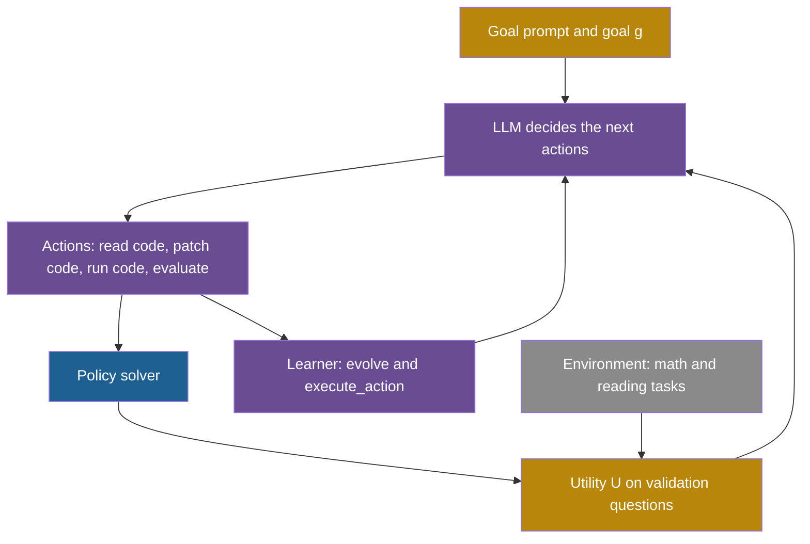

## Learning objectives

After this page you can:

- Write the update rules of a hand-designed agent, a meta-learning agent and a self-referential agent, and say what each rule changes.
- Explain how runtime inspection and monkey patching let an agent change its own improvement loop while it runs.
- Read the paper's results table fairly: separate the constrained Gödel-base from the unconstrained Gödel-free.
- Use confidence intervals to decide which gains over Meta Agent Search are larger than the noise.
- Interpret the 4%, 92% and 14% figures of the stability test.
- List the parts that stay fixed and the differences between the paper and the released code.

## Prerequisites

- [L5: Recursion, self-reference and programs that change programs](/notes/ai/recursive-self-improvement/01-foundations/l5-recursion-and-self-reference)
- [L4: The improver, meta-levels and the frozen core](/notes/ai/recursive-self-improvement/03-anatomy/l4-the-improver-and-meta-levels)
- [L3: Evaluation under noise](/notes/ai/recursive-self-improvement/04-mathematics/l3-evaluation-under-noise)
- [2024: ADAS and Meta Agent Search](/notes/ai/recursive-self-improvement/06-research-systems/p07-adas-meta-agent-search)

## The paper on one card

| Field | Value |
|---|---|
| Title | "Gödel Agent: A Self-Referential Agent Framework for Recursively Self-Improvement" |
| Authors | Xunjian Yin, Xinyi Wang, Liangming Pan, Li Lin, Xiaojun Wan, William Yang Wang |
| Year | 2024 (v1 on 6 October 2024, v4 on 31 May 2025) |
| Venue | ACL 2025, Volume 1: Long Papers, pages 27890–27913 |
| arXiv and DOI | [2410.04444](https://arxiv.org/abs/2410.04444), DOI 10.18653/v1/2025.acl-long.1354 |
| Code | [github.com/Arvid-pku/Godel_Agent](https://github.com/Arvid-pku/Godel_Agent), MIT license |
| One-sentence result | With GPT-3.5 running the tasks, the constrained Gödel-base scored 64.2% on MGSM against 53.4% for Meta Agent Search. |

The title on the ACL Anthology page says "for Recursively Self-Improvement". The arXiv abstract page says "for Recursive Self-Improvement". These notes use the published ACL title.

The code facts on this page come from a reading of the public repository at commit `bbb5087` (17 September 2025). The repository was updated after the paper, so its models and loop limits differ from the paper (Section 11.2).

## Terms

| Term | Plain meaning |
|---|---|
| self-referential agent | An agent that can read and change the code that defines itself, including the code that changes it. |
| policy | The rule or program that the agent uses to solve a task. In the code it is the function `solver`. |
| learner | The procedure that updates the policy from feedback. The paper calls it the meta-learning algorithm $I$. |
| utility function | The function that scores a policy in an environment, for example accuracy on math problems. |
| runtime memory inspection | Reading the functions, classes and variables of a program while it runs. |
| monkey patching | Replacing a function or method of a running program with new code, without a restart. |
| Gödel-base | The constrained version of Gödel Agent, in which GPT-3.5 runs every policy. |
| Gödel-free | The version without constraints, which may call stronger models. |
| bootstrap confidence interval | An interval made by resampling the test questions many times and recomputing the score each time. |
| unexpected termination | A run that stopped by itself, usually after the agent changed its own improvement code. |
| validation data | Questions used during improvement to score candidate policies. |
| test data | Questions kept apart and used only to report the final score. |

## 1. The problem it addresses

Think of a student who studies for exams. A plain student follows a fixed study plan. A better student changes the plan after each exam. A third student also changes the way she decides how to change her plan. She might decide, for example, to wait for two exam results before she changes anything.

Agents have the same three options. Most agents are hand-designed: their policy is fixed. Some are optimized by a fixed meta-learner, such as the meta agent of ADAS (Meta Agent Search). In both cases, a human-designed component limits what the agent can become (Yin et al., 2025, [arXiv:2410.04444](https://arxiv.org/abs/2410.04444)).

Gödel Agent tries the third option. The agent may rewrite both its policy and the code that rewrites its policy. There is no fixed optimization routine outside it, apart from a small starting program.

## 2. What existed before it

| Earlier work | What it did | What Gödel Agent changes |
|---|---|---|
| Gödel machine (Schmidhuber, 2003) | Theory: a program may rewrite any part of itself after a proof that the rewrite is useful. | Gödel Agent keeps the self-rewriting and the name, but uses a language model and feedback instead of proofs. |
| Hand-designed agents | Chain-of-thought, self-consistency, Self-Refine, debate and others. Each policy is fixed. | They are the baselines in the results table. |
| ADAS, Meta Agent Search (2024) | A fixed meta agent writes new agents as code and keeps an archive. | Gödel Agent removes the fixed meta agent and lets the agent change its own learner. |

Meta Agent Search is the main baseline of the paper. See [ADAS and Meta Agent Search](/notes/ai/recursive-self-improvement/06-research-systems/p07-adas-meta-agent-search) and [Good and the Gödel machine](/notes/ai/recursive-self-improvement/06-research-systems/p01-good-and-the-godel-machine).

## 3. The central idea

The paper defines three kinds of agent with update rules (Section 3). The difference between them is what the update rule is allowed to change.

**The idea in words.** A hand-designed agent never changes its policy. A meta-learning agent changes its policy with a fixed learner. A self-referential agent changes its policy and its learner, and the new learner makes the next change.

**The equations:**

$$
\text{Hand-designed: } \pi_{t+1} = \pi_t
$$

$$
\text{Meta-learning: } \pi_{t+1} = I(\pi_t, r_t), \qquad r_t = U(E, \pi_t)
$$

$$
\text{Gödel Agent: } (\pi_{t+1}, I_{t+1}) = I_t(\pi_t, I_t, r_t, g), \qquad r_t = U(E, \pi_t)
$$

**The symbols:**

- $t$ is the step number of the improvement process.
- $E$ is an environment, for example a set of math problems with known answers.
- $\pi_t$ is the policy at step $t$, the program that solves tasks.
- $U$ is the utility function. $U(E, \pi_t)$ is the score of policy $\pi_t$ in environment $E$.
- $r_t$ is the feedback at step $t$, here the score.
- $I$ is a fixed learner. $I_t$ is the learner at step $t$, which can change.
- $g$ is the high-level goal, for example "the highest accuracy".
- The starting agent is $(\pi_0, I_0)$. The paper splits $I_0$ into a decision function $f_0$ and an action function $o_0$.

**In plain English.** In the meta-learning rule, the same $I$ appears at every step. In the Gödel Agent rule, the learner $I_t$ takes itself as an input and returns a new learner $I_{t+1}$. So the procedure that improves the agent is itself something that the agent improves.

> [!example] Worked example: two steps of the Gödel Agent rule
> The 28.0% comes from the paper's MGSM result for chain-of-thought. The other numbers are invented for the illustration.
>
> 1. Start: $\pi_0$ is a chain-of-thought solver. $I_0$ is the starting improvement loop. The score is $r_0 = U(E, \pi_0) = 0.28$.
> 2. Step 0: $I_0$ reads $\pi_0$ and its own code. It writes $\pi_1$, which solves each problem with Python code and checks the answer.
> 3. In the same step, $I_0$ also rewrites itself into $I_1$. Say $I_1$ scores every new policy twice before it keeps the policy.
> 4. Feedback: $r_1 = U(E, \pi_1) = 0.40$.
> 5. Step 1: now $I_1$, not $I_0$, makes the next change. Its double scoring is part of how $\pi_2$ is chosen.

**The assumptions.**

1. The utility $U$ and the goal $g$ stay fixed. The agent changes how it pursues the goal, not the goal.
2. The language model that powers the learner can write correct code for both the policy and the learner.
3. A change to the learner takes effect at the next step. The architecture (Section 4) makes this possible.

**When it is useful.** Use these rules to classify a system. Ask which symbols change from step to step. This tells you whether the improver is improved.

**What it does not prove.** The rule allows the learner to change. It does not show that the learner gets better. A changed learner can be worse, and Section 8.3 shows that this happens.

## 4. The architecture

### 4.1 One live Python process

Gödel Agent is one running Python process. A language model, in a loop that calls tools, can read the source of any function in the process. It can replace that function while the process runs. The paper names four core abilities:

1. **Runtime memory inspection.** The agent reads its own Python locals, globals, functions and classes.
2. **Monkey patching.** The agent rewrites functions and classes in live memory.
3. **Recursion instead of a loop.** The main improvement routine is a recursive function. So an updated routine takes effect at the next call.
4. **A set of actions.** `self_inspect` reads the current $\pi$ and $I$. `interact` calls $U$ to score the policy. `self_update` rewrites $\pi$ and $I$, and `continue_improve` recurses. Algorithm 1 calls the first one `self_state`.

Supporting tools add thinking before acting, error handling, code execution in Python or Bash, and calls to a language model.

### 4.2 Monkey patching in a few lines

Monkey patching is ordinary Python. This small example is not from the repository. It shows the mechanism:

```python
class Agent:
    def evolve(self):
        return "old improvement loop"

def new_evolve(self):
    return "new improvement loop"

setattr(Agent, "evolve", new_evolve)   # replace the method in the running program
print(Agent().evolve())                # prints: new improvement loop
```

The repository does the same with code that the language model writes. In the function `action_adjust_logic`, the new code is compiled and run, and the result is installed with `setattr` (public code, `src/agent_module.py`):

```python
exec(compile(new_code, f"running.{module_name}.{target_name}", "exec"), globals(), locals_dict)
...
setattr(cls, target_name, new_target)
getattr(cls, target_name).__source__ = new_code
```

The last line stores the new source text on the new function. So when the agent reads its own code later, it sees the patched version, not the original file.

> [!key] Monkey patching of the improver
> 1. **Name:** monkey patching.
> 2. **Meaning:** replacing a function or method of a running program with new code.
> 3. **Problem it solves:** a self-improving agent needs its changes to take effect at once, without a restart by a human.
> 4. **Example:** the agent replaces `Agent.evolve`, the method that runs its improvement loop, with a new version.
> 5. **Link to RSI:** because the improvement loop is itself a patchable method, the agent can change the procedure that produces its next change.
> 6. **Limits:** a broken patch to the loop can stop the whole agent. Nothing outside the process restores the old version.

### 4.3 The components



Blue is the policy that solves tasks. Purple is the learner and its actions, the meta level. Gold is the fixed goal and the utility. Gray is the environment. The arrow from the learner back to the language model shows the self-reference: the learner shapes how the next decision is made.

## 5. The algorithm, step by step

### 5.1 Algorithm 1 of the paper

In a short paraphrase of Algorithm 1:

```text
s = SELF_INSPECT()                 # read all agent code, including the learner
r = U(E, pi_0)                     # initial score
SELF_IMPROVE(pi, s, r, g):
    a_1 .. a_n = f_0(pi, s, r, g)  # the LLM decides actions
    for each a_i: EXECUTE(a_i)     # inspect, evaluate, patch code, or recurse
    return the updated (pi, s, r)
return the optimized pi and the agent code s
```

In numbered steps:

1. Read all of the agent's code, including the learner.
2. Score the starting policy with the utility.
3. Ask the language model for a sequence of actions, given the policy, the code, the score and the goal.
4. Run each action. An action can read code, score the policy, patch the policy or the learner, or call the improvement routine again.
5. If an action fails, stop the current sequence, carry the error message forward and go to the next step.
6. Return the final policy and the final agent code.

### 5.2 The loop in the released code

The released code implements the loop as two methods that call each other (public code, `src/agent_module.py`):

1. `evolve()` adds 1 to a counter. It sends the language model the goal prompt, a summary of the environment and the last 10 messages of the history.
2. The model must call a tool (`tool_choice="required"`). The current code uses `o3-2025-04-16` here.
3. `execute_action()` runs each tool call and appends the result, or the error text, to the history.
4. `execute_action()` then calls `evolve()` again. This mutual recursion replaces a `while` loop.
5. The process stops when the counter reaches 100 calls of `evolve()`.

The tools in the code are `action_display_analysis`, `action_environment_aware`, `action_read_logic`, `action_adjust_logic`, `action_run_code`, `action_call_json_format_llm` and `action_evaluate_on_task`.

The goal prompt tells the agent that it is "a self-evolving agent" running "within an active Python runtime environment". It also grants "unrestricted access to modify logic, run code and manipulate environment" (public code, `src/goal_prompt.md`).

**Our interpretation:** both `evolve()` and `execute_action()` are methods that the agent can patch. So the agent can change the very loop that is running it. That is the self-referential claim of the paper, made concrete in a few lines of Python.

## 6. The role of evaluation

### 6.1 What the agent sees

The utility $U$ scores a policy on validation data (Section 5.2). In the released code, `action_evaluate_on_task` works like this for MGSM, a benchmark of grade-school math problems in several languages (public code, `src/task_mgsm.py`):

1. Shuffle the examples with a fixed seed and take the first 128.
2. Reshuffle these 128 with a seed from the clock, and take 50.
3. Run the solver on the 50 questions and compute the validation accuracy.
4. If the validation accuracy is at least 0.94, also run the 800 test questions. The test accuracy then appears in the feedback text.

There is no acceptance rule. A patch changes the live process at once. The agent must decide for itself whether to keep a change or to restore an old one.

### 6.2 How noisy is the agent's own feedback?

**The idea in words.** The agent compares versions by their scores on 50 random questions. Each score has sampling noise. The difference of two such scores has more noise than either one.

$$
\mathrm{SE} = \sqrt{\frac{p\,(1 - p)}{n}}, \qquad \mathrm{SE}_{\text{diff}} = \sqrt{\mathrm{SE}_1^2 + \mathrm{SE}_2^2}
$$

- $p$ is the measured accuracy and $n$ is the number of questions.
- $\mathrm{SE}$ is the standard error of one score.
- $\mathrm{SE}_{\text{diff}}$ is the standard error of the difference of two independent scores, with standard errors $\mathrm{SE}_1$ and $\mathrm{SE}_2$.

**In plain English.** With 50 questions, two evaluations of the same solver can differ a lot by chance alone.

> [!example] Worked example: the same solver, evaluated twice
> 1. Accuracy $p = 0.64$ and $n = 50$: $\mathrm{SE} = \sqrt{0.64 \times 0.36 / 50} = \sqrt{0.004608} = 0.068$.
> 2. Two evaluations draw different random samples of 50, so their errors are close to independent.
> 3. $\mathrm{SE}_{\text{diff}} = \sqrt{0.068^2 + 0.068^2} = 0.096$.
> 4. A 95% range for the difference is about $\pm 1.96 \times 0.096 = \pm 0.19$.
>
> So a change can look 10 points better or worse with no real effect. With all 128 validation questions, one score has $\mathrm{SE} = \sqrt{0.64 \times 0.36 / 128} = 0.042$.

**Assumptions.** Questions are independent, and each is right or wrong. Because the 50 questions come from the same 128, two samples overlap partly, so the true $\mathrm{SE}_{\text{diff}}$ is somewhat smaller. **When it is useful:** to judge whether the agent's own feedback can tell a good change from a lucky one. **What it does not prove:** it says nothing about whether the agent's decisions were right in a given run.

### 6.3 A leak from the test set

**Our interpretation:** step 4 of Section 6.1 feeds the test accuracy back into the agent's context once validation accuracy reaches 0.94. The agent can then use test results when it chooses its next change. In clean evaluation, the test set is used once, at the end. A reading of the released code shows this. The paper's reported runs may differ.

### 6.4 What the paper reports

The paper reports final scores on test data, with 95% bootstrap confidence intervals (Table 1). A bootstrap interval resamples the test questions many times. It shows how much the score depends on which questions are in the test set. **Our interpretation:** it does not show how much the score depends on the run of the self-improvement process, which has its own randomness.

## 7. The experimental setup

| Setting | Value (paper) |
|---|---|
| Self-modification model | gpt-4o-2024-05-13 (Appendix B) |
| Model that runs every policy and baseline | gpt-3.5-turbo-0125 ("we use GPT-3.5 for all the tests", Section 5.2) |
| Starting policy | chain-of-thought |
| Runs | 6 independent self-improvement cycles per task, at most 30 iterations each, on validation data |
| DROP, MGSM, MMLU | 128 validation and 800 test questions each |
| GPQA | 32 validation and 166 test questions |
| Cost | about USD 15 for one full evolution of 30 recursive self-improvements across the four tasks, against USD 300 for Meta Agent Search (Appendix D) |

DROP is a reading benchmark scored by F1, a measure of word overlap with the right answer. MGSM is multilingual grade-school math. MMLU is a set of multiple-choice questions on many subjects. GPQA is a set of hard science questions.

The paper gives no wall-clock time. The cost compares the search processes, not the cost of running each final policy.

## 8. The reported results

### 8.1 Main results

All values are **Measured** (Table 1). DROP is F1 and the others are accuracy in percent, each with a 95% bootstrap interval.

| Method | DROP | MGSM | MMLU | GPQA |
|---|---|---|---|---|
| Chain-of-thought | 64.2 ± 0.9 | 28.0 ± 3.1 | 65.4 ± 3.3 | 29.2 ± 3.1 |
| Chain-of-thought with self-consistency | 64.4 ± 0.8 | 28.2 ± 3.1 | 65.9 ± 3.2 | 30.5 ± 3.2 |
| Self-Refine | 59.2 ± 0.9 | 27.5 ± 3.1 | 63.5 ± 3.4 | 31.6 ± 3.2 |
| LLM Debate | 60.6 ± 0.9 | 39.0 ± 3.4 | 65.6 ± 3.3 | 31.4 ± 3.2 |
| Step-back Abstraction | 60.4 ± 1.0 | 31.1 ± 3.2 | 65.1 ± 3.3 | 26.9 ± 3.0 |
| Quality-Diversity | 61.8 ± 0.9 | 23.8 ± 3.0 | 65.1 ± 3.3 | 30.2 ± 3.1 |
| Role Assignment | 65.8 ± 0.9 | 30.1 ± 3.2 | 64.5 ± 3.3 | 31.1 ± 3.1 |
| Meta Agent Search (ADAS) | 79.4 ± 0.8 | 53.4 ± 3.5 | 69.6 ± 3.2 | 34.6 ± 3.2 |
| Gödel-base (constrained, GPT-3.5 runs the policy) | 80.9 ± 0.8 | 64.2 ± 3.4 | 70.9 ± 3.1 | 34.9 ± 3.3 |
| Gödel-free (no constraints) | 90.5 ± 1.8 | 90.6 ± 2.0 | 87.9 ± 2.2 | 55.7 ± 3.1 |

Gödel-free is "the standard implementation without any constraints" (Table 1 caption). The paper says that its large gains come mainly from the agent asking stronger models, such as GPT-4o, for help (Section 5.3).

### 8.2 Ablation on MGSM

Table 2 removes one ability at a time. The full Gödel-base scores 64.2 on MGSM.

| Removed ability | MGSM score |
|---|---|
| none (full) | 64.2 |
| thinking before acting | 50.8 |
| error handling | 49.4 |
| code running | 57.1 |
| calls to a language model | 60.4 |

The arrows in the paper's table are inconsistent, so this table gives the reported scores only. The mapping of the short labels to the abilities comes from the table's abbreviations.

### 8.3 The stability test

The paper ran 100 trials on MGSM (Section 6.2). **Measured:**

1. 4% ended in unexpected termination, usually after the agent changed its own improvement module.
2. 92% had at least one temporary drop in performance.
3. 14% ended worse than the starting policy.

These percentages describe different events, and one run can belong to several groups. So you cannot add them.

### 8.4 Game of 24

The Game of 24 is a puzzle in which four numbers must make 24. The agent reached 100% after it switched to a search algorithm (Section 6.3). Its variants that still used the language model to reason gained more than 10% from code-assisted checks. They gained more than 15% from new attempts with more data. Tree of Thought, a hand-designed search over reasoning steps, still beat all of these variants. The authors say that the limits of the language model make it hard to go beyond state-of-the-art algorithms.

## 9. What the results show

1. **Measured:** an agent that patches its own running code can produce a policy that beats hand-designed baselines run by the same model, GPT-3.5.
2. **Our interpretation:** on MGSM, Gödel-base (64.2 ± 3.4) beats Meta Agent Search (53.4 ± 3.5) by 10.8 points. The two intervals, 60.8 to 67.6 and 49.9 to 56.9, do not overlap. This gain is larger than the test-sampling noise.
3. **Our interpretation:** on DROP the gain is 1.5 points. The intervals are 80.1 to 81.7 and 78.6 to 80.2. They overlap by 0.1 points, so the gain is at the edge of the noise.
4. **Our interpretation:** on MMLU (+1.3) and GPQA (+0.3) the gains lie inside the intervals. These results do not separate the two methods.
5. **Measured:** the search cost about USD 15 per full evolution, against USD 300 for Meta Agent Search.
6. **Measured:** each supporting ability matters on MGSM. Without error handling the score falls from 64.2 to 49.4.
7. **Measured:** changing the improver is risky. 4 runs in 100 stopped themselves, and 14 in 100 ended worse than they started.
8. **Measured:** when an exact algorithm exists, the agent can find and use it. On the Game of 24 it reached 100% after it switched to search.

## 10. What the results do not show

1. **Not shown: that self-reference causes the Gödel-free numbers.** Gödel-free's large gains come mainly from calls to stronger models. It is not comparable with baselines that use GPT-3.5. The fair comparison is Gödel-base against Meta Agent Search.
2. **Not shown: that the learner improved.** The rule allows the learner $I$ to change. The evidence that the learner, not only the policy, got better is mostly qualitative.
3. **Not shown: the variation between runs.** The intervals come from resampling test questions. They do not cover the randomness of the six improvement cycles.
4. **Not shown: how the reported policy was chosen.** Table 1 may report the best of six cycles, an average or one cycle. These notes did not find which. If it reports the best on validation data, the test set still gives a fair final score, but the choice adds a selection step.
5. **Not shown: safety.** The paper reports no sandbox experiment and no analysis of reward hacking. It recommends a sandbox but does not test one.
6. **Not shown: gains beyond known algorithms.** On the Game of 24, Tree of Thought beat all language-model variants of the agent.
7. **Not shown: unlimited improvement.** Each cycle ran at most 30 iterations. 92% of the stability runs had at least one drop.

## 11. Limitations

### 11.1 Limitations that the authors state

1. The agent must write all task code itself. So the paper does not compare it with heavily engineered systems such as OpenDevin.
2. As it grows more complex, the system may lose its self-referential ability.
3. Fully self-modifying agents will need human oversight and regulation (Section 7.2). The ethics statement proposes a "Sandboxed Environment" and "Constrained Modifications". **Speculation:** these are recommendations, not tested controls.

### 11.2 The paper versus the released code

| Point | Paper | Released code |
|---|---|---|
| Runs | 6 cycles of at most 30 iterations | one cycle, stopped at 100 calls of `evolve()` |
| Models | gpt-4o for self-modification, GPT-3.5 for all tests | o3 for the loop, gpt-4o-mini in the solver |
| Rollback | claims the agent can "revert to a previous optimal algorithm when performance declines" | no rollback mechanism, only the prompt and code dumps to disk |
| Test data | used for the final report | test accuracy enters the agent's context once validation accuracy is at least 0.94 |

The code keeps the best code only through a dump to disk. When test accuracy improves, it writes every function and class to a folder named after the accuracy.

### 11.3 Safety gaps in the released code

The code reading found these points (public code, `src/agent_module.py`):

1. There is no container or sandbox. The model's code runs in the host process, which also holds the API key.
2. Bash commands run with `shell=True` and a 30-second timeout. Python code has no timeout.
3. The guards in `action_adjust_logic` are name and text checks. For example, they forbid changes to `Agent.action_call_llm` and forbid `time.sleep` in the solver.
4. These guards do not apply to `action_run_code`. That tool can call `setattr` on anything, including the guarded methods and `action_adjust_logic` itself.
5. The only hard stop is the counter of 100 `evolve()` calls, and the counter lives in state that the agent can change.

**Our interpretation:** the agent's own boundary is almost the whole process. The goal, the utility and the language model weights are fixed by design. But in the released code, little except the process limits stops the agent from changing even its own guards.

## 12. Its relationship to RSI

Gödel Agent is the clearest example of an agent that changes its own improvement loop at runtime. On [the ladder of this course](/notes/ai/recursive-self-improvement/02-core-idea/l2-the-ladder-of-self-improvement), it sits at Level 3, because it changes its own implementation. It also claims Level 5, because its learner is editable.

| Part of the system | Can Gödel Agent change it? |
|---|---|
| The policy, `solver` | yes |
| The learner, `evolve` and `execute_action` | yes, by monkey patching |
| The set of actions | yes, it can add actions |
| The goal $g$ and the utility $U$ | no, by design |
| The environment $E$ | no |
| The language model weights | no |
| The starting program $(\pi_0, I_0)$ | no, it is the fixed bootstrap |

**Claimed:** the learner improves. **Measured:** the learner can break. The 4% of runs that stopped, mostly after the agent changed its improvement module, are the main measured risk. **Our interpretation:** this is a small, concrete case of the special risk of [changing the improver](/notes/ai/recursive-self-improvement/08-failure-modes-and-safety/l6-changing-the-improver-safely). A bad change to the procedure that makes changes can end all further improvement.

Gödel Agent also differs from later systems in one important way. It keeps one live agent and no archive. The [Darwin Gödel Machine](/notes/ai/recursive-self-improvement/06-research-systems/p10-darwin-godel-machine) keeps every valid version, so a broken child cannot end the search.

## 13. Common mistakes

1. **"Gödel Agent proves that its changes are useful, like the Gödel machine."** It uses no proofs. It uses a language model's decisions and scores on validation data.
2. **"Gödel-free's 90.6% on MGSM shows the power of self-reference."** Those gains come mainly from calls to stronger models. Compare Gödel-base with Meta Agent Search instead.
3. **"Gödel Agent beats Meta Agent Search on every task."** Only the MGSM gain is clearly outside the intervals. MMLU and GPQA gains are inside them.
4. **"The agent keeps its best version and rolls back automatically."** The released code has no rollback. Patches apply at once, and the agent must undo its own mistakes.
5. **"The language model improves."** The weights are frozen. The policy and the learner code change.
6. **"The bootstrap intervals cover all uncertainty."** They cover the choice of test questions, not the randomness of the improvement runs.
7. **"Name-based guards make the agent safe."** The tool `action_run_code` can bypass them.

## 14. One-minute explanation

Gödel Agent is one running Python program in which a language model can replace any function, including the agent's own improvement loop. Its rule updates the policy and the learner, so the improved learner makes the next change. With GPT-3.5 running the tasks, it scored 64.2% on MGSM against 53.4% for Meta Agent Search, and other gains were small. The unconstrained version scored much higher, but mainly because it called stronger models. In a stability test, 4 runs in 100 stopped after the agent changed its improvement code, and 14 ended worse than they began. The goal, the utility and the model stay fixed, and the released code has no sandbox and no rollback.

## 15. Check questions

```check
{
  "question": "Understanding: write the update rule of a meta-learning agent and of Gödel Agent. Which symbol changes in one rule and stays fixed in the other, and why does that matter for RSI?",
  "answer": "Meta-learning: $\\pi_{t+1} = I(\\pi_t, r_t)$. Gödel Agent: $(\\pi_{t+1}, I_{t+1}) = I_t(\\pi_t, I_t, r_t, g)$. The learner $I$ is fixed in the first rule and changes in the second. In the second rule, the learner that was changed at step $t$ makes the change at step $t+1$. That is the defining feature of recursive self-improvement in the strong sense: the improver improves, and the improved improver acts next."
}
```

```check
{
  "question": "Application: on GPQA, Gödel-base scored 34.9 ± 3.3 and Meta Agent Search scored 34.6 ± 3.2. On MGSM they scored 64.2 ± 3.4 and 53.4 ± 3.5. For each task, write the two intervals and say whether the gain is larger than the test-sampling noise.",
  "hint": "Subtract and add the half-width to each score.",
  "answer": "GPQA: 31.6 to 38.2 and 31.4 to 37.8. The intervals overlap almost completely, so a gain of 0.3 is not separated from noise. MGSM: 60.8 to 67.6 and 49.9 to 56.9. The intervals do not overlap, so the gain of 10.8 points is larger than the test-sampling noise. Note that non-overlap is a strict test, and neither interval covers run-to-run variation."
}
```

```check
{
  "question": "Analysis: in the stability test, 4% of runs ended in unexpected termination, 92% had a temporary drop and 14% ended worse than the start. A reader adds 4 + 14 and says that 82% of runs ended better than the start. What is wrong?",
  "answer": "The three figures describe different events, and one run can belong to several groups. A terminated run may also count as worse than the start. A run with a temporary drop can end better or worse. So you cannot add them. From the figures given, you only know that 86% did not end worse than the starting policy. Some of those may have ended equal, not better."
}
```

```check
{
  "question": "Application: in the released code, the agent scores a solver on 50 random questions out of 128, with a new random sample each time. A solver has a true accuracy of 0.64. Estimate how far apart two evaluations of the same solver can be by chance, and explain the risk for a self-improving agent.",
  "hint": "Compute the standard error of one score, then of a difference.",
  "answer": "1. One score: $\\sqrt{0.64 \\times 0.36 / 50} = 0.068$.\n2. Difference of two nearly independent scores: $\\sqrt{2} \\times 0.068 = 0.096$.\n3. A 95% range is about $\\pm 0.19$.\n\nSo two evaluations of the same solver can differ by up to about 19 points by chance. An agent that keeps a change whenever its score rises will often keep useless changes and drop useful ones. The overlap of the 50-question samples makes the true range a little smaller, but the risk stays."
}
```

```check
{
  "question": "Analysis: propose two changes to the released Gödel Agent code that would reduce the risk of a broken improvement loop. For each, say which failure it addresses.",
  "answer": "1. Keep a copy of every version of `evolve` and `execute_action`. Run a watchdog outside the process that restarts the last working version when the agent stops or loops. This addresses unexpected termination after a change to the improvement module.\n2. Run the agent in a container with no API key and with time limits enforced from outside. Remove `action_run_code`, or send it through the same checks as `action_adjust_logic`. This addresses the bypass of the guards and the absence of a sandbox.\n\nA third option is an acceptance rule outside the agent: test a patched learner on held-out tasks before it may act."
}
```

## 16. Summary and links

- Gödel Agent lets one running agent read and replace any of its functions, including its own improvement loop.
- Its update rule changes both the policy and the learner: $(\pi_{t+1}, I_{t+1}) = I_t(\pi_t, I_t, r_t, g)$.
- With GPT-3.5 running the tasks, Gödel-base beat Meta Agent Search clearly on MGSM only. Gödel-free's large gains came mainly from stronger models.
- In 100 MGSM trials, 4% stopped themselves after changing the improvement module and 14% ended worse than the start.
- The goal, the utility and the model weights stay fixed. The released code has no sandbox, no archive and no rollback.

**Next:** [SICA](/notes/ai/recursive-self-improvement/06-research-systems/p09-sica-self-improving-coding-agent) also lets an agent change its own code, but it writes every version to its own folder and benchmarks it before use.

**Links:**

- Previous: [2024: ADAS and Meta Agent Search](/notes/ai/recursive-self-improvement/06-research-systems/p07-adas-meta-agent-search)
- Next: [2025: SICA, a Self-Improving Coding Agent](/notes/ai/recursive-self-improvement/06-research-systems/p09-sica-self-improving-coding-agent)
- Code walkthrough: [L5: SICA and Gödel Agent in code](/notes/ai/recursive-self-improvement/07-implementations/l5-sica-and-godel-agent-in-code)
- Risks of changing the improver: [L6: The special risks of changing the improver](/notes/ai/recursive-self-improvement/08-failure-modes-and-safety/l6-changing-the-improver-safely)
- Overview: [L5: Code self-modification](/notes/ai/recursive-self-improvement/05-approaches/l5-code-self-modification)

**Videos:** these notes know of no verified talk on Gödel Agent. For the idea behind its name, watch [Juergen Schmidhuber: Godel Machines, Meta-Learning, and LSTMs](https://www.youtube.com/watch?v=3FIo6evmweo) (Lex Fridman Podcast #11, 2018). The inventor of the Gödel machine explains programs that rewrite themselves. It supports Sections 2 and 3. See also the [video guide](/notes/ai/recursive-self-improvement/videos).

## References

- Xunjian Yin, Xinyi Wang, Liangming Pan, Li Lin, Xiaojun Wan, William Yang Wang. "Gödel Agent: A Self-Referential Agent Framework for Recursively Self-Improvement". 2025. Proceedings of the 63rd Annual Meeting of the ACL (Volume 1: Long Papers), pages 27890–27913. DOI 10.18653/v1/2025.acl-long.1354. arXiv:2410.04444. https://aclanthology.org/2025.acl-long.1354. Code: https://github.com/Arvid-pku/Godel_Agent
- Shengran Hu, Cong Lu, Jeff Clune. "Automated Design of Agentic Systems". 2024. ICLR 2025. arXiv:2408.08435. https://arxiv.org/abs/2408.08435
- Jürgen Schmidhuber. "Goedel Machines: Self-Referential Universal Problem Solvers Making Provably Optimal Self-Improvements". 2003. arXiv:cs/0309048. https://arxiv.org/abs/cs/0309048
- Jenny Zhang, Shengran Hu, Cong Lu, Robert Lange, Jeff Clune. "Darwin Godel Machine: Open-Ended Evolution of Self-Improving Agents". 2025. ICLR 2026. arXiv:2505.22954. https://arxiv.org/abs/2505.22954
- E. Miller. "Adding Error Bars to Evals: A Statistical Approach to Language Model Evaluations". 2024. arXiv:2411.00640. https://arxiv.org/abs/2411.00640
