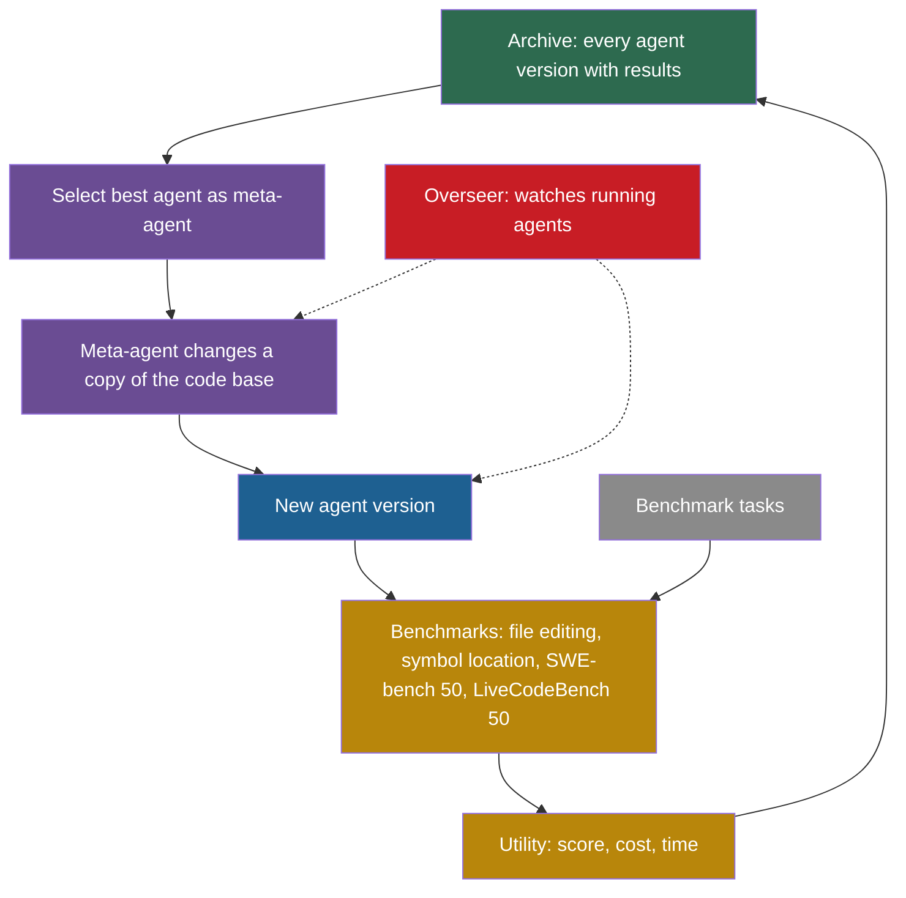

## Learning objectives

After this page you can:

- Explain how SICA removes the split between a meta-agent and a target agent.
- Compute SICA's utility from a score, a cost and a time, with and without the timeout penalty.
- Read "17% to 53%" correctly: an absolute solve rate on 50 tasks, at one version, with a later version at 51%.
- Estimate the noise of a score on 50 tasks, and judge which changes in the results table are real.
- Explain why the scaffold scored below the bare reasoning model on AIME and GPQA.
- Describe the overseer and why its place inside the editable code matters.
- List the differences between the paper and the released code.

## Prerequisites

- [L2: Agents: actions, state, memory, tools and environment](/notes/ai/recursive-self-improvement/01-foundations/l2-agents-actions-state-tools-environment)
- [L7: What "improvement" means, and how to measure it](/notes/ai/recursive-self-improvement/01-foundations/l7-measuring-improvement)
- [L1: Functions, objectives and search spaces](/notes/ai/recursive-self-improvement/04-mathematics/l1-functions-objectives-and-search-spaces)
- [L3: Evaluation under noise](/notes/ai/recursive-self-improvement/04-mathematics/l3-evaluation-under-noise)
- [2024: ADAS and Meta Agent Search](/notes/ai/recursive-self-improvement/06-research-systems/p07-adas-meta-agent-search)

## The paper on one card

| Field | Value |
|---|---|
| Title | "A Self-Improving Coding Agent" |
| Authors | Maxime Robeyns, Martin Szummer, Laurence Aitchison |
| Year | 2025 (v1 on 21 April 2025, v2 on 16 May 2025) |
| Venue | ICLR 2025 Workshop on Scaling Self-Improving Foundation Models |
| arXiv | [2504.15228](https://arxiv.org/abs/2504.15228) |
| Code | [github.com/MaximeRobeyns/self_improving_coding_agent](https://github.com/MaximeRobeyns/self_improving_coding_agent), MIT license |
| One-sentence result | On 50 fixed SWE-bench Verified tasks, the solve rate rose from 17% to 53% over 14 iterations, for about USD 7,000. |

The code facts on this page come from a reading of the public repository at commit `ed8275d` (24 April 2025). That code differs from the paper in several places (Section 11.2).

## Terms

| Term | Plain meaning |
|---|---|
| meta-agent | The agent that changes another agent's code. In ADAS it is a separate, fixed agent. |
| target agent | The agent whose code the meta-agent changes. |
| meta-improvement iteration | One pass in which an agent changes the code base to make a new agent version. |
| utility | One number that combines the benchmark score, the cost and the time of an agent. |
| timeout penalty | A factor that halves the utility of an agent that ran out of time. |
| main agent | The top agent in SICA. It routes work to sub-agents and combines their results. |
| sub-agent | An agent that the main agent calls like a tool. It returns a string. |
| asynchronous overseer | A language model that runs at the same time as the agent and watches it for loops or drift from the task. |
| call graph | The tree of which agent called which sub-agent, with their events. |
| SWE-bench Verified | A benchmark of real GitHub issues, checked by tests. SICA uses a fixed random subset of 50 tasks. |
| LiveCodeBench | A benchmark of programming problems that keeps adding new problems over time. |
| abstract syntax tree (AST) | A tree that represents the structure of a program. Tools use it to find functions and classes. |
| reasoning model | A language model trained to write long reasoning before it answers, here o3-mini. |

## 1. The problem it addresses

A carpenter who makes her own tools gets a double benefit. A sharper chisel makes better furniture. It also makes the next tool better. Her furniture skill and her toolmaking skill grow together, because the same hands and tools do both kinds of work.

Earlier systems split these roles. In ADAS, a fixed meta-agent writes the code of a separate target agent. The meta-agent itself never improves. The SICA paper calls ADAS "not self-improving" for this reason (Robeyns et al., 2025, [arXiv:2504.15228](https://arxiv.org/abs/2504.15228), Section 2).

SICA asks: what happens if the agent that solves coding tasks is also the agent that changes the code base? The paper says that SICA "eliminates the distinction between meta-agent and target agent". It calls the result "fully self-improving (i.e. there is no distinction between the meta and target agent)" (Section 2).

## 2. What existed before it

| Earlier work | What it did | What SICA changes |
|---|---|---|
| ADAS (2024) | A fixed meta-agent writes a new `forward` function for a separate target agent, in a restricted form. | SICA lets the best agent change its whole code base, and that agent is also the meta-agent. |
| STOP (2023) | An improver program improves its own code. One improver, scored by a meta-utility on small tasks. | SICA applies the same idea to a full coding agent on real coding benchmarks. |
| Gödel Agent (2024) | One live agent patches its own running code. | SICA writes each new version to its own folder and benchmarks it before it can act as meta-agent. |

You can read the earlier systems on their own pages: [STOP](/notes/ai/recursive-self-improvement/06-research-systems/p05-stop-self-taught-optimizer), [ADAS](/notes/ai/recursive-self-improvement/06-research-systems/p07-adas-meta-agent-search) and [Gödel Agent](/notes/ai/recursive-self-improvement/06-research-systems/p08-godel-agent).

## 3. The central idea

SICA has two central ideas. First, one code base is both the worker and the improver. Second, one number, the utility, decides which agent is best, and it rewards speed and low cost as well as correct answers.

### 3.1 One code base for both roles

SICA keeps an archive of every agent version and its results. In each iteration, the best agent so far becomes the meta-agent. It reads the archive, picks an improvement and changes the code base to implement it (Algorithm 1). The changed code base is the next agent. That next agent can later become the meta-agent too.

**Our interpretation:** this closes a loop that ADAS leaves open. Take a change that helps the agent solve coding tasks, such as a better file-editing tool. It also helps the agent change its own code in the next iteration.

### 3.2 The utility: score, cost and time in one number

**The idea in words.** SICA wants an agent that solves tasks, and does so cheaply and fast. So it combines three measurements into one number. The score gets half of the weight. Cost and time get a quarter each. The cost and time terms are 1 for a free, instant agent and fall to 0 at a cap.

**The equation** (Section 3, Equations 1 and 2):

$$
U = w_{\text{score}}\, p_{\text{score}} + w_{\text{cost}} \left(1 - \min\!\left(1, \frac{p_{\text{cost}}}{10}\right)\right) + w_{\text{time}} \left(1 - \min\!\left(1, \frac{p_{\text{time}}}{300}\right)\right)
$$

$$
U_{\text{final}} = \begin{cases} U\,(1 - \tau) & \text{if the agent timed out} \\ U & \text{otherwise} \end{cases}
$$

**The symbols:**

- $U$ is the utility of an agent before the timeout penalty.
- $p_{\text{score}}$ is the normalized benchmark performance, a number from 0 to 1.
- $p_{\text{cost}}$ is the cost per problem in US dollars. The number 10 is the cap: at USD 10 or more, the cost term is 0.
- $p_{\text{time}}$ is the wall-clock time per problem in seconds. The number 300 is the cap, which is also the timeout.
- $w_{\text{score}} = 0.5$, $w_{\text{cost}} = 0.25$ and $w_{\text{time}} = 0.25$ are the weights.
- $\min(1, x)$ is the smaller of 1 and $x$. It stops a term from going below 0.
- $\tau = 0.5$ is the timeout penalty. It gives "partial credit for work done before the timeout".
- $U_{\text{final}}$ is the utility after the penalty.

**In plain English.** Half of the utility comes from solving tasks. A quarter comes from being cheap and a quarter from being fast. An agent that times out loses half of its utility.

> [!example] Worked example: version 0 and version 14
> This example uses rows of the paper's Table 1 as an illustration. It treats the SWE-bench column as $p_{\text{score}}$. The paper's own $p_{\text{score}}$ covers its whole benchmark set.
>
> Version 14: $p_{\text{score}} = 0.53$, $p_{\text{cost}} = 2.20$, $p_{\text{time}} = 117.1$.
>
> 1. Score term: $0.5 \times 0.53 = 0.265$.
> 2. Cost term: $2.20 / 10 = 0.22$, so $0.25 \times (1 - 0.22) = 0.195$.
> 3. Time term: $117.1 / 300 = 0.3903$, so $0.25 \times (1 - 0.3903) = 0.1524$.
> 4. Sum: $U = 0.265 + 0.195 + 0.1524 = 0.6124$.
> 5. If this agent had timed out: $U_{\text{final}} = 0.6124 \times 0.5 = 0.3062$.
>
> Version 0: $p_{\text{score}} = 0.17$, $p_{\text{cost}} = 1.91$, $p_{\text{time}} = 130.2$. The same steps give $0.085 + 0.2023 + 0.1415 = 0.4288$.
>
> Version 15: $p_{\text{score}} = 0.51$, $p_{\text{cost}} = 1.70$, $p_{\text{time}} = 114.5$. The same steps give $U = 0.6171$. That is higher than version 14, although version 15 solved fewer tasks. Its lower cost and time outweigh one task.

**The assumptions.**

1. One weighted sum can express what "better" means. A gain of 0.04 in score adds 0.02 to $U$. A saving of USD 0.80 per problem also adds 0.02.
2. The caps are right. Above USD 10 or 300 seconds, more cost or time is not punished further.
3. The score, cost and time are measured well enough on the benchmark set.

**When it is useful.** Use a weighted utility when several measurements matter and you must rank versions by one number. [Part 4 L1](/notes/ai/recursive-self-improvement/04-mathematics/l1-functions-objectives-and-search-spaces) explains this technique, called scalarization.

**What it does not prove.** The utility does not prove that a higher-utility agent solves more tasks. Version 15 above has a higher utility and a lower SWE-bench score.

> [!trap] Half of the utility does not need any solved task
> **Our interpretation:** check the corners of this formula.
>
> 1. An agent that answers nothing, at once and for free, has $p_{\text{score}} = 0$, a cost term of 0.25 and a time term of 0.25. Its utility is 0.5.
> 2. An agent that solves every task at USD 10 and 300 seconds also has a utility of 0.5.
> 3. In the illustration above, the do-nothing agent would even beat version 0.
> 4. These notes found no statement on whether SICA guards against this case.
>
> When you design a utility, check that doing nothing cannot score well.

## 4. The architecture

### 4.1 Main agent, sub-agents and tools

SICA's agent is a small hierarchy (Section 3 and Appendix A):

1. **The main agent** routes work and combines results. It has only file and directory viewing tools. It delegates all real work.
2. **Sub-agents** are called like tools and return a string. There are three: a coding agent, a problem-solver agent and a reasoning agent that uses o3-mini. They keep the main agent's context short.
3. **Tools** include file tools (open, close and overwrite a file) and a tool to run shell commands. Others are a calculator, submit an answer, return a sub-agent result, early exit and an archive-analysis tool.

### 4.2 The asynchronous overseer

An overseer is a language model that runs in a separate thread while the agent works. By default it runs every 30 seconds, or on key events (Section 3.1, Appendix A.2). It reads the call graph and the event stream. It looks for pathological behaviour and for drift away from the task. It can act in three ways:

1. Notify a running agent or its parents, with a message that is inserted into the agent's context.
2. Remind an agent that it can finish.
3. Cancel a stuck or off-task agent. It must first send at least one notification, and it must also notify the parent.

> [!key] Overseer inside the editable code
> 1. **Name:** asynchronous overseer.
> 2. **Meaning:** a second language model that watches the agent while it runs and can warn or stop it.
> 3. **Problem it solves:** long agent runs can loop or wander off the task, and a fixed time limit stops good runs too.
> 4. **Example:** a sub-agent repeats the same failed command. The overseer notices, sends a message, and cancels it if the loop continues.
> 5. **Link to RSI:** in the released code, the overseer lives in `base_agent/src/oversight/`, which is part of the agent's own code base. So a meta-improvement step can change or remove it.
> 6. **Limits:** it only steers. It does not judge whether a code change is safe. A watcher inside the boundary of what can change is not an independent control.

### 4.3 The components



Green is the archive. Purple is the meta level. Blue is the new agent version. Gold is evaluation and gray is the task environment. The overseer is red here because it is a risk control that the agent itself can change.

## 5. The algorithm, step by step

### 5.1 The paper's loop

Algorithm 1 of the paper, in a short paraphrase:

```text
Input: benchmark set B, number of iterations n
A_0 = initial agent
for i = 0 .. n-1:
    evaluate A_i on B, store A_i and its results in the archive
    best = the best agent so far in the archive
    A_(i+1) = run best as meta-agent: it reads the archive,
              picks an improvement and changes the code base
return A_n
```

In numbered steps:

1. Evaluate the current agent version on the benchmark set.
2. Store the version and its results in the archive.
3. Find the best agent in the archive so far.
4. Run that agent as the meta-agent. It reads the archive and chooses one improvement.
5. The meta-agent changes the code base to implement it. The result is the next agent version.
6. Repeat.

Algorithm 1 writes the selection as an argmax over the scores $p_j$. The text says that the meta-agent is chosen by utility. Treat "the best-performing agent in the archive" as the rule, and note that the paper is not fully consistent here.

### 5.2 The loop in the released code

The released code splits "best agent" into two roles (public code, `runner.py`):

1. **The base agent** is the version whose code will be copied and changed. The function `select_base_agent()` picks it.
2. **The meta-agent** is the version that does the changing. It is the version with the highest mean benchmark score.

The base-selection rule works like this. Compute a 95% confidence interval for each version's mean score. Walk backwards from the newest version. Return the first version whose mean is at least the lower bound of the best version's interval. If no version qualifies before you reach the best version, return the best version.

> [!example] Worked example: base and meta-agent differ
> Version 3 has the best mean score, 0.60. Its 95% interval has a lower bound of 0.48. Version 5 has a mean of 0.45 and version 4 has 0.50.
>
> 1. Start at version 5. Its mean 0.45 is below 0.48, so skip it.
> 2. Move to version 4. Its mean 0.50 is at least 0.48, so version 4 is the base.
> 3. The meta-agent is version 3, the best mean.
>
> So version 3 changes a copy of version 4's code. **Our interpretation:** this rule prefers recent versions that are not clearly worse than the best. It is a form of rollback: a clearly worse recent version is skipped.

The meta-improvement step then works like this (public code, `base_agent/__main__.py` and `meta_improvement.py`):

1. Copy the base agent's code to a new folder for version $i+1$.
2. Run the meta-agent in Docker with the archive mounted read-only and the new folder writable.
3. Give it a prompt: "It is meta-improvement time. Your singular task is to make the coding agent system placed in /home/sandbox/workdir better at writing code".
4. The agent follows a scripted reasoning structure. It finds features that do not work and features that work. It proposes one concrete improvement.
5. A review committee of language model calls checks the proposed change "until there are no significant reviewer concerns".
6. A software-engineer sub-agent implements the change, runs tests and updates `description.txt` and `agent_change_log.md`.
7. Rebuild the Docker image, in case the requirements changed, and benchmark the new version.

There is no acceptance rule in the code. Every new version is benchmarked. A broken version scores low, and the base-selection rule then avoids it.

## 6. The role of evaluation

### 6.1 What is measured

The main run uses four benchmarks:

1. A synthetic file-editing benchmark built from SWE-bench repositories.
2. A synthetic symbol-location benchmark, which tests code navigation.
3. A fixed random subset of 50 SWE-bench Verified tasks.
4. 50 random LiveCodeBench problems.

In the released code, scoring runs on the host with the original benchmark code. The agent's own possibly changed copy of that code is not used (public code, `runner.py`). This protects the score from the agent's changes.

### 6.2 How noisy is a 50-task score?

**The idea in words.** A score on $n$ tasks is an estimate of the true solve rate. The standard error says how much the score would move with another sample of tasks.

$$
\mathrm{SE} = \sqrt{\frac{p\,(1 - p)}{n}}
$$

- $p$ is the measured solve rate, from 0 to 1.
- $n$ is the number of tasks.
- A 95% interval is about $p \pm 1.96\,\mathrm{SE}$ (Miller, 2024, [arXiv:2411.00640](https://arxiv.org/abs/2411.00640)).

**In plain English.** With 50 tasks, one task is 2 percentage points, and the interval is wide.

> [!example] Worked example: version 14
> 1. $p = 0.53$ and $n = 50$.
> 2. $p(1 - p) = 0.53 \times 0.47 = 0.2491$.
> 3. $0.2491 / 50 = 0.004982$, and its square root is $0.0706$.
> 4. The 95% interval is $0.53 \pm 1.96 \times 0.0706 = 0.53 \pm 0.138$, so about 39% to 67%.

**Assumptions.** The tasks are independent, and each one passes or fails. **When it is useful:** to judge whether a change from one row of the table to the next is real. **What it does not prove:** it covers only the sampling of tasks, not the variation between whole runs.

The table itself shows the noise. The SWE-bench score was 0.47 at version 9, 0.27 at version 13 and 0.53 at version 14 (Table 1). A drop of 10 tasks out of 50 between neighbouring versions shows how much one version can differ from the next.

### 6.3 One task set for selection and reporting

SICA chooses the best agent with scores on its benchmark set. The reported numbers come from the same benchmark set, including the same 50 SWE-bench tasks. **Our interpretation:** the sources of these notes describe no held-out test set. So the reported best score is also a selected score, and it carries an upward bias. [Part 4 L3](/notes/ai/recursive-self-improvement/04-mathematics/l3-evaluation-under-noise) calls this the winner's curse.

## 7. The experimental setup

| Setting | Value |
|---|---|
| Models | Claude 3.5 Sonnet v2 for most agents, o3-mini for the reasoning sub-agent |
| Benchmarks | file editing, symbol location, 50 SWE-bench Verified tasks, 50 LiveCodeBench problems |
| Iterations | 15 meta-improvement iterations, so table rows 0 to 15 |
| Time per meta-improvement | "may take on the order of one hour" for the main agent |
| Cost | about USD 7,000 in API fees for the run |
| Isolation | Docker, as the README requires, because the agent runs shell commands |

**Our arithmetic:** USD 7,000 over 15 iterations is about USD 467 per iteration, which includes the benchmark runs. The paper gives no total wall-clock time.

## 8. The reported results

### 8.1 The main table

All values are **Measured**, from one run (Table 1). File, Sym, SWE-Bv and LCB are scores from 0 to 1. Cost is USD per problem and time is seconds per problem.

| Version | File | Sym | SWE-Bv (50) | LCB (50) | Cost | Time |
|---|---|---|---|---|---|---|
| 0 | 0.82 | 0.35 | 0.17 | 0.65 | 1.91 | 130.2 |
| 1 | 0.87 | 0.32 | 0.14 | 0.62 | 1.71 | 123.8 |
| 2 | 0.92 | 0.31 | 0.17 | 0.58 | 2.45 | 151.4 |
| 3 | 0.82 | 0.33 | 0.22 | 0.64 | 1.84 | 126.9 |
| 4 | 0.88 | 0.31 | 0.38 | 0.54 | 2.70 | 148.3 |
| 5 | 0.89 | 0.31 | 0.30 | 0.59 | 2.17 | 134.8 |
| 6 | 0.96 | 0.31 | 0.37 | 0.64 | 2.21 | 134.1 |
| 7 | 0.92 | 0.35 | 0.33 | 0.58 | 2.15 | 134.9 |
| 8 | 0.93 | 0.33 | 0.27 | 0.64 | 2.03 | 128.5 |
| 9 | 0.88 | 0.40 | 0.47 | 0.61 | 2.03 | 126.3 |
| 10 | 0.87 | 0.41 | 0.46 | 0.66 | 1.77 | 107.0 |
| 11 | 0.89 | 0.43 | 0.44 | 0.70 | 2.25 | 129.6 |
| 12 | 0.91 | 0.38 | 0.44 | 0.64 | 1.58 | 103.9 |
| 13 | 0.86 | 0.40 | 0.27 | 0.61 | 1.66 | 113.3 |
| 14 | 0.94 | 0.34 | 0.53 | 0.67 | 2.20 | 117.1 |
| 15 | 0.91 | 0.40 | 0.51 | 0.71 | 1.70 | 114.5 |

```plot
{
  "title": "SICA scores by agent version, from Table 1: blue = SWE-bench Verified 50, ink = LiveCodeBench 50",
  "xAxis": {"domain": [-0.5, 15.5], "label": "agent version"},
  "yAxis": {"domain": [0, 0.8], "label": "score"},
  "disableZoom": true,
  "data": [
    {"points": [[0,0.17],[1,0.14],[2,0.17],[3,0.22],[4,0.38],[5,0.30],[6,0.37],[7,0.33],[8,0.27],[9,0.47],[10,0.46],[11,0.44],[12,0.44],[13,0.27],[14,0.53],[15,0.51]], "fnType": "points", "graphType": "polyline", "color": "#1E6091", "skipTip": true},
    {"points": [[0,0.17],[1,0.14],[2,0.17],[3,0.22],[4,0.38],[5,0.30],[6,0.37],[7,0.33],[8,0.27],[9,0.47],[10,0.46],[11,0.44],[12,0.44],[13,0.27],[14,0.53],[15,0.51]], "fnType": "points", "graphType": "scatter", "color": "#1E6091", "skipTip": true},
    {"points": [[0,0.65],[1,0.62],[2,0.58],[3,0.64],[4,0.54],[5,0.59],[6,0.64],[7,0.58],[8,0.64],[9,0.61],[10,0.66],[11,0.70],[12,0.64],[13,0.61],[14,0.67],[15,0.71]], "fnType": "points", "graphType": "polyline", "color": "#100D12", "skipTip": true},
    {"points": [[0,0.65],[1,0.62],[2,0.58],[3,0.64],[4,0.54],[5,0.59],[6,0.64],[7,0.58],[8,0.64],[9,0.61],[10,0.66],[11,0.70],[12,0.64],[13,0.61],[14,0.67],[15,0.71]], "fnType": "points", "graphType": "scatter", "color": "#100D12", "skipTip": true}
  ]
}
```

### 8.2 What "17% to 53%" means

The abstract reports "performance gains from 17% to 53% on a random subset of SWE Bench Verified". Read it with four facts:

1. These are **absolute** solve rates on 50 tasks: 0.17 at version 0 and 0.53 at version 14.
2. One task is 2 percentage points. But 0.17 of 50 is 8.5 tasks and 0.53 of 50 is 26.5 tasks, which are not whole numbers. So the values may average repeated attempts or give partial credit. The sources of these notes do not say which.
3. The final version, 15, scored 0.51, not 0.53. The headline uses the best version, not the last one.
4. The change is +36 percentage points in absolute terms, or about 3.1 times in relative terms.

LiveCodeBench went from 0.65 to 0.71. The paper calls this gain "subtle".

### 8.3 What the agent built

The agent added these features to its own code (Figure 3 annotations):

1. A "Smart Edit" tool that edits with diffs and line ranges.
2. Summaries of code context.
3. A check that verifies each file edit.
4. An AST symbol locator, which appeared at iteration 9.
5. A hybrid symbol locator.

**Our interpretation:** the jump of the SWE-bench score at version 9 comes at the same time as the AST symbol locator. The paper's annotations show this timing. One run cannot show that the tool caused the jump.

### 8.4 The reasoning experiment

SICA was also run on AIME 2024 and GPQA Diamond, two benchmarks of hard reasoning questions. The figure title is "AIME and GPQA Show Little Improvement". Version 0 averaged 76% across the two. The o3-mini model alone, at high reasoning effort, scored 87% on AIME and 79% on GPQA Diamond.

**Measured:** the scaffold scored lower than the bare model it called. The authors suspect that the added reasoning scaffolds interrupt the reasoning model's own chain of thought.

## 9. What the results show

1. **Measured:** in one run, a self-changing agent went from 0.17 to a best of 0.53 on 50 fixed SWE-bench Verified tasks.
2. **Our arithmetic:** with independent errors, the standard error of the difference between 0.17 and 0.53 is about 8.8 points. The gap of 36 points is about 4.1 standard errors. Task-sampling noise alone is an unlikely explanation.
3. **Our arithmetic:** the gain is not one lucky version. Versions 9 to 15 average 0.446 on SWE-bench. Versions 0 to 3 average 0.175.
4. **Measured:** cost and time per problem did not rise. Version 0 cost USD 1.91 and took 130.2 seconds per problem. Version 15 cost USD 1.70 and took 114.5 seconds.
5. **Measured:** the agent built recognisable engineering tools, such as diff-based editing and an AST symbol locator, from a simpler start.
6. **Measured:** for a strong reasoning model, this kind of scaffold made results worse, not better.

## 10. What the results do not show

1. **Not shown: performance on new tasks.** The sources of these notes describe no held-out test set. The same 50 tasks were used to pick the best agent and to report its score.
2. **Not shown: an unbiased best score.** 0.53 is the maximum of 16 noisy values. The last version scored 0.51, and a fresh test would likely give a lower number than the maximum.
3. **Not shown: the variation between runs.** There is one run. Path dependence is a stated limitation, so another run could find other features.
4. **Not shown: a gain on the full SWE-bench Verified set** or on other code bases.
5. **Not shown: that the utility drove the result.** The headline is the score alone. The released code does not use the weighted utility at all (Section 11.2).
6. **Not shown: that the overseer prevents harm.** The paper describes it but reports no measurement of what it caught.
7. **Not shown: the absence of reward hacking.** The paper does not discuss reward hacking or benchmark gaming. No report is not the same as no hacking.
8. **Not shown: help for reasoning models.** On AIME and GPQA the scaffold was worse than o3-mini alone.

## 11. Limitations

### 11.1 Limitations that the authors state

1. Weak idea generation, or "taste", and bad ideas that cost a lot.
2. Path dependence and variance: early ideas, such as caching open files, shaped later ones.
3. 5-minute timeouts may lower SWE-bench scores. Much of the gain was in speed and cost, which SWE-bench does not reward.
4. Problems with benchmark data quality, for example in the symbol locator benchmark.
5. The runs were short and did not saturate.
6. Scaffolding gave little benefit for reasoning models.

### 11.2 The paper versus the released code

| Point | Paper | Released code |
|---|---|---|
| Utility | 0.5 score + 0.25 cost term + 0.25 time term, timeout factor 0.5 | returns the mean score, or 0 if any limit (USD 3, 300 s) is broken, and selection ignores it |
| Who changes what | the best-utility agent is meta-agent and base | meta-agent = best mean score, base = the confidence-interval rule |
| Overseer interval | about every 30 seconds | default 60 seconds |
| Benchmarks | 50 SWE-bench Verified, 50 LiveCodeBench, file editing, symbol location | only GSM8K is enabled, 18 problems per benchmark |
| Iterations | 15 | default 20 |
| Models | Claude 3.5 Sonnet v2 and o3-mini | Claude 3.7 Sonnet and o3-mini in the configuration |

The meta-improvement prompt in the code says that the code in the folder is from the best iteration. When the base and the best version differ, that statement is false.

### 11.3 Safety gaps in the released code

The paper lists observability, the overseer and the absence of weight updates as safety measures. It also proposes to add safety evaluations to the benchmark set. The code reading found these gaps (public code, `sandbox/Dockerfile` and `runner.py`):

1. The overseer lives inside the agent's own code base, so a new version can change or remove it.
2. Inside the container, the agent user has passwordless sudo.
3. API keys are built into the Docker image.
4. Network access is not disabled.
5. During benchmarks, the whole experiment folder is mounted read-write, so a benchmarked agent could write into other agents' folders.
6. The meta-improvement run has no time limit and no cost cap.
7. There is no human approval step.

The paper also states a risk: if the weights were updated too, observability alone would be "clearly inadequate".

## 12. Its relationship to RSI

SICA is a clear case of an agent that changes its own implementation. On [the ladder of this course](/notes/ai/recursive-self-improvement/02-core-idea/l2-the-ladder-of-self-improvement), it sits at Level 3.

It also reaches partly into Level 5. The meta-agent is a version of the agent itself. So when the agent improves its tools, it also improves the tools that will perform the next improvement. This is the same pattern as in the [Darwin Gödel Machine](/notes/ai/recursive-self-improvement/06-research-systems/p10-darwin-godel-machine).

| Part of the system | Can SICA change it? |
|---|---|
| Tools, sub-agents, prompts and orchestration | yes |
| The code that performs the next meta-improvement | yes, it is the same code base |
| The overseer (in the released code) | yes, it is inside the code base |
| The language model weights | no |
| The benchmark set and the utility | no |
| The outer loop: evaluate, pick best, self-change | no |

**Our interpretation:** the frozen core is small but decisive. The benchmark set defines what "better" means, and the outer loop decides which version acts. A gain in the editable part is real only to the extent that the frozen benchmark measures what you care about. SICA's own result shows the limit: on reasoning benchmarks, its changes did not help.

## 13. Common mistakes

1. **"SICA tripled its performance on SWE-bench."** It went from 17% to 53% on a fixed subset of 50 tasks, at its best version. Say "+36 points on 50 tasks", and add that the last version scored 51%.
2. **"The 53% is a test-set score."** The same 50 tasks were used to choose the best agent. No held-out set is described.
3. **"SICA ranks agents by the weighted utility."** The paper says so. The released code ranks by mean score and does not use the weighted formula.
4. **"A higher utility means more solved tasks."** In the worked example, version 15 has a higher utility than version 14 with fewer solved tasks.
5. **"The overseer is an independent safety control."** In the code it is part of the editable code base, and it only steers the agent.
6. **"More scaffolding always helps."** On AIME and GPQA the scaffold scored below the bare o3-mini model.
7. **"No reported reward hacking means none happened."** The paper does not analyse reward hacking.

## 14. One-minute explanation

SICA is a coding agent that keeps an archive of its versions and their benchmark results. In each iteration, the best version so far changes the code base to make a new version. Because worker and improver are the same code, a better tool helps both the tasks and the next self-change. The paper scores agents with a utility of half score, a quarter cost and a quarter time, halved on a timeout. On 50 fixed SWE-bench Verified tasks, the solve rate rose from 17% to a best of 53%, and the last version scored 51%. The weights, benchmarks and outer loop stay fixed, and the scaffold did not help a strong reasoning model.

## 15. Check questions

```check
{
  "question": "Application: an agent version has a normalized score of 0.60. It costs USD 4.00 and takes 150 seconds per problem. Compute its SICA utility. Then compute it again if the agent timed out.",
  "hint": "Use weights 0.5, 0.25 and 0.25, caps of USD 10 and 300 seconds, and a timeout factor of 0.5.",
  "answer": "1. Score term: $0.5 \\times 0.60 = 0.30$.\n2. Cost term: $4/10 = 0.4$, so $0.25 \\times 0.6 = 0.15$.\n3. Time term: $150/300 = 0.5$, so $0.25 \\times 0.5 = 0.125$.\n4. $U = 0.30 + 0.15 + 0.125 = 0.575$.\n5. With a timeout: $0.575 \\times 0.5 = 0.2875$."
}
```

```check
{
  "question": "Understanding: the abstract says \"17% to 53%\". Give three facts that a careful reader must add to this number.",
  "answer": "1. These are absolute solve rates on a fixed random subset of 50 SWE-bench Verified tasks, so one task is 2 percentage points.\n2. 53% is the best version (version 14). The last version (15) scored 51%.\n3. The same 50 tasks were used to choose the best agent and to report it, and there was one run. So the number is a selected score without a held-out test."
}
```

```check
{
  "question": "Analysis: the SWE-bench score fell from 0.47 at version 9 to 0.27 at version 13 and rose to 0.53 at version 14. Use the standard error to decide whether a single drop like 0.44 to 0.27 proves that version 13 is a worse agent.",
  "hint": "Compute the standard error of each score on 50 tasks, then of the difference.",
  "answer": "1. For 0.44: $\\sqrt{0.44 \\times 0.56 / 50} = 0.070$.\n2. For 0.27: $\\sqrt{0.27 \\times 0.73 / 50} = 0.063$.\n3. Difference: $\\sqrt{0.070^2 + 0.063^2} = 0.094$, about 9.4 points.\n4. The drop is 17 points, about 1.8 standard errors.\n\nThat is suggestive but not strong evidence. With 16 versions in a row, some drops of this size happen by chance. You would need to re-test version 13 on more or fresh tasks before you call it worse."
}
```

```check
{
  "question": "Analysis: on AIME and GPQA, SICA's version 0 averaged 76% while o3-mini alone scored 87% and 79%. What does this tell you about scaffolds as the target of self-improvement?",
  "answer": "A scaffold is not always a help. Here the agent's extra structure scored below the bare reasoning model that it called. The authors suspect that the scaffold interrupts the model's own chain of thought. So scaffold-level self-improvement has a ceiling that depends on the model and the task. For strong reasoning models, the search may need to remove structure, not add it. A self-improving system that only adds features can make things worse."
}
```

```check
{
  "question": "Classification: for each part of the released SICA code, say whether a meta-improvement step can change it. (a) The overseer. (b) The benchmark scoring used for perf.json. (c) The Smart Edit tool. (d) The archive of earlier agents during the meta step. (e) The rule that selects the base agent.",
  "answer": "(a) Yes. It lives in `base_agent/src/oversight/`, inside the agent's code base. (b) No. The host scores with its own copy of the benchmark code. (c) Yes. Tools are part of the code base. (d) No. The archive is mounted read-only during the meta step. (e) No. It lives in `runner.py`, outside the agent. Note that during benchmarks, though, the whole experiment folder is mounted read-write."
}
```

```check
{
  "question": "Analysis: agent X answers nothing, at once and for free. Agent Y solves every task at USD 10 and 300 seconds per problem. Show that both get the same SICA utility. What design lesson follows?",
  "answer": "Do-nothing agent: $0.5 \\times 0 + 0.25 \\times (1 - 0) + 0.25 \\times (1 - 0) = 0.5$. Perfect but slow and costly agent: $0.5 \\times 1 + 0.25 \\times (1 - 1) + 0.25 \\times (1 - 1) = 0.5$. Both get 0.5. The lesson: when a utility mixes quality with cost or time, check its corners. A search will find the cheapest way to a high utility. Add a minimum score, or make cost and time count only when the answer is correct."
}
```

## 16. Summary and links

- SICA removes the split between meta-agent and target agent: the best agent so far changes its own code base to make the next version.
- The paper's utility weights score 0.5, cost 0.25 and time 0.25. The caps are USD 10 and 300 seconds, and a timeout halves the utility.
- "17% to 53%" is an absolute solve rate on 50 fixed SWE-bench Verified tasks at the best version. The last version scored 51%, and one task is 2 points.
- There is one run, no held-out test set and about USD 7,000 of cost.
- The scaffold scored below the bare o3-mini model on AIME and GPQA.
- The released code uses a different selection rule, does not use the weighted utility, and puts the overseer inside the editable code.

**Next:** the [Darwin Gödel Machine](/notes/ai/recursive-self-improvement/06-research-systems/p10-darwin-godel-machine) keeps the same self-changing coding agent but chooses parents from a whole archive, not only the best version.

**Links:**

- Previous: [2024: Gödel Agent](/notes/ai/recursive-self-improvement/06-research-systems/p08-godel-agent)
- Next: [2025: The Darwin Gödel Machine](/notes/ai/recursive-self-improvement/06-research-systems/p10-darwin-godel-machine)
- Code walkthrough: [L5: SICA and Gödel Agent in code](/notes/ai/recursive-self-improvement/07-implementations/l5-sica-and-godel-agent-in-code)
- Overview: [L5: Code self-modification](/notes/ai/recursive-self-improvement/05-approaches/l5-code-self-modification)
- Roles such as the overseer: [L9: Multi-agent roles in improvement](/notes/ai/recursive-self-improvement/05-approaches/l9-multi-agent-improvement)

**Videos:** these notes know of no verified talk on SICA. For background on coding agents, watch [Agents for Software Development by Graham Neubig](https://www.youtube.com/watch?v=f9L9Fkq-8K4) (Berkeley RDI, 2024). It explains agents that read, write and run code, which is the kind of agent that SICA improves. See also the [video guide](/notes/ai/recursive-self-improvement/videos).

## References

- Maxime Robeyns, Martin Szummer, Laurence Aitchison. "A Self-Improving Coding Agent". 2025. ICLR 2025 Workshop on Scaling Self-Improving Foundation Models. arXiv:2504.15228. https://arxiv.org/abs/2504.15228. Code: https://github.com/MaximeRobeyns/self_improving_coding_agent
- Shengran Hu, Cong Lu, Jeff Clune. "Automated Design of Agentic Systems". 2024. ICLR 2025. arXiv:2408.08435. https://arxiv.org/abs/2408.08435
- Eric Zelikman, Eliana Lorch, Lester Mackey, Adam Tauman Kalai. "Self-Taught Optimizer (STOP): Recursively Self-Improving Code Generation". 2023. arXiv:2310.02304. https://arxiv.org/abs/2310.02304
- Xunjian Yin, Xinyi Wang, Liangming Pan, Li Lin, Xiaojun Wan, William Yang Wang. "Gödel Agent: A Self-Referential Agent Framework for Recursively Self-Improvement". 2025. ACL 2025. arXiv:2410.04444. https://aclanthology.org/2025.acl-long.1354
- Jenny Zhang, Shengran Hu, Cong Lu, Robert Lange, Jeff Clune. "Darwin Godel Machine: Open-Ended Evolution of Self-Improving Agents". 2025. ICLR 2026. arXiv:2505.22954. https://arxiv.org/abs/2505.22954
- C. E. Jimenez, J. Yang, A. Wettig, et al. "SWE-bench: Can Language Models Resolve Real-World GitHub Issues?". 2023. ICLR 2024. arXiv:2310.06770. https://arxiv.org/abs/2310.06770
- N. Jain, K. Han, A. Gu, et al. "LiveCodeBench: Holistic and Contamination Free Evaluation of Large Language Models for Code". 2024. arXiv:2403.07974. https://arxiv.org/abs/2403.07974
- E. Miller. "Adding Error Bars to Evals: A Statistical Approach to Language Model Evaluations". 2024. arXiv:2411.00640. https://arxiv.org/abs/2411.00640
