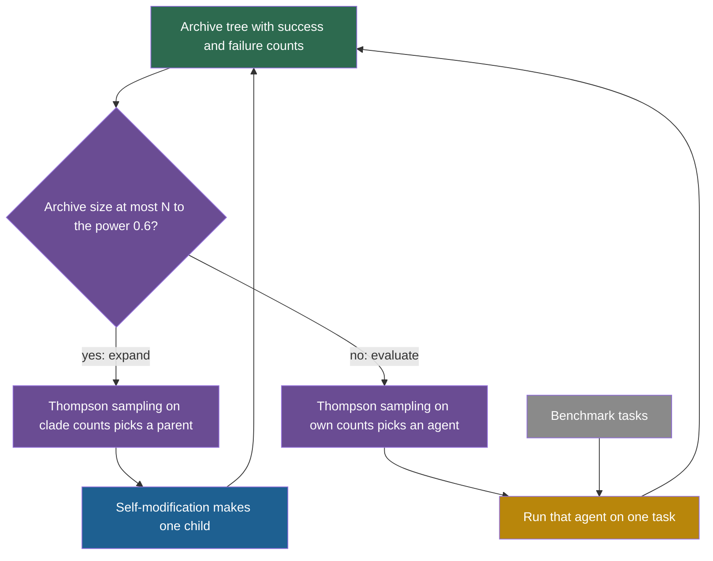

## Learning objectives

After this page you can:

- Explain the metaproductivity–performance mismatch and give the correlation numbers that the paper measured.
- State the definition of clade-metaproductivity (CMP) in plain words and say why it cannot be computed directly.
- Compute the estimate $\widehat{\mathrm{CMP}}$ for agents in a small tree, and show how it can rank agents differently from their own scores.
- Explain how HGM decides between expanding the tree and evaluating an agent, and how Thompson sampling picks agents.
- Judge the size of HGM's reported gains against the noise of a 60-task benchmark.
- Name what is fixed in HGM and what is not verified.

## Prerequisites

- [L3: Archives: why keep more than the best version](/notes/ai/recursive-self-improvement/03-anatomy/l3-archives-and-search-over-versions)
- [L5: Optimizing the improver: meta-objectives and nested loops](/notes/ai/recursive-self-improvement/04-mathematics/l5-optimizing-the-improver)
- [L3: Evaluation under noise](/notes/ai/recursive-self-improvement/04-mathematics/l3-evaluation-under-noise)
- [2025: The Darwin Gödel Machine](/notes/ai/recursive-self-improvement/06-research-systems/p10-darwin-godel-machine)

## The paper on one card

| Field | Value |
|---|---|
| Title | "Huxley-Gödel Machine: Human-Level Coding Agent Development by an Approximation of the Optimal Self-Improving Machine" |
| Authors | Wenyi Wang, Piotr Piękos, Li Nanbo, Firas Laakom, Yimeng Chen, Mateusz Ostaszewski, Mingchen Zhuge, Jürgen Schmidhuber |
| Year | 2025 (v1 on 24 October 2025, v3 on 29 October 2025) |
| Venue | ICLR 2026, "Published as a conference paper at ICLR 2026". The project README says it was an oral presentation. |
| arXiv | [2510.21614](https://arxiv.org/abs/2510.21614) |
| Code | [github.com/metauto-ai/HGM](https://github.com/metauto-ai/HGM) |
| Affiliation shown | KAUST |
| One-sentence result | With 800 evaluations each, HGM's chosen agent scored 56.7% on 60 SWE-bench Verified tasks, against 53.3% for DGM. |

The arXiv HTML of v3 stops before Section 4. The results on this page come from the arXiv v3 PDF and the OpenReview camera-ready PDF.

## Terms

| Term | Plain meaning |
|---|---|
| metaproductivity | An agent's potential to produce useful further self-improvements, through itself and its descendants. |
| metaproductivity–performance mismatch | The finding that an agent's own score is a poor guide to how good its descendants will be. |
| clade | An agent and all its descendants in the archive tree. The word comes from biology. |
| clade-metaproductivity (CMP) | The expected quality of the best final agent that will come from an agent's clade. |
| $\widehat{\mathrm{CMP}}$ estimate | A computable estimate of CMP: the success rate of all evaluations in the clade together. |
| Pearson correlation | A number from −1 to 1 that measures how well a straight line relates two quantities. |
| expansion | One self-modification step that creates one new child agent. |
| evaluation step | One run of one agent on one task, which gives one success or one failure. |
| Thompson sampling | A way to choose among options: draw one random plausible value for each option from its record, and pick the highest draw. |
| Beta distribution | A probability distribution over a rate between 0 and 1. Its shape comes from counts of successes and failures. |
| best-belief agent | The agent that HGM returns at the end, chosen by its record of successes and failures. |
| CPU-hour | One hour of work by one processor core, a measure of compute cost. |
| SWE-Verified-60 | A 60-task subset of SWE-bench Verified that the paper uses. |
| SWE-bench Lite | A smaller, separate version of SWE-bench that the paper uses to test generalization. |

## 1. The problem it addresses

Suppose a school must choose who will train the next generation of teachers. The obvious rule is to pick the teacher with the best personal exam score. But a strong exam taker is not always a strong teacher. Some teachers with average scores train students who become excellent. To choose well, you would want to know how good each teacher's students become, not only how good the teacher is.

The [Darwin Gödel Machine (DGM)](/notes/ai/recursive-self-improvement/06-research-systems/p10-darwin-godel-machine) and [SICA](/notes/ai/recursive-self-improvement/06-research-systems/p09-sica-self-improving-coding-agent) choose which agent to expand by that agent's own benchmark score. The Huxley-Gödel Machine (HGM) paper argues that this score poorly predicts the success of the agent's descendants (Wang et al., 2025, [arXiv:2510.21614](https://arxiv.org/abs/2510.21614)). A high-scoring agent may have unproductive descendants. A lower-scoring agent may start a strong lineage. The paper calls this the "Metaproductivity-Performance Mismatch".

So the question is: how can a self-improving system estimate which agent is the best starting point for further self-improvement?

## 2. What existed before it

| Earlier work | How it chooses whom to expand | What HGM changes |
|---|---|---|
| Gödel machine (Schmidhuber, 2003) | Only rewrites after a proof that the rewrite helps. Optimal in theory, impractical in practice. | HGM keeps the goal of the optimal machine and approximates it with an estimate. |
| SICA (2025) | The best agent so far, by its benchmark score. | HGM uses the record of the whole clade, not the agent's own score. |
| DGM (2025) | A random draw weighted by the sigmoid of the agent's score times one over one plus its number of children. | HGM replaces the agent's own score with the clade estimate, and evaluates one task at a time. |

Both DGM and SICA always expand first and then evaluate each new child on many tasks. HGM separates these two kinds of work (Section 3.3).

## 3. The central idea

### 3.1 Clade-metaproductivity

**The idea in words.** Judge an agent by its family, not by itself. Imagine that the search continues from now until the budget is spent. At the end, look at the best agent among this agent's descendants. CMP is the expected quality of that best descendant.

**The equation** (Section 3):

$$
\mathrm{CMP}_{\pi}(T, a) = \mathbb{E}_{T_B \sim p_{\pi}(\cdot \mid T, a)} \left[ U\!\left( \operatorname*{argmax}_{a' \in C(T_B, a)} \mathrm{Score}_{\pi}(a') \right) \right]
$$

**The symbols:**

- $T$ is the current archive, a tree of agents.
- $a$ is the agent that we judge.
- $\pi$ is the search policy: the rules that decide what to expand and evaluate.
- $B$ is the total budget. $T_B$ is the final archive when the policy runs until the budget is spent.
- $p_{\pi}(\cdot \mid T, a)$ is the probability distribution of final archives that the policy produces when it starts from $T$ and chooses $a$.
- $C(T_B, a)$ is the clade of $a$ in the final archive: $a$ and all its descendants.
- $\mathrm{Score}_{\pi}(a')$ is the measure that the policy uses to pick a final agent.
- $\operatorname{argmax}$ picks the agent $a'$ in the clade with the highest score.
- $U$ is the utility: the average of success indicators (1 for success, 0 for failure) over downstream tasks.
- $\mathbb{E}$ is the expectation, the average over all possible final archives, weighted by their probability.

**In plain English.** CMP asks: if I bet on this agent's family, how good will its best member be, on average?

> [!example] Worked example: CMP with two possible futures
> The numbers are invented. From the current archive, the search can end in two ways after agent $a$ is chosen.
>
> 1. Future 1 has probability 0.5. The best agent in $a$'s clade has a true utility of 0.60.
> 2. Future 2 has probability 0.5. The best agent in $a$'s clade has a true utility of 0.40.
> 3. $\mathrm{CMP} = 0.5 \times 0.60 + 0.5 \times 0.40 = 0.50$.
>
> Agent $a$ itself might score only 0.30. Its CMP of 0.50 says that its family is worth more than it is.

**The assumptions.** CMP depends on the search policy $\pi$ and on the budget $B$. A different policy would grow a different family. The paper's theorem adds four more assumptions. Section 3.2 of this page lists them.

**When it is useful.** CMP is the right target when you choose a parent for self-modification. It measures the value of a starting point, not the value of a finished product.

**What it does not prove.** CMP is defined as an expectation over futures that have not happened. You cannot compute it directly. It does not tell you how to estimate it well.

### 3.2 The link to the Gödel machine

**Theory:** Theorem 1 of the paper says that, under Assumption 1, access to a true CMP oracle is enough to imitate the Gödel machine. An oracle is an imagined function that returns the exact value. Assumption 1 has four parts:

1. The objective depends only on the final agent.
2. Utility is measured by repeatable trials.
3. Gödel machine proofs cost no budget.
4. Each self-modification costs exactly one unit of budget.

The proof is in Appendix A. **Our interpretation:** the theorem explains why CMP is the right quantity to chase. It does not make the practical system optimal, because HGM has only an estimate, not the oracle.

### 3.3 The estimate

**The idea in words.** Count every success and every failure of every agent in the clade. Divide the clade's successes by all of its evaluations. A clade whose members pass many tasks gets a high estimate.

**The equation** (Section 3):

$$
n^{C}_{\text{success}}(a) = \sum_{a' \in C(a)} n_{\text{success}}(a'), \qquad n^{C}_{\text{failure}}(a) = \sum_{a' \in C(a)} n_{\text{failure}}(a')
$$

$$
\widehat{\mathrm{CMP}}(a) = \frac{n^{C}_{\text{success}}(a)}{n^{C}_{\text{success}}(a) + n^{C}_{\text{failure}}(a)}
$$

**The symbols:**

- $n_{\text{success}}(a')$ and $n_{\text{failure}}(a')$ are the numbers of passed and failed task evaluations of agent $a'$.
- $C(a)$ is the clade of $a$ in the current archive.
- $n^{C}_{\text{success}}(a)$ and $n^{C}_{\text{failure}}(a)$ are the sums over the clade.
- $\widehat{\mathrm{CMP}}(a)$ is the estimate, a number from 0 to 1.

**In plain English.** The estimate is a weighted average of the success rates of the clade members. Each member counts in proportion to how often it was evaluated.

> [!example] Worked example: two siblings with opposite rankings
> Agents X and Y are siblings. Each was evaluated on 10 tasks. Each has two children, also evaluated on 10 tasks each. All numbers are invented.
>
> 1. X passed 6 of 10, so its own score is 0.60. Its children passed 2 of 10 and 3 of 10.
> 2. Y passed 4 of 10, so its own score is 0.40. Its children passed 7 of 10 and 8 of 10.
> 3. Clade of X: successes $6 + 2 + 3 = 11$ of 30 evaluations. $\widehat{\mathrm{CMP}}(X) = 11/30 = 0.367$.
> 4. Clade of Y: successes $4 + 7 + 8 = 19$ of 30. $\widehat{\mathrm{CMP}}(Y) = 19/30 = 0.633$.
>
> A rule based on the agent's own score prefers X. The clade estimate prefers Y, whose family has done better.

**The assumptions.**

1. The past success of a family predicts its future success.
2. Each evaluation is one fair trial on a task drawn the same way.
3. More-evaluated members deserve more weight. A member evaluated 100 times counts ten times as much as one evaluated 10 times.

**When it is useful.** Use it when you have an archive tree and per-task results for each agent. It costs nothing extra to compute.

**What it does not prove.** It does not prove that the clade will keep improving. A young agent with no children has an estimate equal to its own score, so the estimate cannot see its future yet. A large old clade is also slow to change its estimate.

> [!key] Metaproductivity
> 1. **Name:** metaproductivity.
> 2. **Meaning:** the potential of an agent to lead, through self-modification, to better agents later.
> 3. **Problem it solves:** a self-improving search must choose parents. A parent's value lies in its descendants, not in its own score.
> 4. **Example:** in the worked example, Y scores lower than X but has the more productive family.
> 5. **Link to RSI:** recursive self-improvement is about improving the ability to improve. Metaproductivity is a direct measure of that ability, while a benchmark score measures only current skill.
> 6. **Limits:** it can only be estimated from the past, and it depends on the search policy and the budget.

## 4. The architecture

HGM keeps an archive tree of coding agents, in the same setting as DGM and SICA. It differs in how it spends its budget. Each step is one of two actions (Section 3.3):

1. **Expansion:** one self-modification, which creates one new child.
2. **Evaluation:** one agent runs one task, which adds one success or one failure to that agent's record.

DGM and SICA always expand and then evaluate each new child on many tasks. HGM evaluates one agent–task pair at a time. So it can stop spending evaluations on an agent that looks bad early. Asynchronous execution lets expansions and evaluations run in parallel.



Green is the archive, purple is the fixed search policy, blue is the new agent, gold is evaluation and gray is the tasks.

## 5. The algorithm, step by step

### 5.1 Expand or evaluate

**The idea in words.** Early in the search, there are few agents, so HGM should make more. Later, it has many agents with few evaluations each, so it should learn more about them. The rule lets the archive grow more slowly than the number of evaluations.

**The rule** (Section 3.3):

$$
\text{expand if } \lvert T \rvert \le N^{\alpha}, \text{ otherwise evaluate}, \qquad \alpha = 0.6
$$

- $\lvert T \rvert$ is the number of agents in the archive.
- $N$ is the number of evaluations done so far.
- $\alpha = 0.6$ sets how fast the archive may grow.

**In plain English.** The archive may hold at most $N^{0.6}$ agents. When it is full, HGM spends the next step on an evaluation.

> [!example] Worked example: the expansion limit
> 1. After $N = 100$ evaluations: $100^{0.6} = 15.85$. An archive of 15 agents expands. An archive of 16 agents evaluates.
> 2. After $N = 800$ evaluations: $800^{0.6} = 55.19$. The archive can hold at most 55 agents.
> 3. So, at the end of an 800-evaluation run, there are on average at least $800/55 \approx 14.5$ evaluations per agent.

```plot
{
  "title": "HGM expansion limit: purple = largest archive size N^0.6 at which HGM still expands",
  "xAxis": {"domain": [0, 800], "label": "evaluations so far N"},
  "yAxis": {"domain": [0, 60], "label": "archive size"},
  "disableZoom": true,
  "data": [
    {"fn": "x^0.6", "color": "#6A4C93"}
  ]
}
```

**Assumptions.** One value of $\alpha$ suits the task and budget. **When useful:** as a simple schedule that balances making agents and measuring them. **What it does not prove:** that 0.6 is the best value. These notes found no tuning study for it.

### 5.2 Choose a parent with Thompson sampling

For an expansion, HGM must choose a parent. It uses Thompson sampling on the clade counts (Section 3.3).

For each agent $a$, it draws one random number from a Beta distribution:

$$
\theta_a \sim \mathrm{Beta}\!\left(\tau\,(1 + n^{C}_{\text{success}}(a)),\ \tau\,(1 + n^{C}_{\text{failure}}(a))\right)
$$

Then it picks the agent with the largest $\theta_a$.

- $\theta_a$ is a random plausible value of the clade's success rate.
- $\mathrm{Beta}(x, y)$ is a distribution on rates from 0 to 1. With $\tau = 1$, its mean is $x/(x + y)$. Larger counts make it narrower.
- $\tau$ is an exploration scheduler that grows over time. A larger $\tau$ makes every draw closer to its mean, so the choice becomes greedier.

> [!example] Worked example: the means of the draws
> With $\tau = 1$, take the clades of the earlier example.
>
> 1. X: 11 successes and 19 failures, so $\mathrm{Beta}(12, 20)$ with mean $12/32 = 0.375$.
> 2. Y: 19 successes and 11 failures, so $\mathrm{Beta}(20, 12)$ with mean $20/32 = 0.625$.
> 3. Y wins most draws. But both distributions are wide, so X still wins sometimes. That is how Thompson sampling keeps exploring.

The exact form of $\tau$ is not verified. A text extraction of the PDF gave $\tau = B/b$, where $b$ is the remaining budget. Treat this form as unconfirmed.

### 5.3 Choose an agent to evaluate

For an evaluation step, HGM uses Thompson sampling again, but on the agent's own counts: $\mathrm{Beta}(\tau(1 + n_{\text{success}}(a)), \tau(1 + n_{\text{failure}}(a)))$. It runs the chosen agent on one task and updates its counts. **Our interpretation:** an agent with a poor early record rarely wins the draw, so it stops receiving evaluations.

### 5.4 Choose the final agent

At the end, HGM returns the agent with the highest posterior $\epsilon$-percentile, $I_{\epsilon}(1 + n_{\text{success}}, 1 + n_{\text{failure}})$. $I_{\epsilon}$ is computed with the regularized incomplete beta function. In plain words, HGM picks the agent whose success rate is high even under a cautious reading of its record. The paper sets $\epsilon = 1$ in the experiments, per a text extraction. The exact meaning of that setting is not verified.

### 5.5 The whole loop

1. Look at the archive size $\lvert T \rvert$ and the evaluation count $N$.
2. If $\lvert T \rvert \le N^{0.6}$, choose a parent by Thompson sampling on clade counts, and make one child by self-modification.
3. Otherwise, choose an agent by Thompson sampling on its own counts, and run it on one task.
4. Update the counts of that agent and, through the sums, of every clade that contains it.
5. Repeat until the budget of evaluations is spent.
6. Return the agent with the best cautious estimate of its own success rate.

## 6. The role of evaluation

Evaluation has two roles in HGM. It measures agents, and it feeds the clade estimates that guide expansion. Because each evaluation is one agent on one task, HGM can spend its budget where it is most informative.

The paper also uses evaluation to test its own idea. It measures how well each method's guidance signal agrees with the "empirical CMP" of the agents (Table 1). The guidance signal is the agent's own benchmark score for DGM and SICA, and $\widehat{\mathrm{CMP}}$ for HGM. The measure is the Pearson correlation, in a weighted and an unweighted form.

**Our arithmetic:** the square of a correlation, $r^2$, is the share of variation that a straight line explains. For SICA's 0.444, $r^2 = 0.197$, so about 20%. For HGM's 0.778, $r^2 = 0.605$, so about 61%.

**Our interpretation:** both the guidance signal of HGM and the empirical CMP use the results of clade members. Some agreement between them may follow from this shared basis. These notes do not have the exact definition of empirical CMP, so treat this as a question to check in the paper.

## 7. The experimental setup

| Setting | Value |
|---|---|
| Budget | 800 task evaluations per method (Section 4.2) |
| Benchmarks | SWE-Verified-60, a 60-task subset of SWE-bench Verified, and Polyglot |
| Models, SWE-Verified-60 | GPT-5 for expansion (self-modification), GPT-5-mini for evaluation |
| Models, Polyglot | Qwen3-Coder-480B-A35B-Instruct (quantized) for expansion, Qwen3-Coder-30B-A3B-Instruct for evaluation |
| Time limits | 1 hour per agent run (Section 4.2), 5 hours in the generalization test (Section 4.3) |
| Compared methods | SICA, DGM and HGM, in the same setting |
| Cost | about USD 5,000 "to produce the experimental results, including all three methods" (Appendix C.2) |

The initial agent scored 40% on SWE-Verified-60 and 20.3% on Polyglot.

## 8. The reported results

### 8.1 Does the guidance signal predict family success?

**Measured** (Table 1). Pearson correlation of each method's guidance signal with empirical CMP, weighted / unweighted:

| Estimator | SWE-Verified-60 | Polyglot |
|---|---|---|
| SICA (benchmark score) | 0.444 / 0.444 | 0.274 / 0.274 |
| DGM (benchmark score) | 0.285 / 0.406 | 0.383 / 0.357 |
| HGM ($\widehat{\mathrm{CMP}}$) | 0.778 / 0.512 | 0.626 / 0.873 |

The text of Section 4.1 gives 0.8783 for HGM on Polyglot, unweighted. The table gives 0.873. The paper is not consistent here.

### 8.2 The best agent after 800 evaluations

**Measured** (Table 2). The change from the initial agent is in brackets.

| Method | SWE-Verified-60 | CPU-hours | Polyglot | CPU-hours |
|---|---|---|---|---|
| SICA | 50.0% (+10) | "infinite loop", see below | 25.4% (+5.1) | 572 |
| DGM | 53.3% (+13.3) | 1231 | 27.1% (+6.8) | 2385 |
| HGM | 56.7% (+16.7) | 517 | 30.5% (+10.2) | 347 |

For SICA on SWE-Verified-60, the paper gives "infinite loop" instead of CPU-hours. Context-window errors started after 360 evaluations, which is 45% of the budget. HGM used 2.38 times fewer CPU-hours than DGM on SWE-Verified-60. On Polyglot it used about 6.86 times fewer than DGM and 1.65 times fewer than SICA.

### 8.3 Generalization to SWE-bench Lite

**Measured** (Table 3, Section 4.3). Scores on SWE-bench Lite, in a filtered and a standard version:

| Agent | Filtered | Standard |
|---|---|---|
| HGM initial ancestor | 34.8% | 44.0% |
| SWE-agent + GPT-5-mini | 39.6% | 47.6% |
| HGM best-belief agent + GPT-5-mini | 40.1% | 49.0% |
| SWE-agent + Claude 4 Sonnet (best checked leaderboard entry) | 48.3% | 56.7% |
| HGM best-belief agent + GPT-5 | 48.8% | 57.3% |

The rows with GPT-5 and Claude 4 Sonnet come from the OpenReview camera-ready version. The text extraction of the arXiv v3 PDF showed only the first three rows.

### 8.4 Other reported results

The camera-ready version also reports two more results:

1. On the full SWE-bench Verified (500 tasks), the starting agent with GPT-5-mini went from 53.2% to 61.4% after 8,000 evaluations.
2. On SWE-Bench-Live Lite, HGM scored 27.0% with GPT-5.1 Codex mini, against a previous leaderboard best of 24.7%.

### 8.5 The "human-level" claim

The title says "Human-Level". In the paper this means a match on SWE-bench Lite. The best HGM agent scored 48.8% and 57.3%. The best officially checked human-engineered agent scored 48.3% and 56.7%. **Claimed:** the label "human-level". **Measured:** the numeric match on that leaderboard.

## 9. What the results show

1. **Measured:** in these runs, an agent's own score correlated only weakly with its family's success. The values were 0.274 to 0.444.
2. **Measured:** the clade estimate correlated more strongly: 0.512 to 0.873, depending on the benchmark and the weighting.
3. **Measured:** with the same budget of 800 evaluations, HGM's chosen agent scored highest on both benchmarks, and HGM used far fewer CPU-hours.
4. **Our interpretation:** the CPU-hour savings fit the design. HGM stops evaluating weak agents early, while DGM and SICA evaluate every child on many tasks.
5. **Measured:** with GPT-5, an HGM agent matched the best checked human-engineered agent on SWE-bench Lite.
6. **Our interpretation:** the main lesson is conceptual. A high score now is not the same as a high ability to improve later. This is a measured warning about the assumption behind DGM.

## 10. What the results do not show

1. **Not shown: that HGM beats DGM beyond noise.** Out of 60 tasks, HGM solved 34, DGM 32 and SICA 30. So HGM beat DGM by 2 tasks.
2. **Our arithmetic:** a score near 55% on 60 tasks has a standard error of about 6.4 points. The difference of two such scores has a standard error of about 9.1 points. So HGM's 3.4-point lead over DGM is about 0.37 standard errors.
3. **Not shown: the variation between runs.** There is one run per method per benchmark (Table 2). Another run could reverse the order.
4. **Not shown: a comparison with the DGM paper's numbers.** HGM uses other models (GPT-5, Qwen3-Coder) and another task subset. Its DGM baseline is a re-run in its own setting, not the original 50.0%.
5. **Not shown: a fully independent correlation test.** The empirical CMP may share its basis with the HGM estimate. This is a question to check (Section 6).
6. **Not shown: freedom from contamination.** The authors name SWE-bench contamination as a concern. Strong models may have seen the issues or their fixes.
7. **Not shown: human-level software engineering in general.** The claim rests on one leaderboard match on SWE-bench Lite.
8. **Not shown: that the selection rule improves itself.** HGM's own policy is fixed.

## 11. Limitations

1. **Symbolic self-improvement only.** The system changes scaffolds, prompts and control logic. Weights and architecture are fixed.
2. **Contamination.** The authors name concerns about SWE-bench contamination.
3. **Small benchmarks and single runs.** One task on SWE-Verified-60 is 1.67 points.
4. **Unverified details.** These notes could not confirm the exact form of the $\tau$ scheduler. They could not confirm the meaning of $\epsilon = 1$ either.
5. **A fixed policy.** The expand-or-evaluate rule, Thompson sampling and the final selection are not self-modified.
6. **Safety.** Self-modification ran in a sandboxed environment. The paper frames the work as a step toward safer self-improving AI. These notes found no detailed safety experiment.

## 12. Its relationship to RSI

HGM sits at the same place as DGM on [the ladder of this course](/notes/ai/recursive-self-improvement/02-core-idea/l2-the-ladder-of-self-improvement). The agent changes its own code, and the changed code does the next self-modification. Its contribution is a better **selection rule**: which self-modification to build on.

| Part of the system | Can HGM change it? |
|---|---|
| The agent's scaffold, prompts and control logic | yes |
| The model weights and the architecture | no |
| The expand-or-evaluate rule and Thompson sampling | no |
| The clade estimate and the final selection | no |
| The benchmarks | no |

HGM shows a deep point about recursive self-improvement. The quantity that matters is not "how good is this agent" but "how good will the agents be that this agent leads to". DGM assumed that the first predicts the second. HGM measured that it does so only weakly, and built a better predictor from the archive itself. See [Part 4 L5](/notes/ai/recursive-self-improvement/04-mathematics/l5-optimizing-the-improver) for metaproductivity as a meta-objective, and [Part 3 L3](/notes/ai/recursive-self-improvement/03-anatomy/l3-archives-and-search-over-versions) for archives.

**Our interpretation:** the next step would be a system that also improves its own selection rule. HGM does not do this. Its rule is fixed, like DGM's.

## 13. Common mistakes

1. **"A high score makes the best parent."** In these runs, an agent's own score correlated only 0.274 to 0.444 with its family's success.
2. **"CMP is a number that HGM computes."** CMP is an expectation over futures. HGM computes only the estimate $\widehat{\mathrm{CMP}}$.
3. **"HGM clearly beats DGM on SWE-bench."** On 60 tasks, it beat DGM by 2 tasks in one run. That is well inside the noise.
4. **"HGM's 56.7% can be compared with the DGM paper's 50.0%."** The models, the task subset and the budget differ.
5. **"Theorem 1 makes HGM optimal."** The theorem needs a true CMP oracle and strong assumptions. HGM has an estimate.
6. **"HGM improves its own search policy."** The policy is fixed. Only the agents change.

## 14. One-minute explanation

The Huxley-Gödel Machine asks which agent a self-improving system should build on. Earlier systems used each agent's own score, which HGM found predicts its descendants' success only weakly, with correlations of about 0.27 to 0.44. So HGM judges an agent by its whole family, pooling the successes and failures of the agent and its descendants. Thompson sampling on these counts picks parents, and a simple rule decides when to make a new agent and when to test an old one. With 800 evaluations, HGM's best agent beat DGM's by 56.7% to 53.3% on 60 tasks, but that is 2 tasks in one run. The lasting lesson is that a high score now does not mean a high ability to improve later.

## 15. Check questions

```check
{
  "question": "Application: agent P passed 5 of 10 tasks. Its only child passed 9 of 10, and that child's only child passed 8 of 10. Agent Q passed 7 of 10 and has one child that passed 3 of 10. Compute the clade estimate for P and Q. Which one would a DGM-style rule prefer, and which one HGM?",
  "hint": "Add the successes and the evaluations over each clade.",
  "answer": "P's clade: $(5 + 9 + 8)/(10 + 10 + 10) = 22/30 = 0.733$. Q's clade: $(7 + 3)/(10 + 10) = 10/20 = 0.500$. A rule based on the agent's own score prefers Q, because 0.7 is more than 0.5. HGM prefers P, because its family has done much better. (A DGM-style rule also uses child counts, which favors agents with fewer children, but the score term alone favors Q.)"
}
```

```check
{
  "question": "Understanding: why can HGM not compute CMP directly, and what does it compute instead?",
  "answer": "CMP is an expectation over the final archives that the search could produce from now until the budget is spent. Those futures have not happened, so their best agents and utilities are unknown. HGM computes an estimate from the past: the number of successes of all clade members divided by all their evaluations. It assumes that a family's past success predicts its future success."
}
```

```check
{
  "question": "Application: HGM has done N = 400 evaluations and its archive holds 37 agents. Does the next step expand or evaluate? What if the archive holds 36 agents?",
  "hint": "Compute 400 to the power 0.6.",
  "answer": "$400^{0.6} = 36.41$. With 37 agents, $37 > 36.41$, so HGM evaluates. With 36 agents, $36 \\le 36.41$, so HGM expands."
}
```

```check
{
  "question": "Analysis: HGM reports 56.7% against DGM's 53.3% on SWE-Verified-60, with one run each. Convert both to tasks, estimate the noise, and write one sentence that a careful reviewer could sign.",
  "hint": "One task is 100/60 = 1.67 points. Use sqrt(p(1-p)/n) for each score.",
  "answer": "56.7% is 34 tasks and 53.3% is 32 tasks, a gap of 2 tasks. Each score has a standard error of about $\\sqrt{0.55 \\times 0.45 / 60} = 0.064$, and their difference about $\\sqrt{2} \\times 0.064 = 0.091$. The gap of 3.4 points is about 0.37 standard errors. A careful sentence: \"In one run each, HGM's best agent solved 2 more of 60 tasks than DGM's. This difference is within sampling noise. HGM used about 2.4 times fewer CPU-hours.\""
}
```

```check
{
  "question": "Analysis: SICA's own benchmark score correlated 0.444 with empirical CMP on SWE-Verified-60. What share of the variation in family success does this explain, and what does that mean for a system like DGM?",
  "answer": "$0.444^2 = 0.197$, so about 20% of the variation. About 80% of the differences in how well families do are not explained by the parent's own score. DGM weights parents by their own score. So it spends many expansions on parents whose families will not do well. It spends too few on lower-scoring agents with productive families. The archive helps, because DGM keeps all agents, but its selection signal is weak."
}
```

## 16. Summary and links

- DGM and SICA choose parents by their own benchmark score. HGM measured that this score predicts family success only weakly, with correlations from 0.274 to 0.444.
- Clade-metaproductivity (CMP) is the expected quality of the best final agent in an agent's family. With a true CMP oracle, a theorem says that the system could imitate the Gödel machine.
- HGM estimates CMP by pooling the successes and failures of a whole clade. It uses Thompson sampling to choose parents and agents to evaluate.
- With 800 evaluations, HGM's best agent scored 56.7% on 60 tasks against 53.3% for DGM, with fewer CPU-hours. The gap is 2 tasks in one run.
- The search policy, the model weights and the benchmarks stay fixed.

**Next:** [FunSearch and AlphaEvolve](/notes/ai/recursive-self-improvement/06-research-systems/p12-funsearch-and-alphaevolve) use the same pairing of a language model with an evaluator, but to improve solutions, not the system itself.

**Links:**

- Previous: [2025: The Darwin Gödel Machine](/notes/ai/recursive-self-improvement/06-research-systems/p10-darwin-godel-machine)
- Next: [2023 and 2025: FunSearch and AlphaEvolve](/notes/ai/recursive-self-improvement/06-research-systems/p12-funsearch-and-alphaevolve)
- Archives and parent selection: [L3: Archives: why keep more than the best version](/notes/ai/recursive-self-improvement/03-anatomy/l3-archives-and-search-over-versions)
- Self-evaluation and the mismatch: [L4: Self-evaluation failures](/notes/ai/recursive-self-improvement/08-failure-modes-and-safety/l4-self-evaluation-failures)
- Open problems: [L4: Open problems, and how to read new RSI work](/notes/ai/recursive-self-improvement/10-advanced/l4-open-problems-and-how-to-read-new-work)

**Videos:** these notes know of no verified talk on HGM. The [video guide](/notes/ai/recursive-self-improvement/videos) lists talks on the DGM and on open-ended search, which give the background for this page.

## References

- Wenyi Wang, Piotr Piękos, Li Nanbo, et al. "Huxley-Gödel Machine: Human-Level Coding Agent Development by an Approximation of the Optimal Self-Improving Machine". 2025. ICLR 2026. arXiv:2510.21614. https://arxiv.org/abs/2510.21614. Camera-ready: https://openreview.net/pdf/3acf0849444035b86d5c18ebc10e654a5951c9de.pdf. Code: https://github.com/metauto-ai/HGM
- Jenny Zhang, Shengran Hu, Cong Lu, Robert Lange, Jeff Clune. "Darwin Godel Machine: Open-Ended Evolution of Self-Improving Agents". 2025. ICLR 2026. arXiv:2505.22954. https://arxiv.org/abs/2505.22954
- Maxime Robeyns, Martin Szummer, Laurence Aitchison. "A Self-Improving Coding Agent". 2025. ICLR 2025 Workshop on Scaling Self-Improving Foundation Models. arXiv:2504.15228. https://arxiv.org/abs/2504.15228
- Jürgen Schmidhuber. "Goedel Machines: Self-Referential Universal Problem Solvers Making Provably Optimal Self-Improvements". 2003. arXiv:cs/0309048. https://arxiv.org/abs/cs/0309048
- E. Miller. "Adding Error Bars to Evals: A Statistical Approach to Language Model Evaluations". 2024. arXiv:2411.00640. https://arxiv.org/abs/2411.00640
