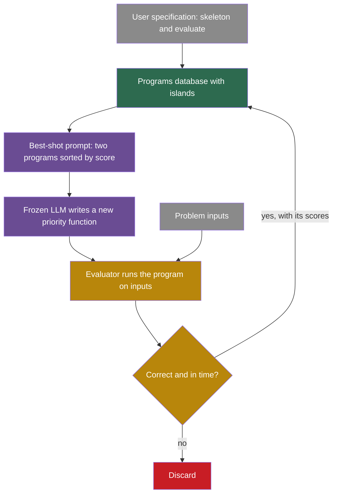

## Learning objectives

After this page you can:

- Explain why FunSearch evolves programs instead of answers, and why it cannot work without an automatic evaluator.
- Describe the skeleton, the programs database with islands, and best-shot prompting.
- Compute FunSearch's sampling probabilities for clusters and for programs.
- Read the cap set and bin-packing results, and say which number is not verified.
- Describe how AlphaEvolve extends FunSearch, using the paper's own comparison.
- Quote AlphaEvolve's statements about its own training exactly, and explain why this is only an indirect loop.
- Use OpenEvolve as an open reference implementation and name its safety gaps.

## Prerequisites

- [L4: Optimization and search](/notes/ai/recursive-self-improvement/01-foundations/l4-optimization-and-search)
- [L6: Evolutionary search, populations and open-endedness](/notes/ai/recursive-self-improvement/05-approaches/l6-evolutionary-and-population-methods)
- [L4: Examples and non-examples](/notes/ai/recursive-self-improvement/02-core-idea/l4-examples-and-non-examples)
- [P1: A fixed agent with a score](/notes/ai/recursive-self-improvement/09-build-it/p1-a-fixed-agent-with-a-score), which uses the same bin-packing problem

## The paper on one card

| Field | FunSearch | AlphaEvolve |
|---|---|---|
| Title | "Mathematical discoveries from program search with large language models" | "AlphaEvolve: A coding agent for scientific and algorithmic discovery" |
| Authors | Bernardino Romera-Paredes, Mohammadamin Barekatain, Alexander Novikov, et al. (12 authors) | Alexander Novikov, Ngân Vũ, Marvin Eisenberger, et al. (18 authors) |
| Year | 2023, online on 14 December 2023, issue dated 2024 | 2025, blog on 14 May 2025, arXiv v1 on 16 June 2025 |
| Venue | Nature 625(7995):468–475 | arXiv preprint, with a Google DeepMind blog and white paper |
| Identifier | DOI [10.1038/s41586-023-06924-6](https://www.nature.com/articles/s41586-023-06924-6) | [arXiv:2506.13131](https://arxiv.org/abs/2506.13131) |
| Code | [github.com/google-deepmind/funsearch](https://github.com/google-deepmind/funsearch), Apache-2.0, without the language model, the sandbox and the infrastructure | no official open-source code |
| One-sentence result | A cap set of size 512 in dimension 8, larger than previously known, and bin-packing heuristics that beat first fit and best fit. | Recovered 0.7% of Google's fleet-wide compute, cut Gemini training time by 1%, and found a 48-multiplication method for 4×4 complex matrices. |

This page also covers OpenEvolve, an open-source system in the same style (Section 4.3).

## Terms

| Term | Plain meaning |
|---|---|
| program search | A search in which each candidate is a program, and the program produces the answer. |
| evolutionary search | A search that keeps a population of candidates, changes some of them, and keeps the better ones. |
| skeleton | A fixed program written by the user, with one function left for the search to change. |
| priority function | The function that FunSearch evolves. It gives a number to each choice, and the skeleton takes the choice with the highest number. |
| programs database | FunSearch's store of correct programs and their scores. |
| island | A separate sub-population in the database. Islands evolve apart from each other. |
| signature | The tuple of a program's scores on each test input. Programs with the same signature form one cluster. |
| best-shot prompting | A prompt that shows a few good programs, sorted by score, and asks for a better one. |
| temperature | A number that controls how strongly a random choice prefers high scores. A low temperature is greedy. |
| cap set | A set of points in an $n$-dimensional grid with 3 values per coordinate, in which no three points lie on a line. |
| online bin packing | Items arrive one at a time and must go into a bin at once. The aim is to use few bins. |
| first fit and best fit | Two standard rules: put the item in the first bin with room, or in the bin with the least room left that still fits. |
| MAP-Elites | A method that keeps the best candidate in each cell of a grid of features, to keep the population diverse. |
| evaluation cascade | A series of tests from easy to hard. A candidate goes on only if it passes each stage. |
| SEARCH/REPLACE diff | A change written as "find this text, put this text in its place". |
| meta-prompt | Instructions in the prompt that tell the model how to propose changes. AlphaEvolve evolves these too. |
| kernel | A small, heavily used routine that runs on an accelerator chip, for example one step of a model's computation. |
| indirect loop | A loop in which a system's output helps to build its next version only through other processes, here human-run model training. |

## 1. The problem it addresses

A mathematician with a computer can often check a proposed construction in seconds. Is this set of points free of lines? How many bins does this packing use? But she may not know how to find a better construction. A language model can propose many ideas quickly, but some of them are wrong, and it states them with confidence.

FunSearch pairs the two. Its abstract describes the method as "pairing a pretrained LLM with a systematic evaluator" (Romera-Paredes et al., 2023, [DOI 10.1038/s41586-023-06924-6](https://www.nature.com/articles/s41586-023-06924-6)). The language model proposes programs. The evaluator runs them and scores them. Wrong programs are discarded, so the confident errors of the model do no harm.

AlphaEvolve asks the same question at a larger scale (Novikov et al., 2025, [arXiv:2506.13131](https://arxiv.org/abs/2506.13131)). Can this pairing improve whole code files for real engineering problems? Examples are data-center scheduling and the training of Google's own models.

## 2. What existed before it

| Before | Its limit | What FunSearch and AlphaEvolve add |
|---|---|---|
| Hand-designed heuristics, such as first fit and best fit for bin packing | A human must invent each rule. | The search writes new rules as programs. |
| Evolutionary search over programs, known as genetic programming | Random changes to program text rarely produce working code. Programs also tend to grow without need (see [Part 8 L5](/notes/ai/recursive-self-improvement/08-failure-modes-and-safety/l5-churn-bloat-and-drift)). | A language model proposes the changes. |
| A language model alone | It can write plausible but wrong answers. | An automatic evaluator rejects every wrong program. |

**Our interpretation:** the new ingredient is the language model as the source of changes. A model that has read much code can propose changes that make sense, where a random change usually breaks the program.

## 3. The central idea

FunSearch evolves programs, not answers. It does not ask the model "what is a large cap set?". It asks for a better version of one function inside a fixed program, and that program builds the answer.

This choice has three benefits, as the paper presents them:

1. **A small target.** The skeleton fixes most of the program. Only one critical function changes: `priority` for the cap set or `heuristic` for bin packing.
2. **A score for every program.** The evaluator runs the program on inputs and returns a number. The search can compare any two candidates.
3. **Programs that people can read.** **Claimed:** the evolved programs tend to be interpretable. For the cap set, the evolved priority function showed a "reflections" symmetry that helped the authors understand the construction.

AlphaEvolve keeps this idea and widens it. It can evolve a whole code file in any language, with several scores at once (Section 4.2 of this page).

## 4. The architecture

### 4.1 FunSearch

FunSearch has four components (Romera-Paredes et al., 2023):

1. **The specification**, from the user. It has an `evaluate` function and a skeleton program, for example a greedy algorithm. For the cap set, the search starts from a trivial constant function.
2. **The language model.** It is pretrained and frozen: Codey, "an LLM built on top of the PaLM2 model family", with no fine-tuning.
3. **The evaluator.** It runs each program on inputs. Programs that time out, use too much memory or give invalid output are discarded.
4. **The programs database with islands.** Every 4 hours, the half of the islands with the lowest best scores are wiped. Each of them restarts from the best program of a randomly chosen surviving island.

Inside an island, programs are grouped into clusters by signature, the tuple of their scores on the inputs.



Green is the database, purple is the proposer, gold is the evaluator and gray is the user's problem. Note what is missing: no box is the system being improved. FunSearch improves a solution program, not itself.

### 4.2 AlphaEvolve

AlphaEvolve has the same loop with larger parts (Novikov et al., 2025, Section 2):

1. **The task specification.** The user marks the code to evolve with `# EVOLVE-BLOCK-START` and `# EVOLVE-BLOCK-END`. An `evaluate` function returns scores that the search tries to make larger.
2. **The prompt sampler.** It builds prompts from programs in the database, with context and evaluation results. It varies the format at random. It also uses meta-prompts that are co-evolved in a separate database.
3. **An ensemble of language models.** Gemini 2.0 Flash gives many fast candidates. Gemini 2.0 Pro gives fewer, higher-quality suggestions.
4. **The output format.** Changes come as SEARCH/REPLACE diff blocks, or as full rewrites for short code.
5. **The evaluators.** They run `evaluate` as an evaluation cascade from easy to hard tests. They can add feedback from a language model for properties that are hard to code, such as simplicity. They can track several scores at once.
6. **The program database.** It combines MAP-Elites with an island-based population.
7. **A distributed pipeline.** A controller, model samplers and evaluation nodes run at the same time.

The AlphaEvolve paper compares the two systems itself (Table 1):

| Property | FunSearch | AlphaEvolve |
|---|---|---|
| What evolves | one function | a whole code file |
| Code size | 10 to 20 lines | hundreds of lines |
| Language | Python | any language |
| Evaluation time | at most 20 minutes on 1 CPU | hours, in parallel, on accelerators |
| Model samples | millions | thousands suffice |
| Model | small, no benefit from larger ones | benefits from state-of-the-art models |
| Context in the prompt | minimal | rich context and feedback |
| Scores | one | several |

### 4.3 OpenEvolve, an open reference

AlphaEvolve's code is not public. OpenEvolve is an open-source system in the same style. Its author is Asankhaya Sharma, and its repository is [github.com/codelion/openevolve](https://github.com/codelion/openevolve), now served from the `algorithmicsuperintelligence` organization. It uses the Apache-2.0 license.

The launch blog of 20 May 2025 called it "an open-source implementation of the AlphaEvolve system". The current README no longer names AlphaEvolve in its main text. It is an independent implementation, not DeepMind code.

A reading of its code at commit `74c7cb0` (version 0.4.0) gives these defaults (public code, `openevolve/config.py`):

1. Five islands, each with its own MAP-Elites grid over two features: code complexity and diversity, with 10 bins each.
2. An archive of 100 elite programs.
3. Parent choice: 20% at random from the island, 70% from the island's elite archive, 10% in proportion to fitness.
4. Every 50 island generations, each island copies its top 10% to its two neighbours in a ring.
5. A child takes its grid cell if the cell is empty or if the child scores higher than the program there.
6. An evaluation cascade with thresholds 0.5, 0.75 and 0.9. The code never uses the third threshold.

[Part 7 L6](/notes/ai/recursive-self-improvement/07-implementations/l6-openevolve-in-code) walks through this code.

## 5. The algorithm, step by step

### 5.1 The FunSearch loop

1. Choose an island.
2. Inside it, sample $k = 2$ programs (Section 5.2 explains how).
3. Sort them by score and label them `v0` and `v1`. Ask the model to write `v2`. This is best-shot prompting.
4. The evaluator runs the new program on the inputs.
5. If it is wrong or too slow, discard it. If it is correct, add it to the island with its scores.
6. Every 4 hours, wipe the weaker half of the islands and restart them from the best programs of the others.
7. Repeat, with many samplers and evaluators in parallel.

### 5.2 How FunSearch samples programs

The paper refers to its Supplementary Information for the exact sampling rules. The public code gives them (public code, `programs_database.py`).

**The idea in words.** First choose a cluster, with a preference for high scores. The preference starts mild and gets stronger as the island grows, then resets. Then choose a program inside the cluster, with a preference for short programs.

**The equations:**

$$
P(\text{cluster } i) = \frac{e^{s_i / T_{\text{cluster}}}}{\sum_j e^{s_j / T_{\text{cluster}}}}, \qquad T_{\text{cluster}} = T_0 \left(1 - \frac{n \bmod N}{N}\right)
$$

$$
P(\text{program } i) \propto e^{-\tilde{\ell}_i / T_{\text{program}}}, \qquad \tilde{\ell}_i = \frac{\ell_i - \min \ell}{\max \ell + 10^{-6}}
$$

**The symbols:**

- $s_i$ is the score of cluster $i$.
- $T_{\text{cluster}}$ is the temperature for the cluster choice. $T_0 = 0.1$ is its starting value.
- $n$ is the number of programs registered on the island so far. $N = 30{,}000$ is the reset period.
- $n \bmod N$ is the remainder of $n$ divided by $N$. It counts from 0 to 29,999 and starts again.
- $\ell_i$ is the length of program $i$ in characters. $\min \ell$ and $\max \ell$ are the shortest and longest lengths in the cluster.
- $\tilde{\ell}_i$ is the normalized length, from 0 for the shortest program to almost 1.
- $T_{\text{program}} = 1$ is the temperature for the program choice.
- The symbol $\propto$ means "proportional to". Divide by the sum to get probabilities.

**In plain English.** High-scoring clusters are chosen more often. Over each run of 30,000 programs, the choice gets greedier. Inside a cluster, shorter programs are chosen more often.

> [!example] Worked example: clusters and programs
> Three clusters have scores 0.50, 0.52 and 0.60. These numbers are invented.
>
> 1. At $n \bmod N = 0$: $T_{\text{cluster}} = 0.1$. The weights are $e^{5.0} = 148.4$, $e^{5.2} = 181.3$ and $e^{6.0} = 403.4$. Their sum is 733.1. So the probabilities are 0.202, 0.247 and 0.550.
> 2. At $n \bmod N = 15{,}000$: $T_{\text{cluster}} = 0.1 \times (1 - 0.5) = 0.05$. The same steps give 0.101, 0.151 and 0.748. The best cluster now gets three of every four draws.
> 3. Inside one cluster, three programs have 200, 400 and 1,000 characters. The normalized lengths are $0$, $200/1000 = 0.2$ and $800/1000 = 0.8$.
> 4. The weights are $e^{0} = 1$, $e^{-0.2} = 0.819$ and $e^{-0.8} = 0.449$. The sum is 2.268, so the probabilities are 0.441, 0.361 and 0.198.

**The assumptions.**

1. The temperature works on the raw score scale. If scores differ by whole units instead of hundredths, the same temperature is far greedier.
2. Shorter programs are better starting points. This is a preference against bloat, not a proven fact.
3. Clusters by signature give a useful kind of diversity.

**When it is useful.** Use a softmax with a temperature when you want to prefer good candidates but still explore. A schedule that cools and resets alternates between exploring and exploiting.

**What it does not prove.** These rules do not guarantee that the search finds the best program. They only shape which programs the model sees next.

### 5.3 The AlphaEvolve loop

In a short paraphrase of Sections 2.1 to 2.6:

```text
DB = { initial program }
loop, with many concurrent workers:
    parent, inspirations = sample(DB)
    prompt = build(parent, inspirations, results, meta-prompt)
    diff   = LLM_ensemble(prompt)
    child  = apply(diff, parent)
    scores = evaluation_cascade(child)
    DB.add(child, scores)
```

1. Sample a parent and some "inspiration" programs from the database.
2. Build a prompt with them, their results and a meta-prompt.
3. Ask the model ensemble for a diff.
4. Apply the diff to the parent to get a child.
5. Run the child through the evaluation cascade.
6. Add the child and its scores to the database.

## 6. The role of evaluation

In both systems, the evaluator is the only source of truth. The model may propose anything. Only the evaluator decides what survives.

The FunSearch authors say the method works best under three conditions:

1. An evaluator that runs fast.
2. A rich score, not a single pass or fail.
3. A skeleton with an isolated part to evolve.

They also say that theorem proving is out of scope for now.

The AlphaEvolve paper states its main limit in one sentence (Section 6). It reads: "The main limitation of AlphaEvolve is that it handles problems for which it is possible to devise an automated evaluator". Manual experiments are out of scope. Feedback from a language model is possible, but it is "not a setting we have optimized for".

> [!key] The automatic evaluator
> 1. **Name:** automatic evaluator.
> 2. **Meaning:** a program that runs each candidate and returns a score, with no human in the loop.
> 3. **Problem it solves:** a language model proposes wrong answers with confidence. The evaluator catches them.
> 4. **Example:** for bin packing, the evaluator packs test items with the candidate heuristic and counts the bins. An invalid packing is discarded.
> 5. **Link to RSI:** every self-improving loop needs such a judge. These systems show how far a loop can go when the judge is exact and cheap.
> 6. **Limits:** the evaluator must be written by hand, and it measures only what it tests. A candidate can exploit a weak evaluator, which [Part 8 L2](/notes/ai/recursive-self-improvement/08-failure-modes-and-safety/l2-reward-hacking-and-specification-gaming) covers.

The evaluator also runs model-written code. FunSearch used a sandbox for untrusted code, but the public repository does not include it. OpenEvolve has no built-in sandbox (Section 11).

## 7. The experimental setup

**FunSearch** (Methods):

1. Total samples "on the order of $10^6$".
2. A typical setup of 15 samplers and 150 CPU evaluators.
3. The public code's settings: 10 islands, 15 samplers, 140 evaluators and 4 samples per prompt.
4. The model: Codey, built on PaLM 2, frozen.

**AlphaEvolve** (Section 3):

1. Gemini 2.0 Flash and Gemini 2.0 Pro as the model ensemble.
2. Tasks from mathematics and from Google's own systems: data-center scheduling, kernels for Gemini training, a TPU circuit and compiler-generated code.
3. Evaluation that can take hours, in parallel, on accelerators.

AlphaEvolve's results are Google's own report on Google's own systems. No outside group can rerun them.

## 8. The reported results

### 8.1 FunSearch: the cap set

**Measured** (Romera-Paredes et al., 2023):

1. In dimension $n = 8$, FunSearch found a cap set of size 512. The paper says it is "a larger cap set than what was previously known".
2. Only 4 of 140 experiments found it.
3. The evolved priority function revealed a "reflections" symmetry.
4. The DeepMind blog calls it the "largest increase in the size of cap sets in the past 20 years".

The previous record is often given as 496. That number is not verified in the sources of these notes, so do not quote it as fact.

FunSearch also improved lower bounds for a related constant, the cap set capacity $C$, through objects called admissible sets:

1. $I(12, 7)$ raised the lower bound from 2.2180 to 2.2184.
2. A full-size $I(15, 10)$ gives $C \ge 2.219486$.
3. A partial $A(24, 17)$ of size 237,984 gives $C \ge 2.2202$.

Every admissible-set experiment improved the previous lower bound, and 60% found a full-size admissible set.

### 8.2 FunSearch: online bin packing

**Measured.** The score is the fraction of excess bins over a lower bound that the paper calls L2. Lower is better.

| Dataset | First fit | Best fit | FunSearch |
|---|---|---|---|
| OR1 | 6.42% | 5.81% | 5.30% |
| OR2 | 6.45% | 6.06% | 4.19% |
| OR3 | 5.74% | 5.37% | 3.11% |
| OR4 | 5.23% | 4.94% | 2.47% |
| Weibull 5k | 4.23% | 3.98% | 0.68% |
| Weibull 10k | 4.20% | 3.90% | 0.32% |
| Weibull 100k | 4.00% | 3.79% | 0.03% |

```plot
{
  "title": "FunSearch bin packing, excess bins in %: red = first fit, gold = best fit, blue = FunSearch. x = 1 to 4 are OR1 to OR4, x = 5 to 7 are Weibull 5k, 10k, 100k. Lines only link the datasets.",
  "xAxis": {"domain": [0.5, 7.5], "label": "dataset"},
  "yAxis": {"domain": [0, 7], "label": "excess bins (%)"},
  "disableZoom": true,
  "data": [
    {"points": [[1,6.42],[2,6.45],[3,5.74],[4,5.23],[5,4.23],[6,4.20],[7,4.00]], "fnType": "points", "graphType": "polyline", "color": "#C81D25", "skipTip": true},
    {"points": [[1,6.42],[2,6.45],[3,5.74],[4,5.23],[5,4.23],[6,4.20],[7,4.00]], "fnType": "points", "graphType": "scatter", "color": "#C81D25", "skipTip": true},
    {"points": [[1,5.81],[2,6.06],[3,5.37],[4,4.94],[5,3.98],[6,3.90],[7,3.79]], "fnType": "points", "graphType": "polyline", "color": "#B8860B", "skipTip": true},
    {"points": [[1,5.81],[2,6.06],[3,5.37],[4,4.94],[5,3.98],[6,3.90],[7,3.79]], "fnType": "points", "graphType": "scatter", "color": "#B8860B", "skipTip": true},
    {"points": [[1,5.30],[2,4.19],[3,3.11],[4,2.47],[5,0.68],[6,0.32],[7,0.03]], "fnType": "points", "graphType": "polyline", "color": "#1E6091", "skipTip": true},
    {"points": [[1,5.30],[2,4.19],[3,3.11],[4,2.47],[5,0.68],[6,0.32],[7,0.03]], "fnType": "points", "graphType": "scatter", "color": "#1E6091", "skipTip": true}
  ]
}
```

**Our arithmetic:** on OR4, FunSearch halves the excess of best fit, from 4.94% to 2.47%. On Weibull 100k, it cuts the excess from 3.79% to 0.03%.

### 8.3 AlphaEvolve: the exact claims

All of these are **Measured** by Google's own report, mostly from the paper's v1 (Novikov et al., 2025):

1. **Data-center scheduling** (Section 3.3.1). The heuristic "continuously recovers on average 0.7% of Google's fleet-wide compute resources, which would otherwise be stranded." The blog says that this heuristic for Borg has been "in production for over a year".
2. **Gemini kernels** (Section 3.3.2). "an average 23% kernel speedup across all kernels" and a "corresponding 1% reduction in Gemini's overall training time". Kernel optimization time fell "from several months of dedicated engineering effort to just days". The blog words this differently: "a 23% speedup" of "a vital kernel in Gemini's architecture".
3. **A TPU circuit** (Section 3.3.3). A rewrite in Verilog, a hardware description language, removed unnecessary bits in an arithmetic circuit. TPU designers checked it. The paper gives no area or power numbers.
4. **Compiler-generated code** (Section 3.3.4). A FlashAttention kernel ran 32% faster, and its pre- and post-processing ran 15% faster. The blog says "up to 32.5%".
5. **4×4 complex-valued matrix multiplication.** 48 scalar multiplications, "the first improvement, after 56 years, over Strassen's algorithm in this setting" (abstract).
6. **Matrix multiplication in general** (Section 3.1). The state of the art improved for 14 targets. For example, the rank for $\langle 4,4,8 \rangle$ fell from 98 to 96, and for $\langle 4,5,6 \rangle$ from 93 to 90. It matched or beat the best known results for all sizes up to 5.
7. **Mathematics.** Over 50 open problems: it matched the best known constructions in about 75% and beat them in about 20%. The kissing number in 11 dimensions rose to 593 from 592.

**Ablations** (Section 4, Figure 8). The authors removed one part at a time: evolution, context in the prompt, meta-prompt evolution, full-file evolution, and the large model. The text says "each of the components is responsible for a significant improvement". The paper shows curves only, without exact numbers.

### 8.4 OpenEvolve: a replication claim

The OpenEvolve launch blog reports a circle-packing result for $n = 26$. Its sum of radii is 2.634, against 2.635 in the AlphaEvolve paper, "within about 0.04%". **Claimed:** this is the author's own report, not a peer-reviewed result.

## 9. What the results show

1. **Measured:** a frozen language model with an exact evaluator can find new mathematical constructions, such as a cap set of size 512.
2. **Measured:** the same method found bin-packing heuristics that beat first fit and best fit on all seven reported datasets.
3. **Measured, by Google:** the approach scaled to whole code files and production systems. The effects were 0.7% of fleet compute and 1% of Gemini training time.
4. **Measured, by Google:** it improved a 56-year-old result for 4×4 complex matrices, with 48 multiplications.
5. **Our interpretation:** these results come where the evaluator is exact and cheap. Packing can be counted, a matrix method can be checked, a kernel can be timed.
6. **Measured:** search over programs can produce readable results. The cap set program showed a symmetry that people could study.

## 10. What the results do not show

1. **Not shown: self-improvement of the system.** FunSearch improves solution programs. Its model, evaluator and skeleton stay fixed. AlphaEvolve does not change its own code either.
2. **Not shown: a reliable success rate for the cap set result.** Only 4 of 140 experiments found the size-512 cap set.
3. **Not shown: the size of the step over the old record.** The often-cited previous cap set record of 496 is not verified here.
4. **Not shown: independent checks of the AlphaEvolve engineering results.** They are Google's measurements on Google's systems. The code is not public. The ablations have curves but no numbers.
5. **Not shown: a smarter model.** A 1% cut in Gemini training time makes training cheaper or faster. It does not by itself make the model more capable.
6. **Not shown: a fast or autonomous loop.** The authors say the feedback loops are "on the order of months", and humans run them.
7. **Not shown: problems without an automatic evaluator.** By the authors' own statement, those are outside the method's reach.

## 11. Limitations

1. **The evaluator is the bottleneck.** Both systems need an automated evaluator. FunSearch also needs a rich score and a skeleton with an isolated part to evolve.
2. **The model is fixed.** No weights change. The AlphaEvolve paper's comparison table says that FunSearch did not benefit from larger models. AlphaEvolve benefits from stronger models but does not train them itself.
3. **Scale and cost.** FunSearch drew on the order of a million samples. AlphaEvolve's evaluations can take hours on accelerators. These notes found no cost figures for either system.
4. **Safety of model-written code.** FunSearch used a sandbox, but the public code does not include it. In OpenEvolve, a reading of the code found these gaps (public code, `process_parallel.py` and `evaluator.py`):
   - There is no built-in sandbox. In the smallest example, the candidate program is imported into the worker process.
   - Each worker inherits the parent's full environment, including the model API keys.
   - Settings for memory and CPU limits exist but are not used anywhere.
   - A security step removes keys and passwords from the error text that enters prompts. It does not isolate the code.
5. **Self-reported results.** AlphaEvolve's production results have no outside replication. OpenEvolve's replication claim is the author's own.

## 12. Its relationship to RSI

### 12.1 FunSearch is not self-improvement

FunSearch improves solutions, not itself. The language model, the evaluator, the skeleton and the search procedure stay the same from start to end. On [the ladder of this course](/notes/ai/recursive-self-improvement/02-core-idea/l2-the-ladder-of-self-improvement), it is not on a self-improvement rung at all. It belongs in the course for two reasons. It is the ancestor of AlphaEvolve. And it shows the evaluator-driven evolutionary loop that systems such as the [Darwin Gödel Machine](/notes/ai/recursive-self-improvement/06-research-systems/p10-darwin-godel-machine) apply to agents.

### 12.2 AlphaEvolve and its own training: the exact words

Google's statements about AlphaEvolve and its own model are these:

1. Abstract: AlphaEvolve "accelerated the training of the LLM underpinning AlphaEvolve itself."
2. Section 3.3.2: "This deployment also marks a novel instance where Gemini, through the capabilities of AlphaEvolve, optimizes its own training process."
3. Section 6: "it is also intriguing that AlphaEvolve can make practical discoveries that increase the efficiency of its own infrastructure and of (future versions of) its base LLMs."
4. Section 6, next: "Currently, the gains are moderate and the feedback loops for improving the next version of AlphaEvolve are on the order of months."
5. Section 6: "This can have intrinsic value and also, likely, uplift the next version of AlphaEvolve."
6. The blog: AlphaEvolve improved AI training processes, "including training the large language models underlying AlphaEvolve itself."

Read the hedges. "Moderate". "On the order of months". "Likely". Keep them when you repeat the claim.

### 12.3 Why this is an indirect loop


**Our interpretation**, in five points:

1. **What improved is training efficiency, not capability directly.** A 1% faster training run makes the next Gemini cheaper or faster to train. It does not by itself make the model smarter.
2. **Humans and Google's training pipeline close the loop.** Engineers deploy the kernel. A later Gemini is trained. A later AlphaEvolve may use it. The authors put this loop "on the order of months".
3. **AlphaEvolve does not change its own code.** Its controller, prompt sampler, database and evaluators are fixed. The meta-prompts co-evolve, but that is prompt content, not the algorithm.
4. **The gains are small.** The authors call them "moderate".
5. **So:** AlphaEvolve improves task programs. Through a slow path that humans run, its output may lead to a better future base model. That is real evidence that AI can contribute to AI infrastructure. It is not an autonomous self-improvement loop.

[Part 2 L4](/notes/ai/recursive-self-improvement/02-core-idea/l4-examples-and-non-examples) uses this case to practise classification, and [Part 10 L3](/notes/ai/recursive-self-improvement/10-advanced/l3-models-agents-and-agent-factories) places it among the ways AI can help build AI.

## 13. Common mistakes

1. **"FunSearch is a self-improving system."** It improves solution programs. The model, the evaluator, the skeleton and the search stay fixed.
2. **"FunSearch beat the old cap set record of 496."** The paper says the new set is larger than previously known. The figure 496 is not verified in the sources of these notes.
3. **"AlphaEvolve trained a better Gemini."** It made Gemini training about 1% faster through faster kernels. Humans run the training.
4. **"AlphaEvolve is recursive self-improvement."** It is an indirect, slow, human-run loop. AlphaEvolve does not change its own code.
5. **"The method works on any problem."** It needs an automated evaluator. The authors name this as the main limit.
6. **"OpenEvolve is DeepMind's AlphaEvolve code."** It is an independent open-source system in the same style.
7. **"23% faster kernels means 23% faster training."** The kernel speedup is 23% on average. The effect on Gemini's whole training time is 1%.

## 14. One-minute explanation

FunSearch pairs a frozen language model with an automatic evaluator and evolves one function inside a user's skeleton program. The model proposes versions, the evaluator discards wrong ones, and good programs return to a database with islands. This found a cap set of size 512 in dimension 8 and bin-packing rules that beat first fit and best fit. AlphaEvolve scales the idea to whole code files, and Google reports 0.7% of its fleet compute recovered and Gemini training 1% faster. Neither system changes its own code, so neither is self-improvement in the strict sense. AlphaEvolve's link to its own model is an indirect loop that humans run over months.

## 15. Check questions

```check
{
  "question": "Understanding: why does FunSearch evolve a program that builds the answer, instead of asking the model for the answer directly? Give two reasons from the paper.",
  "answer": "1. The evaluator can run any program and score it, so every candidate gets a number and wrong programs are discarded. The model's confident errors then do no harm. 2. The skeleton fixes most of the program, so only one small function changes, which keeps the search focused. A third reason the authors claim is that programs can be read: the cap set program showed a symmetry."
}
```

```check
{
  "question": "Application: an island has two clusters with scores 0.40 and 0.50. Compute the probability of each cluster at the start of a period, when the temperature is 0.1. Then compute it when the temperature has fallen to 0.025.",
  "hint": "Divide each score by the temperature, take the exponential, and normalize.",
  "answer": "At $T = 0.1$: weights $e^{4} = 54.6$ and $e^{5} = 148.4$. The sum is 203.0, so the probabilities are 0.269 and 0.731.\n\nAt $T = 0.025$: weights $e^{16}$ and $e^{20}$. Their ratio is $e^{4} = 54.6$, so the probabilities are $1/55.6 = 0.018$ and $54.6/55.6 = 0.982$.\n\nAs the temperature falls, the search becomes almost greedy. The reset every 30,000 programs brings back exploration."
}
```

```check
{
  "question": "Classification: for each statement, say whether it is supported, overstated or unverified. (a) AlphaEvolve made Gemini's training 1% faster. (b) AlphaEvolve recursively improves itself. (c) FunSearch beat the old record of 496. (d) FunSearch found a cap set of size 512 in dimension 8.",
  "answer": "(a) Supported, by Google's own report: a 23% average kernel speedup gave a 1% cut in overall training time. (b) Overstated. AlphaEvolve does not change its own code, and its link to its model is an indirect loop that humans run over months. (c) Unverified. The paper says the new set is larger than previously known, but the figure 496 is not verified in these notes' sources. (d) Supported, measured, though only 4 of 140 experiments found it."
}
```

```check
{
  "question": "Analysis: AlphaEvolve's authors say the feedback loops for improving the next version of AlphaEvolve are \"on the order of months\". Explain why this matters for discussions of recursive self-improvement.",
  "answer": "Fast-takeoff arguments imagine a loop in which each improvement quickly produces the next one. Here, one cycle needs a discovery, human deployment, a new training run of the base model, and a new version of the system. That takes months, and humans run several steps. The gain per cycle is also small: about 1% of training time. So this is evidence that AI can contribute to AI infrastructure. It is not evidence of a fast or autonomous loop. The loop gain per cycle, the speed of a cycle and the role of humans all matter."
}
```

```check
{
  "question": "Analysis: you want to use OpenEvolve to evolve a scheduling heuristic, and your evaluator imports each candidate program in the same process. Name two risks found in the code reading and one control for each.",
  "answer": "1. No sandbox: a candidate runs with the full rights of the worker process and could delete files or run commands. Control: run each candidate in a separate container or subprocess with a time limit that can kill it, and without write access to anything important. 2. The workers inherit the environment, including model API keys, so a candidate could read and use them. Control: start the evaluation process with a clean environment that holds no keys. A third risk is that the memory and CPU limit settings are not used, so enforce limits at the container level."
}
```

## 16. Summary and links

- FunSearch pairs a frozen language model with an automatic evaluator and evolves one function of a user's skeleton program, with islands and best-shot prompting.
- It found a cap set of size 512 in dimension 8, in 4 of 140 experiments. It also found bin-packing rules that beat first fit and best fit. The often-cited old record of 496 is not verified here.
- AlphaEvolve evolves whole code files with Gemini models, evaluation cascades and MAP-Elites. Google reports 0.7% of fleet compute recovered, 1% less Gemini training time and 48 multiplications for 4×4 complex matrices.
- Neither system changes its own code. AlphaEvolve's effect on its own model is an indirect loop that humans run, with "moderate" gains over months.
- OpenEvolve is an open reference implementation with no built-in sandbox.

**Next:** [The AI Scientist and automated research](/notes/ai/recursive-self-improvement/06-research-systems/p13-the-ai-scientist-and-automated-research) moves from algorithms to whole research projects, and to how the field measures AI research automation.

**Links:**

- Previous: [2025: The Huxley-Gödel Machine](/notes/ai/recursive-self-improvement/06-research-systems/p11-huxley-godel-machine)
- Next: [2024–2026: The AI Scientist and the measurement of automated AI research](/notes/ai/recursive-self-improvement/06-research-systems/p13-the-ai-scientist-and-automated-research)
- Evolutionary methods: [L6: Evolutionary search, populations and open-endedness](/notes/ai/recursive-self-improvement/05-approaches/l6-evolutionary-and-population-methods)
- Code walkthrough: [L6: OpenEvolve in code](/notes/ai/recursive-self-improvement/07-implementations/l6-openevolve-in-code)
- Build it yourself: [P1: A fixed agent with a score](/notes/ai/recursive-self-improvement/09-build-it/p1-a-fixed-agent-with-a-score)

**Videos:**

- [FunSearch from DeepMind explained](https://www.youtube.com/watch?v=EXj5pbH_D3c) (AI Coffee Break with Letitia, 2023). A short explainer of the model-plus-evaluator loop, cap sets and bin packing. It supports Sections 3 to 5.
- [Bernardino Romera Paredes - Evolving Programs with LLMs](https://www.youtube.com/watch?v=rA3f7pGBaFI) (ML in PL, 2025). A talk by the FunSearch first author on why search in the space of code works. It supports Section 3.
- [Wild breakthrough on Math after 56 years...](https://www.youtube.com/watch?v=vC9nAosXrJw) (Machine Learning Street Talk, 2025). An interview with two AlphaEvolve authors. Its final chapter asks whether improving the infrastructure that trains its own models is a form of RSI. It supports Section 12.
- [DeepMind's Pushmeet Kohli on AI's Scientific Revolution](https://www.youtube.com/watch?v=6J7d4_yvqcg) (Sequoia Capital, 2025). A non-technical overview of AlphaEvolve's results. It supports Section 8.3.

## References

- Bernardino Romera-Paredes, Mohammadamin Barekatain, Alexander Novikov, et al. "Mathematical discoveries from program search with large language models". Nature 625(7995):468–475. 2023 (online), 2024 (issue). DOI 10.1038/s41586-023-06924-6. https://www.nature.com/articles/s41586-023-06924-6. Code: https://github.com/google-deepmind/funsearch
- Google DeepMind. "FunSearch: Making new discoveries in mathematical sciences using Large Language Models". Blog, 14 December 2023. https://deepmind.google/discover/blog/funsearch-making-new-discoveries-in-mathematical-sciences-using-large-language-models/
- Alexander Novikov, Ngân Vũ, Marvin Eisenberger, et al. "AlphaEvolve: A coding agent for scientific and algorithmic discovery". 2025. arXiv:2506.13131. https://arxiv.org/abs/2506.13131
- Google DeepMind. "AlphaEvolve: A Gemini-powered coding agent for designing advanced algorithms". Blog, 14 May 2025. https://deepmind.google/discover/blog/alphaevolve-a-gemini-powered-coding-agent-for-designing-advanced-algorithms/
- Asankhaya Sharma. "OpenEvolve: an open-source evolutionary coding agent". 2025. Software. https://github.com/codelion/openevolve
- Asankhaya Sharma. "OpenEvolve: An Open Source Implementation of Google DeepMind's AlphaEvolve". Hugging Face blog, 20 May 2025. https://huggingface.co/blog/codelion/openevolve
