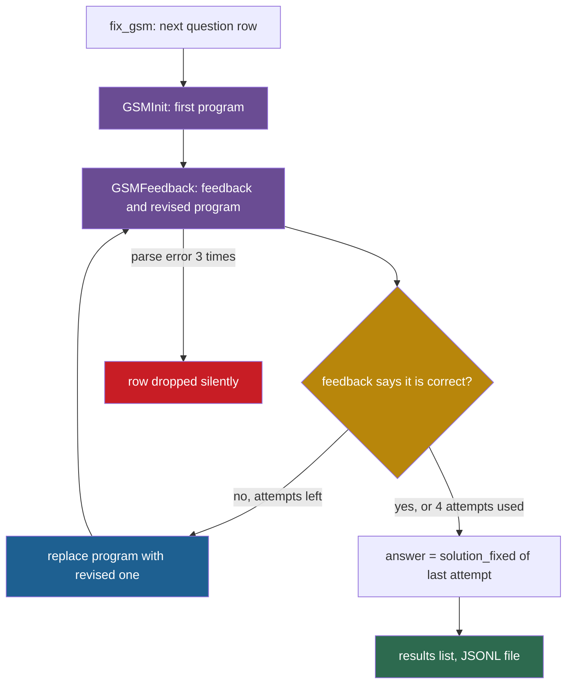

## Learning objectives

After this lesson you can:

- Pin a repository to one commit, and record its date and license before you quote a line number.
- Find the entry point and the main loop of a research codebase without running it.
- Answer the eleven questions of this part for any self-improving system.
- Separate a code fact, a paper claim, a "BUG?" observation and your own interpretation, and label each one.
- Explain why you must never run untrusted research code outside a sandbox.

## Prerequisites

- [L2: Agents: actions, state, memory, tools and environment](/notes/ai/recursive-self-improvement/01-foundations/l2-agents-actions-state-tools-environment)
- [L5: Recursion, self-reference and programs that change programs](/notes/ai/recursive-self-improvement/01-foundations/l5-recursion-and-self-reference)
- [L1: The components of a self-improving system](/notes/ai/recursive-self-improvement/03-anatomy/l1-the-components)
- [L2: One iteration, step by step](/notes/ai/recursive-self-improvement/03-anatomy/l2-one-iteration-step-by-step)
- [2023: Self-Refine and Reflexion](/notes/ai/recursive-self-improvement/06-research-systems/p02-self-refine-and-reflexion)

## 1. The question this idea answers

A mechanic gets a car and its manual. The manual describes the engine. The mechanic still opens the hood, because the car can differ from the manual. A part was replaced. A model year changed. A feature in the brochure was never built.

A research paper is the manual. The code repository is the car. A paper on a self-improving agent says how its loop works. The released code shows what a run really does. In this course, the two often differ.

Here is one example. The Darwin Gödel Machine (DGM) paper describes a third evaluation stage on 200 tasks. The released code computes the threshold for that stage, but no line uses it. So the stage never runs (`DGM_outer.py` lines 192–219 and 296, commit `a565fd2`).

So the question of this lesson is practical. You open a repository with dozens of files and no guide. How do you find the loop that improves the system? How do you check what that loop does, without running a single line of it?

## 2. Mental model, and where it stops working

> [!analogy] Follow one parcel through a sorting center
> - You want to understand a large parcel sorting center. You do not study every machine. You follow one parcel from the door where it enters to the shelf where it ends.
> - At each station you ask three things. What happens to the parcel here? Who decides where it goes next? What is written down about it?
> - A self-improving system is a sorting center for candidates. A candidate enters as a prompt to a language model. It leaves as an archive entry, or it is discarded. The main loop is the conveyor belt that brings the next parcel to the start.
> - **Where it stops working:** a sorting center has one physical path. Code has branches that flags and configuration files select, so two runs with different flags follow different paths.
> - Code also has stations that no parcel reaches, because nothing calls them or nothing uses their result. Many parcels also move at the same time in threads or processes.
> - So follow the default path first. Then list the flags that change it, and the parts that never run.

## 3. Terms

| Term | Plain meaning |
|---|---|
| repository | A folder of files under version control, with the full record of saved changes. |
| commit | One saved state of a repository. |
| commit hash | The 40-character hexadecimal name of a commit, for example `a565fd2d…`. |
| pin a commit | Record the exact commit you read, so that every line number and claim refers to one fixed version. |
| shallow clone | A copy of a repository that holds only the latest commit, not the older ones. |
| license | The legal text that says what you may do with the code. |
| entry point | The file and the function that start a run. |
| command-line interface (CLI) | The arguments that a program accepts when you start it from a terminal. |
| default | The value that an argument or setting has when you do not give one. |
| main loop | The loop that repeats the steps propose, evaluate, store and select. |
| dead code | Code that exists but that no run reaches, or whose result nothing uses. |
| code-versus-paper difference | A place where the released code does something other than what the paper describes. |
| BUG? note | An observation from reading that some code looks unintended. A run did not confirm it. |
| code reading | A fact taken from reading the repository at the pinned commit, without running it. Notes mark such facts "(code reading)". |
| sandbox | An environment that limits what a running program can read, write, reach on the network and use in resources. |
| container | A packaged, isolated environment that runs a program with its own file system, for example a Docker container. |
| excerpt | A short, exact copy of code, given with its file path and line range. |
| `exec` and `eval` | Python built-in functions that run a string as Python code. |
| pickle | Python's binary format for saved objects. Loading a pickle file can run code. |

## 4. Method and math

### 4.1 Why read the code at all

You read the code for three reasons.

1. **The paper compresses.** A paper gives the idea and the headline settings. The code gives every default, every threshold and every failure path.
2. **The code and the paper differ.** The difference can be small, such as a retry count. It can also be large, such as a missing evaluation stage.
3. **The code shows the real safety boundary.** Only the code shows which process runs the model's output. It also shows which secrets that process holds, and whether it can reach the network.

The code reading for this part covered eight repositories. Five of the six main systems have a paper, and each of the five shows at least one code-versus-paper difference. Some examples follow.

| System | The paper says | The code at the pinned commit does |
|---|---|---|
| DGM | A third stage on 200 tasks for strong agents. | Computes the threshold, never runs the stage. |
| Automated Design of Agentic Systems (ADAS) | Generated code ran in "containerized, isolated environments". | Runs generated code with plain `exec` in the main Python process. |
| Self-Taught Optimizer (STOP) | GPT-4 disabled a sandbox flag in 0.42% of 10,000 improvements. | Ships the bait task, but not the program that ran and counted the experiment. |
| Self-Improving Coding Agent (SICA) | A utility of 0.5 · score + 0.25 · cost term + 0.25 · time term. | Has no weighted formula. It selects agents by mean benchmark score. |
| Gödel Agent | The agent can revert to a previous good algorithm. | Has no rollback mechanism, only a request in the prompt and code dumps on disk. |

All five rows come from reading the code at the commits of section 4.2. Later lessons of this part give the file paths and line numbers.

**Our interpretation:** a claim about a self-improving system has two halves. One half is what the paper measured. The other half is what the code does. You need both halves before you trust the claim or build on it.

### 4.2 Pin the commit

Code changes over time. Lines move up and down when someone edits a file. A line number without a commit is therefore not a reference. It is a guess.

So before you quote a line, record four facts:

1. The repository URL.
2. The commit hash.
3. The commit date.
4. The license.

The table lists the commits that this part reads. Every line number in Part 7 refers to these commits only.

| System | Repository | Commit | Commit date | License |
|---|---|---|---|---|
| DGM | https://github.com/jennyzzt/dgm | `a565fd2d1dca504ef5104a7cc0f3bdc4ab9b4fd2` | 2025-08-13 | Apache 2.0 |
| ADAS | https://github.com/ShengranHu/ADAS | `2702bee8fefda42255efc5be9f60e3bd3db96ae4` | 2025-01-27 | Apache 2.0 |
| STOP | https://github.com/microsoft/stop | `0d6780c54306b2486dd36e9c4ae9b49aceb27ea4` | 2023-12-21 | MIT (code) |
| SICA | https://github.com/MaximeRobeyns/self_improving_coding_agent | `ed8275dca4d3c5dbf77229964351fe9b424797dc` | 2025-04-24 | MIT |
| Gödel Agent | https://github.com/Arvid-pku/Godel_Agent | `bbb508796be31c7140cdfc7106efd830a1324242` | 2025-09-17 | MIT |
| OpenEvolve | https://github.com/codelion/openevolve | `74c7cb0c06bae9b6134764d28759d3cf40db76ec` | 2026-10-19 | Apache 2.0 |
| Reflexion | https://github.com/noahshinn/reflexion | `218cf0ef1df84b05ce379dd4a8e47f17766733a0` | 2025-01-13 | MIT |
| Self-Refine | https://github.com/madaan/self-refine | `9a206d41e5d2d0c241bb441f41eeadb945afaa55` | 2024-10-04 | Apache 2.0 |

Two details matter here.

- The OpenEvolve commit is from the day this course was written (checked on 2026-10-19). OpenEvolve changes often, so its line numbers will drift first. Its README badges also point to a new address, `github.com/algorithmicsuperintelligence/openevolve` (code reading).
- All clones were shallow. Because of this, older commits were not available. For example, the code reading for this part could not search older SICA commits for the weighted utility of the paper.

> [!key] Pin a commit
> - **Name:** pinning a commit.
> - **Meaning:** you write down the exact commit you read, next to every claim about the code.
> - **Problem it solves:** without it, a line number points to a moving target, and nobody can check your claim.
> - **Example:** "`DGM_outer.py` line 228 at commit `a565fd2`" can be checked by anyone. "Line 228 of the DGM code" cannot.
> - **Link to recursive self-improvement (RSI):** a self-improving system changes its own code. The research code that runs it also changes. Two levels of change make exact references even more important.
> - **Limits:** a pinned commit tells you what the code says. It does not tell you which commit, flags or settings the authors used for the paper's runs.

### 4.3 Read the license

The license tells you what you may copy and quote. All eight repositories use the MIT license or the Apache License 2.0. Both are permissive licenses. They let you read, copy and change the code if you keep the license notice.

A license can also hold surprises. The STOP README says that its data and documentation use a Creative Commons license, through a file `data/DATA_LICENSE`. The clone has no `data/` folder at all (code reading). So a README can point to a license file that is not in the repository.

For study notes, short excerpts with the file path, the commit and the license name are the normal practice. This part keeps every excerpt at 15 lines or fewer.

### 4.4 Read, do not run

Every self-improving system runs code that a language model wrote. Three READMEs say this directly:

- DGM: "This repository involves executing untrusted, model-generated code. We strongly advise users to be aware of the associated safety risks."
- ADAS: "The code in this repository involves executing untrusted model-generated code. We strongly advise users to be aware of this safety concern."
- SICA: "IMPORTANT NOTE: always run the agent in the provided Docker container."

The research for this part therefore only read files. It did not run, install or import any repository code. It did not load any pickle file. For example, the ADAS split files for the ARC benchmark are `.pkl` files, and this part did not open them.

Every code fact in Part 7 comes from this reading. Where no file and line are given, the notes mark such a fact "(code reading)".

Two facts explain why even an import is a risk.

1. **An import runs code.** Python runs the top-level statements of a module when you import it. For example, STOP's `language_model.py` raises an exception at import time if a file `api_key.py` is missing (lines 10–13). ADAS's `_mgsm/search.py` creates an OpenAI client at import time (line 16).
2. **A pickle can run code.** Loading a pickle can call functions that the file names. So a pickle from an unknown source is a program, not only data.

If you must run such code, run it in a sandbox. That means a container with no network, no secrets, resource limits, and time limits that a process outside the container enforces. Part 8 treats these controls in detail.

> [!trap] A container is not automatically a sandbox
> DGM runs every self-modification inside a Docker container. That is good. But the containers start with default Docker settings. The network is on, and the code passes application programming interface (API) keys into the container environment (`utils/docker_utils.py` line 133, `self_improve_step.py` lines 339–346). So "it runs in Docker" tells you little. Ask what the container can reach and what secrets it holds.

### 4.5 The eleven questions

Each walkthrough in this part answers the same eleven questions. The questions follow one candidate from its birth to its fate. They also map onto the components of [L1: The components of a self-improving system](/notes/ai/recursive-self-improvement/03-anatomy/l1-the-components).

| # | Question | Component | What to search for |
|---|---|---|---|
| 1 | What is the entry point, and what are its arguments and defaults? | the whole run | `__main__`, `argparse`, `config` |
| 2 | How does the agent get its objective? | objective, tasks | `prompt`, `goal`, `task`, `utility`, dataset loaders |
| 3 | How is a change proposed, and what context goes into the prompt? | proposer | `prompt`, `messages`, `system`, `archive` |
| 4 | How is a change applied? | candidate | `exec`, `setattr`, `patch`, `diff`, `copytree`, file writes |
| 5 | How are candidates evaluated? | evaluator | `score`, `fitness`, `accuracy`, `evaluate`, `timeout` |
| 6 | How are results stored? | archive, attempt log | `json.dump`, `jsonl`, `metadata`, `checkpoint` |
| 7 | How are successful changes incorporated? Write the selection rule as code. | acceptance rule, parent selection | `best`, `max`, `random.choices`, `sorted`, `append` |
| 8 | How are failures handled? | failure paths | `try`, `except`, `return None`, `retry`, `continue` |
| 9 | What prevents invalid or unsafe changes, and what does not? | frozen core, sandbox | `docker`, `subprocess`, `shell=True`, `API_KEY`, `environ` |
| 10 | What is the loop, written as pseudocode as implemented? | all | the outer `for` or `while` |
| 11 | In what order should a learner read the files? | all | the README file map |

Question 7 asks for the selection rule as code, not as words. Words hide details. For example, "good agents are picked more often" hides the exact weight. The code line `1 / (1 + math.exp(-10*(score-0.5)))` does not.

Question 9 has two halves on purpose. A list of protections is not a safety analysis. You also need the list of what is not protected.

### 4.6 A search procedure

Use these steps on any repository. They work without running anything.

1. Read the README. Write down the run command, the warnings and the file map.
2. Open the file that the run command names. Find `if __name__ == "__main__":` and the argument parser.
3. Write the arguments and their defaults in a table. Mark any value that the paper says it changed.
4. Find the outer loop. Look for a `for` loop over a count such as `n_iterations`, `max_generation` or `n_generation`. Also look for a `while` loop with a counter, or for two functions that call each other.
5. Inside one iteration, mark four calls. One builds a prompt. One calls a model. One computes a score. One writes to an archive or to disk.
6. Follow the score. Find where the code compares it, and what decides keep or discard.
7. Follow every failure path: each `try` and `except`, each `timeout`, each `return None`.
8. Search for places that run generated text: `exec`, `eval`, `compile`, `importlib`, `subprocess`, `shell=True`, `docker`.
9. Search for secrets: `API_KEY`, `os.environ`, `env`, key files.
10. Search each configuration name across the repository. A setting that nothing reads is dead configuration.

Step 10 finds real problems. In OpenEvolve, the evaluator settings `memory_limit_mb` and `cpu_limit` exist in `config.py` (lines 392–393), but no other file uses them (code reading). A reader who trusts the names believes that candidate programs have memory and processor limits. They do not.

Step 4 has a special case in this part. Gödel Agent has no loop statement for its improvement process. `evolve()` calls `execute_action()`, and `execute_action()` calls `evolve()` again. A counter stops the chain after 100 calls (`agent_module.py` lines 583–587). So search for mutual calls, not only for `for` and `while`.

### 4.7 Code-versus-paper differences, and why they happen

A difference between code and paper is not proof of an error. It has several common causes:

1. **The code changed after the paper.** Gödel Agent's current code uses the model `o3-2025-04-16` for its improvement loop. The paper says "we use GPT-3.5 for all the tests" (Yin et al., 2025).
2. **The defaults differ from the paper's settings.** STOP's `config.py` sets 6 iterations. The paper reports results for other numbers of iterations (Zelikman et al., 2023).
3. **Parts were not released.** STOP's repository has no runner and no real scorer for its sandbox experiment (code reading).
4. **Parts were computed but never connected.** DGM's 200-task stage is the example.
5. **The paper describes a formula that the code does not contain.** SICA's weighted utility is the example.
6. **The paper describes a safety measure that the code does not show.** ADAS's containers are the example.

Report each difference in a fixed form: "The paper says X (source). The code at commit Y does Z (file, lines). Code reading, not a run." The last sentence matters. You read the code. You did not watch it run with the authors' settings.

### 4.8 How to write a BUG? note

A "BUG?" note records code that looks unintended. The question mark is part of the label. It says that nobody ran the code to confirm the problem. Write each note in five parts:

1. Quote the line, with its file and line number.
2. Say what the line does in plain Python terms.
3. Say why it looks unintended.
4. Say what it affects, and what it does not affect.
5. Say what you did not check.

Here is a worked example from DGM (code reading). Line 228 of `DGM_outer.py` reads:

```python
        choices=['random', 'score_prop', 'score_child_prop' 'best'],
```

1. **The line:** `DGM_outer.py` line 228, commit `a565fd2`.
2. **What Python does:** a comma is missing between `'score_child_prop'` and `'best'`. Python joins two string literals that stand next to each other. So the list holds three strings, and the third one is `'score_child_propbest'`.
3. **Why it looks unintended:** the code has branches for both `score_child_prop` and `best` (lines 91 and 101). So both names were meant to be valid choices.
4. **Effect:** the default value `'score_child_prop'` still works, because `argparse` does not check a default against `choices`. But a user who types `--choose_selfimproves_method score_child_prop` or `best` gets an error.
5. **Not checked:** whether the authors ran their experiments with the default or with a typed value.

Code reading, not a run. This is the standard label for every BUG? note in this part.

### 4.9 Worked mini-example: the Self-Refine loop for math problems

This section applies the eleven questions to a small repository. Self-Refine (Madaan et al., 2023, [arXiv:2303.17651](https://arxiv.org/abs/2303.17651)) uses one large language model (LLM) in three roles. It writes an answer, writes feedback on that answer, and rewrites the answer. Self-Refine improves one output inside one task. It does not change its own code, so it is not recursive self-improvement (RSI). It is a good first exercise because the loop for the GSM8K math benchmark fits in one short file.

**Repository:** https://github.com/madaan/self-refine, commit `9a206d41e5d2d0c241bb441f41eeadb945afaa55` (2024-10-04), Apache 2.0. Line numbers refer to this commit.

**Q1. Entry point and arguments.** The README gives the command `python -u src/gsm/run.py` with no argument. The file `src/gsm/run.py` starts with `if sys.argv[1] == "test":` (line 95). The argument parser sits in the `else` branch (lines 97–107). So the script needs at least one argument (code reading). With no argument at all, `sys.argv[1]` raises an `IndexError` in Python.

The arguments and defaults are `--gsm_task_file` (`data/tasks/gsm/gsm.jsonl`), `--max_attempts` (4), `--outfile`, `--feedback_type` (`rich`) and `--temperature` (0.0). The model is fixed in lines 10–12: `ENGINE = CODEX`, with `CODEX = "code-davinci-002"`.

**Q2. Objective.** Each input row holds one math question in the field `input`. No score function exists inside the loop. The implicit objective is a correct Python program `solution()` for the question.

**Q3. How a change is proposed, and the context.** Two prompt objects build every new program.

`GSMInit` (`src/gsm/task_init.py`) uses few-shot examples from `data/prompt/gsm/init.txt` to write the first program. `GSMFeedback` (`src/gsm/feedback.py`) uses few-shot examples from `data/prompt/gsm/feedback.txt`. It adds the instruction "There is an error in the code above because of lack of understanding of the question. What is the error?" One model call returns both the feedback and a revised program.

The context also grows inside one question. After each call, `update_prompt()` appends the old program, the feedback and the new program to the prompt (`feedback.py` lines 56–66). The object is created again for each question, so nothing carries over to the next question.

**Q4. How a change is applied.** The code splits the model output at the text `def solution():`. The part before it is the feedback. The part after it becomes the new program (`feedback.py`). The loop then replaces the old program string with the new one.

**Q5. Evaluation.** Inside the loop, nothing runs the program. The stop rule is the model's own judgment. Here is the loop body:

```python
        if n_attempts == 0:
            solution = task_init(solution=question)

        fb_and_maybe_soln = task_feedback(solution=solution)
        

        log.append({"attempt": n_attempts, "solution_curr": solution, "solution_fixed": fb_and_maybe_soln["solution"], "feedback": fb_and_maybe_soln["feedback"]})

        if "it is correct" in fb_and_maybe_soln["feedback"].lower():
            break

        solution = fb_and_maybe_soln["solution"]

        n_attempts += 1
```

(`src/gsm/run.py` lines 36–49. Line 34 opens the loop with `while n_attempts < max_attempts:`.)

Line by line:

- Lines 36–37: on the first attempt only, the model writes the first program from the question.
- Line 39: one model call returns a dictionary with the feedback and a revised program.
- Line 42: the code records the attempt number, the current program, the revised program and the feedback.
- Lines 44–45: if the feedback contains the words "it is correct", the loop stops.
- Line 47: otherwise the revised program replaces the current one, with no check.
- Line 49: the attempt counter grows by one. With the default of 4, the loop makes at most 4 feedback calls.

So the evaluator inside the loop is the same model that wrote the program. The real score comes later. A separate script, `src/gsm/gsm_selfref_eval.py`, runs the saved programs. This lesson did not trace that script, so it does not describe it further.

**Q6. Storage.** Each question gets a list `run_logs` with one dictionary per attempt. The function `fix_gsm()` writes all rows in the JSON Lines format (JSONL): one JavaScript Object Notation (JSON) object per line (lines 54–74). Every 10 rows it also writes a checkpoint file `outfile + ".{i}.jsonl"` (lines 68–69).

**Q7. Incorporation and selection.** There is no comparison and no acceptance rule. The final answer is the revised program of the last attempt:

```python
            row_copy["generated_answer_ours"] = run_logs[-1]["solution_fixed"]
            row_copy["generated_answer_direct"] = run_logs[0]["solution_curr"]
```

(`src/gsm/run.py` lines 65–66.) Line 65 takes the last revised program as the Self-Refine answer. Line 66 keeps the first program as the baseline answer. **Our interpretation, from code reading:** when the model says "it is correct", the loop stops, but line 65 still takes `solution_fixed`. That is the program that the model rewrote in the same call, not the program that it judged correct.

**Q8. Failures.** A decorator wraps `iterative_gsm()`. The decorator `retry_parse_fail_prone_cmd` (`src/utils.py` lines 26–47) catches `ValueError`, `KeyError` and `IndexError`. It tries the whole function up to 3 times. After the third failure, it returns `None`. Then this code runs:

```python
    for i, row in tqdm(slow_programs_df.iterrows(), total=len(slow_programs_df)):
        row_copy = row.to_dict()
        try:
            run_logs = iterative_gsm(question=row["input"], max_attempts=max_attempts, feedback_type=feedback_type, temperature=temperature)
            row_copy["run_logs"] = run_logs
            row_copy["generated_answer_ours"] = run_logs[-1]["solution_fixed"]
            row_copy["generated_answer_direct"] = run_logs[0]["solution_curr"]
            results.append(row_copy)
            if i % 10 == 0:
                pd.DataFrame(results).to_json(outfile + f".{i}.jsonl", orient="records", lines=True)
        except Exception as e:
            # raise e
            pass
```

(`src/gsm/run.py` lines 60–72.)

Line by line:

- Line 60: the loop visits every question row.
- Line 63: the Self-Refine loop runs. After three failed tries, `run_logs` is `None`.
- Line 65: `None[-1]` raises a `TypeError`.
- Lines 70–72: the `except` block catches every exception and does nothing. The commented `raise e` shows that someone once chose to stop on errors.
- Line 67 never runs for that question. So the question is missing from `results`.

**Code reading, not a run:** a question whose feedback call fails three times disappears from the output file without a message. A typical cause is a model reply with no `def solution():`. Then `split(...)[1]` in `feedback.py` raises an `IndexError`. If the evaluation script counts only the rows in the file, then such questions do not count as wrong. This lesson did not trace the evaluation script, so that last point stays open.

**Q9. Safety.** The loop itself never runs the model's programs. The separate evaluation script runs them later (code reading). No sandbox exists in the loop file. The main protection is that execution happens in a different step.

**Q10. Pseudocode, as implemented.**

```text
for each question row:
    try up to 3 times (decorator):
        solution = LLM_init(question)
        for attempt in 0 .. max_attempts-1:          # default 4
            feedback, revised = LLM_feedback(solution)  # prompt grows with earlier exchanges
            log(attempt, solution, revised, feedback)
            if "it is correct" in feedback: break
            solution = revised
    if all 3 tries failed: drop the row silently
    answer = revised program of the last attempt
write all rows as JSONL
```

**Q11. Reading order.**

1. `README.md`: the run commands and the evaluation command.
2. `src/gsm/run.py`: the loop, the output, the argument parser.
3. `src/gsm/task_init.py`: the first-answer prompt.
4. `src/gsm/feedback.py`: the feedback prompt, the split, the growing prompt.
5. `data/prompt/gsm/feedback.txt`: the few-shot examples of feedback.
6. `src/utils.py`: the retry decorator.
7. `src/gsm/gsm_selfref_eval.py`: how the saved programs are run and scored.



Three lessons come from this small example. First, a README command and the code can disagree. Second, a bare `except: pass` can remove data without a trace. Third, a loop can stop on the model's own opinion, with no outside check. You will meet all three patterns again in the larger systems.

### 4.10 Exercise: fill the table for a system you know

**Exercise 1.** Take any agent code you have written. Fill the eleven rows of the table in section 4.5 for it. For row 9, list at least two things that your code does not prevent.

```check
{
  "question": "You filled row 9 for your own agent. Your list says only: 'It runs in Docker.' Why is this answer incomplete, and which three facts should you add?",
  "hint": "Think about what a container can still reach and hold.",
  "answer": "A container is not automatically a sandbox. Add three facts. (1) Does the container have network access? (2) Which secrets, such as API keys, are in its environment or image? (3) Which limits exist on time, memory and processor use, and who enforces them? DGM and SICA both use Docker, but their containers have network access and API keys (code reading)."
}
```

## 6. Video and animation

- [CMU LLM Inference (8): Self-Refine and Self-Correction Methods](https://www.youtube.com/watch?v=uaxf9yssDy4) (Graham Neubig). A course lecture on Self-Refine, Reflexion and the limits of self-correction. Watch it with section 4.9. It explains the method whose code you read there.
- [LLM Agents MOOC: Agents for Software Development](https://www.youtube.com/watch?v=f9L9Fkq-8K4) (Graham Neubig, Berkeley RDI). Coding agents that read, write and run code. The DGM and SICA repositories of this part are coding agents of this kind.

## 7. Code

The program below helps you read a repository without running it. It parses Python files as text with the `ast` module. Parsing builds a tree of the source. It does not import the module and does not run it. The program lists every loop and every call to a function with a risky name.

```python
import ast
import sys

RISKY = {"exec", "eval", "compile", "system", "Popen", "run", "load", "exec_run"}

def scan(path):
    source = open(path, encoding="utf-8").read()
    tree = ast.parse(source, filename=path)
    found = []
    for node in ast.walk(tree):
        if isinstance(node, (ast.For, ast.While)):
            found.append((node.lineno, "loop", type(node).__name__))
        if isinstance(node, ast.Call):
            f = node.func
            name = f.id if isinstance(f, ast.Name) else getattr(f, "attr", "")
            if name in RISKY:
                found.append((node.lineno, "call", name))
    for line, kind, what in sorted(found):
        print(f"{path}:{line}  {kind}: {what}")

for p in sys.argv[1:]:
    scan(p)
```

On the Self-Refine file `src/gsm/run.py`, it prints three loops: a `While` at line 34 and `For` loops at lines 60 and 87. On DGM's `DGM_outer.py`, its first line of output is a call to `system` at line 31. That line copies the cached evaluation of the first agent with `os.system`.

The list is only a map. A match on `run` can be `subprocess.run` or `asyncio.run`, and only reading tells you which. The program also misses code that runs through other names, for example a function stored in a variable.

```check
{
  "question": "Why is `ast.parse` safe to use on an untrusted repository, while `import` of the same file is not?",
  "answer": "`ast.parse` reads the file as text and builds a syntax tree. It runs none of the statements. `import` runs every top-level statement of the module, for example STOP's `language_model.py` raises an exception at import time when `api_key.py` is missing. So an import can do anything the module's top level does."
}
```

## 8. Common mistakes

1. **"The paper describes what the code does."** The paper describes the method the authors intended and measured. The released code can differ in defaults, stages and safety measures. Every system in this part that has a paper shows at least one difference.
2. **"A line number is a reference."** A line number is a reference only together with a commit hash. Without the commit, nobody can check it.
3. **"Importing a module only reads it."** An import runs the module's top-level statements. Use text tools or `ast` to read untrusted code.
4. **"It runs in Docker, so it is sandboxed."** A default Docker container can reach the network and can hold API keys. DGM and SICA containers do both (code reading).
5. **"A BUG? note is a confirmed bug."** It is an observation from reading. Report it with the label "code reading, not a run".
6. **"A setting does what its name says."** A setting can exist and still have no effect. OpenEvolve's `memory_limit_mb` is an example.
7. **"Start reading at the first file in the folder."** Start at the entry point, find the main loop, and follow one candidate through it.

## 9. One-minute explanation

To read a research repository on self-improvement, first pin its URL, commit hash, date and license, because line numbers change. Do not run it: read the README, open the entry file, list the defaults and find the outer loop. Then follow one candidate through the loop: its objective, its prompt, and how it is applied, scored, stored, accepted or lost on failure. Ask what stops unsafe changes, and also what does not. Write the loop as pseudocode and give a reading order. Compare with the paper, and label each difference and each suspected bug as code reading, not a run.

## 10. Check questions

```check
{
  "question": "Classify each statement as a code fact, a paper claim, a BUG? note or our interpretation. (a) DGM's `--update_archive` default is `keep_all`. (b) STOP's improved improver raised 3-SAT utility from 21.2% to 75.1%. (c) DGM's line 144 compares a list with 0, so an agent with no unresolved tasks could crash `random.choice`. (d) A claim about a self-improving system needs both the paper and the code.",
  "hint": "Ask: did someone read it in the code, measure it, suspect it, or conclude it?",
  "answer": "(a) Code fact, from `DGM_outer.py` line 232. (b) Paper claim with a measured result, from the STOP paper's Table 1 (Zelikman et al., 2023). The code shipped at the pinned commit does not reproduce it by itself. (c) BUG? note: an observation from reading, not confirmed by a run. (d) Our interpretation: a conclusion of these notes."
}
```

```check
{
  "question": "In the Self-Refine loop with `--max_attempts 4`, how many model calls can one question cost at most? Count the retry decorator too.",
  "hint": "One call writes the first program. Each attempt makes one feedback call. The decorator repeats the whole function on some errors.",
  "answer": "One try of `iterative_gsm()` makes 1 call to `task_init` and at most 4 calls to `task_feedback`, so 5 calls. The decorator repeats the whole function up to 3 times on `ValueError`, `KeyError` or `IndexError`. So the maximum is 3 × 5 = 15 calls. If all three tries fail, the question is then dropped from the output."
}
```

```check
{
  "question": "Where in the Self-Refine loop would you add a held-out re-test, and what would it change?",
  "hint": "Look at the stop rule in lines 44–45 and the answer choice in line 65.",
  "answer": "Add it at the stop rule, around lines 44–45 of `src/gsm/run.py`. Do not trust the words 'it is correct'. Run the program on a check that the model did not write, for example a known answer kept outside the prompt. Then keep the revised program only if it passes. This turns the loop's evaluator from the model's opinion into an outside signal. It also shows how often the model said 'correct' for a wrong program."
}
```

```check
{
  "question": "A repository's `config.py` has a setting `max_memory_mb = 512`. Describe a check that tells you whether the setting has any effect, without running the code.",
  "answer": "Search the whole repository for the name `max_memory_mb`. If the only match is the line that defines it, nothing reads it, so it has no effect. If other files read it, follow each use and check that it reaches a real limit, for example a resource call or a container option. OpenEvolve's `memory_limit_mb` and `cpu_limit` fail this check: they appear only in `config.py` (code reading)."
}
```

## 11. Summary and links

- Pin every repository to a commit, and record the URL, the date and the license. Line numbers mean nothing without the commit.
- Read untrusted research code as text. An import or a pickle load runs code.
- The eleven questions follow one candidate from prompt to archive. They make every walkthrough comparable.
- Expect differences between code and paper. Report each one with the label "code reading, not a run".
- Even a small loop such as Self-Refine's can hide a silent data drop and a self-judged stop rule.

**Next:** [L2: STOP in code](/notes/ai/recursive-self-improvement/07-implementations/l2-stop-in-code) applies the eleven questions to the first system whose improver improves itself.

**Related:** [L5: Code self-modification](/notes/ai/recursive-self-improvement/05-approaches/l5-code-self-modification), [L7: Controls, oversight and governance](/notes/ai/recursive-self-improvement/08-failure-modes-and-safety/l7-controls-oversight-and-governance), [L7: What the code teaches](/notes/ai/recursive-self-improvement/07-implementations/l7-what-the-code-teaches).

## References

- Aman Madaan, Niket Tandon, Prakhar Gupta, et al. "Self-Refine: Iterative Refinement with Self-Feedback". 2023. NeurIPS 2023. arXiv:2303.17651. https://arxiv.org/abs/2303.17651
- Self-Refine repository. https://github.com/madaan/self-refine. Commit `9a206d41e5d2d0c241bb441f41eeadb945afaa55` (2024-10-04). Apache 2.0.
- Jenny Zhang, Shengran Hu, Cong Lu, Robert Lange, Jeff Clune. "Darwin Gödel Machine: Open-Ended Evolution of Self-Improving Agents". 2025. ICLR 2026. arXiv:2505.22954. https://arxiv.org/abs/2505.22954. Code: https://github.com/jennyzzt/dgm, commit `a565fd2d1dca504ef5104a7cc0f3bdc4ab9b4fd2`.
- Shengran Hu, Cong Lu, Jeff Clune. "Automated Design of Agentic Systems". 2024. ICLR 2025. arXiv:2408.08435. https://arxiv.org/abs/2408.08435. Code: https://github.com/ShengranHu/ADAS, commit `2702bee8fefda42255efc5be9f60e3bd3db96ae4`.
- Eric Zelikman, Eliana Lorch, Lester Mackey, Adam Tauman Kalai. "Self-Taught Optimizer (STOP): Recursively Self-Improving Code Generation". 2023. COLM 2024. arXiv:2310.02304. https://arxiv.org/abs/2310.02304. Code: https://github.com/microsoft/stop, commit `0d6780c54306b2486dd36e9c4ae9b49aceb27ea4`.
- Maxime Robeyns, Martin Szummer, Laurence Aitchison. "A Self-Improving Coding Agent". 2025. ICLR 2025 Workshop on Scaling Self-Improving Foundation Models. arXiv:2504.15228. https://arxiv.org/abs/2504.15228. Code: https://github.com/MaximeRobeyns/self_improving_coding_agent, commit `ed8275dca4d3c5dbf77229964351fe9b424797dc`.
- Xunjian Yin, Xinyi Wang, Liangming Pan, Li Lin, Xiaojun Wan, William Yang Wang. "Gödel Agent: A Self-Referential Agent Framework for Recursively Self-Improvement". 2025. ACL 2025. arXiv:2410.04444. https://aclanthology.org/2025.acl-long.1354. Code: https://github.com/Arvid-pku/Godel_Agent, commit `bbb508796be31c7140cdfc7106efd830a1324242`.
- OpenEvolve repository (Asankhaya Sharma). https://github.com/codelion/openevolve. Commit `74c7cb0c06bae9b6134764d28759d3cf40db76ec` (2026-10-19). Apache 2.0.
- Reflexion repository. https://github.com/noahshinn/reflexion. Commit `218cf0ef1df84b05ce379dd4a8e47f17766733a0` (2025-01-13). MIT.
