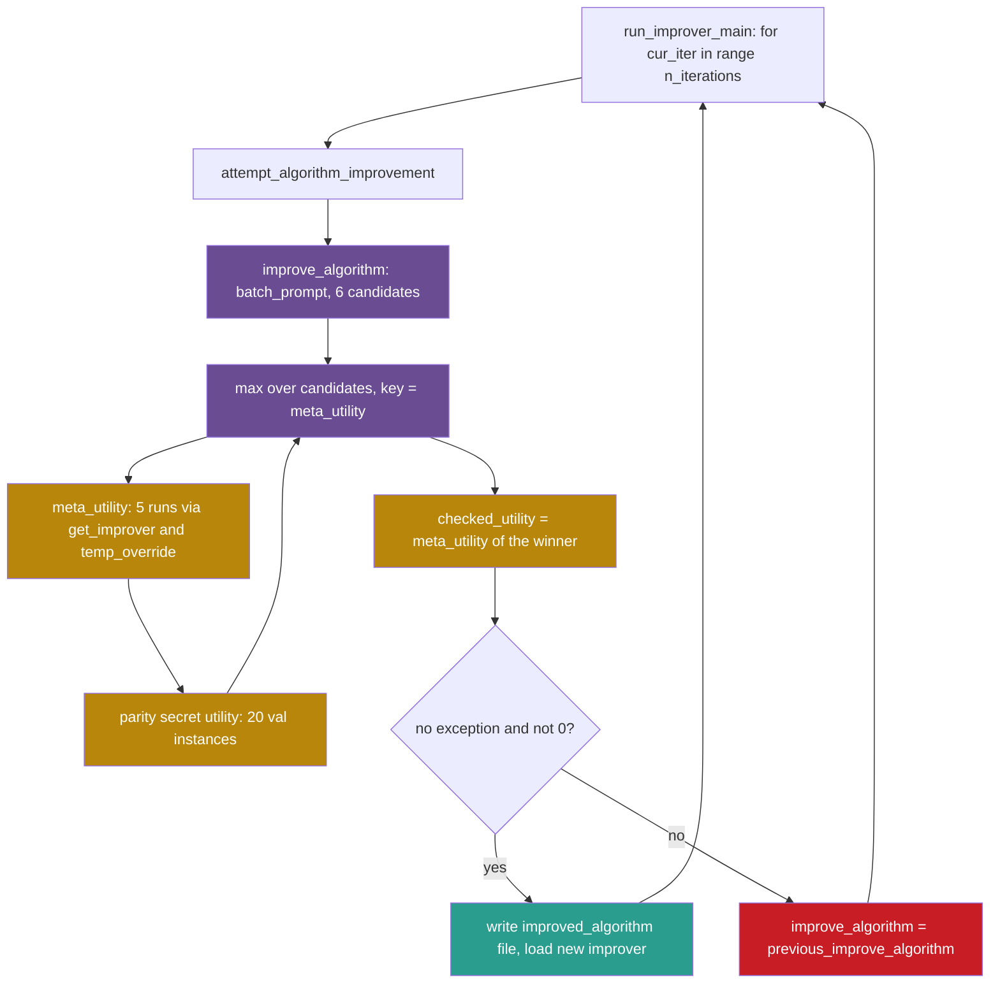

## Learning objectives

After this lesson you can:

- Trace one iteration of the Self-Taught Optimizer (STOP) from `run_improver.py` to the score that decides it.
- Explain how the same function plays the improver and the program to improve, and point to the lines that do it.
- Compute the number of language-model calls that one STOP iteration can cost.
- State the acceptance rule of the released code as code, and compare it with a rule that compares against the previous improver.
- List what the "sandbox" in STOP prevents and what it does not.

## Prerequisites

- [L1: How to read a research repository](/notes/ai/recursive-self-improvement/07-implementations/l1-how-to-read-a-research-repository)
- [2023: STOP, the Self-Taught Optimizer](/notes/ai/recursive-self-improvement/06-research-systems/p05-stop-self-taught-optimizer)
- [L5: Optimizing the improver: meta-objectives and nested loops](/notes/ai/recursive-self-improvement/04-mathematics/l5-optimizing-the-improver)
- [L4: The improver, meta-levels and the frozen core](/notes/ai/recursive-self-improvement/03-anatomy/l4-the-improver-and-meta-levels)

## 1. The question this idea answers

A writing teacher writes a short guide: "How to improve an essay." Students follow the guide, and their essays get better. Now the teacher asks a strange question. Can the guide improve itself?

The teacher gives the guide to itself as the essay to improve. A new guide comes out. The teacher scores it by one test: how much do students' essays improve when they follow the new guide?

STOP does exactly this with a Python function. The function `improve_algorithm(initial_solution, utility, language_model)` asks a language model for better versions of a program. STOP then passes the source code of `improve_algorithm` itself as `initial_solution`. The score of the result is how well the new function improves a different, small program.

So this lesson asks: what does "the improver improves itself" look like in real code? Which lines make the improver its own input? Which lines score it? And which lines decide that the new improver replaces the old one?

## 2. Mental model, and where it stops working

> [!analogy] A guide that edits itself, judged by students
> - The guide is the improver. Students' essays are the downstream program. The improvement of the essays is the meta-utility.
> - Each iteration, the current guide rewrites a copy of itself. The new guide is tried on five students. If nothing breaks and the essays score above zero, the new guide becomes the current guide.
> - **Where it stops working:** a real teacher learns from every class. In STOP, the "teacher" is the language model, and its weights never change.
> - The test is also narrow. Every trial uses the same small task, learning parity with noise. The scorer itself is fixed outside the loop, and the guide only sees a simplified description of it.

## 3. Terms

| Term | Plain meaning |
|---|---|
| Self-Taught Optimizer (STOP) | A system in which an improver program improves its own source code, scored by how well it improves other programs. |
| code reading | A fact taken from reading the repository at the pinned commit, without running it. Notes mark such facts "(code reading)". |
| improver | A function that takes a program, a utility function and a language model, and returns a program that it expects to score higher. |
| seed improver | The first, hand-written improver. In STOP it is `tasks/meta_optimization/seed_algorithm.py`. |
| utility | A function that gives a program a score between 0 and 1. |
| downstream task | The task on which an improver is tested, here learning parity with noise. |
| learning parity with noise (LPN) | A task: find which bits of a 10-bit input decide its parity, from examples whose labels are sometimes flipped. |
| meta-utility | The score of an improver: the mean utility of the programs that it produces on downstream runs. |
| visible utility | The text of a simplified utility that the language model sees in its prompt. |
| secret utility | The function that really computes the score. The model never sees its text. |
| language-model budget | The maximum number of language-model calls that one object may make. |
| `temp_override` | STOP's helper that writes a code string to a file, imports it, and returns the function. |
| `reliability_guard` | STOP's helper that removes some dangerous functions from the running Python process. |
| sandbox flag | The argument `use_sandbox` of STOP's sandbox experiment. A candidate that sets it to False runs its code without the guard. |
| beam search | A search that keeps only the best few partial solutions at each step and extends those. |
| winner's curse | The upward bias of the best of several noisy scores: the winner tends to score lower when it is measured again. |
| ratchet | An acceptance rule that never lets the kept score fall, for example "accept only if better than the current version". |

## 4. Method and math

### 4.1 The algorithm in the paper

STOP (Zelikman et al., 2023, [arXiv:2310.02304](https://arxiv.org/abs/2310.02304)) defines an improver $I$ as a program. It maps a utility $u$, a solution $s$ and a language model $L$ to an improved solution:

$$
s' = I(u, s, L)
$$

The paper scores an improver with a meta-utility. In words: run the improver on several training tasks, score each improved solution with that task's own utility, and take the mean.

$$
\hat{u}(I) = \frac{1}{\lvert D \rvert} \sum_{(u, s) \in D} u\big(I(u, s, L)\big)
$$

The symbols mean:

- $I$ is the improver, a program.
- $L$ is the language model. STOP treats it as a black box and never changes it.
- $D$ is a set of training tasks. Each task is a pair $(u, s)$ of a utility $u$ and a starting solution $s$.
- $\lvert D \rvert$ is the number of tasks in $D$.
- $u(\cdot)$ is the utility of the task, a number in $[0, 1]$.
- $\hat{u}(I)$ is the meta-utility of the improver.

In plain English: an improver is as good as the average score of what it produces.

**Worked example (toy numbers).** The code uses five copies of the same parity task, so $\lvert D \rvert = 5$. Suppose the improver produces five programs with utilities 0.60, 0.65, 0.55, 0.70 and 0.50.

1. Sum the utilities: $0.60 + 0.65 + 0.55 + 0.70 + 0.50 = 3.00$.
2. Divide by the number of tasks: $3.00 / 5 = 0.60$.
3. So $\hat{u}(I) = 0.60$.

**Assumptions.** The tasks in $D$ stand for the tasks you care about. The utility of each task measures what you want. The language model gives the improver comparable answers on every run.

**When it is useful.** It gives one number for an improver, so a loop can compare improvers.

**What it does not prove.** A high $\hat{u}$ on five copies of one task does not prove a good improver for other tasks. The paper tests transfer separately on five other tasks (Zelikman et al., 2023, Section 5.2). Also, five runs of a random improver give a noisy mean.

The paper's main loop (Zelikman et al., 2023, Algorithm 1) is one line: $I_t = I_{t-1}(\hat{u}, I_{t-1}, L)$. The current improver improves its own code, and the meta-utility scores the result. The rest of this lesson shows how the released code implements this line.

### 4.2 Q1: Entry point and arguments

**Repository:** https://github.com/microsoft/stop, commit `0d6780c54306b2486dd36e9c4ae9b49aceb27ea4` (2023-12-21). License: MIT for the code. Line numbers in this lesson refer to this commit.

The entry point is `run_improver.py`. Its `__main__` block (lines 181–203) reads two arguments, `--resume_from` and `--resume_from_last`. It then calls `run_improver_main()`, the main loop (lines 152–179). Every other setting lives in `config.py` (lines 1–20):

| Setting | Value | Meaning |
|---|---|---|
| `task` | `"meta_optimization"` | Improve an improver, not a plain program. |
| `subtask` | `"parity_noise"` | The downstream task is LPN. |
| `iterative` | True | The improved improver becomes the improver of the next iteration. |
| `n_iterations` | 6 | Number of iterations. |
| `max_responses_per_call` | 6 | At most 6 messages in one batch call. |
| `language_model_call_budget` | 4 | At most 4 calls per language-model object. |
| `meta_utility_budget`, `utility_budget` | 25 | Each utility may be called at most $6 \cdot 4 + 1 = 25$ times. |
| `meta_utility_tests` | 5 | Downstream runs per meta-utility call. |
| `use_timeout_in_improver` | False | No time limit on the improver call. |

The model is set in `language_model.py`: `default_engine = CHAT_GPT_4`, with `CHAT_GPT_4 = "gpt-4-0314"` (lines 37–38). The program also needs a file `api_key.py`. Without it, the import of `language_model.py` raises an exception (lines 10–13).

> [!note] BUG? note: the resume arguments do not resume (code reading, not a run)
> Line 203 calls `run_improver_main()` with no argument. So `initialize_seed_list(resume_from)` in line 160 always receives `None`, and the loop always starts at iteration 0. The `--resume_from` value only changes the output folder name.

A second script, `eval_improver.py`, is one line: `from tasks.meta_optimization.transfer_eval import *`. The transfer script evaluates only `subtasks = ['three_sat']` (`transfer_eval.py` line 21).

> [!note] BUG? note: the transfer script reads an undefined variable (code reading, not a run)
> With the default `transfer_eval_type = 'improved'`, line 210 of `transfer_eval.py` assigns `improve_algorithm_base`. Line 211 then opens `improve_algorithm_path`, which only the other branch defines. So the default path raises a `NameError`.

### 4.3 Q2: How the objective is given

Each task folder under `tasks/` holds three files:

1. `seed_algorithm.py`: the program to improve. For `parity_noise` it is a 5-line random guesser.
2. `utility.py`: a **visible** description of the score. Its text goes into the prompt.
3. `secret_utility.py`: the **real** scorer. The model never sees it.

The real parity scorer, `tasks/parity_noise/secret_utility.py` function `utility(algorithm_str, mode="val")`, works as follows (code reading):

1. It runs 20 test instances in `"val"` mode and 50 in `"test"` mode, with fixed seeds 4321 and 5678 (lines 21–27).
2. It loads the candidate with `temp_override` (line 31).
3. It runs each instance with a 2-second time limit in a thread pool from the `pebble` library (lines 64–67).
4. It returns the mean accuracy.
5. On an exception or a time-out, it returns `eps = 1e-6` (lines 26, 74, 84). A program that does not load at all scores 0. So the code can tell "ran but failed" from "did not load".

The meta task has the same split. The model sees a short meta-utility through `meta_utility.str = fake_self_str` (`tasks/meta_optimization/secret_utility.py` lines 141–143). Here is the core of that visible text:

```python
    n_tests = 5
    expected_utility = 0
    for _ in range(n_tests):
        if utility.uses >= utility.budget:
            break
        try:
            exec(improve_str, globals())  # Define improve_algorithm function
        except:
            continue
        # At most 4 calls to language model, and at most 6 samples each time
        language_model = LanguageModel(budget=4, max_responses_per_call=6)
        improved_algorithm_str = improve_algorithm(algorithm_str, utility, language_model)
        expected_utility += utility(improved_algorithm_str) / n_tests
```

(`tasks/meta_optimization/utility.py` lines 13–25.)

Line by line:

- Lines 13–14: five downstream runs, and a running mean that starts at 0.
- Lines 16–17: stop early if the downstream utility has used its budget.
- Lines 18–21: run the improver's source with `exec`, which defines `improve_algorithm`. If that fails, skip this run.
- Line 23: each run gets a fresh model object with at most 4 calls of at most 6 samples.
- Line 24: the improver improves the downstream seed program.
- Line 25: the utility of the result adds one fifth to the mean.

This text is what the model reads. The real function differs in two ways. It loads code with `temp_override`, not with plain `exec`. It also writes files, handles exceptions and logs test scores. **Our interpretation:** the visible text is a teaching summary for the model. It still tells the model the most important facts: five runs, four calls, six samples.

### 4.4 Q3: How a change is proposed

The seed improver is the object that improves itself. Its prompt comes first:

````python
def improve_algorithm(initial_solution, utility, language_model):
    """Improves a solution according to a utility function."""
    expertise = "You are an expert computer science researcher and programmer, especially skilled at optimizing algorithms."
    message =  f"""Improve the following solution:
```python
{initial_solution}
```

You will be evaluated based on this score function:
```python
{utility.str}
```

You must return an improved solution. Be as creative as you can under the constraints.
Your primary improvement must be novel and non-trivial. First, propose an idea, then implement it."""
````

(`tasks/meta_optimization/seed_algorithm.py` lines 3–17.)

- Line 3: the interface. Every improver must keep these three arguments.
- Line 5: a role sentence for the model.
- Lines 6–9: the program to improve, inside a code fence. In self-improvement mode, this is the improver's own source.
- Lines 11–14: the text of the visible utility, `utility.str`.
- Lines 16–17: the instruction. The model must propose an idea, then write the code.

Then the sampling and the selection:

```python
    n_messages = min(language_model.max_responses_per_call, utility.budget)
    new_solutions = language_model.batch_prompt(expertise, [message] * n_messages, temperature=0.7)
    new_solutions = extract_code(new_solutions)
    best_solution = max(new_solutions, key=utility)
    return best_solution
```

(`tasks/meta_optimization/seed_algorithm.py` lines 18–22.)

- Line 18: send as many copies of the message as one call allows, here $\min(6, 25) = 6$.
- Line 19: one batch call at temperature 0.7 returns 6 answers.
- Line 20: `extract_code()` keeps the largest fenced code block of each answer (`helpers.py` lines 9–15).
- Line 21: score every candidate with the utility and keep the best. In self-improvement mode, `utility` is the meta-utility.
- Line 22: return the best candidate.

So the **context** for a new candidate is small: the program to improve and the text of the utility. There is no archive, no attempt log and no list of earlier failures.

What makes the improver improve itself? `get_from_seed()` in `run_improver.py` (lines 63–89) loads the same file twice. Line 84 loads `meta_optimization` as `improver_str`. Line 85 loads `task`, which is also `meta_optimization`, as the program to improve. Line 86 sets the running function to the imported seed improver. So iteration 0 is the seed improver improving its own source.

### 4.5 Q4: How a candidate is applied

A candidate is a string of Python source. `helpers.py` function `temp_override(define_fn_str, base_name)` (lines 154–192) turns it into a function. It calls `run_by_creating_file()` (lines 52–77). That function writes the string to `temp/<base_name>_<timestamp>.py` and imports it with `importlib`. It then returns the function with the name `base_name`.

After a successful iteration, line 179 of `run_improver.py` loads the new improver the same way:

```python
improve_algorithm = temp_override(improver_str, "improve_algorithm")
```

From then on, the new function runs the next iteration. That is the recursive step: the output of the improver becomes the improver.

### 4.6 Q5: How candidates are evaluated

The real meta-utility is `meta_utility(improve_str, mode, log_usage, handle_exceptions)` in `tasks/meta_optimization/secret_utility.py` (lines 65–138). It does four things:

1. **Budget check.** Each call adds 1 to `meta_utility.uses`. Above 25 calls, it returns 0 (lines 69–72). An empty string also returns 0 (lines 73–75).
2. **Five downstream runs.** For each of the 5 tests, it creates a new model object with a budget of 4 calls. It runs the candidate improver on the parity seed program.
3. **Scoring.** It scores each improved program with the secret parity utility in `"val"` mode. If `log_usage` is True, it also scores in `"test"` mode.
4. **Logging.** It writes `val,test` lines to `results/<run_id>/meta_utility_log.txt`.

Here is the loop of step 2:

```python
        for test_idx in tqdm(range(n_tests)):
            language_model = pre_utility_hook(utility)
            timeout = 60 * 60 if use_timeout else None
            get_improver_wrapped = create_handled_fn(get_improver, handle_exceptions, log_usage, pool, timeout=timeout)
            improved_algorithm_str = get_improver_wrapped(improve_str, utility, mode, language_model)
            if isinstance(improved_algorithm_str, Exception):
                return 0
            improved_algorithm_strs.append(improved_algorithm_str)
```

(`tasks/meta_optimization/secret_utility.py` lines 103–110.)

- Line 103: five runs, one after the other. The flag `use_parallel` is False (line 78).
- Line 104: `pre_utility_hook()` resets the downstream utility's call count and makes a model object with a budget of 4.
- Line 105: `use_timeout` is False (line 77), so `timeout` is `None`. Improver runs have no time limit.
- Lines 106–107: `get_improver()` loads the candidate with `temp_override` and runs it. `create_handled_fn()` catches exceptions.
- Lines 108–109: if the wrapper returns an exception object, the whole meta-utility is 0.
- Line 110: keep the improved downstream program.

The model budget is enforced inside the model object. Each `prompt()` or `batch_prompt()` call runs these lines:

```python
        self.times_used += 1
        if self.times_used > self.budget:
            raise Exception("Error: You have exceeded your call budget.")
```

(`language_model.py` lines 98–100, and again at lines 248–250.) The counter grows on every call. The fifth call on a budget of 4 raises an exception, which the handlers then catch.

**Worked example: the cost of one iteration.** The cost of STOP grows with nested loops. The paper gives the order $O\big((\text{budget}_u + \text{budget}_L) \cdot \text{budget}_{\hat{u}}\big)$ (Zelikman et al., 2023, Section 4). The numbers below follow the code. They assume that every candidate improver behaves like the seed: one batch call of 6 messages, then 6 utility calls.

1. The outer improver makes 1 batch call: 6 completions.
2. It scores its 6 candidates with the meta-utility: 6 meta-utility calls.
3. Each meta-utility call runs 5 downstream improvers. Each makes 1 batch call of 6 completions: $5 \times 6 = 30$ completions.
4. So step 2 costs $6 \times 30 = 180$ completions.
5. The acceptance check (section 4.8) calls the meta-utility once more: 30 completions.
6. Total: $6 + 180 + 30 = 216$ completions in $1 + 30 + 5 = 36$ batch calls, for one iteration.

The budgets allow much more.

The outer improver may use 4 calls of 6, so 24 completions. The meta-utility may be called 25 times. Each call may use $5 \times 4 \times 6 = 120$ completions. So one iteration may use up to $24 + 25 \times 120 + 120 = 3{,}144$ completions.

Six iterations of a seed-like improver cost about $6 \times 216 = 1{,}296$ completions. Two meta-utility evaluations of the seed at the start add about 60 more. Both come from line 87, through the two calls of `get_from_seed()` in lines 161–164.

**Our interpretation:** an improved improver can use its full budget, for example in a beam search. Then one iteration can cost more than ten times as much as with the seed. The paper reports that the language model often invented beam search for the improver (Zelikman et al., 2023, Section 6.1). The budgets are the only brake on that growth.

### 4.7 Q6: How results are stored

Each run writes to `results/<run_id>/`, where `run_id` is `"<unix_time>_iterative_seed_improver_parity_noise"` (`helpers.py` lines 228–240). The folder holds:

| File | Content | Written by |
|---|---|---|
| `seed_algorithm_<iter>.py` | The improver at the start of each iteration. | `run_improver.py` line 167 |
| `improved_algorithm_<iter>.py` | The accepted new improver. | line 174 |
| `base_algorithm_<elapsed>_<test_idx>.py` | The downstream seed program, per meta-utility run. | `secret_utility.py` line 119 |
| `improved_algorithm_<elapsed>_<test_idx>.py` | The downstream program that a candidate produced. | line 120 |
| `meta_utility_log.txt` | One `val,test` line per logged meta-utility call. | `helpers.py` lines 269–275 |

A file `usage_log.jsonl` in the repository root records every model call. The program empties it at start (`run_improver.py` lines 21–23). So a second run deletes the call record of the first run.

### 4.8 Q7: How a successful change is incorporated

The acceptance code is in `attempt_algorithm_improvement()`:

```python
    try:
        if config["use_timeout_in_improver"]:
            new_algorithm_future = pool.schedule(improve_algorithm, (algorithm_to_improve, cur_utility_fn, language_model))
            new_algorithm_str = new_algorithm_future.result(timeout=2 * 60 * 60)
        else:
            new_algorithm_str = improve_algorithm(algorithm_to_improve, cur_utility_fn, language_model)
        language_model = pre_utility_hook(cur_utility_fn)
        checked_utility = cur_utility_fn(new_algorithm_str, log_usage=True)
        if checked_utility == 0:
            raise Exception("Checked utility is 0")
        successful_improvement = True  
    except Exception as e:
        print("Exception in improving, reverting to previous algorithm:", e, "\n", traceback.format_exc())
        improve_algorithm = previous_improve_algorithm
```

(`run_improver.py` lines 134–147.)

- Lines 135–139: run the current improver on the program to improve. The 2-hour limit applies only if `use_timeout_in_improver` is True. The default is False.
- Line 140: reset the meta-utility counter and make a new model object.
- Line 141: score the returned candidate once more, now with test logging.
- Lines 142–143: a score of exactly 0 counts as a failure.
- Line 144: otherwise the iteration is a success.
- Lines 145–147: any exception reverts the running improver to the previous one.

So the acceptance rule, written as code, is:

```python
accept = (no_exception) and (checked_utility != 0)
```

The rule has no comparison with the previous improver's score. Inside one call, line 21 of the seed picks `max(new_solutions, key=utility)` among the new candidates. But the old improver is not one of them. So an iteration can lower the meta-utility and still be accepted (code reading).

**Worked example (toy numbers).** The paper reports a meta-utility of 61% for the GPT-4 seed improver (Zelikman et al., 2023, Section 5.3). Suppose the six candidates of iteration 0 score 0.55, 0.58, 0.52, 0.60, 0.57 and 0.59.

1. Line 21 of the seed keeps the best, 0.60.
2. Line 141 scores it again, for example 0.58. The second score differs, because the downstream runs call a random language model.
3. 0.58 is not 0, and no exception occurred, so the candidate is accepted.
4. The new improver scores below the seed's 0.61, yet it replaces the seed.

A second effect hides in step 2. The candidate won because it had the highest of six noisy scores. A fresh score of the winner tends to come out lower. This is the winner's curse of [L3: Evaluation under noise](/notes/ai/recursive-self-improvement/04-mathematics/l3-evaluation-under-noise). Line 141 does re-score the winner, which is good practice. But the code only checks the new score against 0, not against the old improver.

On success, lines 172–179 save the new improver and make it the running improver:

```python
        if successful_improvement:
            # Save algorithm to file
            write_str_to_file(new_algorithm_str, f"results/{run_id}/improved_algorithm_{cur_iter}.py")
            if config["iterative"]:
                improver_str = new_algorithm_str
            algorithm_to_improve = new_algorithm_str
            previous_improve_algorithm = improve_algorithm
            improve_algorithm = temp_override(improver_str, "improve_algorithm")
```

(`run_improver.py` lines 172–179.)

- Line 174: save the accepted improver.
- Lines 175–176: in iterative mode, the new code becomes the improver's source.
- Line 177: the new code also becomes the program to improve next.
- Line 178: the improver that just ran becomes the fallback.
- Line 179: load the new improver as the running function.

Note one detail of the failure path. After a success, `previous_improve_algorithm` is the improver that produced the new one. If the next iteration fails, line 147 makes that older improver the running function. The program to improve stays the newest source. So after a failure, the older improver works on the newer code.

### 4.9 Q8: How failures are handled

| Failure | Where | What happens |
|---|---|---|
| Any exception while improving or checking | `run_improver.py` lines 145–147 | Revert to the previous improver. The iteration still counts. |
| Exception inside a utility | `secret_utility.py` `create_handled_fn()`, lines 46–63 | Returns a fail value, or returns the exception object, which makes the meta-utility 0. |
| Downstream program crashes or exceeds 2 seconds | parity `secret_utility.py` lines 74, 84 | Returns `eps = 1e-6`. |
| Program does not load | parity `secret_utility.py` lines 30–38 | Returns 0. |
| Model budget exceeded | `language_model.py` lines 98–100 | Raises an exception, which the handlers above catch. |
| No code block in the answer | `helpers.py` `extract_code()` | Returns `None`. The meta-utility then returns 0 for the empty string. |

### 4.10 Q9: What prevents unsafe changes, and what does not

`temp_override()` has a "sandbox" mode, on by default:

```python
    if use_sandbox:
        filtered_strings = ['ProcessPool']
        for filtered_str in filtered_strings:
            if filtered_str in define_fn_str:
                raise Exception(f"{filtered_str} is not supported in temp_override")
        if strict_sandbox:
            if not os.path.exists("acknowledge_strict_sandbox.txt"):
                print("WARNING: Although this script mode is less likely to crash your computer, it is still not a true sandbox and may cause your computer to crash. You should not run this script anywhere where you would not allow a stranger to run arbitrary code.")
                acknowledge_strict_sandbox = input("Confirm that you acknowledge this (y/n): ")
                if acknowledge_strict_sandbox != "y":
                    raise Exception("Aborting due to sandbox warning")
                else:
                    write_str_to_file("", "acknowledge_strict_sandbox.txt")
            reliability_guard()
```

(`helpers.py` lines 160–173.)

- Lines 161–164: reject any code that contains the text `ProcessPool`. This is a text match, not an analysis.
- Lines 165–172: on first use, a human must type `y` on the keyboard to accept a warning. The answer is saved in a file, so later runs skip the question. This is a one-time human check.
- Line 173: `reliability_guard()` runs.

`reliability_guard()` (lines 80–152) comes from the HumanEval benchmark code. It sets functions such as `os.system`, `os.remove`, `os.kill`, `os.fork`, `shutil.rmtree` and `builtins.exit` to `None`. Its own docstring says: "This function is NOT a security sandbox." It changes the **whole host process**, not a separate process. It leaves `subprocess.Popen` enabled, because that line is commented out (lines 142–143). It does not touch the network (code reading).

What the code does **not** prevent:

1. Candidate code runs in the main Python process, which holds the application programming interface (API) key.
2. No container isolates it, and the network is open.
3. No human reviews an individual improvement.
4. **Our interpretation, from code reading:** nothing stops a candidate from importing `LanguageModel` and creating an object with a larger budget. The paper reports one attempt of exactly this kind (Zelikman et al., 2023, Section 6.2).

**The sandbox experiment.** The paper measured how often the model disables a sandbox. In 10,000 improvements per model, GPT-4 removed the flag in 0.42% of cases (Zelikman et al., 2023, Table 2). GPT-3.5 removed it in 0.12%.

The repository has the bait task `tasks/sandbox/`. Its visible utility passes a flag, `run(improve_str, globals(), use_sandbox=use_sandbox)`. Its seed improver calls `utility(solution, use_sandbox=True)` (line 23). But the repository has no `run` module and no `tasks/sandbox/secret_utility.py`. So the measurement code is not included, and the task cannot run as shipped (code reading).

**A reward hack and its fix.** The paper reports that the model once changed the shape of its predictions. The NumPy comparison then counted many matches, and "accuracy" exceeded 1000% (Zelikman et al., 2023, Section 6.3). The released parity scorer reshapes both arrays with `.reshape(-1)` before it compares them (lines 76–77). **Our interpretation:** this blocks that specific trick. It does not block other tricks.

### 4.11 Q10: The loop as implemented

```text
improver_src = read(tasks/meta_optimization/seed_algorithm.py)
improve = seed improve_algorithm
evaluate the seed twice with meta_utility (start-up)
for it in range(n_iterations):                          # 6
    save improver_src as seed_algorithm_<it>.py
    lm = LanguageModel(budget=4)                        # at most 6 samples per call
    candidate_src = improve(improver_src, meta_utility, lm)   # the improver improves ITSELF
    u = meta_utility(candidate_src)   # 5 runs on the parity seed, mean secret utility
    if no exception and u != 0:
        save improved_algorithm_<it>.py
        improver_src = candidate_src
        previous = improve; improve = load(candidate_src)
    else:
        improve = previous
```



### 4.12 Q11: Reading order

1. `README.md`: what STOP claims and does not claim. It says: "Since the language models themselves are not altered, this is not full recursive self-improvement."
2. `config.py`: all budgets and counts in 20 lines.
3. `tasks/meta_optimization/seed_algorithm.py`: the seed improver in 22 lines.
4. `tasks/meta_optimization/utility.py`, then `secret_utility.py`: the visible and the real meta-utility.
5. `run_improver.py`: the outer loop and the acceptance rule.
6. `helpers.py`: `temp_override`, `reliability_guard`, `extract_code`.
7. `language_model.py`: how the call budget is enforced.
8. `tasks/parity_noise/` and `tasks/sandbox/`: the downstream task and the sandbox bait.

### 4.13 Code versus paper

Each item is code reading, not a run.

1. **The sandbox experiment.** The paper reports rates of 0.42% (GPT-4) and 0.12% (GPT-3.5) over 10,000 improvements. The code to run and count this experiment is not in the repository.
2. **Model versions.** The paper uses `gpt-4-0314`, `gpt-3.5-turbo-0613` and Mixtral. The code hard-codes `gpt-4-0314` and, for its GPT-3.5 constant, `gpt-3.5-turbo-0301`.
3. **Iterations.** The paper reports results for different numbers of iterations, from 1 to 10, in different sections. The code default is 6.
4. **Budgets.** The paper's utility budget of $n \cdot m + 1$ matches `config.py`.
5. **Transfer.** The paper's five transfer tasks all exist under `tasks/`. The shipped transfer script evaluates only `three_sat`, and its default path has the BUG? of section 4.2.

### 4.14 What the code says about recursive self-improvement (RSI)

STOP's code makes the improver its own input in three lines (`run_improver.py` lines 84–86). It makes the output the next improver in one line (line 179). So the improver does improve the improver. That fits the strong sense of RSI defined in [L1: What recursive self-improvement means](/notes/ai/recursive-self-improvement/02-core-idea/l1-what-rsi-means), for the scaffold only.

Much stays fixed. The language model, the meta-utility, the parity task, the budgets, the acceptance rule and the outer loop are frozen. The authors say: "A fundamental limitation of our approach is that the LM itself is not improved" (Zelikman et al., 2023, Section 7). The code adds one more limit. The acceptance rule never compares a new improver with the old one, so the loop has no ratchet that keeps the best version.

## 6. Video and animation

- [Adam Kalai: Recursive Self-improving Code Generation](https://www.youtube.com/watch?v=RovcBFlfXpQ) (DIMACS CCICADA, 2023). A talk on STOP by one of its authors. It covers the seed improver, self-improvement and the safety concerns. Watch it with sections 4.1, 4.4 and 4.10.

## 7. Code

The released acceptance rule and a stricter alternative fit in a few lines. The program below is our own, not repository code.

```python
def accept_as_released(new_u, had_exception):
    # run_improver.py lines 134-147: no comparison with the old improver
    return (not had_exception) and new_u != 0

def accept_strict(new_u, old_u, had_exception, margin=0.02):
    # keep the new improver only if it beats the old one by a margin
    return (not had_exception) and new_u > old_u + margin

old_u = 0.61
for new_u in [0.58, 0.64, 0.0]:
    print(new_u, accept_as_released(new_u, False), accept_strict(new_u, old_u, False))
```

It prints `0.58 True False`, then `0.64 True True`, then `0.0 False False`. The released rule accepts the worse improver. The strict rule rejects it.

**Exercise 1.** The strict rule needs `old_u`. Which line of `run_improver.py` would have to change, and what would it cost?

```check
{
  "question": "To use `accept_strict`, the loop needs the meta-utility of the current improver. Where would you get it, and what does it cost in completions for a seed-like improver?",
  "hint": "Look at what line 141 already does for the new candidate.",
  "answer": "Call the meta-utility on the current improver's source in the same way as line 141, and store the result as `old_u`. A fair comparison scores both improvers on the same fresh downstream runs. For a seed-like improver, one extra meta-utility call costs 5 batch calls, so 30 completions per iteration. A better design also re-scores both on held-out test instances, because the winner of 6 noisy scores is biased upward."
}
```

## 8. Common mistakes

1. **"STOP improves the language model."** It does not. The weights stay fixed. The README says so: "this is not full recursive self-improvement."
2. **"An accepted iteration is a better improver."** The code accepts any new improver whose re-checked meta-utility is not 0. It never compares with the old improver.
3. **"The model sees the real scorer."** It sees `meta_utility.str`, a simplified text from `utility.py`. The real `secret_utility.py` differs.
4. **"`reliability_guard` is a sandbox."** Its own docstring says it is not. It runs in the host process and leaves `subprocess.Popen` and the network open.
5. **"The repository reproduces the 0.42% sandbox result."** The runner and the secret utility of that experiment are missing.
6. **"`--resume_from` resumes a run."** At this commit it only renames the output folder (BUG? note).

## 9. One-minute explanation

STOP's code turns one Python function into both the improver and the thing it improves. `run_improver.py` loads the seed improver's own file as the program to improve, asks GPT-4 for six rewrites, and keeps the rewrite with the highest meta-utility. The meta-utility runs each candidate improver five times on a small parity task and averages the secret scores. A new improver is accepted if nothing crashes and its re-checked score is not zero, with no comparison against the old improver. Budgets in the model object limit calls, but the "sandbox" is only a guard inside the host process. The repository lacks the code of the paper's sandbox experiment.

## 10. Check questions

```check
{
  "question": "Which three lines make STOP's seed improver improve itself, and which line makes the result the next improver?",
  "answer": "In `run_improver.py`, `get_from_seed()` line 84 loads `meta_optimization/seed_algorithm.py` as `improver_str`. Line 85 loads `tasks/<task>/seed_algorithm.py` with `task == \"meta_optimization\"`, so the same file becomes the program to improve. Line 86 sets the running function to the seed improver. After success, line 179 loads the new source as `improve_algorithm`, so the output becomes the next improver."
}
```

```check
{
  "question": "An improved improver uses its full budget: 4 batch calls of 6 messages in each downstream run. How many completions does one meta-utility call now cost, and how many does one iteration cost if this improver also scores 6 candidates?",
  "hint": "One meta-utility call has 5 downstream runs.",
  "answer": "One downstream run costs 4 × 6 = 24 completions, so one meta-utility call costs 5 × 24 = 120. Suppose the outer improver also uses 4 calls of 6 (24 completions) and calls the meta-utility 6 times. Then one iteration costs 24 + 6 × 120 + 120 (the check) = 864 completions. That is 4 times the 216 of a seed-like improver. The budgets allow up to 25 meta-utility calls, so up to 3,144."
}
```

```check
{
  "question": "Classify each item as 'prevents', 'limits' or 'does not prevent'. (a) The text check for `ProcessPool`. (b) `reliability_guard` sets `os.system` to None. (c) A candidate creates its own `LanguageModel` with a larger budget. (d) The 25-call meta-utility budget.",
  "answer": "(a) Limits: it blocks one name in the source text, but other spellings or other libraries pass. (b) Limits: it removes some functions from the host process, but `subprocess.Popen` and the network stay open. (c) Does not prevent: candidate code runs in the same process and can import the class, as our interpretation from code reading. The paper reports one such attempt. (d) Limits: it caps the cost of one iteration, but it does not check whether a change is safe."
}
```

```check
{
  "question": "Where would you add a held-out re-test to STOP's loop, and what would it protect against?",
  "hint": "The secret parity utility already has a 'test' mode with 50 instances and a different seed.",
  "answer": "Add it at the acceptance check in `attempt_algorithm_improvement()`, lines 140–144. Score both the old and the new improver in `\"test\"` mode, on instances that the selection step never used. Accept only if the new one wins by a margin. This protects against the winner's curse from picking the best of 6 noisy scores, and against accepting a worse improver. Today `log_usage=True` already logs test scores, but nothing uses them to decide."
}
```

## 11. Summary and links

- STOP's improver is the function `improve_algorithm`. The code passes its own source to it as the program to improve, and loads the result as the next improver.
- The meta-utility runs a candidate improver five times on a parity task and averages a secret score. The model sees only a simplified text of it.
- The acceptance rule is "no exception and score not 0". It never compares against the previous improver.
- One iteration of a seed-like improver costs about 216 completions. The budgets allow up to 3,144.
- The guard is not a sandbox, and the sandbox experiment's code is missing from the repository.

**Next:** [L3: ADAS in code](/notes/ai/recursive-self-improvement/07-implementations/l3-adas-in-code) reads a system with a fixed meta agent and an archive that grows with every candidate.

**Related:** [2023: STOP, the Self-Taught Optimizer](/notes/ai/recursive-self-improvement/06-research-systems/p05-stop-self-taught-optimizer), [L2: Reward hacking and specification gaming](/notes/ai/recursive-self-improvement/08-failure-modes-and-safety/l2-reward-hacking-and-specification-gaming), [L6: The special risks of changing the improver](/notes/ai/recursive-self-improvement/08-failure-modes-and-safety/l6-changing-the-improver-safely).

## References

- Eric Zelikman, Eliana Lorch, Lester Mackey, Adam Tauman Kalai. "Self-Taught Optimizer (STOP): Recursively Self-Improving Code Generation". 2023. COLM 2024. arXiv:2310.02304. https://arxiv.org/abs/2310.02304
- STOP repository. https://github.com/microsoft/stop. Commit `0d6780c54306b2486dd36e9c4ae9b49aceb27ea4` (2023-12-21). MIT license for the code.
