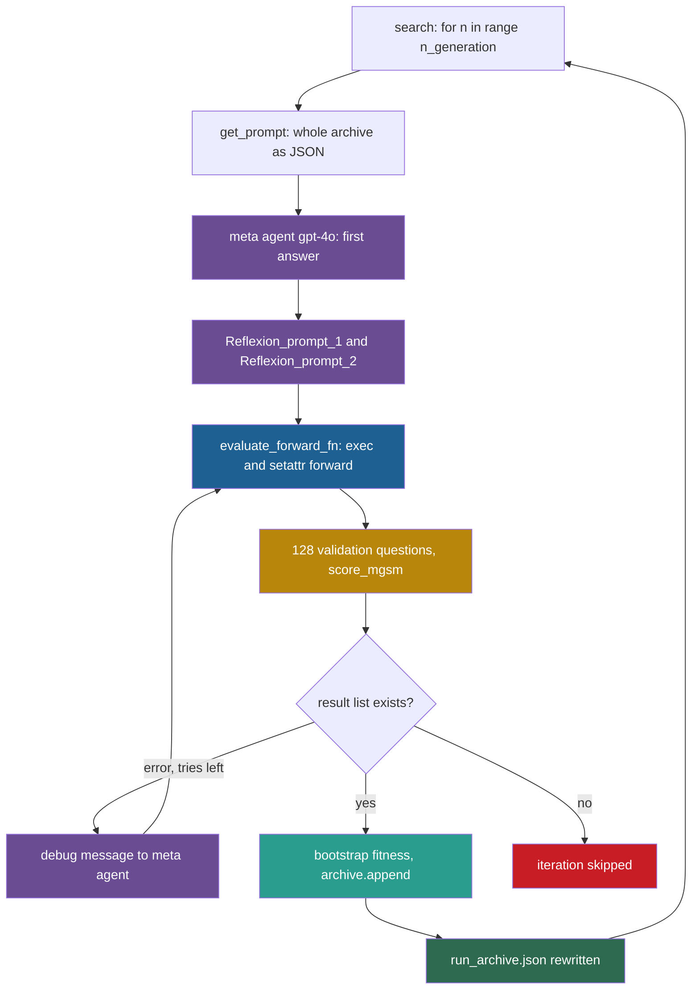

## Learning objectives

After this lesson you can:

- Trace one iteration of Meta Agent Search from `search()` to the archive file.
- Explain why the whole archive is the context of every new candidate, and estimate how fast that context grows.
- Write the acceptance rule of Automated Design of Agentic Systems (ADAS) as code, and say where selection pressure really comes from.
- Compute the uncertainty of a fitness value from the size of the validation set.
- List what runs model-written code in ADAS, and what does not protect the host.

## Prerequisites

- [L1: How to read a research repository](/notes/ai/recursive-self-improvement/07-implementations/l1-how-to-read-a-research-repository)
- [2024: ADAS and Meta Agent Search](/notes/ai/recursive-self-improvement/06-research-systems/p07-adas-meta-agent-search)
- [L4: Workflow and architecture search](/notes/ai/recursive-self-improvement/05-approaches/l4-workflow-and-architecture-search)
- [L5: Recursion, self-reference and programs that change programs](/notes/ai/recursive-self-improvement/01-foundations/l5-recursion-and-self-reference)
- [L3: Evaluation under noise](/notes/ai/recursive-self-improvement/04-mathematics/l3-evaluation-under-noise)

## 1. The question this idea answers

An architecture studio keeps a binder. Each page holds one building design and the rating that it got. A senior architect reads the whole binder, then draws one new design. The new design is rated and goes into the binder, good or bad. Nothing is ever removed. After thirty designs, which one is "the result"?

Automated Design of Agentic Systems (ADAS) works like this studio. Its method, Meta Agent Search, has a fixed "meta agent", a large language model (LLM). The meta agent reads an archive of agent designs and writes a new one as Python code. The new design is scored and appended to the archive.

So this lesson asks: how does the released code do each of these steps? What exactly does the meta agent read? How does a string of code become a running agent? And what decides which design counts?

## 2. Mental model, and where it stops working

> [!analogy] A studio binder read by one architect
> - The binder is the archive. Each page is one agent design with its fitness.
> - The senior architect is the meta agent. The rating office is the evaluation on a validation set.
> - Every new design goes into the binder. The architect sees all ratings and is asked to beat them.
> - **Where it stops working:** a real architect learns over the years. The meta agent is a fixed model with a fixed prompt, so it never improves.
> - The binder also gets too long. In ADAS, every page is copied into every prompt, and the prompt keeps growing.
> - Finally, ADAS builds each new design inside the studio's own office. The model-written code runs in the main Python process, with no walls around it.

## 3. Terms

| Term | Plain meaning |
|---|---|
| Automated Design of Agentic Systems (ADAS) | The research area, and the repository, about letting a model design agents as code. |
| Meta Agent Search | The ADAS method: a meta agent writes new agents, conditioned on an archive of earlier agents. |
| code reading | A fact taken from reading the repository at the pinned commit, without running it. Notes mark such facts "(code reading)". |
| meta agent | The LLM that writes new agent designs. In ADAS it is `gpt-4o-2024-05-13`, and it never changes. |
| agent design | One Python function `forward(self, taskInfo)` that solves a task by calling LLM sub-agents. |
| `LLMAgentBase` | The framework class that turns one LLM call into a sub-agent with named output fields. |
| `Info` | A named tuple with four fields, `name`, `author`, `content` and `iteration_idx`, that carries messages between sub-agents. |
| archive | The JavaScript Object Notation (JSON) list of all agent designs, each with its thought, name, code, fitness and generation. |
| fitness | The score of a design: a text string with a 95% bootstrap confidence interval and a median. |
| bootstrap confidence interval | An interval made by resampling the per-question results many times and taking percentiles of the means. |
| validation split | The questions used to score designs during the search. |
| test split | The separate questions used once, after the search, to score every design. |
| Multilingual Grade School Math (MGSM) | A benchmark of grade-school math word problems in 11 languages. |
| reflection step | A follow-up call in which the meta agent reviews and revises its own new design. |
| debug retry | A follow-up call in which the meta agent sees an error message and tries to fix its code. |
| monkey patching | Replacing an attribute of a class or module while the program runs, for example with `setattr`. |
| standard error | The typical size of the error of a measured mean. For a pass rate $p$ on $n$ questions it is about $\sqrt{p(1-p)/n}$. |
| winner's curse | The upward bias of the best of several noisy scores: the winner tends to score lower when it is measured again. |

## 4. Method and math

### 4.1 The algorithm in the paper

ADAS (Hu, Lu and Clune, 2024, [arXiv:2408.08435](https://arxiv.org/abs/2408.08435), ICLR 2025) names three parts of automated agent design. They are a search space, a search algorithm and an evaluation function. Its search space is code. Every agent is a `forward()` function inside "a simple framework (within 100 lines of code)" (Hu et al., 2024).

The paper's loop, in paraphrase:

1. Start the archive with seven hand-designed agents, each with its validation score.
2. In each of $N$ iterations, the meta agent reads the framework code, the task description and the archive. It writes an idea and the code of a new `forward()`.
3. Two reflection steps check novelty and correctness.
4. If the code raises an error, the meta agent reflects and fixes it.
5. The new agent is scored on the validation set with `gpt-3.5-turbo-0125`.
6. The agent and its score join the archive.
7. After the search, the paper reports test accuracy of selected agents.

$N$ is 25 for the ARC benchmark and 30 for the reasoning benchmarks. The rest of this lesson shows how the code does each step.

### 4.2 Q1: Entry point and arguments

**Repository:** https://github.com/ShengranHu/ADAS, commit `2702bee8fefda42255efc5be9f60e3bd3db96ae4` (2025-01-27). License: Apache 2.0. Line numbers refer to this commit.

Each benchmark folder (`_arc`, `_drop`, `_gpqa`, `_mgsm`, `_mmlu`) is self-contained. It holds `search.py`, a prompt file and `utils.py`. This lesson reads `_mgsm` and notes where `_arc` differs. The README command is `python {DOMAIN}/search.py`.

The `__main__` block of `_mgsm/search.py` (lines 335–360) first runs `search(args)` with `SEARCHING_MODE = True`. It then runs `evaluate(args)` with `SEARCHING_MODE = False`. The arguments and defaults (lines 337–351):

| Argument | Default | Note |
|---|---|---|
| `--valid_size` | 128 | Questions used to score designs during the search. |
| `--test_size` | 800 | Questions used by `evaluate()`. |
| `--shuffle_seed` | 0 | Seed of the split. |
| `--n_repreat` | 1 | Spelled this way in the code. Repeats each question. |
| `--multiprocessing` | True | `store_true` with default True, so it is always on. |
| `--max_workers` | 48 | Threads that score questions in parallel. |
| `--n_generation` | 30 | Iterations of the search. |
| `--debug_max` | 3 | Debug retries per iteration. |
| `--model` | `gpt-4o-2024-05-13` | The meta agent. |
| `--save_dir`, `--expr_name` | `results/`, `mgsm_gpt3.5_results` | Output location. |

The ARC folder differs: 25 iterations, `--n_repreat 5`, `--max_workers 32`, and pickled split files (code reading).

### 4.3 Q2: How the objective is given

The meta agent gets its objective from one long prompt string, `base`, in `_mgsm/mgsm_prompt.py` (lines 226–490). It has five parts:

1. The goal: "design an optimal agent performing well on the Multilingual Grade School Math Benchmark (MGSM)".
2. One example question in Japanese, with its answer marked "(Not Given)".
3. "# The utility code:" with the framework source, including `LLMAgentBase` and the `forward(self, taskInfo)` interface (line 235).
4. "# Discovered architecture archive" with the placeholder `[ARCHIVE]` (lines 411–414). The text ends: "Your GOAL is to maximize the "fitness"."
5. The output format, four "WRONG Implementation examples", and the task: "THINK OUTSIDE THE BOX."

Each agent design gets its tasks in a different way. A question arrives as `Info('task', 'User', question, -1)` (`_mgsm/search.py` lines 307–310). The design's `forward()` calls `LLMAgentBase` sub-agents. Their default model is `gpt-3.5-turbo-0125` (line 75).

The data split happens inside the evaluation function:

```python
    # set seed 0 for valid set
    examples = get_all_examples()
    random.seed(args.shuffle_seed)
    random.shuffle(examples)

    if SEARCHING_MODE:
        examples = examples[:args.valid_size] * args.n_repreat
    else:
        examples = examples[args.valid_size:args.valid_size + args.test_size] * args.n_repreat
```

(`_mgsm/search.py` lines 291–299.)

- Line 292: load the questions of all 11 languages.
- Lines 293–294: shuffle with a fixed seed, so every call gets the same order.
- Lines 296–297: during the search, use the first 128 questions.
- Lines 298–299: during the final evaluation, use the next 800 questions.

The split is clean: the 128 validation questions and the 800 test questions do not overlap. The seed is fixed, so every design sees the same 128 questions.

### 4.4 Q3: How a change is proposed

The prompt comes from `get_prompt()`:

```python
def get_prompt(current_archive, adaptive=False):
    archive_str = ",\n".join([json.dumps(sol) for sol in current_archive])
    archive_str = f"[{archive_str}]"
    prompt = base.replace("[ARCHIVE]", archive_str)
    prompt = prompt.replace("[EXAMPLE]", json.dumps(EXAMPLE))

    return system_prompt, prompt
```

(`_mgsm/mgsm_prompt.py` lines 530–536.)

- Line 531: turn every archive entry into JSON text and join them with commas.
- Line 532: wrap the result in square brackets, so it reads as one JSON list.
- Line 533: put the whole list where `[ARCHIVE]` stands in the base prompt.
- Line 534: put one example answer where `[EXAMPLE]` stands.
- Line 536: return the system prompt, "You are a helpful assistant. Make sure to return in a WELL-FORMED JSON object.", and the user prompt.

So the context of every new candidate is **the whole archive**: thought, name, code, fitness and generation of every entry. There is no parent selection and no sampling of entries (code reading). The argument `adaptive` is not used in the function body.

**Worked example: how fast the context grows.** The repository ships a finished archive, `results/mgsm_gpt3.5_results.json`, with 36 entries (code reading). We measured its JSON text after removing the `test_fitness` field, which the search-time archive does not have. This measurement is our own reading of the data file.

1. The 7 hand-designed seeds take about 11,800 characters.
2. The first 35 entries take about 125,000 characters.
3. So the archive part of the prompt grew by a factor of about 10.6 over the run.

The context of the last iteration is therefore about ten times the context of the first. The critique by El, Yuksekgonul and Zou (2025) tested this design. The ADAS-style cumulative context "performs worse than ignoring prior designs entirely" in their setup (El, Yuksekgonul and Zou, 2025). An evolutionary context with the top 7 parents did better.

Three model calls then build one candidate:

```python
            next_solution = get_json_response_from_gpt_reflect(msg_list, args.model)

            Reflexion_prompt_1, Reflexion_prompt_2 = get_reflexion_prompt(archive[-1] if n > 0 else None)
            # Reflexion 1
            msg_list.append({"role": "assistant", "content": str(next_solution)})
            msg_list.append({"role": "user", "content": Reflexion_prompt_1})
            next_solution = get_json_response_from_gpt_reflect(msg_list, args.model)
            # Reflexion 2
            msg_list.append({"role": "assistant", "content": str(next_solution)})
            msg_list.append({"role": "user", "content": Reflexion_prompt_2})
            next_solution = get_json_response_from_gpt_reflect(msg_list, args.model)
```

(`_mgsm/search.py` lines 187–197.)

- Line 187: the first answer, a JSON object with `thought`, `name` and `code`.
- Line 189: build the two reflection prompts. The first one also shows the previous archive entry, if there is one.
- Lines 191–193: add the answer and the first reflection prompt. It asks about "Interestingness", "Implementation Mistakes" and "Improvement". The model answers again.
- Lines 195–197: add the second prompt, which asks the model to check the code against the "WRONG Implementation examples". The model answers a third time.

All three calls use `temperature=0.8` and request a JSON object (`get_json_response_from_gpt_reflect()`, lines 53–66).

### 4.5 Q4: How a candidate is applied

A candidate is a string that defines one function. The code turns it into a method of an empty class:

```python
    namespace = {}
    exec(forward_str, globals(), namespace)
    names = list(namespace.keys())
    if len(names) != 1:
        raise AssertionError(f"{len(names)} things in namespace. Please only provide 1")
    func = namespace[names[0]]
    if not callable(func):
        raise AssertionError(f"{func} is not callable")
    setattr(AgentSystem, "forward", func)
```

(`_mgsm/search.py` lines 281–289.)

- Line 281: an empty dictionary will collect the names that the string defines.
- Line 282: `exec` runs the string. It reads the module's globals, so the code can use `LLMAgentBase`, `Info`, the OpenAI `client` and every imported module. New names go into `namespace`.
- Lines 283–285: the string must define exactly one name. Otherwise the code raises an error.
- Lines 286–288: that name must be callable.
- Line 289: monkey patching. `setattr` installs the function as the `forward` method of `AgentSystem`, an empty class (lines 140–142).

No file is written for a candidate. The code exists only as a string in the archive.

### 4.6 Q5: How candidates are evaluated

`evaluate_forward_fn()` (lines 278–332) runs `agentSystem.forward` on every validation question. It uses `ThreadPoolExecutor(max_workers=min(len(examples), args.max_workers))`, so up to 48 questions run at once (lines 305, 315–316). The answer check is an exact string match:

```python
def score_mgsm(target: str, prediction: str) -> bool:
    if "." in prediction:
        prediction = prediction.rstrip("0").rstrip(".")

    target = target.replace(",", "")
    prediction = prediction.replace(",", "")

    return target == prediction
```

(`_mgsm/utils.py` lines 50–57.)

- Lines 51–52: remove trailing zeros and a trailing point, so "12.0" becomes "12".
- Lines 54–55: remove thousands separators.
- Line 57: the answer counts only if the two strings are equal.

Errors during answer extraction or scoring give that question a score of 0 (lines 319–328). **Our interpretation, from code reading:** an exception raised inside `forward()` itself behaves differently. `executor.map` raises it again when line 316 collects the results. So the whole evaluation fails, and the debug retry of section 4.9 starts.

The fitness is a string. `bootstrap_confidence_interval(acc_list)` (`_mgsm/utils.py` lines 88–133) draws 100,000 bootstrap samples. It returns, for example, `"95% Bootstrap Confidence Interval: (23.4%, 39.1%), Median: 31.2%"`. The meta agent reads these strings in the archive.

A candidate with mean accuracy below 0.01 counts as an error during the search (lines 208–209). Apart from that check, there is no staged evaluation, no time limit and no sandbox in the evaluation path (code reading). After the search, `evaluate()` (lines 243–275) scores **every** archive entry on the 800 test questions and stores `test_fitness`.

**Worked example: how wide is a fitness interval?** Take a pass rate $p$ on $n$ questions. The normal approximation of the 95% interval half-width is $1.96 \sqrt{p(1-p)/n}$. This is the standard error of [L3: Evaluation under noise](/notes/ai/recursive-self-improvement/04-mathematics/l3-evaluation-under-noise), times 1.96.

1. MGSM validation: $n = 128$, $p = 0.30$. Then $p(1-p) = 0.21$, $0.21 / 128 = 0.00164$, the square root is $0.0405$, and $1.96 \times 0.0405 = 0.079$. So the interval is about ±7.9 points.
2. GPQA validation: $n = 32$, $p = 0.30$. The half-width is about ±15.9 points.
3. ARC validation: 20 questions (Hu et al., 2024), with $p = 0.10$. The half-width is about ±13.1 points. Each ARC agent is evaluated 5 times, but repeats of the same 20 questions do not add new questions.
4. MGSM test: $n = 800$, $p = 0.30$. The half-width is about ±3.2 points.

The shipped archive agrees with step 1. The chain-of-thought seed has the validation fitness "(22.7%, 38.3%), Median: 30.5%", an interval of about ±7.8 points.

### 4.7 Q6: How results are stored

| File | Content | Lines |
|---|---|---|
| `<save_dir>/<expr_name>_run_archive.json` | The archive as one JSON list, rewritten after every new entry. | 146, 237–240 |
| `<expr_name>_run_archive_evaluate.json` | The archive with `test_fitness` added by `evaluate()`. | 245 |

Each entry has the keys `thought`, `name`, `code`, `fitness` and `generation`. Seeds have `generation` set to `"initial"`. The code deletes `debug_thought` and `reflection` before it saves (lines 231–234). So the attempt log keeps the final thought, but not the reflection text or the failed attempts.

Resume is simple. If the archive file exists, `start = archive[-1]['generation']` (lines 147–153). The shipped results file `results/mgsm_gpt3.5_results.json` has 36 entries: 7 seeds and 29 generated agents. Its last entry is "Dynamic Task Allocation and Feedback Agent", generation 30 (code reading). Our own reading of the file adds one detail: generation 25 is absent. That fits the skipped-iteration behavior of section 4.9, but the run log was not available to confirm it.

### 4.8 Q7: How a successful change is incorporated

Here is the end of one iteration:

```python
        if not acc_list:
            n -= 1
            continue

        fitness_str = bootstrap_confidence_interval(acc_list)
        next_solution['fitness'] = fitness_str
        next_solution['generation'] = n + 1

        if 'debug_thought' in next_solution:
            del next_solution['debug_thought']
        if 'reflection' in next_solution:
            del next_solution['reflection']
        archive.append(next_solution)
```

(`_mgsm/search.py` lines 223–235.)

- Lines 223–225: if no evaluation produced a result list, skip this iteration.
- Lines 227–229: compute the fitness string and record the generation number.
- Lines 231–234: delete the reflection fields.
- Line 235: append the candidate to the archive.

So the acceptance rule, as code, is:

```python
if acc_list:            # the candidate ran and produced per-question results
    archive.append(candidate)
```

There is **no comparison** with existing entries (code reading). A design with low fitness stays in the archive and stays in every later prompt. There is also no parent-selection formula. The only selection pressure is the meta agent itself. It reads the fitness strings and the sentence "Your GOAL is to maximize the "fitness"."

**Our interpretation:** in ADAS, the selection rule is written in English, inside a prompt, and a fixed model applies it. You cannot write it as a formula, because it depends on how GPT-4o reads 30 to 40 JSON entries.

### 4.9 Q8: How failures are handled

The debug loop:

```python
        acc_list = []
        for _ in range(args.debug_max):
            try:
                acc_list = evaluate_forward_fn(args, next_solution["code"])
                if np.mean(acc_list) < 0.01 and SEARCHING_MODE:
                    raise Exception("All 0 accuracy")
                break
            except Exception as e:
                print("During evaluation:")
                print(e)
                msg_list.append({"role": "assistant", "content": str(next_solution)})
                msg_list.append({"role": "user", "content": f"Error during evaluation:\n{e}\nCarefully consider where you went wrong in your latest implementation. Using insights from previous attempts, try to debug the current code to implement the same thought. Repeat your previous thought in 'thought', and put your thinking for debugging in 'debug_thought'"})
```

(`_mgsm/search.py` lines 204–215.)

- Line 204: start with an empty result list.
- Line 205: at most `debug_max` = 3 tries.
- Lines 207–210: evaluate. If the mean accuracy is below 0.01, raise an error on purpose. Otherwise stop the loop.
- Lines 211–213: on any error, print it.
- Lines 214–215: send the code and the error text back to the meta agent with a request to debug. The next lines (216–222) ask the model for a fixed version.

Other failure paths (code reading):

| Failure | Where | What happens |
|---|---|---|
| Model call or JSON parse fails while proposing | lines 198–202 | Print, `n -= 1`, `continue`. |
| No try produced results | lines 223–225 | Skip the iteration. |
| A sub-agent's model call fails | `LLMAgentBase.query()`, lines 116–126 | Missing JSON fields are filled with `''`. Only a context-length error is raised, in search mode. |
| A seed agent crashes | lines 164–169 | Print and skip that seed. |

> [!note] BUG? note: a failed iteration is skipped, not retried (code reading, not a run)
> Lines 201 and 224 run `n -= 1` inside `for n in range(start, args.n_generation)`. In Python, the `for` statement gives `n` its next value from the range at the start of each pass. So `n -= 1` has no effect, and the iteration is lost, not repeated.

> [!note] Edge case: a never-evaluated candidate can enter the archive (code reading, not a run)
> Suppose the first try returns all zeros. Then `acc_list` holds zeros, and line 209 raises the "All 0 accuracy" error. Suppose the next tries fail inside `exec`. They raise before line 207 can assign a new list. After the loop, `acc_list` still holds the zeros, which is not empty. So line 235 appends the **last** `next_solution`, which was never evaluated, with the zero fitness of the first try.

### 4.10 Q9: What prevents unsafe changes, and what does not

Not prevented (code reading):

1. Model-written code runs with `exec(..., globals(), ...)` in the main Python process. That process holds the OpenAI client, the file system and the network.
2. The ARC version also runs model-written `transform` code with `exec(code, {}, local_vars)` (`_arc/search.py` line 177). It calls `eval` on the agent's string output (line 407).
3. There are no time limits, no container and no resource limits.
4. The meta agent cannot edit the search loop, because it only writes `forward()`. But the `forward()` code that it writes has full access to the process.

Light guards:

- The checks "exactly one name" and "callable" in lines 283–288.
- The budget of 3 debug tries.

The README states the risk in its "Safety Consideration" section: "The code in this repository involves executing untrusted model-generated code. We strongly advise users to be aware of this safety concern."

### 4.11 Q10: The loop as implemented

```text
archive = load_or(init_archive = [CoT, CoT-SC, Reflexion, Debate, StepBack, QD, RoleAssign])
for seed in archive without fitness: seed.fitness = bootstrap_CI(run(seed.code, validation))
for n in range(start, n_generation):                  # 30 (25 for ARC)
    msgs = [system, base_prompt(whole archive + utility code + example)]
    cand = meta_llm(msgs); cand = meta_llm(+reflexion_1); cand = meta_llm(+reflexion_2)
    for _ in range(debug_max):                        # 3
        try: acc = run(exec(cand.code) as AgentSystem.forward, validation)
             require mean(acc) >= 0.01; break
        except e: cand = meta_llm(+error e, "debug")
    if acc: cand.fitness = bootstrap_CI(acc); archive.append(cand); save json
for entry in archive: entry.test_fitness = bootstrap_CI(run(entry.code, test))
```



### 4.12 Q11: Reading order

1. `README.md`: the run command, how to add a domain, the safety note.
2. `_mgsm/search.py`: `search()`, `evaluate_forward_fn()`, `LLMAgentBase`.
3. `_mgsm/mgsm_prompt.py`: `base`, the seed agents such as `COT`, the two reflection prompts, `get_prompt()`.
4. `results/mgsm_gpt3.5_results.json`: what the archive looks like after a run.
5. `_mgsm/utils.py`: data loading, `score_mgsm()`, the bootstrap fitness.
6. `_arc/search.py`: the ARC version, whose agents run code through `run_examples_and_get_feedback()`.
7. `_arc/data_select.py`: how the ARC split was made.

### 4.13 Code versus paper

Each item is code reading, not a run.

1. **Debug retries.** The paper says the meta agent retries runtime errors "up to five times if errors persist". The code default is `--debug_max 3`.
2. **Isolation.** The paper says that generated code ran in "containerized, isolated environments". The released code has no container logic. It uses plain `exec`. Any isolation must be added by the user.
3. **ARC split.** The paper uses 20 validation and 60 test questions. `_arc/data_select.py` writes 20 and up to 80. The shipped `.pkl` files were not opened, so their real contents are unknown.
4. **Matches.** The iteration counts (25 for ARC, 30 for the reasoning benchmarks) and the models (meta agent `gpt-4o-2024-05-13`, evaluated agents `gpt-3.5-turbo-0125`) match the code defaults.

### 4.14 Which agent is "the result"?

The code computes test fitness for every archive entry. It does not choose a final agent. That choice happens outside the code, so the reader must check how the paper made it.

Our own reading of the shipped MGSM file shows one clear case. The entry with the highest validation median is "Dynamic Role-Playing Architecture" from generation 4. Its validation median is 54.7% and its test median is 53.4%. The paper's Table 1 reports 53.4 for Meta Agent Search on MGSM (Hu et al., 2024, Table 1). The seven seeds' test medians in the file also equal the paper's baseline rows, for example 28.0 for chain-of-thought.

The same file shows why validation scores are optimistic. "Verified Multimodal Collaborative Agent" has a validation median of 50.8% and a test median of 39.1%. That is a drop of 11.7 points, wider than the ±7.9 points of section 4.6. **Our interpretation:** the best of about 36 noisy validation scores is biased upward, as the winner's curse predicts. Here the best-by-validation agent held up on test, but others did not.

One caveat about the paper matters here. For the model-transfer experiment on ARC, the authors "test the top 3 agents with the best test accuracy evaluated with GPT-3.5". So those agents were selected with test data, and the transfer table is not a clean held-out estimate.

### 4.15 What the code says about recursive self-improvement (RSI)

ADAS changes agent code, and it keeps an archive. But the meta agent, its prompt, the search loop and the evaluation are all fixed. Nothing in the code lets the meta agent change itself. The authors of the Self-Improving Coding Agent (SICA) describe ADAS as "not self-improving" for this reason (Robeyns et al., 2025, Section 2). The ADAS paper names "higher order" meta-learning, with a learned meta agent, as future work (Hu et al., 2024). So ADAS is automated design by an outside, fixed designer.

Its importance for RSI is the representation. Once an agent is code, an agent can, in principle, edit its own code. The next lessons read systems that do exactly that.

## 5. Graphs

```plot
{
  "title": "Half-width of a 95% interval, in points, against the number of questions n. Blue: p = 0.3. Ink: p = 0.5. Gold points: ARC 20, GPQA 32, MGSM validation 128, MGSM test 800, at p = 0.3",
  "xAxis": { "domain": [10, 820], "label": "number of questions n" },
  "yAxis": { "domain": [0, 32], "label": "half-width (points)" },
  "disableZoom": true,
  "data": [
    { "fn": "196*sqrt(0.21/x)", "color": "#1E6091" },
    { "fn": "196*sqrt(0.25/x)", "color": "#100D12" },
    { "points": [[20, 20.08], [32, 15.88], [128, 7.94], [800, 3.18]], "fnType": "points", "graphType": "polyline", "color": "#B8860B", "skipTip": true },
    { "points": [[20, 20.08], [32, 15.88], [128, 7.94], [800, 3.18]], "fnType": "points", "graphType": "scatter", "color": "#B8860B", "skipTip": true }
  ]
}
```

The curve falls with the square root of $n$. Four times more questions halve the interval. The gold points show that the ADAS validation sets are small, so many archive entries have overlapping intervals. The ARC point assumes $p = 0.3$ for the shape of the curve. Section 4.6 used $p = 0.10$ for ARC.

## 6. Video and animation

- [Automated Design of Agentic Systems with Shengran Hu](https://www.youtube.com/watch?v=C5EyZAYlW7E) (The TWIML AI Podcast, 2024). The first author explains ADAS, its components and the designs found on ARC. Watch it before section 4.4.
- [Don't invent faster horses - Prof. Jeff Clune](https://www.youtube.com/watch?v=mw5WIDGRLnA) (Machine Learning Street Talk, 2025). The senior author on open-ended algorithms. The ADAS part starts at 1:15:10. It supports section 4.15.

## 7. Code

ADAS reports fitness as a bootstrap interval. The program below is our own. It compares a bootstrap interval with the normal approximation for 38 correct answers out of 128.

```python
import numpy as np

def bootstrap_ci(data, samples=10000, seed=0):
    rng = np.random.default_rng(seed)
    data = np.array(data)
    means = rng.choice(data, size=(samples, len(data)), replace=True).mean(axis=1)
    lo, hi = np.percentile(means, [2.5, 97.5])
    return lo, np.median(means), hi

acc = [1] * 38 + [0] * 90          # 38 of 128 correct, about 29.7%
lo, med, hi = bootstrap_ci(acc)
p, n = 38 / 128, 128
se = (p * (1 - p) / n) ** 0.5
print(f"bootstrap: {lo:.3f} {med:.3f} {hi:.3f}")
print(f"normal:    {p - 1.96*se:.3f} {p:.3f} {p + 1.96*se:.3f}")
```

It prints `bootstrap: 0.219 0.297 0.375` and `normal: 0.218 0.297 0.376`. For a pass rate on 128 questions, the two methods agree to about one tenth of a point. The bootstrap uses 10,000 samples here, not the 100,000 of ADAS, which only changes the last digit.

**Exercise 1.** The archive stores fitness as a string. Write a function that extracts the median as a number, so that a program can sort the archive.

```check
{
  "question": "Write a one-line Python expression that returns the median as a float. The input is a fitness string such as \"95% Bootstrap Confidence Interval: (23.4%, 39.1%), Median: 31.2%\".",
  "hint": "Use a regular expression on the text after 'Median: '.",
  "answer": "`float(re.search(r\"Median: ([0-9.]+)%\", s).group(1))` returns 31.2 for that string. Note why this matters: the search code never parses fitness. Only the meta agent reads the strings. So the archive has no numeric order inside the program."
}
```

## 8. Common mistakes

1. **"ADAS selects the best agent in each iteration."** The code appends every candidate that runs. It never compares a candidate with the archive.
2. **"The meta agent sees only the best designs."** It sees every entry, including weak ones, in every prompt.
3. **"ADAS improves its meta agent."** The meta agent is a fixed model with a fixed prompt. The search loop is also fixed.
4. **"The released code runs agents in containers."** The paper says so. The released code uses plain `exec` in the main process.
5. **"`n -= 1` retries a failed iteration."** In a Python `for` loop it has no effect. The iteration is skipped.
6. **"A fitness of 54.7% beats one of 50.8%."** With 128 questions, each interval is about ±8 points. The two intervals overlap.

## 9. One-minute explanation

ADAS's `search()` loop asks a fixed GPT-4o meta agent to write one new agent per iteration. The prompt holds the framework code and the whole archive of earlier agents as JSON, with their fitness strings. Two reflection calls revise the answer. Then `exec` and `setattr` turn the code string into the `forward` method of an empty class, which 128 validation questions score by exact match. Every candidate that produces results is appended to the archive, with no comparison, so the only selection is the meta agent reading "maximize the fitness". The code has no sandbox, no time limits and no container, and it scores every entry on 800 test questions after the search.

## 10. Check questions

```check
{
  "question": "Write the acceptance rule of ADAS as code, and say where selection pressure comes from.",
  "answer": "`if acc_list: archive.append(candidate)` (lines 223–235). Any candidate that produced a non-empty result list joins the archive. Selection pressure comes only from the meta agent, which reads every entry's fitness string in the prompt and is told to maximize it. The code itself has no comparison and no parent-selection formula."
}
```

```check
{
  "question": "Two archive entries have validation medians of 46.9% and 50.8% on the 128 MGSM questions. Is the second design better? Use the half-width from section 4.6.",
  "hint": "Compare the difference with the width of each interval.",
  "answer": "Not clearly. The difference is 3.9 points. Each interval has a half-width of about ±8.7 points at p near 0.5, so the intervals overlap widely. A paired comparison on the same 128 questions would be tighter, but the archive does not store per-question results. You need more questions, or a fresh test, before you call the second design better."
}
```

```check
{
  "question": "Where in the ADAS code would you add a held-out re-test, and why?",
  "hint": "Look at what `evaluate()` already does after the search.",
  "answer": "Add it after line 235, inside the loop, but only for a candidate that beats the current best validation fitness. Score it on a second set of questions that the search never uses, separate from the 800 test questions. Keep the test set for the single final report. This guards against the winner's curse during the search, and it stops the final choice from depending on test scores. Today `evaluate()` scores every entry on test, so any choice of 'the best agent by test' uses the test set for selection."
}
```

```check
{
  "question": "Classify ADAS on the system boundary. Which parts can change during a run, and which are frozen? Is ADAS recursive self-improvement?",
  "answer": "Can change: the archive, which grows by one agent design per iteration. The agent designs are new `forward()` functions. Frozen: the meta agent model and its prompt, the search loop, the evaluation function, the sub-agent model and the validation set. Because the designer never changes and no design can change the designer, ADAS is not recursive self-improvement. It is automated design by a fixed, external designer."
}
```

## 11. Summary and links

- Every ADAS candidate sees the whole archive as JSON. In the shipped MGSM run, that context grew about tenfold.
- `exec` plus `setattr` turns a code string into a running agent inside the main process, with no sandbox.
- The acceptance rule appends every candidate that produces results. Selection lives only in the meta agent's reading of fitness strings.
- Fitness intervals on 128 validation questions are about ±8 points wide, so many entries cannot be told apart.
- The meta agent and the loop are fixed, so ADAS is not self-improving. Its legacy is the idea of agents as code.

**Next:** [L4: The Darwin Gödel Machine in code](/notes/ai/recursive-self-improvement/07-implementations/l4-darwin-godel-machine-in-code) reads the system in which the agent that solves tasks also edits its own code.

**Related:** [2024: ADAS and Meta Agent Search](/notes/ai/recursive-self-improvement/06-research-systems/p07-adas-meta-agent-search), [L3: Evaluation failures: leakage, overfitting, noise and regression](/notes/ai/recursive-self-improvement/08-failure-modes-and-safety/l3-evaluation-failures), [L3: Archives: why keep more than the best version](/notes/ai/recursive-self-improvement/03-anatomy/l3-archives-and-search-over-versions).

## References

- Shengran Hu, Cong Lu, Jeff Clune. "Automated Design of Agentic Systems". 2024. ICLR 2025. arXiv:2408.08435. https://arxiv.org/abs/2408.08435
- ADAS repository. https://github.com/ShengranHu/ADAS. Commit `2702bee8fefda42255efc5be9f60e3bd3db96ae4` (2025-01-27). Apache 2.0.
- Batu El, Mert Yuksekgonul, James Zou. "Inefficiencies of Meta Agents for Agent Design". 2025. Findings of EMNLP 2025. arXiv:2510.06711. https://arxiv.org/abs/2510.06711
- Maxime Robeyns, Martin Szummer, Laurence Aitchison. "A Self-Improving Coding Agent". 2025. arXiv:2504.15228. https://arxiv.org/abs/2504.15228
