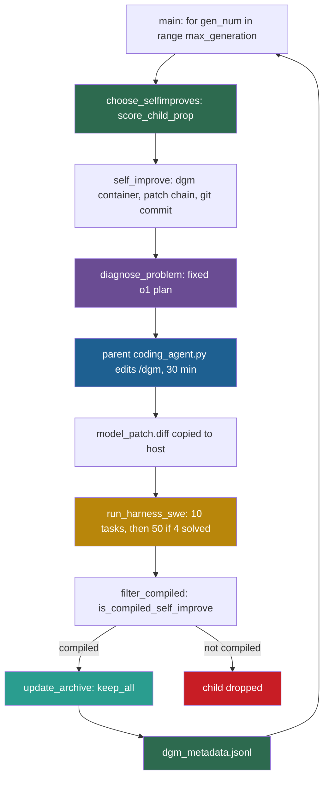

## Learning objectives

After this lesson you can:

- Trace one iteration of the Darwin Gödel Machine (DGM) through `DGM_outer.py` and `self_improve_step.py`, with real function names.
- Compute parent-selection probabilities from the code's formula for a small archive.
- Explain how an agent is stored as a chain of patches, and how the chain is rebuilt inside a container.
- State exactly which agents enter the archive, and why no line checks that a child beats its parent.
- List the code-versus-paper differences, the BUG? notes and the gaps in isolation.

## Prerequisites

- [L1: How to read a research repository](/notes/ai/recursive-self-improvement/07-implementations/l1-how-to-read-a-research-repository)
- [2025: The Darwin Gödel Machine](/notes/ai/recursive-self-improvement/06-research-systems/p10-darwin-godel-machine)
- [L2: One iteration, step by step](/notes/ai/recursive-self-improvement/03-anatomy/l2-one-iteration-step-by-step)
- [L3: Archives: why keep more than the best version](/notes/ai/recursive-self-improvement/03-anatomy/l3-archives-and-search-over-versions)
- [L3: Evaluation under noise](/notes/ai/recursive-self-improvement/04-mathematics/l3-evaluation-under-noise)

## 1. The question this idea answers

A carpenter sharpens her own chisels with her own tools. A better carpenter makes better chisels. Better chisels then make her a better carpenter. If you could only measure her furniture, you would still learn something about her tool-making.

The DGM makes this bet with a coding agent. The agent is a small Python program that edits code repositories with a language model. To get better at coding tasks, it must improve its own code-editing tools. Those same tools then perform the next edit to itself. The blog states the hope: "improved performance on coding challenges means it has also gotten better at improving itself" (Sakana AI blog, 2025).

So this lesson asks: how does the released code make an agent edit its own source? How does it keep many versions, choose which one to change next, and decide which ones to keep? And which parts of the loop never change?

## 2. Mental model, and where it stops working

> [!analogy] A family tree of workshops
> - Every workshop in a family tree started as a copy of its parent workshop, plus one renovation.
> - Each year, the family picks two workshops. Good workshops are picked more often, but a workshop that already has many children is picked less often.
> - An outside inspector studies one failed order of the picked workshop and writes a renovation plan. The workshop's own crew then carries the plan into a copy of its own workshop.
> - The new workshop takes a short test of 10 orders. If it passes 4, it takes 50 more. If it produces any real work, it joins the family tree, even if it is worse than its parent.
> - **Where it stops working:** in the code, the inspector never changes. It is a fixed `o1` model with fixed prompts, outside every workshop.
> - The rules for picking parents and the test itself are also fixed. And a workshop's score on 10 or 60 orders is a noisy guide to how good its descendants will be.

## 3. Terms

| Term | Plain meaning |
|---|---|
| Darwin Gödel Machine (DGM) | A system that keeps an archive of coding agents, picks parents, and lets each parent edit its own source, then benchmarks the result. |
| code reading | A fact taken from reading the repository at the pinned commit, without running it. Notes mark such facts "(code reading)". |
| coding agent | Here, `coding_agent.py`: a program that solves a repository task with a language model and two tools, bash and an editor. |
| SWE-bench Verified | A benchmark of real GitHub issues in Python repositories, checked by tests. |
| Polyglot | A coding benchmark with tasks in several programming languages. |
| task instance | One benchmark task, named by an ID such as `django__django-10999`. |
| patch | A text file in unified diff format that lists line changes to files. |
| patch chain | The ordered list of patches from the initial agent to one agent. Applying it rebuilds that agent. |
| parent, child | The agent that was edited, and the new agent that the edit produced. |
| generation | The code's word for one iteration of the outer loop. |
| diagnosis step | The call to a fixed `o1` model that reads a failure and writes a plan for the next change. |
| staged evaluation | Scoring in stages: a small task set first, and a larger one only if the small score is high enough. |
| compiled child | The code's word for a child that produced a score, at least one non-empty benchmark patch, and enough submissions. |
| sigmoid | The function $1/(1 + e^{-z})$, which maps any number to a value between 0 and 1. |
| Docker image, container | An image is a packaged file system with a program. A container is one running copy of an image. |
| `.dockerignore` | A file that lists paths that Docker must not copy into an image when it builds it. |
| stepping stone | A version that is not the best itself, but from which a better version later grows. |
| standard error | The typical size of the error of a measured mean. For a pass rate $p$ on $n$ tasks it is about $\sqrt{p(1-p)/n}$. |
| winner's curse | The upward bias of the best of several noisy scores: the winner tends to score lower when it is measured again. |

## 4. Method and math

### 4.1 The algorithm in the paper

The DGM paper (Zhang et al., 2025, [arXiv:2505.22954](https://arxiv.org/abs/2505.22954), ICLR 2026) describes this loop:

1. The archive starts with the initial agent and its benchmark score.
2. In each of 80 iterations, the loop samples $k$ parents from the archive with replacement. $k$ is 2 for SWE-bench and 4 for Polyglot.
3. For each parent, it picks one task that the parent failed, or one of three special entries.
4. A diagnosis reads the parent's code and failure log and writes a problem statement.
5. The parent agent, inside a Docker container, edits its own code to implement that statement.
6. The child is scored with staged evaluation: 10 tasks, then 50 more, then 200 for the strongest.
7. A child joins the archive if it compiles and still produces non-empty patches.

The paper states the result: 20.0% to 50.0% on its 200-task subset of SWE-bench Verified (Zhang et al., 2025). One run costs about USD 22,000 (v1, Appendix B.1) and about two weeks (v3, Section 6). The rest of this lesson reads each step in the released code.

### 4.2 Q1: Entry point and arguments

**Repository:** https://github.com/jennyzzt/dgm, commit `a565fd2d1dca504ef5104a7cc0f3bdc4ab9b4fd2` (2025-08-13). License: Apache 2.0. Line numbers refer to this commit.

The README command is `python DGM_outer.py`. The function `main()` (lines 221–332) parses the arguments (lines 222–242):

| Argument | Default | Note |
|---|---|---|
| `--max_generation` | 80 | Iterations of the outer loop. |
| `--selfimprove_size` | 2 | Children per iteration. |
| `--selfimprove_workers` | 2 | Threads that build children in parallel. |
| `--choose_selfimproves_method` | `'score_child_prop'` | Parent-selection method. See the BUG? note below. |
| `--update_archive` | `'keep_all'` | Archive rule: `keep_all` or `keep_better`. |
| `--num_swe_evals` | 1 | Repeated benchmark runs per child. |
| `--shallow_eval` | False | Run only the 10-task stage. |
| `--polyglot` | False | Use Polyglot. Its help text is a copy of `--shallow_eval`'s. |
| `--eval_noise` | 0.1 | Leeway used only by `keep_better`. |
| `--no_full_eval` | False | See the stage-3 note in section 4.6. |
| `--run_baseline` | None | `no_selfimprove` or `no_darwin`. |
| `--post_improve_diagnose` | False | An extra `o1` diagnosis after evaluation. |
| `--continue_from` | None | Folder of a run to resume. |

> [!note] BUG? note: a missing comma in the choices (code reading, not a run)
> Line 228 reads `choices=['random', 'score_prop', 'score_child_prop' 'best']`. Python joins the last two strings into `'score_child_propbest'`. The default still works, because `argparse` does not check a default against `choices`. But typing `score_child_prop` or `best` on the command line is rejected. [L1](/notes/ai/recursive-self-improvement/07-implementations/l1-how-to-read-a-research-repository) uses this note as its worked example.

The run folder is `./output_dgm/<YYYYmmddHHMMSS_ffffff>/` (lines 245–251). `initialize_run()` (lines 15–35) starts the archive as `['initial']`. It copies the cached evaluation of the initial agent from `initial/`, or `initial_polyglot/`, into the run folder. One self-improvement step can also run alone through `self_improve_step.py` `main()` (lines 422–444).

The cached scores of the initial agent are part of the repository. `initial/metadata.json` has an `accuracy_score` of 0.2, which is 12 of 60 tasks. `initial_polyglot/metadata.json` has 0.142, which is 32 of 225 (code reading).

### 4.3 Q2: How the agent gets its task

The coding agent receives two kinds of task through the same command-line interface.

1. **Benchmark tasks.** `swe_bench/harness.py` loads SWE-bench Verified (lines 205–207). Each instance runs in its own SWE-bench container (`process_entry()`, lines 24–182). The code copies the agent's files in and applies the parent patches with `patch -p1`. It then calls the agent with `timeout 32400`, which is 9 hours (lines 99–134).
2. **The self-improvement task.** It arrives as the same `--problem_statement` argument. But now `--git_dir /dgm/` points at the agent's **own** source, and `--self_improve` is set (`self_improve_step.py` lines 347–358).

The task subsets are JavaScript Object Notation (JSON) lists of instance IDs: `swe_bench/subsets/small.json` (10), `medium.json` (50) and `big.json` (140). The three lists are disjoint. Polyglot uses `polyglot/subsets/small.json` (10) and `medium.json` (50), which share 1 ID (code reading).

The whole agent is one call:

```python
        instruction = f"""I have uploaded a Python code repository in the directory {self.git_tempdir}. Help solve the following problem.

<problem_description>
{self.problem_statement}
</problem_description>

<test_description>
{self.test_description}
</test_description>

Your task is to make changes to the files in the {self.git_tempdir} directory to address the <problem_description>. I have already taken care of the required dependencies.
"""
```

(`coding_agent.py` lines 157–168. Line 153 defines `forward(self)`. Line 169 then calls `chat_with_agent(instruction, model=self.code_model, ...)`.)

- Line 157: the instruction names the repository folder. For self-improvement, that folder is `/dgm/`, the agent's own code.
- Lines 159–161: the problem: a GitHub issue, or the diagnosis plan.
- Lines 163–165: how to run tests.
- Line 167: the request to change files.

The model is `CLAUDE_MODEL = 'bedrock/us.anthropic.claude-3-5-sonnet-20241022-v2:0'` (`llm_withtools.py` line 13). `tools/__init__.py` loads every tool file under `tools/`. The initial tools are `bash`, with 120 seconds per command, and `editor`, with the commands `view`, `create` and `edit`. Its `edit` overwrites a whole file (code reading). After `forward()`, `main()` writes the `git diff` against the base commit to `model_patch.diff` (lines 197–201).

### 4.4 Q3: How a change is proposed

Two different models build one change.

**Step 1: diagnosis with a fixed model.** `self_improve_step.py` `diagnose_problem()` (lines 30–67) calls `diagnose_model = 'o1-2024-12-17'` (line 28). Its system message holds the agent's code:

```python
diagnose_system_message = """Here is the implementation of the coding agent.

# Coding Agent Implementation
----- Coding Agent Implementation Start -----
{code}
----- Coding Agent Implementation End -----

Your task is to identify ONE detailed plan that would improve the agent's coding ability. The improvement should not be specific to any particular GitHub issue or repository.
"""
```

(`prompts/self_improvement_prompt.py` lines 64–72.)

- Lines 64–69: `{code}` is filled with the agent's source.
- Line 71: the task is ONE general plan, not a fix for one issue.

`get_current_code()` (lines 409–468) builds `{code}`. It joins `coding_agent.py` and every `.py` file under `tools/` and `utils/`. It skips four files: `utils/evo_utils.py`, `utils/docker_utils.py`, `utils/swe_log_parsers.py` and `prompts/self_improvement_prompt.py` (lines 326–332). Then it appends every ancestor patch as text, headed "# Patch i" (lines 461–466).

The user message depends on the entry that the outer loop chose. For a task ID, `diagnose_prompt` (lines 77–120) holds five parts:

1. The agent's running log for that task, cut to 250,000 characters.
2. The GitHub issue.
3. The agent's predicted patch.
4. SWE-bench's private test patch.
5. The official test results.

The prompt labels part 4 itself:

```python
# Private Test Patch
SWE-bench's official private tests to detect whether the issue is solved. This is not available to the agent during evaluation. The agent should try to implement its own tests.
----- Private Test Patch Start -----
{test_patch}
----- Private Test Patch End -----
```

(`prompts/self_improvement_prompt.py` lines 95–99.)

The model must answer with JSON fields `log_summarization`, `potential_improvements`, `improvement_proposal`, `implementation_suggestion` and `problem_description`. `get_problem_description_prompt()` (lines 177–181) joins a summary of the agent with the last two fields. That text becomes the problem statement of step 2.

**Our interpretation:** the hidden tests of SWE-bench never reach the agent that solves benchmark tasks. But they do reach the model that plans the next version of that agent. The plan must be general, so the effect is probably small. Still, it is an information path from hidden tests into the self-modification.

**Step 2: the parent edits itself.** The parent's own `coding_agent.py` runs inside the container:

```python
    cmd = [
        "timeout", "1800",  # 30min timeout
        "python", "/dgm/coding_agent.py",
        "--problem_statement", problem_statement,
        "--git_dir", "/dgm/",
        "--chat_history_file", chat_history_file_container,
        "--base_commit", commit_hash,
        "--outdir", "/dgm/",
        "--test_description", test_description,
        "--self_improve",
    ]
    exec_result = container.exec_run(cmd, environment=env_vars, workdir='/')
```

(`self_improve_step.py` lines 347–358.)

- Line 348: the Unix `timeout` command stops the edit after 1,800 seconds, 30 minutes.
- Line 349: run the parent's own agent file inside the container.
- Line 350: the problem statement from step 1.
- Line 351: the repository to edit is `/dgm/`, the agent itself.
- Line 353: the diff is measured against the commit made just before, so it holds only the new change.
- Line 355: the test description of `prompts/testrepo_prompt.py` line 28. It says "ONLY test tools and utils. NEVER try to test or run agentic_system.forward()."
- Line 358: run it in the container, with the environment variables of lines 339–346.

So the context of one change is the parent's own source, its patch chain and one failure. The failure part holds the issue, the predicted patch, the hidden tests and the test results. The archive as a whole is never shown to any model (code reading).

**Our interpretation:** the step that decides **what** to change is a fixed `o1` call outside the editable code. Only the step that **implements** the change belongs to the agent. So DGM improves the implementer part of its improver, not its ideation part.

### 4.5 Q4: How a candidate is applied

Every agent is the initial repository plus an ordered list of unified diffs. This function rebuilds the list:

```python
def get_model_patch_paths(root_dir, dgm_dir, parent_commit):
    prev_commit = parent_commit
    patch_files = []
    while prev_commit != 'initial':
        parent_dir = os.path.join(root_dir, dgm_dir, prev_commit)
        parent_patch_file = os.path.join(parent_dir, "model_patch.diff")
        if os.path.exists(parent_patch_file):
            patch_files.append(parent_patch_file)
        else:
            print(f"Parent patch file not found: {parent_patch_file}")
        # find next parent commit in the metadata
        parent_metadata = load_json_file(os.path.join(parent_dir, "metadata.json"))
        prev_commit = parent_metadata.get('parent_commit', 'initial')
    return patch_files[::-1]  # reverse the list to get the correct order
```

(`utils/evo_utils.py` lines 28–41.)

- Line 29: start at the parent.
- Line 31: walk up the family tree until the initial agent.
- Lines 32–35: collect each ancestor's own patch file.
- Lines 36–37: if a patch file is missing, print a warning and go on. The chain then silently lacks that change.
- Lines 39–40: read the ancestor's `metadata.json` to find its parent.
- Line 41: reverse the list, so the oldest patch comes first.

Inside the self-improvement container, the steps are:

1. Start a container from the image `dgm` (lines 264–274). `build_dgm_container()` builds the image once from the repository root and then reuses it.
2. Apply each ancestor patch with `patch -p1 < /dgm/parent_patch.txt` (lines 292–300).
3. Commit the result with `git commit -m 'a nonsense commit message'`, and read the hash from the output (lines 302–309). This makes the next diff hold only the new change.
4. Run `pip install -r /dgm/requirements.txt` again, because a patch may add dependencies (lines 311–313).
5. Run the parent agent on itself (section 4.4).
6. Copy `/dgm/model_patch.diff` to `<run>/<child_id>/model_patch.diff` on the host (lines 361–365).

For evaluation, the code appends the new patch to the chain (line 381). It applies the full chain inside every benchmark container. Patches are never applied to the host repository (code reading).

### 4.6 Q5: How candidates are evaluated

`run_harness_swe()` (lines 125–178) runs two stages. Stage 1 runs the 10 tasks of `small.json` with up to 5 parallel workers. The scoring runs on the host. `swe_bench/report.py` `make_report()` calls the official SWE-bench evaluation script. Before that, `remove_patches_to_tests()` removes any diff part that touches a test path (code reading). `get_all_performance()` in `utils/evo_utils.py` (lines 43–94) then computes `accuracy_score = total_resolved_instances / total_submitted_instances`.

Stage 2 depends on this test:

```python
    if (overall_performance and \
        test_more_threshold is not None and test_task_list_more is not None and \
            overall_performance.get('total_resolved_instances', 0) >= len(test_task_list) * test_more_threshold):
        safe_log("Start additional evaluation cycle")
```

(`self_improve_step.py` lines 153–156.)

- Line 153: a score must exist.
- Line 154: stage 2 must be switched on. `--shallow_eval` switches it off.
- Line 155: the child must resolve at least $10 \times 0.4 = 4$ of the 10 tasks. `test_more_threshold = 0.4` is set in `DGM_outer.py` line 268.

If the test passes, the child runs the 50 tasks of `medium.json`. The score is then recomputed over all 60 results (lines 157–178).

> [!note] Code versus paper: stage 3 is not executed (code reading, not a run)
> The paper describes a third stage on 200 tasks for agents above 40% that rank in the top two. The code computes `get_full_eval_threshold()` (lines 192–219) and passes it as `full_eval_threshold=` (line 296). `self_improve()` also loads `big.json` into `test_task_list_big` (`self_improve_step.py` line 258). But no other line uses either variable. So stage 3 never runs.

**Worked example: how noisy is stage 1?** Treat each task as an independent trial with solve probability $p$. The chance of at least 4 successes in 10 trials is $\sum_{k=4}^{10} \binom{10}{k} p^k (1-p)^{10-k}$.

1. For $p = 0.2$, like the initial agent, the chance is about 0.12.
2. For $p = 0.3$, it is about 0.35.
3. For $p = 0.4$, it is about 0.62.
4. For $p = 0.5$, it is about 0.83.

So the second stage is a lottery for most agents. An agent with a true rate of 0.5 still misses stage 2 about once in six tries. After stage 2, the score rests on 60 tasks. At 50%, its standard error is $\sqrt{0.25/60} \approx 0.065$, about 6.5 points. Real tasks differ in difficulty, so this model of equal, independent trials is only a rough guide.

Polyglot uses `run_harness_polyglot()` (lines 180–221). Its stage 2 writes `overall_performance_deep` instead of replacing `overall_performance` (line 220). The agent gets `timeout 600`, and each test script gets `timeout 120` (code reading).

The time limits are 30 minutes per self-modification, 9 hours per SWE-bench instance, and 120 seconds per bash command. One more limit only looks real:

```python
            for future in as_completed(futures):
                try:
                    # Added timeout to avoid hanging indefinitely (1.5 h here)
                    metadata = future.result(timeout=1.5*60*60)
                    selfimprove_ids.append(metadata['run_id'])
                except TimeoutError:
                    logger.error("Self-improvement attempt timed out.")
                    future.cancel()  # Optionally cancel the future if it's still running
```

(`DGM_outer.py` lines 302–309.)

- Line 302: `as_completed` yields each future only after it has finished.
- Line 305: so `future.result()` returns at once. The 1.5-hour time limit can never trigger.
- Lines 307–309: the `TimeoutError` branch is therefore dead code (code reading).

### 4.7 Q6: How results are stored

```text
output_dgm/<dgm_run_id>/
├── dgm_outer.log
├── dgm_metadata.jsonl          # one JSON object per iteration (DGM_outer.py lines 325-332)
├── initial/                    # copied cached evaluation of the initial agent
│   ├── metadata.json
│   ├── predictions/ ...        # per-instance agent log and patch
│   └── logs/run_evaluation/... # SWE-bench reports
└── <child_run_id>/             # for example 20250101_120000_123456
    ├── self_improve.log
    ├── self_evo.md             # chat log of the self-modification
    ├── model_patch.diff        # this child's own diff
    ├── metadata.json
    └── predictions/, logs/     # benchmark outputs
```

`dgm_metadata.jsonl` has the keys `generation`, `selfimprove_entries`, `children`, `children_compiled` and `archive`. The code writes each object with `indent=2`, so the file is not strict JSON Lines (JSONL), with one object per line. `load_dgm_metadata()` reads it back by splitting on `'\n{'` (code reading).

A child's `metadata.json` holds `run_id`, `parent_commit`, `entry`, `problem_statement`, `model_patch_exists`, `model_patch_notempty`, `swe_dnames` and `overall_performance`. The last one holds `accuracy_score`, the resolved and submitted counts, and the lists of resolved, unresolved and empty-patch task IDs (code reading). Together, the patch files and the `parent_commit` links form the full lineage of every version.

### 4.8 Q7: How a successful change is incorporated

**Which children enter the archive.** After each iteration, `filter_compiled()` (`DGM_outer.py` lines 152–165) keeps a child only if `is_compiled_self_improve()` returns True:

```python
    # 2. Must have at least one non-empty patch
    num_resolved = len(overall_perf['total_resolved_ids'])
    num_unresolved = len(overall_perf['total_unresolved_ids'])
    if (num_resolved + num_unresolved) == 0:
        logger.info(f"no non-empty patch")
        return False

    # 3. If specified, total evaluated must match num_swe_issues, else it means that some didn't compile
    total_evaluated = overall_perf['total_submitted_instances']
    if total_evaluated < num_swe_issues[0]:
        logger.info(f"not match num_issues")
        return False

    return True
```

(`utils/evo_utils.py` lines 114–127. Check 1, at lines 106–112, requires four keys in `overall_performance`.)

- Lines 115–116: count tasks with a non-empty patch, solved or not.
- Lines 117–119: if every patch was empty, reject the child.
- Lines 122–125: the child must have submitted at least `num_swe_issues[0]` tasks, which is 10.
- Line 127: otherwise the child is "compiled".

Then `update_archive()` adds the children:

```python
def update_archive(output_dir, archive, new_ids, method='keep_all', noise_leeway=0.1):
    """
    Update the archive with the new self-improve runs.
    """
    if method == 'keep_better':
        # keep only better ones
        original_score = get_original_score(output_dir) - noise_leeway
        for run_id in new_ids:
            metadata = load_json_file(os.path.join(output_dir, run_id, "metadata.json"))
            score = metadata["overall_performance"]["accuracy_score"]
            if score >= original_score:
                archive.append(run_id)
    else:
        # keep everything
        archive += new_ids
```

(`DGM_outer.py` lines 174–188.)

- Line 174: the default method is `keep_all`.
- Lines 178–185: `keep_better` compares each child with the **initial** agent's score minus 0.1, not with its parent.
- Lines 186–188: `keep_all` appends every compiled child.

So the acceptance rule, as code, is:

```python
accept = has_score and (resolved + unresolved > 0) and (submitted >= 10)
```

There is **no "must beat the parent" rule**. A child that is worse than its parent still joins the archive. Quality pressure comes only from parent selection (code reading). This is deliberate: the paper keeps worse agents as possible stepping stones (Zhang et al., 2025).

**Parent selection.** `choose_selfimproves()` (lines 50–150) first collects every archive member whose `metadata.json` loads. It counts each member's children as the number of archive members that name it as `parent_commit` (lines 69–72). The default method is `score_child_prop`:

```python
    elif method == 'score_child_prop':
        # Choose parents based on score and the number of children
        commits = list(candidates.keys())
        scores = [candidates[commit]['accuracy_score'] for commit in commits]
        scores = [1 / (1 + math.exp(-10*(score-0.5))) for score in scores]
        children_counts = [candidates[commit]['children_count'] for commit in commits]
        children_counts = [1 / (1 + count) for count in children_counts]
        probabilities = [score * count for score, count in zip(scores, children_counts)]
        probabilities = [prob / sum(probabilities) for prob in probabilities]
        parent_commits = random.choices(commits, probabilities, k=selfimprove_size)
```

(`DGM_outer.py` lines 91–100.)

- Line 93: the list of eligible agents.
- Line 94: each agent's accuracy on its evaluated tasks.
- Line 95: a sigmoid with slope 10 around 0.5.
- Lines 96–97: a bonus that falls with the number of children.
- Line 98: the weight is the product.
- Line 99: normalize the weights to probabilities.
- Line 100: draw `selfimprove_size` parents **with replacement**, so one agent can be drawn twice.

The paper writes the same rule as a formula. In words: good agents are picked more often, and agents with many children are picked less often.

$$
s_i = \frac{1}{1 + e^{-\lambda(\alpha_i - \alpha_0)}}, \qquad h_i = \frac{1}{1 + n_i}, \qquad p_i = \frac{s_i h_i}{\sum_j s_j h_j}
$$

The symbols mean:

- $\alpha_i$ is the accuracy score of agent $i$, between 0 and 1.
- $\lambda = 10$ is the slope of the sigmoid, and $\alpha_0 = 0.5$ is its midpoint.
- $s_i$ is the sigmoid-scaled score.
- $n_i$ is the number of children of agent $i$ in the archive.
- $h_i$ is the novelty bonus.
- $p_i$ is the probability that one draw picks agent $i$.

**Worked example.** An archive has four agents. The initial agent scores 0.20 and has two children, B and C. B scores 0.40 and has one child, D. C scores 0.50 and D scores 0.60. Neither has children.

1. Sigmoids: $s = 1/(1 + e^{3}) = 0.047$ for the initial agent, $1/(1 + e^{1}) = 0.269$ for B, $0.5$ for C and $1/(1 + e^{-1}) = 0.731$ for D.
2. Bonuses: $1/3$, $1/2$, $1$ and $1$.
3. Weights: $0.047 \times 1/3 = 0.016$, $0.269 \times 1/2 = 0.134$, $0.5$ and $0.731$. Their sum is $1.381$.
4. Probabilities: 0.011 for the initial agent, 0.097 for B, 0.362 for C and 0.529 for D.
5. With 2 draws with replacement, D is picked at least once with probability $1 - (1 - 0.529)^2 = 0.78$. Both draws pick D with probability $0.529^2 = 0.28$.

**Assumptions.** The accuracy scores are comparable across agents. In the code they are not fully comparable, because an agent that missed stage 2 has a score on 10 tasks, and others on 60.

**What it does not prove.** A high $p_i$ does not mean that agent $i$ has productive descendants. The Huxley-Gödel Machine paper measured the correlation between DGM's score signal and the later success of an agent's descendants. It was 0.285 (weighted) and 0.406 (unweighted) on a 60-task SWE-bench subset (Wang et al., 2025, Table 1).

The mapping between paper and code (code reading):

| Paper | Code |
|---|---|
| $s_i$ with $\lambda = 10$ and $\alpha_0 = 0.5$ | line 95 |
| $h_i = 1/(1 + n_i)$, children with editing ability | line 97. Only compiled children enter the archive, so the counts match. |
| $p_i = w_i / \sum_j w_j$ | lines 98–99 |
| $k = 2$ for SWE-bench, $k = 4$ for Polyglot | line 100. The default is 2. For Polyglot, the user must pass `--selfimprove_size 4`. |
| eligible agents have $\alpha_i < 1$ | **Not in the code.** Every archive member with loadable metadata is eligible. |

Other methods exist. `score_prop` uses the sigmoid only (lines 83–90), and `random` draws uniformly (line 109). The `no_darwin` baseline always takes the newest archive entry (lines 79–82).

> [!note] BUG? note: `best` picks the worst agents (code reading, not a run)
> The `best` branch (lines 101–106) sorts the candidates by score in ascending order and takes the first `k`. So it picks the **lowest**-scoring agents.

**Which failure to work on.** For each parent, lines 111–148 choose an entry for the diagnosis. In SWE-bench mode, three special entries come first:

```python
            # Solve empty patches
            if len(empty_ids) >= 0.1 * num_total_ids and random.random() < 0.25:
                entry = 'solve_empty_patches'
                selfimprove_entries.append((parent_commit, entry))
                continue

            # Solve stochasticity
            if random.random() < 0.25:
                entry = 'solve_stochasticity'
                selfimprove_entries.append((parent_commit, entry))
                continue
```

(`DGM_outer.py` lines 124–134.)

- Line 125: if at least 10% of the parent's tasks had empty patches, a 25% chance to ask for a general fix of empty patches.
- Line 131: otherwise, a 25% chance to ask for a fix of random variation between runs.
- Lines 136–141 (not shown) add `solve_contextlength` with 25% chance, if the parent's logs show the repeated error "Input is too long".
- Otherwise the entry is a random unresolved task.

**Worked example.** A parent qualifies for both conditional entries. Then the chances are: empty patches 0.25, variation $0.75 \times 0.25 = 0.1875$, context length $0.75^2 \times 0.25 \approx 0.14$, and a real failed task $0.75^3 \approx 0.42$. So most diagnoses of such a parent are not about a real failed task.

> [!note] BUG? note: a list compared with 0 (code reading, not a run)
> Line 144 tests `if unresolved_ids == 0:`. `unresolved_ids` is a list, so the test is always False. An agent with no unresolved tasks would then reach `random.choice([])` in line 147, which raises an error.

### 4.9 Q8: How failures are handled

| Failure | Where | What happens |
|---|---|---|
| The `o1` reply has no JSON that can be parsed | `diagnose_problem()` lines 55–66 | Recursive retry, up to 3 more attempts. Then `None`, and the child is saved with no patch (lines 328–333). |
| The self-modification hangs | line 348 | `timeout 1800` stops it. |
| No patch, or an empty patch | lines 367–379 | Metadata is saved and the function returns. The child has no `overall_performance`, so it fails the archive check. |
| The patched agent crashes or does not import | benchmark containers | It produces empty patches or no submissions, so it fails check 2 or 3. |
| The benchmark run raises an error | lines 398–399 | Logged. No `overall_performance`. |
| A whole self-improvement thread raises an error | `DGM_outer.py` lines 310–313 | Logged. The child ID is not recorded. |
| A parent's metadata is missing | lines 73–76 | The parent is skipped as "not eligible". |
| The agent loops in tool use | `llm_withtools.py` `chat_with_agent_claude()` line 380 | `while tool_use:` has no step limit. Only the outer `timeout` stops it. |

### 4.10 Q9: What prevents unsafe changes, and what does not

**What prevents or limits (code reading):**

1. Model-written code runs only inside Docker containers: the `dgm` image for self-modification, and SWE-bench or Polyglot images for evaluation.
2. `.dockerignore` keeps the outer loop and the scoring code **out of the image** that the agent edits. It lists `DGM_outer.py`, `self_improve_step.py`, `swe_bench/`, `polyglot/`, `prompts/self_improvement_prompt.py`, `prompts/diagnose_improvement_prompt.py`, `utils/evo_utils.py`, `utils/docker_utils.py`, `initial/` and `output_dgm/`. So the agent cannot edit its own selection rule or scorer.
3. Scoring runs on the host with the official SWE-bench script, and edits to test files are removed first.
4. Children must pass `is_compiled_self_improve()` to enter the archive.
5. Time limits: 30 minutes, 9 hours, and 120 seconds per bash call.

A small detail in item 2: the file groups its lines under headings such as `<!-- code outside of coding agent -->`. That is not comment syntax for `.dockerignore`. Those lines are just harmless extra patterns (code reading).

**What does not prevent:**

1. Containers start with default Docker settings (`utils/docker_utils.py` line 133). The network is on.
2. The code passes `ANTHROPIC_API_KEY`, `OPENAI_API_KEY` and AWS keys into the container environment (`self_improve_step.py` lines 339–346, `swe_bench/harness.py` lines 114–121).
3. No human-approval step exists in the code. No processor or memory limits are set.
4. `keep_all` admits regressions. Nothing checks that a change is safe, only that it still produces patches.

The README states: "This repository involves executing untrusted, model-generated code. We strongly advise users to be aware of the associated safety risks."

**Our interpretation:** the `.dockerignore` boundary is the most important safety line in this repository. It is a clear example of a frozen core. The agent can rewrite its tools and its workflow, but it cannot touch the code that chooses parents and scores children. But the paper's objective-hacking case shows the limits of a boundary.

In one case study, the agent removed the logging of special markers that a hallucination detector relied on. The source is the paper's appendix, as the Sakana AI blog describes it (Zhang et al., 2025). The detector was hidden, but the markers lived inside the editable agent.

### 4.11 Q10: The loop as implemented

```text
archive = ["initial"]                                # cached evaluation of the initial agent
for gen in range(max_generation):                    # default 80
    pairs = []
    for parent in sample_with_replacement(archive, k = selfimprove_size,
                       p proportional to sigmoid(10*(acc-0.5)) * 1/(1+n_children)):
        entry = pick_failure(parent)                 # special prompts first, else a random unresolved task
        pairs.append((parent, entry))
    in parallel threads, for (parent, entry) in pairs:
        container = docker("dgm"); apply ancestor patches; git commit
        plan = o1(own source + ancestor patches, failure log + issue + hidden tests)
        parent_agent_in_container.solve(plan, repo = /dgm)   # edits ITSELF, 30 min
        patch = git diff
        if patch is empty: save metadata; continue
        score = SWE-bench(10 tasks, in Docker)
        if resolved >= 4: score = SWE-bench(10 + 50 tasks)
        save metadata.json, model_patch.diff
    archive += [c for c in children if compiled(c)]  # keep_all
    append {generation, entries, children, archive} to dgm_metadata.jsonl
```



### 4.12 Q11: Reading order

1. `README.md`: setup, the safety warning, the file map.
2. `DGM_outer.py`: the whole outer loop in 336 lines. Focus on `choose_selfimproves()`, `filter_compiled()`, `update_archive()` and `main()`.
3. `self_improve_step.py`: one self-modification: container, patch chain, diagnosis, agent call, staged evaluation.
4. `prompts/self_improvement_prompt.py`: what the diagnosis model sees, in `get_diagnose_prompt_swe()` and `get_current_code()`.
5. `coding_agent.py`: the initial agent. It is small, one `forward()` call.
6. `llm_withtools.py`, `tools/bash.py`, `tools/edit.py`: the tool loop and the two initial tools.
7. `utils/evo_utils.py`: the patch chain, the score, the "compiled" rule.
8. `swe_bench/harness.py` and `.dockerignore`: how candidates run, and what stays out of the image.

### 4.13 Code versus paper

Each item is code reading, not a run.

1. **Stage 3 is not implemented.** The paper evaluates top agents on 200 tasks (140 new plus the earlier 60). The code computes the threshold and never uses it.
2. **The stage-1 rule differs.** The paper says: "We first evaluate each coding agent on a set of 10 tasks to verify basic codebase-editing functionality." The code requires at least 40% resolved on those 10 before it runs the 50.
3. **Eligible parents.** The paper excludes agents with a perfect score. The code does not.
4. **Parallelism.** The paper uses two parallel iterations for SWE-bench and four for Polyglot. The code defaults are 2 and 2 for both.
5. **Polyglot model roles appear swapped.** The paper says that Claude 3.5 Sonnet (New) powers self-modification in both benchmarks. It says that o3-mini is used for Polyglot evaluation. In the code, `coding_agent_polyglot.py` line 116 sets `self.code_model = CLAUDE_MODEL if not self_improve else OPENAI_MODEL`, with `OPENAI_MODEL = 'o3-mini-2025-01-31'`. `self_improve_step.py` renames that file to `coding_agent.py` and calls it with `--self_improve` (lines 276–282, 356). So the code uses o3-mini for Polyglot self-modification and Claude 3.5 Sonnet for Polyglot evaluation. The code reading could not tell which version produced the reported runs.
6. **The diagnosis model** `o1-2024-12-17` is hard-coded (line 28).

### 4.14 What the code says about recursive self-improvement (RSI)

The same file, `coding_agent.py`, solves benchmark tasks and performs the next self-modification. So a better tool, such as finer file viewing or string-replacement editing, helps both kinds of work. This is the code-level reason why DGM counts as self-improvement in which the improver changes.

The code also shows how much stays fixed. The `o1` diagnosis, the prompts, the parent-selection rule, the archive rule, the staged evaluation, the benchmarks and the model weights never change. The paper says that the open-ended exploration process is "fixed and not modifiable by the DGM" (Zhang et al., 2025, Section 3). So DGM improves one part of its improver, the implementer, inside a fixed outer machine.

## 5. Graphs

```plot
{
  "title": "DGM parent weight against accuracy score. Blue: no children, h = 1. Purple: one child, h = 1/2. Gold: two children, h = 1/3",
  "xAxis": { "domain": [0, 1], "label": "accuracy score alpha" },
  "yAxis": { "domain": [0, 1], "label": "weight s times h" },
  "disableZoom": true,
  "data": [
    { "fn": "1/(1+exp(-10*(x-0.5)))", "color": "#1E6091" },
    { "fn": "0.5/(1+exp(-10*(x-0.5)))", "color": "#6A4C93" },
    { "fn": "(1/3)/(1+exp(-10*(x-0.5)))", "color": "#B8860B" }
  ]
}
```

The sigmoid is steep around 0.5. Between scores 0.3 and 0.7 the weight grows about sevenfold, from 0.12 to 0.88. Below 0.2 the weight is almost zero, so a weak agent is rarely picked. Each child lowers the curve, which gives under-explored agents a chance.

## 6. Video and animation

- [Darwin Gödel Machine Explained: Self-Improving AI Agents](https://www.youtube.com/watch?v=KptCerr9D5I) (AI Papers Academy, 2025). A short explainer of the paper: a coding agent edits its own code, and an archive keeps the search open. Watch it before section 4.1.
- [Jeff Clune: Open-Ended, Quality Diversity, and AI-Generating Algos in the Era of Foundation Models](https://www.youtube.com/watch?v=ynhAJceDuIw) (alphaXiv, 2025). A research talk by the DGM senior author. It explains why the archive keeps weaker agents, which supports section 4.8.

## 7. Code

The program below is our own. It reproduces the selection probabilities of section 4.8 with the same formula as `DGM_outer.py` lines 95–99.

```python
import math

archive = {"initial": (0.20, 2), "B": (0.40, 1), "C": (0.50, 0), "D": (0.60, 0)}

weights = {}
for name, (score, children) in archive.items():
    s = 1 / (1 + math.exp(-10 * (score - 0.5)))
    h = 1 / (1 + children)
    weights[name] = s * h

total = sum(weights.values())
for name, w in weights.items():
    print(name, round(w / total, 3))
```

It prints `initial 0.011`, `B 0.097`, `C 0.362` and `D 0.529`.

**Exercise 1.** Add the paper's eligibility rule: an agent with a perfect score cannot be a parent.

```check
{
  "question": "Change the program so that agents with a score of 1.0 get no weight, as the paper says. What changes if the archive also holds agent E with score 1.0 and no children?",
  "hint": "Skip an agent before you compute its weight.",
  "answer": "Add `if score >= 1.0: continue` at the start of the loop body. Without the rule, E gets weight 1/(1 + e^-5) = 0.993, the largest of all. Then E takes about 42% of the probability, and the others shrink. With the rule, E is never a parent, and the four probabilities stay as before. The released code does not have this rule (code reading)."
}
```

## 8. Common mistakes

1. **"A child must beat its parent to enter the archive."** The default `keep_all` admits every compiled child. Even `keep_better` compares with the initial agent minus 0.1, not with the parent.
2. **"The agent decides what to improve."** In the released code, a fixed `o1` call writes the plan. The agent implements it.
3. **"Every agent is scored on 200 tasks."** Stage 3 never runs in this code. Weak agents are scored on 10 tasks, the others on 60.
4. **"Docker isolates the agent completely."** The containers have network access and application programming interface (API) keys.
5. **"The outer loop has a 1.5-hour time limit per child."** That `future.result(timeout=...)` call cannot trigger, because `as_completed` yields finished futures.
6. **"The archive is shown to the model."** Only the parent's own code, its patch chain and one failure are shown. The archive guides selection, not the prompt.

## 9. One-minute explanation

The DGM code stores every agent as the initial repository plus a chain of git patches, and keeps every working child in an archive. Each iteration, `choose_selfimproves()` samples two parents with a weight of sigmoid(10 × (score − 0.5)) divided by one plus the number of children. For each parent, a fixed `o1` model reads the agent's own code and one failure, including the hidden tests, and writes a plan. The parent's own `coding_agent.py` then edits its own source in a Docker container for up to 30 minutes, and the diff becomes the child. The child runs 10 SWE-bench tasks, 50 more if it solves 4, and joins the archive if it made real patches, with no parent comparison. The outer loop and the scorer stay outside the container image, but the containers keep network access and API keys.

## 10. Check questions

```check
{
  "question": "An archive holds two agents: the initial agent with score 0.20 and two children, and agent X with score 0.45 and no children. Compute the probability that one draw picks X.",
  "hint": "Compute the sigmoid of each score, multiply by 1/(1 + children), then normalize.",
  "answer": "Initial: s = 1/(1 + e^3) = 0.047, h = 1/3, so w = 0.016. X: s = 1/(1 + e^0.5) = 1/(1 + 1.649) = 0.378, h = 1, so w = 0.378. The sum is 0.394. So X is picked with probability 0.378 / 0.394 = 0.96, and the initial agent with 0.04."
}
```

```check
{
  "question": "Where in the DGM code would you add a held-out re-test, and what should it check?",
  "hint": "Look at what happens between `run_harness_swe()` and `update_archive()`.",
  "answer": "Add it in `DGM_outer.py` after `filter_compiled()` and before `update_archive()`, around lines 317–322. For a child whose 60-task score beats its parent's, run a fresh set of tasks that no parent selection or diagnosis has used. One option is the unused `big.json` tasks, kept apart from the diagnosis prompts. Record both scores. Use the held-out score, not the selection score, to decide which agent to report as best. This guards against the winner's curse of picking the best of many noisy 60-task scores."
}
```

```check
{
  "question": "Classify each DGM part as editable by the agent or frozen: (a) `tools/edit.py`, (b) `DGM_outer.py`, (c) the `o1` diagnosis prompt, (d) `coding_agent.py`, (e) `utils/evo_utils.py`.",
  "answer": "(a) Editable: it is in the image and is one of the agent's tools. (b) Frozen: `.dockerignore` keeps it out of the image. (c) Frozen: `prompts/self_improvement_prompt.py` is in `.dockerignore`, and the diagnosis runs on the host. (d) Editable: it is the agent itself. (e) Frozen: it is in `.dockerignore`, and `get_current_code()` also leaves it out of the code shown to `o1`."
}
```

```check
{
  "question": "An agent has a true solve rate of 0.3. What is the chance that it reaches stage 2? What does this mean for the scores in the archive?",
  "answer": "The chance of at least 4 successes in 10 independent trials at p = 0.3 is about 0.35. So about two of three such agents keep a score from only 10 tasks, with a standard error of about 14 points. The archive then mixes scores on 10 tasks with scores on 60 tasks. Parent selection treats them as equal, although the 10-task scores are much noisier."
}
```

## 11. Summary and links

- DGM stores each agent as a chain of patches. The chain is rebuilt in a fresh container for every self-modification and every benchmark task.
- A fixed `o1` model plans each change from the parent's code and one failure. The parent's own agent implements the plan on its own source.
- Staged evaluation runs 10 tasks, then 50 more at 4 of 10 solved. The 200-task stage is not executed in this code.
- Every compiled child joins the archive. Selection pressure comes only from the parent weight, sigmoid(10 × (score − 0.5)) / (1 + children).
- `.dockerignore` keeps the outer loop and the scorer out of the agent's reach, but the containers hold API keys and network access.

**Next:** [L5: SICA and Gödel Agent in code](/notes/ai/recursive-self-improvement/07-implementations/l5-sica-and-godel-agent-in-code) reads two other ways to change an agent's own code. One is a copy-and-edit loop in Docker. The other is live monkey patching.

**Related:** [2025: The Darwin Gödel Machine](/notes/ai/recursive-self-improvement/06-research-systems/p10-darwin-godel-machine), [2025: The Huxley-Gödel Machine](/notes/ai/recursive-self-improvement/06-research-systems/p11-huxley-godel-machine), [L7: Controls, oversight and governance](/notes/ai/recursive-self-improvement/08-failure-modes-and-safety/l7-controls-oversight-and-governance).

## References

- Jenny Zhang, Shengran Hu, Cong Lu, Robert Lange, Jeff Clune. "Darwin Gödel Machine: Open-Ended Evolution of Self-Improving Agents". 2025. ICLR 2026. arXiv:2505.22954. https://arxiv.org/abs/2505.22954
- DGM repository. https://github.com/jennyzzt/dgm. Commit `a565fd2d1dca504ef5104a7cc0f3bdc4ab9b4fd2` (2025-08-13). Apache 2.0.
- Sakana AI. "The Darwin Gödel Machine" (blog). 2025. https://sakana.ai/dgm/
- Wenyi Wang, Piotr Piękos, Li Nanbo, et al. "Huxley-Gödel Machine: Human-Level Coding Agent Development by an Approximation of the Optimal Self-Improving Machine". 2025. ICLR 2026. arXiv:2510.21614. https://arxiv.org/abs/2510.21614
