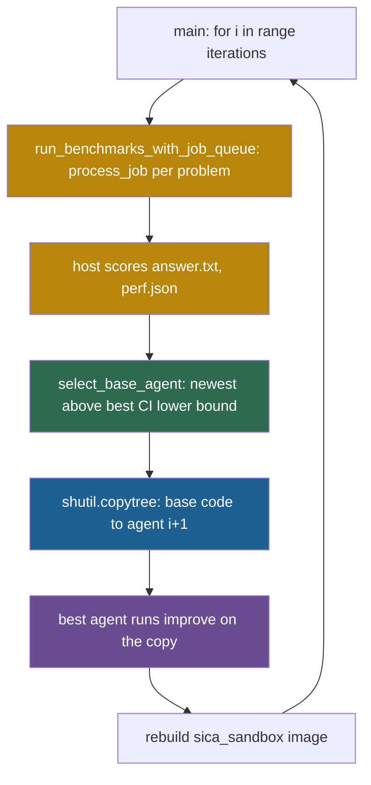
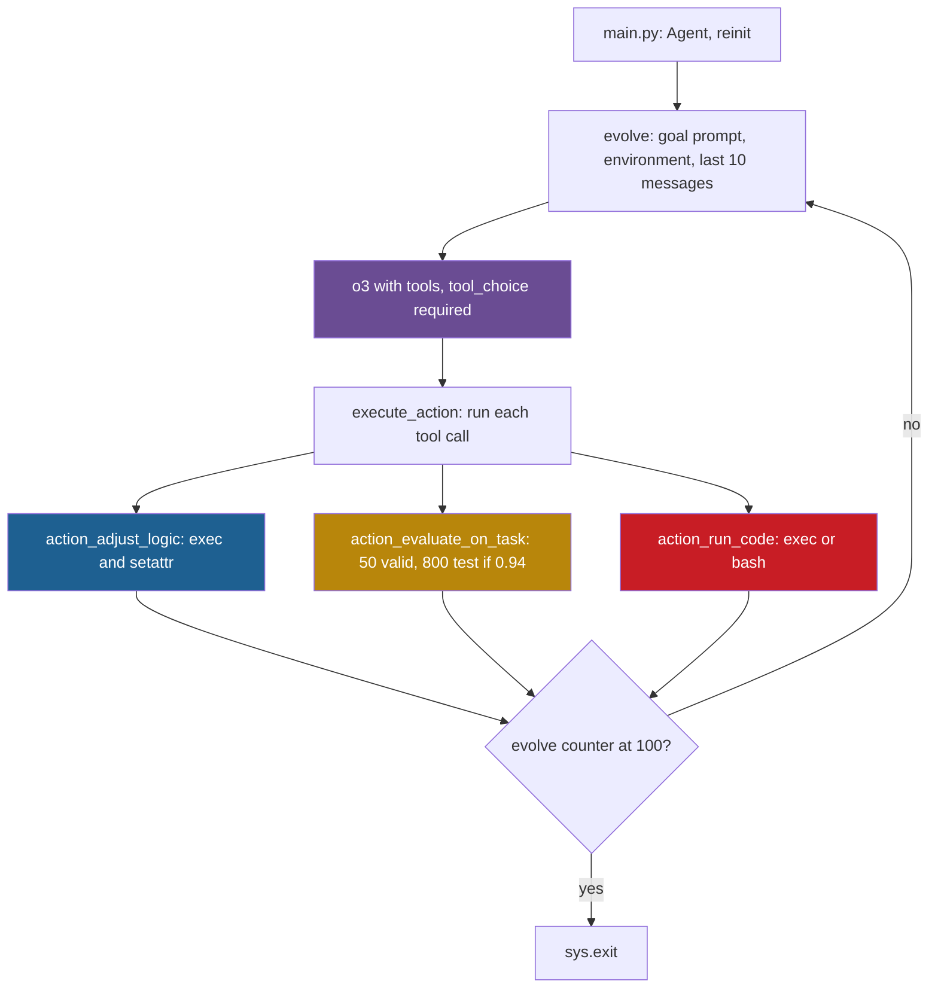

## Learning objectives

After this lesson you can:

- Trace one iteration of the Self-Improving Coding Agent (SICA) through `runner.py`, and name the agent that edits and the agent that is edited.
- Compute SICA's base-agent choice from its confidence-interval rule on a small example.
- Trace one step of Gödel Agent's `evolve()` and show how it rewrites a live function with `exec` and `setattr`.
- Compute the chance that Gödel Agent's 0.94 threshold is passed by luck.
- Compare the two designs on storage, acceptance, rollback and isolation.

## Prerequisites

- [L1: How to read a research repository](/notes/ai/recursive-self-improvement/07-implementations/l1-how-to-read-a-research-repository)
- [L4: The Darwin Gödel Machine in code](/notes/ai/recursive-self-improvement/07-implementations/l4-darwin-godel-machine-in-code)
- [2025: SICA, a Self-Improving Coding Agent](/notes/ai/recursive-self-improvement/06-research-systems/p09-sica-self-improving-coding-agent)
- [2024: Gödel Agent](/notes/ai/recursive-self-improvement/06-research-systems/p08-godel-agent)
- [L5: Recursion, self-reference and programs that change programs](/notes/ai/recursive-self-improvement/01-foundations/l5-recursion-and-self-reference)

## 1. The question this idea answers

There are two ways to renovate a house that you live in. You can build a copy of the house next door and renovate the copy. You live in it for a test week and keep the old house as a fallback. Or you can renovate the room you are standing in, wall by wall, while you live there.

SICA takes the first way. Its best agent so far edits a **copy** of an agent's code in a container. The new copy is benchmarked in the next iteration, and the old versions stay on disk. Gödel Agent takes the second way. One live Python process reads its own functions and replaces them while it runs, including the function that runs the improvement loop.

So this lesson asks: what does each way look like in code? Where does each new version live? What decides whether a change stays? And what happens when a change breaks the agent?

## 2. Mental model, and where it stops working

> [!analogy] Renovate a copy, or renovate the room you stand in
> - **SICA:** build the new house next door. The best builder so far does the work. Every house ever built stays on the street, with its inspection report. Next time, the family moves into a recent house that scored close to the best one.
> - **Gödel Agent:** renovate the room you stand in. Every change takes effect at once. You can even change the way you plan renovations. If a wall falls, you live with the hole, unless you notice and rebuild it.
> - **Where it stops working:** in SICA, the "inspection" is 18 math questions, so a score is a rough guide, not a certificate.
> - In Gödel Agent, nothing stops a renovation that breaks the house. The paper reports that 4% of runs ended in an unexpected termination (Yin et al., 2025, Section 6.2). Most followed a change to the agent's own improvement module.

## 3. Terms

| Term | Plain meaning |
|---|---|
| Self-Improving Coding Agent (SICA) | A coding agent that benchmarks itself, stores the results in an archive, and runs on its own code base to make the next version. |
| code reading | A fact taken from reading the repository at the pinned commit, without running it. Notes mark such facts "(code reading)". |
| meta-improvement step | SICA's step in which an agent runs on agent code to improve it, instead of on a benchmark task. |
| base agent | In SICA, the agent whose code is copied and edited in a meta-improvement step. |
| meta agent | In SICA's code, the agent that does the editing: the agent with the best mean score so far. |
| GSM8K | A benchmark of grade-school math word problems with numeric answers. |
| confidence interval | A range that, under assumptions, covers the true mean with a stated probability, here 95%. |
| standard error | The typical size of the error of a measured mean: the standard deviation divided by the square root of the number of problems. |
| overseer | SICA's language model that runs beside the agent, reads its call graph, and can send notes or cancel a stuck sub-agent. |
| Gödel Agent | An agent in one live Python process that reads and replaces its own functions with tool calls. |
| monkey patching | Replacing a function or method of a running program by assigning a new object to its name, for example with `setattr`. |
| `__source__` | An attribute that Gödel Agent sets on a patched function to store the source text of its new definition. |
| tool call | A structured request by a language model to run one named function with given arguments. |
| mutual recursion | Two functions that call each other, so control passes back and forth without a loop statement. |

## 4. Method and math

### 4.1 Two papers, two loops

**SICA** (Robeyns, Szummer and Aitchison, 2025, [arXiv:2504.15228](https://arxiv.org/abs/2504.15228)) removes the split between a meta agent and a target agent. Its README describes the loop in four steps (code reading):

1. Evaluate the current agent version on some benchmark tasks.
2. Store the results in an archive.
3. Run the agent on its own code base to work on an improvement.
4. Return to step 1 with the updated agent code.

The paper chooses the agent that edits by a utility: $U = 0.5\, p_{\text{score}} + 0.25\,(1 - \min(1, p_{\text{cost}}/\text{USD } 10)) + 0.25\,(1 - \min(1, p_{\text{time}}/300\text{ s}))$, halved on a time-out (Robeyns et al., 2025, Section 3). The paper reports 17% to 53% on a 50-task subset of SWE-bench Verified (Robeyns et al., 2025, Table 1).

**Gödel Agent** (Yin et al., 2025, [ACL 2025](https://aclanthology.org/2025.acl-long.1354)) writes its update as $(\pi_{t+1}, I_{t+1}) = I_t(\pi_t, I_t, r_t, g)$ (Section 3). Here $\pi_t$ is the policy that solves tasks, $I_t$ is the learning code that changes the policy, $r_t$ is feedback and $g$ is the goal. Both the policy and the learner can be rewritten. On Multilingual Grade School Math (MGSM), the paper reports 64.2 for its constrained version (Yin et al., 2025, Table 1). Meta Agent Search gets 53.4.

The rest of this lesson reads each repository with the eleven questions.

### 4.2 SICA, Q1: Entry point and arguments

**Repository:** https://github.com/MaximeRobeyns/self_improving_coding_agent, commit `ed8275dca4d3c5dbf77229964351fe9b424797dc` (2025-04-24). License: MIT. Line numbers refer to this commit.

The entry point is `runner.py` `main()` (lines 977–1047). `setup_argparse()` (lines 47–66) gives:

| Argument | Default | Note |
|---|---|---|
| `--experiment-id`, `-id` | None | The next free `results/run_<i>`. The README writes `--id`, which `argparse` accepts as a prefix. |
| `--iterations`, `-n` | 20 | Iterations of the loop. |
| `--workers` | 8 | Benchmark problems that run at the same time. |
| `test --name <bench>` | `gsm8k` | A sub-command that runs one benchmark on the latest agent. |

A new run copies `base_agent/` to `results/run_<id>/agent_0/agent_code/` (lines 987–996). The agent program itself is `base_agent/__main__.py`. It has two sub-commands: `benchmark`, with a default time limit of 300 s and cost limit of 10, and `improve` (lines 35–80). The models are set in `base_agent/src/config.py`: `MODEL = Model.SONNET_37`, `REASONING_MODEL = Model.O3_MINI` and `OVERSIGHT_MODEL = Model.SONNET_37` (code reading).

### 4.3 SICA, Q2: How the objective is given

The benchmarks live in `base_agent/src/benchmarks/__init__.py` `benchmark_registry` (lines 32–53). At this commit, **only `GSM8KBenchmark` is enabled**. DROP, ARC-AGI, MATH, SWE-bench Verified, HumanEval, LiveCodeBench, GPQA and others are commented out. The README says: "make sure that you have uncommented those you want to include" (code reading).

Each benchmark is built as `benchmark_cls(seed=1, subset_size=18)` (`runner.py` line 669). `process_job()` (lines 360–602) writes the problem statement to `/tmp/prompt.txt` inside a container. It then runs the agent with `--timeout 600 --cost-threshold 3.0` (lines 448–484). The agent writes `answer.txt`. The host scores it with the host's own copy of the benchmark code (lines 532–537). For GSM8K the score is an exact match of the numbers.

The objective of the meta-improvement step is a long prompt in `base_agent/__main__.py` `improve_agent()` (lines 150–198). It begins: "It is meta-improvement time. Your singular task is to make the coding agent system placed in /home/sandbox/workdir better at writing code."

### 4.4 SICA, Q3 and Q4: How a change is proposed and applied

`run_meta_agent_benchmark()` (`runner.py` lines 751–974) runs one meta-improvement step:

```python
    # 1. Select the base agent to use for improvement
    aa = ArchiveAnalyzer(f"results/run_{exp_id}")
    base_iter = select_base_agent(aa, iteration, score_type="mean_score")
    base_agent_dir = f"results/run_{exp_id}/agent_{base_iter}/agent_code"
    logger.info(f"Selected agent {base_iter} as base for improvement")

    # 2. Copy the selected agent's code as starting point
    base_code_dir = Path(base_agent_dir)
    shutil.copytree(base_code_dir, next_agent_code_dir)

    try:
        best_iter = aa.get_best_agent_iteration()
    except Exception:
        best_iter = 0
```

(`runner.py` lines 769–782.)

- Lines 770–771: read the archive and choose the **base** agent with the rule of section 4.6.
- Lines 776–777: copy the base agent's whole code folder to `agent_<i+1>/agent_code`. This copy is the candidate.
- Lines 779–782: find the **best** agent by mean score. If that fails, use agent 0.

Then the best agent runs on the copy. A container mounts the whole archive read-only at `/home/agent/archive`, and the new folder read-write at `/home/agent/workdir` (lines 831–837). The command is `python -m archive.agent_<best>.agent_code improve` (lines 860–867). So the code that edits is the best agent's code, loaded from the read-only archive. The code that is edited is the copy of the base agent.

The meta agent edits files directly in the work folder. Its editing tools, such as `overwrite_file.py` and `execute_command.py`, are part of its own code. So they are editable targets too. There is no diff: the new agent is the whole folder. After the step, the runner rebuilds the `sica_sandbox` image "in case the requirements.txt changed" (lines 936–969).

The **context** is large (code reading):

1. The agent's own code in the work folder.
2. The full archive of past agents' code, read-only.
3. Benchmark results and per-problem traces.
4. Summaries written by a Gemini model (`generate_contextual_summary()`, lines 275–342).
5. The cumulative `agent_change_log.md`.

The prompt asks the agent to "invoke the meta improvement reasoning structure as early as reasonably possible". That structure, `MetaImprovementReasoningStructure` in `base_agent/src/tools/reasoning_structures/meta_improvement.py`, walks the agent through fixed steps. The agent finds features that do not work and features that work, and proposes one change. A review committee of language models comments on the change until there are "no significant reviewer concerns". A sub-agent then implements it, tests it and updates `description.txt` and `agent_change_log.md` (code reading).

> [!note] Code reading: two names for the work folder
> Line 151 of the prompt names `/home/sandbox/workdir`. The container mount and the rest of the prompt use `/home/agent/workdir`. Line 164 also says "The agent code in this directory is the best performing in the sequence of agent iterations". That is untrue whenever the base agent differs from the best agent. Code reading, not a run.

### 4.5 SICA, Q5 and Q6: How candidates are evaluated and stored

`run_benchmarks_with_job_queue()` (lines 645–748) runs one asynchronous task per benchmark problem, with up to `--workers` = 8 at once. Each problem run starts a **fresh** container from the image `sica_sandbox`. The mounts are:

```python
        container_cmd += ["-p", f"808{worker_id}:8080"]
        # Mount the experiment directory (results/run_{i})
        container_cmd += [
            "-v",
            f"{exp_dir.absolute()}:/home/agent/{exp_dir}:rw",
        ]
        # Mount the problem data directory to the workdir
        container_cmd += [
            "-v",
            f"{problem_data_dir.absolute()}:/home/agent/workdir:rw",
        ]
```

(`runner.py` lines 422–432.)

- Line 422: open a port per worker for the monitoring interface.
- Lines 424–427: mount the **whole experiment folder** read-write. Every agent of the run lives in this folder.
- Lines 429–432: mount the problem's own folder as the work folder.

Each problem has a time limit of 600 s and a cost limit of USD 3.00 (lines 367–368). The agent enforces both itself (`base_agent/agent.py`, `cost_monitor()` and `time_monitor()`). The runner adds a hard `asyncio.timeout(TIMEOUT_SECONDS + 10)` around `docker exec` (lines 481–484). There is no staged evaluation: every iteration runs all enabled benchmarks, 18 problems each (code reading).

Results go to `results/run_<id>/agent_<i>/`. Each agent folder holds `agent_code/`, then `benchmarks/<bench>/results.jsonl` (one result per problem), `perf.json` (sums of score, tokens, cost and time) and `traces/<problem_id>/`. A folder `meta_improvement_logs/` holds the logs of the step that started **from** this agent. The README's file tree says `perf.jsonl`, but the code writes `perf.json` (line 636).

### 4.6 SICA, Q7: How a successful change is incorporated

**There is no acceptance rule.** Every `agent_<i+1>` is created and benchmarked. Rollback happens only through the choice of the next base agent:

```python
    for i in range(current_iteration, -1, -1):
        if i not in stats.index:
            continue

        current_mean = stats.loc[i, "target_score"]
        logger.info(
            f"Agent {i} mean {score_type} score: {current_mean}; best lower bound: {best_lower_bound}"
        )
        if current_mean >= best_lower_bound:
            return i
```

(`runner.py` lines 126–135, in `select_base_agent()`.)

- Line 126: walk backward from the newest agent to agent 0.
- Lines 127–128: skip an agent that has no statistics.
- Line 130: the agent's mean score. With `score_type="mean_score"` this is the mean benchmark `avg_score`, not the utility.
- Lines 134–135: return the first agent whose mean is at least the lower 95% bound of the best agent.
- Lines 139–141 (not shown) run `if i <= best_idx: return best_idx`. So if the walk reaches the best agent first, the rule returns the best agent.

The lower bound comes from `compute_statistics()` in `base_agent/src/utils/archive_analysis.py`:

```python
    z_score = 1.96  # For 95% confidence
    stats["ci_lower"] = stats["target_score"] - z_score * (
        stats["std_score"] / np.sqrt(stats["num_problems"])
    )
```

(lines 836–839.) The bound is the mean minus 1.96 standard errors. `std_score` is the standard deviation of the per-problem scores, and `num_problems` is their count.

So the rule, as code, is:

```python
base = newest i with mean[i] >= mean[best] - 1.96 * sd[best] / sqrt(n[best]), else best
meta_agent = argmax over i of mean[i]
```

**Worked example.** Each agent answers 18 GSM8K problems, each scored 0 or 1.

1. Agents 0 to 3 solve 11, 13, 10 and 9 of 18. Their means are 0.611, 0.722, 0.556 and 0.500.
2. The best is agent 1 with 0.722. Its sample standard deviation is $\sqrt{0.722 \times 0.278 \times 18/17} = 0.461$.
3. Its standard error is $0.461 / \sqrt{18} = 0.109$.
4. The lower bound is $0.722 - 1.96 \times 0.109 = 0.509$.
5. The walk starts at agent 3. Its mean, 0.500, is below 0.509, and 3 is above the best index 1, so the walk goes on.
6. Agent 2 has 0.556, which is at least 0.509. So agent 2 is the base.
7. The meta agent is agent 1, the best. So agent 1 edits a copy of agent 2.

The rule tolerates a drop of about 21 points from the best, because 18 problems give a wide interval. **Our interpretation:** the rule mostly builds on recent agents. It returns to the best agent only after a clear drop.

The paper's utility exists in the code, but in a different form:

```python
        if (self.avg_score > 0.0 and  # Any positive score counts as partial success
            self.cost <= cost_limit and
            self.time <= time_limit and
            not self.timed_out):
            return self.avg_score  # Return the actual score for partial credit
        else:
            return 0.0  # Failure if any constraint is violated
```

(`archive_analysis.py` lines 79–85, in `BenchmarkScore.utility()`, with `cost_limit=3.0` and `time_limit=5*60`.)

- Lines 79–82: four conditions: a positive score, cost and time within limits, no time-out.
- Line 83: if all hold, the utility is just the score.
- Line 85: otherwise it is 0.

The code computes this into `utility_score` columns. The default selection uses `"mean_score"`, so the utility is not used. At benchmark level the code applies it to the sums in `perf.json`, over 18 problems. Such sums would usually exceed USD 3 and 300 s (code reading).

### 4.7 SICA, Q8 and Q9: Failures and safety

**Failures (code reading):**

| Failure | What happens |
|---|---|
| The container does not start | `process_job()` returns False (lines 435–439). |
| The agent exits with an error | Logged. `process_job()` returns False (lines 505–507). |
| The hard time limit is hit | The trace gets "EXECUTION TIMED OUT". No score is recorded, and `perf.json` counts a missing score as 0 (lines 485–507, 614–618). |
| The meta agent fails | Logged, and the step returns (lines 872–875). The new folder keeps whatever was copied or edited, and it is still benchmarked. A broken agent scores low and is avoided by the base rule. |
| Any container | Always removed in a `finally` block (lines 596–602, 971–974). |
| The meta-improvement run itself | Has **no** time or cost limit. `improve_agent()` calls `agent.exec(self_improvement_prompt)` with neither (lines 208–210), and the runner does not wrap that `docker exec` in a time limit (lines 868–870). |

**Present safety measures:**

1. Docker isolation for every benchmark problem and for the meta step, from a Fedora 42 image.
2. The archive is mounted read-only during the meta step. Only the new agent's folder is writable.
3. Scoring and `perf.json` are computed on the host with the original benchmark code, not the agent's possibly changed copy.
4. An asynchronous overseer, `base_agent/src/oversight/overseer.py` class `Overseer`, with `check_interval=60.0`. It reads the call graph. It can notify an agent, or cancel it after at least one notification.

**Weak or missing:**

1. The overseer is part of the agent's own code base, so a meta agent can edit or remove it in a new version. It also only steers, and it does not check whether a code change is safe.
2. Inside the container, the `agent` user has passwordless `sudo` (`sandbox/Dockerfile` line 16).
3. Application programming interface (API) keys are **baked into the image** as build arguments that become `ENV` lines (`sandbox/Dockerfile` lines 139–151, `runner.py` lines 940–967).
4. The network is not disabled.
5. During benchmarks the whole experiment folder is mounted read-write (line 426). So an agent under test can write into other agents' folders.
6. No human approval step exists.

### 4.8 SICA, Q10 and Q11: Loop and reading order

```text
init results/run_<id>/agent_0/agent_code = copy(base_agent)
for i in range(start, iterations):                       # default 20
    for each enabled benchmark (18 problems, seed 1), up to 8 workers:
        docker run sica_sandbox; agent_i.benchmark(problem, 10 min, USD 3)
        host scores answer.txt; a model writes a trace summary; append results.jsonl
    write perf.json per benchmark
    base = select_base_agent()       # newest agent with mean >= best's CI lower bound, else best
    best = argmax of mean benchmark score
    copy agent_base/agent_code -> agent_{i+1}/agent_code
    docker run (archive read-only, workdir = agent_{i+1}/agent_code read-write):
        archive.agent_best.agent_code improve     # no time or cost cap
    summarize the meta trace; rebuild the sica_sandbox image
```



Reading order:

1. `README.md`: the loop, the Docker warning, the results layout.
2. `runner.py`: `main()`, `process_job()`, `run_meta_agent_benchmark()`, `select_base_agent()`.
3. `base_agent/__main__.py`: the `benchmark` and `improve` modes, and the meta-improvement prompt.
4. `base_agent/src/tools/reasoning_structures/meta_improvement.py`: the scripted improvement procedure.
5. `base_agent/src/utils/archive_analysis.py`: `utility()`, `compute_statistics()`, `get_best_agent_iteration()`.
6. `base_agent/agent.py`: `Agent.exec()`, the time and cost monitors, the overseer start.
7. `base_agent/src/oversight/overseer.py`: the overseer.
8. `base_agent/src/benchmarks/` and `sandbox/Dockerfile`: what is measured, and where it runs.

**Code versus paper (code reading, not a run):**

1. **Utility.** The paper's weighted formula is not in the code. `utility()` returns the score or 0, with limits of USD 3 and 300 s, and the runner selects by mean score.
2. **Meta agent and base.** The paper says: "The highest-utility agent is chosen as the meta-agent ... and as the base for the next version." The code uses the best mean score for the meta agent, and the confidence-interval rule for the base, which is often the latest agent.
3. **Overseer interval.** The paper says about every 30 seconds. The code default is 60 seconds.
4. **Benchmarks.** The paper uses 50 SWE-bench Verified tasks, 50 LiveCodeBench tasks, file editing and symbol location, over 15 iterations. The code at this commit enables GSM8K only, with 18 problems, and defaults to 20 iterations.

### 4.9 Gödel Agent, Q1 and Q2: Entry point and objective

**Repository:** https://github.com/Arvid-pku/Godel_Agent, commit `bbb508796be31c7140cdfc7106efd830a1324242` (2025-09-17). License: MIT. Line numbers refer to this commit.

The entry point `src/main.py` has 8 lines and no arguments. Inside `for _ in range(1)`, it builds `Agent(goal_prompt_path="src/goal_prompt.md", key_path=key_path)`, then calls `reinit()` and `evolve()`. The key file `src/key.env` is empty in the repository, so the user must paste an OpenAI key there. The task is hard-coded: `import task_mgsm as task_mgsm` (`agent_module.py` line 278) and `agent.goal_task = task_mgsm.MGSM_Task()` (line 316).

The objective comes from `src/goal_prompt.md`, sent as a system message named "Principles". It begins: "You are a **self-evolving agent**, named `self_evolving_agent`, an instance of the `Agent` class, in module `agent_module`, running within an active **Python runtime environment**." It grants "**unrestricted access** to modify logic, run code and manipulate environment". It asks the agent to evaluate only after it changes `solver`, and not to "change interface of any function".

The policy is `solver(agent, task)` (`agent_module.py` lines 279–296). It calls `action_call_json_format_llm` with `model="gpt-4o-mini-2024-07-18"` and must return a dictionary with the key `"answer"`.

### 4.10 Gödel Agent, Q3: How a change is proposed

`Agent.evolve()` (lines 589–621) is one step of the improvement process:

```python
        messages = [{"role": "system", "name": "Principles", "content": agent.goal_prompt}, 
                    {"role": "system", "name": "Environment", "content": action_environment_aware(agent)},
                    *agent.optimize_history]
        try:
            response = agent.action_call_llm(messages=messages, model="o3-2025-04-16", response_format="text", tools=agent.action_functions, tool_choice="required")
        except Exception as e:
            print(repr(e))
            for message in messages:
                print(f"========== Message:  ==========\n{message}", end="\n\n")
            sys.exit(1)
        
        agent.optimize_history.append(response[0])
        agent.execute_action(response[0])
```

(`agent_module.py` lines 609–621.)

- Line 609: the goal prompt.
- Line 610: an "Environment" summary from `action_environment_aware()` (lines 33–75). It lists global functions, modules, variables and classes, and the agent's own methods and attributes.
- Line 611: the recent messages.
- Line 613: one call to `o3-2025-04-16` with the tool list. `tool_choice="required"` forces at least one tool call.
- Lines 614–618: if the call fails, print everything and stop the whole program.
- Lines 620–621: store the reply and run its tool calls.

The recent messages come from lines 596–607. Line 598 keeps only `agent.optimize_history[-10:]`. **Code reading, not a run:** line 607 then assigns the trimmed list back to `agent.optimize_history`. So older messages are deleted for good, not only hidden. The first message, the source of `solver` from `reinit()` (lines 513–522), is lost after a few steps.

The tools are listed in `agent.action_functions` (lines 324–509): `action_display_analysis`, `action_environment_aware`, `action_read_logic`, `action_adjust_logic`, `action_run_code`, `action_call_json_format_llm` and `action_evaluate_on_task`. `action_read_logic()` returns the source of any function. It uses `logic.get_source_code()`, which prefers the stored `__source__` attribute, so a patched function shows its new source (`src/logic.py` lines 20–26).

### 4.11 Gödel Agent, Q4: How a change is applied

`action_adjust_logic(module_name, target_name, new_code, target_type, operation)` (lines 109–191) is the monkey patch:

```python
        locals_dict = {}
        exec(compile(new_code, f"running.{module_name}.{target_name}", "exec"), globals(), locals_dict)
        if '.' in target_name:
            class_name_, target_name_ = target_name.split('.')
            if class_name_ in locals_dict:
                new_target = getattr(locals_dict[class_name_], target_name_)
                locals_dict.pop(class_name_)
            else:
                new_target = locals_dict[target_name_]
                locals_dict.pop(target_name_)
        else:
            new_target = locals_dict[target_name]
            locals_dict.pop(target_name)
        globals().update(locals_dict)
```

(`agent_module.py` lines 147–160.)

- Line 147: an empty dictionary will collect the new definitions.
- Line 148: compile the model's code string and run it with the module's globals. Any top-level statement in the string runs now.
- Lines 149–156: for a method such as `Agent.evolve`, find the new function, either inside a new class or as a plain function.
- Lines 157–159: for a module function such as `solver`, take it by name.
- Line 160: every other name that the string defined becomes a module global.

Lines 162–176 then install the new object. For a method, they call `setattr(cls, target_name, new_target)` and set `__source__`. For a module function, they call `setattr(module, target_name, new_target)`. The operation can also be `delete`, which calls `delattr` (lines 178–186).

The targets can be module functions such as `solver`, or methods such as `Agent.evolve` and `Agent.execute_action`. So the agent can rewrite **its own improvement loop** while it runs (code reading). A new `evolve` takes effect at its next call.

There is a second way to change state. `action_run_code(code_type, code, timeout=30.0)` (lines 193–276) runs Python with `exec(code, globals(), locals_dict)` and merges new names into the globals. It runs bash with `subprocess.run(code, shell=True, timeout=timeout)` (code reading).

### 4.12 Gödel Agent, Q5 and Q6: Evaluation and storage

`action_evaluate_on_task(task, solver)` (lines 299–310) calls `MGSM_Task.evaluate(solver)` in `task_mgsm.py` (lines 113–153):

1. Shuffle all MGSM examples with seed 0 and keep the first 128.
2. Shuffle those 128 again with `random.seed(time.time())` and keep **50** (lines 114–120).
3. Run `solver` on them with up to 48 threads.
4. If the validation accuracy is at least `threshold = 0.94` (line 14), also run `real_evaluate()` on `examples[128:928]`, which is **800 test examples** (lines 77–110).

The feedback that the agent reads:

```python
        valid_acc = sum(acc_list) / len(acc_list)
        print("Acc:", valid_acc)
        if valid_acc >= threshold:
            test_acc = real_evaluate(solver)
            feedback = f"Valid Accuracy: {valid_acc}\nTest Accuracy {test_acc}\n"# + "Evaluation Info:\n" + "\n".join(info_list)
        else:
            test_acc = 0
            feedback = f"`Valid Accuracy: `{valid_acc}\nValid Accuracy less than {threshold}, no testing needed.\n" #+ "Evaluation Info:\n" + "\n".join(info_list)
        return feedback, test_acc
```

(`task_mgsm.py` lines 145–153.)

- Line 145: the accuracy on the 50 sampled questions.
- Lines 147–149: above the threshold, run the test set and put the **test accuracy** into the feedback string.
- Lines 150–152: below it, report only the validation accuracy.
- Line 153: return the feedback and the test accuracy.

The commented `+ "Evaluation Info:..."` shows that per-question details are not sent. So the agent sees only accuracy numbers.

**Worked example: passing 0.94 by luck.** Treat the 50 questions as independent trials with the solver's true accuracy $p$. The rule needs at least 47 correct, because $0.94 \times 50 = 47$. The chance is $\sum_{k=47}^{50} \binom{50}{k} p^k (1-p)^{50-k}$.

1. For $p = 0.88$: about 0.13.
2. For $p = 0.90$: about 0.25.
3. For $p = 0.92$: about 0.43.
4. For $p = 0.94$: about 0.65.

So a solver with 90% true accuracy crosses the threshold in about one evaluation of four. Each crossing shows it a test accuracy. The 50 questions are a random sample from 128, which this simple model ignores, so the numbers are a rough guide.

Storage is mostly in memory: the patched functions, their `__source__` strings, the message list and an `action_counter`. On disk, `action_evaluate_on_task` writes code only when test accuracy improves:

```python
    feedback, acc = task.evaluate(solver)
    if acc > task_mgsm.last_test_acc:
        logic.store_all_logic(f"../{task_mgsm.__name__}_{round(acc, 4)}")
        task_mgsm.last_test_acc = acc
    return feedback
```

(`agent_module.py` lines 306–310.)

- Line 306: `acc` is the **test** accuracy, or 0 below the threshold.
- Lines 307–309: if it beats the best so far, dump all loaded code with `store_all_logic()` and record the new best.

The path `../task_mgsm_<acc>/` is relative to the working folder. The README says to run from the repository root, so the dump lands **outside** the repository (code reading). `real_evaluate()` also writes `results/mgsm_<acc>.txt`. The repository ships two such results: `results/drop/` and `results/gpqa/`.

### 4.13 Gödel Agent, Q7 and Q8: Incorporation and failures

**Incorporation is immediate and unconditional.** `action_adjust_logic` changes the live process at once. There is no acceptance rule, no archive and no automatic rollback. The goal prompt asks the agent itself to "backtrack, restore the original state, or find an alternative solution". The only "keep the best" step is the disk dump when test accuracy improves (code reading).

As code, the rule is simply:

```python
accept = True    # every successful action_adjust_logic call changes the live agent
```

**Failures:**

1. Any exception in a tool call is caught in `execute_action()` (lines 567–572). The traceback text becomes the tool result, so the model sees the error.
2. An answer that cannot be read, for example a result without the key `"answer"`, scores 0 for that question (`task_mgsm.py` lines 138–141). An exception inside the solver itself is raised again when `executor.map` returns the results (line 131). The whole evaluation then fails, and `execute_action()` reports the error (code reading, not a run).
3. A failure of the `o3` call in `evolve()` ends the program with `sys.exit(1)`.
4. Bash commands stop after 30 s. Python code has no time limit.

The loop has no `for` or `while`. Here is its end:

```python
        print(f"========== Action Counter:  ==========\n{action_counter}", end='\n\n')
        if action_counter["evolve"] >= 100:
            sys.exit(1)
        print(f"========== Agent Evolve:  ==========", end="\n\n")
        
        agent.evolve()
```

(`agent_module.py` lines 582–587, the end of `execute_action()`.)

- Lines 583–584: after 100 calls of `evolve`, stop the program.
- Line 587: otherwise call `evolve()` again. `evolve()` itself ends by calling `execute_action()`. So the two functions call each other until the counter stops them.

If the agent's Python code contains `self_evolving_agent.reinit()`, the remaining tool calls of that turn are skipped (lines 549–550, 575–576).

**Our interpretation:** the counter lives in mutable module state, and `execute_action` is itself a patchable method. So the only hard stop sits inside the editable system.

### 4.14 Gödel Agent, Q9: What prevents unsafe changes

`action_adjust_logic` checks four strings before it runs anything:

```python
    if module_name == "agent_module":
        if target_name == "solver":
            if "time.sleep" in new_code:
                raise ValueError("Don't use `time.sleep` in solver.")
        if target_name == "Agent.action_call_llm":
            raise ValueError("Don't modify `action_call_llm`.")
        if target_name == "Agent.action_call_json_format_llm":
            raise ValueError("Don't modify `action_call_json_format_llm`.")

    if "import logging" in new_code or "from logging" in new_code:
        raise ValueError("Don't use `logging`.")
```

(`agent_module.py` lines 128–138.)

- Lines 129–131: a new `solver` must not contain the text `time.sleep`.
- Lines 132–135: the two model-calling methods must not be the target.
- Lines 137–138: no code may import `logging`.

These are name and text checks only. They do not apply to `action_run_code`, which can call `setattr` on anything. That includes the guarded methods and `action_adjust_logic` itself. It can also run shell commands (code reading).

Not prevented: there is no container or sandbox, and model code runs in the host process with the API key. Bash runs with `shell=True`, no human approves changes, and `Agent.evolve` and `Agent.execute_action` are editable. The goal prompt even says that `action_run_code` "Can be use to import new module or external libraries and install external libraries."

The paper's own robustness test fits this picture. In 100 MGSM trials, 4% ended in unexpected termination, usually after the agent modified its own improvement module. 92% had at least one temporary drop, and 14% ended worse than the initial policy (Yin et al., 2025, Section 6.2).

### 4.15 Gödel Agent, Q10 and Q11: Loop and reading order

```text
agent = Agent(goal_prompt, key); messages = ["The logic of solver:\n" + source(solver)]
def evolve():                                  # can itself be monkey-patched
    counter.evolve += 1
    msgs = [goal_prompt, environment_summary(), *messages[-10:]]  # older messages deleted
    reply = o3(msgs, tools = actions, tool_choice = "required")
    messages.append(reply); execute_action(reply)
def execute_action(reply):                     # can itself be monkey-patched
    for call in reply.tool_calls:
        result = run_tool(call)   # read_logic | adjust_logic (exec + setattr) | run_code | call_llm | evaluate_on_task
        messages.append(tool result or traceback)
    if counter.evolve >= 100: exit
    evolve()
# evaluate_on_task: 50 random of the first 128 MGSM; if acc >= 0.94 also 800 test; dump code if test acc improves
```



Reading order:

1. `README.md`: what each file is, and the tips for adding actions.
2. `src/goal_prompt.md`: the agent's standing instructions.
3. `src/main.py`: the driver.
4. `src/agent_module.py`, in this order: `evolve()`, `execute_action()`, `action_read_logic()`, `action_adjust_logic()`, `action_run_code()`, `solver()`, `action_evaluate_on_task()`, `action_functions`.
5. `src/logic.py`: `get_source_code()` and `store_all_logic()`.
6. `src/task_mgsm.py`: the validation and test protocol and the 0.94 threshold.
7. `results/drop/agent_module/`: an example of a dumped, self-modified agent.

**Code versus paper (code reading, not a run):**

1. **Cycles.** The paper performs 6 independent cycles with at most 30 iterations each. The code runs `range(1)` cycle with a cap of 100 `evolve` calls.
2. **Models.** The paper says "we use GPT-3.5 for all the tests". The code uses `gpt-4o-mini-2024-07-18` for the solver and `o3-2025-04-16` for the loop. The repository was updated after the paper. `task_mgsm.py` also holds an unused second `solver` with `gpt-4.1-mini` (lines 58–75).
3. **Rollback.** The paper says that the agent can "revert to a previous optimal algorithm when performance declines". The code has no rollback, only the prompt and the disk dumps.
4. **Test leakage.** The code feeds **test-set accuracy** into the agent's context once validation reaches 0.94 (`task_mgsm.py` line 149). The agent can then steer by test results.

### 4.16 The two designs side by side

| Question | SICA | Gödel Agent |
|---|---|---|
| Where a new version lives | A full code folder per iteration on disk | Live objects in one Python process |
| Who edits | The best agent so far, loaded read-only | The running agent, on itself |
| Can the improvement loop be edited? | The meta agent's code is in the editable folder of the next version | Yes, `Agent.evolve` and `Agent.execute_action` at runtime |
| Acceptance rule | None. Every version is benchmarked. | None. Every patch applies at once. |
| Rollback | Through base selection with a confidence bound | None in code. Disk dumps on test gains. |
| Evaluator | Host-side scoring of 18 GSM8K problems | 50 sampled validation questions, test feedback at 0.94 |
| Isolation | Docker, with network, sudo and baked-in keys | None |

**Our interpretation:** both systems let the improver change itself, which the Darwin Gödel Machine (DGM) only does in part. Both pay for it. SICA keeps every version and can step back, but its evaluation is small. Gödel Agent is cheap and direct, but it has no record of versions and no wall between the agent and its host.

## 5. Graphs

```plot
{
  "title": "Gödel Agent: chance that 50 sampled questions give validation accuracy of at least 0.94, against true accuracy p (gold curve)",
  "xAxis": { "domain": [0.8, 1], "label": "true accuracy p" },
  "yAxis": { "domain": [0, 1], "label": "chance of at least 47 of 50" },
  "disableZoom": true,
  "data": [
    { "fn": "19600*x^47*(1-x)^3 + 1225*x^48*(1-x)^2 + 50*x^49*(1-x) + x^50", "color": "#B8860B" }
  ]
}
```

The curve rises slowly. At $p = 0.90$ it is about 0.25, and at $p = 0.94$ only about 0.65. So the threshold does not separate solvers well, and a lucky draw reveals a test score.

## 6. Video and animation

- [LLM Agents MOOC: Agents for Software Development](https://www.youtube.com/watch?v=f9L9Fkq-8K4) (Graham Neubig, Berkeley RDI). Coding agents that read, write and run code. SICA is an agent of this kind that also works on its own code base.
- [The AI Scientific Revolution will be Driven by Open-Ended and AI-Generating Algorithms](https://www.youtube.com/watch?v=P-qzI6ZJQBw) (Jeff Clune, Vector Institute, 2026). It places self-modifying agents among the open-ended methods. Use it as background for section 4.16.

## 7. Code

The program below is our own. It reproduces SICA's base choice from section 4.6 with the same statistics as `compute_statistics()` and the same walk as `select_base_agent()`.

```python
import statistics

solved = [11, 13, 10, 9]                      # agents 0..3, each on 18 problems
n = 18
scores = [[1] * s + [0] * (n - s) for s in solved]
means = [sum(x) / n for x in scores]
best = max(range(len(means)), key=lambda i: means[i])
sd = statistics.stdev(scores[best])           # sample standard deviation, like pandas
lower = means[best] - 1.96 * sd / n ** 0.5

base = best
for i in range(len(means) - 1, -1, -1):
    if means[i] >= lower:
        base = i
        break
    if i <= best:
        break
print(round(lower, 3), "base:", base, "meta agent:", best)
```

It prints `0.509 base: 2 meta agent: 1`.

**Exercise 1.** Change `solved` to `[11, 13, 8, 7]`. Which agent becomes the base, and why?

```check
{
  "question": "With `solved = [11, 13, 8, 7]`, which agent is the base?",
  "hint": "The lower bound depends only on the best agent, which has not changed.",
  "answer": "The lower bound stays 0.509, because the best agent is still agent 1 with 13 of 18. Agent 3 has 7/18 = 0.389 and agent 2 has 8/18 = 0.444, both below 0.509. The walk reaches agent 1, the best index, so the rule returns the best agent. Agent 1 then edits a copy of itself."
}
```

## 8. Common mistakes

1. **"In SICA the best agent is always the base."** The base is the newest agent within the best agent's confidence bound. The best agent is the one that edits.
2. **"SICA selects agents by the paper's weighted utility."** The code selects by mean benchmark score. Its `utility()` is a different, simpler function, and the default path does not use it.
3. **"SICA's Docker setup isolates the agent."** The containers have `sudo`, network access and API keys in the image. The experiment folder is also writable during benchmarks.
4. **"Gödel Agent keeps the best version and rolls back."** Patches apply at once. Only a dump on disk records versions with better test accuracy.
5. **"Gödel Agent's guards protect its model-calling methods."** They are text checks inside one tool. `action_run_code` can bypass them.
6. **"Gödel Agent's validation and test sets are separate signals."** Above 0.94, the test accuracy enters the agent's context. So the agent can select by it.

## 9. One-minute explanation

SICA and Gödel Agent both let the agent that solves tasks also rewrite the code that improves it. SICA's `runner.py` benchmarks each agent folder on 18 GSM8K problems in Docker, copies a base agent, and lets the best agent edit the copy. The base is the newest agent within the best one's 95% confidence bound, and no acceptance rule exists. Gödel Agent's `evolve()` sends its goal, an environment summary and its last ten messages to `o3`, whose tool calls patch live functions, including `evolve`. Its patches apply at once, with no archive or rollback, and test accuracy reaches the agent after a noisy 0.94 threshold. SICA isolates with leaky containers, and Gödel Agent does not isolate at all.

## 10. Check questions

```check
{
  "question": "In SICA, the best agent is agent 4 with 12 of 18 solved, sample standard deviation 0.485. Agents 5 and 6 solved 9 and 8. Which agent is the base at iteration 6?",
  "hint": "Compute the lower bound first. Then walk back from agent 6.",
  "answer": "The best mean is 12/18 = 0.667. The standard error is 0.485 / sqrt(18) = 0.114, so the lower bound is 0.667 − 1.96 × 0.114 = 0.443. Agent 6 has 8/18 = 0.444, which is at least 0.443. So the base is agent 6, and agent 4 edits a copy of agent 6. If agent 6 had solved one problem fewer, the walk would stop at agent 5, because 9/18 = 0.500 is above the bound."
}
```

```check
{
  "question": "Where in Gödel Agent's code would you add a held-out re-test, and what should it change?",
  "hint": "Look at `action_evaluate_on_task` and the feedback string in `task_mgsm.py`.",
  "answer": "Add it in `action_evaluate_on_task()` (lines 299–310), outside the agent's editable reach. Keep the test accuracy out of the feedback string of `task_mgsm.py` line 149, so the agent never sees it. Use a fixed validation sample instead of a time-seeded one. Re-test a solver that crosses the threshold on fresh validation questions before any test run. Report the test score only once, at the end. This removes the test-set leak and reduces lucky crossings."
}
```

```check
{
  "question": "Classify each mechanism as editable by the agent or fixed. (a) SICA's overseer. (b) SICA's `select_base_agent()`. (c) Gödel Agent's `Agent.evolve`. (d) Gödel Agent's 100-call counter. (e) SICA's GSM8K scoring.",
  "answer": "(a) Editable: it lives in `base_agent/src/oversight/`, inside the agent's code. (b) Fixed: it is in `runner.py` on the host. (c) Editable: `action_adjust_logic` can patch it at runtime. (d) Editable in practice: the check sits in `execute_action`, a patchable method, and the counter is mutable module state. (e) Fixed: the host scores with its own copy of the benchmark code."
}
```

```check
{
  "question": "Both systems let the improver change itself. Which one keeps a record that would let you study a bad change later, and what does that record contain?",
  "answer": "SICA. Every iteration keeps a full code folder, `description.txt`, `agent_change_log.md`, per-problem results, traces and meta-improvement logs. You can compare any two versions with a diff and see their scores. Gödel Agent keeps patched code only in memory, plus dumps when test accuracy improves. A change that made things worse leaves no saved version, only console output."
}
```

## 11. Summary and links

- SICA's best agent edits a copy of a base agent in Docker. The base is the newest agent within the best agent's 95% confidence bound, computed from 18 problems.
- SICA has no acceptance rule. Its paper's weighted utility is not used by the code at this commit, and only GSM8K is enabled.
- Gödel Agent patches live functions with `exec`, `compile` and `setattr`, including its own `evolve`. Changes apply at once, with no archive and no rollback.
- Gödel Agent's 0.94 threshold on 50 sampled questions is crossed by luck often, and each crossing shows the agent a test accuracy.
- Both systems change their improver, and both have weak isolation: leaky containers in SICA, none in Gödel Agent.

**Next:** [L6: OpenEvolve in code](/notes/ai/recursive-self-improvement/07-implementations/l6-openevolve-in-code) reads an evolutionary system whose controller never changes, with islands, a MAP-Elites grid and cascade evaluation.

**Related:** [L5: Code self-modification](/notes/ai/recursive-self-improvement/05-approaches/l5-code-self-modification), [L6: The special risks of changing the improver](/notes/ai/recursive-self-improvement/08-failure-modes-and-safety/l6-changing-the-improver-safely), [L3: Evaluation failures: leakage, overfitting, noise and regression](/notes/ai/recursive-self-improvement/08-failure-modes-and-safety/l3-evaluation-failures).

## References

- Maxime Robeyns, Martin Szummer, Laurence Aitchison. "A Self-Improving Coding Agent". 2025. ICLR 2025 Workshop on Scaling Self-Improving Foundation Models. arXiv:2504.15228. https://arxiv.org/abs/2504.15228
- SICA repository. https://github.com/MaximeRobeyns/self_improving_coding_agent. Commit `ed8275dca4d3c5dbf77229964351fe9b424797dc` (2025-04-24). MIT.
- Xunjian Yin, Xinyi Wang, Liangming Pan, Li Lin, Xiaojun Wan, William Yang Wang. "Gödel Agent: A Self-Referential Agent Framework for Recursively Self-Improvement". 2025. ACL 2025. DOI 10.18653/v1/2025.acl-long.1354. arXiv:2410.04444. https://aclanthology.org/2025.acl-long.1354
- Gödel Agent repository. https://github.com/Arvid-pku/Godel_Agent. Commit `bbb508796be31c7140cdfc7106efd830a1324242` (2025-09-17). MIT.
