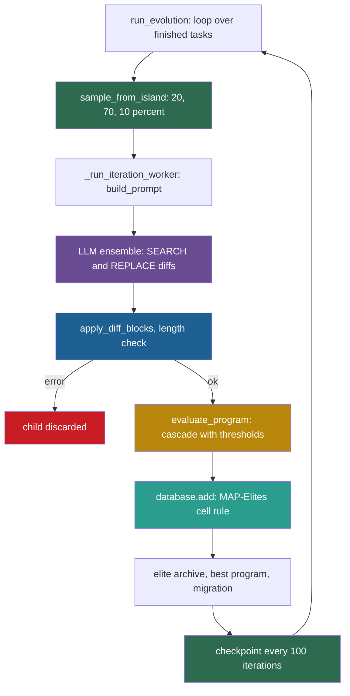

## Learning objectives

After this lesson you can:

- Trace one OpenEvolve iteration from parent sampling to insertion in the program database, with real function names.
- Compute the chance that a program is chosen as a parent under the three sampling modes.
- Explain the MAP-Elites insertion rule and the island model, and write the insertion rule as code.
- Describe cascade evaluation, and find the configured stage that no code uses.
- Explain why OpenEvolve improves programs but not itself, and list its isolation gaps.

## Prerequisites

- [L1: How to read a research repository](/notes/ai/recursive-self-improvement/07-implementations/l1-how-to-read-a-research-repository)
- [L6: Evolutionary search, populations and open-endedness](/notes/ai/recursive-self-improvement/05-approaches/l6-evolutionary-and-population-methods)
- [2023 and 2025: FunSearch and AlphaEvolve](/notes/ai/recursive-self-improvement/06-research-systems/p12-funsearch-and-alphaevolve)
- [L3: Archives: why keep more than the best version](/notes/ai/recursive-self-improvement/03-anatomy/l3-archives-and-search-over-versions)

## 1. The question this idea answers

A plant breeder grows tomatoes in five separate greenhouses. In each greenhouse, she keeps the best plant for every combination of size and color. Most new seeds come from the best plants. Some come from random plants, so that odd varieties get a chance. Every few seasons she carries the best plants of each greenhouse to its two neighbors.

OpenEvolve breeds programs the same way. A language model plays the role of mutation. It reads a parent program and suggests small edits. An evaluator that the user writes plays the role of the harvest. The program database keeps the best program for each "cell" of features, in several islands.

So this lesson asks: how does the code choose a parent, ask for edits, apply them, score the child and decide where it lives? And because this is a course on self-improvement: which parts of this machine can ever change?

## 2. Mental model, and where it stops working

> [!analogy] Greenhouses with one champion per bed
> - Each island is a greenhouse. Each cell of the feature grid is a bed. Each bed holds one champion program.
> - A new child takes its bed if the bed is empty, or if it beats the champion there. Every few seasons, the best plants travel to the neighboring greenhouses.
> - **Where it stops working:** a breeder can change her own methods over the years. OpenEvolve's controller, database rules and prompt templates are fixed code. Only the user's program evolves.
> - Plants also grow in separate pots. In the main example of the repository, a candidate program runs inside the worker process, with that process's environment, including application programming interface (API) keys.

## 3. Terms

| Term | Plain meaning |
|---|---|
| OpenEvolve | An open-source evolutionary coding system: a language model proposes edits to a program, and a user evaluator scores them. |
| code reading | A fact taken from reading the repository at the pinned commit, without running it. Notes mark such facts "(code reading)". |
| evolutionary search | A search that keeps a population, makes children by changing parents, and selects by a fitness score. |
| population | The set of programs that the search keeps at one time. |
| fitness | The score that drives selection. In OpenEvolve, `combined_score` if the evaluator returns it, else the mean of the other numeric metrics. |
| island | A sub-population that evolves mostly on its own. |
| migration | Copying good programs from one island to another. |
| MAP-Elites | A quality-diversity method: split programs into cells by features, and keep the best program per cell. |
| feature dimension | A property that places a program in the grid, for example code length ("complexity") or difference from others ("diversity"). |
| edit distance | The number of single-character insertions, deletions or replacements that turn one text into another. |
| winner's curse | The upward bias of the best of several noisy scores: the winner tends to score lower when it is measured again. |
| elite archive | OpenEvolve's set of up to 100 strong programs, used for most parent choices. |
| inspiration | A program shown in the prompt as an example, besides the parent. |
| SEARCH/REPLACE diff | An edit format: a block of exact text to find, and the text to put in its place. |
| `EVOLVE-BLOCK` markers | Comment lines that mark the part of a program that should evolve. |
| cascade evaluation | Scoring in stages, where a candidate runs a later, more costly stage only if it passes a threshold. |
| artifact | Extra output of an evaluation, such as an error message, that later prompts can show to the model. |
| large language model (LLM) ensemble | Several language models, one chosen at random by weight for each call. |

## 4. Method and math

### 4.1 What OpenEvolve is, and what it is not

OpenEvolve's README calls it "an open-source evolutionary coding agent". Its citation is "OpenEvolve: an open-source evolutionary coding agent" by Asankhaya Sharma, 2025, as software (code reading). Its launch blog of 2025-05-20 called it "an open-source implementation of the AlphaEvolve system" (Sharma, 2025, blog). The current README does not mention AlphaEvolve at all (code reading). It is an independent implementation, not Google DeepMind code.

AlphaEvolve's paper describes a loop with similar parts (Novikov et al., 2025, [arXiv:2506.13131](https://arxiv.org/abs/2506.13131), Section 2). It has a prompt sampler and an ensemble of language models. It uses SEARCH/REPLACE diffs, an evaluation cascade, and a program database with MAP-Elites and islands. This part did not compare OpenEvolve with the AlphaEvolve white paper. So this lesson describes OpenEvolve's code on its own terms, and it does not claim that the two systems match in detail.

**Repository:** https://github.com/codelion/openevolve, commit `74c7cb0c06bae9b6134764d28759d3cf40db76ec` (2026-10-19, version `0.4.0` in `openevolve/_version.py`). License: Apache 2.0. Line numbers refer to this commit. This repository changes often, so its line numbers will drift first (checked on 2026-10-19).

### 4.2 Q1: Entry point and arguments

The script `openevolve-run.py` calls `openevolve/cli.py` `main()` (lines 235–243), which runs `main_async()` (lines 108–232). The class `OpenEvolve` in `openevolve/controller.py` (line 31) offers the same loop as a library.

`parse_args()` (lines 19–79) takes two positional arguments: `initial_program` and `evaluation_file`. The options include `--config` (a YAML file), `--output`, `--iterations`, `--target-score`, `--checkpoint`, `--api-base`, `--evaluator-args`, `--primary-model` and `--secondary-model`. Every option defaults to None. The real defaults live in `openevolve/config.py` (code reading):

| Group | Setting | Default |
|---|---|---|
| main | `max_iterations` | 10000 |
| main | `checkpoint_interval` | 100 |
| main | `diff_based_evolution` | True |
| main | `max_code_length` | 10000 |
| main | `enforce_evolve_blocks` | False |
| database | `num_islands` | 5 |
| database | `population_size`, `archive_size` | 1000, 100 |
| database | `exploration_ratio`, `exploitation_ratio` | 0.2, 0.7 |
| database | `feature_dimensions`, `feature_bins` | `["complexity", "diversity"]`, 10 |
| database | `migration_interval`, `migration_rate` | 50, 0.1 |
| evaluator | `timeout`, `max_retries` | 300, 3 |
| evaluator | `cascade_evaluation`, `cascade_thresholds` | True, `[0.5, 0.75, 0.9]` |
| evaluator | `parallel_evaluations` | 1 |
| model | `temperature`, `max_tokens` | 0.7, 4096 |
| prompt | `num_top_programs`, `num_diverse_programs` | 3, 2 |

The output folder defaults to `<folder of the initial program>/openevolve_output` (`controller.py` lines 59–60).

### 4.3 Q2: How the objective is given

The user supplies two files.

1. **The initial program**, in any language. Comment lines `# EVOLVE-BLOCK-START` and `# EVOLVE-BLOCK-END` mark the part to evolve. In `examples/function_minimization/initial_program.py` they are lines 1 and 35. The markers are only advice, unless `enforce_evolve_blocks` is True. Then `utils/code_utils.py` `enforce_evolve_blocks()` reverts edits outside them (code reading).
2. **The evaluator file.** It must define `evaluate(program_path)`, which returns a dictionary of metrics or an `EvaluationResult(metrics, artifacts)`. For a cascade it may also define `evaluate_stage1`, `evaluate_stage2` and `evaluate_stage3`.

The fitness is `metrics["combined_score"]` if the evaluator returns that key. Otherwise it is the mean of the numeric metrics that are not feature dimensions (`utils/metrics_utils.py` `get_fitness_score()`, lines 72–112). The default system message says: "Your goal is to maximize the FITNESS SCORE while exploring diverse solutions across feature dimensions."

**Worked example: the example evaluator's score.** `examples/function_minimization/evaluator.py` scores a search algorithm that tries to find the minimum of a function of two variables. It runs the candidate 10 times and computes:

$$
\text{combined} = \big(0.5\, v + 0.3\, d + 0.2\, r\big) \times q
$$

The symbols mean:

- $v = 1 / (1 + \text{mean absolute error of the found value})$, the value score.
- $d = 1 / (1 + \text{mean distance to the true minimum})$, the distance score.
- $r$ is the fraction of the 10 trials that succeeded.
- $q$ is a quality factor. By mean distance, $q = 1.5$ below 0.5, $q = 1.2$ below 1.5, $q = 1.0$ below 3.0, and $q = 0.7$ otherwise.

Suppose the mean value error is 0.1, the mean distance is 0.3 and all 10 trials succeed.

1. $v = 1/1.1 = 0.909$ and $d = 1/1.3 = 0.769$ and $r = 1.0$.
2. The base score is $0.5 \times 0.909 + 0.3 \times 0.769 + 0.2 \times 1.0 = 0.885$.
3. The distance 0.3 is below 0.5, so $q = 1.5$.
4. So $\text{combined} = 0.885 \times 1.5 = 1.33$.

The formula comes from lines 213–232 of the example evaluator. Note that its maximum is 1.5, not 1. So the default cascade thresholds of 0.5, 0.75 and 0.9 would be easy to pass. The example's `config.yaml` sets its own single threshold, `cascade_thresholds: [1.3]`.

### 4.4 Q3: How a change is proposed

The main process chooses a parent and its inspirations. `ProcessParallelController._submit_iteration()` (`process_parallel.py` lines 1041–1076) calls `database.sample_from_island(island_id, num_inspirations=...)`. It then sends `_run_iteration_worker` to a worker process, with a snapshot of the database. Here is the core of the parent choice:

```python
        rand_val = random.random()

        if rand_val < self.config.exploration_ratio:
            # EXPLORATION: Sample randomly from island (diverse sampling)
            parent = self._sample_from_island_random(island_id)
            sampling_mode = "exploration"
        elif rand_val < self.config.exploration_ratio + self.config.exploitation_ratio:
            # EXPLOITATION: Sample from archive (elite programs)
            parent = self._sample_from_archive_for_island(island_id)
            sampling_mode = "exploitation"
        else:
            # WEIGHTED: Use fitness-weighted sampling (remaining probability)
            parent = self._sample_from_island_weighted(island_id)
            sampling_mode = "weighted"
```

(`openevolve/database.py` lines 577–590.)

- Line 577: one random number between 0 and 1 decides the mode.
- Lines 579–582: below 0.2, pick a program uniformly from the island.
- Lines 583–586: from 0.2 to 0.9, pick uniformly among the elite-archive members of this island. If the island has none, pick any archive member (lines 1721–1727).
- Lines 587–590: above 0.9, pick from the island in proportion to fitness, with weight `max(fitness, 0.001)` (lines 1602–1657).

**Worked example.** An island holds four programs. A has fitness 0.9 and B has 0.6, and both are in the elite archive. C has 0.3. D has 0, so its weight is 0.001. The weight sum is $0.9 + 0.6 + 0.3 + 0.001 = 1.801$.

1. Program A: $0.2 \times \tfrac{1}{4} + 0.7 \times \tfrac{1}{2} + 0.1 \times \tfrac{0.9}{1.801} = 0.05 + 0.35 + 0.05 = 0.45$.
2. Program B: $0.05 + 0.35 + 0.1 \times \tfrac{0.6}{1.801} = 0.05 + 0.35 + 0.033 = 0.433$.
3. Program C: $0.05 + 0 + 0.1 \times \tfrac{0.3}{1.801} = 0.067$.
4. Program D: $0.05 + 0 + 0.1 \times \tfrac{0.001}{1.801} \approx 0.050$.

The four values sum to 1. The 70% exploitation share makes the elites dominate, but every program keeps at least a 5% chance from the uniform share. A and B are almost equal, because the uniform archive choice ignores their fitness difference.

The worker `_run_iteration_worker()` (`process_parallel.py` lines 144–409) then builds the prompt with `PromptSampler.build_prompt()` (`prompt/sampler.py`, from line 51). The prompt holds the parent code and metrics, earlier best programs, top programs, inspirations, the iteration number, the feature dimensions and the island ID. It also holds the parent's **artifacts**, such as error output and tracebacks (code reading).

The default user template, `prompts/defaults/diff_user.txt`, ends with the task. It asks the model to "Suggest improvements to the program that will improve its FITNESS SCORE". It says: "You MUST use the exact SEARCH/REPLACE diff format", and "IMPORTANT: Do not rewrite the entire program - focus on targeted improvements."

The model call is `_worker_llm_ensemble.generate_with_context(system_message, messages)` (line 212). `llm/ensemble.py` `_sample_model()` (lines 107–109) picks one model per call by normalized weight. The example configuration uses `gemini-2.5-flash-lite` with weight 0.8 and `gemini-2.5-flash` with weight 0.2.

### 4.5 Q4: How a candidate is applied

In diff mode, the default, the worker extracts the SEARCH/REPLACE blocks and applies them:

```python
                child_code, applied = apply_diff_blocks(parent.code, diff_blocks)
                if applied == 0:
                    return SerializableResult(
                        error=(
                            f"None of the {len(diff_blocks)} SEARCH block(s) matched the "
                            "parent program"
                        ),
                        iteration=iteration,
                        token_usage=token_usage,
                    )
                if applied < len(diff_blocks):
                    logger.warning(
                        f"Iteration {iteration}: only {applied} of {len(diff_blocks)} "
                        "SEARCH block(s) matched the parent program"
                    )
```

(`openevolve/process_parallel.py` lines 286–300.)

- Line 286: apply every block to the parent's code. `applied` counts the blocks whose SEARCH text matched.
- Lines 287–295: if no block matched, return an error. The candidate dies here.
- Lines 296–300: if only some blocks matched, keep the partial result and log a warning.

Lines 301–306 then reject a child whose code equals the parent's. Before that, line 238 calls `extract_diffs()` with the pattern `<<<<<<< SEARCH\n(.*?)=======\n(.*?)>>>>>>> REPLACE`. If no diff is found, the worker returns "No valid diffs found in response" (lines 243–248).

Three other paths exist (code reading):

1. **Full rewrite**, when `diff_based_evolution` is False: `parse_full_rewrite()` (line 315). An identical rewrite is rejected.
2. **Changes description**, when `programs_as_changes_description` is True: the diffs apply to the code and to a stored text that describes the changes. That text must change (lines 250–283).
3. **Length limit**: a child longer than `max_code_length` characters is rejected (lines 356–361).

The child becomes a new `Program` with an `id`, its `code` and its `parent_id` (lines 373–388). Its `generation` is one higher than the parent's.

### 4.6 Q5: How candidates are evaluated

The worker calls `_worker_evaluator.evaluate_program(child_code, child_id)` (line 367). `Evaluator.evaluate_program()` (`evaluator.py` lines 234–398) writes the code to a temporary file. It then runs `_cascade_evaluate()` if `cascade_evaluation` is True, else `_direct_evaluate()`:

```python
        async def run_evaluation():
            loop = asyncio.get_event_loop()
            return await loop.run_in_executor(
                self._executor,
                functools.partial(self.evaluate_function, **self._evaluator_kwargs),
                program_path,
            )

        # Run the evaluation with timeout - let exceptions bubble up for retry handling
        result = await asyncio.wait_for(run_evaluation(), timeout=self.config.timeout)
```

(`openevolve/evaluator.py` lines 451–460.)

- Lines 451–457: run the user's `evaluate` function in a thread, through `run_in_executor`.
- Line 460: wait at most `timeout` seconds, 300 by default.

**Our interpretation, from code reading:** `asyncio.wait_for` stops **waiting** after the time limit. It cannot stop a thread that is still running. So a candidate that loops forever keeps using a processor after the time limit.

The cascade checks a threshold after each stage:

```python
            if not self._passes_threshold(
                stage1_eval_result.metrics, self.config.cascade_thresholds[0]
            ):
                return stage1_eval_result
```

(`evaluator.py` lines 531–534.) If stage 1 fails the first threshold, the result of stage 1 is final. Otherwise stage 2 runs, and its metrics merge with stage 1's. Lines 595–598 then check the second threshold before stage 3. `_passes_threshold()` (lines 784–822) uses `combined_score` if present, else the mean of numeric metrics except `error`.

> [!note] Code reading: the third threshold is never used
> The default `cascade_thresholds` has three values: 0.5, 0.75 and 0.9. The code reads index 0 before stage 2 and index 1 before stage 3. No code reads index 2. So the value 0.9 has no effect.

Retries and time limits (code reading):

1. An exception leads to up to `max_retries + 1` = 4 attempts (line 257).
2. A time-out returns `{"error": 0.0, "timeout": True}` at once (line 367).
3. If all attempts fail, the result is `{"error": 0.0}` plus artifacts with the error output (line 398).
4. If `use_llm_feedback` is True, a language model adds scores, and `combined_score = accuracy * 0.7 + llm_average * 0.3` (lines 291–316).

**Two example evaluators show two ways to run a candidate.** The function-minimization evaluator imports the candidate in the worker process with `spec_from_file_location` (lines 75–77). It runs it 10 times with a 5-second limit in `run_with_timeout()` (lines 14–33). The circle-packing evaluator runs the candidate in a separate **subprocess** with `communicate(timeout=...)`, which can really stop runaway code (code reading).

> [!note] Code reading: a time limit that waits anyway
> `run_with_timeout()` creates its thread pool in a `with` block (line 27). When the 5-second limit passes, line 33 raises `TimeoutError`. But leaving a `with` block for a `ThreadPoolExecutor` calls `shutdown(wait=True)`. In standard Python, that waits for the running thread to finish. So the error reaches the caller only after the candidate stops on its own. Code reading, not a run.

### 4.7 Q6: How results are stored

The database lives in memory, in `ProgramDatabase` (`database.py` line 136). Its main fields are the `programs` dictionary, the `islands`, the per-island feature grids `island_feature_maps`, the elite `archive` and the best program's ID. Every `checkpoint_interval` iterations, `_save_checkpoint()` (`controller.py` lines 446–502) writes:

```text
<output_dir>/checkpoints/checkpoint_<N>/
├── metadata.json            # island grids, islands, archive, best program, counters
├── programs/<program_id>.json   # each Program as a dictionary
├── best_program<ext>
└── best_program_info.json   # id, generation, iteration, metrics, timestamp
```

A program file holds the code, the parent ID, the metrics, the feature values and the artifacts. With `log_prompts` it also holds the prompts. So the checkpoint is both the archive and a large part of the attempt log. Artifacts above 32 KB go to a separate folder (code reading).

### 4.8 Q7: How a successful change is incorporated

The controller inserts each finished child with `self.database.add(child_program, iteration=..., target_island=result.target_island)` (`process_parallel.py` lines 765–769). `ProgramDatabase._add()` (`database.py` lines 334–511) then works in six steps (code reading):

1. Choose the island: the island that was sampled, else the parent's island.
2. Run an optional admission hook, `population_strategy.admit`.
3. Store the program and compute its feature coordinates. `complexity` is a bin of code length. `diversity` is a bin of edit distance to a reference set. A custom metric name from the evaluator also works.
4. Run an optional novelty check, only if an embedding model is configured.
5. Apply the MAP-Elites rule to the island's grid.
6. Add the child to the island, update the elite archive and the best program, and enforce the population limit.

Here is step 5:

```python
        feature_key = self._feature_coords_to_key(feature_coords)
        island_feature_map = self.island_feature_maps[island_idx]
        should_replace = feature_key not in island_feature_map

        if not should_replace:
            # Check if the existing program still exists before comparing
            existing_program_id = island_feature_map[feature_key]
            if existing_program_id not in self.programs:
                # Stale reference, replace it
                should_replace = True
```

(`database.py` lines 398–407.)

- Line 398: turn the coordinates into a key, one key per cell.
- Line 399: take this island's grid.
- Line 400: an empty cell is always taken.
- Lines 402–407: if the cell's program no longer exists, the child takes the cell.

Otherwise line 424 sets `should_replace = self._is_better(program, self.programs[existing_program_id])`. `_is_better()` (lines 1246–1274) returns `fitness1 > fitness2`. So the rule, as code, is:

```python
take_cell = cell_is_empty or incumbent_is_gone or fitness(child) > fitness(incumbent)
```

Note the strict "greater than". A child that ties with the champion does not take its cell. Also note step 6: the child joins the island set even when it does not take a cell (line 485). The elite archive then admits the child if it is not full (`_update_archive()`, lines 1276–1351). If it is full, the child replaces the worst member when the child is better.

**Worked example.** The grid has 10 bins per feature. A child lands in the cell with complexity bin 3 and diversity bin 5. The cell holds a champion with fitness 0.62.

1. If the child's fitness is 0.65, it takes the cell, because $0.65 > 0.62$.
2. If it is 0.62, it does not, because the comparison is strict.
3. If it is 0.40, it does not take the cell. But it can still be a parent through the 20% uniform share of its island.

**Islands and migration.** In the first batch, islands are assigned in turn. After that, each finished task is replaced by one new task (`process_parallel.py` lines 667–690, 994–1016). Every `migration_interval` island generations, `migrate_programs()` (lines 2041–2112) copies the top 10% of each island to its two ring neighbors, $(i+1)$ and $(i-1)$.

**Stopping.** The loop ends at `max_iterations`, at `--target-score` on `combined_score`, by early stopping, or on an interrupt signal (code reading).

### 4.9 Q8: How failures are handled

| Failure | Where | What happens |
|---|---|---|
| The model fails or returns nothing | worker, lines 210–227 | The worker returns an error result. The controller logs it and discards the child (lines 754–757). |
| No diffs, no SEARCH match, or no change | worker, lines 238–306 | Error result. The child is discarded. |
| Edits only outside the evolve blocks | worker, lines 333–353 | Error result, when the markers are enforced. |
| Code too long | worker, lines 356–361 | Error result. |
| Any other exception in the worker | lines 406–409 | Error result. |
| The evaluator crashes | `evaluator.py` lines 369–398 | Up to 3 retries, then `{"error": 0.0}` with artifacts. |
| The evaluator exceeds its time limit | line 367 | `{"error": 0.0, "timeout": True}` with artifacts. |
| The admission hook rejects the child | `process_parallel.py` lines 961–969 | Handled as a rejection. |

A difference matters here. Children that fail before evaluation are **discarded**. Children that crash **during** evaluation are **inserted** with fitness 0. Their error artifacts then appear in the prompts of their descendants (code reading). So the model can learn from crashes, but crashed programs also take space in the population.

The controller calls `future.result(timeout=evaluator.timeout + 30)` (lines 740–741). It does so only after `future.done()` is True, so in practice it never times out (code reading).

### 4.10 Q9: What prevents unsafe changes, and what does not

**Present (code reading):**

1. Candidate programs run only through the user's evaluator, with its time limit and retries.
2. `artifact_security_filter` removes long tokens, `sk-...` keys and `password=` or `token=` patterns from artifacts before they enter prompts (`prompt/sampler.py` `_apply_security_filter()`).
3. `max_code_length`, and the optional `enforce_evolve_blocks`, which keeps fixed parts of the program fixed.
4. An optional Docker image for running OpenEvolve itself.

**Not present:**

1. No built-in sandbox for candidate code. In the function-minimization example, the candidate runs inside the worker process.
2. The worker processes receive the parent's full environment:

```python
        current_env = dict(os.environ)

        executor_kwargs = {
            "max_workers": self.num_workers,
            "initializer": _worker_init,
            "initargs": (config_dict, self.evaluation_file, current_env),
        }
```

(`process_parallel.py` lines 541–547.) Line 541 copies every environment variable, including API keys. Lines 543–547 pass the copy to `_worker_init()`, which runs `os.environ.update(parent_env)` in each worker (lines 51–52). So a candidate that runs in the worker can read the keys.

3. `EvaluatorConfig.memory_limit_mb` and `cpu_limit` exist in `config.py` (lines 392–393), but no other file uses them. `PromptConfig.use_meta_prompting` is also declared but unused.
4. No human approval step exists.

### 4.11 Q10: The loop as implemented

```text
db = ProgramDatabase(islands = 5, a MAP-Elites grid per island, elite archive = 100)
db.add(initial_program, metrics = evaluate(initial))
pool = worker processes (parallel_evaluations), each with a copy of the environment
submit 2 * workers tasks, islands in turn
while tasks are pending and done < max_iterations:
    result = next finished task
    if result.error: log it
    else:
        db.add(child, target_island)      # take the cell if empty or fitter; update archive and best
        if migration is due: copy the top 10% of each island to its ring neighbors
        checkpoint every 100; stop on target score or early stopping
    submit one new task:
        parent, inspirations = db.sample_from_island(i)   # 20% random, 70% archive, 10% weighted
        prompt = system + parent code + metrics + artifacts + top and diverse programs
        diff = LLM_ensemble(prompt); child = apply SEARCH/REPLACE
        child.metrics = cascade(stage1 -> stage2 -> stage3) with time limit and retries
return db.best_program
```



### 4.12 Q11: Reading order

1. `README.md` and `examples/function_minimization/`: `initial_program.py`, `evaluator.py` and `config.yaml`. This is the smallest complete example.
2. `openevolve/cli.py`: how a run starts.
3. `openevolve/controller.py`: `OpenEvolve.run()` and the checkpoints.
4. `openevolve/process_parallel.py`: `_run_iteration_worker()` for one iteration, and `run_evolution()` for the loop.
5. `openevolve/database.py`: `_add()`, `sample_from_island()`, `_update_archive()`, `migrate_programs()`.
6. `openevolve/evaluator.py`: `evaluate_program()`, `_cascade_evaluate()`, `_passes_threshold()`.
7. `openevolve/prompt/sampler.py` and `openevolve/prompts/defaults/diff_user.txt`: what the model sees.
8. `openevolve/config.py`: every default in one place.

### 4.13 Code versus paper, and what is safe to say

OpenEvolve has no paper of its own, only a software citation. This part did not check it against the AlphaEvolve white paper. These code facts are safe to state (code reading):

1. The SEARCH/REPLACE diff format and the `EVOLVE-BLOCK` markers.
2. The island model with ring migration.
3. A MAP-Elites grid per island, and an elite archive.
4. Cascade evaluation with thresholds.
5. An ensemble of models chosen by weight.

The author's blog claims one replication: circle packing with $n = 26$, a sum of radii of 2.634 against the AlphaEvolve paper's 2.635. This is **Claimed** by the author and not peer-reviewed (Sharma, 2025, blog).

One small contrast is visible in the code. The AlphaEvolve paper describes meta-prompts that are co-evolved in a separate database (Novikov et al., 2025, Section 2). OpenEvolve declares a setting `use_meta_prompting`, but no code uses it (code reading). **Our interpretation:** at this commit, nothing in OpenEvolve evolves its own prompts.

### 4.14 What the code says about recursive self-improvement (RSI)

OpenEvolve changes only the user's program. The controller, the sampling rule, the MAP-Elites rule, the prompt templates and the evaluator are fixed code. The language models are fixed too. So OpenEvolve is not self-improvement. It improves solutions, not itself.

It still matters for RSI in two ways. First, it is a clean, readable example of the loop that self-improving systems reuse. Sample a parent, ask a model for a change, evaluate, and keep the result in an archive.

Second, its target could be any program. Suppose you pointed it at the source of an agent and scored that agent on tasks. Then it would be a fixed external improver of that agent, like Automated Design of Agentic Systems (ADAS). To make it recursive, the evolving program would also have to include the code that proposes and selects. Nothing in OpenEvolve does that.

## 6. Video and animation

- [FunSearch from DeepMind explained](https://www.youtube.com/watch?v=EXj5pbH_D3c) (AI Coffee Break with Letitia, 2023). A short explainer of the ancestor of this loop: a model proposes programs, and an automatic evaluator keeps the good ones. Watch it before section 4.4.
- [Wild breakthrough on Math after 56 years...](https://www.youtube.com/watch?v=vC9nAosXrJw) (Machine Learning Street Talk, 2025). The AlphaEvolve authors explain the evolutionary loop, the evaluators and the database. Its last chapter asks whether AlphaEvolve is a form of RSI. It supports sections 4.1 and 4.14.

## 7. Code

The program below is our own. It computes the parent probabilities of section 4.4 for the default ratios.

```python
programs = {"A": (0.9, True), "B": (0.6, True), "C": (0.3, False), "D": (0.0, False)}
explore, exploit = 0.2, 0.7
weighted = 1 - explore - exploit

n = len(programs)
elites = [p for p, (_, elite) in programs.items() if elite]
weights = {p: max(f, 0.001) for p, (f, _) in programs.items()}
total_w = sum(weights.values())

for p in programs:
    prob = explore / n
    prob += exploit / len(elites) if p in elites else 0.0
    prob += weighted * weights[p] / total_w
    print(p, round(prob, 3))
```

It prints `A 0.45`, `B 0.433`, `C 0.067` and `D 0.05`. The `weighted` share is computed as $1 - 0.2 - 0.7$, which floating-point arithmetic gives as about 0.1.

**Exercise 1.** Change the ratios to exploration 0.5 and exploitation 0.4. How do the chances of A and D change?

```check
{
  "question": "With `explore, exploit = 0.5, 0.4`, compute the chances of A and D.",
  "hint": "The weighted share is still 0.1. The uniform share is now 0.5 / 4.",
  "answer": "A: 0.5/4 + 0.4/2 + 0.1 × 0.9/1.801 = 0.125 + 0.2 + 0.05 = 0.375. D: 0.125 + 0 + 0.1 × 0.001/1.801 ≈ 0.125. So A drops from 0.45 to 0.375, and D rises from 0.05 to 0.125. More exploration gives weak programs more chances to become parents, at the cost of fewer children from the elites."
}
```

## 8. Common mistakes

1. **"OpenEvolve improves itself."** Only the user's program evolves. The controller, sampling, insertion rule, prompts and models are fixed.
2. **"OpenEvolve is Google DeepMind's AlphaEvolve."** It is an independent open-source implementation. This part did not compare it with AlphaEvolve's white paper in detail.
3. **"The time limit stops runaway candidates."** `asyncio.wait_for` stops waiting, but a thread keeps running. Only evaluators that use a subprocess, as in the circle-packing example, can stop the code.
4. **"All three cascade thresholds matter."** The third default threshold is never read.
5. **"`memory_limit_mb` limits candidate memory."** No code uses it.
6. **"A crashed child is thrown away."** A child that crashes during evaluation is inserted with fitness 0, and its error text reaches later prompts.

## 9. One-minute explanation

OpenEvolve evolves one user program. For each iteration, it samples a parent from an island: 20% uniformly, 70% from the island's elite archive members and 10% by fitness. A worker sends the parent's code, metrics, error artifacts and some top programs to an ensemble of models, which returns SEARCH/REPLACE diffs. The worker applies the diffs, checks the length and runs the user's evaluator, optionally as a cascade with thresholds. The child takes its feature cell if the cell is empty or its fitness is strictly higher, and top programs migrate between ring neighbors. The machine itself never changes, its time limits only stop waiting, and its workers carry the API keys.

## 10. Check questions

```check
{
  "question": "Write OpenEvolve's MAP-Elites insertion rule as code, and say what happens on a tie.",
  "answer": "`take_cell = cell_is_empty or incumbent_is_gone or fitness(child) > fitness(incumbent)`, from `database.py` lines 398–424 and `_is_better()` lines 1246–1274. On a tie the strict comparison is False, so the champion keeps the cell. The child still joins the island set and can still enter the elite archive."
}
```

```check
{
  "question": "Where in OpenEvolve would you add a held-out re-test, and why is it needed even though each cell keeps only its best program?",
  "hint": "Think about how many children compete for one cell, and how often each is scored.",
  "answer": "Add it in `ProgramDatabase._add()`, around line 424, or in the controller before `database.add()`. Before a child replaces a champion, score both again on inputs that the evaluator has not used. One example is new random seeds for the function-minimization trials. It is needed because many children compete for each cell, and each is scored once. The cell keeps the luckiest high score, the winner's curse. Also re-test the final best program before you report it."
}
```

```check
{
  "question": "Classify each part of OpenEvolve as evolving or fixed. (a) The code between the `EVOLVE-BLOCK` markers. (b) The sampling ratios. (c) `diff_user.txt`. (d) The evaluator file. (e) The language models.",
  "answer": "(a) Evolving: it is the target of the diffs. (b) Fixed: set in the configuration before the run. (c) Fixed: the template never changes, and `use_meta_prompting` is unused. (d) Fixed: the user supplies it, and diffs cannot edit it. But a candidate that runs in the worker process could in principle touch files. (e) Fixed: chosen by weight, never trained. So OpenEvolve is not self-improvement."
}
```

```check
{
  "question": "A candidate enters an infinite loop inside `evaluate()` of the function-minimization example. Trace what happens with the default 300-second evaluator limit.",
  "answer": "The example's own 5-second limit raises `TimeoutError` only after its `with` block waits for the thread, so it does not return early (code reading). After 300 seconds, `asyncio.wait_for` stops waiting and the evaluator returns `{\"error\": 0.0, \"timeout\": True}`. The child is inserted with fitness 0. But the thread that runs the loop keeps running inside the worker process and keeps using a processor. Only a subprocess-based evaluator, as in the circle-packing example, could stop it."
}
```

## 11. Summary and links

- OpenEvolve samples a parent per island with a 20/70/10 split between uniform, elite-archive and fitness-weighted choice.
- A model ensemble writes SEARCH/REPLACE diffs. Failed edits are discarded, and crashes during evaluation are kept with fitness 0.
- A child takes its MAP-Elites cell only if the cell is empty or the child is strictly fitter. Top programs migrate between ring neighbors.
- The cascade's third default threshold, `memory_limit_mb` and `cpu_limit` are unused, and time limits stop waiting rather than code.
- Only the user's program evolves. OpenEvolve is a clean example of the evolutionary loop, not of self-improvement.

**Next:** [L7: What the code teaches](/notes/ai/recursive-self-improvement/07-implementations/l7-what-the-code-teaches) compares all six codebases and draws engineering lessons.

**Related:** [2023 and 2025: FunSearch and AlphaEvolve](/notes/ai/recursive-self-improvement/06-research-systems/p12-funsearch-and-alphaevolve), [L6: Evolutionary search, populations and open-endedness](/notes/ai/recursive-self-improvement/05-approaches/l6-evolutionary-and-population-methods), [L5: Churn, bloat, lost behavior, drift and runaway cost](/notes/ai/recursive-self-improvement/08-failure-modes-and-safety/l5-churn-bloat-and-drift).

## References

- OpenEvolve repository (Asankhaya Sharma). "OpenEvolve: an open-source evolutionary coding agent". 2025. Software. https://github.com/codelion/openevolve. Commit `74c7cb0c06bae9b6134764d28759d3cf40db76ec` (2026-10-19). Apache 2.0.
- Asankhaya Sharma. "OpenEvolve: An Open Source Implementation of Google DeepMind's AlphaEvolve" (blog). 2025. https://huggingface.co/blog/codelion/openevolve
- Alexander Novikov, Ngân Vũ, Marvin Eisenberger, et al. "AlphaEvolve: A coding agent for scientific and algorithmic discovery". 2025. arXiv:2506.13131. https://arxiv.org/abs/2506.13131
- Bernardino Romera-Paredes, Mohammadamin Barekatain, Alexander Novikov, et al. "Mathematical discoveries from program search with large language models". Nature 625, 468–475. 2023. DOI 10.1038/s41586-023-06924-6. https://www.nature.com/articles/s41586-023-06924-6
