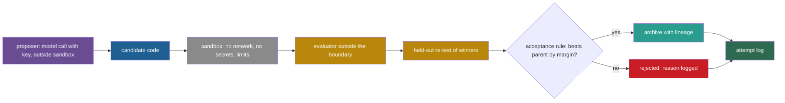

## Learning objectives

After this lesson you can:

- Compare the six codebases of this part on their loop and on their safety boundary, from code facts.
- Name seven recurring weaknesses of research code for self-improvement, with one example of each.
- Estimate how much a "best of k" choice inflates a score, and explain why a held-out re-test fixes it.
- Read the main loops of Reflexion and Self-Refine, and say why they improve an output, not the system.
- Turn the lessons into a checklist for your own experiment.

## Prerequisites

- [L1: How to read a research repository](/notes/ai/recursive-self-improvement/07-implementations/l1-how-to-read-a-research-repository)
- [L2: STOP in code](/notes/ai/recursive-self-improvement/07-implementations/l2-stop-in-code) to [L6: OpenEvolve in code](/notes/ai/recursive-self-improvement/07-implementations/l6-openevolve-in-code)
- [L3: Evaluation under noise](/notes/ai/recursive-self-improvement/04-mathematics/l3-evaluation-under-noise)
- [L1: Self-critique and iterative refinement](/notes/ai/recursive-self-improvement/05-approaches/l1-self-critique-and-refinement)

## 1. The question this idea answers

A building inspector checks six houses from six builders. Each house has its own design. But the report shows the same defects again and again. Smoke alarms have no batteries, fire doors do not close, and a spare key lies under the mat. One house with a defect is bad luck. Five houses with the same defect is a pattern of the trade.

This part read six self-improving or self-modifying codebases with the same eleven questions. Two of them are the Self-Taught Optimizer (STOP) and Automated Design of Agentic Systems (ADAS). Two more are the Darwin Gödel Machine (DGM) and the Self-Improving Coding Agent (SICA). The last two are Gödel Agent and OpenEvolve.

This lesson puts the six reports side by side. It asks: which design choices repeat? Which weaknesses repeat? And what should you do differently when you build such a system yourself?

## 2. Mental model, and where it stops working

> [!analogy] One inspector, six houses
> - Each walkthrough is an inspection report. Each of the eleven questions is a line of the checklist.
> - Patterns across reports tell you about the trade, not about one builder.
> - **Where it stops working:** six repositories are a small sample. They are research code, written to test an idea, not products.
> - Each repository is one snapshot at one commit. Some authors may have run their experiments with settings or code that they did not release. So a pattern in the code is evidence about the released code, not proof about the authors' experiments.

## 3. Terms

| Term | Plain meaning |
|---|---|
| code reading | A fact taken from reading the repository at the pinned commit, without running it. Notes mark such facts "(code reading)". |
| fixed proposer | A part of the loop that suggests changes and that the loop itself can never change. |
| editable improver | An improver whose own code is inside the part that the system can change. |
| acceptance rule | The rule that decides if a candidate replaces or joins the kept versions. |
| ratchet | An acceptance rule that never lets the kept score fall, for example "accept only if better than the current version". |
| held-out re-test | A second evaluation of a winning candidate on tasks that played no part in choosing it. |
| winner's curse | The upward bias of the best of several noisy scores. |
| sandbox | An environment that limits what running code can read, write, reach on the network and use in resources. |
| secret | A credential, such as an application programming interface (API) key, that gives access to a paid or private service. |
| dead configuration | A setting that exists in the code but that nothing reads. |
| Reflexion | A method in which an agent writes a short verbal reflection after a failed attempt and uses it in the next attempt. |
| internal tests | Tests that the agent writes itself and may see. |
| hidden tests | Tests that the benchmark keeps and that the agent never sees. |

## 4. Method and math

### 4.1 The six loops side by side

All facts in the two tables come from Lessons 2 to 6. Line numbers refer to the commits pinned in [L1](/notes/ai/recursive-self-improvement/07-implementations/l1-how-to-read-a-research-repository).

**Table A: the loop.**

| System | What changes | Who proposes the change | Can the proposer change? | Evaluator inside the loop | Acceptance or selection rule in code |
|---|---|---|---|---|---|
| STOP | The improver's source | The current improver, with GPT-4 | Yes, the scaffold. The model and the meta-utility stay fixed. | Meta-utility: 5 runs on a parity task | Accept if no exception and score not 0. No comparison with the old improver. |
| ADAS | A new `forward()` function | A fixed GPT-4o meta agent that reads the whole archive | No | 128 Multilingual Grade School Math (MGSM) validation questions | Append every candidate that produces results. |
| DGM | The parent agent's own repository, as a patch | A fixed `o1` plan, implemented by the parent agent | Partly. The implementer changes, the planner does not. | 10 SWE-bench tasks, 50 more at 4 of 10 | Keep every compiled child. Parent weight sigmoid(10(acc − 0.5)) / (1 + children). |
| SICA | A copy of a base agent's whole folder | The best agent so far | Yes | 18 GSM8K problems per benchmark | No rule. Base is the newest agent within the best agent's 95% lower bound. |
| Gödel Agent | Live functions, including `evolve` | The running agent, with `o3` | Yes, at runtime | 50 sampled MGSM questions, test set at 0.94 | None. Patches apply at once. |
| OpenEvolve | The user's program | A fixed ensemble of models | No | The user's evaluator, optional cascade | A child takes its cell if the cell is empty or the child is strictly fitter. |

**Table B: the safety boundary.**

| System | Where model-written code runs | Network | Secrets near that code | Time limits in code | Human approval |
|---|---|---|---|---|---|
| STOP | The main Python process, after `reliability_guard()` | Open | API key in the process | 2 s per parity test. No limit on improver runs by default. | A one-time keyboard acknowledgement |
| ADAS | The main Python process, with `exec` | Open | OpenAI client in the process | None | None |
| DGM | Docker containers | On, by default settings | API keys in the container environment | Unix `timeout`: 30 min per edit, 9 h per task | None |
| SICA | Docker containers, user with `sudo` | On | API keys baked into the image | 600 s per problem. None for the meta step. | None |
| Gödel Agent | The main Python process | Open | API key in the process | 30 s for bash only | None |
| OpenEvolve | The worker process, in the main example | Open | The full environment copied into workers | Waiting limits that cannot stop a thread | None |

Two facts stand out. Every system keeps a fixed core that the loop cannot change. And no system has a sandbox without network access and without secrets. The next sections turn these observations into seven lessons.

### 4.2 Lesson 1: there is always a fixed proposer or a fixed evaluator

"The improver improves itself" is a matter of degree. Each system keeps some part of the improvement process outside the reach of change:

1. **DGM:** the plan for each change comes from a fixed `o1` call with fixed prompts. Only the implementation is done by the agent (Zhang et al., 2025, and code reading).
2. **ADAS:** the meta agent, its prompt and the loop are all fixed.
3. **STOP:** the improver changes, but the language model, the meta-utility and the outer loop do not.
4. **SICA:** the agent that edits is editable in later versions. But `runner.py`, with its base rule and its scoring, stays on the host.
5. **Gödel Agent:** even `evolve` can change. But the model, the task, the scorer in `task_mgsm.py` and the goal prompt file are set at start.
6. **OpenEvolve:** only the user's program changes.

**Our interpretation:** the fixed part is where the real design decisions live. It decides what counts as better, which versions get another chance and what the model sees. When a paper says that "the system improves itself", ask a question. Which fixed parts would have to change for the claim to be true without qualification? [L4: The improver, meta-levels and the frozen core](/notes/ai/recursive-self-improvement/03-anatomy/l4-the-improver-and-meta-levels) treats the frozen core in general.

A fixed core is also a safety feature. DGM's `.dockerignore` keeps `DGM_outer.py`, `self_improve_step.py` and the scoring code out of the image that the agent edits. So the agent cannot rewrite its own parent-selection rule or its scorer. This is the clearest example in the six repositories of a deliberate boundary.

### 4.3 Lesson 2: sandboxes are weak or missing

Table B shows the pattern. Three systems run model-written code in the main Python process: ADAS, STOP and Gödel Agent. One, OpenEvolve, runs it in worker processes that hold a copy of the environment. Two, DGM and SICA, use Docker, but with the network on and with secrets inside.

The papers often describe more isolation than the code shows:

| System | The paper says | The code at the pinned commit |
|---|---|---|
| ADAS | Generated code ran in "containerized, isolated environments" (Hu et al., 2024). | Plain `exec` in the main process. |
| DGM | Isolated sandboxed environments and limited network access are among the safety measures (Zhang et al., 2025, Section 5). | Containers start with default Docker settings, so the network is on (code reading). |
| Gödel Agent | The ethics statement proposes a "Sandboxed Environment" and "Constrained Modifications" (Yin et al., 2025, ethics statement). | No container. The goal prompt grants "unrestricted access". |

Each row is code reading, not a run. The authors may have run their experiments inside an outer sandbox that is not part of the repository. The point for you is simple: the released code does not supply that sandbox, so you must build it.

The guards that do exist are text checks. STOP rejects code that contains `ProcessPool`. Gödel Agent rejects code that contains `time.sleep` in `solver` or `import logging`. A text check stops the exact string, not the behavior. Gödel Agent's guards also apply to only one of its two code-running tools.

### 4.4 Lesson 3: acceptance rules are weaker than the papers suggest

| System | Paper or intuition | The rule in code |
|---|---|---|
| STOP | The improved improver is better. | No comparison with the old improver. A worse improver is accepted if its score is not 0. |
| ADAS | Meta Agent Search finds better agents. | Every candidate that runs joins the archive. Only the meta agent reads fitness. |
| DGM | Evaluation on 10, then 60, then 200 tasks. | The 200-task stage never runs. Every compiled child is kept, which the paper does intend. |
| SICA | The highest-utility agent is the base and the meta agent. | No acceptance rule. The base is chosen by a confidence rule on mean score, not by utility. |
| Gödel Agent | The agent can revert to a previous good algorithm. | No rollback. Every patch applies at once. |
| OpenEvolve | MAP-Elites keeps the best program per cell. | One evaluation per child, then a strict comparison with the cell's champion. |

Some of these choices are deliberate. DGM keeps worse children on purpose, because they can be stepping stones (Zhang et al., 2025). But no system re-tests a winner on held-out tasks before it builds on it. STOP comes closest: it scores the winner again with fresh runs (line 141), but it only checks that the new score is not 0.

**Worked example: how large is the winner's curse?** Suppose $k$ candidates have the same true quality. Each measured score is the true score plus independent noise with standard deviation $\sigma$. The best measured score is then too high, on average, by $\sigma$ times the expected maximum of $k$ standard normal values. Here $\sigma$ is the noise of one score, and a standard normal value has mean 0 and standard deviation 1. [L3: Evaluation under noise](/notes/ai/recursive-self-improvement/04-mathematics/l3-evaluation-under-noise) derives this.

1. For $k = 6$, as in one STOP improvement call, the expected maximum is about $1.27$.
2. Suppose each meta-utility score has $\sigma = 0.05$. The winner then looks about $1.27 \times 0.05 = 0.063$ better than it is.
3. For $k = 30$, about the size of an ADAS archive, the factor is about $2.04$.
4. Take the ADAS validation noise of about 4 points per entry ($\sigma \approx 0.04$). If all entries were equal, the best one would look about 8 points too good.

**Assumptions.** Equal true quality and independent, normal noise. Real candidates differ in quality, which reduces the bias for the truly best one. **What it does not prove.** It does not say that any reported result is wrong. It says that a selected score needs a fresh test before you trust it. The ADAS example in [L3](/notes/ai/recursive-self-improvement/07-implementations/l3-adas-in-code) showed one entry that fell from a 50.8% validation median to a 39.1% test median.

### 4.5 Lesson 4: some code is missing

Several published results cannot be produced from the released code alone:

1. **STOP:** the sandbox experiment, with its 0.42% and 0.12% rates, has no runner and no secret utility in the repository. The default transfer script also stops on an undefined variable (BUG? note).
2. **DGM:** the 200-task stage is computed but never connected.
3. **SICA:** the paper's weighted utility is not in the code, and only GSM8K is enabled. The paper's SWE-bench and LiveCodeBench benchmarks are commented out.
4. **ADAS:** the container logic is absent.
5. **Gödel Agent:** the rollback mechanism is absent, and the models differ from the paper's.
6. **FunSearch,** outside this part (Romera-Paredes et al., 2023). Its repository "does not contain language models for generating new programs, the sandbox for executing untrusted code, nor the infrastructure" of the paper.

**Our interpretation:** releasing code is valuable, and every repository here helped this course. But "code available" in a paper does not mean "results reproducible from this code". Check which experiment each script runs before you cite a number as reproduced.

### 4.6 Lesson 5: secrets sit next to untrusted code

The least trusted code in a self-improving system is the code that a model just wrote. The most valuable secret is the API key that pays for the model. In all six systems, the two meet:

1. **DGM** passes `ANTHROPIC_API_KEY`, `OPENAI_API_KEY` and AWS keys into each container's environment.
2. **SICA** bakes the keys into the image as build arguments that become `ENV` lines. **Our interpretation:** values stored this way remain readable to anyone who can inspect the image.
3. **OpenEvolve** copies the full environment of the main process into each worker, with `dict(os.environ)`.
4. **STOP, ADAS and Gödel Agent** run model-written code in the process that holds the key or the client.

OpenEvolve does one useful thing here. Its `artifact_security_filter` removes key-like strings from error outputs before they reach a prompt. That protects the prompt, but not the process.

A safer layout keeps the key in a separate process that makes model calls, and gives the candidate's process no key and no network. [L7: Controls, oversight and governance](/notes/ai/recursive-self-improvement/08-failure-modes-and-safety/l7-controls-oversight-and-governance) shows this layout as a figure.

### 4.7 Lesson 6: time limits must be able to stop the work

A time limit is real only if something can stop the work when the limit passes. The code shows four kinds of "limit" that cannot:

1. **DGM** calls `future.result(timeout=1.5*60*60)` on futures that `as_completed` has already finished. The limit can never trigger.
2. **OpenEvolve** uses `asyncio.wait_for`, which stops waiting but cannot stop a thread. Its example evaluator's 5-second limit sits in a `with` block that waits for the thread anyway (code reading).
3. **Reflexion's** `function_with_timeout()` calls `thread.join(timeout)` and raises `TimeoutError` if the thread is still alive. It cannot stop the thread (code reading).
4. **SICA's** meta-improvement step and **STOP's** improver runs have no limit at all by default.

The limits that do work run outside the work. Examples are the Unix `timeout` command around DGM's agent, and `asyncio.timeout` around SICA's `docker exec`, with container removal afterward. OpenEvolve's circle-packing evaluator also works, because it runs the candidate as a subprocess. The rule is simple. A limit must be enforced by a process that can kill the process that does the work.

### 4.8 Lesson 7: evaluation data leaks into the loop

Three systems let information from held-out data reach the improvement loop:

1. **DGM's** diagnosis prompt contains "SWE-bench's official private tests". The agent that solves tasks never sees them, but the model that plans its next version does.
2. **Gödel Agent** puts the test-set accuracy into its feedback string once validation reaches 0.94. The agent can then steer by test results.
3. **ADAS's** `evaluate()` scores every archive entry on the test set. Any later choice of "the best agent by test" uses the test set for selection. The paper did this for its model-transfer table (Hu et al., 2024).

Small evaluation sets add noise everywhere: 18 problems per iteration in SICA, 50 sampled questions in Gödel Agent, 10 tasks for most DGM children. [L3: Evaluation failures](/notes/ai/recursive-self-improvement/08-failure-modes-and-safety/l3-evaluation-failures) treats leakage and selection-set overfitting in general.

### 4.9 Small bugs, all from reading

The BUG? notes of this part, collected. Each is code reading, not a run (code reading).

| System | File and line | Observation |
|---|---|---|
| DGM | `DGM_outer.py` 228 | A missing comma joins `'score_child_prop' 'best'`, so typing either name is rejected. |
| DGM | `DGM_outer.py` 101–106 | The `best` method sorts ascending, so it picks the lowest-scoring agents. |
| DGM | `DGM_outer.py` 144 | `unresolved_ids == 0` compares a list with 0. An agent with no unresolved tasks would crash `random.choice([])`. |
| ADAS | `_mgsm/search.py` 201, 224 | `n -= 1` inside a `for` loop has no effect, so a failed iteration is skipped, not retried. |
| ADAS | `_mgsm/search.py` 204–235 | After an all-zero first try and later `exec` failures, a never-evaluated candidate joins the archive with zero fitness. |
| STOP | `run_improver.py` 203 | `run_improver_main()` gets no argument, so `--resume_from` never resumes. |
| STOP | `transfer_eval.py` 210–211 | The default path opens `improve_algorithm_path`, which it never defines. |

Some smaller observations of this part are not in the table above and are also code reading. Self-Refine's math loop drops a question silently after three parse failures ([L1](/notes/ai/recursive-self-improvement/07-implementations/l1-how-to-read-a-research-repository)). Self-Refine's acronym loop has a check `if total_score >= 0:` with the comment "only iterate over things that are improving". It accepts every non-negative score, so it does not select anything (code reading).

### 4.10 The Reflexion and Self-Refine loops, briefly

Reflexion and Self-Refine are not self-modifying code systems. They improve one **output** inside one task with verbal feedback (code reading). This course uses them as the self-refinement baseline. Their loops are short, and they show one good habit and one weak one.

**Reflexion** (Shinn et al., 2023, [arXiv:2303.11366](https://arxiv.org/abs/2303.11366)). **Repository:** https://github.com/noahshinn/reflexion, commit `218cf0ef1df84b05ce379dd4a8e47f17766733a0` (2025-01-13), MIT. The programming loop is `programming_runs/reflexion.py` `run_reflexion()` (lines 8–101), started by `programming_runs/main.py --strategy reflexion`. The default `--max_iters` is 10. The example script `run_reflexion.sh` uses HumanEval in Python, `gpt-4` and `--max_iters 2`.

Per problem, the agent first writes its own internal tests (lines 34–37) and a first implementation (line 40). Then the loop runs:

```python
            while cur_iter < max_iters:
                # get self-reflection
                reflection = gen.self_reflection(
                    cur_func_impl, cur_feedback, model)
                reflections += [reflection]

                # apply self-reflection in the next attempt
                cur_func_impl = gen.func_impl(
                    func_sig=item["prompt"],
                    model=model,
                    strategy="reflexion",
                    prev_func_impl=cur_func_impl,
                    feedback=cur_feedback,
                    self_reflection=reflection,
                )
```

(`programming_runs/reflexion.py` lines 57–71.)

- Line 57: repeat until the iteration limit.
- Lines 59–60: the model writes "a few sentences to explain why your implementation is wrong as indicated by the tests" (`PY_SELF_REFLECTION_CHAT_INSTRUCTION`, `generators/py_generate.py` line 151).
- Line 61: every reflection is logged.
- Lines 64–71: the next implementation sees the previous code, the test feedback and **only the latest** reflection.

Lines 76–88 then run the internal tests. If they pass, or on the last iteration, the hidden tests decide `is_solved` with `exe.evaluate(..., timeout=10)` (lines 82–83). The loop then stops either way.

The good habit: the hidden tests never feed back into the loop. They decide the outcome once, at the end.

The weak point: everything depends on the quality of the internal tests. Reflexion raised HumanEval Python from 80.1 to 91.0 with self-written tests whose false-positive rate was 0.01. The 80.1 is the paper's own GPT-4 baseline column, and the paper's text elsewhere says 82%, an internal inconsistency. On MBPP Python, it fell from 80.1 to 77.1, with a false-positive rate of 0.16. Both results are in Tables 1 and 2 of the paper (Shinn et al., 2023).

The executor runs code with `exec` in the same process, with a thread-based limit, and no sandbox (code reading). Each problem's result goes to one line of a JSON Lines (JSONL) file, with `is_solved`, `reflections`, `implementations`, `test_feedback` and `solution`.

In the ALFWorld experiments, `alfworld_runs/main.py` loops over trials and calls `update_memory()` after each. The memory keeps the last 3 reflections (code reading). That memory lasts across trials of the same environment, not across different tasks.

**Self-Refine** (Madaan et al., 2023, [arXiv:2303.17651](https://arxiv.org/abs/2303.17651)) uses one model to write, critique and rewrite. Its math loop, `src/gsm/run.py` `iterative_gsm()`, is the worked example of [L1](/notes/ai/recursive-self-improvement/07-implementations/l1-how-to-read-a-research-repository). It stops when the model's own feedback contains "it is correct", or after at most 4 attempts. No outside check runs inside the loop.

**Our interpretation:** the contrast between the two loops is the lesson of [L1: Self-critique and iterative refinement](/notes/ai/recursive-self-improvement/05-approaches/l1-self-critique-and-refinement) in code. Reflexion's loop is driven by executed tests. Self-Refine's math loop is driven by the model's opinion. Neither changes the system that will solve the next task, so neither is self-improvement in the sense of this course.

### 4.11 A checklist for your own loop

Each item answers one lesson. The column "Where" names the place in a loop where the item belongs.

| # | Item | Lesson | Where |
|---|---|---|---|
| 1 | List every fixed part, and say which claim each one limits. | 1 | Design document |
| 2 | Run candidate code in a container with no network and no secrets. | 2, 5 | Apply and evaluate |
| 3 | Keep the evaluator, the selection rule and the logs outside the editable boundary. | 1, 2 | System boundary |
| 4 | Write the acceptance rule as one line of code, and test it on toy numbers. | 3 | Acceptance |
| 5 | Re-test every winner on held-out tasks before you build on it or report it. | 3, 7 | Between evaluation and acceptance |
| 6 | Keep the test set out of every prompt, every feedback string and every selection. | 7 | Evaluation |
| 7 | Enforce time, memory and cost limits from a process outside the work. | 6 | Runner |
| 8 | Search every setting name, and delete or connect dead configuration. | 4 | Configuration |
| 9 | Log every candidate, accepted or not, with its patch, its scores and the reason for the decision. | 3 | Attempt log |
| 10 | Release the code that produced each reported number, with the commit and the flags. | 4 | Publication |

Part 9 builds a small loop that follows this list, step by step. [P6: An acceptance rule with a validation suite](/notes/ai/recursive-self-improvement/09-build-it/p6-a-validation-gate) implements items 4, 5 and 9.



## 5. Graphs

```plot
{
  "title": "Expected maximum of k standard normal values against k (red points): how many noise units the best of k equal candidates looks too good",
  "xAxis": { "domain": [0, 32], "label": "number of candidates k" },
  "yAxis": { "domain": [0, 2.3], "label": "expected maximum, in units of sigma" },
  "disableZoom": true,
  "data": [
    { "points": [[1, 0], [2, 0.564], [5, 1.163], [6, 1.267], [10, 1.539], [20, 1.867], [30, 2.043]], "fnType": "points", "graphType": "polyline", "color": "#C81D25", "skipTip": true },
    { "points": [[1, 0], [2, 0.564], [5, 1.163], [6, 1.267], [10, 1.539], [20, 1.867], [30, 2.043]], "fnType": "points", "graphType": "scatter", "color": "#C81D25", "skipTip": true }
  ]
}
```

The bias grows fast at first and then slowly. Going from 1 to 6 candidates costs about 1.27 noise units. Going from 6 to 30 costs only about 0.78 more. So even a small search, such as STOP's six candidates per call, needs a re-test.

## 6. Video and animation

- [9 Examples of Specification Gaming](https://www.youtube.com/watch?v=nKJlF-olKmg) (Robert Miles AI Safety, 2020). Systems that meet the letter of a score but not its intent. It explains why the evaluator must sit outside the editable boundary, as in Lesson 1 and Lesson 7.
- [CMU LLM Inference (8): Self-Refine and Self-Correction Methods](https://www.youtube.com/watch?v=uaxf9yssDy4) (Graham Neubig). Self-Refine, Reflexion and the limits of self-correction. It supports section 4.10.
- [The AI Scientific Revolution will be Driven by Open-Ended and AI-Generating Algorithms](https://www.youtube.com/watch?v=P-qzI6ZJQBw) (Jeff Clune, Vector Institute, 2026). A recent talk that connects ADAS, DGM and their successors. Use it to place the six codebases in one research line.

## 7. Code

The program below is our own. It writes Lesson 3 as code: an acceptance rule that requires a selection win and a confirmed win on fresh tasks.

```python
import math

def accept(parent_score, child_select, child_retest, n_retest):
    # 1. the child must look better on the selection tasks
    if child_select <= parent_score:
        return False
    # 2. on fresh tasks it must still beat the parent by two standard errors
    p = child_retest
    se = math.sqrt(p * (1 - p) / n_retest)
    return child_retest - parent_score > 2 * se

print(accept(0.50, 0.58, 0.52, 100))   # looked better, fresh test does not confirm
print(accept(0.50, 0.58, 0.62, 100))   # confirmed on 100 fresh tasks
print(accept(0.50, 0.58, 0.62, 25))
```

It prints `False`, `True`, `False`. In the second case, two standard errors on 100 tasks are about 0.097, and the margin of 0.12 is larger. In the third case, two standard errors on 25 tasks are about 0.194, so the same margin is not enough.

The rule has a limit. It treats the parent's score as exact. A better rule re-tests the parent on the same fresh tasks and compares the two per task, a paired comparison.

**Exercise 1.** Which of the six systems would reject the most candidates under this rule, and which part of its code would you change?

```check
{
  "question": "Apply the `accept` rule to STOP. Which line would call it, what are `parent_score` and `child_select`, and what does the rule fix?",
  "hint": "STOP already re-scores the winner at line 141 of `run_improver.py`.",
  "answer": "Call it in `attempt_algorithm_improvement()` where lines 141–143 now check only `checked_utility == 0`. `parent_score` is the meta-utility of the current improver, which the code does not compute today. `child_select` is the winning score inside the improver's `max(..., key=utility)`. `child_retest` would be a meta-utility on fresh downstream instances, for example the parity test mode. The rule adds a ratchet and removes the winner's curse of picking the best of six. It also costs at least one more meta-utility call per iteration."
}
```

## 8. Common mistakes

1. **"These systems improve every part of themselves."** Each keeps a fixed core: a planner, a meta agent, a selection rule, an evaluator or a model.
2. **"The repository reproduces the paper."** Several key experiments have missing or unconnected code at the pinned commits.
3. **"Docker means the agent is isolated."** Network access and secrets inside the container remove much of the isolation.
4. **"A time limit in the code stops runaway code."** Several limits only stop waiting, or never trigger.
5. **"An accepted candidate is a better version."** Most rules accept without comparing with the parent, and none re-tests a winner on held-out tasks.
6. **"Reflexion is self-improvement."** It improves one output with verbal feedback. Its memory lasts within one task's trials, not across the system's future tasks.

## 9. One-minute explanation

Reading six self-improving codebases with the same eleven questions shows the same patterns. Each keeps a fixed core, such as DGM's `o1` planner, ADAS's meta agent or OpenEvolve's controller, so "the improver improves itself" is always partial. Model-written code runs in the main process or in containers with network access and API keys, and several time limits cannot stop the work. Acceptance rules are weak, from "append everything" to "not zero", and none re-tests winners on held-out tasks. Some reported experiments lack their code, and test data leaks into the loop in DGM, Gödel Agent and ADAS. Build your own loop with a sandbox without secrets, an evaluator outside the boundary, a re-test before acceptance, and released code for every number.

## 10. Check questions

```check
{
  "question": "Rank STOP, DGM and SICA by how much of their improver the system can change. Justify each place with one code fact.",
  "answer": "SICA is highest. The best agent edits a copy of a whole agent folder, including the meta-improvement prompt and reasoning structure. So later versions can change how they improve. Only `runner.py` on the host stays fixed. STOP is next. The improver function is its own input and becomes the next improver (`run_improver.py` lines 84–86 and 179). But the model and the meta-utility stay fixed. DGM is lowest of the three. The agent implements changes, but the plan comes from a fixed `o1` call outside the editable code. Also, `.dockerignore` keeps the selection and scoring code out of reach."
}
```

```check
{
  "question": "A loop scores 20 equally good candidates once each, with noise sigma = 0.03, and keeps the best. About how much too high is the kept score, and what would remove the bias?",
  "hint": "Use the expected maximum of 20 standard normal values.",
  "answer": "The expected maximum of 20 standard normal values is about 1.87. So the kept score is about 1.87 × 0.03 ≈ 0.056 too high, more than 5 points on a 0–1 scale. A held-out re-test removes the bias. Score the winner again on tasks that played no part in the choice, and use that score for acceptance and for reporting."
}
```

```check
{
  "question": "Classify each finding as 'safety boundary', 'acceptance rule', 'missing code' or 'evaluation leak'. (a) SICA bakes API keys into its image. (b) STOP accepts an improver whose score is not 0. (c) DGM's 200-task stage never runs. (d) Gödel Agent shows test accuracy to the agent. (e) ADAS runs `forward()` with `exec` in the main process.",
  "answer": "(a) Safety boundary: a secret sits next to model-written code. (b) Acceptance rule: no comparison with the old improver. (c) Missing code: the stage is computed but not connected, which also weakens evaluation. (d) Evaluation leak: test results enter the context that drives changes. (e) Safety boundary: no sandbox around model-written code."
}
```

```check
{
  "question": "Design question: you will run a DGM-like loop for one week. Name the three changes to the released DGM code that you would make first, and the line or file for each.",
  "answer": "One reasonable answer: (1) Start containers with no network and without API keys. Change `build_dgm_container()` in `utils/docker_utils.py` (line 133) and the `env_vars` of `self_improve_step.py` lines 339–346, and route model calls through a host process. (2) Add a held-out re-test between `filter_compiled()` and `update_archive()` in `DGM_outer.py`, before a child is reported as best. Also connect or remove the unused stage-3 code. (3) Remove the private test patch from the diagnosis prompt in `prompts/self_improvement_prompt.py` lines 95–99, or measure its effect with an ablation. Fixing the BUG? notes in `choose_selfimproves()` is also cheap."
}
```

## 11. Summary and links

- Every codebase keeps a fixed core. Self-improvement in code is always partial, and the fixed parts hold the key decisions.
- Sandboxes are weak or missing, secrets sit next to model-written code, and several time limits cannot stop the work.
- Acceptance rules are weaker than the papers suggest, and no system re-tests winners on held-out tasks. The best of $k$ noisy scores is biased by about $\sigma$ times the expected maximum of $k$ normals.
- Some reported experiments have missing or unconnected code, and test data leaks into three of the loops.
- Reflexion and Self-Refine improve outputs inside a task. Reflexion's loop is driven by executed tests, and Self-Refine's math loop by the model's own opinion.

**Next:** [L1: Measured score versus real capability](/notes/ai/recursive-self-improvement/08-failure-modes-and-safety/l1-measured-score-vs-real-capability) starts Part 8, which studies these failures in general, beyond the six codebases.

**Related:** [L7: Controls, oversight and governance](/notes/ai/recursive-self-improvement/08-failure-modes-and-safety/l7-controls-oversight-and-governance), [L10: The approaches compared](/notes/ai/recursive-self-improvement/05-approaches/l10-approaches-compared), [P9: From the toy to a language-model version](/notes/ai/recursive-self-improvement/09-build-it/p9-from-toy-to-language-model), [2023: Self-Refine and Reflexion](/notes/ai/recursive-self-improvement/06-research-systems/p02-self-refine-and-reflexion).

## References

- Eric Zelikman, Eliana Lorch, Lester Mackey, Adam Tauman Kalai. "Self-Taught Optimizer (STOP): Recursively Self-Improving Code Generation". 2023. COLM 2024. arXiv:2310.02304. https://arxiv.org/abs/2310.02304. Code: https://github.com/microsoft/stop, commit `0d6780c54306b2486dd36e9c4ae9b49aceb27ea4`.
- Shengran Hu, Cong Lu, Jeff Clune. "Automated Design of Agentic Systems". 2024. ICLR 2025. arXiv:2408.08435. https://arxiv.org/abs/2408.08435. Code: https://github.com/ShengranHu/ADAS, commit `2702bee8fefda42255efc5be9f60e3bd3db96ae4`.
- Jenny Zhang, Shengran Hu, Cong Lu, Robert Lange, Jeff Clune. "Darwin Gödel Machine: Open-Ended Evolution of Self-Improving Agents". 2025. ICLR 2026. arXiv:2505.22954. https://arxiv.org/abs/2505.22954. Code: https://github.com/jennyzzt/dgm, commit `a565fd2d1dca504ef5104a7cc0f3bdc4ab9b4fd2`.
- Maxime Robeyns, Martin Szummer, Laurence Aitchison. "A Self-Improving Coding Agent". 2025. arXiv:2504.15228. https://arxiv.org/abs/2504.15228. Code: https://github.com/MaximeRobeyns/self_improving_coding_agent, commit `ed8275dca4d3c5dbf77229964351fe9b424797dc`.
- Xunjian Yin, Xinyi Wang, Liangming Pan, Li Lin, Xiaojun Wan, William Yang Wang. "Gödel Agent: A Self-Referential Agent Framework for Recursively Self-Improvement". 2025. ACL 2025. https://aclanthology.org/2025.acl-long.1354. Code: https://github.com/Arvid-pku/Godel_Agent, commit `bbb508796be31c7140cdfc7106efd830a1324242`.
- OpenEvolve repository (Asankhaya Sharma). https://github.com/codelion/openevolve. Commit `74c7cb0c06bae9b6134764d28759d3cf40db76ec` (2026-10-19). Apache 2.0.
- Noah Shinn, Federico Cassano, Edward Berman, Ashwin Gopinath, Karthik Narasimhan, Shunyu Yao. "Reflexion: Language Agents with Verbal Reinforcement Learning". 2023. NeurIPS 2023. arXiv:2303.11366. https://arxiv.org/abs/2303.11366. Code: https://github.com/noahshinn/reflexion, commit `218cf0ef1df84b05ce379dd4a8e47f17766733a0`.
- Aman Madaan, Niket Tandon, Prakhar Gupta, et al. "Self-Refine: Iterative Refinement with Self-Feedback". 2023. NeurIPS 2023. arXiv:2303.17651. https://arxiv.org/abs/2303.17651. Code: https://github.com/madaan/self-refine, commit `9a206d41e5d2d0c241bb441f41eeadb945afaa55`.
- Bernardino Romera-Paredes, Mohammadamin Barekatain, Alexander Novikov, et al. "Mathematical discoveries from program search with large language models". Nature 625, 468–475. 2023. DOI 10.1038/s41586-023-06924-6. https://www.nature.com/articles/s41586-023-06924-6
