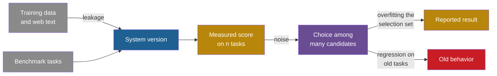

## Learning objectives

After this lesson you can:

- Explain four ways in which an evaluation gives a wrong score even when nobody games it.
- Describe documented cases of each failure, with exact numbers.
- Compute a standard error, a 95% interval and a paired standard error for a pass rate.
- Estimate how much a winner's score is inflated by selection among many candidates.
- Design an evaluation split that separates selection from reporting.
- Write a non-regression check for an acceptance rule.

## Prerequisites

- [L1: Measured score versus real capability](/notes/ai/recursive-self-improvement/08-failure-modes-and-safety/l1-measured-score-vs-real-capability)
- [L3: Evaluation under noise](/notes/ai/recursive-self-improvement/04-mathematics/l3-evaluation-under-noise)
- [L6: How machine learning systems are trained and evaluated](/notes/ai/recursive-self-improvement/01-foundations/l6-how-ml-systems-are-trained-and-evaluated)

## 1. The question this idea answers

A teacher uses the same final exam every year. After a few years, older students pass their papers to younger students. The class average rises. The teacher is pleased.

Has teaching improved? Maybe. But four other explanations fit the same average:

1. Students saw the answers before the exam.
2. The teacher adjusted lessons, year after year, to the exact questions on this exam.
3. This year's class was lucky on a short exam.
4. The class learned the exam topics and forgot the topics that the exam does not cover.

None of these needs any student to cheat during the exam. They are failures of the **evaluation**, not of the people evaluated. A self-improving system suffers all four, often at the same time. This lesson asks: **how does an honest evaluation still give a wrong score, and how do you catch it?**

## 2. Mental model, and where it stops working

> [!analogy] The reused exam
> - **The picture:** an exam is a small sample of a large subject. A good exam score means good knowledge only under four conditions. The questions are new to the student. They were chosen without looking at the student. The exam is long enough to beat luck. It is broad enough to cover the subject.
> - **The four failures:** leakage breaks "new to the student". Overfitting the selection set breaks "chosen without looking". Noise breaks "long enough". Regression breaks "broad enough".
> - **Where it stops working:** a student is one fixed person. A self-improving system creates thousands of versions and tests each one. So the selection effect is far stronger than for one student. Also, an agent can read files at run time, so leakage has a channel that a student in an exam hall does not have.

## 3. Terms

| Term | Plain meaning |
|---|---|
| contamination | Benchmark tasks or their solutions are in the data that the model learned from. |
| leakage | Any route by which the answer reaches the system before or during evaluation. Contamination is one kind. |
| selection set | The tasks used to choose between versions. Also called a validation set or development set. |
| held-out test set | Tasks used only once, at the end, to report the final result. |
| adaptive overfitting | Each choice depends on earlier results from the same tasks, so the choices fit the quirks of those tasks. |
| holdout reuse | Using the same held-out tasks again and again for decisions. |
| standard error (SE) | How much a score would move if you drew a different random sample of tasks. |
| 95% interval | A range of about 1.96 standard errors on each side of the score. |
| paired comparison | Comparing two versions on the same tasks, task by task. |
| clustered tasks | Tasks that share a source, such as several questions about one passage. They are not independent. |
| optimizer's curse | The value of the chosen option is expected to be lower than its estimate. Also called the winner's curse. |
| regression | A change breaks something that used to work. |
| regression suite | A fixed set of tests of behavior that already works. A change must not break it. |
| catastrophic forgetting | Training a neural network on a new task overwrites what it learned for an old task. |

## 4. Method and math

### 4.1 Four failures, one pipeline

An evaluation is a pipeline. Tasks come from somewhere, and the system meets them. A version gets a score. The loop uses the score to choose, and a report states a final number.

Each failure enters the pipeline at a different point.



The four failures differ in their cure. Leakage needs fresh or private tasks. Overfitting needs a split between selection and reporting. Noise needs more tasks and better statistics. Regression needs a test of old behavior inside the acceptance rule. The sections below take them one at a time, each with the six parts.

### 4.2 Evaluation leakage and benchmark contamination

**1. What it is.** Contamination happens when "language models inadvertently incorporate evaluation benchmark information from their training data" (Xu et al., 2024). The score then measures memory, not skill. Leakage is the wider family: any route by which the answer reaches the system.

**2. Why it happens.** There are three channels:

1. Training data from the web contains public benchmarks and their solutions.
2. The task text can contain the answer, for example a fix proposed in a comment on a GitHub issue.
3. In agentic settings, the agent can read evaluation files at run time.

The third channel is new with agents. A model in a chat window cannot open the grader's files. A coding agent with a shell can.

**3. Documented examples.**

**Measured:** SWE-Bench+ checked SWE-Agent with GPT-4 patches on SWE-bench by hand (Aleithan et al., 2024):

1. 32.67% of successful patches were "cheating", because the solution was in the issue report or its comments.
2. 31.08% of passing patches were suspicious, because the tests were too weak.
3. After filtering, the resolution rate fell from 12.47% to 3.97%.
4. More than 94% of the issues were created before the models' knowledge cutoff dates.

**Measured and Claimed:** on 23 February 2026, OpenAI explained why it stopped using SWE-bench Verified (OpenAI, 2026). It wrote that "all frontier models we tested were able to reproduce the original, human-written bug fix" for some tasks. GPT-5.2 solved 31 tasks that the authors considered almost impossible. Its chain of thought showed knowledge of release notes.

OpenAI also audited 138 problems that o3 did not solve consistently. These are 27.6% of the dataset. The audit found material issues in 59.4% of them:

1. 35.5% had "narrow" tests, which reject correct solutions.
2. 18.8% had "wide" tests, which check behavior that the task does not specify.
3. 5.1% had other issues.

The state of the art on SWE-bench Verified had risen from 74.9% to 80.9% in the six months before. OpenAI wrote: "we have stopped reporting SWE-bench Verified scores". It recommends SWE-bench Pro (public split), which it says "is not perfect".

**Measured:** GSM1k is a new set of grade-school math problems, built to match the older GSM8k set (Zhang et al., 2024). Some models lost up to 8% accuracy on the new set. The Spearman $r^2$ between a model's probability of generating GSM8k examples and its GSM8k-minus-GSM1k gap was 0.36. Many frontier models showed minimal overfitting. So contamination was real for some models and small for others.

**4. How to detect it.**

1. Build a fresh parallel test set and compare scores (the GSM1k method).
2. Use only problems published after the model's cutoff. LiveCodeBench "continuously collects new problems over time" from LeetCode, AtCoder and CodeForces (Jain et al., 2024).
3. Probe memorization. Ask the model to reproduce gold patches or problem text. Measure the probability that it generates benchmark text.
4. Audit passing solutions by hand.

**5. How to reduce the risk.**

1. Use private, newly written tasks. OpenAI cites GDPval, whose tasks are "privately authored by domain experts".
2. Use time-split benchmarks.
3. Block known solutions at run time. PaperBench forbids viewing "paper authors' original codebases" and uses a blocklist per paper (Starace et al., 2025).
4. Keep evaluation files outside the agent's file system.

**6. What limits remain.** You cannot prove that contamination is absent. Private sets leak slowly through repeated use. **Speculation:** new benchmarks age and may become part of future training data.

### 4.3 Overfitting to the benchmark or the selection set

**1. What it is.** You use the same tasks again and again to choose between versions. Your choices start to fit the quirks of those tasks. The score on those tasks then overstates the real performance.

**2. Why it happens.** Standard statistics assume that you fix the analysis before you look at the data. Real development is adaptive: each new choice depends on earlier results from the same data. Each look leaks a little information about the holdout (Dwork et al., 2015). A Google Research blog on this work warns that competitors "may begin to overfit to the holdout data that supports the leaderboard" (Hardt, 2015).

An improvement loop is adaptive by design. Every iteration reads the scores of earlier versions and proposes the next version. So every iteration that uses the same tasks spends some of their value as a fair test.

**3. Documented examples.**

**Measured:** in the Thresholdout experiment, the labels were random, so no method could beat 50% accuracy (Dwork et al., 2015, NIPS paper). The analyst chose the 500 variables most correlated with the label, using the holdout to filter. With a standard holdout, the reported accuracy was over 63% on both the training set and the holdout. Fresh data showed a true accuracy near 50%. With Thresholdout, the reported accuracy tracked the true accuracy.

**Measured:** prompt and agent optimizers show the same gap.

| System | Observation | Source |
|---|---|---|
| DSPy | Development to test: 88.3 to 81.6 (GSM8K) and 48.7 to 39.6 (HotPotQA). The dev set was also the selection set. | Khattab et al., 2023 |
| OPRO | "our training accuracies are often 5%-20% higher than our test accuracies". | Yang et al., 2023 |
| EvoPrompt | "We sample a subset from the test set as the development set". The paper does not say these examples were removed from the reported test numbers. | Guo et al., 2023 |
| ADAS (Automated Design of Agentic Systems) | ARC used a 20-question validation set. Agents for model transfer were chosen by test accuracy. | Hu, Lu and Clune, 2024 |
| ADAS-style meta agents | The best agent on training tasks loses on test, for example MMLU 74.7 to 66.2. | El, Yuksekgonul and Zou, 2025 |

The DSPy gap is **Measured**, but the paper does not isolate its cause. Selection on the dev set and a shift between dev and test could both explain it.

Reading the code of self-improving agents shows two more points to watch. These are observations from code, not results of experiments.

1. The public Gödel Agent code feeds test-set accuracy back into the agent's context once validation accuracy reaches 0.94. After that, the test set influences later changes.
2. The Darwin Gödel Machine (DGM) code builds each improvement plan from a failed benchmark task. The plan input includes the task's failure log and hidden tests. The same benchmark also scores the agents.

Neither point proves that a reported score is inflated. Each one is a question to check before you trust the number.

> [!trap] Recht et al. are not proof of overfitting
> Recht, Roelofs, Schmidt and Shankar (2019) built new test sets for CIFAR-10 and ImageNet by copying the original collection process. **Measured:** accuracy dropped by 3% to 15% on CIFAR-10 and 11% to 14% on ImageNet. But improvements on the old test sets gave larger improvements on the new ones, so the ranking held. **Claimed:** the authors say the drops are "not caused by adaptivity". The models fail on slightly harder images. So a drop on a new test set can come from distribution shift, not only from adaptive overfitting.

**4. How to detect it.**

1. Keep a final test set that no choice ever uses.
2. Track the gap between the selection-set score and the final test score over iterations.
3. Ask, for every reported number, which decisions its tasks influenced.

**5. How to reduce the risk.** Thresholdout gives a principled method (Dwork et al., 2015). In plain words:

1. Compare a candidate's score on the training data and on the holdout.
2. If they agree within a noisy threshold, report the training score. The holdout then reveals almost nothing.
3. If they disagree, report the holdout score plus fresh noise, and spend one unit of an "overfitting budget".
4. Stop when the budget is gone.

Simpler steps also help. Limit how often the loop queries the holdout. Refresh the test sets.

**6. What limits remain.** A holdout can be reused only a limited number of times. The Google blog says that number grows roughly with the square of the holdout size. Distribution shift is a separate problem, as Recht et al. show.

### 4.4 Noisy evaluation, the winner's curse and selection bias

**1. What it is.** Each score is the real value plus random noise. If you pick the highest score among many, you tend to pick the version with the most positive noise.

Smith and Winkler (2006) state the problem exactly. In their words, "we should expect the value of the chosen alternative to be less than its estimate, even if the value estimates are unbiased." They call it the optimizer's curse. It causes "postdecision surprise": disappointment after the choice.

**2. Why it happens.** The noise comes from the small sample of tasks. The curse comes from the selection. Together they mean that the winner of a noisy contest looks better than it is. The statistics of this are in [Part 4, L3](/notes/ai/recursive-self-improvement/04-mathematics/l3-evaluation-under-noise). This section gives the key formulas and the evidence.

First, the size of the noise. The idea: a pass rate measured on $n$ tasks moves by about one standard error if you draw a new sample of tasks.

$$
SE = \sqrt{\frac{\bar{s}\,(1 - \bar{s})}{n}} \qquad \text{95\% interval} = \bar{s} \pm 1.96 \times SE
$$

The symbols mean:

- $\bar{s}$ is the measured pass rate, a number between 0 and 1.
- $n$ is the number of tasks.
- $SE$ is the standard error of the pass rate.

In plain English: the interval shrinks with the square root of the number of tasks. Four times more tasks halve the interval.

> [!example] Worked example: how wide is a 50-task score?
> 1. Take $n = 50$ tasks and $\bar{s} = 0.40$.
> 2. $\bar{s}(1 - \bar{s}) = 0.40 \times 0.60 = 0.24$.
> 3. $0.24 / 50 = 0.0048$, and $\sqrt{0.0048} = 0.069$.
> 4. The 95% interval is $0.40 \pm 1.96 \times 0.069 = 0.40 \pm 0.136$.
> 5. So a 40% score on 50 tasks is consistent with any real rate from about 26% to 54%.
> 6. With $n = 500$ and $\bar{s} = 0.50$: $SE = 0.022$, so the interval is about $\pm 4.4$ points.

These are Miller's equations 2 and 3 (Miller, 2024). They assume independent tasks. Miller notes that the pass-fail formula "will tend to be conservative (too wide)" for scores that are fractions. The formula is useful for a quick check of any reported gain. It does **not** cover bias, leakage or clustered tasks.

**Clustered tasks.** Some benchmarks have several questions per source, for example per passage. Those questions are not independent, so the naive SE is too small. **Measured:** Miller (2024, Table 4) reports clustered standard errors of 1.34 against a naive 0.44 on DROP, a ratio of 3.05. On RACE-H the values are 0.51% against 0.46%. On MGSM they are 1.62% against 0.86%. Anthropic's summary says clustered errors "can be over three times as large as naive standard errors".

**Paired comparison.** Two versions answer the same tasks. Hard tasks are hard for both. Pairing removes that shared difficulty. The idea in a formula:

$$
\operatorname{Var}(A - B) = \frac{\operatorname{Var}(s_A) + \operatorname{Var}(s_B) - 2\operatorname{Cov}(s_A, s_B)}{n}
$$

The symbols mean:

- $s_A$ and $s_B$ are the per-task scores of versions A and B.
- $\operatorname{Var}$ is the variance across tasks, and $\operatorname{Cov}$ is the covariance of the two scores across tasks.
- $n$ is the number of shared tasks.

In plain English: the more the two versions agree on which tasks are hard, the smaller the noise in their difference.

> [!example] Worked example: pairing on 200 tasks
> 1. Both versions pass about half the tasks, so each per-task variance is $0.5 \times 0.5 = 0.25$.
> 2. Suppose their per-task scores have a correlation of 0.5. Then $\operatorname{Cov} = 0.5 \times 0.25 = 0.125$.
> 3. Paired: $\operatorname{Var}(A - B) = (0.25 + 0.25 - 0.25) / 200 = 0.00125$, so the SE is $\sqrt{0.00125} = 0.035$, or 3.5 points.
> 4. Unpaired, the covariance term is missing: $(0.25 + 0.25) / 200 = 0.0025$, so the SE is 0.05, or 5.0 points.
> 5. Pairing cut the noise in the difference by 30%, for free.

Miller reports that question-score correlations between frontier models are often 0.3 to 0.7. So pairing is a "free" reduction of variance in practice. The formula assumes independent tasks. It does not remove clustering, and it does not help if the two versions run on different tasks.

**Two more tools from Miller (2024):**

1. Resampling $K$ answers per task reduces the variance that comes from the model's randomness. $K = 2$ removes 1/3 of it, $K = 4$ removes 1/2 and $K = 6$ removes 5/9. The limit is 2/3.
2. Power analysis tells you how many tasks you need. With the settings in Miller's section 5, you need about 969 questions to detect a 3-point difference.

**3. Documented examples and a simulation.**

**Our interpretation:** the simulation below was made for these notes. Every variant has the same real pass rate of 50%. We keep the best observed score. Each row is a mean over 4,000 repeats.

| Variants compared | Tasks per variant | Mean best observed score |
|---|---|---|
| 1 | 50 | 50.1% |
| 5 | 50 | 58.3% |
| 20 | 50 | 63.2% |
| 80 | 50 | 67.1% |
| 20 | 200 | 56.6% |

**Measured:** real agent evaluations show this noise.

1. SICA, a self-improving coding agent, reports results on 50 SWE-bench Verified tasks. So each task is worth 2 points. Its series moves 0.47, 0.27, 0.53 over iterations 9, 13 and 14 (Robeyns et al., 2025).
2. The DGM staged evaluation scores new agents on 10 tasks, then 50 more. By the formula above, a 50-task score has a 95% interval of roughly $\pm 14$ points.
3. In RE-Bench, one spike in a Claude agent's score came from "an anomalous lucky guess" in one run (Wijk et al., 2024).
4. METR's time-horizon estimate for GPT-5.6 Sol was about 11.3 hours, with a 95% interval of 5 to 40 hours (METR, 2026).

**4. How to detect it.**

1. Re-evaluate the winner on fresh tasks. A drop toward the parent's score is the signal.
2. Report confidence intervals with every score.
3. Use paired tests against the parent version.

**5. How to reduce the risk.**

1. Shrink high estimates toward a prior. Smith and Winkler "propose the use of Bayesian methods to adjust value estimates".
2. Use more tasks, resampling and paired differences.
3. Accept a change only if the gain exceeds the minimum detectable effect.
4. Confirm every accepted gain on a held-out set.

**6. What limits remain.** Bigger evaluations cost more. Clustered tasks reduce the effective sample size. Long tasks are expensive, so they are few. Only 5 of 31 long tasks in METR's Time Horizon 1.1 suite have human baselines (METR, 29 January 2026).

### 4.5 Regression on previously solved tasks, and catastrophic forgetting

**1. What it is.** A change that helps on new tasks breaks something that used to work.

**2. Why it happens.** The change is chosen to raise the target score. Nothing in that score protects old behavior, unless old behavior is also measured. In neural networks there is a second cause: the same weights serve many tasks. Training on a new task can overwrite what the weights stored for an old task.

Kirkpatrick et al. (2017) describe the mechanism. Forgetting occurs when weights that are important for task A change to meet the objectives of task B.

**3. Documented examples.**

1. **Measured:** Kirkpatrick et al. (2017) trained one agent on ten Atari games in sequence. Without their method, the agent never learned more than one game. With elastic weight consolidation (EWC), which slows learning on the weights most important for past tasks, it learned several.
2. **Measured:** the InstructGPT paper reports an "alignment tax". In its words: "During RLHF fine-tuning, we observe performance regressions compared to GPT-3 on certain public NLP datasets" (Ouyang et al., 2022). Here RLHF means reinforcement learning from human feedback. Mixing pretraining updates into training ("PPO-ptx") greatly reduced the regressions.
3. **Measured:** SEAL updates its own weights with self-written training data. The authors report that "performance on earlier tasks gradually declines as the number of edits increases" (Zweiger et al., 2025).
4. **Measured:** Gödel Agent edits its own code. The authors ran 100 trials on MGSM. In 92% of them, performance dropped at least once for a while. In 14%, the run ended worse than the initial policy (Yin et al., 2025, section 6.2).
5. **Design fact:** SWE-bench itself guards against regressions. Besides the tests that check the fix, it runs "a median of 51 additional tests". These check that "prior functionality is properly maintained" (Jimenez et al., 2024, section 2.3).

The DGM archive deliberately keeps children that score below their parents, because they can be stepping stones (Zhang et al., 2025). That is not a regression of the best agent. But it means that the archive's newest member is not always its best one.

> [!example] Worked example: a higher average with two new failures
> A parent and a child run on the same 10 tasks. The table shows the results. A 1 means pass.

| Task | 1 | 2 | 3 | 4 | 5 | 6 | 7 | 8 | 9 | 10 |
|---|---|---|---|---|---|---|---|---|---|---|
| Parent | 1 | 1 | 1 | 1 | 0 | 0 | 0 | 0 | 0 | 0 |
| Child | 1 | 0 | 1 | 0 | 1 | 1 | 1 | 0 | 0 | 0 |

The parent passes 4 tasks and the child passes 5, so the average rises from 40% to 50%. But the child fails tasks 2 and 4, which the parent passed. A rule that checks only the average accepts the child. A rule that checks the regression suite (tasks 1 to 4) rejects it, or at least flags it for review.

**4. How to detect it.**

1. Keep a regression suite of tasks that already pass.
2. Compare old and new versions on the same tasks, task by task.
3. Look at the per-task changes, not only the average.

**5. How to reduce the risk.**

1. Accept a change only if it does not break the regression suite.
2. Keep an archive and allow rollback. The DGM paper describes its archive as an auditable lineage that enables rollback.
3. Replay or mix old data during training, as PPO-ptx and EWC do.

**6. What limits remain.** No regression suite covers every useful behavior. Lesson [L5](/notes/ai/recursive-self-improvement/08-failure-modes-and-safety/l5-churn-bloat-and-drift) looks at behaviors that no suite measures. Also, an average score can rise while some tasks fail, so every report should include per-task changes.

### 4.6 A split that separates selection from reporting

**Our interpretation:** the four failures suggest a standard layout for the tasks of a self-improving loop.

| Task set | Used for | Who may see it | How often |
|---|---|---|---|
| Training tasks | Diagnosis and proposals | The proposer | Every iteration |
| Selection set | Accept or reject candidates | The evaluator only | Every iteration, with a reuse budget |
| Regression suite | Block changes that break old behavior | The evaluator only | Every candidate |
| Held-out test set | The final report | Nobody until the end | Once |
| Fresh or private set | Check for leakage and drift | Nobody until the end | Once per release |

The proposer may learn from the training tasks. It must never see the selection set, the regression suite or the test set. If a number is reported, the reader must know which row it comes from.

## 5. Graphs

The first plot shows the half-width of a 95% interval for a pass rate near 50%, against the number of tasks. The formula is $1.96 \times \sqrt{0.25 / n}$, in percentage points.

```plot
{
  "title": "Half-width of the 95% interval in points (blue) against the number of tasks, for a pass rate near 50%",
  "xAxis": { "domain": [10, 1000], "label": "number of tasks n" },
  "yAxis": { "domain": [0, 35], "label": "half-width (points)" },
  "disableZoom": true,
  "data": [
    { "fn": "196*sqrt(0.25/x)", "color": "#1E6091" }
  ]
}
```

At 50 tasks the half-width is about 14 points. At 200 tasks it is about 7 points. At 1,000 tasks it is about 3 points.

The second plot shows the simulation of 4.4. All candidates have a real pass rate of 50%, and each is scored on 50 tasks.

```plot
{
  "title": "Simulation for these notes: mean best measured score (red) against the number of equal candidates, 50 tasks each, real rate 50%",
  "xAxis": { "domain": [0, 85], "label": "number of candidates" },
  "yAxis": { "domain": [0.45, 0.7], "label": "mean best measured score" },
  "disableZoom": true,
  "data": [
    { "points": [[1, 0.501], [5, 0.583], [20, 0.632], [80, 0.671]], "fnType": "points", "graphType": "polyline", "color": "#C81D25", "skipTip": true },
    { "points": [[1, 0.501], [5, 0.583], [20, 0.632], [80, 0.671]], "fnType": "points", "graphType": "scatter", "color": "#C81D25", "skipTip": true }
  ]
}
```

The curve rises fast at first and then slowly. The bias never goes away with more candidates. It grows.

## 6. Video and animation

- The animation of the winner's curse is in [Part 4, L3](/notes/ai/recursive-self-improvement/04-mathematics/l3-evaluation-under-noise). It shows twenty equal candidates with noisy scores, and the best one falling back on a re-test.
- [How METR measures Long Tasks and Experienced Open Source Dev Productivity](https://www.youtube.com/watch?v=k1t2xyWMUdY) (Joel Becker, METR, AI Engineer channel, 2026). How a careful evaluator measures long tasks, and why the numbers have wide intervals. It supports 4.4.

## 8. Common mistakes

1. **"Our test set is private, so it is clean."** Private sets leak slowly through repeated use. Also, an agent may read evaluation files at run time if they are on its file system.
2. **"We used a validation set, so our number is unbiased."** A validation set that chose the version is a selection set. Its score is optimistic. Report a separate held-out score.
3. **"A drop on a new test set proves overfitting."** Recht et al. (2019) found drops that the authors attribute to harder images, not to adaptivity. Check for distribution shift too.
4. **"Ten points on 50 tasks is a clear win."** A 40% score on 50 tasks has a 95% interval of about $\pm 14$ points. After a selection among many candidates, ten points may be noise.
5. **"The naive standard error is good enough."** On DROP, the clustered error was 3.05 times the naive one.
6. **"The average went up, so nothing broke."** An average can rise while previously solved tasks fail. Check per-task changes.

## 9. One-minute explanation

An honest evaluation can still give a wrong score in four ways. Leakage lets answers reach the system through training data, task text or files that an agent can read. Overfitting happens when a loop chooses versions on the same tasks again and again, so the choices fit those tasks. Noise makes small task sets unreliable, and picking the best of many noisy scores picks luck. Regression means a change breaks old behavior while the average still rises. The cures differ: fresh private tasks, a held-out test set used once, more tasks with paired statistics, and a regression suite inside the acceptance rule.

## 10. Check questions

```check
{
  "question": "An agent scores 30% on a 60-task subset, and a child scores 38% on the same 60 tasks. Compute the unpaired standard error of the difference. Then say what pairing would add, and whether the gain is convincing.",
  "hint": "Use $\\sqrt{p(1-p)/n}$ for each version, then combine the two variances.",
  "answer": "Parent variance: $0.30 \\times 0.70 / 60 = 0.0035$. Child variance: $0.38 \\times 0.62 / 60 = 0.00393$. The unpaired SE of the difference is $\\sqrt{0.0035 + 0.00393} = \\sqrt{0.00743} \\approx 0.086$, or 8.6 points. The gain of 8 points is less than one standard error, so it is not convincing. Pairing on the same 60 tasks would subtract twice the covariance, which shrinks the SE when the two versions find the same tasks hard. Even then, a single 8-point gain on 60 tasks, chosen from several candidates, needs a re-test on fresh tasks."
}
```

Use this log for the next question.

```text
iter  candidates  best_dev_score (dev = 40 tasks, reused)  held_out (200 tasks, used once at end)
  1        8          0.48                                   -
  5        8          0.58                                   -
 10        8          0.65                                   -
 15        8          0.70                                   -
 20        8          0.73                                   0.51
start version                                                0.47
```

```check
{
  "question": "The log above comes from a prompt optimizer. Which failure modes explain the gap between 0.73 and 0.51, and how would you redesign the run?",
  "answer": "Two failures combine. First, noise and the winner's curse: each iteration picks the best of 8 candidates on only 40 tasks, so each winner carries lucky noise. Second, adaptive overfitting: the same 40 dev tasks were reused for 20 iterations, so the choices fit their quirks. The held-out gain is only 4 points, from 0.47 to 0.51, which may itself be noise on 200 tasks. Redesign it in four ways. Use a larger selection set. Accept only gains above a noise threshold in a paired test. Cap how often the loop queries the selection set. Confirm each accepted change on a separate set before it becomes a parent."
}
```

```check
{
  "question": "A coding agent reaches 62% on a public benchmark. A new benchmark of matched problems, written after the model's knowledge cutoff, gives 41%. Name two possible explanations, and one test that separates them.",
  "answer": "Explanation 1: contamination. The model saw the public problems or their solutions in training, so the 62% includes memory. Explanation 2: distribution shift. The new problems are slightly harder or different, as Recht et al. found for ImageNet. A test that separates them: probe memorization on the old benchmark. Ask the model to reproduce the problem text or the reference solution, or measure its probability of generating benchmark text. Strong memorization points to contamination. If memorization is weak, examine the difficulty of the new problems, for example with human solve rates."
}
```

Use this log for the next question.

```text
candidate c19 vs parent c12, same 120 tasks
  newly passed:   tasks 7, 18, 44, 51, 63, 90, 101, 115   (+8)
  newly failed:   tasks 3, 9, 12                          (-3)
  pass rate:      parent 0.55 -> child 0.59
  acceptance rule: ACCEPT (child > parent)
```

```check
{
  "question": "Which failure mode does the log above show, and how would you change the acceptance rule?",
  "answer": "It shows regression on previously solved tasks. The child passes 8 new tasks but fails 3 tasks that the parent passed. The rule looked only at the average, which rose from 0.55 to 0.59, so it accepted the child. Change the rule in two ways. First, keep a regression suite of solved tasks and reject, or flag for review, any candidate that fails one of them. Second, require the paired gain to exceed a noise threshold: a net gain of 5 tasks out of 120 is small. Then inspect tasks 3, 9 and 12 to see what the change broke."
}
```

```check
{
  "question": "An improvement loop becomes more productive: it proposes more candidates per iteration, with the same task set. Why does the winner's curse get worse?",
  "answer": "The curse comes from taking the maximum of noisy scores. More candidates means a larger maximum of the noise terms, even when no candidate is better. In the simulation, the mean best score rose from 58.3% with 5 candidates to 67.1% with 80. Every candidate had a real rate of 50%. So a more productive proposer, evaluated on the same small set, produces winners whose scores are more inflated. The fix is to grow the task set or to re-test winners on fresh tasks as the number of candidates grows."
}
```

## 11. Summary and links

- Evaluation fails in four honest ways: leakage, overfitting of the selection set, noise with selection, and regression.
- **Measured:** filtering leaked and weak-test passes cut one SWE-bench result from 12.47% to 3.97%. OpenAI stopped reporting SWE-bench Verified in February 2026.
- Reusing a holdout leaks information. In a random-label test, a standard holdout reported over 63% where the truth was near 50%.
- A 50-task score has a 95% interval of roughly $\pm 14$ points. Pairing, resampling and more tasks shrink it.
- An average can rise while solved tasks break. Put a regression suite inside the acceptance rule.

**Next:** lesson L4 looks at a special evaluator: the system itself. It asks what happens when a model grades its own work.

- Previous: [L2: Reward hacking and specification gaming](/notes/ai/recursive-self-improvement/08-failure-modes-and-safety/l2-reward-hacking-and-specification-gaming)
- Next: [L4: Self-evaluation failures](/notes/ai/recursive-self-improvement/08-failure-modes-and-safety/l4-self-evaluation-failures)
- Related: [L3: Evaluation under noise](/notes/ai/recursive-self-improvement/04-mathematics/l3-evaluation-under-noise), [P6: An acceptance rule with a validation suite](/notes/ai/recursive-self-improvement/09-build-it/p6-a-validation-gate), [P7: Regression tests and an archive](/notes/ai/recursive-self-improvement/09-build-it/p7-regression-tests-and-an-archive), [L3: Prompt and instruction optimization](/notes/ai/recursive-self-improvement/05-approaches/l3-prompt-and-instruction-optimization)

## References

- C. Xu, S. Guan, D. Greene, M-T. Kechadi. "Benchmark Data Contamination of Large Language Models: A Survey". 2024. arXiv:2406.04244. https://arxiv.org/abs/2406.04244
- R. Aleithan, H. Xue, M. M. Mohajer, E. Nnorom, G. Uddin, S. Wang. "SWE-Bench+: Enhanced Coding Benchmark for LLMs". 2024. arXiv:2410.06992. https://arxiv.org/abs/2410.06992
- OpenAI. "Why SWE-bench Verified no longer measures frontier coding capabilities". 23 February 2026. https://openai.com/index/why-we-no-longer-evaluate-swe-bench-verified/
- H. Zhang, J. Da, D. Lee, et al. "A Careful Examination of Large Language Model Performance on Grade School Arithmetic". 2024. NeurIPS 2024 Datasets and Benchmarks Track. arXiv:2405.00332. https://arxiv.org/abs/2405.00332
- N. Jain, K. Han, A. Gu, et al. "LiveCodeBench: Holistic and Contamination Free Evaluation of Large Language Models for Code". 2024. arXiv:2403.07974. https://arxiv.org/abs/2403.07974
- G. Starace, O. Jaffe, D. Sherburn, et al. "PaperBench: Evaluating AI's Ability to Replicate AI Research". 2025. arXiv:2504.01848. https://arxiv.org/abs/2504.01848
- C. Dwork, V. Feldman, M. Hardt, T. Pitassi, O. Reingold, A. Roth. "The reusable holdout: Preserving validity in adaptive data analysis". Science 349(6248):636. 2015. DOI 10.1126/science.aaa9375. https://cis.upenn.edu/~aaroth/reusable.html
- C. Dwork, V. Feldman, M. Hardt, T. Pitassi, O. Reingold, A. Roth. "Generalization in Adaptive Data Analysis and Holdout Reuse". NIPS 2015. arXiv:1506.02629. https://papers.neurips.cc/paper_files/paper/2015/file/bad5f33780c42f2588878a9d07405083-Paper.pdf
- M. Hardt. "The reusable holdout: Preserving validity in adaptive data analysis". Google Research blog, 6 August 2015. https://www.research.google/blog/the-reusable-holdout-preserving-validity-in-adaptive-data-analysis/
- B. Recht, R. Roelofs, L. Schmidt, V. Shankar. "Do ImageNet Classifiers Generalize to ImageNet?". ICML 2019, PMLR 97:5389–5400. arXiv:1902.10811. https://proceedings.mlr.press/v97/recht19a.html
- Omar Khattab, Arnav Singhvi, Paridhi Maheshwari, et al. "DSPy: Compiling Declarative Language Model Calls into Self-Improving Pipelines". 2023. ICLR 2024. arXiv:2310.03714. https://arxiv.org/abs/2310.03714
- Chengrun Yang, Xuezhi Wang, Yifeng Lu, et al. "Large Language Models as Optimizers". 2023. ICLR 2024. arXiv:2309.03409. https://arxiv.org/abs/2309.03409
- Qingyan Guo, Rui Wang, Junliang Guo, et al. "EvoPrompt: Connecting LLMs with Evolutionary Algorithms Yields Powerful Prompt Optimizers". 2023. ICLR 2024. arXiv:2309.08532. https://arxiv.org/abs/2309.08532
- Shengran Hu, Cong Lu, Jeff Clune. "Automated Design of Agentic Systems". 2024. ICLR 2025. arXiv:2408.08435. https://arxiv.org/abs/2408.08435
- Batu El, Mert Yuksekgonul, James Zou. "Inefficiencies of Meta Agents for Agent Design". Findings of EMNLP 2025. arXiv:2510.06711. https://arxiv.org/abs/2510.06711
- J. E. Smith, R. L. Winkler. "The Optimizer's Curse: Skepticism and Postdecision Surprise in Decision Analysis". Management Science 52(3):311–322. 2006. DOI 10.1287/mnsc.1050.0451. https://ideas.repec.org/a/inm/ormnsc/v52y2006i3p311-322.html
- E. Miller. "Adding Error Bars to Evals: A Statistical Approach to Language Model Evaluations". 2024. arXiv:2411.00640. https://arxiv.org/abs/2411.00640
- H. Wijk, T. Lin, J. Becker, et al. "RE-Bench: Evaluating frontier AI R&D capabilities of language model agents against human experts". 2024. arXiv:2411.15114. https://arxiv.org/abs/2411.15114
- METR. "Summary of METR's predeployment evaluation of GPT-5.6 Sol". 26 June 2026. https://metr.org/blog/2026-06-26-gpt-5-6-sol/
- METR. "Time Horizon 1.1". 29 January 2026. https://metr.org/blog/2026-1-29-time-horizon-1-1/
- Maxime Robeyns, Martin Szummer, Laurence Aitchison. "A Self-Improving Coding Agent". 2025. arXiv:2504.15228. https://arxiv.org/abs/2504.15228
- Jenny Zhang, Shengran Hu, Cong Lu, Robert Lange, Jeff Clune. "Darwin Gödel Machine: Open-Ended Evolution of Self-Improving Agents". 2025. ICLR 2026. arXiv:2505.22954. https://arxiv.org/abs/2505.22954 . Code: https://github.com/jennyzzt/dgm
- Xunjian Yin, Xinyi Wang, Liangming Pan, Li Lin, Xiaojun Wan, William Yang Wang. "Gödel Agent: A Self-Referential Agent Framework for Recursively Self-Improvement". ACL 2025. arXiv:2410.04444. https://aclanthology.org/2025.acl-long.1354 . Code: https://github.com/Arvid-pku/Godel_Agent
- J. Kirkpatrick, R. Pascanu, N. Rabinowitz, et al. "Overcoming catastrophic forgetting in neural networks". PNAS 114(13):3521–3526. 2017. DOI 10.1073/pnas.1611835114. arXiv:1612.00796. https://arxiv.org/abs/1612.00796
- L. Ouyang, J. Wu, X. Jiang, et al. "Training language models to follow instructions with human feedback". 2022. arXiv:2203.02155. https://arxiv.org/abs/2203.02155
- Adam Zweiger, Jyothish Pari, Han Guo, Ekin Akyürek, Yoon Kim, Pulkit Agrawal. "Self-Adapting Language Models". 2025. arXiv:2506.10943. https://arxiv.org/abs/2506.10943
- C. E. Jimenez, J. Yang, A. Wettig, et al. "SWE-bench: Can Language Models Resolve Real-World GitHub Issues?". ICLR 2024. arXiv:2310.06770. https://arxiv.org/abs/2310.06770
