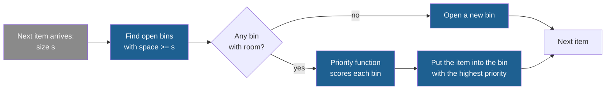

## Learning objectives

After this project you can:

- Describe online bin packing as an agent task: the state, the action, the goal and the score.
- Write a packer that chooses a bin with a priority function, and explain its tie rule.
- Compute the lower bound $L_1$ and the excess score of a packing by hand.
- Make training, validation and test sets with fixed seeds, and say what each set is for.
- Compare first fit and best fit on all three sets, and say what the comparison shows and what it does not show.

## Prerequisites

- [L2: Agents: actions, state, memory, tools and environment](/notes/ai/recursive-self-improvement/01-foundations/l2-agents-actions-state-tools-environment)
- [L6: How machine learning systems are trained and evaluated](/notes/ai/recursive-self-improvement/01-foundations/l6-how-ml-systems-are-trained-and-evaluated)
- [L7: What "improvement" means, and how to measure it](/notes/ai/recursive-self-improvement/01-foundations/l7-measuring-improvement)
- Optional: [2023 and 2025: FunSearch and AlphaEvolve](/notes/ai/recursive-self-improvement/06-research-systems/p12-funsearch-and-alphaevolve)

## 1. The problem

Before you train for a race, you need a fixed course and a stopwatch that you trust. Without them, you cannot say if a new training plan made you faster. Recursive self-improvement (RSI) has the same need. An improvement loop keeps the versions that score better. So the score decides everything that the loop does.

Part 9 builds one small system in eight projects. Each project adds one part of a self-improving system. This first project builds the part that every later project depends on: a fixed agent, a task set and a score. Nothing changes the agent in P1. The goal is a measurement that is exact and repeatable.

The task is **online bin packing**:

1. Items arrive one at a time. Each item has an integer size from 1 to 100.
2. Each bin has a capacity of 100. The sizes in one bin must add up to 100 or less.
3. When an item arrives, the agent must put it at once into an open bin that has room, or open a new bin.
4. The agent cannot move an item later.
5. Fewer bins is better.

We use this task because FunSearch used it. FunSearch paired a frozen large language model (LLM) with an evaluator. It evolved one function, called `heuristic`, inside a fixed program skeleton for bin packing (Romera-Paredes et al., 2023, [Nature](https://www.nature.com/articles/s41586-023-06924-6)). Our priority function plays the same role. The domain is small, fast to evaluate and has an exact score, so it fits a course that runs in a browser.


The same process as a diagram:



Gray is the environment, which sends the items. Blue is the agent.

## 2. Terms

| Term | Plain meaning |
|---|---|
| online bin packing | A packing task in which each item must be placed when it arrives, without knowledge of later items, and cannot move later. |
| item | One object to pack. Here it is an integer size from 1 to 100. |
| bin | A container with a capacity of 100. |
| instance | One task: one list of item sizes in arrival order. |
| packing | The answer for one instance: a list of bins, where each bin is a list of item indices. |
| free space | The capacity of a bin minus the sizes already in it. |
| priority function | The agent's strategy: a function `priority(item, space)` that returns a number for one open bin. |
| first fit | The strategy that gives every bin the same priority. The tie rule then picks the first bin with room. |
| best fit | The strategy that prefers the bin in which the item leaves the least free space. |
| lower bound $L_1$ | A number of bins that no packing can beat, computed from the total size. |
| excess | How far a packing is above $L_1$, as a fraction of $L_1$. Lower is better. |
| task family | A named random rule that makes instances, for example "mixed big-small". |
| task set | A list of instances from one family, made from one seed. |
| seed | A number that fixes the output of a random generator. The same seed gives the same numbers. |
| training set | The tasks that an improvement loop may look at as often as it wants. |
| validation set | The tasks used to decide which version to keep. |
| test set | The tasks used once, at the end, to report the result. No choice may depend on them. |

> [!key] The priority function
> - **What it is:** the one part of the agent that later projects change. It maps an item size and the free space of one bin to a number.
> - **The problem it solves:** it separates the fixed procedure (scan the bins, follow the tie rule, open a new bin) from the strategy. So an improvement loop can change the strategy without the risk of breaking the procedure.
> - **Example:** best fit is `-(space - item)`. An item of 30 sees two bins with free space 50 and 30. The priorities are -20 and 0, so the item goes into the second bin.
> - **Link to RSI:** FunSearch evolved such a function and kept the skeleton fixed (Romera-Paredes et al., 2023). The fixed skeleton is part of the system boundary of Part 2.
> - **Limits:** the function sees only one bin at a time. It cannot see the other bins, the earlier items or the item count. Some good strategies need that information.

## 3. The architecture

The system of P1 has four parts. Later projects add a proposer, an acceptance rule and an archive around them.


Gray marks the environment and the tasks, blue marks the agent and its output, and gold marks the evaluator and the score. The evaluator receives the instance too. It needs the item sizes to compute $L_1$.

The lab uses five task families. Each one is a random rule that we chose for this course:

| Family | Item sizes |
|---|---|
| uniform 20-100 | every integer from 20 to 100 with the same chance |
| small 1-30 | every integer from 1 to 30 with the same chance |
| mixed big-small | half big items from 55 to 85, half small items from 10 to 45 |
| triangular | a triangular distribution from 1 to 100 with its peak at 40, rounded |
| weibull 45 | 45 times a Weibull draw with shape 3, rounded and clipped to 1 to 100 |

In the triangular family, sizes near 40 are the most likely, and the chance falls in straight lines toward 1 and toward 100. The Weibull distribution is a standard skewed distribution. With shape 3 and the factor 45, most sizes fall between about 20 and 60.

FunSearch also reported results on Weibull data, in datasets named Weibull 5k, 10k and 100k (Romera-Paredes et al., 2023, bin-packing table). The parameters of our "weibull 45" family are our own choice. Our instances have only 10 to 120 items.

## 4. The algorithm

### 4.1 The packer in simple words

For each item, in arrival order:

1. Look at every open bin that has room: `space >= item`.
2. Ask the priority function for a number for each of these bins.
3. Put the item into the bin with the highest number. On a tie, use the bin with the lowest index.
4. If no open bin has room, open a new bin at the end of the list.

```text
pack(items, priority):
    free = []          # free[j] = free space of bin j
    bins = []          # bins[j] = indices of the items in bin j
    for i, item in items:
        best_j = none, best_p = minus infinity
        for j = 0, 1, 2, ...:
            if free[j] >= item and priority(item, free[j]) > best_p:
                best_j = j, best_p = priority(item, free[j])
        if best_j is none: open a new bin with item i
        else: put item i into bin best_j and lower free[best_j] by item
    return bins
```

The comparison `>` is strict. Because of this, a later bin with the same priority never replaces an earlier one, and the lowest index wins a tie. First fit depends on this rule: all its priorities are equal, so only the tie rule chooses.

> [!example] Worked example: first fit and best fit differ
> Items arrive in the order 50, 70, 30.
>
> 1. Item 0 (size 50): no bin is open, so bin 0 opens with free space 50.
> 2. Item 1 (size 70): bin 0 has only 50, so bin 1 opens with free space 30.
> 3. Item 2 (size 30): both bins have room.
>    - First fit: both priorities are 0. The tie rule picks bin 0. Packing: `[[0, 2], [1]]`.
>    - Best fit: bin 0 gives $-(50 - 30) = -20$ and bin 1 gives $-(30 - 30) = 0$. Bin 1 wins. Packing: `[[0], [1, 2]]`.
>
> Both packings use 2 bins. The bins differ, so later items would see different free spaces.

### 4.2 The score

The raw number of bins is not a fair score, because a large instance needs more bins than a small one. So we compare each packing with a number that no packing can beat. The total size must fit into the bins, so the number of bins is at least the total size divided by the capacity, rounded up:

$$
L_1 = \left\lceil \frac{\sum_{i} s_i}{C} \right\rceil, \qquad \text{excess} = \frac{B - L_1}{L_1}
$$

- $s_i$ is the size of item $i$.
- $C$ is the capacity of a bin. Here $C = 100$.
- $\lceil x \rceil$ is $x$ rounded up to the next whole number.
- $B$ is the number of bins that the packing uses.
- $L_1$ is the lower bound. The excess is the fraction of extra bins above it.

In plain English: count how many bins the total size needs at least, then say how many percent more bins the agent used.

> [!example] Worked example: the score of three instances
> 1. Items `[60, 40]`, packed into one bin. Total 100, so $L_1 = \lceil 100/100 \rceil = 1$. Excess $= (1 - 1)/1 = 0$.
> 2. Items `[30, 30, 30, 11]`. Total 101, so $L_1 = \lceil 1.01 \rceil = 2$. Integer division would give 1, which is wrong.
> 3. Items `[60, 60, 60]`. No two items fit together, so every packer uses 3 bins. Total 180, so $L_1 = 2$. Excess $= (3 - 2)/2 = 0.5$.
>
> The mean excess of a task set is the mean over its instances. For instances 1 and 3 it is $(0 + 0.5)/2 = 0.25$.

**Assumptions.** All sizes are positive integers and no size is larger than the capacity.

**When it is useful.** The excess puts instances of different size on one scale. It is exact: the same packing always gets the same score.

**What it does not prove.** An excess above 0 does not prove that a better packing exists. Example 3 shows this: the optimum is 3 bins, but $L_1$ says 2. So $L_1$ can be far below the real optimum, mainly when many items are larger than half a bin. FunSearch used a stronger bound, called L2 (Romera-Paredes et al., 2023). Its numbers are therefore not comparable with ours.

### 4.3 The data split

An improvement loop chooses versions by their scores. If you report the score on the same tasks that you used to choose, the report is too optimistic (see [L3: Evaluation under noise](/notes/ai/recursive-self-improvement/04-mathematics/l3-evaluation-under-noise)). So each family gets three task sets, each from its own seed. With `k` as the position of the family in the list of families, the seeds are:

| Set | Seed | Used for |
|---|---|---|
| training set | `1 + 1000 * k` | anything, as often as needed |
| validation set | `2 + 1000 * k` | choosing between versions |
| test set | `3 + 1000 * k` | one final report |

Fixed seeds make every run repeat exactly. Different seeds make the three sets different instances from the same family.

## 5. Setup and how to run

Open [Lab: RSI P1 · A fixed agent with a score](/labs/new?template=rsi-01-fixed-agent). The lab runs Python in your browser. You install nothing, and you need no API key and no network.

1. Click **Run all**. The run stops at the first exercise with `NotImplementedError`. This is expected.
2. Read the demo cell. It packs one instance with next fit, a simpler rule that keeps only the newest bin open. Move its controls.
3. Write `pack`. Run the test cell below it. Open the hints only when you are stuck.
4. Write `lower_bound`, `excess` and `mean_excess`. Run their tests.
5. Write `make_splits`. Run its tests.
6. Run the experiment cell. Change the family and the set sizes.
7. Answer the three questions in the Observations cell.

## 6. Expected output

With a correct solution, all 26 checks of the lab pass. The demo cell, with its default controls, prints a total size of 1282 and 18 bins for next fit.

The experiment cell, with its default controls (family "mixed big-small", 60 items per instance, 20 training, 20 validation and 100 test instances), prints:

| Set | First fit | Best fit |
|---|---|---|
| training | 11.99 % | 10.46 % |
| validation | 12.43 % | 11.60 % |
| test | 13.31 % | 11.57 % |

Three observations:

1. Best fit beats first fit on every set. The gain is between 0.83 and 1.74 percentage points.
2. The scores differ between the sets by more than one point. The sets hold different instances, so a score is a property of the strategy **and** the task set.
3. Now set the family to "weibull 45". Both strategies get the same validation score (7.75 %). Their test scores differ: first fit 8.44 %, best fit 7.50 %. Twenty instances were not enough to separate them.

**Measured:** these numbers come from our own runs of the reference solution in this course. They are exact for these seeds.

## 7. Tests and validation

The lab's tests check behaviour, not a copy of the formula:

1. **Known packings that we computed by hand.** Examples are `[50, 70, 30]` with both strategies, and a tie between two bins with equal free space.
2. **Edge cases.** An empty list gives no bins. An item that fills the free space exactly must fit, which tests `>=` against `>`. Three items of 60 need three bins.
3. **The priority is really used.** Worst fit and best fit must give different packings for `[30, 80, 15]`.
4. **Validity of a random packing.** A helper counts each index once and adds the real sizes of each bin.
5. **The split.** Calls with the same arguments give equal sets. No instance is in two sets. A literal value pins the training seed.

## 8. Common errors

1. **"Integer division is enough for $L_1$."** `101 // 100` is 1, but a total of 101 needs 2 bins. Use `math.ceil(total / capacity)`.
2. **"A bin with space equal to the item is full, so it has no room."** The test is `space >= item`. A bin can be filled exactly.
3. **"`>=` and `>` are the same in the priority comparison."** With `>=`, a tie goes to the last bin. First fit then becomes a "last fit" rule.
4. **"First fit and next fit are the same."** Next fit looks only at the newest bin. First fit looks at all open bins. Next fit usually uses more bins.
5. **"One seed for the whole split is fine."** Then the three sets can contain the same instances. The test set then measures nothing new.
6. **"I can look at the test score while I tune."** Then the test set becomes a second validation set. Its score is then too optimistic, like the validation score.

## 9. Limitations

This project is a toy. Be clear about what it is not.

1. The instances are small (10 to 120 items). Small instances make the rounding in $L_1$ a large part of the excess. FunSearch reported results on datasets named OR1 to OR4 and Weibull 5k, 10k and 100k (Romera-Paredes et al., 2023). Our research notes do not give their instance sizes, so do not compare our numbers with theirs.
2. $L_1$ is weak. A production evaluator would use a tighter bound, or the exact optimum where it can be computed.
3. The families are invented. A real system would use data from the real workload, and would check that the test data looks like future data.
4. The agent sees only one bin at a time. Real packers can use more state.
5. The score counts bins only. A real system also cares about time per item, memory and other costs.

## 10. Suggested extensions

1. Add worst fit (`space - item`) and next fit to the experiment. Rank all four strategies on every family.
2. Plot the mean excess of best fit against the number of items per instance. Explain the shape with the rounding in $L_1$.
3. Add a family of your own, for example items that come in pairs that add up to 100. Predict the result before you run it.
4. Count how often the validation set and the test set disagree about which of two strategies is better, for set sizes from 2 to 60.

## 11. Check questions

```check
{
  "question": "An instance has the sizes [45, 45, 45, 45, 20]. Compute L1. Then pack the items with first fit and compute the excess.",
  "hint": "Add the sizes and divide by 100, rounded up. For first fit, put each item into the first bin that has room.",
  "answer": "The total is 200, so L1 = 2. First fit: 45 opens bin 0 (free 55). The second 45 goes into bin 0 (free 10). The third 45 opens bin 1 (free 55). The fourth 45 goes into bin 1 (free 10). The item 20 fits nowhere, so it opens bin 2. Three bins, so the excess is (3 - 2) / 2 = 0.5. A packing with two bins is impossible here too, because no bin can hold 45 + 45 + 20 = 110."
}
```

```check
{
  "question": "A version of the packer uses `>=` instead of `>` when it compares priorities. Which strategy does first fit turn into, and why would the tests of the lab find the problem?",
  "hint": "With `>=`, which of two equal priorities is kept when the scan reaches the second one?",
  "answer": "With `>=`, every later bin with the same priority replaces the earlier one. First fit gives all bins the same priority, so the item goes into the LAST bin that has room. The test 'first fit takes the first bin with room' expects [[0, 2], [1]] for [50, 70, 30], but this version gives [[0], [1, 2]]. The tie test with [70, 70, 20] also fails."
}
```

```check
{
  "question": "With 20 validation instances of the family weibull 45, first fit and best fit had the same validation score (7.75 %). On 100 test instances best fit was better by 0.94 points. What does this tell you about the validation set, and what would you change?",
  "hint": "When can two strategies get equal mean scores although one is better in general?",
  "answer": "The two strategies used the same number of bins on almost every one of the 20 instances. The few differences cancelled or were absent. So 20 instances were too few to separate them. Use more validation instances, or compare the strategies instance by instance (a paired comparison, as in P6). A tie on a small set is not evidence that two strategies are equal."
}
```

```check
{
  "question": "Classify each choice as allowed or not allowed. (a) Tune the agent on the training set 500 times. (b) Choose between two final versions by their validation scores. (c) Choose between two final versions by their test scores. (d) Report the test score of the chosen version once.",
  "hint": "Which set must stay unused for every decision?",
  "answer": "(a) Allowed: the training set is for repeated use. (b) Allowed: this is what the validation set is for. (c) Not allowed: a choice that depends on the test set makes its score too optimistic. (d) Allowed: this is the only use of the test set."
}
```

## 12. Summary and links

- Online bin packing is an agent task with an exact score. The agent's strategy is one priority function inside a fixed packer.
- The excess compares a packing with the lower bound $L_1 = \lceil \text{total} / 100 \rceil$. $L_1$ can be far below the real optimum.
- Three task sets from three fixed seeds keep training, choice and report apart.
- Best fit beat first fit on every set in our run. Small sets can still fail to separate two strategies.
- Nothing changes the agent in P1. The next project shows what you get from sampling many answers without any change to the agent.

**Next:** [P2: Many candidates, one answer](/notes/ai/recursive-self-improvement/09-build-it/p2-many-candidates-one-answer)

**Related:** [2023 and 2025: FunSearch and AlphaEvolve](/notes/ai/recursive-self-improvement/06-research-systems/p12-funsearch-and-alphaevolve), [L7: What "improvement" means, and how to measure it](/notes/ai/recursive-self-improvement/01-foundations/l7-measuring-improvement), [Reference solutions](/notes/ai/recursive-self-improvement/09-build-it/solutions)

## References

- Bernardino Romera-Paredes, Mohammadamin Barekatain, Alexander Novikov, et al. "Mathematical discoveries from program search with large language models". Nature 625(7995):468–475. 2023 (published online 14 December 2023). DOI 10.1038/s41586-023-06924-6. https://www.nature.com/articles/s41586-023-06924-6. Code: https://github.com/google-deepmind/funsearch
