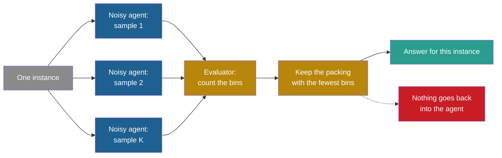

## Learning objectives

After this project you can:

- Turn a fixed priority function into a random one, and explain what the noise level controls.
- Write best-of-K: sample K packings of one instance and keep the one with the fewest bins.
- Measure the gain of best-of-K and its cost, and compute the gain per unit of cost.
- Show with an experiment that nothing persists: the next instance needs K samples again.
- Explain the optimistic bias of a version that you choose and score on the same data, with numbers.

## Prerequisites

- [P1: A fixed agent with a score](/notes/ai/recursive-self-improvement/09-build-it/p1-a-fixed-agent-with-a-score)
- [L2: The ladder: from repeating a task to improving the improver](/notes/ai/recursive-self-improvement/02-core-idea/l2-the-ladder-of-self-improvement)
- [L3: Evaluation under noise](/notes/ai/recursive-self-improvement/04-mathematics/l3-evaluation-under-noise)

## 1. The problem

A student answers one exam question eight times on scrap paper and hands in the best answer. The grade goes up. But two things are needed: eight times the work, and a way to tell which answer is best. And at the next exam, the student is no better than before. The student did not learn. The student only searched.

Language model systems use the same trick. They sample several answers and keep the best one, or the most common one. Self-consistency samples many reasoning paths and takes the majority answer. It needs "no additional training, fine-tuning, nor extra data collection" (Wang et al., 2023, [arXiv:2203.11171](https://arxiv.org/abs/2203.11171)). Its authors also note that it "incurs more computation cost".

Test-time compute is the computation that a model spends while it answers. Snell et al. use best-of-N as the baseline that better uses of test-time compute must beat (Snell et al., 2025, [arXiv:2408.03314](https://arxiv.org/abs/2408.03314)).

This is the lowest rung of the ladder in [L2: The ladder: from repeating a task to improving the improver](/notes/ai/recursive-self-improvement/02-core-idea/l2-the-ladder-of-self-improvement). At Level 0 the agent repeats or resamples, and the system does not change. None of the definitions of self-improvement that this course compares counts it. This project makes the point concrete. You will measure the gain, the cost, and the fact that nothing stays.

## 2. Terms

| Term | Plain meaning |
|---|---|
| noise level $\sigma$ | The size of the random number added to every priority value. |
| noisy priority | A priority function plus $\sigma z$, with a new standard normal draw $z$ at every call. |
| sample | One complete packing of one instance by the noisy packer. |
| best-of-K | Make K samples of one instance and keep the one with the fewest bins. |
| verifier | A check that can rank or accept answers. Here, counting bins is an exact verifier. |
| cost | The work that a method uses. Here we count calls of the priority function. |
| persistence | Whether a gain stays for future tasks. |
| version | One random stream, used for a whole task set. It acts like one fixed random agent. |
| optimistic bias | The amount by which the score of the chosen version, on the data used to choose it, is better than its score on new data. |
| winner's curse | The general effect behind the optimistic bias: the best of several noisy scores is usually lucky. |

> [!key] Persistence
> - **What it means:** a gain persists if it stays available for later tasks without the same work again.
> - **The problem it solves:** it separates searching for a good answer from becoming a better agent.
> - **Example:** best-of-8 lowers the excess on one instance. On the next instance, the agent starts from scratch.
> - **Link to recursive self-improvement (RSI):** RSI needs persistent change to the system, and later projects store the change in the agent's strategy. Part 2 discusses persistence in [L3: The system boundary, the "self" and persistence](/notes/ai/recursive-self-improvement/02-core-idea/l3-system-boundary-and-persistence).
> - **Limits:** a method can persist something small, for example a memory of good answers, and still not change the agent's skill. Persistence is necessary for improvement. It is not enough.

## 3. The architecture



Gray is the task and blue is the agent. Gold is the evaluator and the selection, and teal is the kept answer. Red marks what is missing: no change reaches the agent. Compare this with the improvement loop of [L2: One iteration, step by step](/notes/ai/recursive-self-improvement/03-anatomy/l2-one-iteration-step-by-step). There, the accepted change goes back into the system.

> [!note] A rule we break on purpose
> A real online packer cannot pack the same item sequence K times. Here each instance is one task, and the agent may try K complete answers before it submits one. This matches how a language model system samples K answers to one question.

## 4. The algorithm

### 4.1 The noisy packer

The noisy priority is $p(\text{item}, \text{space}) + \sigma z$. When two bins have almost the same priority, the noise decides which one wins. So two runs can give different packings. With $\sigma = 0$ the packer is the fixed packer of P1. With a very large $\sigma$ the priority stops mattering, and the packer chooses a random bin with room.

The lab uses best fit as the base priority. Best fit gives $-(\text{space} - \text{item})$, so neighbouring bins differ by whole numbers. A noise level of 10 swaps bins whose free spaces differ by a few units.

### 4.2 Best-of-K

```text
best_of_k(items, priority, K, sigma, seed):
    best = none
    for j = 0 .. K-1:
        rng = new generator from [seed, j]        # sample j always repeats
        bins = pack(items, priority + sigma * normal noise from rng)
        if best is none or len(bins) < len(best): best = bins
    return best
```

Each sample has its own generator `[seed, j]`. So sample `j` is the same in every run. The first 4 samples of a run with K = 8 are the 4 samples of a run with K = 4. This makes the claim "more samples never give more bins" testable.

### 4.3 The cost

Each sample repeats the whole packing. The work grows in proportion to K. The gain does not. The best of 16 is only a little better than the best of 8, because the minimum of many draws moves slowly. So the gain per unit of work falls as K grows.

### 4.4 The optimistic bias of the best

Now choose between whole **versions** of the random agent. Version $j$ packs every instance of a task set with one stream $[seed, j]$. Let $m_j$ be its mean excess on a task set. Each $m_j$ is the version's true mean, $\mu_j$, plus a noise term, $\epsilon_j$:

$$
m_j = \mu_j + \epsilon_j, \qquad \hat j = \arg\min_j m_j
$$

- $\mu_j$ is the mean excess that version $j$ would get on unlimited new instances.
- $\epsilon_j$ is the error from the finite task set and from the version's luck on it.
- $\hat j$ is the version with the lowest measured mean.

The minimum picks the version whose noise happened to be most negative. So $m_{\hat j}$ is usually below $\mu_{\hat j}$, even when every single measurement is unbiased. Smith and Winkler call this the optimizer's curse (Smith and Winkler, 2006, [Management Science](https://ideas.repec.org/a/inm/ormnsc/v52y2006i3p311-322.html)). In their words: "we should expect the value of the chosen alternative to be less than its estimate, even if the value estimates are unbiased". Their setting maximizes a value, and ours minimizes a cost. The effect is the same with the sign reversed.

> [!example] Worked example from the lab
> Twenty versions are scored on 20 training instances of "weibull 45". Version 1 has the lowest training score: 7.28 %.
>
> 1. On 100 test instances, version 1 scores 8.07 %.
> 2. The mean test score of all 20 versions is 8.14 %.
> 3. So the chosen version is about as good as an average version. Its training score was 0.79 points too optimistic.
>
> The choice found luck, not skill. All 20 versions are the same agent with different random streams.

**Assumptions.** The versions are scored on the same task set, and the noise is not correlated with the true quality.

**What it does not prove.** It does not say that every selection is useless. When versions really differ, selection finds better ones on average. It says that the score used for selection is not a fair estimate of the chosen version.

## 5. Setup and how to run

Open [Lab: RSI P2 · Many candidates, one answer](/labs/new?template=rsi-02-many-candidates). It needs no installation and no network.

1. Run the first cell. It defines the pieces of P1.
2. Run the demo of section 2. Change the noise level and the seed. See how the bin count changes from run to run.
3. Write `noisy`, then `best_of_k`, then `pick_best_version`. Run each test cell after its exercise.
4. Run the three experiment cells: the gain and the cost, nothing persists, and the optimistic bias.
5. Answer the Observations.

## 6. Expected output

With a correct solution, all 16 checks pass.

**The demo** (seed 5, 120 items, noise 10): best fit uses 53 bins and $L_1 = 49$. Of 30 noisy runs, one uses 52 bins and 29 use 53.

**The gain and the cost** (family "weibull 45", noise 10, 20 validation instances of 60 items):

| K | Mean excess | Priority calls |
|---|---|---|
| 1 | 7.93 % | 1,221 |
| 2 | 7.53 % | 2,411 |
| 4 | 7.35 % | 4,807 |
| 8 | 6.93 % | 9,627 |
| 16 | 6.72 % | 19,292 |

Best fit without noise scores 7.75 %. One noisy sample is worse than best fit (7.93 %). But two samples are already better (7.53 %). From K = 1 to K = 16 the work grows 15.8 times, and the excess falls by 1.21 points.

**Nothing persists** (K = 8, noise 10):

| What the agent uses on the next instance | Mean excess |
|---|---|
| The winning stream of the last instance | 8.79 % |
| One fresh sample | 8.37 % |
| The best of 8 fresh samples | 7.10 % |

The reused winner is no better than a fresh sample. In our run it is even a little worse. The gain of best-of-8 came back only by paying for 8 new samples.

**The optimistic bias** (20 versions, 20 training instances): the chosen version scores 7.28 % on the training set and 8.07 % on the test set. All versions average 8.14 % on the test set.

**Measured:** all numbers come from our run of the reference solution. They repeat exactly with the same seeds.

## 7. Tests and validation

1. `noisy`: with $\sigma = 0$ the value equals the base priority. Over 2,000 calls the noise has a mean within 0.5 of 0 and a standard deviation within 0.3 of $\sigma$. The same seed gives the same values.
2. `best_of_k`: K = 1 without noise equals the plain packer. The kept packing has the fewest bins and is valid. The first 4 counts of K = 8 equal the 4 counts of K = 4.
3. `pick_best_version`: one score per version, and the chosen version has the lowest score. Without noise all versions tie and version 0 wins. A literal value pins the stream `[seed, 4]`.

The statistical tests use wide tolerances on purpose. A test that fails by chance one time in a hundred teaches the learner to ignore failures.

## 8. Common errors

1. **"Draw the noise once, when `noisy` is called."** Then every bin gets the same offset. The order of the bins does not change. Draw a new value at every call.
2. **"One generator for all K samples is the same as one per sample."** It gives valid samples. But sample 3 then depends on how many draws samples 1 and 2 used, so the nesting test fails.
3. **"Best-of-K improved the agent."** It improved four answers on four instances. The agent is unchanged.
4. **"The chosen version's training score is its expected score."** It is the best of several noisy scores, so it is too optimistic. Score it again on new data.
5. **"Higher noise always helps best-of-K."** In our runs, one sample got worse as the noise grew. It scored 8.13 % at noise 5 and 9.13 % at noise 100. Best-of-16 improved up to noise 20 and 40 (6.49 %), then got worse again (6.69 % at noise 100). The best noise level depends on K.

## 9. Limitations

1. **A perfect verifier.** Counting bins is exact. For language model answers, the verifier is often a model or a test suite that can be wrong. Then best-of-K can choose a confident wrong answer. P3 shows what happens when the score can be fooled.
2. **The online rule is broken.** A real online packer cannot replay the items.
3. **A crude noise model.** Gaussian noise on a priority is not how a language model samples.
4. **Small numbers.** The gains are a few tenths of a point on small instances. They show the shape of the effect, not its size in a real system.

A production version would need three more things. It needs a verifier whose own errors are measured, a budget per task, and a rule that decides when one sample is enough.

## 10. Suggested extensions

1. Plot the mean excess of best-of-K against K for noise levels 2, 10 and 20. Which noise level is best for each K?
2. Make the verifier imperfect: add a random error of ±1 bin to each count before you choose. How much of the gain is left?
3. Repeat the optimistic-bias experiment with 60 training instances, and with 60 versions. Predict the direction of each change first.
4. Compute the gain per 1,000 priority calls for each K.

## 11. Check questions

```check
{
  "question": "Best-of-8 used 9,627 priority calls and reached 6.93 %. One sample used 1,221 calls and reached 7.93 %. Best fit without noise reached 7.75 % with roughly the work of one sample. How many calls did best-of-8 spend per percentage point of gain over best fit?",
  "hint": "First compute the gain over best fit, then the extra calls over one sample.",
  "answer": "The gain over best fit is 7.75 - 6.93 = 0.82 points. The extra work is about 9,627 - 1,221 = 8,406 calls. That is about 8,406 / 0.82 = 10,250 calls per percentage point. The gain is real, but it is bought with work, and it must be bought again for every instance."
}
```

```check
{
  "question": "Place each method on the ladder of Part 2 and say whether anything persists. (a) Best-of-K packing. (b) Choosing the best random version on the training set and then using it on all later tasks.",
  "hint": "Does the system that starts the next task differ from the one that started this task?",
  "answer": "(a) Level 0: repeat or resample. Nothing persists, so the next instance needs K samples again. (b) Something persists: the choice of version. But the experiment shows that the choice carried no skill, because all versions are the same agent with different luck. It is a selection among equals, so it is still not an improvement of the agent."
}
```

```check
{
  "question": "The chosen version scored 7.28 % on the training set and 8.07 % on the test set. Give two reasons why the test score is worse, and say which one the experiment shows.",
  "hint": "One reason is about how the version was chosen. The other is about the instances.",
  "answer": "Reason 1: selection on noisy scores. The minimum of 20 scores is usually lucky, so the chosen version's training score is too low (the optimizer's curse). Reason 2: the test instances are different instances, and they may be a little harder on average. The experiment separates the two with the mean of all versions on the test set: 8.14 %. The chosen version is no better than the average version, so its training advantage was luck. Reason 1 explains the gap."
}
```

```check
{
  "question": "A team reports: 'Best-of-16 sampling improved our agent from 7.93 % to 6.72 %.' What is wrong with this claim? How would you report the result honestly?",
  "hint": "Think about cost and persistence.",
  "answer": "The agent did not change. The result is the same agent with 16 times the work per task and an exact verifier. An honest report says that best-of-16 lowered the excess from 7.93 % to 6.72 %. It used 15.8 times the priority calls. The gain does not persist. The report should also compare with best fit without noise (7.75 %) at equal work."
}
```

## 12. Summary and links

- Best-of-K improves answers, not the agent. In our run, 16 samples lowered the excess from 7.93 % to 6.72 % and cost 15.8 times the work.
- The gain needs an exact verifier. Here, counting bins is exact.
- Nothing persists. The winner of one instance did no better than a fresh sample on the next one.
- Choosing a version by its score on the same data is optimistic. The chosen version scored 7.28 % on training data and 8.07 % on test data.
- P3 asks what happens when the verifier can be fooled.

**Previous:** [P1: A fixed agent with a score](/notes/ai/recursive-self-improvement/09-build-it/p1-a-fixed-agent-with-a-score)

**Next:** [P3: An evaluator with explicit tests](/notes/ai/recursive-self-improvement/09-build-it/p3-an-evaluator-with-explicit-tests)

**Related:** [L1: Self-critique and iterative refinement](/notes/ai/recursive-self-improvement/05-approaches/l1-self-critique-and-refinement), [Reference solutions](/notes/ai/recursive-self-improvement/09-build-it/solutions)

## References

- Xuezhi Wang, Jason Wei, Dale Schuurmans, et al. "Self-Consistency Improves Chain of Thought Reasoning in Language Models". ICLR 2023. arXiv:2203.11171. https://arxiv.org/abs/2203.11171
- Charlie Snell, Jaehoon Lee, Kelvin Xu, Aviral Kumar. "Scaling LLM Test-Time Compute Optimally Can be More Effective than Scaling Parameters for Reasoning". ICLR 2025. arXiv:2408.03314. https://arxiv.org/abs/2408.03314
- James E. Smith, Robert L. Winkler. "The Optimizer's Curse: Skepticism and Postdecision Surprise in Decision Analysis". Management Science 52(3):311–322. 2006. DOI 10.1287/mnsc.1050.0451. https://ideas.repec.org/a/inm/ormnsc/v52y2006i3p311-322.html
