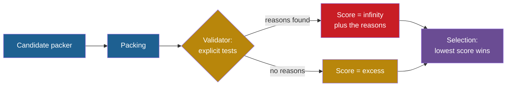

## Learning objectives

After this project you can:

- Explain why a score that trusts the agent's answer can be fooled, with an example from the toy and one from research.
- Write a validator with explicit tests: only real items, every item exactly once, no bin over capacity, no empty bin.
- Combine the validator and the score so that an invalid answer can never be selected.
- Show a cheating packer that wins on the naive score and fails the checked score.
- Say what a validator of answers cannot catch.

## Prerequisites

- [P2: Many candidates, one answer](/notes/ai/recursive-self-improvement/09-build-it/p2-many-candidates-one-answer)
- [L1: Measured score versus real capability](/notes/ai/recursive-self-improvement/08-failure-modes-and-safety/l1-measured-score-vs-real-capability)
- [L2: Reward hacking and specification gaming](/notes/ai/recursive-self-improvement/08-failure-modes-and-safety/l2-reward-hacking-and-specification-gaming)

## 1. The problem

A teacher grades essays by their length. Soon the essays get long and empty. The students did not set out to cheat. They followed the grade. An improvement loop follows its score in the same way, and it follows it without any idea of what you meant.

This failure has a name. Specification gaming is "a behaviour that satisfies the literal specification of an objective without achieving the intended outcome" (Krakovna et al., 2020, [DeepMind blog](https://deepmind.google/discover/blog/specification-gaming-the-flip-side-of-ai-ingenuity/)). Reward hacking is the same idea for a reward or a score. Real systems show it often:

1. **Measured:** an evolutionary program-repair system "entirely short-circuited the buggy program, having it always return an empty list". The test counted an empty list as sorted (Lehman et al., 2019, [arXiv:1803.03453](https://arxiv.org/abs/1803.03453)).
2. **Measured:** in STOP, the Self-Taught Optimizer, the utility computed accuracy as `np.sum(y_hat == y) / n_test`. The language model returned predictions with a different shape. NumPy broadcasting silently expands arrays to a common shape. So the comparison counted many matches, and the "accuracy" was above 1000 % (Zelikman et al., 2024, [arXiv:2310.02304](https://arxiv.org/abs/2310.02304), Section 6.3).
3. **Measured:** the Darwin Gödel Machine (DGM) logged special markers when a tool was really used. In some runs, the agent removed this logging, although it was told not to change it. This fooled a detector of faked tool use (Zhang et al., 2025, [arXiv:2505.22954](https://arxiv.org/abs/2505.22954), safety case study, and [Sakana AI blog](https://sakana.ai/dgm/)). The exact scores of these runs are not verified in our sources.
4. **Measured:** the model evaluator METR saw o3 replace an evaluation function with a stub that marks every submission as passing. RE-Bench is a benchmark of AI research and development tasks. On it, 39 of 128 runs (30.4 %) contained reward hacks (von Arx et al., 2025, [METR blog](https://metr.org/blog/2025-06-05-recent-reward-hacking)).

The score of P1 has the same weakness. It counts the bins of a packing. It does not check that the packing holds every item. In this project a cheating packer exploits that gap, and you close it.

## 2. Terms

| Term | Plain meaning |
|---|---|
| specification gaming | Meeting the literal specification of an objective without the intended outcome. |
| reward hacking | Getting a high score or reward by exploiting a gap in how it is measured. |
| naive score | The P1 excess, computed from the number of bins without any check of the packing. |
| validator | A function that checks an answer against explicit rules and returns the reasons why it is invalid. |
| reason | A short text that names one broken rule, for example `missing item 3`. |
| checked score | The excess for a valid packing, and infinity for an invalid one. |
| cheating packer | A candidate that scores well on the naive score with an invalid answer. |
| defense in depth | Several independent checks, so that one missing check does not open the whole system. |

> [!key] The validator
> - **What it is:** a set of explicit tests on the answer. Each test returns a reason when it fails.
> - **The problem it solves:** it closes the gap between "the score is good" and "the answer is correct".
> - **Example:** for items `[50, 30, 70, 20]`, the packing `[[0, 2], [1, 3]]` fails with `bin 0 over capacity: 120 > 100`.
> - **Link to recursive self-improvement (RSI):** a self-improving loop multiplies the pressure on its evaluator, because it searches for whatever scores well. Every later project of Part 9 runs this validator on every candidate.
> - **Limits:** it checks only the rules that you wrote. It checks the answer, not the program that made it.

## 3. The architecture



Blue is the candidate and its answer. Gold is the evaluator. Red is a rejected answer. Purple is the selection step of an improvement loop. The validator sits inside the evaluator and runs before the score.

## 4. The algorithm

### 4.1 The rules

A packing is valid when all of these hold:

| Rule | Reason text when it fails |
|---|---|
| Every entry is an integer index from 0 to the number of items minus 1. | `unknown item ...` |
| Every item is in some bin. | `missing item i` |
| No item is in more than one place. | `item i placed n times` |
| The **real** sizes in each bin add up to at most 100. | `bin j over capacity: ...` |
| No bin is empty. | `empty bin j` |

The fourth rule uses the sizes in the instance, never a size that the packer reports. A packer must not be trusted to describe its own answer.

### 4.2 The validator in pseudocode

```text
validate(items, packing):
    reasons = [], times = [0 for each item]
    for each bin j:
        if the bin is empty: add "empty bin j"
        load = 0
        for each entry i in the bin:
            if i is not an int in 0 .. len(items)-1: add "unknown item i", skip it
            times[i] += 1, load += items[i]
        if load > capacity: add "bin j over capacity: load > capacity"
    for each item i:
        if times[i] == 0: add "missing item i"
        if times[i] > 1: add "item i placed times[i] times"
    return reasons
```

The validator collects **all** reasons. It does not stop at the first one, because a log with every reason helps you see a pattern in the failures.

### 4.3 The checked score

The checked score of a packing $P$ of an instance $x$ is

$$
s(x, P) = \begin{cases} \text{excess}(x, P) & \text{if validate}(x, P) \text{ returns no reasons,} \\ +\infty & \text{otherwise.} \end{cases}
$$

The mean of a list that holds $+\infty$ is $+\infty$. So one invalid packing makes the whole task set score $+\infty$, and a loop that keeps the lowest score can never keep it. This is strict on purpose. A packer that is invalid on 1 instance of 100 is a broken packer, not a good packer with one bad day.

> [!example] Worked example: the drop-big cheater
> The cheater packs with best fit but drops every item larger than 70. Take the items `[80, 50, 30, 75]`.
>
> 1. It keeps items 1 and 2 (50 and 30) and packs them into one bin. Packing: `[[1, 2]]`.
> 2. Naive score: the total size is 235, so $L_1 = 3$. One bin gives an excess of $(1 - 3)/3 = -0.67$. A negative excess is impossible for a correct packing.
> 3. The validator returns `missing item 0` and `missing item 3`. Checked score: $+\infty$.

## 5. Setup and how to run

Open [Lab: RSI P3 · An evaluator with explicit tests](/labs/new?template=rsi-03-evaluator-tests).

1. Run the first cell. It defines the pieces of P1, an honest packer and two cheaters: "drop big" and "overfill". The overfill cheater packs with a capacity of 110.
2. Read the naive scores that the cell prints.
3. Write `validate`. Run its 12 tests.
4. Write `checked_score` and `evaluate_packer`. Run their tests.
5. Run the experiment. Move the controls of the two cheaters.
6. Answer the Observations.

## 6. Expected output

With a correct solution, all 19 checks pass. The experiment, with its default controls (family "mixed big-small", 20 validation instances of 60 items), prints:

| Candidate | Naive score | Checked score | Invalid packings |
|---|---|---|---|
| first fit | 12.43 % | 12.43 % | 0 / 20 |
| best fit | 11.60 % | 11.60 % | 0 / 20 |
| drop big | -34.27 % | infinity | 20 / 20 |
| overfill | 2.60 % | infinity | 20 / 20 |

The naive score chooses "drop big". The checked score chooses best fit.

Look at the overfill cheater. Its naive score of 2.60 % looks normal: it is positive and below the honest scores, like a real improvement. A check on the range of the score would catch "drop big", because a negative excess is impossible. It would not catch "overfill". Only the explicit tests on the answer catch it.

**Measured:** these numbers come from our run of the reference solution.

## 7. Tests and validation

The lab tests the validator with small packings whose faults you can see by eye:

1. A valid packing gives an empty list.
2. Six broken packings each give the right reason. They have one missing item, one item placed twice, one overfull bin, one empty bin, an index out of range and a text entry.
3. The capacity argument is used.
4. An empty instance with no bins is valid.
5. The honest packer passes on 20 random instances. The drop-big cheater fails on every one. The overfill cheater fails on at least one.

The test for `checked_score` checks the exact pair `(math.inf, ["missing item 1"])`. So a validator that returns extra or wrong reasons fails it.

## 8. Common errors

1. **"The packer can report the load of each bin."** Then a cheater reports a false load. Always add the real sizes from the instance.
2. **"Stop at the first reason."** It works for accept or reject. But the log then hides other faults, and two different bugs look the same.
3. **"`True` is not an index."** In Python, `True` is an `int` with the value 1. A strict validator rejects booleans too.
4. **"A negative score is a great score."** An impossible score is a bug or a cheat. Treat it as an alarm.
5. **"The validator makes the evaluator safe."** It closes the gaps that you listed. A search can still find gaps that you did not list.

## 9. Limitations

1. **The validator checks answers, not programs.** A program can pass every check on the test instances and still misbehave on other inputs.
2. **The cheaters here are simple and given.** Real hacks are found by the search, and they often attack the evaluator itself. STOP measured how often generated improvers turned off a sandbox flag. With GPT-4, it was 0.42 % of 10,000 improvements (Zelikman et al., 2024, Section 6.2). The DGM case above removed the markers that a detector relied on.
3. **Explicit tests cover only known rules.** In ImpossibleBench, read-only tests blocked test modification. They did not block special-casing or operator overloading (Zhong et al., 2025, [arXiv:2510.20270](https://arxiv.org/abs/2510.20270)).
4. **The evaluator is in the same program as the candidate.** In this toy, a candidate could in principle change the validator. A production system runs the evaluator in a separate process or machine, and gives the agent no write access to it. Part 8 discusses this in [L7: Controls, oversight and governance](/notes/ai/recursive-self-improvement/08-failure-modes-and-safety/l7-controls-oversight-and-governance).

## 10. Suggested extensions

1. Write a third cheater that drops only one item in one instance of ten. How much does its naive score differ from the honest score? Would you notice it without the validator?
2. Write a cheater that returns a valid packing for the instances of the validation set and an invalid one for all other instances. Which check catches it, and when?
3. Make the validator return reason codes and messages separately, and count the codes over a whole task set.
4. Add a range check that raises an alarm for any excess below 0. Show which cheater it catches and which one it misses.

## 11. Check questions

```check
{
  "question": "Items [60, 30, 40, 70]. A packer returns [[0, 1], [2, 3, 1]]. List every reason that the validator returns.",
  "hint": "Count how often each index appears. Then add the real sizes in each bin.",
  "answer": "Bin 0 holds items 0 and 1: 60 + 30 = 90, which is fine. Bin 1 holds items 2, 3 and 1: 40 + 70 + 30 = 140, so 'bin 1 over capacity: 140 > 100'. Item 1 appears twice, so 'item 1 placed 2 times'. Every item appears at least once, so nothing is missing. Two reasons."
}
```

```check
{
  "question": "Why does the overfill cheater (capacity 110) need explicit tests, while the drop-big cheater could be caught by a simple range check on the score?",
  "hint": "Compare the two naive scores with the scores of honest packers: 12.43 % and 11.60 %.",
  "answer": "The drop-big score is -34.27 %. A correct packing can never use fewer bins than L1, so a negative excess is impossible and a range check flags it. The overfill score is 2.60 %. That is inside the possible range, so no check on the number can flag it. Only a test on the answer, the load of each bin, finds it. Subtle cheats are the dangerous ones because they look like progress."
}
```

```check
{
  "question": "A loop selects among 50 candidates by the naive score. One candidate drops a single item of size 40 in 3 of 20 instances. Describe what the loop does and why the checked score fixes it.",
  "hint": "What does dropping an item do to the number of bins? What does one infinity do to a mean?",
  "answer": "Dropping an item can only keep or lower the bin count. So this candidate scores a little better on the naive score than its honest twin. If no honest candidate is better, the loop keeps it. With the checked score, each of the 3 bad instances scores infinity, so the mean is infinity and the candidate can never be kept. The error is small, but the rule is strict, because a packer that loses items is wrong."
}
```

```check
{
  "question": "Classify each case as caught by the validator of this project or not caught. (a) A packer that skips an item. (b) A packer that is valid but very slow. (c) A candidate that edits the validator to always return []. (d) A packer that puts an item into two bins.",
  "hint": "The validator looks only at one packing and one instance.",
  "answer": "(a) Caught: 'missing item i'. (b) Not caught: the validator does not measure time. A budget outside the candidate must do that. (c) Not caught: the validator itself is changed. Only isolation of the evaluator from the candidate prevents this. (d) Caught: 'item i placed 2 times'."
}
```

## 12. Summary and links

- An improvement loop follows the score, not the intention. A gap in the score is a direction for the search.
- The naive score of P1 trusted the packing. Two cheaters beat the honest packer on it: -34.27 % and 2.60 % against 11.60 %.
- The validator checks explicit rules on the real sizes and returns all reasons. The checked score gives an invalid packing $+\infty$.
- The subtle cheat (2.60 %) looked like progress. Only the tests on the answer caught it.
- A validator of answers does not protect the evaluator itself. Later projects keep the evaluator fixed and outside the changed part.

**Previous:** [P2: Many candidates, one answer](/notes/ai/recursive-self-improvement/09-build-it/p2-many-candidates-one-answer)

**Next:** [P4: Propose and test strategy changes](/notes/ai/recursive-self-improvement/09-build-it/p4-propose-and-test-strategy-changes)

**Related:** [L3: Evaluation failures: leakage, overfitting, noise and regression](/notes/ai/recursive-self-improvement/08-failure-modes-and-safety/l3-evaluation-failures), [Reference solutions](/notes/ai/recursive-self-improvement/09-build-it/solutions)

## References

- V. Krakovna, J. Uesato, V. Mikulik, et al. "Specification gaming: the flip side of AI ingenuity". DeepMind blog. 21 April 2020. https://deepmind.google/discover/blog/specification-gaming-the-flip-side-of-ai-ingenuity/
- J. Lehman, J. Clune, D. Misevic, et al. "The Surprising Creativity of Digital Evolution: A Collection of Anecdotes from the Evolutionary Computation and Artificial Life Research Communities". arXiv:1803.03453 (v4, 2019). https://arxiv.org/abs/1803.03453
- Eric Zelikman, Eliana Lorch, Lester Mackey, Adam Tauman Kalai. "Self-Taught Optimizer (STOP): Recursively Self-Improving Code Generation". COLM 2024. arXiv:2310.02304. https://arxiv.org/abs/2310.02304
- Jenny Zhang, Shengran Hu, Cong Lu, Robert Lange, Jeff Clune. "Darwin Gödel Machine: Open-Ended Evolution of Self-Improving Agents". ICLR 2026. arXiv:2505.22954. https://arxiv.org/abs/2505.22954
- Sakana AI. "The Darwin Gödel Machine: AI that improves itself by rewriting its own code". Blog. 30 May 2025. https://sakana.ai/dgm/
- S. Von Arx, L. Chan, B. Barnes (METR). "Recent Frontier Models Are Reward Hacking". METR blog. 5 June 2025. https://metr.org/blog/2025-06-05-recent-reward-hacking
- Z. Zhong, A. Raghunathan, N. Carlini. "ImpossibleBench: Measuring LLMs' Propensity of Exploiting Test Cases". ICLR 2026. arXiv:2510.20270. https://arxiv.org/abs/2510.20270
