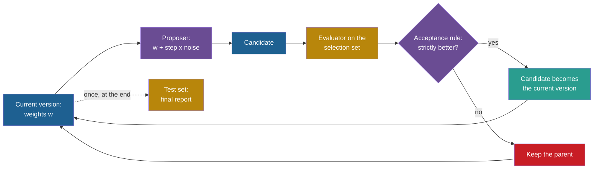

## Learning objectives

After this project you can:

- Describe a strategy as a vector of weights over features of a bin, and compute its priority by hand.
- Write a proposer that makes a small random change, and a hill-climbing loop with a strict acceptance rule.
- Run the same loop with two selection sets: a small training set and a larger validation set.
- Explain overfitting with the numbers of your own run: a better selection score and a worse test score.
- Name the published evidence for the same effect in prompt and agent search.

## Prerequisites

- [P1: A fixed agent with a score](/notes/ai/recursive-self-improvement/09-build-it/p1-a-fixed-agent-with-a-score)
- [L4: Optimization and search](/notes/ai/recursive-self-improvement/01-foundations/l4-optimization-and-search)
- [L6: How machine learning systems are trained and evaluated](/notes/ai/recursive-self-improvement/01-foundations/l6-how-ml-systems-are-trained-and-evaluated)
- [L3: Evaluation under noise](/notes/ai/recursive-self-improvement/04-mathematics/l3-evaluation-under-noise)

## 1. The problem

A cook changes a recipe a little each evening and keeps the change when the four regular guests like it more. After a month, the recipe suits those four people very well. A new guest may not like it at all. The cook did not learn to cook better. The cook learned the tastes of four people.

From this project on, an outer loop changes the agent. This is the first **improvement loop** of Part 9:

1. Take the current version of the agent.
2. A **proposer** makes a **candidate**: a copy with a small random change.
3. An **evaluator** scores the candidate on a **selection set** of tasks.
4. An **acceptance rule** keeps the candidate if its score is strictly better. Otherwise it keeps the parent.
5. Repeat for a fixed number of iterations.

The loop is outside the agent, and the agent never changes itself. So this is improvement by a fixed external improver, not yet self-improvement. The key question of the project is which task set the acceptance rule may look at.

Published work shows that this question matters at scale too:

1. **Measured:** OPRO (Optimization by PROmpting) optimizes prompts with a language model (Yang et al., 2024, [arXiv:2309.03409](https://arxiv.org/abs/2309.03409), overfitting section). Its authors write: "our training accuracies are often 5%-20% higher than our test accuracies".
2. **Measured:** in DSPy, programs selected on a development set lost accuracy on the test set (Khattab et al., 2024, [arXiv:2310.03714](https://arxiv.org/abs/2310.03714)). One example is the grade-school math benchmark GSM8K, with step-by-step reasoning (chain of thought), an ensemble and GPT-3.5: 88.3 to 81.6. The paper does not separate selection effects from a shift between the data sets.
3. **Measured:** an independent study examined meta agents that design agents (El et al., 2025, [arXiv:2510.06711](https://arxiv.org/abs/2510.06711)). The agent that was best on the training data lost on the test data. On the MMLU benchmark, it went from 74.7 to 66.2.

## 2. Terms

| Term | Plain meaning |
|---|---|
| feature | A number that describes one property of a bin for the arriving item, for example the gap that stays after the item. |
| weight vector $w$ | Six numbers that say how much each feature counts. The strategy is $w$. |
| proposer | The part that makes a candidate from the current version. Here: add random noise to every weight. |
| step size $\sigma$ | The standard deviation of the noise that the proposer adds. |
| hill climbing | A loop that keeps one version and accepts a candidate only if it scores strictly better. |
| acceptance rule | The rule that decides if a candidate replaces the current version. |
| selection set | The task set whose score the acceptance rule uses. |
| overfitting | A version scores better on the selection set but not better, or worse, on new tasks. |
| adaptive overfitting | Overfitting caused by many choices made with the same data. Each choice leaks a little information about that data. |

> [!key] The selection set
> - **What it is:** the tasks whose score decides which candidate is kept.
> - **The problem it solves:** the loop needs some score to decide. The choice of tasks decides what the loop really optimizes.
> - **Example:** with 8 training instances, loop A accepted changes that won on those 8 instances but lost on 200 test instances.
> - **Link to recursive self-improvement (RSI):** a self-improving system selects thousands of versions. Each selection uses data, so the selection set must be larger than the training set, and a test set must stay untouched.
> - **Limits:** a validation set used for hundreds of choices can be overfitted too. Work on the reusable holdout shows that a holdout set supports only a limited number of reuses (Dwork et al., 2015, [reusable holdout](https://cis.upenn.edu/~aaroth/reusable.html)).

## 3. The architecture



Blue is the agent: versions and candidates. Purple is the improver: the proposer and the acceptance rule. Gold is the evaluation, teal is an accepted change and red is a rejected one. The dotted line is the only use of the test set.

## 4. The algorithm

### 4.1 A family of strategies

The idea: describe each open bin with a few numbers, and let the strategy be a weighted sum of them. Then a change of strategy is a change of a few numbers. Let $g = (\text{space} - \text{item})/100$ be the gap that stays after the item, as a fraction of a bin.

$$
\text{priority}(\text{item}, \text{space}) = \sum_{k=1}^{6} w_k \, f_k(\text{item}, \text{space})
$$

- $w_k$ is weight $k$ of the strategy.
- $f_1 = -g$ is the tight fit, $f_2 = g^2$ is the squared gap, and $f_3 = (\text{item}/100)\,g$ is the gap scaled by the item size.
- $f_4 = 1$ if $g = 0$ (an exact fit), else 0.
- $f_5 = 1$ if $0 < \text{space} - \text{item} < 20$ (a small gap that few items can fill), else 0.
- $f_6 = (\text{item}/100)\, f_5$ is the small gap scaled by the item size.

In plain English: each feature votes for or against a bin, and each weight says how loud that vote is.

> [!example] Worked example: one item, two bins
> An item of size 30 arrives. Bin A has free space 50, and bin B has free space 32.
>
> 1. Bin A: $g = 0.20$. The features are $f_1 = -0.20$, $f_2 = 0.04$, $f_3 = 0.06$, $f_4 = 0$, $f_5 = 0$ (the gap is 20, not below 20), $f_6 = 0$.
> 2. Bin B: $g = 0.02$. The features are $f_1 = -0.02$, $f_2 = 0.0004$, $f_3 = 0.006$, $f_4 = 0$, $f_5 = 1$, $f_6 = 0.3$.
> 3. With best fit, $w = (1, 0, 0, 0, 0, 0)$: A gets $-0.20$ and B gets $-0.02$. B wins.
> 4. With $w = (1, 0, 0, 0, -1, 0)$, which penalizes small gaps: A gets $-0.20$ and B gets $-0.02 - 1 = -1.02$. A wins.

**Assumptions.** The features see only the item and one bin. The strategy is linear in the features.

**When it is useful.** A few numbers describe many strategies. All zeros is first fit, because every bin ties. The vector $(1, 0, 0, 0, 0, 0)$ is best fit. $(-1, 0, 0, 0, 0, 0)$ is worst fit.

**What it does not show.** A linear family cannot express every rule. The best rule in this family may still be far from the best rule overall. Also, multiplying all weights by the same positive number changes nothing, because only the order of the priorities matters.

### 4.2 The proposer and the loop

The proposer adds noise to every weight: $w' = w + \sigma z$, where $z$ holds one standard normal draw per weight. It returns a new array and leaves the parent unchanged.

```text
hill_climb(w0, select_set, iterations, step, seed):
    rng = generator(seed)
    best_w = w0, best = mean_excess(select_set, w0)
    history = [best]
    repeat iterations times:
        cand = best_w + step * normal(6 draws from rng)
        score = mean_excess(select_set, cand)
        if score < best: best_w, best = cand, score
        append best to history
    return best_w, best, history
```

The rule is **strict**: a candidate with an equal score is rejected. A tie gives no evidence that the candidate is better.

### 4.3 The experiment

Two loops start from first fit (all zeros) with the same seeds:

1. **Loop A** accepts by the mean excess on a small **training set** (8 instances).
2. **Loop B** accepts by the mean excess on a **validation set** (30 instances).

Both final versions are then scored once on a **test set** of 200 instances that neither loop saw.

## 5. Setup and how to run

Open [Lab: RSI P4 · Propose and test strategy changes](/labs/new?template=rsi-04-propose-and-test).

1. Run the first cell. It defines the pieces of P1, the six features and `make_priority`.
2. Move the six weight sliders of the explore cell. Find worst fit. Double all weights and see that nothing changes.
3. Write `propose`. Run its tests.
4. Write `hill_climb`. Run its tests.
5. Run the experiment with the default controls. Then change `n_train` and run it again.
6. Answer the Observations.

## 6. Expected output

With a correct solution, all 18 checks pass. The experiment uses its default controls: family "weibull 45", 30 items per instance, and 8 training, 30 validation and 200 test instances. It runs 120 iterations with step 1.0 and 4 seeds. It prints these mean excess values:

| Strategy | Training | Validation | Test |
|---|---|---|---|
| first fit | 9.32 % | 8.29 % | 8.57 % |
| best fit | 9.32 % | 8.02 % | 7.96 % |
| A, seed 0 | 9.32 % | 8.29 % | 8.57 % |
| A, seed 1 | 9.15 % | 10.09 % | 10.42 % |
| A, seed 2 | 8.19 % | 8.55 % | 8.64 % |
| A, seed 3 | 8.19 % | 8.55 % | 8.78 % |
| **mean of A** | **8.71 %** | 8.87 % | **9.10 %** |
| B, every seed | 9.32 % | 8.02 % | 7.96 % |
| **mean of B** | 9.32 % | **8.02 %** | **7.96 %** |

How to read the table:

1. Loop A lowered its training score to 8.71 % on average. That is below the training score of best fit (9.32 %). On its own data, loop A looks like a success.
2. On the test set, loop A scored 9.10 % on average. That is worse than first fit (8.57 %), where it started. Seeds 2 and 3 gained 1.13 points on the training set and lost on the test set.
3. Seed 0 of loop A never accepted a change. On 8 instances, first fit and best fit have the same score, so the move to best fit was not visible.
4. Loop B ended at the test score of best fit (7.96 %) in every run.

**Measured:** these numbers come from our run of the reference solution. They repeat exactly. They come from one family and one set of seeds, so they show the effect, not its typical size.

**Our interpretation:** the training set of 8 instances could not separate the strategies that matter. But it could reward rules that fit its own 8 item sequences. Loop B saw 30 instances, so a rule had to help more broadly to win.

## 7. Tests and validation

1. `propose`: the candidate has 6 weights, and a list also works. Step 0 gives a copy, the same seed gives the same candidate, and the parent does not change. Over 2,000 proposals, the changes have mean 0 and a standard deviation equal to the step.
2. `hill_climb`: 0 iterations return the start. The history has one entry per iteration plus the start and never gets worse. The returned score belongs to the returned weights. A literal weight vector pins the use of one generator with one candidate per iteration.

## 8. Common errors

1. **"`w += step * noise` is fine inside `propose`."** It changes the parent in place. The parent of a rejected candidate is then corrupted.
2. **"Accept ties, so the loop can move."** On a small set many candidates tie. Accepting ties lets the weights drift with no evidence. The tests expect a strict rule.
3. **"A lower training score means a better agent."** The table shows the opposite for loop A.
4. **"The validation score of loop B is an honest estimate."** Loop B chose by that score 120 times. Report the test score.
5. **"A larger step size is always faster."** From the zero start, the step size has no effect here. Every candidate is the step times a sum of normal draws, and only the direction of $w$ decides the packing. From a start other than zero, the step size does change the run.

## 9. Limitations

1. **A toy family.** Six linear features. Best fit is hard to beat inside this family on these sizes, so the loops mainly rediscover best fit.
2. **One family, one run per seed.** A real study would use several families, more seeds, and a report of the spread.
3. **The validation set is reused.** Loop B made 120 choices with the same 30 instances. In a long run, it would overfit them too.
4. **The test set is small.** For best fit, the standard error of the test score is 0.31 points. We computed it from the 200 per-instance values. A difference of 0.1 points is not meaningful here.

A production system would hold back a test set that the team never looks at during development. It would also refresh the validation set, limit how often it is used, and compare against a random-search baseline with the same budget.

## 10. Suggested extensions

1. Run the experiment for `n_train` = 2, 4, 8, 16, 32 and 60. Plot the mean test score of loop A against `n_train`.
2. Add a third loop: accept on the training set, then keep the version with the best validation score from the whole history. Is it better than loop B?
3. Count how many accepted changes of loop A also improved the validation score.
4. Replace hill climbing by random search with the same number of evaluations. Compare the test scores.

## 11. Check questions

```check
{
  "question": "An item of size 40 arrives. Bin A has free space 40, and bin B has free space 70. Which bin wins with w = (1, 0, 0, 0, 0, 0), and which with w = (0, 0, 0, -1, 0, 0)?",
  "hint": "Compute g for each bin first. f4 is 1 only for an exact fit.",
  "answer": "Bin A: g = 0, so f1 = 0 and f4 = 1. Bin B: g = 0.30, so f1 = -0.30 and f4 = 0. With best fit, A gets 0 and B gets -0.30, so A wins. With w4 = -1, A gets -1 and B gets 0, so B wins. That strategy avoids exact fits, which wastes space."
}
```

```check
{
  "question": "Loop A, seeds 2 and 3, lowered the training score from 9.32 % to 8.19 %. The test score went from 8.57 % to 8.64 % and 8.78 %. Was this an improvement? Give the numbers that decide it.",
  "hint": "Which set did the loop use to choose, and which set did it never see?",
  "answer": "No. The decision must come from the test set, which the loop never used. There, both runs got worse than their start, first fit (8.57 %), by 0.07 and 0.21 points. They are also worse than best fit (7.96 %). The training gain of 1.13 points was overfitting to 8 item sequences."
}
```

```check
{
  "question": "Seed 0 of loop A accepted nothing in 120 iterations. Loop B, with the same seed, found the score of best fit. Explain the difference.",
  "hint": "Compare the training scores of first fit and best fit in the table.",
  "answer": "On the 8 training instances, first fit and best fit both score 9.32 %. So every candidate that behaves like best fit ties with the start, and the strict rule rejects it. Other candidates were worse on the training set. On the 30 validation instances, best fit is better (8.02 % against 8.29 %), so loop B could see and accept the change. A small selection set can hide a real improvement as well as create a false one."
}
```

```check
{
  "question": "OPRO reported training accuracies 5 % to 20 % above its test accuracies. Name two choices that would make such a gap smaller, and one thing that the gap alone does not tell you.",
  "hint": "Think about the size and the use of the selection set, and about why test data can differ.",
  "answer": "Smaller gap: (1) select on a larger set that is separate from the data for the proposals. (2) Use the selection set fewer times, or refresh it. The gap alone does not say whether it comes from selection (adaptive overfitting) or from a real difference between the training and test data. A study must test this separately."
}
```

## 12. Summary and links

- An improvement loop is propose, evaluate, accept or reject, repeat. In P4 the loop is outside the agent.
- The strategy is six weights. All zeros is first fit, and $(1, 0, 0, 0, 0, 0)$ is best fit.
- Accepting on 8 training instances gave a better training score (8.71 %) and a worse test score (9.10 %) than the start.
- Accepting on 30 validation instances reached the test score of best fit (7.96 %).
- The same effect appears in published prompt and agent search (OPRO, DSPy, El et al.).
- P5 replaces the six numbers with program source, which can express much more and can also break much more.

**Previous:** [P3: An evaluator with explicit tests](/notes/ai/recursive-self-improvement/09-build-it/p3-an-evaluator-with-explicit-tests)

**Next:** [P5: An agent that edits a program](/notes/ai/recursive-self-improvement/09-build-it/p5-an-agent-that-edits-a-program)

**Related:** [L3: Prompt and instruction optimization](/notes/ai/recursive-self-improvement/05-approaches/l3-prompt-and-instruction-optimization), [L3: Evaluation failures: leakage, overfitting, noise and regression](/notes/ai/recursive-self-improvement/08-failure-modes-and-safety/l3-evaluation-failures), [Reference solutions](/notes/ai/recursive-self-improvement/09-build-it/solutions)

## References

- Chengrun Yang, Xuezhi Wang, Yifeng Lu, et al. "Large Language Models as Optimizers". ICLR 2024. arXiv:2309.03409. https://arxiv.org/abs/2309.03409
- Omar Khattab, Arnav Singhvi, Paridhi Maheshwari, et al. "DSPy: Compiling Declarative Language Model Calls into Self-Improving Pipelines". ICLR 2024 (published as "... into State-of-the-Art Pipelines"). arXiv:2310.03714. https://arxiv.org/abs/2310.03714
- Batu El, Mert Yuksekgonul, James Zou. "Inefficiencies of Meta Agents for Agent Design". Findings of EMNLP 2025. arXiv:2510.06711. https://arxiv.org/abs/2510.06711
- C. Dwork, V. Feldman, M. Hardt, T. Pitassi, O. Reingold, A. Roth. "The reusable holdout: Preserving validity in adaptive data analysis". Science 349(6248):636. 2015. DOI 10.1126/science.aaa9375. https://cis.upenn.edu/~aaroth/reusable.html
