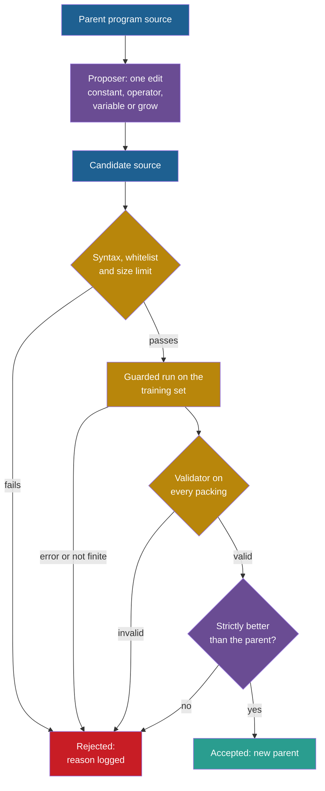

## Learning objectives

After this project you can:

- Represent a strategy as the source of a Python expression, and read its syntax tree.
- Write a whitelist check that rejects syntax errors, forbidden code and programs that are too large.
- Write a program edit on the syntax tree: swap one binary operator.
- Run a candidate under guards: runtime errors, values that are not finite numbers, and the validator.
- Count the reasons for rejection in an edit loop, and explain why most proposals are wasted.

## Prerequisites

- [P3: An evaluator with explicit tests](/notes/ai/recursive-self-improvement/09-build-it/p3-an-evaluator-with-explicit-tests)
- [P4: Propose and test strategy changes](/notes/ai/recursive-self-improvement/09-build-it/p4-propose-and-test-strategy-changes)
- [L5: Recursion, self-reference and programs that change programs](/notes/ai/recursive-self-improvement/01-foundations/l5-recursion-and-self-reference)
- [L5: Code self-modification](/notes/ai/recursive-self-improvement/05-approaches/l5-code-self-modification)

## 1. The problem

A vector of six weights can only express what its six features allow. A program can express much more: thresholds, products, minimums, any formula. This is why FunSearch evolved the source of a function (Romera-Paredes et al., 2023, [Nature](https://www.nature.com/articles/s41586-023-06924-6)). It is also why the Darwin Gödel Machine (DGM) changes the code of a whole coding agent (Zhang et al., 2025, [arXiv:2505.22954](https://arxiv.org/abs/2505.22954)).

A program can also do much more harm. It can crash, loop forever, read files, use the network, or change the evaluator. Real systems handle this in different ways, with different strength:

1. FunSearch discarded programs that timed out, used too much memory or gave invalid output. Its public code does not contain "the sandbox for executing untrusted code" (Romera-Paredes et al., 2023, and the [repository](https://github.com/google-deepmind/funsearch)).
2. The released DGM code runs the agent's self-changes inside Docker containers. A container is an isolated environment with its own files and processes. It keeps the outer loop and the scoring code out of the edited image (see [L4: The Darwin Gödel Machine in code](/notes/ai/recursive-self-improvement/07-implementations/l4-darwin-godel-machine-in-code)).
3. The code of STOP, the Self-Taught Optimizer, uses a guard function adapted from HumanEval, a coding benchmark. Its own docstring says: "This function is NOT a security sandbox." (code walkthrough in [L2: STOP in code](/notes/ai/recursive-self-improvement/07-implementations/l2-stop-in-code)).

In this project the strategy becomes the source text of one Python expression. A seeded random proposer edits it. Every candidate must pass a pipeline of checks before it can score. You will count where the candidates go.

## 2. Terms

| Term | Plain meaning |
|---|---|
| program source | The text of a program. Here, one Python expression such as `-gap`. |
| syntax tree | The structure that Python builds from source text. Each node is one part: a number, a name, an operation. |
| node | One element of the syntax tree. |
| program size | The number of expression nodes in the tree. `-gap` has size 2. |
| whitelist | A list of the node types, names and operators that a program may use. Everything else is forbidden. |
| restricted namespace | The names that the compiled program can see. Here: no built-in functions except `abs`, `min` and `max`. |
| sandbox | An environment that limits what a program can do to the rest of the computer. A restricted namespace in the same process is **not** a sandbox. |
| program edit | One change to the syntax tree: change a constant, swap an operator, replace a sub-expression with a leaf, or grow a sub-expression. |
| guarded run | Running a candidate so that every error becomes a rejection reason instead of a crash of the loop. |
| bloat | Growth of program size without a matching gain in the score. |
| outcome | What happened to one proposal: accepted, not better, already tried, no change, or a rejection reason. |

> [!key] The whitelist
> - **What it is:** a rule that says which constructs a program may contain. Anything not on the list is rejected before it runs.
> - **The problem it solves:** a list of forbidden things is never complete, because there are always new ways to reach a file or a process. A list of allowed things is short and can be checked.
> - **Example:** `__import__('os').system('echo hi')` contains a call to a name that is not `abs`, `min` or `max`, and an attribute access. Both are rejected.
> - **Link to recursive self-improvement (RSI):** a self-modifying system proposes code that nobody reviewed. The check must not depend on the proposer being honest or careful.
> - **Limits:** a whitelist limits what a program can say. It does not limit time or memory. In a real system, the program must also run in a separate process with outside limits.

## 3. The architecture



Blue is the program and purple is the improver. Gold is the chain of checks in the evaluator, teal is an accepted change and red is a rejection. The cheap checks come first. A candidate reaches the expensive packing run only after the checks on its text.

## 4. The algorithm

### 4.1 The program language

A program is one expression with three variables:

| Variable | Meaning |
|---|---|
| `item` | the size of the arriving item |
| `space` | the free space of the bin |
| `gap` | `space - item`, the free space that stays after the item |

It may use numbers, the operators `+ - * /`, the minus sign, and calls of `abs`, `min` and `max`. Nothing else. `0` is first fit, `-gap` is best fit and `gap` is worst fit. Programs that differ in text can behave the same. For example, `item` is constant for one item, so it ranks all bins equally, exactly like `0`.

### 4.2 The four edits

1. **constant**: move one number by a random amount. If the program has no number, nothing changes.
2. **operator**: replace the operator of one binary operation with a different one. You write this edit.
3. **variable**: replace one sub-expression with a variable or a random number.
4. **grow**: combine one sub-expression `X` with a new leaf: `X op leaf`, `abs(X)`, `min(X, leaf)` or `max(X, leaf)`.

The demo of the lab applies the given edits to `min(gap, 30) - space / 3`. With seed 0, "constant" gives `min(gap, 30) - space / 2.3`. "Variable" gives `26`, which turns the strategy into first fit. "Grow" gives `(min(gap, 30) - space / 3) * gap`. An edit on the tree always produces well-formed source, so syntax errors come only from text that someone typed.

### 4.3 The gate, in order

Each step returns a reason, or passes the candidate on:

| Step | Check | Reason |
|---|---|---|
| 1 | `ast.parse` works | `syntax error` |
| 2 | every node type, name, call and constant is on the whitelist | `forbidden: ...` |
| 3 | program size at most the limit (15) | `too large` |
| 4 | compile in the restricted namespace, pack every instance, catch exceptions | `runtime error: <class>` |
| 5 | every priority value is a finite `int` or `float` | `not finite` |
| 6 | every packing passes the validator of P3 | `invalid packing` |
| 7 | the mean excess is strictly lower than the parent's | `not better` |

Step 6 should never fire, because the packer is fixed and correct. It stays as **defense in depth**: if someone changes the packer, the validator still protects the score. The lab tests it with a packer that loses its last bin.

### 4.4 The edit loop

```text
edit_loop(seed_src, task_set, iterations, seed):
    rng = generator(seed); best = seed_src; best_score = score(seed_src); tried = {seed_src}
    for t in 0 .. iterations-1:
        edit, cand = mutate(best, rng)
        if cand == best: outcome = "no change"
        elif cand in tried: outcome = "already tried"
        else:
            add cand to tried
            score, reason = try_candidate(cand, task_set)
            if reason != "ok": outcome = reason before ":"
            elif score < best_score: best, best_score, outcome = cand, score, "accepted"
            else: outcome = "not better"
        log (t, edit, cand, outcome)
    return best, best_score, log
```

The set `tried` saves work: a source that was evaluated once is not evaluated again. It also makes the log honest about how much of the proposal budget was repeated.

## 5. Setup and how to run

Open [Lab: RSI P5 · An agent that edits a program](/labs/new?template=rsi-05-program-edits).

1. Run the two setup cells. The second one defines the language, `program_size`, `make_function` and three of the four edits.
2. Run the explore cell. Pick programs from the list, read their trees and scores, and see what the edits do.
3. Write `check_program`. Run its 14 tests.
4. Write `swap_operator`. Run its tests.
5. Write `try_candidate`. Run its tests.
6. Write `edit_loop`. Run its tests.
7. Run the experiment. Then set `max_size` to 5 and run it again.

## 6. Expected output

With a correct solution, all 35 checks pass.

The experiment uses its default controls: family "mixed big-small", seed program `gap`, 300 iterations, size limit 15, seed 0 and 20 training instances. It prints these outcomes:

| Outcome | Count |
|---|---|
| already tried | 115 |
| not better | 96 |
| no change | 85 |
| accepted | 2 |
| runtime error | 2 |

The two accepted changes are:

1. Iteration 1, edit "variable": `gap` becomes `item`. This ranks all bins equally, so it behaves like first fit.
2. Iteration 55, edit "grow": `item` becomes `item - space`. For one item, this ranks bins like `-gap`, so it behaves like best fit.

The final program scores 12.61 % on the validation set and 11.83 % on the test set. These are exactly the scores of best fit. First fit scores 13.85 % and 13.08 %.

With the size limit set to 5, the outcome "too large" appears 10 times, and the two accepted changes stay the same. With the seed program `0`, the loop needs one accepted change, `0 - space`, at iteration 51.

**Measured:** these numbers come from our run of the reference solution.

**Our interpretation:** only 2 of 300 proposals were useful. 200 were repeats or did nothing: "constant" cannot change a program without numbers, and small programs have few distinct neighbours. A random proposer wastes most of its budget once it is close to a good program. A language model proposer is meant to make fewer useless proposals. That claim must be measured, not assumed (see [P9: From the toy to a language-model version](/notes/ai/recursive-self-improvement/09-build-it/p9-from-toy-to-language-model)).

## 7. Tests and validation

1. `check_program` gets 14 hand-made inputs. Two are allowed programs, and two are too large. The other ten are broken text, an import, attribute access, a comprehension, an unknown function and keyword arguments. The last four are a lambda, a string, a bool and a wrong name.
2. `swap_operator` must never return its input. It may change only the operator, and must produce all three other operators over 60 tries. It must leave a program without a binary operation unchanged, and must be able to choose any operation in a nested program.
3. `try_candidate` must give the exact reasons for `1 / gap` (division by zero at an exact fit), `min(gap)` (a type error), `gap * 1e308 * 10` (infinity) and a broken packer.
4. `edit_loop` must log one known outcome per iteration and beat worst fit. The last accepted candidate must be the returned program, and the run must repeat exactly.

## 8. Common errors

1. **"`eval` with an empty `__builtins__` is safe."** Python objects carry attributes that lead back to the whole runtime. The whitelist must reject attribute access before anything runs.
2. **"Forbid the dangerous names."** You cannot list them all. Allow only what the language needs.
3. **"Catch `Exception` around the whole loop."** Then one bad candidate stops the search. Catch it per candidate and log a reason.
4. **"A division by zero is rare, so skip it."** `1 / gap` fails at every exact fit, and exact fits are common.
5. **"Compare the edited text with the parent to detect a change."** Two different texts can behave the same, like `item` and `0`. The log shows a change of text, not a change of behaviour.
6. **"A larger size limit gives better programs."** It gives more room for bloat: longer programs with the same behaviour.

## 9. Limitations

1. **A tiny language.** No loops, no state, no access to other bins. Real systems edit whole functions or whole repositories.
2. **The checks run in the same process as the search.** A whitelist on a one-line expression is enough for this toy. It is not a sandbox. A real system needs a separate process or container, time and memory limits set outside the program, and no network.
3. **No time limit.** Our expressions always finish fast. A program with loops needs a timeout that the program cannot change. STOP's results show why. When budget limits were not strictly enforced, programs that ignored them tended to score higher (Zelikman et al., 2024, [arXiv:2310.02304](https://arxiv.org/abs/2310.02304), Section 6.2).
4. **A blind proposer.** The random edits do not use the scores, the failures or the code's meaning.

## 10. Suggested extensions

1. Add the edit "swap two children" (`a - b` becomes `b - a`). Does the loop reach best fit faster from `gap`?
2. Track the program size of every accepted candidate. Run the loop from `abs(gap - 25)` with size limits 8, 15 and 30.
3. Detect behavioural duplicates: compare the bin choices of a candidate and its parent on a few instances before you score it. Count how much work this saves.
4. Add a time budget per candidate, measured with `time.perf_counter`, and reject candidates that exceed it.

## 11. Check questions

```check
{
  "question": "Give the gate outcome of each candidate, in the order of the gate: (a) `gap -`, (b) `min(gap, 30) - space / 3`, (c) `space.__class__`, (d) `1 / (space - item)`, (e) `max(gap, 1e308) * 10`.",
  "hint": "Remember that gap = space - item. Which step stops each candidate first?",
  "answer": "(a) 'syntax error' at step 1. (b) It passes steps 1 to 6, and only its score decides. (c) 'forbidden: Attribute' at step 2. (d) It passes the text checks, then fails at step 4 with 'runtime error: ZeroDivisionError' at the first exact fit. (e) Every value is at least 1e308 * 10, which is infinity in floating point, so it fails at step 5 with 'not finite'."
}
```

```check
{
  "question": "In our run, 85 of 300 proposals had the outcome 'no change'. Which edit type caused them, and why does that edit do nothing to `gap` and `item - space`?",
  "hint": "Look at the list of the four edits and at the numbers in these two programs.",
  "answer": "The edit 'constant' caused them. It moves one number of the program, and these programs contain no number. So the edit returns the source unchanged. In P8 the improver learns to give this edit less weight for such programs."
}
```

```check
{
  "question": "The program `item - space` scored exactly like best fit, although it is not the text `-gap`. Explain why. Then explain why `item` scored like first fit.",
  "hint": "For one arriving item, which part of each program is the same for all bins?",
  "answer": "For one item, `item` is the same for every bin. So `item - space` orders the bins by -space, which is the same order as -(space - item) = -gap. The same bin wins, so the packings are identical. `item` alone is a constant for all bins of one item. Every bin ties, so the tie rule picks the first bin with room. That is first fit."
}
```

```check
{
  "question": "A teammate proposes: 'Remove the whitelist. `eval` with no built-ins is enough, and the random proposer never writes imports anyway.' Give two reasons to keep the whitelist.",
  "hint": "Who writes the candidates in a real system? What can an attribute access reach?",
  "answer": "(1) In a real system a language model writes the candidates, and it can write any text, including code that reaches the operating system. A check must not depend on the proposer's habits. (2) An empty __builtins__ does not stop attribute access: Python objects expose attributes that lead to classes, modules and the runtime. Only a whitelist that rejects attributes, comprehensions, lambdas and unknown calls closes those routes for this toy language. A real system still needs process isolation."
}
```

## 12. Summary and links

- The strategy is now program source, edited on its syntax tree by four edit types.
- Every candidate passes a gate: syntax, whitelist, size, a guarded run, finite values, the validator and a strict comparison.
- In our run, 2 of 300 proposals were accepted, and they reached the behaviour of best fit. 200 proposals were repeats or did nothing.
- A whitelist in the same process is not a sandbox. Real systems need process isolation and limits set outside the program.
- P6 adds noise to the agent, and shows that "strictly better" is not enough when the score is noisy.

**Previous:** [P4: Propose and test strategy changes](/notes/ai/recursive-self-improvement/09-build-it/p4-propose-and-test-strategy-changes)

**Next:** [P6: An acceptance rule with a validation suite](/notes/ai/recursive-self-improvement/09-build-it/p6-a-validation-gate)

**Related:** [L6: OpenEvolve in code](/notes/ai/recursive-self-improvement/07-implementations/l6-openevolve-in-code), [L6: The special risks of changing the improver](/notes/ai/recursive-self-improvement/08-failure-modes-and-safety/l6-changing-the-improver-safely), [Reference solutions](/notes/ai/recursive-self-improvement/09-build-it/solutions)

## References

- Bernardino Romera-Paredes, Mohammadamin Barekatain, Alexander Novikov, et al. "Mathematical discoveries from program search with large language models". Nature 625(7995):468–475. 2023. DOI 10.1038/s41586-023-06924-6. https://www.nature.com/articles/s41586-023-06924-6. Code: https://github.com/google-deepmind/funsearch
- Jenny Zhang, Shengran Hu, Cong Lu, Robert Lange, Jeff Clune. "Darwin Gödel Machine: Open-Ended Evolution of Self-Improving Agents". ICLR 2026. arXiv:2505.22954. https://arxiv.org/abs/2505.22954. Code: https://github.com/jennyzzt/dgm
- Eric Zelikman, Eliana Lorch, Lester Mackey, Adam Tauman Kalai. "Self-Taught Optimizer (STOP): Recursively Self-Improving Code Generation". COLM 2024. arXiv:2310.02304. https://arxiv.org/abs/2310.02304. Code: https://github.com/microsoft/stop
