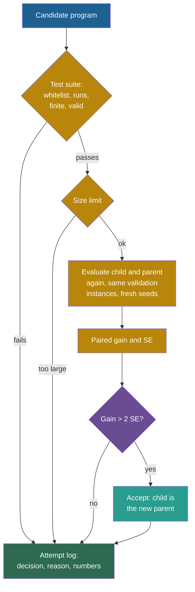

## Learning objectives

After this project you can:

- Explain why a random agent gets a noisy score, and how noise makes a naive acceptance rule accept useless changes.
- Compute the mean and the standard error (SE) of a paired difference between a parent and a child, by hand.
- Write an acceptance rule with a test suite, a size limit and a gain larger than two standard errors.
- Keep an attempt log with a reason and the numbers for every decision.
- Compare a naive rule and the 2 SE rule by the changes that hold on the test set and by the final program size.

## Prerequisites

- [P5: An agent that edits a program](/notes/ai/recursive-self-improvement/09-build-it/p5-an-agent-that-edits-a-program)
- [L3: Evaluation under noise](/notes/ai/recursive-self-improvement/04-mathematics/l3-evaluation-under-noise)
- [L2: One iteration, step by step](/notes/ai/recursive-self-improvement/03-anatomy/l2-one-iteration-step-by-step)
- [L5: Churn, bloat, lost behavior, drift and runaway cost](/notes/ai/recursive-self-improvement/08-failure-modes-and-safety/l5-churn-bloat-and-drift)

## 1. The problem

Two runners race twice, and each wins once. Who is faster? You cannot say. If you must choose after one race, you choose a winner by luck about half of the time. Now repeat this choice 200 times, always against the current winner. You will crown many "faster" runners, and most of them will be no faster at all.

In P5 the score was exact: the same program always got the same score. Agents built on language models are different. They sample, so the same version gets a different score on each run.

Small benchmarks add more noise. For a pass rate $\bar s$ on $n$ tasks, Miller gives the standard error $\sqrt{\bar s(1-\bar s)/n}$ (Miller, 2024, [arXiv:2411.00640](https://arxiv.org/abs/2411.00640), Eq. 2). With 50 tasks and a pass rate of 40 %, this is 0.069. The 95 % confidence interval is then about ±13.6 percentage points. The Darwin Gödel Machine (DGM) first evaluates new agents on 10 tasks, then on 50 more (Zhang et al., 2025, [arXiv:2505.22954](https://arxiv.org/abs/2505.22954)).

When the score is noisy, "the child scored better" is weak evidence. A loop that accepts every better score accepts luck. The research notes call the result **churn**: many accepted changes, a score that moves up and down, and no real gain. As a named effect, churn is **Speculation** in our sources. Its parts are **Measured**: the winner's curse and overfitting to a reused data set.

This project makes the agent random on purpose. Then it builds an acceptance rule that asks for more than luck.

## 2. Terms

| Term | Plain meaning |
|---|---|
| random agent | An agent that sometimes makes a random choice. Here, with probability $\varepsilon$ it puts the item into a random bin that has room. |
| evaluation noise | The spread of the scores of one version over repeated runs. |
| paired comparison | Scoring a parent and a child on the same instances, and looking at the differences instance by instance. |
| gain $d_i$ | The parent's excess minus the child's excess on instance $i$. Positive means the child is better. |
| standard error (SE) | The typical size of the error in a mean that comes from noise and from the choice of instances. |
| 2 SE rule | Accept a child only if its mean gain is larger than two standard errors. |
| naive rule | Accept a child if its mean gain is larger than 0. |
| test suite | Fixed checks that every candidate must pass before it is scored. |
| attempt log | The record of every candidate, the decision and the reason with numbers. |
| churn | Many accepted changes without a real gain. |
| bloat | Growth of a program without a matching gain. Langdon and Poli showed that "fitness based selection leads to bloat" in genetic programming (Langdon and Poli, 1997, [report](https://gpbib.cs.ucl.ac.uk/gp-html/Langdon_1997_bloatTR.html)). |
| held | An accepted change holds if the child is better than the parent on the test set. |

> [!key] The paired comparison
> - **What it is:** score parent and child on the same instances and analyse the differences.
> - **The problem it solves:** instances differ a lot in difficulty. If parent and child see different instances, that difference hides the effect of the change.
> - **Example:** on an instance that every packer finds hard, both versions score badly. The difference on that instance is still small and informative.
> - **Link to recursive self-improvement (RSI):** every iteration of an improvement loop compares a child with its parent. Miller recommends paired analysis for model evaluations (Miller, 2024, [arXiv:2411.00640](https://arxiv.org/abs/2411.00640)). The reason: question-score correlations between frontier models are often 0.3 to 0.7.
> - **Limits:** pairing removes the variation between instances. It does not remove the noise of the agent itself. It does not fix a validation set that is too small or used too often.

## 3. The architecture



Blue is the candidate, gold is the evaluation and purple is the acceptance rule. Teal is an accepted change. Green is the attempt log, which keeps every decision. Every path ends in the log, including the accepted one.

## 4. The algorithm

### 4.1 The random agent

The random agent is the packer of P5 with one change. Before it uses the priority, it draws a random number. With probability $\varepsilon$ it ignores the priority and puts the item into a random bin that has room. The lab uses $\varepsilon = 0.1$. A new seed gives a new run, so the same program gets a different score.

### 4.2 The paired gain and its standard error

The idea: look at the gain on each instance, and ask if the mean gain is large compared with its own uncertainty.

$$
\bar d = \frac{1}{n} \sum_{i=1}^{n} d_i, \qquad
s_d = \sqrt{\frac{1}{n-1} \sum_{i=1}^{n} \left(d_i - \bar d\right)^2}, \qquad
\text{SE} = \frac{s_d}{\sqrt{n}}
$$

- $n$ is the number of validation instances.
- $d_i = e_i^{\text{parent}} - e_i^{\text{child}}$ is the gain on instance $i$, where $e$ is the excess of one run.
- $\bar d$ is the mean gain, and $s_d$ is the sample standard deviation of the gains.
- SE is the standard error of $\bar d$.

The rule is: accept if $\bar d > 2\,\text{SE}$. In plain English: the child must win by more than twice the typical error of the measured win.

> [!example] Worked example: a small gain
> A parent and a child are scored on four instances. The parent's excess values are 0.10, 0.12, 0.08 and 0.10. The child's are 0.10, 0.12, 0.06 and 0.09.
>
> 1. The gains are $d = (0, 0, 0.02, 0.01)$.
> 2. The mean gain is $\bar d = 0.03 / 4 = 0.0075$.
> 3. The deviations from the mean are $-0.0075, -0.0075, 0.0125, 0.0025$. Their squares add up to $0.00005625 + 0.00005625 + 0.00015625 + 0.00000625 = 0.000275$.
> 4. $s_d = \sqrt{0.000275 / 3} = 0.00957$, and $\text{SE} = 0.00957 / 2 = 0.00479$.
> 5. $2\,\text{SE} = 0.0096$. The gain 0.0075 is smaller, so the 2 SE rule rejects the child. The naive rule accepts it, because 0.0075 > 0.
>
> The lab has a test with exactly these numbers.

**Assumptions.** The instances are independent. The mean of the gains is close to normally distributed. Both versions are scored on the same instances.

**When it is useful.** In every iteration of a loop with a noisy score.

**What it does not prove.** The rule is not a guarantee. **Theory:** take a child that is exactly as good as its parent. Under a normal approximation, it still passes a one-sided 2 SE test about 2.3 % of the time. A loop that makes 200 comparisons will therefore accept a few equal children. Also, with $n = 1$ the SE is not defined, and the code sets it to infinity.

### 4.3 Score the parent again

The parent was accepted because its score was good. Part of that score was luck.

Suppose the loop compares a new child with the parent's **old** score. Then the bar is too high, and the luck of the parent hides real gains. So the loop scores the parent again in every iteration, on the same instances as the child, with its own fresh seed. This doubles the cost of each evaluation. It is the price of a fair comparison.

### 4.4 The loop and the attempt log

```text
improvement_loop(seed_src, val_set, iterations, rule, eps, seed):
    rng = generator(seed); best = seed_src; tried = {seed_src}; log = []
    for t in 0 .. iterations-1:
        edit, cand = mutate(best, rng)
        entry = {iteration t, parent best, candidate cand, accepted no, reason "", gain none, se none}
        if cand == best or cand in tried: reason = "skipped: no change or already tried"
        else:
            add cand to tried
            if run_tests(cand) passes and size(cand) <= MAX_SIZE:
                child = evaluate(cand, val_set, eps, seed [seed, t, 0])
                parent = evaluate(best, val_set, eps, seed [seed, t, 1])
            accepted, reason = decide(cand, parent, child, rule)
            if accepted: best = cand
        append entry with the reason and the numbers
    return best, log
```

The rule `decide` checks in a fixed order: the test suite, then the size limit, then the evaluation, then the gain. The first failed check gives the reason. Every reason holds its numbers, for example `rejected: gain +0.0012 <= 2 SE 0.0040`. A log without numbers cannot be checked later.

## 5. Setup and how to run

Open [Lab: RSI P6 · An acceptance rule with a validation suite](/labs/new?template=rsi-06-validation-gate).

1. Run the long setup cell. Its last part is new: `pack_random`, `evaluate` and `run_tests`.
2. Run the noise demo. Move $\varepsilon$ from 0 to 0.3 and watch the histograms.
3. Write `paired_gain`. Run its tests.
4. Write `decide`. Run its 11 tests.
5. Write `improvement_loop`. Run its tests.
6. Run the experiment. Then change $\varepsilon$ and `n_val`.

## 6. Expected output

With a correct solution, all 26 checks pass.

**The noise demo** ($\varepsilon = 0.1$, 30 runs of 20 instances): first fit has a mean of 13.87 % and a standard deviation of 0.19. Best fit has a mean of 12.80 % with a standard deviation of 0.25. Two single runs of best fit give 12.61 % and 12.87 %.

**The experiment** (family "mixed big-small", $\varepsilon = 0.1$, 20 validation instances of 60 items, 200 iterations, seed 0, start program `gap`):

| | Naive rule | 2 SE rule |
|---|---|---|
| accepted changes | 46 | 2 |
| accepted changes that held on the test set | 3 | 2 |
| rejected by the gain | 99 | 70 |
| rejected as too large | 11 | 0 |
| rejected by the tests | 5 | 2 |
| skipped (no change or tried) | 39 | 126 |
| final program | `min(42.1, item) / max(item * space, 6) / 16.0` | `item - space` |
| size of the final program | 13 | 3 |
| test score of the final program | 11.97 % | 11.97 % |

How to read the table:

1. Both rules ended at the same test score. Both final programs behave like best fit.
2. The naive rule accepted 46 changes. Only 3 of them made the program better on the test set. The other 43 were churn: changes that won a noisy comparison and changed nothing real.
3. The naive program grew from size 1 to size 13, with no gain. This is bloat. The 2 SE program has size 3.
4. The 2 SE rule accepted 2 changes, and both held.

We also ran seeds 1 and 2 of the same setup. The naive rule accepted 49 and 56 changes, of which 8 and 2 held. The 2 SE rule accepted 3 and 2 changes, of which 2 and 2 held.

**Measured:** these numbers come from our runs of the reference solution.

**Our interpretation:** in a noisy loop, the number of accepted changes measures luck as much as progress. The size of the program and the share of changes that hold on held-out data are better signs.

## 7. Tests and validation

1. `paired_gain`: hand-computed values, a negative gain, equal scores (gain 0, SE 0), one value (SE infinity), and NumPy arrays.
2. `decide`: a clear gain is accepted and a small noisy gain splits the two rules. The order of the checks is tested with a program that fails the tests, a forbidden program and a program that is too large. A failed evaluation and a zero gain are also tested.
3. `improvement_loop`: one entry per iteration with seven keys and a reason. Accepted entries become the next parent, and every acceptance satisfies the 2 SE rule. The final program passes the tests, and the run repeats exactly.

## 8. Common errors

1. **"Compare the child with the parent's stored score."** The stored score is the lucky one that got the parent accepted. Score the parent again, on the same instances.
2. **"Use the population standard deviation."** For an estimate from a sample, divide by $n - 1$. With 20 instances the difference is small, but the tests check it.
3. **"Different random seeds for the instances of parent and child."** The instances must be the same. The random choices of the agent may differ, and in a real system they will.
4. **"More accepted changes means more progress."** The table shows 46 acceptances with the same final score as 2.
5. **"A reason like 'rejected' is enough."** Without the numbers, you cannot audit the decision later.
6. **"The 2 SE rule never accepts noise."** It accepts an equal child about 2.3 % of the time, under a normal approximation. Over many comparisons, that adds up.

## 9. Limitations

1. **Twenty instances.** The normal approximation is rough with so few values. The SE is itself noisy.
2. **Independent instances.** Real benchmarks have clusters of related tasks. Miller found clustered standard errors that "can be over three times as large as naive standard errors" (Miller, 2024, [arXiv:2411.00640](https://arxiv.org/abs/2411.00640)). A real gate must account for clusters.
3. **Many comparisons on one validation set.** The loop reuses the same 20 instances in every iteration. Over a long run, it can overfit them even with the 2 SE rule.
4. **A strict rule blocks small real gains.** Our sources note that strict thresholds slow real progress. Open-ended search keeps some non-improving steps on purpose (see P7).
5. **A crude random agent.** Random bin choices are not how a language model errs.

A production gate would use a power analysis to choose the number of tasks for the smallest gain that matters. It would also use clustered standard errors, and a fresh confirmation set before a change is deployed.

## 10. Suggested extensions

1. Set $\varepsilon = 0$. The agent is now exact. How many changes does the naive rule accept? Explain the result.
2. Replace 2 SE by 1 SE and by 3 SE. Plot accepted changes and held changes against the threshold.
3. Add a confirmation step: before you accept, score the child once more on a second validation set. Count how many naive acceptances survive.
4. Compare with the optional `keep_better` rule of the DGM code (see [L4: The Darwin Gödel Machine in code](/notes/ai/recursive-self-improvement/07-implementations/l4-darwin-godel-machine-in-code)). It keeps a child only if its score is at least `initial_score - noise_leeway`, with a leeway of 0.1. What does a fixed leeway ignore that an SE-based rule uses?

## 11. Check questions

```check
{
  "question": "A child and its parent are scored on 5 instances. The gains are 0.04, 0.02, 0.00, 0.02 and 0.02. Compute the mean gain and the SE, and decide with the naive rule and with the 2 SE rule.",
  "hint": "The mean is 0.02. Compute the squared deviations from 0.02, divide their sum by n - 1 = 4, and take the square root. Then divide by the square root of 5.",
  "answer": "Mean: 0.10 / 5 = 0.02. Deviations: 0.02, 0, -0.02, 0, 0. Squares: 0.0004, 0, 0.0004, 0, 0, so the sum is 0.0008. s_d = sqrt(0.0008 / 4) = sqrt(0.0002) = 0.01414. SE = 0.01414 / sqrt(5) = 0.00632, so 2 SE = 0.01265. The gain 0.02 is larger than 0.01265, so both rules accept."
}
```

```check
{
  "question": "The naive rule accepted 46 changes and 3 held. The 2 SE rule accepted 2 and both held. The final test scores were equal. Name three costs of the naive rule that the test score does not show.",
  "hint": "Look at the final programs and at the log.",
  "answer": "(1) Bloat: the final program has size 13 instead of 3, so it is harder to read, check and change. (2) A misleading log: 43 entries claim improvements that were luck, which hides the real history. (3) Risk: every accepted change is code that nobody needed, and each one can carry a new failure that the tests do not cover."
}
```

```check
{
  "question": "Why does the loop evaluate the parent again in every iteration instead of using its score from the iteration in which it was accepted?",
  "hint": "Which scores get a candidate accepted?",
  "answer": "A candidate is accepted when its score is high, and part of a high score is luck. So the stored score of the parent is biased upward (the winner's curse). Comparing a new child with it sets the bar too high, and real gains are rejected. A new evaluation on the same instances gives an unbiased comparison. It doubles the cost of an iteration."
}
```

```check
{
  "question": "Classify each statement as true or false. (a) Pairing removes the effect of instance difficulty. (b) Pairing removes the agent's own randomness. (c) A larger validation set makes the SE smaller. (d) The 2 SE rule makes false acceptances impossible.",
  "hint": "Recall what varies between two runs on the same instance.",
  "answer": "(a) True: both versions see the same instances, so difficulty cancels in d_i. (b) False: the agent's random choices still differ between the two runs. (c) True, for a fixed spread of the gains: SE = s_d / sqrt(n). (d) False: under a normal approximation, an equal child passes about 2.3 % of the time, so false acceptances still happen over many comparisons."
}
```

## 12. Summary and links

- A random agent gets a noisy score, and "the child scored better" is weak evidence.
- The paired gain and its standard error measure a change against its own uncertainty. The rule is: accept if $\bar d > 2\,\text{SE}$.
- The acceptance rule checks, in order, the test suite, the size limit, the evaluation and the gain, and logs every decision with numbers.
- In our run, the naive rule accepted 46 changes (3 held) and grew the program to size 13. The 2 SE rule accepted 2 (both held) and kept size 3. The final test scores were equal.
- P7 adds several task families, regression tests and an archive.

**Previous:** [P5: An agent that edits a program](/notes/ai/recursive-self-improvement/09-build-it/p5-an-agent-that-edits-a-program)

**Next:** [P7: Regression tests and an archive](/notes/ai/recursive-self-improvement/09-build-it/p7-regression-tests-and-an-archive)

**Related:** [L3: Evaluation failures: leakage, overfitting, noise and regression](/notes/ai/recursive-self-improvement/08-failure-modes-and-safety/l3-evaluation-failures), [Reference solutions](/notes/ai/recursive-self-improvement/09-build-it/solutions)

## References

- E. Miller. "Adding Error Bars to Evals: A Statistical Approach to Language Model Evaluations". arXiv:2411.00640. 2024. https://arxiv.org/abs/2411.00640
- Jenny Zhang, Shengran Hu, Cong Lu, Robert Lange, Jeff Clune. "Darwin Gödel Machine: Open-Ended Evolution of Self-Improving Agents". ICLR 2026. arXiv:2505.22954. https://arxiv.org/abs/2505.22954. Code: https://github.com/jennyzzt/dgm
- W. B. Langdon, R. Poli. "Fitness Causes Bloat". Technical Report CSRP-97-09, University of Birmingham. 1997. https://gpbib.cs.ucl.ac.uk/gp-html/Langdon_1997_bloatTR.html
- James E. Smith, Robert L. Winkler. "The Optimizer's Curse: Skepticism and Postdecision Surprise in Decision Analysis". Management Science 52(3):311–322. 2006. https://ideas.repec.org/a/inm/ormnsc/v52y2006i3p311-322.html
