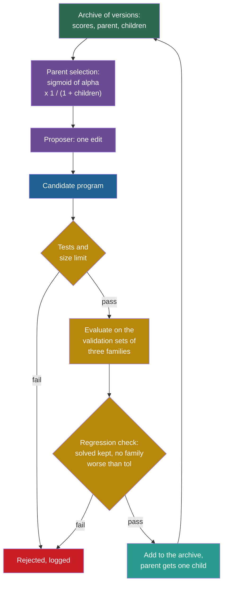

## Learning objectives

After this project you can:

- Define a solved instance, a solve rate and a regression, and explain why a mean score can hide a regression.
- Write a regression check that rejects a change that breaks solved instances or makes a task family worse.
- Compute the Darwin Gödel Machine (DGM) parent-selection probabilities by hand: a sigmoid of the score times $1/(1 + \text{children})$.
- Run a search with an archive and a search with a single greedy line on the same budget.
- Read the comparison over many seeds, and say what it shows and what it does not show.

## Prerequisites

- [P6: An acceptance rule with a validation suite](/notes/ai/recursive-self-improvement/09-build-it/p6-a-validation-gate)
- [L3: Archives: why keep more than the best version](/notes/ai/recursive-self-improvement/03-anatomy/l3-archives-and-search-over-versions)
- [2025: The Darwin Gödel Machine](/notes/ai/recursive-self-improvement/06-research-systems/p10-darwin-godel-machine)
- [L4: The Darwin Gödel Machine in code](/notes/ai/recursive-self-improvement/07-implementations/l4-darwin-godel-machine-in-code)

## 1. The problem

A software team adds a feature, and all of its new tests pass. A week later, users cannot log in. The new code broke something that had worked. This is a **regression**. Teams therefore keep a **regression suite**: tests for old behaviour that every change must still pass.

SWE-bench, a benchmark of real software issues, does the same for patches (Jimenez et al., 2024, [arXiv:2310.06770](https://arxiv.org/abs/2310.06770), Section 2.3). Besides the tests for the fix, it runs "a median of 51 additional tests" for prior functionality.

A long improvement loop meets two problems:

1. **Regressions.** A change can raise the mean score and still break tasks that worked before. A mean over many tasks hides this.
2. **Getting stuck.** A loop that always builds on its single best version cannot use a weaker version as a **stepping stone**.

The DGM answers the second problem with an **archive**. It keeps the versions that still work and chooses parents at random from them. Its paper reports dips in the lineage of its best agent (Zhang et al., 2025, [arXiv:2505.22954](https://arxiv.org/abs/2505.22954)). At iterations 4 and 56, the score "temporarily fell below that of its parent".

The paper also reports ablations on SWE-bench. The full DGM reached 50.0 %, a greedy variant that always picks the best agent 39.7 %, and a variant without the archive 23.0 %. These are **Measured** results from single runs per setting.

In this project you build both ideas at toy scale. Then you compare an archive with a greedy line over several seeds.

## 2. Terms

| Term | Plain meaning |
|---|---|
| task family | A kind of task. Here: three families of instances, each with its own validation and test sets. |
| reference packer | First fit decreasing (FFD): sort all items from largest to smallest, then use first fit. It sees the whole list, so an online agent cannot use it. |
| solved instance | An instance on which the online packer uses no more bins than FFD. |
| solve rate $\alpha$ | The share of all validation instances that a version solves. |
| regression | A change breaks something that worked: a solved instance becomes unsolved, or a family gets worse. |
| regression check | A rule that rejects a change that causes a regression. |
| family guard | The part of the regression check that rejects a change when one family's mean excess gets worse by more than a tolerance. |
| archive | The stored set of kept versions, with their scores, from which parents are chosen. |
| parent selection | The rule that chooses which archive member gets the next change. |
| children count $n_i$ | The number of archive members whose parent is member $i$. |
| greedy line | A search that always changes its best version and keeps only better children. |
| stepping stone | A version that is not the best but leads to a better version later. |

> [!key] The archive
> - **What it is:** a stored set of versions, each with its scores, its parent and its number of children.
> - **The problem it solves:** a single line of versions cannot go back. An archive keeps other branches alive, so the search can continue from a weaker version.
> - **Example:** in our default run, the archive of each seed held 38.2 versions on average after 60 attempts. The greedy line held 2.9.
> - **Link to recursive self-improvement (RSI):** the DGM keeps an archive of agents. Its code keeps every child that still compiles and produces patches by default (`keep_all`). Quality pressure comes only from parent selection.
> - **Limits:** an archive costs evaluations on branches that may lead nowhere. It grows without limit unless you prune it. A high score now does not prove a high ability to improve later. The Huxley-Gödel Machine (HGM) paper calls this the "Metaproductivity-Performance Mismatch" (Wang et al., 2025, [arXiv:2510.21614](https://arxiv.org/abs/2510.21614)).

## 3. The architecture



Green is the archive, purple is the improver and blue is the candidate. Gold is the evaluation, teal is an added version and red is a rejection. In greedy mode, the selection box always returns the best member, and the regression box also asks for a higher $\alpha$ than the parent's.

## 4. The algorithm

### 4.1 Solved instances and the solve rate

Instances are small (20 items) so that the online packer often matches the reference. An instance is solved when the packer uses no more bins than FFD. We do not use the lower bound $L_1$ of P1 for this. In "uniform 20-100", many items are larger than 50, so even an optimal packing often needs more than $L_1$ bins.

The solve rate $\alpha$ of a version is the share of its 60 validation instances (20 per family) that it solves. It plays the role of the share of benchmark tasks that a DGM agent resolves.

### 4.2 The regression check

A child is compared with its parent on the same validation instances. The check returns a reason, or nothing:

1. Count the instances that the parent solved and the child does not. If the count is above `max_breaks`, return `breaks k solved`.
2. For each family, compare the mean excess. If the child is worse by more than `tol`, return `worse on <family>: <delta>`.

> [!example] Worked example: an improvement that breaks one instance
> 1. The program `abs(gap - 25)` solves 46.7 % of the validation instances. First fit (`0`) solves 48.3 %. So the change from the first to the second raises $\alpha$.
> 2. But first fit fails on one instance that `abs(gap - 25)` solved. With `max_breaks = 0`, the check returns `breaks 1 solved` and rejects the change. With `max_breaks = 1`, the change passes.
> 3. The mean went up and one solved task was lost. A rule must decide which matters more. That is a design choice, not a fact of the data.

### 4.3 The DGM parent-selection rule

The idea: choose good versions more often, but give versions with few children extra chances, so that no branch is starved. For archive member $i$ with score $\alpha_i \in [0, 1]$ and $n_i$ children:

$$
s_i = \frac{1}{1 + e^{-\lambda(\alpha_i - \alpha_0)}}, \qquad
h_i = \frac{1}{1 + n_i}, \qquad
p_i = \frac{s_i\, h_i}{\sum_j s_j\, h_j}
$$

- $\lambda = 10$ sets how steep the sigmoid is, and $\alpha_0 = 0.5$ sets its middle.
- $s_i$ is the sigmoid of the score. It rises from near 0 to near 1 as $\alpha_i$ goes from 0 to 1.
- $h_i$ is the bonus for few children. It halves when a member gets its first child.
- $p_i$ is the probability to choose member $i$ as the next parent.

These are the values of the DGM paper and of its code. The code computes `1 / (1 + math.exp(-10*(score-0.5)))` times `1 / (1 + count)`, normalizes, and samples with `random.choices` (`DGM_outer.py`, function `choose_selfimproves`, method `score_child_prop`). One difference: the paper excludes agents with a perfect score from selection. The released code does not (see [L4: The Darwin Gödel Machine in code](/notes/ai/recursive-self-improvement/07-implementations/l4-darwin-godel-machine-in-code)).

> [!example] Worked example: four members
> The archive holds four members with $\alpha = (0.5, 0.5, 0.9, 0.1)$ and children $(0, 1, 0, 0)$.
>
> 1. Sigmoids: $s = (0.5,\ 0.5,\ 1/(1 + e^{-4}),\ 1/(1 + e^{4})) = (0.5,\ 0.5,\ 0.98201,\ 0.01799)$.
> 2. Bonuses: $h = (1,\ 0.5,\ 1,\ 1)$.
> 3. Weights: $s \cdot h = (0.5,\ 0.25,\ 0.98201,\ 0.01799)$. Their sum is 1.75.
> 4. Probabilities: $p = (0.28571,\ 0.14286,\ 0.56115,\ 0.01028)$.
>
> The member with one child has half the chance of its twin with no children. The weak member keeps about 1 %.

**Assumptions.** The score lies in $[0, 1]$, and the children count is a fair measure of how much a branch was explored.

**When it is useful.** When a search can get stuck on its best version and weaker versions may lead further.

**What it does not prove.** It does not prove that the archive finds better versions than a greedy line. That is an empirical question for each problem, and section 6 tests it on ours.

### 4.4 The two searches

```text
archive_search(seed_src, budget, seed, mode):
    archive = [seed program with its results, alpha, 0 children, no parent]
    for t in 0 .. budget-1:
        if mode == "archive": parent = sample from archive with the DGM probabilities
        else: parent = the member with the highest alpha
        cand = mutate(parent)
        outcome = first that applies: skipped (tried before), tests failed, too large,
                  runtime error, regression check, (greedy only) not better
        if no outcome: add cand to the archive, parent.children += 1, outcome = added
        log (t, parent, cand, outcome)
    return archive, log
```

In archive mode, a child does not need to beat its parent. It only needs to work and to pass the regression check. This follows the DGM's default `keep_all`. In greedy mode, a child must also have a higher $\alpha$, so the archive becomes a single chain.

## 5. Setup and how to run

Open [Lab: RSI P7 · Regression tests and an archive](/labs/new?template=rsi-07-regression-archive).

1. Run the setup cell. It defines the pieces of P5 and P6, FFD, the three families and their sets, `evaluate_families` and `solve_rate`. It prints the solve rates of worst fit, first fit and best fit.
2. Write `regression_check`. Run its tests.
3. Write `selection_probs`. Run its tests.
4. Write `archive_search`. Run its tests.
5. Run the experiment. Then try `budget` 20 and 200, and `max_breaks` 0.

## 6. Expected output

With a correct solution, all 23 checks pass.

The setup cell prints these solve rates on the validation sets: worst fit 0.283, first fit 0.483 and best fit 0.517. On the test sets, first fit has 0.450 and best fit 0.556.

The experiment, with its default controls (budget 60, 10 seeds, `max_breaks` 2, `tol` 0.005), prints:

| | Archive (DGM selection) | Greedy line |
|---|---|---|
| best validation $\alpha$ (mean of 10 seeds) | 0.517 | 0.507 |
| test $\alpha$ of that member | 0.552 | 0.524 |
| archive size | 38.2 | 2.9 |
| added | 372 | 19 |
| skipped | 133 | 217 |
| not better | 0 | 277 |
| breaks solved | 77 | 45 |
| worse on a family | 6 | 39 |
| tests failed | 10 | 3 |
| runtime error | 1 | 0 |

We also changed the budget and `max_breaks`:

| Setting | Archive: validation / test $\alpha$ | Greedy: validation / test $\alpha$ |
|---|---|---|
| budget 20 | 0.493 / 0.487 | 0.500 / 0.503 |
| budget 60 (default) | 0.517 / 0.552 | 0.507 / 0.524 |
| budget 60, `max_breaks` 0 | 0.517 / 0.552 | 0.507 / 0.524 |
| budget 200 | 0.517 / 0.552 | 0.517 / 0.556 |

How to read these tables:

1. At budget 20, the greedy line is a little ahead. The archive spends attempts on other branches before it has found a good one.
2. At budget 60, the archive is ahead: every seed reached the best validation $\alpha$ (0.517), and the greedy line did not.
3. At budget 200, both reach the same validation $\alpha$. This is the ceiling of this toy: best fit and programs that behave like it.
4. The greedy line wasted most attempts on "not better" (277) and on repeats (217). Its single parent has few new neighbours.
5. A strict rule (`max_breaks` 0) rejected more children but did not change the final result here.

**Measured:** these numbers come from our runs of the reference solution, 10 seeds per setting.

**Our interpretation:** the archive pays an exploration cost first and can win later. In this toy the path to the best program has almost no deceptive step, so the archive's advantage is small and temporary. The DGM reported a large advantage on SWE-bench, where the path to its best agent included dips. Our toy cannot confirm or refute that result.

## 7. Tests and validation

1. `regression_check`: hand-made results for two families test a pure improvement, a broken solved instance, `max_breaks`, a worse family, `tol` and no change. One real case uses `abs(gap - 25)` and first fit.
2. `selection_probs`: the probabilities add up to 1, one child halves the weight, a better score gets more weight, and a weak member keeps a chance. The values must match the hand computation of section 4.3 to $10^{-8}$.
3. `archive_search`: one log entry per attempt, and the seed program first. The tests also check the archive size, the children counts against the parent links, and that every parent comes before its children. Every member must pass the tests. In greedy mode each member must beat its parent, and the archive must be a chain. The run must repeat exactly.

## 8. Common errors

1. **"Regression means a lower mean."** A change can raise the mean and still break solved tasks. Check per task.
2. **"Normalize only over the members that you might choose."** Then the probabilities do not add up to 1. Divide every weight by the sum of all weights.
3. **"Count children by the attempts on a parent."** The DGM code counts archive members that name the parent. A rejected attempt does not count.
4. **"Pick the best archive member by its test score."** Choose by validation, report by test, as in P1.
5. **"Use the same random generator for parent selection and edits in another order."** The run still works, but it no longer repeats the reference numbers. Follow the order of the specification.
6. **"An archive always beats a greedy line."** Our budget-20 result shows the opposite.

## 9. Limitations

1. **A small toy.** Three families, 60 validation instances and programs of size 15 or less. The ceiling is reached within 200 attempts.
2. **A local regression check.** The child is compared only with its parent. A real regression suite holds every task that any accepted version has solved, and it grows over time.
3. **A reference, not the optimum.** FFD is not always optimal, and an online packer can sometimes beat it.
4. **Selection on the score of today**. HGM measured how well an agent's score predicts the success of its descendants (Wang et al., 2025, [arXiv:2510.21614](https://arxiv.org/abs/2510.21614), Table 1). It used the scores of DGM and of SICA, a self-improving coding agent. The Pearson correlations, where 1 means a perfect linear relation and 0 means none, were only 0.274 to 0.444. Its own estimator reached 0.512 to 0.873.
5. **No pruning and no diversity measure.** The archive keeps every working child, including many with the same behaviour.

A production version would keep a growing regression suite with every solved task. It would store the archive with the full lineage of each version, so that a change can be traced and rolled back. It would also report results over many seeds with their spread.

## 10. Suggested extensions

1. Exclude members with $\alpha = 1$ from selection, as the DGM paper does. Does it matter here?
2. Replace the local regression check with a global suite: every instance that any archive member has solved.
3. Add a clade score in the style of HGM: the share of solved instances over a member and all its descendants. Use it instead of $\alpha$ in the sigmoid.
4. Plot the archive as a tree, with $\alpha$ as the colour of each node. Mark the lineage of the best member.

## 11. Check questions

```check
{
  "question": "An archive has three members: alpha = (0.6, 0.6, 0.3) and children = (2, 0, 0). Compute the selection probabilities. Use e^(-1) = 0.3679 and e^(2) = 7.389.",
  "hint": "s = 1 / (1 + exp(-10 (alpha - 0.5))). For alpha = 0.6 the exponent is -1, and for alpha = 0.3 it is +2.",
  "answer": "s for 0.6 = 1 / 1.3679 = 0.7311. s for 0.3 = 1 / 8.389 = 0.1192. h = (1/3, 1, 1). Weights: 0.2437, 0.7311, 0.1192, and the sum is 1.0940. p = (0.2228, 0.6683, 0.1090). The two members with the same score differ only by their children: the one with 2 children gets a third of the other's chance."
}
```

```check
{
  "question": "A child raises the solve rate from 0.483 to 0.500. It breaks 2 instances that its parent solved, and its mean excess on 'weibull 45' rises by 0.002. With max_breaks = 0 and tol = 0.005, what does the regression check return? With max_breaks = 2?",
  "hint": "Check the breaks first, then the families.",
  "answer": "With max_breaks = 0: 2 breaks are more than 0, so it returns 'breaks 2 solved' and the child is rejected, although alpha went up. With max_breaks = 2: the breaks pass. The family change of +0.002 is below tol = 0.005, so the check returns None and the child passes."
}
```

```check
{
  "question": "At budget 20 the greedy line was ahead (0.500 against 0.493 validation alpha). At budget 60 the archive was ahead (0.517 against 0.507). Explain both results with the parent-selection rule.",
  "hint": "Where does the archive spend its first attempts? Where does the greedy line spend its later attempts?",
  "answer": "The archive gives every member a chance, and weak or new members with few children get a bonus. Early on, many attempts go to branches that do not lead to the best program, so it is slower at budget 20. The greedy line always changes its best member. It improves fast at first. Later its one parent has few new neighbours, so most attempts are repeats or 'not better' (217 and 277 at budget 60). The archive keeps finding new parents and reaches the ceiling in every seed."
}
```

```check
{
  "question": "A paper reports that its archive-based agent beat the greedy baseline by 10 points. List three questions that you would ask before you believe that the archive caused the gain.",
  "hint": "Think about seeds, budgets and how the final agent was chosen.",
  "answer": "(1) How many runs per setting, and what is the spread? One run each cannot separate the two. (2) Was the budget the same, in evaluations, not in iterations? (3) Was the final agent chosen on one task set and scored on another? If the same tasks were used for both, the gain may be selection luck. Also useful: does the gain hold at other budgets, and how does the greedy baseline choose its parent?"
}
```

## 12. Summary and links

- A regression is a loss on something that worked. A mean can rise while solved tasks break, so check per task and per family.
- The DGM rule chooses parents with probability proportional to a sigmoid of the score times $1/(1 + \text{children})$. Every member keeps a chance.
- In our toy, the archive was slower at budget 20, ahead at budget 60, and equal at budget 200.
- The toy has little deception, so the advantage of stepping stones is small here. The DGM reported a large one on SWE-bench.
- P8 turns the improver itself into the thing that improves.

**Previous:** [P6: An acceptance rule with a validation suite](/notes/ai/recursive-self-improvement/09-build-it/p6-a-validation-gate)

**Next:** [P8: Improving the improver](/notes/ai/recursive-self-improvement/09-build-it/p8-improving-the-improver)

**Related:** [2025: The Huxley-Gödel Machine](/notes/ai/recursive-self-improvement/06-research-systems/p11-huxley-godel-machine), [L6: Evolutionary search, populations and open-endedness](/notes/ai/recursive-self-improvement/05-approaches/l6-evolutionary-and-population-methods), [Reference solutions](/notes/ai/recursive-self-improvement/09-build-it/solutions)

## References

- Jenny Zhang, Shengran Hu, Cong Lu, Robert Lange, Jeff Clune. "Darwin Gödel Machine: Open-Ended Evolution of Self-Improving Agents". ICLR 2026. arXiv:2505.22954. https://arxiv.org/abs/2505.22954. Code: https://github.com/jennyzzt/dgm
- Wenyi Wang, Piotr Piękos, Li Nanbo, et al. "Huxley-Gödel Machine: Human-Level Coding Agent Development by an Approximation of the Optimal Self-Improving Machine". ICLR 2026. arXiv:2510.21614. https://arxiv.org/abs/2510.21614
- C. E. Jimenez, J. Yang, A. Wettig, et al. "SWE-bench: Can Language Models Resolve Real-World GitHub Issues?". ICLR 2024. arXiv:2310.06770. https://arxiv.org/abs/2310.06770
