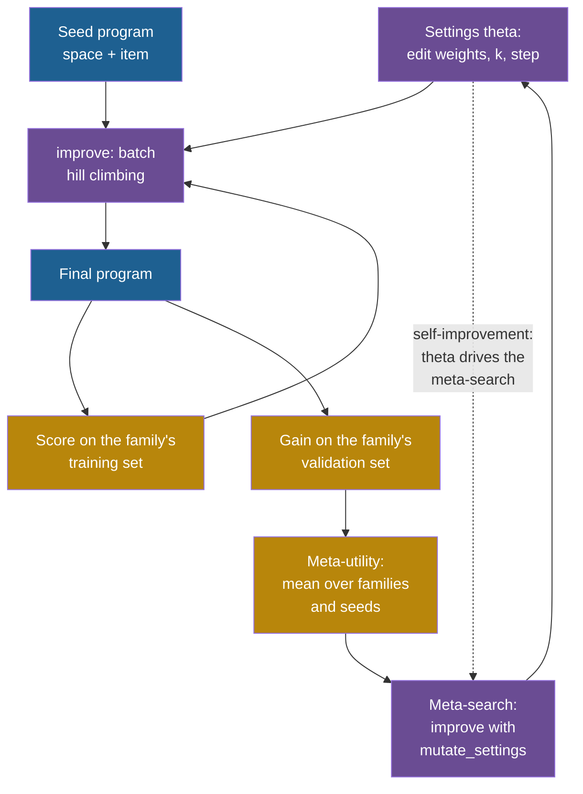

## Learning objectives

After this project you can:

- Write a generic improver whose behaviour depends on its settings: edit weights, candidates per iteration and step size.
- Define a meta-utility and compute it: the mean gain that an improver produces within a fixed budget on training task families.
- Optimize the improver with a fixed meta-improver, and test the result on fresh seeds and on held-out families.
- Let the improver improve its own settings, as the Self-Taught Optimizer (STOP) does with its code, and measure the gain of each round.
- List what stays fixed, and use that list to explain why the gains stop.

## Prerequisites

- [P7: Regression tests and an archive](/notes/ai/recursive-self-improvement/09-build-it/p7-regression-tests-and-an-archive)
- [L4: The improver, meta-levels and the frozen core](/notes/ai/recursive-self-improvement/03-anatomy/l4-the-improver-and-meta-levels)
- [L5: Optimizing the improver: meta-objectives and nested loops](/notes/ai/recursive-self-improvement/04-mathematics/l5-optimizing-the-improver)
- [2023: STOP, the Self-Taught Optimizer](/notes/ai/recursive-self-improvement/06-research-systems/p05-stop-self-taught-optimizer)

## 1. The problem

A coach improves athletes. A better coach improves athletes faster. Now imagine a coach who studies how she coaches, and changes her own methods. If the new methods are better, she also gets better at changing her methods. This is the step from improvement to recursive self-improvement (RSI): the thing that does the improving is itself improved.

STOP, the Self-Taught Optimizer, built this step for scaffold code (Zelikman et al., 2024, [arXiv:2310.02304](https://arxiv.org/abs/2310.02304)):

1. An **improver** $I$ takes a solution, a utility and a language model, and returns a better solution.
2. The **meta-utility** $\hat u(I)$ runs the improver on a set of training tasks and averages the utility of what it returns.
3. The improver is then applied to **its own source code**, scored by the meta-utility: $I_t = I_{t-1}(\hat u, I_{t-1}, L)$.

**Measured:** with GPT-4, STOP improved its mean downstream performance "from 1–3 self-improvement rounds", in 5 runs. The improver from round 4, trained only on one task, also helped on five other tasks. One transfer task was 3-SAT, a logic satisfiability task. There the score went from 21.2 % with the seed improver to 75.1 % (Zelikman et al., 2024, Section 5 and Table 1). With GPT-3.5, "only 12% of GPT-3.5 runs yielded at least a 3% improvement", and with Mixtral the performance declined.

**Measured:** the risks are real. Gödel Agent can rewrite its own improvement code. In 100 trials on one task, 4 % ended in "unexpected termination". This usually happened after the agent modified its own improvement module (Yin et al., 2025, [ACL Anthology](https://aclanthology.org/2025.acl-long.1354), Section 6.2).

In this project the improver's "code" is a small dictionary of six settings. You score it, optimize it, and let it improve itself. Then you find where it stops.

## 2. Terms

| Term | Plain meaning |
|---|---|
| improver | The procedure that takes a version and returns a candidate that it expects to be better. Here: the function `improve`. |
| settings $\theta$ | The six numbers that control the improver: four edit weights, `k` and `step`. |
| edit weights | How often the improver tries each edit type: constant, operator, variable and grow. |
| `k` | The number of candidates per iteration. |
| `step` | How far the edit "constant" moves a number. |
| budget $B$ | The number of proposals that one run of the improver may make. |
| meta-utility $\hat u(\theta)$ | The mean gain that the improver with settings $\theta$ produces within the budget, over training families and seeds. |
| meta-improver | The procedure that changes the settings. |
| self-improvement round | One application of the improver, with settings $\theta_{t-1}$, to the settings $\theta_{t-1}$. |
| ceiling | The meta-utility that the improver would reach if every run ended at best fit. |
| fresh seeds | Random seeds that the meta-search did not use. A score on fresh seeds checks the winner's curse. |
| held-out family | A task family that the meta-search never saw. |

> [!key] The meta-utility
> - **What it is:** a score for an improver: how much better its outputs are than its inputs, averaged over training tasks and seeds.
> - **The problem it solves:** an improver's quality is not visible in one run. It shows only in what it produces on many tasks.
> - **Example:** with the default settings, the improver lowered the validation excess by 1.75 percentage points on average, over 3 families and 8 seeds.
> - **Link to RSI:** STOP's Eq. 2 defines the meta-utility as the mean utility of the improver's outputs on sampled training tasks. Self-improvement maximizes it with the improver itself.
> - **Limits:** it measures the improver only on the training tasks and seeds. A setting can fit their luck, and it can fail on other families.

## 3. The architecture



Purple is the improver and the meta level, blue is the object level (the programs), and gold is the evaluation. The inner loop improves a program. The outer loop improves the settings of the inner loop. With the dotted arrow, the settings also drive the outer loop: that is self-improvement.

## 4. The algorithm

### 4.1 An improver with settings

`improve(solution, utility, mutate_fn, settings, budget, rng)` works for any kind of solution:

```text
improve(solution, utility, mutate_fn, settings, budget, rng):
    best, best_u = solution, utility(solution); k = settings["k"]; used = 0
    while used + k <= budget:
        cands = k calls of mutate_fn(best, settings, rng); used += k
        j = the candidate with the highest utility (the first one on a tie)
        if utility(cands[j]) > best_u: best, best_u = cands[j], utility(cands[j])
    return best, best_u
```

For programs, `mutate_fn` is `mutate_program`. It chooses an edit type with probability proportional to its weight. For settings, `mutate_fn` is `mutate_settings`. It changes one of the six numbers, and moves it by a factor that depends on `step / 10` of the improver that calls it.

The settings matter because the budget is small. With $B = 6$ and $k = 4$, the improver makes one batch of 4 and wastes 2 proposals. With $k = 1$ it makes 6 sequential steps. The edit "constant" does nothing to a program without numbers, such as the seed program `space + item`.

### 4.2 The meta-utility

The idea: score an improver by the gain it produces on several families and seeds, measured on instances that it did not use.

$$
\hat u(\theta) = \frac{1}{|F|\,|S|} \sum_{f \in F} \sum_{s \in S}
\Big( e_f^{\text{val}}(p_0) - e_f^{\text{val}}\big(\text{improve}_\theta(p_0;\ f, s)\big) \Big)
$$

- $F$ is the set of training families: "mixed big-small", "weibull 45" and "uniform 20-100".
- $S$ is the set of seeds 0 to 7.
- $p_0$ is the seed program `space + item`, which behaves like worst fit.
- $\text{improve}_\theta(p_0; f, s)$ is the program that `improve` returns with settings $\theta$, budget $B = 6$ and seed $s$. Its utility is minus the mean excess on the training set of $f$.
- $e_f^{\text{val}}$ is the mean excess on the validation set of $f$.

In plain English: run the improver 24 times, and average how much it lowered the validation excess.

> [!example] Worked example: the ceiling
> If every run ended at best fit, each family would gain the difference between $p_0$ and best fit:
>
> 1. "mixed big-small": $19.71 - 14.59 = 5.12$ points.
> 2. "weibull 45": $15.15 - 8.59 = 6.56$ points.
> 3. "uniform 20-100": $15.98 - 14.34 = 1.64$ points.
>
> The mean is $(5.12 + 6.56 + 1.64)/3 = 4.44$ points. This is the ceiling for the training families. The default settings reach 1.75 points, about 39 % of it.

**Assumptions.** The packer is deterministic, so the score of a program is cached and exact. Every setting uses the same seeds, so two settings are compared on the same random streams.

**When it is useful.** To compare improvers on equal terms: same tasks, same budget, same seeds.

**What it does not prove.** A high $\hat u$ on the training families and seeds does not prove a good improver in general. Section 6 shows a gap on fresh seeds and on held-out families. The ceiling is a rough mark, not a proof: a program could beat best fit on a validation set by a little.

### 4.3 Two ways to change the settings

1. **A fixed meta-improver.** `improve` changes $\theta$, but its own settings are always the defaults. This is ordinary meta-optimization.
2. **Self-improvement.** In round $t$, the improver with settings $\theta_{t-1}$ improves $\theta_{t-1}$:

$$
\theta_t = \text{improve}\big(\theta_{t-1},\ \hat u,\ \text{mutate\_settings},\ \text{settings} = \theta_{t-1},\ B_{\text{meta}} = 12\big)
$$

This mirrors STOP's $I_t = I_{t-1}(\hat u, I_{t-1}, L)$. A change of `k` changes the batch size of the next meta-search. A change of `step` changes how far the next meta-search moves a setting. So a better improver may also be a better improver of itself, or it may not.

### 4.4 What stays fixed

1. The packer, the score, the validator and the tests.
2. The task families, their training and validation sets, and the seeds of the meta-utility.
3. The definition of the meta-utility and the budgets $B = 6$ and $B_{\text{meta}} = 12$.
4. The code of `improve`, `mutate_program` and `mutate_settings`. Only the six numbers of $\theta$ change.
5. The program language: its variables, operators, functions and size limit.

This list is the **frozen core** of the toy. STOP has one too. In STOP the language model, the meta-utility and the downstream utilities are fixed. Its authors write: "Since the language models themselves are not altered, this is not full recursive self-improvement."

## 5. Setup and how to run

Open [Lab: RSI P8 · Improving the improver](/labs/new?template=rsi-08-improve-the-improver).

1. Run the setup cell. It prints the validation excess of the seed program and of best fit for five families.
2. Run the explore cell. Move the four edit weights and count unchanged and better proposals.
3. Write `improve`. Run its tests on a toy problem and on programs.
4. Write `meta_utility`. Run its tests.
5. Run the meta-optimization experiment.
6. Write `self_improve`. Run its tests.
7. Run the self-improvement experiment with 5 rounds.

## 6. Expected output

With a correct solution, all 19 checks pass.

**Setup.** The setup cell prints the validation excess of the seed program and of best fit:

| Family | Seed program | Best fit |
|---|---|---|
| mixed big-small | 19.71 % | 14.59 % |
| weibull 45 | 15.15 % | 8.59 % |
| uniform 20-100 | 15.98 % | 14.34 % |
| triangular (held out) | 16.67 % | 11.20 % |
| small 1-30 (held out) | 3.75 % | 3.75 % |

**Explore** (all weights 1): of 200 proposals from `space + item`, 51 are unchanged, 33 are better on "mixed big-small" and 79 are distinct.

**Meta-optimization** (meta-budget 12, meta-seed 2), mean gain in percentage points:

| Settings | Training families, seen seeds | Training families, fresh seeds | Held-out families |
|---|---|---|---|
| default | 1.75 | 1.54 | 1.44 |
| tuned by a fixed meta-improver | 2.67 | 2.15 | 1.73 |
| ceiling | 4.44 | 4.44 | 2.74 |

The tuned settings raised the weight of "variable" from 1 to 2.46 and lowered `k` from 4 to 3.

**Self-improvement** (5 rounds, meta-budget 12, seed 0):

| Round | Seen seeds | Gain of the round | Fresh seeds | Held-out | Changed settings |
|---|---|---|---|---|---|
| 0 | 1.75 | | 1.54 | 1.44 | defaults |
| 1 | 2.22 | +0.47 | 2.17 | 1.44 | constant 0.77 |
| 2 | 2.43 | +0.21 | 1.86 | 1.73 | constant 0.55, grow 1.11, k 3 |
| 3 | 2.91 | +0.48 | 2.16 | 1.73 | variable 1.48 |
| 4 | 2.91 | +0.00 | 2.16 | 1.73 | none |
| 5 | 2.91 | +0.00 | 2.16 | 1.73 | none |

How to read these tables:

1. **The gains stopped.** After round 3, no change of one setting raised the meta-utility within a meta-budget of 12.
2. **The seen score overstates the gain.** The final settings score 2.91 on the seen seeds, but 2.16 on fresh seeds. In round 2, the seen score rose and the fresh score fell. This is the winner's curse at the meta level.
3. **Self-improvement and the fixed meta-improver ended close.** On fresh seeds, 2.16 against 2.15. The extra seen gain of self-improvement was mostly luck.
4. **Transfer was partial.** On held-out families the gain rose from 1.44 to 1.73, against a ceiling of 2.74.
5. **The ceiling was not reached.** 2.16 of 4.44 on fresh seeds. With $B = 6$, many runs cannot reach best fit, whatever the settings.

**Measured:** these numbers come from our runs of the reference solution.

**Our interpretation:** the improver found real but small changes. It gave less weight to an edit that wasted proposals, and more weight to an edit that helped. Then it hit limits that it cannot change: the budget, the edit code and the program language. Its self-improvement rounds did not beat a fixed meta-improver on fresh seeds.

## 7. Tests and validation

1. `improve` runs on a toy problem whose best answer is 3. It must improve and find 3 within 0.2. For budget 10 and $k = 4$ it must make exactly $1 + 8$ utility calls. A budget below $k$ must change nothing, and the utility must never get worse. On programs, it must beat the seed program.
2. `meta_utility`: an improver that only changes constants gains exactly 0 here, because the seed program has no number. A budget of 0 gains 0. The defaults gain more than 0. A literal value pins the seeds and the order of the loops.
3. `self_improve`: 0 rounds give one entry. The meta-utility never falls, and each value belongs to its settings. The input settings must not change, and the run must repeat exactly.

## 8. Common errors

1. **"Pass `DEFAULT_SETTINGS` as the fourth argument in `self_improve`."** Then the meta-search never uses the improved settings, and it is a fixed meta-improver, not self-improvement.
2. **"Count only the useful proposals against the budget."** Then a wasteful improver gets free work. The budget counts every proposal.
3. **"Use the validation set as the utility of the inner loop."** Then the gain is measured on the data that drove the search. The meta-utility is then too optimistic.
4. **"Different seeds for different settings are fine."** Then two settings differ by luck, not by quality. Use the same seeds for all settings.
5. **"A higher meta-utility on the seen seeds means a better improver."** Check fresh seeds and held-out families.
6. **"The gains stopped, so the improver is optimal."** It is at a local optimum of a meta-search with a small budget and fixed code.

## 9. Limitations

1. **Six numbers, not code.** STOP's improver rewrote its own source. Here the code of the improver is frozen, and only its settings change.
2. **Tiny budgets.** Six proposals per inner run make the settings matter. With larger budgets every setting reaches best fit, and the meta-utility is flat.
3. **Few families and seeds.** Three training families and 8 seeds. The gap to fresh seeds shows that this is not enough.
4. **No safety pressure.** The improver cannot reach the evaluator, the budget or the tests, so it cannot cheat. In STOP, generated improvers turned off a sandbox flag in 0.42 % of 10,000 improvements with GPT-4. When budget limits were not strictly enforced, programs that ignored them tended to score higher (Zelikman et al., 2024, Section 6.2).
5. **A score that predicts the future poorly**. The Huxley-Gödel Machine (HGM) paper found that a current score weakly predicts the success of descendants (Wang et al., 2025, [arXiv:2510.21614](https://arxiv.org/abs/2510.21614)). Our meta-utility measures one run of the improver, not a lineage.

On the ladder of Part 2, this toy has the shape of Level 5, improving the process that makes improvements. But its frozen core is very large, and the measured gains are small and partly luck.

## 10. Suggested extensions

1. Let `mutate_settings` change its own scale factor (now `step / 10`). Does self-improvement then pull ahead of the fixed meta-improver on fresh seeds?
2. Raise the inner budget to 12 and 24. Plot the default meta-utility and the ceiling. At what budget do the settings stop mattering?
3. Use 16 seeds in the meta-utility. Does the gap between seen and fresh seeds shrink?
4. Tune the improver on the held-out families instead. Does it transfer back to the training families?

## 11. Check questions

```check
{
  "question": "The budget is B = 6. For k = 1, 3, 4 and 6, how many proposals does the improver use, and how many sequential steps does it make?",
  "hint": "A batch of k must fit: used + k <= 6.",
  "answer": "With k = 1 there are 6 batches of 1, so 6 proposals and 6 steps. With k = 3 there are 2 batches: 6 proposals and 2 steps. With k = 4 there is 1 batch: 4 proposals and 1 step, and 2 proposals of the budget stay unused. With k = 6 there is 1 batch: 6 proposals and 1 step. The seed program needs about two good changes to behave like best fit. So small k gives more chances to make two steps, but each step chooses from fewer candidates."
}
```

```check
{
  "question": "The final settings of self-improvement scored 2.91 on the seen seeds and 2.16 on fresh seeds. The fixed meta-improver's settings scored 2.67 and 2.15. What do you conclude about self-improvement in this toy?",
  "hint": "Which of the two numbers was used to choose the settings?",
  "answer": "The seen-seed scores were used to choose, so they are optimistic. Both are higher than the fresh-seed scores. On fresh seeds the two methods are equal within 0.01 points. So in this toy, letting the improver improve itself gave no measurable advantage over a fixed meta-improver. Its higher seen score came from selection on the same 24 runs."
}
```

```check
{
  "question": "Classify each item as part of the frozen core of P8, or as something that changes. (a) The weight of the edit 'grow'. (b) The code of mutate_program. (c) The budget B. (d) k. (e) The validation sets. (f) The step size.",
  "hint": "Only the six numbers of theta change.",
  "answer": "Changes: (a) the weight of 'grow', (d) k and (f) the step size. They are three of the six numbers of theta. Frozen core: (b) the code of mutate_program, (c) the budget B and (e) the validation sets."
}
```

```check
{
  "question": "Use the frozen core to explain why the meta-utility stopped at 2.91 on seen seeds, far below the ceiling of 4.44.",
  "hint": "What would have to change for most runs to reach best fit within the budget?",
  "answer": "Three frozen parts limit it. (1) The budget B = 6 allows only a few proposals per run, so many runs cannot reach best fit with any settings. (2) The edit code is fixed: the settings can only reweight the four edits, not invent a better edit. (3) The meta-search changes one setting at a time with a meta-budget of 12, so it stops at a local optimum. The improver cannot change any of these, so its gains stop."
}
```

## 12. Summary and links

- The improver now has settings, and the meta-utility scores them by the gains they produce on training families within a fixed budget.
- A fixed meta-improver raised the meta-utility from 1.75 to 2.67 on seen seeds. On fresh seeds it reached only 2.15, and on held-out families 1.73.
- Self-improvement rose to 2.91 on seen seeds in 3 rounds and then stopped. On fresh seeds it reached 2.16, the same as the fixed meta-improver.
- The gains stopped because of the frozen core: the budget, the edit code, the program language and the meta-budget.
- P9 asks what changes when a language model replaces the random proposer.

**Previous:** [P7: Regression tests and an archive](/notes/ai/recursive-self-improvement/09-build-it/p7-regression-tests-and-an-archive)

**Next:** [P9: From the toy to a language-model version](/notes/ai/recursive-self-improvement/09-build-it/p9-from-toy-to-language-model)

**Related:** [L2: STOP in code](/notes/ai/recursive-self-improvement/07-implementations/l2-stop-in-code), [L8: Meta-learning and improving the improver](/notes/ai/recursive-self-improvement/05-approaches/l8-meta-learning-and-improving-the-improver), [L1: Conditions for sustained improvement, and why it plateaus](/notes/ai/recursive-self-improvement/10-advanced/l1-conditions-for-sustained-improvement), [Reference solutions](/notes/ai/recursive-self-improvement/09-build-it/solutions)

## References

- Eric Zelikman, Eliana Lorch, Lester Mackey, Adam Tauman Kalai. "Self-Taught Optimizer (STOP): Recursively Self-Improving Code Generation". COLM 2024. arXiv:2310.02304. https://arxiv.org/abs/2310.02304. Code: https://github.com/microsoft/stop
- Xunjian Yin, Xinyi Wang, Liangming Pan, Li Lin, Xiaojun Wan, William Yang Wang. "Gödel Agent: A Self-Referential Agent Framework for Recursively Self-Improvement". ACL 2025, pages 27890–27913. DOI 10.18653/v1/2025.acl-long.1354. https://aclanthology.org/2025.acl-long.1354
- Wenyi Wang, Piotr Piękos, Li Nanbo, et al. "Huxley-Gödel Machine: Human-Level Coding Agent Development by an Approximation of the Optimal Self-Improving Machine". ICLR 2026. arXiv:2510.21614. https://arxiv.org/abs/2510.21614
