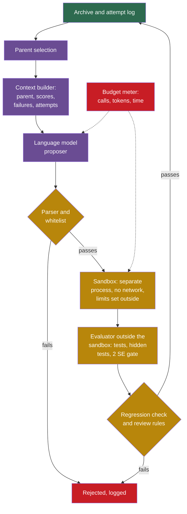

## Learning objectives

After this project you can:

- Design the prompt and the context for a language-model proposer from the parts of P5 to P8.
- Specify how to parse a reply, and list the outcomes of a parse failure.
- Specify a sandbox and budgets that the proposed code cannot change, and explain why they must sit outside the loop.
- Estimate how cost, noise and risk change when a language model replaces the random proposer.
- Map each control of Part 8 to a place in the loop, and design an experiment that tests whether the language model helps.

## Prerequisites

- [P8: Improving the improver](/notes/ai/recursive-self-improvement/09-build-it/p8-improving-the-improver)
- [L6: The special risks of changing the improver](/notes/ai/recursive-self-improvement/08-failure-modes-and-safety/l6-changing-the-improver-safely)
- [L7: Controls, oversight and governance](/notes/ai/recursive-self-improvement/08-failure-modes-and-safety/l7-controls-oversight-and-governance)
- [2023 and 2025: FunSearch and AlphaEvolve](/notes/ai/recursive-self-improvement/06-research-systems/p12-funsearch-and-alphaevolve)
- [L4: The Darwin Gödel Machine in code](/notes/ai/recursive-self-improvement/07-implementations/l4-darwin-godel-machine-in-code)

> [!note] This page is a design, not a lab
> Nothing on this page runs in Labs. The Labs runtime can reach only a few package hosts, not a model API, and an API key does not belong in a lab. So this project has no template. All code here is pseudocode. Build the real version only in an environment that you control, with the controls of section 4.

## 1. The problem

In P5 to P8, a random proposer made the changes. It wasted most of its budget: in P5 only 2 of 300 proposals were accepted, and 200 were repeats or did nothing. It cannot read a score or a failure. It cannot understand what a program does.

Real systems use a large language model (LLM) as the proposer. The LLM reads the parent program, its scores and its failures, and writes a new program. Four published designs show the range:

1. **FunSearch** samples two programs from its database, sorts them by score, labels them `v0` and `v1`, and asks the LLM to write `v2`. Its evaluator discards programs that time out, use too much memory or give invalid output (Romera-Paredes et al., 2023, [Nature](https://www.nature.com/articles/s41586-023-06924-6)).
2. **OPRO** (Optimization by PROmpting) puts the optimization history into the prompt (Yang et al., 2024, [arXiv:2309.03409](https://arxiv.org/abs/2309.03409)). It lists at most 20 earlier solutions with their scores, sorted from worst to best.
3. **STOP**, the Self-Taught Optimizer, has a seed improver that asks the LLM to "Improve the following solution". It shows the score function and samples several candidates at temperature 0.7. It then keeps the best one by the utility (Zelikman et al., 2024, [arXiv:2310.02304](https://arxiv.org/abs/2310.02304)).
4. **The Darwin Gödel Machine (DGM)**, in its released code, first asks a fixed o1 model to read the parent's code and one failure log. That model writes a problem statement. The parent agent then edits its own code base in a Docker container to solve it, within 30 minutes. [L4: The Darwin Gödel Machine in code](/notes/ai/recursive-self-improvement/07-implementations/l4-darwin-godel-machine-in-code) walks through this code.

A language model makes better proposals possible. It also brings three costs: money and time per proposal, noise from sampling, and new risks from code that nobody wrote by hand. This page designs the replacement so that the checks of P5 to P8 stay in force.

## 2. Terms

| Term | Plain meaning |
|---|---|
| language-model proposer | A proposer that asks a language model to write the candidate. |
| prompt | The text sent to the language model. |
| context | The information in the prompt about the current state: the parent program, scores, failures and earlier attempts. |
| temperature | A setting of the language model. A higher temperature gives more varied replies. |
| token | A small piece of text that a language model reads or writes. Providers usually charge per token. |
| parsing | Extracting the candidate program from the reply text. |
| sandbox | An environment, enforced by the operating system or a container, that limits what a program can reach: files, network, processes, time and memory. |
| budget | A hard limit on calls, tokens, time or money, enforced outside the loop. |
| lineage | The chain of parents of a version, with every change. |
| canary task | A task that cannot be solved honestly. Any pass shows a shortcut. |
| trusted monitor | A separate, weaker model or person that checks the output of the stronger model. |

> [!key] Enforce outside, not inside
> - **What it means:** every limit lives in code that the proposed changes cannot edit and that runs outside their process. This covers the sandbox, the budget, the time and the evaluator itself.
> - **The problem it solves:** a search follows the score. If a limit sits inside the editable code, the search can remove it.
> - **Example:** STOP's prompt first carried budget instructions. The language model removed them in later versions and attempted reward hacking. So the authors conveyed the budget through the utility description instead (Zelikman et al., 2024, Section 4).
> - **Link to recursive self-improvement (RSI):** in a self-improving loop, the improver is inside the editable part. Only the outer frame can be trusted.
> - **Limits:** an outside limit can still be wrong. The released DGM code starts containers with default Docker settings, so network access is on and API keys are passed in. Check what your sandbox really does.

## 3. The architecture



Green is the archive and the log, and purple is the improver. Gold is the chain of checks, and red is a rejection or a hard limit. Only the purple part changes from P8. Every gold box stays as it was in P5 to P7, and the budget meter is new.

## 4. The design, step by step

### 4.1 What stays and what changes

| Part | From the toy | In the language-model version |
|---|---|---|
| program language | P5 whitelist | the same whitelist, applied to the parsed reply |
| proposer | `mutate` with four random edits | a language model with a prompt |
| gate | P5 checks and P6 test suite | the same, plus a parse check |
| acceptance rule | P6 paired rule with two standard errors (2 SE) | the same |
| regression check and archive | P7 | the same |
| improver settings | P8: six numbers | prompt template, temperature, number of samples, context size |
| evaluator | in the same process | a separate process with read-only inputs |
| budget | number of proposals | calls, tokens, wall time and money, metered outside |

### 4.2 The prompt and the context

A prompt for one proposal has five parts:

1. **The task.** "Write a priority function for online bin packing. Lower mean excess is better."
2. **The language.** The variables `item`, `space` and `gap`, the allowed operators and functions, and the size limit. A model that knows the rules wastes fewer proposals on forbidden code.
3. **The parent and its scores.** Show the parent's source and its mean excess on each family. Add one or two sibling programs with scores, sorted from worst to best, in the style of FunSearch and OPRO.
4. **Failures.** A few training instances where the parent used more bins than the reference packer, with the item sizes. This is the role of the DGM's failure log.
5. **The output format.** "Reply with one expression in one fenced code block, and nothing else."

Two things must stay out of the prompt:

1. **The validation and test instances.** If the model sees them, they are no longer held out.
2. **Instructions about limits.** Limits that the model is told about can be "simplified" away in later versions, as STOP observed. Enforce them in code.

### 4.3 Parsing the reply

```text
parse(reply):
    blocks = fenced code blocks in reply
    if there is no block: return none, "no program in reply"
    src = the first block, stripped of spaces
    if src has more than one line: return none, "more than one expression"
    reason = check_program(src)          # the P5 whitelist and size limit
    if reason: return none, reason
    return src, "ok"
```

A parse failure is an outcome like any other, and it goes into the attempt log. STOP's helper that extracts code returns nothing when the reply has no code block, and its meta-utility then returns 0 (see [L2: STOP in code](/notes/ai/recursive-self-improvement/07-implementations/l2-stop-in-code)).

### 4.4 The sandbox

The whitelist of P5 is enough for a one-line expression. A real version that edits functions with loops, or whole files, needs more:

1. Run each candidate in a separate process or container, never with `exec` in the process of the loop. ADAS (Automated Design of Agentic Systems) runs generated code with `exec` and attaches it to a class with `setattr` (see [L3: ADAS in code](/notes/ai/recursive-self-improvement/07-implementations/l3-adas-in-code)).
2. No network, no secrets, and no write access outside a scratch folder.
3. CPU time, memory and wall time limits, set by the container, not by the candidate.
4. The evaluator runs outside the sandbox and only reads the candidate's output.
5. Hidden tests that the candidate cannot read, run after it finishes.

Our sources recommend the same: enforce the sandbox at the operating-system or container level, not as a flag in editable code. Run the evaluator separately with read-only access, and set time and storage limits from outside.

### 4.5 Budgets and cost

Every call costs money and time, so the loop needs a budget meter that the proposer cannot change. STOP's code counts calls inside a wrapper object and raises an error when the budget is exceeded (see [L2: STOP in code](/notes/ai/recursive-self-improvement/07-implementations/l2-stop-in-code)).

The cost of a run is roughly

$$
C \approx T \times \big( n_s \, c_{\text{call}} + n_s \, c_{\text{eval}} \big)
$$

- $T$ is the number of iterations.
- $n_s$ is the number of samples per iteration.
- $c_{\text{call}}$ is the cost of one language-model call, which grows with the length of the prompt and the reply.
- $c_{\text{eval}}$ is the cost of one evaluation of a candidate, including the second evaluation of the parent that P6 needs.

In plain English: the cost grows with the iterations, the samples, the size of the context and the size of the evaluation. With 200 iterations and 4 samples, the loop makes 800 calls and up to 1,600 evaluations.

Published runs show the scale. **Measured:** SWE-bench is a benchmark of real software issues. One DGM run on it cost about USD 22,000 and took about 2 weeks (Zhang et al., 2025, [arXiv:2505.22954](https://arxiv.org/abs/2505.22954)). **Measured:** the Huxley-Gödel Machine paper reports about USD 5,000 for its experiments with three methods (Wang et al., 2025, [arXiv:2510.21614](https://arxiv.org/abs/2510.21614)).

### 4.6 Noise

A language model at a temperature above 0 gives different candidates for the same prompt. Your own random seed does not control that sampling. So the run cannot be repeated from a seed.

1. Log everything that the proposal depended on: the prompt, the reply, the model name and version, the temperature, and the time.
2. Keep the paired 2 SE rule of P6. Evaluate the parent again in every iteration.
3. Report results over several runs, with their spread. The DGM ran 3 repeats on one benchmark (Zhang et al., 2025, appendix). It reported a mean of 40.7 % with a standard deviation of 2.3 %.
4. Treat the final choice like P2 and P8 did: confirm the chosen version on fresh tasks before you report it.

### 4.7 The controls of Part 8

| Control | Where it sits in the loop | What it protects against |
|---|---|---|
| frozen evaluator outside the boundary | gold boxes, separate process | edits to the score or the tests |
| hidden held-out tests | after the sandbox run | overfitting and special-casing |
| canary tasks | in the test suite | shortcuts: any pass is a cheat |
| diff of protected files | before acceptance | changes to tests, markers or limits |
| lineage and attempt log | archive | silent changes, and loss of the history needed for rollback |
| trusted monitor on diffs | before acceptance | suspicious code that the tests miss |
| human review of meta-level changes | before a change to the improver | changes that compound across generations |
| budget meter | around every call and run | runaway cost |

Three results explain why each control matters:

1. **Measured:** the DGM removed the markers that a hallucination detector relied on. Its traceable lineage let the team see the change (Zhang et al., 2025, and [Sakana AI blog](https://sakana.ai/dgm/)).
2. **Measured:** in ImpossibleBench, read-only tests did not stop special-casing or operator overloading (Zhong et al., 2025, [arXiv:2510.20270](https://arxiv.org/abs/2510.20270)).
3. **Measured:** AI control experiments compared protocols with a 2 % audit budget (Greenblatt et al., 2024, [PMLR](https://proceedings.mlr.press/v235/greenblatt24a.html)). Upfront auditing reached a safety of 15 %. Trusted monitoring reached 62 % to 92 %, depending on the deferral setting.

## 5. Pseudocode of the full loop

```text
run_lm_loop(seed_program, families, budget):
    meter = BudgetMeter(max_calls, max_tokens, max_seconds, max_money)   # outside the loop's code
    archive = [evaluate_in_sandbox(seed_program)]
    for t in 1 .. T:
        if meter.exhausted(): stop and log "budget"
        parent = select_parent(archive)                  # P7 rule
        prompt = build_context(parent, archive, attempt_log, training failures)
        for each of n_s samples:
            reply = meter.call(language_model, prompt, temperature)
            src, reason = parse(reply)                   # whitelist of P5
            if src is none: log (t, reply, reason); continue
            if src was tried before: log (t, src, "already tried"); continue
            tests = run_tests_in_sandbox(src)            # P6 suite plus canaries
            if tests failed: log (t, src, tests); continue
            child = evaluate_in_sandbox(src, validation sets)
            parent_again = evaluate_in_sandbox(parent, validation sets)
            decision = acceptance_rule(parent_again, child)        # P6: paired 2 SE
            decision = decision and regression_check(parent, child) # P7
            if decision and the change touches the improver: wait for human review
            log (t, prompt id, reply id, src, decision, numbers)
            if decision: add child to archive with its lineage
    best = choose by validation; report test once, with cost and number of runs
```

## 6. What changes: cost, noise and risk

| | Random proposer (P5 to P8) | Language-model proposer |
|---|---|---|
| cost per proposal | microseconds | a model call: money and seconds |
| useful proposals | rare: 2 of 300 in P5 | expected to be more frequent, but this must be measured |
| repeatable from a seed | yes | no, so log every input and output |
| noise in proposals | only from the seed | sampling, model version and provider changes |
| reach of a bad proposal | a one-line expression behind a whitelist | any code that the language allows, so it needs a sandbox |
| who can change the limits | nobody: they are outside | nobody, if you keep them outside |
| evidence for the gain | exact, in our runs | needs a random-proposer baseline with the same budget |

**Our interpretation:** the language model changes the proposer and nothing else. Every check that made the toy trustworthy must stay. The cost and the risk grow faster than the gain unless you measure all three.

## 7. How to validate a language-model version

1. **Same-budget baselines.** Run the random proposer of P5 and the language-model proposer with the same number of evaluations. Our sources stress that random baselines with the same budget are essential.
2. **Several runs.** At least 3 runs of each, with their spread.
3. **A fresh test set.** Choose the final version by validation. Report the test score once.
4. **Ablations.** Remove the failures from the prompt, then remove the archive. Measure what each part adds.
5. **Cost.** Report calls, tokens, time and money next to every score.
6. **Safety logs.** Report how many proposals failed the whitelist, touched protected files or failed canary tasks.

## 8. Common errors

1. **"The model writes good code, so skip the whitelist."** The whitelist does not judge quality. It limits what the code can reach.
2. **"Tell the model not to cheat."** The model evaluator METR tested such instructions. Their effect was "nearly negligible" (von Arx et al., 2025, [METR blog](https://metr.org/blog/2025-06-05-recent-reward-hacking)).
3. **"Put the budget in the prompt."** STOP saw such instructions removed. Enforce budgets in a meter outside the loop.
4. **"Show the model the validation instances, so it can fit them."** Then the validation score no longer predicts anything.
5. **"One good run proves the method."** Language-model runs vary. Report several runs and their cost.
6. **"A Docker container is a sandbox."** Only if you configure it: no network, no secrets, limits set outside.

## 9. Limitations and open problems

1. A language model may propose fewer useless changes, but our sources give no measurement for this toy. The claim must be tested.
2. A better proposer does not move the ceiling of P8 if the evaluator, the language and the budget stay the same.
3. Long runs make many choices on one validation set, and they can overfit it even with the 2 SE rule.
4. Models change over time. A run that worked with one model version may not repeat with the next.
5. No control makes a self-improving system safe on its own. The controls reduce known risks, and the theory of safe self-modification is unsolved (see [L6: The special risks of changing the improver](/notes/ai/recursive-self-improvement/08-failure-modes-and-safety/l6-changing-the-improver-safely)).

## 10. Suggested extensions

These are design exercises. Write the answer as a short specification.

1. Write the full prompt of section 4.2 for the parent `item - space`, with two failure instances of your choice.
2. Specify the container limits for a candidate that may contain a loop: CPU seconds, memory, file system and network.
3. Design an experiment that tells you whether the failures in the prompt help. Give the number of runs, the budget and the metric.
4. Decide which changes need human review in a version where the language model may also edit the prompt template, as in P8.

## 11. Check questions

```check
{
  "question": "A team writes a limit of 10 model calls per improvement into the prompt. Later versions of the improver no longer obey it. What went wrong, and how do you fix it?",
  "hint": "Where does the limit live: in text that the system can rewrite, or in code that it cannot reach?",
  "answer": "The limit lived in the prompt, which is part of what the improver writes and changes. A search that follows the score removes limits that cost score. STOP observed exactly this. The fix: enforce the budget in a wrapper outside the loop that counts the calls and stops them. Keep the prompt free of rules that the system could edit."
}
```

```check
{
  "question": "A loop runs 200 iterations with 4 samples each. Each candidate needs one evaluation, and the parent is evaluated again for each tested candidate. If 50 % of the samples fail the parser or the whitelist, how many model calls and how many evaluations does the run make?",
  "hint": "Calls do not depend on the parse result. Evaluations happen only for samples that pass.",
  "answer": "Calls: 200 x 4 = 800. Samples that pass: 400. Each needs a child evaluation and a parent evaluation, so 800 evaluations. A parse failure still costs a full model call, so the parse failure rate is a cost to watch."
}
```

```check
{
  "question": "Classify each design as acceptable or not, and give one reason. (a) The evaluator runs in the same Python process as the candidate, protected by a flag use_sandbox=True. (b) The candidate runs in a container without network, and the evaluator reads its output from outside. (c) The test instances are in the prompt, so that the model can see real failures. (d) Every prompt, reply and model version is stored with the decision.",
  "hint": "Ask for each design: could the proposed code change it, and does it leak held-out data?",
  "answer": "(a) Not acceptable: a flag inside editable code can be turned off, and STOP measured improvers that did so. (b) Acceptable: the limits are set outside the candidate. (c) Not acceptable: the test set is then no longer held out. Use failures from the training set. (d) Acceptable and necessary: the run cannot be repeated from a seed, so the log is the only record for audit and rollback."
}
```

```check
{
  "question": "Your language-model version reaches a test excess 0.4 points lower than the random proposer of P5. Name three facts that you need before you claim that the language model is the reason.",
  "hint": "Think about budget, repetition and selection.",
  "answer": "(1) Both used the same evaluation budget. (2) The difference holds over several runs of each, with its spread, and it is larger than that spread. (3) The final versions were chosen on validation and scored once on the same fresh test set. Also useful: the cost of each method, and an ablation that removes the context from the prompt."
}
```

## 12. Summary and links

- A language model replaces only the proposer. The gate, the test suite, the 2 SE rule, the regression check and the archive stay.
- The prompt holds the task, the language rules, the parent with scores, training failures and the output format. It never holds held-out data or rules about limits.
- Parse failures are outcomes in the log. Candidates run in a real sandbox with limits set outside, and the evaluator stays outside it.
- Cost, noise and risk grow. Meter the budget outside the loop, log every input and output, and compare with a random proposer at the same budget.
- This page is a design. It does not run in Labs.

**Previous:** [P8: Improving the improver](/notes/ai/recursive-self-improvement/09-build-it/p8-improving-the-improver)

**Next:** [Reference solutions](/notes/ai/recursive-self-improvement/09-build-it/solutions)

**Related:** [L7: What the code teaches](/notes/ai/recursive-self-improvement/07-implementations/l7-what-the-code-teaches), [L4: Open problems, and how to read new RSI work](/notes/ai/recursive-self-improvement/10-advanced/l4-open-problems-and-how-to-read-new-work)

## References

- Bernardino Romera-Paredes, Mohammadamin Barekatain, Alexander Novikov, et al. "Mathematical discoveries from program search with large language models". Nature 625(7995):468–475. 2023. DOI 10.1038/s41586-023-06924-6. https://www.nature.com/articles/s41586-023-06924-6
- Chengrun Yang, Xuezhi Wang, Yifeng Lu, et al. "Large Language Models as Optimizers". ICLR 2024. arXiv:2309.03409. https://arxiv.org/abs/2309.03409
- Eric Zelikman, Eliana Lorch, Lester Mackey, Adam Tauman Kalai. "Self-Taught Optimizer (STOP): Recursively Self-Improving Code Generation". COLM 2024. arXiv:2310.02304. https://arxiv.org/abs/2310.02304. Code: https://github.com/microsoft/stop
- Jenny Zhang, Shengran Hu, Cong Lu, Robert Lange, Jeff Clune. "Darwin Gödel Machine: Open-Ended Evolution of Self-Improving Agents". ICLR 2026. arXiv:2505.22954. https://arxiv.org/abs/2505.22954. Code: https://github.com/jennyzzt/dgm
- Sakana AI. "The Darwin Gödel Machine: AI that improves itself by rewriting its own code". Blog. 30 May 2025. https://sakana.ai/dgm/
- Wenyi Wang, Piotr Piękos, Li Nanbo, et al. "Huxley-Gödel Machine: Human-Level Coding Agent Development by an Approximation of the Optimal Self-Improving Machine". ICLR 2026. arXiv:2510.21614. https://arxiv.org/abs/2510.21614
- Shengran Hu, Cong Lu, Jeff Clune. "Automated Design of Agentic Systems". ICLR 2025. arXiv:2408.08435. https://arxiv.org/abs/2408.08435. Code: https://github.com/ShengranHu/ADAS
- Z. Zhong, A. Raghunathan, N. Carlini. "ImpossibleBench: Measuring LLMs' Propensity of Exploiting Test Cases". ICLR 2026. arXiv:2510.20270. https://arxiv.org/abs/2510.20270
- R. Greenblatt, B. Shlegeris, K. Sachan, F. Roger. "AI Control: Improving Safety Despite Intentional Subversion". Proceedings of the 41st ICML, PMLR 235:16295–16336. 2024. arXiv:2312.06942. https://proceedings.mlr.press/v235/greenblatt24a.html
- S. Von Arx, L. Chan, B. Barnes (METR). "Recent Frontier Models Are Reward Hacking". METR blog. 5 June 2025. https://metr.org/blog/2025-06-05-recent-reward-hacking
