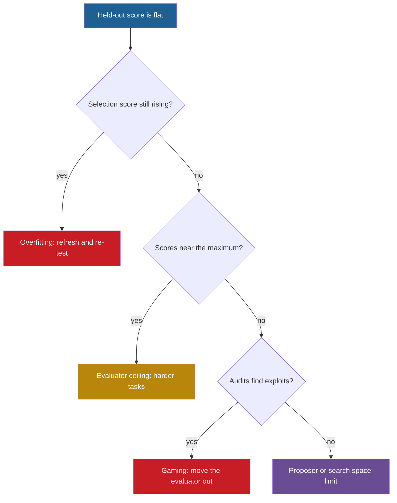

## Learning objectives

After this lesson you can:

- List nine conditions that a self-improving loop needs to keep improving, and give the evidence for each one.
- Diagnose why a loop plateaus from its training, selection and held-out curves.
- Fit a saturating model to published per-iteration gains, and state what the fit does not prove.
- Explain the returns parameter $r$, and why $r > 1$ is a condition inside a model, not a measured fact about the future.
- Separate the claims about sustained improvement that experiments can test from the claims that stay speculative.

## Prerequisites

- [L3: Feedback loops](/notes/ai/recursive-self-improvement/01-foundations/l3-feedback-loops)
- [L3: Archives: why keep more than the best version](/notes/ai/recursive-self-improvement/03-anatomy/l3-archives-and-search-over-versions)
- [L4: Improvement dynamics: rates, diminishing returns and plateaus](/notes/ai/recursive-self-improvement/04-mathematics/l4-improvement-dynamics)
- [L7: Training-based self-improvement and synthetic data](/notes/ai/recursive-self-improvement/05-approaches/l7-training-based-self-improvement)
- [L1: Measured score versus real capability](/notes/ai/recursive-self-improvement/08-failure-modes-and-safety/l1-measured-score-vs-real-capability)

## 1. The question this idea answers

A student prepares for an exam with a book of 200 past questions and the answer key. In the first week, the student's score on the book rises fast. In the third week, it hardly moves, because the student now knows most answers in the book.

Is the student still learning, or only remembering the book? The book cannot tell you. Only new questions can tell you. And even a good student stops improving at some point. The book has no harder questions, time is limited, and the way of studying stays the same.

Replace the student with an agent, the book with a benchmark, and the answer key with an evaluator. You now have the central problem of this part of the course. Every claim of recursive self-improvement (RSI) must answer two questions:

1. What does a loop need so that improvement continues?
2. Why do real loops slow down and stop?

The honest summary of the evidence in October 2026 is short. No published system shows improvement without limit. Every measured loop in this course either slows down, or stops because its budget ends before a plateau can be seen.

## 2. Mental model, and where it stops working

> [!analogy] The student, the answer key and the study method
> A student keeps improving at an exam when nine things are true:
>
> 1. The answer key is correct, and the student cannot change it (a reliable evaluator).
> 2. There are harder questions left (headroom).
> 3. The student can try many kinds of study methods (an expressive search space).
> 4. The student has good ideas about what to try (a capable proposer).
> 5. The student keeps old notes, even notes that did not help yet (an archive of stepping stones).
> 6. The student has enough hours (budget).
> 7. What the student learns also works on new questions (transfer).
> 8. The student still knows it next week (persistence).
> 9. For the strongest case, the student also gets better at studying (an improver that improves).
>
> **Where it stops working:** a student's brain changes with every hour of study. In most self-improving agents, the language model is frozen, so only the code and the text around it change. A student cannot rewrite the answer key, but an agent sometimes can reach its evaluator. And an agent system can keep hundreds of versions alive in an archive.

## 3. Terms

| Term | Plain meaning |
|---|---|
| sustained improvement | The held-out score keeps rising over many iterations, by more than the noise, with a fixed budget per iteration. |
| plateau | A stretch of iterations in which the held-out score does not rise by more than the noise. |
| headroom | The gap between the current score and the highest score that the task or the evaluator allows. |
| evaluator ceiling | The point at which the evaluator cannot separate better versions from worse ones any more. |
| diminishing returns | Each iteration buys a smaller gain than the iteration before it. |
| search space | The set of all candidates that the proposer can produce. |
| stepping stone | A version that is not the best now, but leads to a better version later. |
| transfer | A gain that also appears on tasks, models or benchmarks that did not select the change. |
| persistence | A change stays for future tasks. |
| metaproductivity | The ability of a version to produce good descendants, as opposed to its own score. |
| generation–verification gap | How much better a model can check answers than produce them. |
| returns parameter $r$ | In the model of Eth and Davidson, the number of times software doubles for each doubling of cumulative research effort. |
| recalcitrance | Bostrom's word for how hard it is to make a system smarter with more effort. |
| model collapse | Quality loss when models train again and again on their own generated data. |

> [!key] Sustained improvement
> 1. **Name:** sustained improvement.
> 2. **Meaning:** the score on tasks that never chose a change keeps rising for many iterations, by more than the measurement noise.
> 3. **Problem it solves:** it separates real progress from a lucky winner, a gamed evaluator and a short burst of easy gains.
> 4. **Example:** the Darwin Gödel Machine (DGM) ran for 80 iterations. Its best agent went from 20.0% to 50.0% on a 200-task subset of SWE-bench Verified. Whether this is sustained depends on a held-out check and on repeated runs.
> 5. **Link to RSI:** the "intelligence explosion" picture needs improvement that is sustained and also accelerating.
> 6. **Limits:** a finite experiment can show sustained improvement for N iterations. It can never show improvement without limit.

## 4. Method and math

### 4.1 What "sustained" means

A single gain is easy to produce. Sustained improvement is hard to produce and hard to measure. Use these four tests before you call a curve sustained:

1. The score that rises is a held-out score, not the score that selected the changes. ([L3: Evaluation under noise](/notes/ai/recursive-self-improvement/04-mathematics/l3-evaluation-under-noise) explains why the selection score is too high.)
2. Each rise is larger than the noise of the measurement. With 50 tasks, one task is 2 percentage points.
3. The budget per iteration stays fixed. Otherwise you buy the gain with more compute, not with a better system.
4. The rise continues for many iterations, and the report says how many and over how many runs.

Curves of score against iteration have three basic shapes. A **saturating** curve has gains that shrink toward zero. A **steady** curve has gains of about the same size. An **accelerating** curve has gains that grow. Only the third shape matches Good's 1965 picture, in which each better machine designs a still better one ([L5: A short history](/notes/ai/recursive-self-improvement/02-core-idea/l5-history-from-good-to-agents)).

**Our interpretation:** the published curves in this course are saturating, or too short and too noisy to tell the shape.

### 4.2 Nine conditions for sustained improvement

Each condition below says what it is, why the loop needs it, and what the research shows.

**Condition 1. A reliable evaluator outside the thing that changes.** The evaluator is the only source of direction in the loop. Zenil et al. state it directly: "A positive-feedback theory therefore needs more than recursion. It needs a directional criterion." (Zenil et al., 2026, [arXiv:2601.05280](https://arxiv.org/abs/2601.05280)).

- **Theory:** Mahoney proved a bound for a closed sequence of programs, in which each program only outputs its successor. After $n$ steps, the program holds at most $O(\log n)$ bits of new information ([Mahoney, 2010](https://mattmahoney.net/rsi.pdf)). The reason is simple. You can describe program $n$ as "the first program, run $n$ times", and $n$ needs only about $\log_2 n$ bits. The bound holds only for a system with no new input. So information must enter from outside: from tests, from the environment, from data.
- **Measured:** AlphaGo Zero had a perfect, fixed evaluator: the rules of Go. A new checkpoint replaced the best player only if it won by "a margin of > 55%" of 400 games. The 40-block run played 29 million self-play games in 40 days and reached an Elo of 5,185. The paper reports no regression (Silver et al., 2017, Nature).
- **Measured:** without an outside signal, self-correction can make things worse. GPT-3.5 on CommonSenseQA fell from 75.8 to 38.1 with intrinsic self-correction. With oracle labels that marked the wrong answers, it rose to 89.7 (Huang et al., 2023, [arXiv:2310.01798](https://arxiv.org/abs/2310.01798), Tables 2–4).
- **Measured:** memory loops without labels fell below the model that did not adapt. On FiNER, online ACE scored 67.3 and Dynamic Cheatsheet 68.3. The base model scored 70.7 (Zhang et al., 2025, [arXiv:2510.04618](https://arxiv.org/abs/2510.04618)).

**Condition 2. Headroom.** A loop cannot rise above the highest score that its evaluator gives. Near that ceiling, real progress and noise become hard to separate.

- **Measured:** in Meta-Rewarding, "responses increasingly approached the maximum score, making further improvements difficult to detect" (Wu et al., 2024, [arXiv:2407.19594](https://arxiv.org/abs/2407.19594), Section 5).
- **Measured:** the state of the art on SWE-bench Verified rose from 74.9% to 80.9% in six months. OpenAI then stopped reporting it. An audit of 138 problems that o3 did not solve consistently found material issues in 59.4% of them ([OpenAI, 23 February 2026](https://openai.com/index/why-we-no-longer-evaluate-swe-bench-verified/)).

**Condition 3. An expressive search space.** If the better versions are not in the search space, no amount of search finds them.

- **Measured:** the original POET described environments with a fixed, bounded set of parameters. Its runs "gradually lose steam and plateau after around 20,000 iterations". Enhanced POET used a generator that can express any terrain in principle. Its count of new solved environments kept rising almost linearly (Wang et al., 2020, [arXiv:2003.08536](https://arxiv.org/abs/2003.08536), Figure 8).
- **Claimed:** Promptbreeder evolves prompt text, but "the topology of prompting remains fixed" (Fernando et al., 2023, [arXiv:2309.16797](https://arxiv.org/abs/2309.16797), §6).

**Condition 4. A capable proposer.** In a loop with a frozen model, the proposer decides which changes are ever tried.

- **Measured:** with GPT-4, STOP's improver improved itself. With GPT-3.5 and Mixtral, performance fell. Only 12% of 25 GPT-3.5 runs gained at least 3%. GPT-3.5 did not start low. Its seed improver started at 65%, and GPT-4 at 61% (Zelikman et al., 2023, [arXiv:2310.02304](https://arxiv.org/abs/2310.02304), Section 5.3).
- **Claimed:** the DGM authors write that it is "inherently limited by the capabilities of the underlying FM". FM means the frozen foundation model (Zhang et al., 2025, [arXiv:2505.22954](https://arxiv.org/abs/2505.22954), Section 6).

**Condition 5. Stepping stones and an archive.** A greedy loop keeps only the best version. It gets stuck when every small change from the best looks worse. An archive keeps worse versions that may lead somewhere better ([L3: Archives](/notes/ai/recursive-self-improvement/03-anatomy/l3-archives-and-search-over-versions)).

- **Measured:** on SWE-bench, the full DGM reached 50.0%. Without open-ended exploration (always change the latest version, no archive) it reached 23.0%. With greedy parent choice it reached 39.7% (Zhang et al., 2025).
- **Measured:** on a deceptive maze, novelty search solved 39 of 40 runs. Search that followed the objective solved 3 of 40 (Lehman and Stanley, 2011).
- **Measured, against:** an archive helps only if the proposer uses it well. In a re-test of ADAS-style meta agents, the cumulative archive context "performs worse than ignoring prior designs entirely" (El et al., 2025, [arXiv:2510.06711](https://arxiv.org/abs/2510.06711)).

**Condition 6. Enough budget.** Every iteration costs evaluation. A small budget means few candidates, few tasks and noisy scores.

- **Measured:** one DGM run on SWE-bench took about two weeks and about USD 22,000 (Zhang et al., 2025, v1 Appendix B.1). SICA's 15 iterations cost about USD 7,000 (Robeyns et al., 2025, [arXiv:2504.15228](https://arxiv.org/abs/2504.15228)).
- **Speculation:** for AI research done by AI, Eth and Davidson name a compute bottleneck. In their words, "the fixed amount of computing power limits how many AI experiments can be run in parallel" ([Eth and Davidson, 2025](https://forethought.org/research/will-ai-r-and-d-automation-cause-a-software-intelligence-explosion)).

**Condition 7. Transfer.** If a gain appears only on the tasks that selected it, the loop climbs the quirks of those tasks. When the quirks are used up, it stops.

- **Measured, for:** the DGM-discovered agent raised Claude 3.7 Sonnet from 19.0% to 59.5% on the SWE-bench subset. The agent evolved on SWE-bench scored 28.9% on Polyglot, against 14.2% for the initial agent (Zhang et al., 2025).
- **Measured, against:** ReST-EM reports that "training performance increases linearly with the number of ReST-EM iterations, test set performance does not". The authors blame "overfitting on the small set of training problems" (Singh et al., 2024, [arXiv:2312.06585](https://arxiv.org/abs/2312.06585), Section 5.1).

**Condition 8. Persistence, with clean memory.** A change that disappears after the task cannot be the base of the next improvement. Self-Refine improves one answer, then starts fresh on the next input (Madaan et al., 2023, [arXiv:2303.17651](https://arxiv.org/abs/2303.17651)). For this reason, Duan et al. define RSI through "persistent changes" (Duan et al., 2026, [arXiv:2609.11873](https://arxiv.org/abs/2609.11873)).

Persistence also keeps errors. In one case that ACE reports, a memory of 18,282 tokens was rewritten into 122 tokens. Accuracy fell from 66.7 to 57.1, below the 63.7 of no adaptation (Zhang et al., 2025). SEAL reports that "performance on earlier tasks gradually declines as the number of edits increases" (Zweiger et al., 2025, [arXiv:2506.10943](https://arxiv.org/abs/2506.10943)).

**Condition 9. For strong RSI: an improver that improves.** Suppose only the solver gets better. Then the loop is what Chen et al. call bounded self-refinement ([Chen et al., 2026](https://arxiv.org/pdf/2607.07663), §2.1). Its rate of improvement cannot rise from the improver side.

- **Measured:** STOP compared the seed improver and the improved improver on the same five transfer tasks. On 3-SAT, the downstream score was 21.2% with the seed improver and 75.1% with the improved one (Zelikman et al., 2023, Table 1). This was with GPT-4, after a few rounds, on small tasks.
- **Measured:** the judge inside Self-Rewarding language models improved over three iterations. Its pairwise agreement with human rankings went 78.7%, 80.4%, 81.7% (Yuan et al., 2024, [arXiv:2401.10020](https://arxiv.org/abs/2401.10020), Table 4).
- **Measured, against:** an agent's own score predicts the success of its descendants only weakly. On SWE-Verified-60, the score signals of DGM and SICA correlated 0.285 to 0.444 with the success of their clades. The clade estimate of the Huxley-Gödel Machine (HGM) correlated 0.778 (Wang et al., 2025, [arXiv:2510.21614](https://arxiv.org/abs/2510.21614), Table 1).

| Condition | What happens without it | Strongest evidence |
|---|---|---|
| 1. External evaluator | The loop follows its own errors. | Huang et al.: 75.8 to 38.1 without an outside signal |
| 2. Headroom | Scores pile up at the maximum. | Meta-Rewarding score saturation |
| 3. Expressive search space | The loop exhausts what it can express. | Original POET plateau near 20,000 iterations |
| 4. Capable proposer | Most candidates are worse, so the loop drifts down. | STOP with GPT-3.5 and Mixtral |
| 5. Archive of stepping stones | The loop sticks at a local optimum. | DGM 23.0% without the archive, 50.0% with it |
| 6. Budget | Measurements are few and noisy, and the run stops early. | DGM about USD 22,000 per run |
| 7. Transfer | Gains stay on the selection set. | ReST-EM training rises, test does not |
| 8. Persistence | Each task starts from zero again. | Self-Refine keeps nothing |
| 9. Improver that improves | The rate cannot rise from inside. | STOP Table 1, HGM correlations |

### 4.3 Why improvement plateaus

A plateau has a cause, and the cause decides the remedy. The table collects eight causes. Part 5 teaches the training loops behind several of them ([L7: Training-based self-improvement](/notes/ai/recursive-self-improvement/05-approaches/l7-training-based-self-improvement)).

| Cause | Mechanism | Evidence | Signal you see |
|---|---|---|---|
| Evaluator ceiling | Scores reach the top of the scale. | Meta-Rewarding judge scores approached the maximum. | Many candidates tie at the top score. |
| Frozen model capability | The proposer and the solver use a model that does not change. | SICA's scaffold averaged 76% on AIME and GPQA. The bare o3-mini scored 87% and 79%. | Scaffold changes stop helping, or hurt. |
| Diminishing returns on a fixed task set | The easy gains are taken first. | Iterative RPO gains of 17.5, 4.9, 3.1 and 0.5 points. | Each gain is smaller than the last. |
| Overfitting the selection set | Selection finds the quirks of a reused set. | ReST-EM. DSPy scored 88.3 on dev and 81.6 on test. | Selection score rises while held-out score is flat. |
| Imperfect or self-judged evaluator | The policy learns the judge's errors. | ReST: reward rises with more Grow steps, but humans prefer one Grow step. | Proxy score rises, but audits disagree. |
| Closing generation–verification gap | Outputs become as good as the model's own checks. | Mind the Gap: self-improvement "saturates after two or three rounds". | Generated diversity falls. |
| Collapse and forgetting | Training on own outputs loses rare cases. New updates overwrite old skills. | Model collapse when generated data replaces real data. SEAL forgetting. | Old tasks fail, and outputs become uniform. |
| Metaproductivity mismatch | The selection rule expands the wrong parents. | HGM: score signals correlate 0.27 to 0.44 with clade success. | High scorers have unproductive descendants. |

Budget acts on every row. A larger budget delays most plateaus, but it removes none of these mechanisms.

Two results add detail to the table:

1. **Measured:** a loop can also go backward. The Meta-Rewarding paper ran a Self-Rewarding baseline with length control. On Arena-Hard, it fell from 28.2 to 27.3 at iteration 4 (Wu et al., 2024).
2. **Measured:** model collapse. OPT-125m, trained for generations on its own text with no original data kept, became 20 to 28 perplexity points worse. Keeping 10% of the original data each generation left only minor degradation (Shumailov et al., 2024, Nature). Gerstgrasser et al. show that accumulating real and synthetic data avoids collapse in their settings ([arXiv:2404.01413](https://arxiv.org/abs/2404.01413)).

> [!note] A contrast case
> AlphaGo Zero and AlphaZero report no plateau within their runs. Their domain is closed and fully specified, and it has a perfect, cheap evaluator. **Our interpretation:** do not generalize this result to open-ended tasks without such an evaluator.

### 4.4 Worked example: fit a saturating model to a real plateau

**The idea in words.** Suppose each iteration closes a fixed fraction of the remaining gap to a ceiling. Then the gains shrink in proportion to the gap. ([L4: Improvement dynamics](/notes/ai/recursive-self-improvement/04-mathematics/l4-improvement-dynamics) introduces this model.)

**The equation.**

$$
I_{t+1} = I_t + k\,(I_{\max} - I_t) \qquad\text{so}\qquad g_t = I_{t+1} - I_t = k\,I_{\max} - k\,I_t
$$

**The symbols.**

- $I_t$ is the score after iteration $t$, in percentage points.
- $I_{\max}$ is the ceiling of this loop.
- $k$ is the fraction of the remaining gap closed per iteration, with $0 < k \le 1$.
- $g_t$ is the gain of iteration $t$.

**In plain English.** The gain is a straight line in the current score. The line falls to zero at the ceiling. So if you plot each gain against the score before it, the slope gives $-k$. The point where the line reaches zero gives $I_{\max}$.

**The numbers.** Iterative Reasoning Preference Optimization (Iterative RPO) trained Llama-2-70B-Chat with preference pairs built from answer correctness on GSM8K. Greedy accuracy went 55.6, 73.1, 78.0, 81.1, 81.6. The authors report that "the gain decays across the iterations (17.5%, 4.9%, 3.1%, 0.5%)". They read this as "an upper limit on learning across iterations" (Pang et al., 2024, arXiv:2404.19733, §3.1).

1. Pair each gain with the score before it: (55.6, 17.5), (73.1, 4.9), (78.0, 3.1), (81.1, 0.5).
2. Fit a least-squares line $g = a + b\,I$ through the four points. The mean score is 71.95, and the mean gain is 6.5.
3. The fitted slope is $b = -0.661$, and the intercept is $a = 54.07$.
4. So $k = 0.661$, and $I_{\max} = a / k = 54.07 / 0.661 = 81.8$.
5. The model predicts the path 55.6, 72.9, 78.8, 80.8, 81.4. The measured path is 55.6, 73.1, 78.0, 81.1, 81.6.
6. The closed form is $I_t = 81.8 - 26.2 \times 0.339^{\,t}$. After iteration 4, the remaining gap is $81.8 - 81.6 = 0.2$ points.

**The assumptions.** The fraction $k$ is constant, and the ceiling is fixed. The data is one run, and noise is ignored. The GSM8K test set has 1,319 problems. At 80% accuracy, the standard error is $\sqrt{0.8 \times 0.2 / 1319} \approx 1.1$ points, so the last gain of 0.5 points is inside the noise.

**When it is useful.** The fit estimates the remaining headroom of this loop. It helps you decide when to stop paying for iterations.

**What it does NOT prove.** It does not show that 81.8% is the best that the model or the task allows. A new evaluator, new problems or a new update rule can move the ceiling. The ratios of successive gains are 0.28, 0.63 and 0.16, so one constant $k$ is only a rough fit. And two parameters fitted to four points always look good.

### 4.5 The returns condition $r > 1$, as a model

Older pictures of RSI say that it accelerates only if each improvement makes the next one easier. Yudkowsky used a multiplication factor $k$ from nuclear physics, where $k > 1$ is "critical" (Yudkowsky, 2013). This $k$ is not the $k$ of section 4.4. Bostrom wrote the rate of change of intelligence as optimization power divided by recalcitrance (Bostrom, 2014). Eth and Davidson give a version that can be estimated from data.

**The idea in words.** Suppose AI systems do the research that improves AI software. Suppose also that each doubling of software capability needs less than twice the research effort of the doubling before. Then each doubling comes faster than the last.

**The equation.** Let software capability be $S$ and cumulative research effort be $R$. The returns parameter $r$ is defined by $S \propto R^{\,r}$: when $R$ doubles, $S$ doubles $r$ times. Add one assumption: research effort per unit time is proportional to $S$, because better AI does more research. Then the time of doubling number $j$ is:

$$
T_j = T_0 \cdot 2^{\,j\,(1/r \,-\, 1)}
$$

**The symbols.**

- $S$ is software capability, as one number. $R$ is cumulative research effort.
- $r$ is the returns parameter.
- $T_0$ is the time of the first doubling, and $T_j$ is the time of doubling $j$, counted from 0.

**The derivation.**

1. To double $S$, cumulative effort must grow by the factor $2^{1/r}$.
2. So doubling $j$ needs the effort $R_j\,(2^{1/r} - 1)$, where $R_j = R_0\,2^{\,j/r}$.
3. During doubling $j$, effort arrives at a rate proportional to $S_j = S_0\,2^{\,j}$.
4. Time is effort divided by rate, so $T_j \propto 2^{\,j/r} / 2^{\,j} = 2^{\,j(1/r - 1)}$.

**In plain English.** The factor $2^{1/r - 1}$ compares each doubling with the one before. If $r > 1$, the factor is below 1, so doublings get faster. If $r = 1$, every doubling takes the same time, which is plain exponential growth. If $r < 1$, doublings get slower.

**The numbers.**

| $r$ | Factor $2^{1/r - 1}$ | Time of doubling 4 (first = 1) | Sum of all doubling times |
|---|---|---|---|
| 0.5 | 2.000 | 16.0 | unlimited |
| 0.8 | 1.189 | 2.0 | unlimited |
| 1.0 | 1.000 | 1.0 | unlimited |
| 1.4 | 0.820 | 0.45 | 5.57 |
| 2.0 | 0.707 | 0.25 | 3.41 |

For $r = 2$, the doubling times form a geometric series: $1 + 0.707 + 0.5 + \dots = 1 / (1 - 0.707) = 3.41$. Infinitely many doublings fit into 3.41 first-doubling times. That is the model's version of an explosion. **Our interpretation:** this derivation is a simplified sketch of the idea, not the full Forethought model.

**The assumptions.**

1. Research effort per unit time is proportional to software capability.
2. Hardware is not a bottleneck. With a compute bottleneck, the authors lower their estimate of $r$.
3. $r$ is constant. Near physical limits, $r$ "must eventually fall toward 0".
4. One number can describe "software capability".

**When it is useful.** It shows which quantity to measure, and why the threshold is exactly 1.

**What it does NOT prove.** It does not show that $r > 1$ for future AI research.

- **Measured** (historical data, large uncertainty): computer vision has a median $r$ of 1.4. Its 5th to 95th percentile range is 0.8 to 2.4. Computer chess is 0.8 and reinforcement-learning sample efficiency is 1.6. SAT solvers are 3.5, linear programming 1.1, and general algorithms about 4, "with an especially large grain of salt".
- **Speculation:** the authors' overall best guess "should perhaps be ~1-4, though with high uncertainty". With hardware held fixed, they "might reduce our best-guess estimate of r to ~0.5-2". They conclude: "we can't be confident either way" ([Eth and Davidson, 2025](https://forethought.org/research/will-ai-r-and-d-automation-cause-a-software-intelligence-explosion)).

### 4.6 What experiments can establish, and what stays speculative

| Claim | Testable now? | How to test it | Status in October 2026 |
|---|---|---|---|
| The loop improved on held-out tasks. | Yes | Held-out set, confidence intervals, repeated runs | Measured for several systems, often with one run |
| The improver itself got better. | Yes, at small scale | Old and new improver on fresh tasks at equal budget | Measured in STOP with GPT-4 on small tasks |
| Gains continue for N more iterations. | Yes, for finite N | Run longer and plot the held-out curve | Most runs are short: STOP up to 10 rounds, Self-Rewarding 3 iterations, SICA 15, DGM 80 |
| The rate of improvement is rising. | Partly | Compare gains per iteration with confidence intervals | Not demonstrated |
| Improvement continues without limit. | No | No finite experiment can show it | Speculation |
| $r > 1$ when AI does AI research. | Partly | Historical $r$ is measurable, future $r$ is not | Model estimates only |
| A model builds its successor with no human. | Yes, as a share of work | Automation levels AL0 to AL5 | AL5 at 0% of measured work in August 2026 |

The last row comes from the R&D Automation Index of the Anthropic Institute. In August 2026, Claude "leads" 26% of Anthropic's AI research and development work, and fully autonomous work (AL5) is 0%. These are self-reported measurements ([Anthropic Institute, 2026](https://www.anthropic.com/institute/measuring-pace-of-ai-development)).

### 4.7 A procedure to diagnose a plateau

Use these steps when your loop stops improving:

1. Plot three curves per iteration with confidence intervals: the feedback score, the selection score and the held-out score.
2. If the selection score rises and the held-out score is flat, suspect overfitting. Refresh the selection set, and re-test winners on fresh tasks.
3. If all three curves are flat near the maximum, suspect the evaluator ceiling. Add harder tasks or a finer score.
4. If all three are flat below the maximum, suspect the proposer or the search space. Count how many candidates fail basic checks.
5. If the score rises but audits find exploits, suspect evaluator gaming ([L2: Reward hacking](/notes/ai/recursive-self-improvement/08-failure-modes-and-safety/l2-reward-hacking-and-specification-gaming)).
6. If old tasks start to fail, suspect forgetting. Add a regression suite to the acceptance rule.
7. If the gains are smaller than the noise, add tasks and compare versions on the same tasks.
8. If the cost per accepted gain keeps rising, decide whether the next gain is worth its price.



## 5. Graphs

```plot
{
  "title": "Iterative RPO on GSM8K: measured accuracy (blue points) and the fitted saturating model (gold curve)",
  "xAxis": { "label": "iteration t", "domain": [0, 5] },
  "yAxis": { "label": "accuracy, %", "domain": [50, 85] },
  "disableZoom": true,
  "data": [
    { "points": [[0, 55.6], [1, 73.1], [2, 78.0], [3, 81.1], [4, 81.6]], "fnType": "points", "graphType": "polyline", "color": "#1E6091", "skipTip": true },
    { "points": [[0, 55.6], [1, 73.1], [2, 78.0], [3, 81.1], [4, 81.6]], "fnType": "points", "graphType": "scatter", "color": "#1E6091", "skipTip": true },
    { "fn": "81.78 - 26.18*exp(-1.082*x)", "color": "#B8860B" }
  ]
}
```

The gold curve is the model of section 4.4 with $k = 0.661$ and $I_{\max} = 81.8$. It flattens just above the last measured point.

```plot
{
  "title": "Time of doubling number j relative to the first, in the returns model: r = 0.5 (red), r = 1 (ink), r = 2 (blue)",
  "xAxis": { "label": "doubling number j", "domain": [0, 6] },
  "yAxis": { "label": "relative time", "domain": [0, 5] },
  "disableZoom": true,
  "data": [
    { "fn": "exp(0.6931*x)", "color": "#C81D25" },
    { "fn": "0*x + 1", "color": "#100D12" },
    { "fn": "exp(-0.3466*x)", "color": "#1E6091" }
  ]
}
```

These curves are the formula of section 4.5. They illustrate a model. They are not data.

## 6. Video and animation

- [\[1hr Talk\] Intro to Large Language Models](https://www.youtube.com/watch?v=zjkBMFhNj_g) (Andrej Karpathy, 2023). The chapter at 38:02, "Self-improvement, LLM AlphaGo", asks why self-play worked for Go and what could play the role of the reward for language. It supports condition 1.
- [AlphaGo Zero: Starting from scratch](https://www.youtube.com/watch?v=tXlM99xPQC8) (Google DeepMind, 2017). The clearest closed loop with a fixed, perfect evaluator. It supports condition 1 and the contrast case in section 4.3.
- [Ken Stanley's talk on Why Greatness Cannot Be Planned](https://www.youtube.com/watch?v=VDuF4onPmuE) (Kenneth Stanley). Why stepping stones matter more than direct pursuit of an objective. It supports condition 5.
- [Measuring AI R&D Automation: What Happens When AI Automates AI Research](https://www.youtube.com/watch?v=wRTBKwf45Ak) (Alan Chan, FAR.AI, 9 minutes). How to track whether AI is automating AI research. It supports sections 4.5 and 4.6.

## 7. Code

This function fits the saturating model of section 4.4 to a list of per-iteration scores. It uses only the standard library.

```python
def fit_saturating(scores):
    """Fit I[t+1] = I[t] + k * (I_max - I[t]) by least squares on the gains."""
    if len(scores) < 3:
        raise ValueError("need at least 3 scores (2 gains)")
    levels = scores[:-1]
    gains = [b - a for a, b in zip(scores, scores[1:])]
    n = len(levels)
    mean_x = sum(levels) / n
    mean_y = sum(gains) / n
    sxy = sum((x - mean_x) * (y - mean_y) for x, y in zip(levels, gains))
    sxx = sum((x - mean_x) ** 2 for x in levels)
    slope = sxy / sxx
    if slope >= 0:
        raise ValueError("gains do not shrink: the saturating model does not apply")
    k = -slope
    i_max = (mean_y - slope * mean_x) / k
    return k, i_max


k, i_max = fit_saturating([55.6, 73.1, 78.0, 81.1, 81.6])
print(round(k, 3), round(i_max, 1))   # 0.661 81.8
```

Fit held-out scores, not selection scores. Otherwise the ceiling will be too high. The function refuses curves whose gains do not shrink, because the model is then wrong for your data.

## 8. Common mistakes

1. **"A rising curve means sustained improvement."** First check three things. It must be a held-out score, each step must be larger than the noise, and the budget per iteration must be fixed.
2. **"A stronger model is enough."** A strong proposer with a weak evaluator follows its own errors. GPT-3.5 fell from 75.8 to 38.1 with intrinsic self-correction.
3. **"An archive always helps."** It helps only with a good selection rule. El et al. found that a cumulative archive context did worse than no archive.
4. **"The fitted ceiling is the true limit."** It is the ceiling of one loop with one model, one evaluator and one task set.
5. **"$r > 1$ has been measured for AI research."** Only historical values for other fields exist. The application to AI that does AI research is speculation.
6. **"AlphaGo Zero shows that self-improvement does not plateau."** It shows this for a closed game with a perfect evaluator. Most tasks have neither.
7. **"Persistence is always good."** Persistent memory and weights also keep errors, as ACE's context collapse and SEAL's forgetting show.

## 9. One-minute explanation

A self-improving loop keeps improving only while nine conditions hold. It needs an outside evaluator that brings in new information, headroom, and a search space that contains better versions. It needs a proposer that can find them, an archive of stepping stones, and enough budget. Its gains must transfer and persist. For strong recursive self-improvement, the improver itself must get better.

Real loops break one of these and plateau. Iterative RPO's gains fell from 17.5 to 0.5 points in four iterations. In the returns model, improvement accelerates only if $r > 1$. The estimates of $r$ are wide, and no finite experiment can show improvement without limit.

## 10. Check questions

```check
{
  "question": "A loop uses the same language model to propose changes and to judge them, with no tests and no labels. Its judged score rises every iteration. Which condition of section 4.2 is missing, and what evidence suggests the rise may not be real?",
  "hint": "Where does information enter the loop from outside?",
  "answer": "Condition 1, a reliable evaluator outside the thing that changes, is missing. Huang et al. measured GPT-3.5 on CommonSenseQA falling from 75.8 to 38.1 after intrinsic self-correction. ACE and Dynamic Cheatsheet without labels fell below the base model on FiNER (67.3 and 68.3 against 70.7). Mahoney's bound also says that a closed loop gains little new information. So the judged score can rise while the true score stays flat or falls."
}
```

```check
{
  "question": "A loop starts at 40 points and gains 12, then 6, then 3 points. Fit the saturating model $I_{t+1} = I_t + k(I_{\\max} - I_t)$ and predict the next gain.",
  "hint": "Pair each gain with the score before it: (40, 12), (52, 6), (58, 3).",
  "answer": "The slope from (40, 12) to (52, 6) is (6 - 12) / (52 - 40) = -0.5, so k = 0.5. From 12 = 0.5 × (I_max - 40), I_max = 64. Check the third point: 0.5 × (64 - 58) = 3. The score is now 61, so the next gain is 0.5 × (64 - 61) = 1.5 points. This prediction holds only if k and the ceiling stay constant."
}
```

```check
{
  "question": "In the returns model of section 4.5, the first doubling of software capability takes 12 months. Compute the time of doubling number 3 (counted from 0) for r = 1.4 and for r = 0.8. For r = 1.4, also compute the sum of all doubling times.",
  "hint": "The factor per doubling is $2^{1/r - 1}$.",
  "answer": "For r = 1.4, the factor is 2^(1/1.4 - 1) = 0.820. Doubling 3 takes 12 × 0.820^3 = 6.6 months. The sum of all doubling times is 12 / (1 - 0.820) = 66.8 months. For r = 0.8, the factor is 1.189. Doubling 3 then takes 12 × 1.189^3 = 20.2 months, and the doublings keep getting slower. These numbers come from a model with strong assumptions. They are not a forecast."
}
```

```check
{
  "question": "A self-training loop runs six iterations. The training-set score rises every time. The validation score that selects checkpoints rises slowly. The held-out test score is flat after iteration 2. Name the most likely cause and two remedies, with a published example.",
  "answer": "The most likely cause is overfitting to a small, fixed set of training problems, with some selection optimism on the validation set. ReST-EM shows the same pattern: training performance rose linearly while test performance did not, and APPS and HumanEval regressed after more iterations. Remedies: add new problems or task families, and restart fine-tuning from the base model each iteration, as ReST-EM and STaR do. Also stop on held-out performance, and re-test the chosen checkpoints on fresh tasks."
}
```

```check
{
  "question": "Name the binding limit for each loop. (a) AlphaGo Zero. (b) Self-Refine on code optimization. (c) The DGM run without open-ended exploration. (d) ReST with a learned reward model.",
  "answer": "(a) AlphaGo Zero: no plateau was reported within the run, so the binding limit was the budget of the run. The evaluator (the rules) was perfect. (b) Self-Refine: persistence, because nothing is kept after the task. Within the task, the gains also shrink. (c) DGM without the archive: no stepping stones, so the loop stuck near the start (23.0% against 50.0%). (d) ReST: an imperfect fixed judge. Rewards kept rising, but human ratings were best after one Grow step."
}
```

## 11. Summary and links

- Sustained improvement means a held-out score that keeps rising by more than the noise, at a fixed budget per iteration.
- Nine conditions support it. The first, an outside evaluator that brings in new information, is the one that most loops lack.
- Published loops plateau for eight kinds of reasons, and each cause has a typical signal in the curves.
- A saturating model fits the Iterative RPO gains with a ceiling near 81.8%. The fit does not show the limit of the model or the task.
- The returns condition $r > 1$ comes from a model. Historical estimates of $r$ are wide, and the application to AI research is speculation.

The next lesson takes condition 1 further: what happens when the evaluator is imperfect, and when the evaluator itself is optimized.

- Previous: [P9: From the toy to a language-model version](/notes/ai/recursive-self-improvement/09-build-it/p9-from-toy-to-language-model)
- Next: [L2: Imperfect evaluators and evaluators that are optimized](/notes/ai/recursive-self-improvement/10-advanced/l2-imperfect-and-optimized-evaluators)
- Related: [L4: Improvement dynamics](/notes/ai/recursive-self-improvement/04-mathematics/l4-improvement-dynamics), [2025: The Huxley-Gödel Machine](/notes/ai/recursive-self-improvement/06-research-systems/p11-huxley-godel-machine), [L3: Evaluation failures](/notes/ai/recursive-self-improvement/08-failure-modes-and-safety/l3-evaluation-failures), [Sources](/notes/ai/recursive-self-improvement/sources)

## References

- Anthropic Institute (Marina Favaro, Phillie Wright). "Measurements for understanding the pace of AI development inside frontier labs". 2026. https://www.anthropic.com/institute/measuring-pace-of-ai-development
- Nick Bostrom. *Superintelligence: Paths, Dangers, Strategies*. Oxford University Press. 2014.
- Mingguang Chen, Licheng Wang, Bo Qu. "Recursive Self-Improvement in AI: From Bounded Self-Refinement to Autonomous Research Loops". 2026. arXiv:2607.07663. https://arxiv.org/pdf/2607.07663
- Yi Duan, Ying Liu, Zirui Tang, et al. "The Last AI Built by Humans: Toward Genuine Recursive Self-Improvement". 2026. arXiv:2609.11873. https://arxiv.org/abs/2609.11873
- Batu El, Mert Yuksekgonul, James Zou. "Inefficiencies of Meta Agents for Agent Design". Findings of EMNLP 2025. arXiv:2510.06711. https://arxiv.org/abs/2510.06711
- Daniel Eth, Tom Davidson. "Will AI R&D Automation Cause a Software Intelligence Explosion?". Forethought. 2025. https://forethought.org/research/will-ai-r-and-d-automation-cause-a-software-intelligence-explosion
- Chrisantha Fernando, Dylan Banarse, Henryk Michalewski, Simon Osindero, Tim Rocktäschel. "Promptbreeder: Self-Referential Self-Improvement Via Prompt Evolution". ICML 2024. arXiv:2309.16797. https://arxiv.org/abs/2309.16797
- Matthias Gerstgrasser, Rylan Schaeffer, Apratim Dey, et al. "Is Model Collapse Inevitable? Breaking the Curse of Recursion by Accumulating Real and Synthetic Data". COLM 2024. arXiv:2404.01413. https://arxiv.org/abs/2404.01413
- Irving John Good. "Speculations Concerning the First Ultraintelligent Machine". Advances in Computers 6. 1965. https://www.Gwern.net/doc/ai/1966-good.pdf
- Caglar Gulcehre, Tom Le Paine, Srivatsan Srinivasan, et al. "Reinforced Self-Training (ReST) for Language Modeling". 2023. arXiv:2308.08998. https://arxiv.org/abs/2308.08998
- Jie Huang, Xinyun Chen, Swaroop Mishra, et al. "Large Language Models Cannot Self-Correct Reasoning Yet". ICLR 2024. arXiv:2310.01798. https://arxiv.org/abs/2310.01798
- Joel Lehman, Kenneth O. Stanley. "Abandoning Objectives: Evolution through the Search for Novelty Alone". Evolutionary Computation 19(2):189–223. 2011. DOI 10.1162/EVCO_a_00025.
- Aman Madaan, Niket Tandon, Prakhar Gupta, et al. "Self-Refine: Iterative Refinement with Self-Feedback". NeurIPS 2023. arXiv:2303.17651. https://arxiv.org/abs/2303.17651
- Matt Mahoney. "A Model for Recursively Self Improving Programs". 2008, revised 2010. https://mattmahoney.net/rsi.pdf
- OpenAI. "Why SWE-bench Verified no longer measures frontier coding capabilities". 23 February 2026. https://openai.com/index/why-we-no-longer-evaluate-swe-bench-verified/
- Richard Yuanzhe Pang, Weizhe Yuan, Kyunghyun Cho, He He, Sainbayar Sukhbaatar, Jason Weston. "Iterative Reasoning Preference Optimization". 2024. arXiv:2404.19733.
- Maxime Robeyns, Martin Szummer, Laurence Aitchison. "A Self-Improving Coding Agent". ICLR 2025 Workshop on Scaling Self-Improving Foundation Models. arXiv:2504.15228. https://arxiv.org/abs/2504.15228
- Noah Shinn, Federico Cassano, Edward Berman, Ashwin Gopinath, Karthik Narasimhan, Shunyu Yao. "Reflexion: Language Agents with Verbal Reinforcement Learning". NeurIPS 2023. arXiv:2303.11366. https://arxiv.org/abs/2303.11366
- Ilia Shumailov, Zakhar Shumaylov, Yiren Zhao, Nicolas Papernot, Ross Anderson, Yarin Gal. "AI models collapse when trained on recursively generated data". Nature 631:755–759. 2024. DOI 10.1038/s41586-024-07566-y.
- David Silver, Julian Schrittwieser, Karen Simonyan, et al. "Mastering the game of Go without human knowledge". Nature 550:354–359. 2017. DOI 10.1038/nature24270. https://discovery.ucl.ac.uk/id/eprint/10045895/
- Avi Singh, John D. Co-Reyes, Rishabh Agarwal, et al. "Beyond Human Data: Scaling Self-Training for Problem-Solving with Language Models". TMLR 2024. arXiv:2312.06585. https://arxiv.org/abs/2312.06585
- Yuda Song, Hanlin Zhang, Carson Eisenach, Sham Kakade, Dean Foster, Udaya Ghai. "Mind the Gap: Examining the Self-Improvement Capabilities of Large Language Models". 2025. arXiv:2412.02674.
- Rui Wang, Joel Lehman, Aditya Rawal, et al. "Enhanced POET: Open-Ended Reinforcement Learning through Unbounded Invention of Learning Challenges and their Solutions". ICML 2020. arXiv:2003.08536. https://arxiv.org/abs/2003.08536
- Wenyi Wang, Piotr Piękos, Li Nanbo, et al. "Huxley-Gödel Machine: Human-Level Coding Agent Development by an Approximation of the Optimal Self-Improving Machine". ICLR 2026. arXiv:2510.21614. https://arxiv.org/abs/2510.21614
- Tianhao Wu, Weizhe Yuan, Olga Golovneva, et al. "Meta-Rewarding Language Models: Self-Improving Alignment with LLM-as-a-Meta-Judge". 2024. arXiv:2407.19594. https://arxiv.org/abs/2407.19594
- Eliezer Yudkowsky. "Intelligence Explosion Microeconomics". Technical report 2013-1, Machine Intelligence Research Institute. 2013. https://coefficientgiving.org/wp-content/uploads/IEM.pdf
- Weizhe Yuan, Richard Yuanzhe Pang, Kyunghyun Cho, et al. "Self-Rewarding Language Models". ICML 2024. arXiv:2401.10020. https://arxiv.org/abs/2401.10020
- Eric Zelikman, Eliana Lorch, Lester Mackey, Adam Tauman Kalai. "Self-Taught Optimizer (STOP): Recursively Self-Improving Code Generation". COLM 2024. arXiv:2310.02304. https://arxiv.org/abs/2310.02304
- Hector Zenil, Abicumaran Uthamacumaran, Luan Ozelim. Title of v6: "Large Language Models are Shannon Lossy Compressors Not Solomonoff Induction Estimators". The title changed across versions. 2026. arXiv:2601.05280. https://arxiv.org/abs/2601.05280
- Jenny Zhang, Shengran Hu, Cong Lu, Robert Lange, Jeff Clune. "Darwin Gödel Machine: Open-Ended Evolution of Self-Improving Agents". ICLR 2026. arXiv:2505.22954. https://arxiv.org/abs/2505.22954
- Qizheng Zhang, Changran Hu, Shubhangi Upasani, et al. "Agentic Context Engineering: Evolving Contexts for Self-Improving Language Models". ICLR 2026. arXiv:2510.04618. https://arxiv.org/abs/2510.04618
- Adam Zweiger, Jyothish Pari, Han Guo, Ekin Akyürek, Yoon Kim, Pulkit Agrawal. "Self-Adapting Language Models". NeurIPS 2025. arXiv:2506.10943. https://arxiv.org/abs/2506.10943
