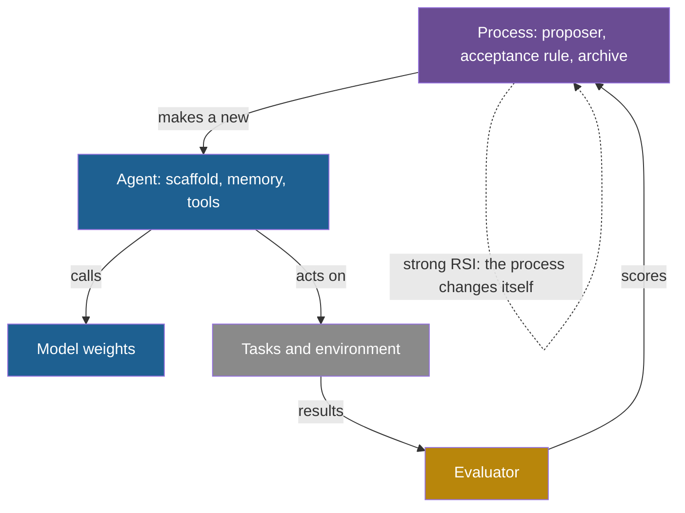

## Learning objectives

After this lesson you can:

- Define three targets of improvement: the model, the agent, and the process that makes agents, with an example and a number for each.
- Use four questions to decide whether a loop is recursive self-improvement or ordinary automated optimization.
- Explain, with a worked example, why an improvement of the process is harder to measure than an improvement of an agent.
- Sort published claims into demonstrated, not demonstrated and open, and give the evidence for each.
- Describe Anthropic's three scenarios and the safety-framework thresholds that name recursive self-improvement.

## Prerequisites

- [L2: The ladder: from repeating a task to improving the improver](/notes/ai/recursive-self-improvement/02-core-idea/l2-the-ladder-of-self-improvement)
- [L3: The system boundary, the "self" and persistence](/notes/ai/recursive-self-improvement/02-core-idea/l3-system-boundary-and-persistence)
- [L4: The improver, meta-levels and the frozen core](/notes/ai/recursive-self-improvement/03-anatomy/l4-the-improver-and-meta-levels)
- [L5: Optimizing the improver: meta-objectives and nested loops](/notes/ai/recursive-self-improvement/04-mathematics/l5-optimizing-the-improver)
- [L8: Meta-learning and improving the improver](/notes/ai/recursive-self-improvement/05-approaches/l8-meta-learning-and-improving-the-improver)

## 1. The question this idea answers

A bakery wants better bread next year. It can buy a better oven. It can train its baker, give the baker a better recipe book and better tools. Or it can improve the baking school that trains all of its future bakers. These are three different investments. They cost different amounts, they take effect at different speeds, and you measure each one differently.

Now suppose the baking school also changes how it teaches, every year, based on how its last graduates performed. This is the strongest case: the process that makes bakers improves the process that makes bakers.

AI has the same three targets. A loop can improve the **model**, which means the weights. It can improve the **agent**: the code, prompts, memory and tools around the model. Or it can improve the **process that makes agents**: the improver or designer. Claims about recursive self-improvement (RSI) often mix the three. This lesson separates them, shows how RSI differs from ordinary automated optimization, and sorts the evidence into what is shown and what is not.

## 2. Mental model, and where it stops working

> [!analogy] Oven, baker and baking school
> The oven is the model. The baker, with a recipe book and tools, is the agent. The baking school is the process that makes agents. Ordinary automated optimization is a school with a fixed curriculum, run by outside staff. RSI in the strong sense is a school whose own graduates rewrite its curriculum, and the new curriculum trains the next graduates.
>
> **Where it stops working:**
>
> - In AI, the school can live inside the baker. In the Darwin Gödel Machine (DGM), the same coding agent solves tasks and edits its own code.
> - The oven is usually frozen. STOP, the DGM, SICA and the Huxley-Gödel Machine (HGM) never change the model's weights.
> - You judge a school only through its graduates' later bread. The feedback is slow, indirect and noisy.

## 3. Terms

| Term | Plain meaning |
|---|---|
| model improvement | A change to the weights of a model, for example by fine-tuning. |
| agent improvement | A change to the scaffold, memory or tools of an agent, with the model unchanged. |
| process that makes agents | The improver or designer that proposes, tests and accepts new agents. Also called an agent factory. |
| meta agent | An agent whose job is to design other agents, as in ADAS. |
| automated optimization | A search for better versions by a fixed procedure outside the system, such as random search or AutoML. |
| AutoML | Automated machine learning: search over models, settings or architectures by a program. |
| meta-learning | "Improving a learning algorithm over multiple learning episodes", in the definition of Hospedales et al. |
| meta-utility | A score of an improver: the average score of the solutions that the improver produces. |
| indirect loop | A loop in which the system's output improves its successor only through humans or other systems. |
| successor model | A new model that replaces the current one. |
| automation level | A step on the scale AL0 (no AI involvement) to AL5 (fully autonomous, no human in the loop). |
| frozen core | The parts of a self-improving system that no level of the loop may change. |

> [!key] The process that makes agents
> 1. **Name:** the process that makes agents (agent factory, improver, designer).
> 2. **Meaning:** the procedure that turns an agent, tasks and a budget into a new agent. It includes the proposer, the acceptance rule and the archive policy.
> 3. **Problem it solves:** a better process produces better agents for many future tasks, not only for one benchmark.
> 4. **Example:** STOP's improver is a short Python function that asks a language model for candidate solutions and keeps the best. STOP runs the improver on its own source code.
> 5. **Link to RSI:** RSI in the strong sense changes this process, and the changed process makes the next change.
> 6. **Limits:** you can only see an improvement of the process through the agents that it produces later. That measurement is slow, expensive and noisy.

## 4. Method and math

### 4.1 Three targets, defined precisely

Write the parts with symbols, so that the three targets do not blur:

- The **model** is a function $f_\theta$ with weights $\theta$.
- The **agent** is $A = (\theta, \sigma, \mu, \tau)$: the weights, the scaffold code and prompts $\sigma$, the memory $\mu$ and the tools $\tau$.
- The **process** $P$ maps an agent, a set of tasks $T$ and a budget $B$ to a new agent: $A' = P(A, T, B)$.

Most self-improving systems in this course change $\sigma$ and $\mu$, keep $\theta$ fixed, and keep most of $P$ fixed. RSI in the strong sense puts $P$ inside the agent and lets the loop change it. The general form, from [L1: What RSI means](/notes/ai/recursive-self-improvement/02-core-idea/l1-what-rsi-means), is $S_{n+1} = S_n.\mathrm{improve}(S_n)$: the system that was just improved does the next improvement.

| Target | What changes | Examples with a number | Persistence | Undo | Main risks |
|---|---|---|---|---|---|
| Model | Weights $\theta$ | STaR: GPT-J reached 72.5% on CommonsenseQA, against 60.0% for direct fine-tuning. Absolute Zero: 40.2 to 50.4 overall for a 7B coder model. | All future inputs | Hard: roll back a checkpoint | Overfitting, collapse, forgetting, hard to audit |
| Agent | Scaffold $\sigma$, memory $\mu$, tools $\tau$ | DGM: 20.0% to 50.0% on SWE-bench. SICA: 17% to 53% on 50 tasks. ACE: 42.4 to 59.4 average on AppWorld. | While the code or memory is kept | Easy: version control | Benchmark gaming, unsafe code, cost, bloat |
| Process | Proposer, acceptance rule, judge, or learning rule | STOP: 3-SAT 21.2% to 75.1% with the improved improver. Self-Rewarding judge: 78.7% to 81.7%. | While the process is kept | Easy for code, hard for weights | Errors that compound, edits to the evaluator, noisy meta-scores |

Sources: STaR (Zelikman et al., 2022), Absolute Zero (Zhao et al., 2025), the DGM and ACE (Zhang et al., 2025), SICA (Robeyns et al., 2025). Also STOP (Zelikman et al., 2023) and Self-Rewarding (Yuan et al., 2024). The references give full citations.

One piece of code can sit in two rows. The DGM's coding agent solves benchmark tasks (agent row), and it also implements its own next change (process row). The DGM authors argue for this reason that "improved performance on coding challenges means it has also gotten better at improving itself" ([Sakana AI, 2025](https://sakana.ai/dgm/)). The HGM paper measured this claim and found it only weakly true (section 4.3).



### 4.2 RSI versus ordinary automated optimization

Machines have designed machines for a long time. Random search tunes settings. Neural architecture search (NAS) designs networks. Population Based Training (PBT) adapts training settings during a run. None of these is usually called recursive self-improvement. Four questions say why:

1. **Inside?** Is the improver inside the system boundary?
2. **Changed?** Does the loop change the improver?
3. **Used next?** Does the changed improver make the next change?
4. **Kept?** Does the change persist into later iterations?

Ordinary automated optimization answers "no" to the first three. Its form is a fixed function $f$ outside the system: $\Pi_{j+1} = f(\Pi_j, \tau_j, r_j)$, in the notation of the survey by Gao et al. ([L1: What RSI means](/notes/ai/recursive-self-improvement/02-core-idea/l1-what-rsi-means)). Strong RSI answers "yes" to all four. Gödel Agent writes its form explicitly: $(\pi_{t+1}, I_{t+1}) = I_t(\pi_t, I_t, r_t, g)$. Here the learner $I$ updates both the policy $\pi$ and itself (Yin et al., 2025, ACL).

| System | Inside? | Changed? | Used next? | Kept? | Verdict |
|---|---|---|---|---|---|
| Random search for settings | No | No | No | Yes | Automated optimization |
| NAS with a learning controller | No | Its weights learn, its learning rule is fixed | Yes, for the controller | Yes | Automated optimization with a learning proposer |
| PBT | No | No | No | Yes | Automated optimization |
| OPRO, DSPy, GEPA | No | No | No | Yes | Automated prompt optimization |
| ADAS | No: a separate meta agent | No | No | Yes | Automated agent design |
| Promptbreeder | Yes | Mutation-prompts evolve, the hyper-mutation prompt is fixed | Yes | Yes | Partial RSI, one level |
| Self-Rewarding | Yes: the judge is the same model | Yes | Yes | Yes | Partial RSI in the weights, training method fixed |
| STOP | Yes | Yes: the improver's code | Yes | Yes | Scaffold-level RSI, model fixed |
| DGM | Yes: the agent edits itself | Partly: diagnosis and parent selection are fixed | Yes | Yes | Partial RSI |
| Gödel Agent | Yes | Claimed: it can patch its own loop | Yes | In memory | Claimed, mostly qualitative evidence |

Three notes on the table. First, the NAS controller learns, but REINFORCE, the rule that trains it, never changes (Zoph and Le, 2016). Second, in the released DGM code, a fixed o1 call proposes "what to change", and the parent agent implements it ([L4: The DGM in code](/notes/ai/recursive-self-improvement/07-implementations/l4-darwin-godel-machine-in-code)). Third, Hospedales et al. exclude random search and Bayesian optimization from meta-learning, because they have no trained meta-objective (Hospedales et al., 2022).

**Our interpretation:** RSI is not a different kind of algorithm. It is ordinary optimization in which the boundary is drawn so that the optimizer is part of what gets optimized. That is why [L3: The system boundary](/notes/ai/recursive-self-improvement/02-core-idea/l3-system-boundary-and-persistence) matters so much.

### 4.3 Why improving the process is harder to measure

An agent is scored directly on tasks. A process is scored only through the agents that it later produces. Four consequences follow.

**1. Each sample of a meta-score is a whole run.** STOP's meta-utility runs a candidate improver on downstream tasks. It then averages the downstream scores (Zelikman et al., 2023, Eq. 2). In the public code, one meta-utility call runs the candidate on 5 downstream tests. Each downstream run may use 4 language-model calls of up to 6 samples.

> [!example] Worked example: the nested cost of one STOP step
> These numbers come from the configuration of the public STOP code. The arithmetic is ours.
>
> 1. The seed improver asks the model for 6 candidate improvers in one batch.
> 2. It scores each candidate with the meta-utility: 6 meta-utility calls.
> 3. Each meta-utility call runs the candidate on 5 downstream tests.
> 4. Each downstream run uses at most 4 calls of at most 6 samples: 24 samples.
> 5. Upper bound for scoring: $6 \times 5 \times 24 = 720$ model samples, plus 6 to propose.
>
> To score an improver of improvers, each of its test runs would contain such a step. Every extra meta-level multiplies the cost by the number of downstream runs per score.

**2. Few samples give weak guarantees.** STOP proves a bound on how far a meta-utility measured on $n$ tasks can be from the true expected utility.

**The idea in words.** Suppose you choose an improver from a large set of possible programs. Then you need many tasks before the best measured improver is reliably good. The bound counts all programs up to a length.

**The equation** (Zelikman et al., 2023, Lemma 1):

$$
\varepsilon = \sqrt{\frac{1}{n}\left(l \ln \lvert \Sigma \rvert + \ln \frac{1}{\delta}\right)}
$$

**The symbols.**

- $n$ is the number of training tasks, drawn independently.
- $l$ is the maximum length of an improver program, in symbols.
- $\lvert \Sigma \rvert$ is the number of symbols in the alphabet.
- $\delta$ is the allowed chance that the bound fails.
- $\varepsilon$ is the largest gap, with probability at least $1 - \delta$, between any improver's average utility on the $n$ tasks and its expected utility. Utility lies in $[0, 1]$.

**In plain English.** The gap shrinks like $1/\sqrt{n}$, and it grows with the length of the programs that you allow.

**A numerical example.** Take $l = 1{,}000$ characters, $\lvert \Sigma \rvert = 128$ and $\delta = 0.05$. These are our example values.

1. $l \ln \lvert \Sigma \rvert = 1{,}000 \times 4.852 = 4{,}852$.
2. $\ln(1/\delta) = \ln 20 = 3.0$, so the bracket is 4,855.
3. With $n = 5$ tasks: $\varepsilon = \sqrt{4{,}855 / 5} = 31.2$. Utility lies between 0 and 1, so this bound says nothing.
4. With $n = 10{,}000$: $\varepsilon = 0.70$. Still weak.
5. For $\varepsilon = 0.1$: $n = 4{,}855 / 0.01 \approx 485{,}500$ tasks.

**The assumptions.** Tasks are independent draws from one distribution. Utility is bounded in $[0, 1]$. The bound covers every program up to length $l$ at once, which is a worst case.

**When it is useful.** It explains why a meta-utility measured on a handful of tasks guarantees little, and why held-out transfer tests matter.

**What it does NOT prove.** It does not say that STOP's improvers fail to generalize. Real search does not try all programs, so the real gap is usually much smaller. STOP's transfer results (section 5) are measured evidence, not a consequence of the bound.

**3. The feedback loop can be months long.** AlphaEvolve found a kernel speedup of 23% on average, which reduced Gemini's overall training time by 1%. The loops that improve the next version "are on the order of months" (Novikov et al., 2025, [arXiv:2506.13131](https://arxiv.org/abs/2506.13131), Section 6).

**4. Today's score is a weak guide to future improvement.** The HGM authors tested each method's guidance signal. They asked how well it predicts the success of an agent's whole clade of descendants. Pearson correlations were 0.444 for SICA and 0.285 to 0.406 for the DGM on SWE-Verified-60. Their own clade estimate reached 0.778 (Wang et al., 2025, [arXiv:2510.21614](https://arxiv.org/abs/2510.21614), Table 1). So "the best agent today" is not reliably "the best parent".

### 4.4 Indirect loops: when humans close the loop

Many real cases of AI improving AI pass through people and organizations.

- **Measured** (Google's report): AlphaEvolve's scheduling heuristic recovers on average 0.7% of Google's fleet-wide compute. Its kernel work gave about 1% faster Gemini training. The paper calls this "a novel instance where Gemini, through the capabilities of AlphaEvolve, optimizes its own training process" (Novikov et al., 2025). **Our interpretation:** AlphaEvolve does not edit its own code. Engineers deploy the kernel, a later Gemini is trained, and a later AlphaEvolve may use it. This is a slow, indirect, human-mediated loop.
- **Measured** (self-reported by Anthropic): Claude wrote more than 80% of merged code at Anthropic by May 2026. On a code-optimization task, speedups rose from about 3 times (Claude Opus 4, May 2025) to about 52 times (Mythos Preview, April 2026). A skilled human reached about 4 times in 4 to 8 hours ([Anthropic Institute, 2026](https://www.anthropic.com/institute/recursive-self-improvement)).
- **Measured, with a caution:** Anthropic also ran a weak-to-strong supervision study. Agents recovered 97% of the performance gap in 800 cumulative hours, for about USD 18,000 of compute. Two humans recovered about 23% in a week. But humans chose the problem and the scoring rubric, and transfer to production scale was not clear (same source).
- **Measured** (self-reported): in August 2026, Claude "leads" 26% of Anthropic's AI research and development work, up from less than 1% in February 2026. Fully autonomous work (AL5) is 0% ([Anthropic Institute, 2026](https://www.anthropic.com/institute/measuring-pace-of-ai-development)).
- **Claimed:** METR reviewed Claude Opus 5.5. It found the model "unlikely to be able to fully automate AI R&D" ([METR, 22 September 2026](https://metr.org/blog/2026-09-22-claude-opus-5-5/)).

Yampolskiy separates direct RSI from "indirect RSI", for example human–AI teams (Yampolskiy, 2015). Hall argued in 2007 that a community of research-level AIs, not a single system, would be needed before unlimited feedback starts (Hall, 2007). Both labels are **Speculation** about the future, but they describe the present structure well: today's fastest loop runs through teams of humans who use AI.

### 4.5 What is established, what is not, and what is open

| Status | Claim | Evidence |
|---|---|---|
| Demonstrated | Scaffold-level self-improvement with frozen models on coding benchmarks | DGM 20.0% to 50.0%, one run per condition, 200-task subset, about USD 22,000 and two weeks. SICA 17% to 53% on 50 tasks. HGM 40% to 56.7% on 60 tasks. |
| Demonstrated | An improver that improves itself, on small tasks | STOP with GPT-4. The same method degraded with GPT-3.5 and Mixtral. |
| Demonstrated | A judge that improves while the model trains on its judgments | Self-Rewarding: 78.7% to 81.7% agreement with human rankings, three iterations |
| Demonstrated | Self-play to superhuman play with a fixed evaluator | AlphaGo Zero: Elo 5,185, beat AlphaGo Lee 100 to 0 |
| Demonstrated | Discovered agents can transfer across models | DGM agent with Claude 3.7 Sonnet: 19.0% to 59.5% |
| Not demonstrated | A model that fully autonomously builds its successor | AL5 at 0% of Anthropic's measured work, August 2026 |
| Not demonstrated | A loop that improves its own outer search at scale | DGM parent selection is fixed. Hyperagents has only preliminary results on editing parent selection. |
| Not demonstrated | Weights, scaffold and evaluator improved together with no fixed anchor | No system in this course |
| Not demonstrated | A rising rate of improvement | Published curves are saturating or too short ([L1](/notes/ai/recursive-self-improvement/10-advanced/l1-conditions-for-sustained-improvement)) |
| Open | Whether $r > 1$ when AI does AI research | Estimates of about 1 to 4, or 0.5 to 2 with fixed hardware |
| Open | Whether coding skill transfers to self-improvement skill | HGM's weak correlations. Hyperagents removes this assumption by design. |
| Open | Whether benchmark gains hold on uncontaminated tasks | OpenAI stopped reporting SWE-bench Verified. SWE-Bench+ found leaked solutions. |
| Open | Whether safety controls hold as capability grows | The Hyperagents authors say safeguards "may become strained" |

**Anthropic's three scenarios.** The Anthropic Institute describes three possible paths ([Anthropic Institute, 2026](https://www.anthropic.com/institute/recursive-self-improvement)):

1. The trend stalls, but capabilities still spread.
2. Efficiency gains compound, and humans still set the direction. The authors say the evidence points here.
3. Full RSI: an AI system "fully autonomously designing and developing its own successor".

**Thresholds in safety frameworks** (checked on 2026-10-19):

- OpenAI's Preparedness Framework, version 2, is dated 15 April 2025. Its Critical level for AI self-improvement is a model "capable of recursively self improving (i.e., fully automated AI R&D)". Whether a newer version exists was not checked.
- Anthropic's Responsible Scaling Policy, version 3.4 (effective 8 July 2026), has an Automated R&D threshold. Its changelog says the threshold "is intended to capture the onset of dramatic recursive self-improvement" and "has proven difficult to operationalize".
- Google DeepMind's Frontier Safety Framework, version 3.1, is dated 17 April 2026. Its ML R&D automation level 1 reads: "Can fully automate the work of any team of researchers at Google focused on improving AI capabilities".

The International AI Safety Report 2026 sums up the state of opinion: "Experts disagree about whether AI-assisted research automation could dramatically accelerate AI progress."

### 4.6 How to test which target improved

Each target needs its own comparison. Mixing them is the most common error in RSI claims.

1. **To claim that the model improved,** keep the scaffold fixed. Compare old and new weights on held-out tasks.
2. **To claim that the agent improved,** keep the model fixed. Compare the old and new scaffold on held-out tasks. Then run the new scaffold with other models to test transfer, as the DGM did.
3. **To claim that the process improved,** run the old and the new improver from the same starting agent, on new tasks, with the same budget. Compare the gains that each one produces. STOP's Table 1 uses this design. Hyperagents measures it as "imp@50". Transferred hyperagents reached 0.630 on math grading, and the baseline 0.0 (Zhang et al., 2026, [arXiv:2603.19461](https://arxiv.org/abs/2603.19461)). **Our interpretation:** the name suggests the improvement that an improver produces within 50 iterations. The sources of these notes do not give the exact definition.

[L4: Open problems, and how to read new RSI work](/notes/ai/recursive-self-improvement/10-advanced/l4-open-problems-and-how-to-read-new-work) turns these comparisons into a full experiment design.

## 5. Graphs

```plot
{
  "title": "STOP transfer tasks: downstream score with the seed improver (x) and with the improved improver (y), in percent. Blue points are the five tasks, the ink line is y = x",
  "xAxis": { "label": "score with seed improver, %", "domain": [0, 100] },
  "yAxis": { "label": "score with improved improver, %", "domain": [0, 100] },
  "disableZoom": true,
  "data": [
    { "points": [[44.3, 56.7], [20.6, 22.1], [21.2, 75.1], [58.7, 74.2], [59.3, 81.7]], "fnType": "points", "graphType": "scatter", "color": "#1E6091", "skipTip": true },
    { "fn": "x", "color": "#100D12" }
  ]
}
```

All five points lie above the line, so the improved improver did better on every transfer task. The gain ranges from 1.5 points (Modified Quadratic Assignment) to 53.9 points (3-SAT). The data comes from GPT-4 runs, with the improver trained on one task only (Zelikman et al., 2023, Table 1).

## 6. Video and animation

- [The AI Scientific Revolution will be Driven by Open-Ended and AI-Generating Algorithms](https://www.youtube.com/watch?v=P-qzI6ZJQBw) (Jeff Clune, Vector Institute, 2026). One talk that connects ADAS, the DGM and Hyperagents. It supports sections 4.1 and 4.2.
- [Adam Kalai - Recursive Self-improving Code Generation](https://www.youtube.com/watch?v=RovcBFlfXpQ) (DIMACS CCICADA, 2023). A STOP co-author explains the seed improver that improves itself. It supports section 4.3.
- [Wild breakthrough on Math after 56 years... \[Exclusive\]](https://www.youtube.com/watch?v=vC9nAosXrJw) (Machine Learning Street Talk, 2025). The AlphaEvolve authors. The final chapter asks whether improving the infrastructure that trains its own models is a form of RSI. It supports section 4.4.
- [Measuring Agent Caps & RSP (Anthropic) by Ben Mann](https://www.youtube.com/watch?v=6y2AnWol7oo) (Berkeley RDI, 2024). How a lab ties agent measurements to its scaling policy. It supports section 4.5.

## 8. Common mistakes

1. **"A better agent means a better model."** In STOP, the DGM, SICA and HGM, the weights never change. The gains live in code and prompts.
2. **"Any machine that designs machines is RSI."** NAS, PBT and ADAS use a fixed improver outside the system. Apply the four questions of section 4.2.
3. **"The DGM improves everything about itself."** Its parent selection, archive rule, evaluation and, in the released code, its diagnosis step are fixed.
4. **"AlphaEvolve improves itself."** It improved its model's training time by about 1%, through engineers, over months. Its own code did not change.
5. **"A meta-utility on five tasks proves a better improver."** It is weak evidence. Test the improver on new tasks at equal budget.
6. **"AI that writes most of a lab's code is RSI."** By Anthropic's own definition, RSI needs a successor built with no human in the loop. AL5 was 0% in August 2026.

## 9. One-minute explanation

A loop can improve three different things. It can change the model's weights, as STaR and Self-Rewarding do. It can change the agent around a frozen model, as the DGM and SICA do. Or it can change the process that makes agents, as STOP does when its improver rewrites itself.

Recursive self-improvement in the strong sense has three parts. The improver is inside the system, the loop changes it, and the changed improver makes the next change. Most automated optimization fails that test, because its improver is fixed and outside.

Process improvements are the hardest to measure. Each score needs whole downstream runs, and the feedback can take months. What is shown today is scaffold-level self-improvement with frozen models, at a cost of thousands of dollars per run. What is not shown is a model that builds its successor with no human, or a rising rate of improvement.

## 10. Check questions

```check
{
  "question": "Apply the four questions of section 4.2 (inside, changed, used next, kept) to AutoML-Zero, Promptbreeder and Gödel Agent. Give a verdict for each.",
  "hint": "AutoML-Zero evolves whole learning algorithms with a fixed evolutionary search.",
  "answer": "AutoML-Zero: the evolutionary searcher is outside and fixed, so inside = no, changed = no, used next = no, kept = yes. It is automated optimization of a learner, a form of meta-learning, not RSI. Promptbreeder: the mutation-prompts are inside the population, they evolve, they make the next task-prompts, and they persist. The hyper-mutation prompt and the genetic algorithm stay fixed, so it is partial RSI at one level. Gödel Agent: the learner is inside the running program, the agent can patch its own loop, and the patched loop runs next. Patches live in memory, and code is saved to disk only when test accuracy improves. The verdict is claimed RSI, with mostly qualitative evidence that the learner itself improved."
}
```

```check
{
  "question": "Scoring one candidate solution costs 24 model samples. Scoring one candidate improver needs 5 downstream runs, each like one candidate solution. Scoring one candidate improver-of-improvers needs 5 runs, each of which scores one candidate improver. How many samples does each score cost?",
  "answer": "A solution: 24 samples. An improver: 5 × 24 = 120 samples. An improver-of-improvers: 5 × 120 = 600 samples. Each meta-level multiplies the cost by the number of runs per score, here 5. Proposal costs and repeated runs come on top. This is one reason why real systems keep their upper levels fixed."
}
```

```check
{
  "question": "Use STOP's bound $\\varepsilon = \\sqrt{(l \\ln |\\Sigma| + \\ln(1/\\delta))/n}$ with $l \\ln |\\Sigma| = 4{,}852$ and $\\delta = 0.05$. How many tasks give $\\varepsilon = 0.2$? What does this tell you about a meta-utility measured on 5 tasks?",
  "answer": "The bracket is 4,852 + 3.0 = 4,855. For ε = 0.2: n = 4,855 / 0.04 ≈ 121,400 tasks. With 5 tasks the bound is about 31, which says nothing, because utility lies between 0 and 1. The bound is a worst case over all programs, so it does not prove that STOP's improvers fail. It does mean that the guarantee comes from measured transfer on new tasks, not from the theory."
}
```

```check
{
  "question": "AlphaEvolve's paper says that Gemini, through AlphaEvolve, 'optimizes its own training process'. Say what changed, who closed the loop, how long the loop takes, and where this sits on the course ladder.",
  "answer": "What changed: a kernel used in Gemini training, with a 23% average speedup and about 1% less total training time. AlphaEvolve's own code and the model's weights did not change directly. Who closed the loop: engineers deployed the kernel, and Google's training pipeline trains later models. Duration: the authors say the feedback loops are on the order of months. Ladder: AlphaEvolve itself evolves task programs, so its own operation is at a low level. The path to better future models is indirect and human-mediated. It is real evidence that AI contributes to AI infrastructure, not an autonomous self-improvement loop."
}
```

```check
{
  "question": "Anthropic reports that agents recovered 97% of a performance gap in a weak-to-strong supervision study, against about 23% for two humans in a week. List what this result shows and what it does not show about RSI.",
  "answer": "It shows that agents can do a defined research task faster and better than two humans. The cost was about USD 18,000 of compute over 800 hours. It does not show autonomous research: humans chose the problem and the scoring rubric. It does not show transfer to production scale, which the source calls unclear. It does not show that the agents improved themselves or built a successor. In the course's terms, it is evidence for a human-directed, compounding-efficiency scenario, not for full RSI."
}
```

## 11. Summary and links

- A loop can improve the model, the agent or the process that makes agents. Each target has its own measurement, persistence, undo cost and risks.
- RSI differs from automated optimization by four answers. The improver is inside, the loop changes it, the changed improver acts next, and the change is kept.
- Process improvements are slow and expensive to measure. In the worst case, STOP's bound needs about 485,500 tasks for a gap of 0.1. HGM shows that today's score is a weak guide to future improvement.
- Demonstrated: scaffold-level self-improvement with frozen models, an improver that improves on small tasks, an improving judge, and self-play with fixed rules.
- Not demonstrated: a fully autonomous successor, self-improvement of the outer search at scale, or a rising rate of improvement.

The next lesson turns these distinctions into tools: a checklist for reading new RSI papers and a method for designing your own experiment.

- Previous: [L2: Imperfect evaluators and evaluators that are optimized](/notes/ai/recursive-self-improvement/10-advanced/l2-imperfect-and-optimized-evaluators)
- Next: [L4: Open problems, and how to read new RSI work](/notes/ai/recursive-self-improvement/10-advanced/l4-open-problems-and-how-to-read-new-work)
- Related: [L4: Examples and non-examples](/notes/ai/recursive-self-improvement/02-core-idea/l4-examples-and-non-examples), [2023: STOP, the Self-Taught Optimizer](/notes/ai/recursive-self-improvement/06-research-systems/p05-stop-self-taught-optimizer)
- Related: [2023 and 2025: FunSearch and AlphaEvolve](/notes/ai/recursive-self-improvement/06-research-systems/p12-funsearch-and-alphaevolve), [2024–2026: The AI Scientist and the measurement of automated AI research](/notes/ai/recursive-self-improvement/06-research-systems/p13-the-ai-scientist-and-automated-research)
- Related: [Sources](/notes/ai/recursive-self-improvement/sources)

## References

- Anthropic Institute (Marina Favaro, Jack Clark). "When AI builds itself". 2026. https://www.anthropic.com/institute/recursive-self-improvement
- Anthropic Institute (Marina Favaro, Phillie Wright). "Measurements for understanding the pace of AI development inside frontier labs". 2026. https://www.anthropic.com/institute/measuring-pace-of-ai-development
- Anthropic. Responsible Scaling Policy, version 3.4, effective 8 July 2026. https://www.anthropic.com/rsp-updates
- Huan-ang Gao, Jiayi Geng, Wenyue Hua, et al. "A Survey of Self-Evolving Agents". 2025. arXiv:2507.21046. https://arxiv.org/abs/2507.21046
- Google DeepMind. Frontier Safety Framework, version 3.1. 17 April 2026. https://storage.googleapis.com/deepmind-media/DeepMind.com/Blog/strengthening-our-frontier-safety-framework/frontier-safety-framework_3-1.pdf
- John Storrs Hall. "Self-improving AI: an Analysis". Minds and Machines 17(3):249–259. 2007. DOI 10.1007/s11023-007-9065-3. https://faculty.washington.edu/seattle/Turing-Test/SelfImprovingAI.pdf
- Timothy Hospedales, Antreas Antoniou, Paul Micaelli, Amos Storkey. "Meta-Learning in Neural Networks: A Survey". IEEE TPAMI 44(9):5149–5169. 2022 (online 2021). arXiv:2004.05439. https://arxiv.org/abs/2004.05439
- International AI Safety Report 2026. 3 February 2026. https://internationalaisafetyreport.org/publication/international-ai-safety-report-2026
- METR. "Summary of METR's predeployment evaluation of Claude Opus 5.5". 22 September 2026. https://metr.org/blog/2026-09-22-claude-opus-5-5/
- Alexander Novikov, Ngân Vũ, Marvin Eisenberger, et al. "AlphaEvolve: A coding agent for scientific and algorithmic discovery". 2025. arXiv:2506.13131. https://arxiv.org/abs/2506.13131
- OpenAI. Preparedness Framework, version 2. 15 April 2025. https://cdn.openai.com/pdf/18a02b5d-6b67-4cec-ab64-68cdfbddebcd/preparedness-framework-v2.pdf
- Maxime Robeyns, Martin Szummer, Laurence Aitchison. "A Self-Improving Coding Agent". ICLR 2025 Workshop on Scaling Self-Improving Foundation Models. arXiv:2504.15228. https://arxiv.org/abs/2504.15228
- Sakana AI. "The Darwin Gödel Machine: AI that improves itself by rewriting its own code". 30 May 2025. https://sakana.ai/dgm/
- David Silver, Julian Schrittwieser, Karen Simonyan, et al. "Mastering the game of Go without human knowledge". Nature 550:354–359. 2017. DOI 10.1038/nature24270. https://discovery.ucl.ac.uk/id/eprint/10045895/
- Wenyi Wang, Piotr Piękos, Li Nanbo, et al. "Huxley-Gödel Machine: Human-Level Coding Agent Development by an Approximation of the Optimal Self-Improving Machine". ICLR 2026. arXiv:2510.21614. https://arxiv.org/abs/2510.21614
- Roman V. Yampolskiy. "From Seed AI to Technological Singularity via Recursively Self-Improving Software". 2015. arXiv:1502.06512. https://arxiv.org/abs/1502.06512
- Xunjian Yin, Xinyi Wang, Liangming Pan, Li Lin, Xiaojun Wan, William Yang Wang. "Gödel Agent: A Self-Referential Agent Framework for Recursively Self-Improvement". ACL 2025. arXiv:2410.04444. https://aclanthology.org/2025.acl-long.1354
- Weizhe Yuan, Richard Yuanzhe Pang, Kyunghyun Cho, et al. "Self-Rewarding Language Models". ICML 2024. arXiv:2401.10020. https://arxiv.org/abs/2401.10020
- Eric Zelikman, Eliana Lorch, Lester Mackey, Adam Tauman Kalai. "Self-Taught Optimizer (STOP): Recursively Self-Improving Code Generation". COLM 2024. arXiv:2310.02304. https://arxiv.org/abs/2310.02304. Code: https://github.com/microsoft/stop
- Eric Zelikman, Yuhuai Wu, Jesse Mu, Noah D. Goodman. "STaR: Bootstrapping Reasoning With Reasoning". NeurIPS 2022. arXiv:2203.14465. https://arxiv.org/abs/2203.14465
- Jenny Zhang, Bingchen Zhao, Wannan Yang, et al. "Hyperagents". 2026. arXiv:2603.19461. https://arxiv.org/abs/2603.19461
- Jenny Zhang, Shengran Hu, Cong Lu, Robert Lange, Jeff Clune. "Darwin Gödel Machine: Open-Ended Evolution of Self-Improving Agents". ICLR 2026. arXiv:2505.22954. https://arxiv.org/abs/2505.22954
- Qizheng Zhang, Changran Hu, Shubhangi Upasani, et al. "Agentic Context Engineering: Evolving Contexts for Self-Improving Language Models". ICLR 2026. arXiv:2510.04618. https://arxiv.org/abs/2510.04618
- Andrew Zhao, Yiran Wu, Yang Yue, et al. "Absolute Zero: Reinforced Self-play Reasoning with Zero Data". NeurIPS 2025. arXiv:2505.03335. https://arxiv.org/abs/2505.03335
- Barret Zoph, Quoc V. Le. "Neural Architecture Search with Reinforcement Learning". 2016. arXiv:1611.01578. https://arxiv.org/abs/1611.01578
