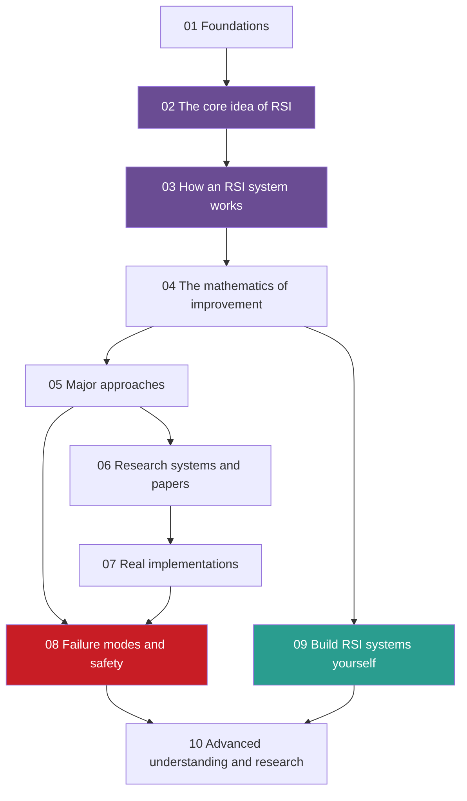

## The map

Each part uses the ideas of the parts before it. Part 9 (the projects) can start after Part 4, and each project names the lessons it needs.

Parts 2 and 3 are the conceptual core. Part 8 is the safety core. Part 9 is where you build.

## Parts

Reading time assumes 200 words a minute for the text, without code. Add time for the check questions, the exercises and the labs.

| Part | Pages | Reading time | Check questions | Labs |
|---|---|---|---|---|
| [01 Foundations](/notes/ai/recursive-self-improvement/01-foundations) | 7 | about 3.1 h | 37 | 0 |
| [02 The core idea of RSI](/notes/ai/recursive-self-improvement/02-core-idea) | 5 | about 2.8 h | 46 | 0 |
| [03 How an RSI system works](/notes/ai/recursive-self-improvement/03-anatomy) | 4 | about 1.8 h | 18 | 0 |
| [04 The mathematics of improvement](/notes/ai/recursive-self-improvement/04-mathematics) | 5 | about 2.4 h | 25 | 0 |
| [05 Major approaches](/notes/ai/recursive-self-improvement/05-approaches) | 10 | about 4.8 h | 50 | 0 |
| [06 Research systems and papers](/notes/ai/recursive-self-improvement/06-research-systems) | 13 | about 6.3 h | 70 | 0 |
| [07 Real implementations](/notes/ai/recursive-self-improvement/07-implementations) | 7 | about 3.0 h | 36 | 0 |
| [08 Failure modes and safety](/notes/ai/recursive-self-improvement/08-failure-modes-and-safety) | 7 | about 3.3 h | 36 | 0 |
| [09 Build RSI systems yourself](/notes/ai/recursive-self-improvement/09-build-it) | 10 | about 2.5 h | 39 | 8 |
| [10 Advanced understanding and research](/notes/ai/recursive-self-improvement/10-advanced) | 5 | about 2.4 h | 38 | 0 |
| Total | 73 | about 33 h | 395 | 8 |

## Pages and reading times

### 01 Foundations

Programs, models, language models, agents, feedback loops, optimization, recursion, training and evaluation, and what "better" means.

| Page | Reading time | Check questions |
|---|---|---|
| [L1: Programs, models and language models](/notes/ai/recursive-self-improvement/01-foundations/l1-programs-models-and-language-models) | 25 min | 5 |
| [L2: Agents: actions, state, memory, tools and environment](/notes/ai/recursive-self-improvement/01-foundations/l2-agents-actions-state-tools-environment) | 22 min | 5 |
| [L3: Feedback loops](/notes/ai/recursive-self-improvement/01-foundations/l3-feedback-loops) | 27 min | 5 |
| [L4: Optimization and search](/notes/ai/recursive-self-improvement/01-foundations/l4-optimization-and-search) | 26 min | 5 |
| [L5: Recursion, self-reference and programs that change programs](/notes/ai/recursive-self-improvement/01-foundations/l5-recursion-and-self-reference) | 26 min | 7 |
| [L6: How machine learning systems are trained and evaluated](/notes/ai/recursive-self-improvement/01-foundations/l6-how-ml-systems-are-trained-and-evaluated) | 28 min | 5 |
| [L7: What "improvement" means, and how to measure it](/notes/ai/recursive-self-improvement/01-foundations/l7-measuring-improvement) | 34 min | 5 |

### 02 The core idea of RSI

What recursive self-improvement means, the ladder of levels, the system boundary and persistence, examples and non-examples, and the history.

| Page | Reading time | Check questions |
|---|---|---|
| [L1: What recursive self-improvement means](/notes/ai/recursive-self-improvement/02-core-idea/l1-what-rsi-means) | 34 min | 6 |
| [L2: The ladder: from repeating a task to improving the improver](/notes/ai/recursive-self-improvement/02-core-idea/l2-the-ladder-of-self-improvement) | 34 min | 13 |
| [L3: The system boundary, the "self" and persistence](/notes/ai/recursive-self-improvement/02-core-idea/l3-system-boundary-and-persistence) | 31 min | 8 |
| [L4: Examples and non-examples](/notes/ai/recursive-self-improvement/02-core-idea/l4-examples-and-non-examples) | 36 min | 14 |
| [L5: A short history: from Good (1965) to self-improving agents (2026)](/notes/ai/recursive-self-improvement/02-core-idea/l5-history-from-good-to-agents) | 33 min | 5 |

### 03 How an RSI system works

The components of a self-improving system, one iteration step by step, archives of versions, and the improver with its frozen core.

| Page | Reading time | Check questions |
|---|---|---|
| [L1: The components of a self-improving system](/notes/ai/recursive-self-improvement/03-anatomy/l1-the-components) | 32 min | 4 |
| [L2: One iteration, step by step](/notes/ai/recursive-self-improvement/03-anatomy/l2-one-iteration-step-by-step) | 31 min | 4 |
| [L3: Archives: why keep more than the best version](/notes/ai/recursive-self-improvement/03-anatomy/l3-archives-and-search-over-versions) | 17 min | 5 |
| [L4: The improver, meta-levels and the frozen core](/notes/ai/recursive-self-improvement/03-anatomy/l4-the-improver-and-meta-levels) | 29 min | 5 |

### 04 The mathematics of improvement

Functions and objectives, update rules, evaluation under noise, improvement dynamics and the mathematics of improving the improver.

| Page | Reading time | Check questions |
|---|---|---|
| [L1: Functions, objectives and search spaces](/notes/ai/recursive-self-improvement/04-mathematics/l1-functions-objectives-and-search-spaces) | 30 min | 5 |
| [L2: Loss, reward and update rules](/notes/ai/recursive-self-improvement/04-mathematics/l2-loss-reward-and-update-rules) | 29 min | 5 |
| [L3: Evaluation under noise](/notes/ai/recursive-self-improvement/04-mathematics/l3-evaluation-under-noise) | 27 min | 5 |
| [L4: Improvement dynamics: rates, diminishing returns and plateaus](/notes/ai/recursive-self-improvement/04-mathematics/l4-improvement-dynamics) | 28 min | 5 |
| [L5: Optimizing the improver: meta-objectives and nested loops](/notes/ai/recursive-self-improvement/04-mathematics/l5-optimizing-the-improver) | 31 min | 5 |

### 05 Major approaches

Self-critique, memory, prompt optimization, workflow search, code self-modification, evolutionary search, training-based improvement, meta-learning and role separation, compared.

| Page | Reading time | Check questions |
|---|---|---|
| [L1: Self-critique and iterative refinement](/notes/ai/recursive-self-improvement/05-approaches/l1-self-critique-and-refinement) | 28 min | 5 |
| [L2: Memory and learning from experience](/notes/ai/recursive-self-improvement/05-approaches/l2-memory-and-learning-from-experience) | 26 min | 5 |
| [L3: Prompt and instruction optimization](/notes/ai/recursive-self-improvement/05-approaches/l3-prompt-and-instruction-optimization) | 27 min | 5 |
| [L4: Workflow and architecture search](/notes/ai/recursive-self-improvement/05-approaches/l4-workflow-and-architecture-search) | 24 min | 5 |
| [L5: Code self-modification](/notes/ai/recursive-self-improvement/05-approaches/l5-code-self-modification) | 28 min | 5 |
| [L6: Evolutionary search, populations and open-endedness](/notes/ai/recursive-self-improvement/05-approaches/l6-evolutionary-and-population-methods) | 38 min | 5 |
| [L7: Training-based self-improvement and synthetic data](/notes/ai/recursive-self-improvement/05-approaches/l7-training-based-self-improvement) | 38 min | 5 |
| [L8: Meta-learning and improving the improver](/notes/ai/recursive-self-improvement/05-approaches/l8-meta-learning-and-improving-the-improver) | 32 min | 5 |
| [L9: Multi-agent roles in improvement](/notes/ai/recursive-self-improvement/05-approaches/l9-multi-agent-improvement) | 30 min | 5 |
| [L10: The approaches compared](/notes/ai/recursive-self-improvement/05-approaches/l10-approaches-compared) | 20 min | 5 |

### 06 Research systems and papers

One page per important paper or system, from the Gödel machine to the Darwin Gödel Machine. Each page says what the paper shows and what it does not show.

| Page | Reading time | Check questions |
|---|---|---|
| [1965–2012: Good's intelligence explosion and the Gödel machine](/notes/ai/recursive-self-improvement/06-research-systems/p01-good-and-the-godel-machine) | 32 min | 6 |
| [2023: Self-Refine and Reflexion](/notes/ai/recursive-self-improvement/06-research-systems/p02-self-refine-and-reflexion) | 26 min | 5 |
| [2023: Voyager](/notes/ai/recursive-self-improvement/06-research-systems/p03-voyager) | 21 min | 5 |
| [2023: Promptbreeder](/notes/ai/recursive-self-improvement/06-research-systems/p04-promptbreeder) | 22 min | 5 |
| [2023: STOP, the Self-Taught Optimizer](/notes/ai/recursive-self-improvement/06-research-systems/p05-stop-self-taught-optimizer) | 31 min | 6 |
| [2024: Self-Rewarding Language Models](/notes/ai/recursive-self-improvement/06-research-systems/p06-self-rewarding-language-models) | 22 min | 5 |
| [2024: ADAS and Meta Agent Search](/notes/ai/recursive-self-improvement/06-research-systems/p07-adas-meta-agent-search) | 24 min | 5 |
| [2024: Gödel Agent](/notes/ai/recursive-self-improvement/06-research-systems/p08-godel-agent) | 28 min | 5 |
| [2025: SICA, a Self-Improving Coding Agent](/notes/ai/recursive-self-improvement/06-research-systems/p09-sica-self-improving-coding-agent) | 31 min | 6 |
| [2025: The Darwin Gödel Machine](/notes/ai/recursive-self-improvement/06-research-systems/p10-darwin-godel-machine) | 45 min | 6 |
| [2025: The Huxley-Gödel Machine](/notes/ai/recursive-self-improvement/06-research-systems/p11-huxley-godel-machine) | 27 min | 5 |
| [2023 and 2025: FunSearch and AlphaEvolve](/notes/ai/recursive-self-improvement/06-research-systems/p12-funsearch-and-alphaevolve) | 30 min | 5 |
| [2024–2026: The AI Scientist and the measurement of automated AI research](/notes/ai/recursive-self-improvement/06-research-systems/p13-the-ai-scientist-and-automated-research) | 37 min | 6 |

### 07 Real implementations

Code walkthroughs of STOP, ADAS, the Darwin Gödel Machine, SICA, Gödel Agent and OpenEvolve, with verified file paths and functions.

| Page | Reading time | Check questions |
|---|---|---|
| [L1: How to read a research repository](/notes/ai/recursive-self-improvement/07-implementations/l1-how-to-read-a-research-repository) | 26 min | 6 |
| [L2: STOP in code](/notes/ai/recursive-self-improvement/07-implementations/l2-stop-in-code) | 26 min | 5 |
| [L3: ADAS in code](/notes/ai/recursive-self-improvement/07-implementations/l3-adas-in-code) | 23 min | 5 |
| [L4: The Darwin Gödel Machine in code](/notes/ai/recursive-self-improvement/07-implementations/l4-darwin-godel-machine-in-code) | 30 min | 5 |
| [L5: SICA and Gödel Agent in code](/notes/ai/recursive-self-improvement/07-implementations/l5-sica-and-godel-agent-in-code) | 28 min | 5 |
| [L6: OpenEvolve in code](/notes/ai/recursive-self-improvement/07-implementations/l6-openevolve-in-code) | 24 min | 5 |
| [L7: What the code teaches](/notes/ai/recursive-self-improvement/07-implementations/l7-what-the-code-teaches) | 26 min | 5 |

### 08 Failure modes and safety

What goes wrong when a system improves itself: Goodhart, reward hacking, evaluation failures, self-evaluation failures, drift, unsafe self-modification, and the controls.

| Page | Reading time | Check questions |
|---|---|---|
| [L1: Measured score versus real capability](/notes/ai/recursive-self-improvement/08-failure-modes-and-safety/l1-measured-score-vs-real-capability) | 27 min | 5 |
| [L2: Reward hacking and specification gaming](/notes/ai/recursive-self-improvement/08-failure-modes-and-safety/l2-reward-hacking-and-specification-gaming) | 27 min | 6 |
| [L3: Evaluation failures: leakage, overfitting, noise and regression](/notes/ai/recursive-self-improvement/08-failure-modes-and-safety/l3-evaluation-failures) | 30 min | 5 |
| [L4: Self-evaluation failures](/notes/ai/recursive-self-improvement/08-failure-modes-and-safety/l4-self-evaluation-failures) | 27 min | 5 |
| [L5: Churn, bloat, lost behavior, drift and runaway cost](/notes/ai/recursive-self-improvement/08-failure-modes-and-safety/l5-churn-bloat-and-drift) | 27 min | 5 |
| [L6: The special risks of changing the improver](/notes/ai/recursive-self-improvement/08-failure-modes-and-safety/l6-changing-the-improver-safely) | 28 min | 5 |
| [L7: Controls, oversight and governance](/notes/ai/recursive-self-improvement/08-failure-modes-and-safety/l7-controls-oversight-and-governance) | 34 min | 5 |

### 09 Build RSI systems yourself

Eight small projects, from a fixed agent with a score to a loop that improves its own improver, plus the path to a language-model version.

| Page | Reading time | Check questions |
|---|---|---|
| [P1: A fixed agent with a score](/notes/ai/recursive-self-improvement/09-build-it/p1-a-fixed-agent-with-a-score) | 18 min | 4 |
| [P2: Many candidates, one answer](/notes/ai/recursive-self-improvement/09-build-it/p2-many-candidates-one-answer) | 15 min | 4 |
| [P3: An evaluator with explicit tests](/notes/ai/recursive-self-improvement/09-build-it/p3-an-evaluator-with-explicit-tests) | 13 min | 4 |
| [P4: Propose and test strategy changes](/notes/ai/recursive-self-improvement/09-build-it/p4-propose-and-test-strategy-changes) | 15 min | 4 |
| [P5: An agent that edits a program](/notes/ai/recursive-self-improvement/09-build-it/p5-an-agent-that-edits-a-program) | 14 min | 4 |
| [P6: An acceptance rule with a validation suite](/notes/ai/recursive-self-improvement/09-build-it/p6-a-validation-gate) | 16 min | 4 |
| [P7: Regression tests and an archive](/notes/ai/recursive-self-improvement/09-build-it/p7-regression-tests-and-an-archive) | 17 min | 4 |
| [P8: Improving the improver](/notes/ai/recursive-self-improvement/09-build-it/p8-improving-the-improver) | 17 min | 4 |
| [P9: From the toy to a language-model version](/notes/ai/recursive-self-improvement/09-build-it/p9-from-toy-to-language-model) | 18 min | 4 |
| [Reference solutions](/notes/ai/recursive-self-improvement/09-build-it/solutions) | 10 min | 3 |

### 10 Advanced understanding and research

Conditions for sustained improvement, imperfect and optimized evaluators, models versus agents versus agent factories, open problems and advanced exercises.

| Page | Reading time | Check questions |
|---|---|---|
| [L1: Conditions for sustained improvement, and why it plateaus](/notes/ai/recursive-self-improvement/10-advanced/l1-conditions-for-sustained-improvement) | 33 min | 5 |
| [L2: Imperfect evaluators and evaluators that are optimized](/notes/ai/recursive-self-improvement/10-advanced/l2-imperfect-and-optimized-evaluators) | 30 min | 5 |
| [L3: Improving a model, an agent, or the process that makes agents](/notes/ai/recursive-self-improvement/10-advanced/l3-models-agents-and-agent-factories) | 27 min | 5 |
| [L4: Open problems, and how to read new RSI work](/notes/ai/recursive-self-improvement/10-advanced/l4-open-problems-and-how-to-read-new-work) | 29 min | 5 |
| [L5: Advanced exercises](/notes/ai/recursive-self-improvement/10-advanced/l5-advanced-exercises) | 23 min | 18 |

## Study paths

### The full path

Read every part in order, from Part 1 to Part 10. Do each Part 9 project when its prerequisites are done. This path suits a reader with no background, and it gives the deepest understanding.

### The engineer's path

This path suits a reader who already knows how language models, agents and model training work.

1. Part 1: read only [L5: Recursion, self-reference and programs that change programs](/notes/ai/recursive-self-improvement/01-foundations/l5-recursion-and-self-reference) and [L7: What "improvement" means, and how to measure it](/notes/ai/recursive-self-improvement/01-foundations/l7-measuring-improvement). Answer the check questions of the other lessons. Read a lesson in full only when you miss a question.
2. Parts 2 and 3: read every lesson.
3. Part 4: read [L3: Evaluation under noise](/notes/ai/recursive-self-improvement/04-mathematics/l3-evaluation-under-noise) and [L5: Optimizing the improver](/notes/ai/recursive-self-improvement/04-mathematics/l5-optimizing-the-improver).
4. Part 5: read [L5: Code self-modification](/notes/ai/recursive-self-improvement/05-approaches/l5-code-self-modification) and [L10: The approaches compared](/notes/ai/recursive-self-improvement/05-approaches/l10-approaches-compared).
5. Part 6: read [STOP](/notes/ai/recursive-self-improvement/06-research-systems/p05-stop-self-taught-optimizer) and [the Darwin Gödel Machine](/notes/ai/recursive-self-improvement/06-research-systems/p10-darwin-godel-machine).
6. Part 7: read [the Darwin Gödel Machine in code](/notes/ai/recursive-self-improvement/07-implementations/l4-darwin-godel-machine-in-code).
7. Parts 8 and 10: read every lesson.
8. Part 9: do projects P6, P7 and P8.

### Topic paths

| If you want to ... | Read these, in this order |
|---|---|
| Judge whether a claimed improvement is real | Part 1 L7, Part 4 L3, Part 8 L1 and L3, Part 10 L2 |
| Understand the strongest current systems | Part 3, Part 5 L5, Part 6 p05, p10 and p11, Part 7 L4 |
| Build your own self-improving loop | Part 3, Part 4 L3, Part 9 P1 to P8, Part 8 L7 |
| Assess safety and governance | Part 8, Part 6 p13, Part 10 L1 and L3 |
| Read papers critically | Part 6 (any page), Part 10 L4, then the original paper |

## How each session works

1. **Recall.** Answer one or two check questions from pages that are due for review.
2. **Problem.** Read section 1 of the next lesson: the question that the idea answers.
3. **Intuition.** Read the mental model, and note where the analogy stops working.
4. **Mechanism.** Read section 4. Work each numerical example yourself before you read its answer.
5. **Visual.** Use the diagram, the figure or the animation of the lesson. Watch the recommended video only when the text is not enough.
6. **Code.** In Part 9, write the code in the lab yourself.
7. **Check and explain back.** Answer the check questions. Then explain the idea aloud in one minute, without notes.
8. **Close.** Record the session in `00 Progress`, with any mistake in the mistakes page.

> [!key] Gate rule
> A lesson is done only when you answer its check questions correctly in your own words. "I understand" does not pass a gate. A correct answer with a wrong reason does not pass.

## How each lesson is built

Every lesson uses the same sections, so you always know where to look.

| Section | What it holds |
|---|---|
| Learning objectives | What you can do at the end |
| Prerequisites | The lessons to read first |
| 1. The question this idea answers | A simple question or an everyday situation |
| 2. Mental model | An analogy, and where it stops working |
| 3. Terms | Every new term with a plain meaning |
| 4. Method and math | The first-principles explanation, worked examples, diagrams, equations and the evidence |
| 5. Graphs | Plots, when they help |
| 6. Video and animation | Recommended videos and the animations of the subject |
| 7. Code | Code excerpts or a lab, when the lesson has them |
| 8. Common mistakes | Wrong beliefs and their corrections |
| 9. One-minute explanation | A short version for teaching another person |
| 10. Check questions | Questions with hidden answers |
| 11. Summary and links | The key ideas and how they connect to the next lesson |
| References | Every source of the page |

A page omits a section that has no content. Some pages then renumber the sections that follow, and some keep the numbers of this table. So find a section by its name, not by its number. The paper pages of Part 6 use twelve questions instead. They cover the problem, the history, the idea, the architecture, the algorithm and the evaluation. They also cover the setup, the results, what the results show and do not show, the limits and the link to RSI.

## Labs

| Project | Lab |
|---|---|
| [P1: A fixed agent with a score](/notes/ai/recursive-self-improvement/09-build-it/p1-a-fixed-agent-with-a-score) | [Lab: RSI P1](/labs/new?template=rsi-01-fixed-agent) |
| [P2: Many candidates, one answer](/notes/ai/recursive-self-improvement/09-build-it/p2-many-candidates-one-answer) | [Lab: RSI P2](/labs/new?template=rsi-02-many-candidates) |
| [P3: An evaluator with explicit tests](/notes/ai/recursive-self-improvement/09-build-it/p3-an-evaluator-with-explicit-tests) | [Lab: RSI P3](/labs/new?template=rsi-03-evaluator-tests) |
| [P4: Propose and test strategy changes](/notes/ai/recursive-self-improvement/09-build-it/p4-propose-and-test-strategy-changes) | [Lab: RSI P4](/labs/new?template=rsi-04-propose-and-test) |
| [P5: An agent that edits a program](/notes/ai/recursive-self-improvement/09-build-it/p5-an-agent-that-edits-a-program) | [Lab: RSI P5](/labs/new?template=rsi-05-program-edits) |
| [P6: An acceptance rule with a validation suite](/notes/ai/recursive-self-improvement/09-build-it/p6-a-validation-gate) | [Lab: RSI P6](/labs/new?template=rsi-06-validation-gate) |
| [P7: Regression tests and an archive](/notes/ai/recursive-self-improvement/09-build-it/p7-regression-tests-and-an-archive) | [Lab: RSI P7](/labs/new?template=rsi-07-regression-archive) |
| [P8: Improving the improver](/notes/ai/recursive-self-improvement/09-build-it/p8-improving-the-improver) | [Lab: RSI P8](/labs/new?template=rsi-08-improve-the-improver) |

The projects use one toy problem, online bin packing, so each project builds on the last. They need no API key and no model. [P9](/notes/ai/recursive-self-improvement/09-build-it/p9-from-toy-to-language-model) explains how to replace the random proposer with a language model.
