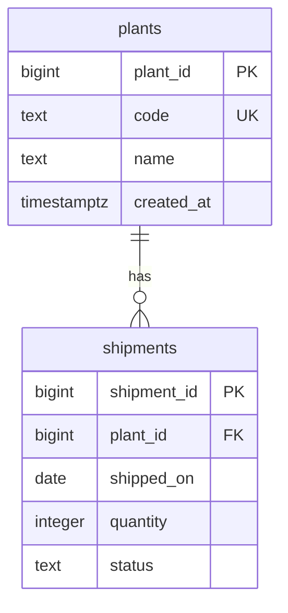

## 1. The question this idea answers

An application saves data. Code has bugs. Two requests can arrive at the same moment. A tool can send a wrong value. So how do you make sure that the stored data stays correct, even when the code is wrong?

A relational database answers with **constraints**: rules that you declare once, in the table definition. The database checks them on every write and rejects any row that breaks them. A primary key gives each row a name. A foreign key makes sure a reference refers to a real row. Other constraints reject empty, duplicate or out-of-range values.

This lesson covers everything inside one `CREATE TABLE` statement except the choice of column types, which is [L2](/notes/databases/postgres/01-relational-basics/l2-column-types). Every SQL example ran on PostgreSQL 16.15. The error messages are the real ones.

## 2. Mental model

> [!analogy] A strict clerk with a ledger
> A table is a ledger with fixed columns. A clerk guards it. Each row gets a serial number that nobody else can have: the primary key. Some columns refer to rows in another ledger: "plant number 1". Before the clerk writes such a row, the clerk checks that plant number 1 exists. The clerk also refuses empty cells where a value is required, numbers that are out of range, and duplicates where a value must be unique.
>
> **Where it stops working:** a ledger has an order: row 1, row 2, row 3. A table has no order. The database can return rows in any order unless you ask for one with `ORDER BY`.

## 3. Terms

| Term | Plain meaning |
|---|---|
| table | A named set of rows. All rows have the same columns. |
| row | One record in a table. |
| column | One named, typed field of every row. |
| schema | The definition of the tables: their columns, types and constraints. Also the name of a namespace for tables, such as `public`. |
| `NULL` | The marker for "no value". It is not zero and not an empty string. |
| constraint | A rule that the database checks on every write. A write that breaks it fails with an error. |
| primary key | A column, or a set of columns, whose value is unique and not null in every row. It names the row. |
| surrogate key | A primary key with no business meaning, created by the database, for example 1, 2, 3. |
| natural key | A primary key with business meaning, for example a plant code. |
| foreign key | A column whose value must match the primary key (or a unique key) of a row in another table. |
| referencing table | The table with the foreign key (the child). |
| referenced table | The table that the foreign key refers to (the parent). |
| `ON DELETE` | The rule for referencing rows when the referenced row is deleted. |
| DDL | Data definition language: statements that define tables, such as `CREATE TABLE`. |
| DML | Data manipulation language: statements that change rows, such as `INSERT`, `UPDATE`, `DELETE`. |

## 4. Method and math

### 4.1 Two tables

The example has plants and their shipments. One plant has many shipments. One shipment belongs to exactly one plant.

```sql
CREATE TABLE plants (
    plant_id   bigint GENERATED ALWAYS AS IDENTITY PRIMARY KEY,
    code       text NOT NULL UNIQUE,
    name       text NOT NULL,
    created_at timestamptz NOT NULL DEFAULT now()
);

CREATE TABLE shipments (
    shipment_id bigint GENERATED ALWAYS AS IDENTITY PRIMARY KEY,
    plant_id    bigint NOT NULL REFERENCES plants (plant_id) ON DELETE CASCADE,
    shipped_on  date NOT NULL,
    quantity    integer NOT NULL CHECK (quantity > 0),
    status      text NOT NULL DEFAULT 'planned'
                CHECK (status IN ('planned', 'shipped', 'cancelled'))
);

CREATE INDEX shipments_plant_id_idx ON shipments (plant_id);
```



The rest of this lesson takes this definition apart, one constraint at a time.

### 4.2 The primary key

The PostgreSQL docs say that a primary key "requires that the values be both unique and not null", and: "Adding a primary key will automatically create a unique B-tree index" (§5.4, checked on 2026-10-12). So a primary key gives three things: no duplicates, no nulls, and fast lookup by key.

`GENERATED ALWAYS AS IDENTITY` lets the database create the value: 1, 2, 3, and so on. You do not send it in an `INSERT`. If you try, PostgreSQL refuses:

```text
ERROR:  cannot insert a non-DEFAULT value into column "plant_id"
DETAIL:  Column "plant_id" is an identity column defined as GENERATED ALWAYS.
HINT:  Use OVERRIDING SYSTEM VALUE to override.
```

| Key kind | Example | Strength | Weakness |
|---|---|---|---|
| Surrogate | `plant_id` = 1, 2, 3 | Never changes. Small. | Means nothing to a person. |
| Natural | `code` = `'BRA'` | Readable | Business values can change. A rename then touches every referencing row. |

A common design uses both: a surrogate primary key, and a `UNIQUE` constraint on the natural key. The example does this with `plant_id` and `code`.

> [!trap] Identity values have gaps
> A failed insert still uses a number. In the test run of this lesson, the first good shipment got 1. Then three inserts failed (a foreign key error and two check errors) and used the numbers 2, 3 and 4. The next good shipment got 5. Never use an identity value as a count, and never expect it to have no gaps.

### 4.3 NOT NULL and DEFAULT

`NOT NULL` "simply specifies that a column must not assume the null value". An insert with no name fails:

```sql
INSERT INTO plants (code) VALUES ('TOR');
```

```text
ERROR:  null value in column "name" of relation "plants" violates not-null constraint
DETAIL:  Failing row contains (4, TOR, null, 2026-10-12 17:22:11.390331-04).
```

`DEFAULT` gives a value when the insert does not name the column. The docs: "The default expression will be used in any insert operation that does not specify a value for the column." In the example, `created_at` gets `now()` and `status` gets `'planned'`.

> [!note] A default is not a constraint
> A default fills a missing value. It does not stop a wrong value. An insert can still set `status` to anything, so the `CHECK` constraint does the stopping.

### 4.4 CHECK

A check constraint is "the most generic constraint type": any expression on the row that must hold.

```sql
INSERT INTO shipments (plant_id, shipped_on, quantity) VALUES (1, '2026-10-11', 0);
```

```text
ERROR:  new row for relation "shipments" violates check constraint "shipments_quantity_check"
DETAIL:  Failing row contains (3, 1, 2026-10-11, 0, planned).
```

```sql
INSERT INTO shipments (plant_id, shipped_on, quantity, status) VALUES (1, '2026-10-11', 5, 'lost');
```

```text
ERROR:  new row for relation "shipments" violates check constraint "shipments_status_check"
DETAIL:  Failing row contains (4, 1, 2026-10-11, 5, lost).
```

> [!trap] NULL passes a CHECK
> The docs say: "a check constraint is satisfied if the check expression evaluates to true or the null value." A comparison with `NULL` gives `NULL`, not false. So `CHECK (discount BETWEEN 0 AND 1)` accepts a row with `discount = NULL`. The test run confirms it: the insert of `NULL` succeeded and the insert of `1.5` failed. If a value is required, add `NOT NULL` too.

### 4.5 UNIQUE

`UNIQUE` rejects a second row with the same value. The docs: "Adding a unique constraint will automatically create a unique B-tree index".

```sql
INSERT INTO plants (code, name) VALUES ('BRA', 'Second Brampton');
```

```text
ERROR:  duplicate key value violates unique constraint "plants_code_key"
DETAIL:  Key (code)=(BRA) already exists.
```

A unique constraint can cover several columns, for example `UNIQUE (plant_id, shipped_on)` for "one shipment per plant per day".

> [!trap] Two NULLs are not duplicates
> The docs: "By default, two null values are not considered equal in this comparison." A `UNIQUE` column without `NOT NULL` accepts many rows with `NULL`. The test run inserted two `NULL` emails with no error. `UNIQUE NULLS NOT DISTINCT` (PostgreSQL 15 and later) changes this. With it, the second `NULL` failed with `Key (email)=(null) already exists.`

### 4.6 The foreign key

A foreign key "maintains the *referential integrity* between two related tables". A shipment for a plant that does not exist fails:

```sql
INSERT INTO shipments (plant_id, shipped_on, quantity) VALUES (99, '2026-10-11', 10);
```

```text
ERROR:  insert or update on table "shipments" violates foreign key constraint "shipments_plant_id_fkey"
DETAIL:  Key (plant_id)=(99) is not present in table "plants".
```

What happens to the shipments when a plant is deleted? The `ON DELETE` clause decides.

| `ON DELETE` | Effect | When to use |
|---|---|---|
| `NO ACTION` (the default) | The delete fails while referencing rows exist. | The child rows must not disappear by accident. |
| `RESTRICT` | Like `NO ACTION`, but checked at once, even in a deferred setup. | Same, with stricter timing. |
| `CASCADE` | The referencing rows are deleted too. The docs: "when a referenced row is deleted, row(s) referencing it should be automatically deleted as well." | The child rows have no meaning without the parent. |
| `SET NULL` | The foreign key column of the child rows becomes `NULL`. | The child can exist alone. |

With the default, the test run gave:

```text
ERROR:  update or delete on table "parent" violates foreign key constraint "child_parent_id_fkey" on table "child"
DETAIL:  Key (id)=(1) is still referenced from table "child".
```

With `ON DELETE CASCADE` in the example, `DELETE FROM plants WHERE code = 'BRA'` also deleted plant 1's shipment: the shipment count went from 1 to 0.

> [!trap] A foreign key does not create an index
> The docs: "the declaration of a foreign key constraint does not automatically create an index on the referencing columns" and "it is often a good idea to index the referencing columns too." Without an index on `shipments.plant_id`, every "shipments of plant 1" query and every cascade delete must scan the whole `shipments` table. The example creates `shipments_plant_id_idx` for this reason. [L3](/notes/databases/postgres/01-relational-basics/l3-indexes) covers indexes.

### 4.7 Rows have no order

A table is a set. `SELECT * FROM shipments` can return the rows in any order. The order that you see in a test is an accident of the storage. It can change after updates, deletes or a new version.

> [!key] Order only with ORDER BY
> If the order matters, for example the order of messages in a chat, store a column that defines it and always write `ORDER BY` with that column.

### 4.8 Name your constraints

PostgreSQL makes names such as `shipments_quantity_check`. You can choose them:

```sql
quantity integer NOT NULL CONSTRAINT quantity_positive CHECK (quantity > 0)
```

A good name appears in the error message and helps the person who reads the log.

### 4.9 Production view

| Concern | What constraints give you |
|---|---|
| Correctness | The database rejects bad rows from every client: the application, a script, a person with SQL access. |
| Debugging | Each error names the constraint and the failing row. |
| Performance | Primary and unique keys come with indexes. Foreign keys need an index that you add yourself. |
| Deletes | `ON DELETE` decides whether a delete fails, cascades or sets nulls. Choose it on purpose. |
| Changes | Adding a constraint later checks all old rows. Plan it as a migration ([part 4](/notes/databases/postgres/04-schema-changes/l1-alter-table-add-column)). |

## 5. Code

These exercises use a local PostgreSQL 16 server. One command starts one with Docker (lesson [5.1](/notes/databases/postgres/05-local-setup/l1-local-postgres-with-docker)):

```bash
docker run --name pg16 -e POSTGRES_PASSWORD=dev -p 5432:5432 -d postgres:16
```

Then connect with `psql -h localhost -U postgres`. Put your SQL in `postgres/01-tables.sql` in the lab folder.

**Exercise 1.1: production lines.** Write `CREATE TABLE lines` for the production lines of a plant: an identity primary key, a foreign key to `plants`, a name that is required, a line number between 1 and 50, and a rule that one plant cannot have two lines with the same number.

Acceptance tests (run each insert and check the result):

- A line for a plant that does not exist fails with a foreign key error.
- A line number of 0 fails with a check error.
- Two lines with number 3 in the same plant fail with a unique error. Number 3 in two different plants succeeds.

**Exercise 1.2: choose ON DELETE.** Decide the `ON DELETE` rule for `lines.plant_id`. Write two sentences that defend your choice. Then delete a plant and show the effect.

**Exercise 1.3: break your own CHECK.** Add a nullable column with a `CHECK` constraint. Insert a row with `NULL` in that column.

Acceptance test: the insert succeeds. Write one sentence that explains why, then fix the column.

## 6. Common mistakes

1. **"The rows return in insert order."** Rows have no order. Use `ORDER BY`.
2. **A CHECK without NOT NULL.** `NULL` passes a CHECK.
3. **A UNIQUE column that allows NULL, used as an identity.** Many rows can have `NULL`.
4. **A foreign key with no index on the referencing column.** Lookups and cascades scan the whole table.
5. **ON DELETE CASCADE by habit.** A delete of one parent can delete thousands of rows. Choose the rule for each relationship.
6. **Counting rows with identity values.** Failed inserts leave gaps.

## 7. One-minute explanation

A table holds rows, and every row has the same typed columns. Constraints are rules that the database checks on every write. The primary key is unique and not null, so it names each row, and it comes with an index. A foreign key makes a column match a key in another table, so a reference cannot refer to a row that does not exist, and `ON DELETE` decides what happens to the children when a parent is deleted. `NOT NULL` forbids empty values, `DEFAULT` fills missing ones, `CHECK` enforces any rule on the row, and `UNIQUE` forbids duplicates. Two traps: a `NULL` passes a `CHECK`, and a foreign key does not create an index on the child column. Rows have no order unless you write `ORDER BY`.

## 8. Check questions

```check
{
  "question": "A column is defined as score integer CHECK (score >= 0). An insert sets score to NULL. Does it succeed? Why?",
  "answer": "Yes. A comparison with NULL gives NULL, and a check constraint is satisfied when its expression is true or null. Add NOT NULL if a score is required."
}
```

```check
{
  "question": "A messages table has a foreign key chat_id to chats, with no ON DELETE clause. What happens when you delete a chat that has messages? What changes with ON DELETE CASCADE?",
  "answer": "With no clause, the rule is NO ACTION, so the delete fails with an error that the key is still referenced from messages. With ON DELETE CASCADE, the delete succeeds and the messages of that chat are deleted too."
}
```

```check
{
  "question": "Why should you create an index on messages.chat_id, when the foreign key already exists?",
  "answer": "A foreign key does not create an index on the referencing column. Without one, every query for the messages of one chat, and every cascade delete of a chat, must scan the whole messages table."
}
```

```check
{
  "question": "Your test shows messages in the right order without ORDER BY. Why is the code still wrong?",
  "answer": "A table has no order. The order in the test is an accident of how the rows are stored, and it can change after updates, deletes or vacuum. The query must order by a column that defines the order, such as a sequence number or a time stamp."
}
```

## 9. Links

- Previous in the priority path: [Transient vs persistent context](/notes/ai/conversation-state/01-where-state-lives/l2-transient-vs-persistent-context)
- Next: [L2: Column types](/notes/databases/postgres/01-relational-basics/l2-column-types)
- Applied to chat history: [Chats, messages and parts](/notes/ai/conversation-state/02-chat-history-model/l1-chats-messages-and-parts)
- [Glossary](/notes/databases/postgres/glossary)
