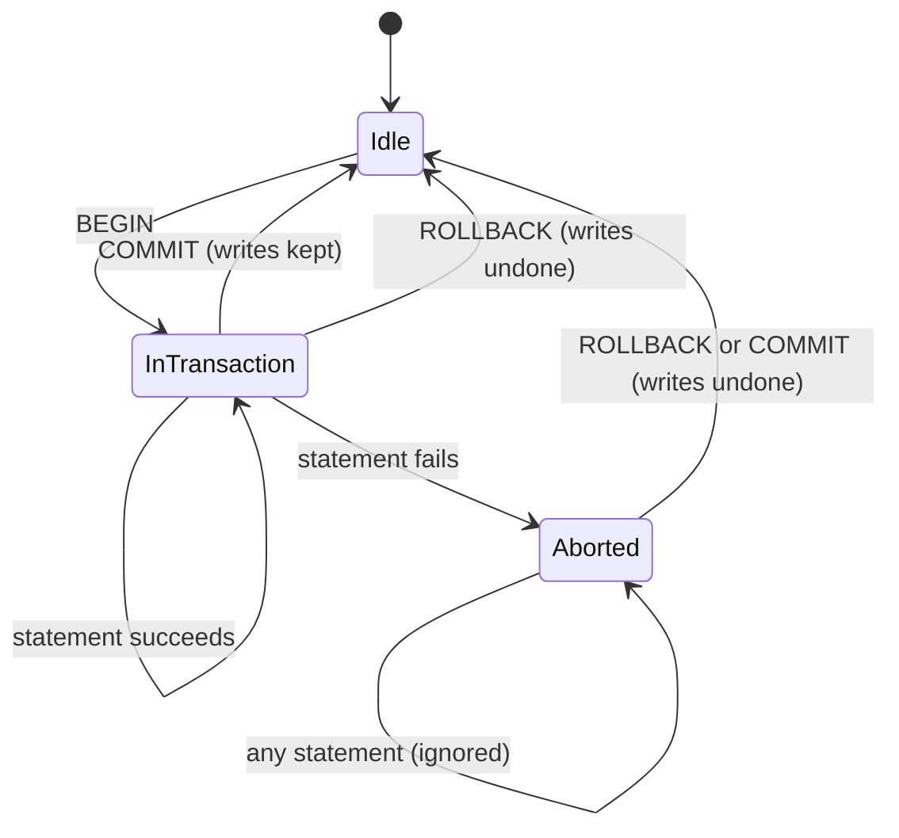

## 1. The question this idea answers

Many actions need more than one write. A shipment must add a stock movement and reduce the stock. A chat turn must save the user's message and the assistant's answer. If the first write succeeds and the second fails, the data is half written: stock that moved with no record, or a question with no answer. A crash between the two writes does the same.

How do you make several writes happen all together, or not at all? The database answers with a **transaction**. This lesson shows exactly what a transaction guarantees, with real results from PostgreSQL 16.15, and what it cannot guarantee.

## 2. Mental model

> [!analogy] A shopping cart at the checkout
> You put items in a cart. Nothing is yours until you pay. At the checkout, either the payment succeeds and all the items are yours, or the payment fails and every item returns to the shelf. Other shoppers do not see your items as sold while they are in your cart.
>
> The writes of a transaction are the items. `COMMIT` is the payment. `ROLLBACK`, or any failure, puts everything back.
>
> **Where it stops working:** a shop can put items back on the shelf. A database can undo only its own writes. If your code also sent an email or called a model API in the middle, the transaction cannot undo that. And while your cart is open, the database holds locks on the rows that you changed, so a long transaction can make other writers wait.

## 3. Terms

| Term | Plain meaning |
|---|---|
| transaction | A group of SQL statements that the database applies as one unit: all of them or none of them. |
| atomicity | The all-or-nothing property of a transaction. |
| `BEGIN` | Starts a transaction block. |
| `COMMIT` | Ends the transaction and makes all its writes permanent and visible. |
| `ROLLBACK` | Ends the transaction and undoes all its writes. |
| implicit transaction | The transaction that PostgreSQL puts around a single statement when no `BEGIN` was given. |
| autocommit | A client mode in which each statement commits on its own. |
| aborted transaction | A transaction in which a statement failed. It accepts no more statements until `ROLLBACK`. |
| savepoint | A named point inside a transaction. `ROLLBACK TO` that point undoes only the later writes. |
| isolation | The rule for what one transaction can see of other transactions that run at the same time. |
| Read Committed | The default isolation level of PostgreSQL. Each statement sees only data that was committed before the statement began. |
| durability | After `COMMIT` returns, the writes survive a crash. |
| lock | A mark on a row or table that makes other transactions wait before they change it. |

## 4. Method and math

### 4.1 What the docs promise

The PostgreSQL 16 tutorial (§3.4, checked on 2026-10-12):

> "The essential point of a transaction is that it bundles multiple steps into a single, all-or-nothing operation. The intermediate states between the steps are not visible to other concurrent transactions, and if some failure occurs that prevents the transaction from completing, then none of the steps affect the database at all."

It also promises durability: "once a transaction is completed and acknowledged by the database system, it has indeed been permanently recorded and won't be lost even if a crash ensues shortly thereafter."

The test tables for this lesson:

```sql
CREATE TABLE inventory (
    item    text PRIMARY KEY,
    on_hand integer NOT NULL CHECK (on_hand >= 0)
);
CREATE TABLE stock_moves (
    move_id bigint GENERATED ALWAYS AS IDENTITY PRIMARY KEY,
    item    text NOT NULL REFERENCES inventory (item),
    change  integer NOT NULL
);
INSERT INTO inventory VALUES ('bagel', 10);
```

A shipment of 12 bagels needs two writes: a stock move of −12, and `on_hand` from 10 to −2. The `CHECK` constraint rejects −2. So the second write fails.

### 4.2 Without a transaction: half written

```sql
INSERT INTO stock_moves (item, change) VALUES ('bagel', -12);   -- succeeds
UPDATE inventory SET on_hand = on_hand - 12 WHERE item = 'bagel'; -- fails
```

```text
ERROR:  new row for relation "inventory" violates check constraint "inventory_on_hand_check"
DETAIL:  Failing row contains (bagel, -2).
```

Result: `moves = 1`, `on_hand = 10`. The stock move exists, but the stock did not change. The data now disagrees with itself.

Why did the first insert stay? The tutorial says: "PostgreSQL actually treats every SQL statement as being executed within a transaction." Each statement "has an implicit `BEGIN` and (if successful) `COMMIT` wrapped around it." So each statement here was its own transaction, and the first one committed before the second one ran.

### 4.3 With a transaction: nothing written

```sql
BEGIN;
INSERT INTO stock_moves (item, change) VALUES ('bagel', -12);
UPDATE inventory SET on_hand = on_hand - 12 WHERE item = 'bagel';  -- fails
SELECT 1;
COMMIT;
```

The output, line by line:

```text
BEGIN
INSERT 0 1
ERROR:  new row for relation "inventory" violates check constraint "inventory_on_hand_check"
ERROR:  current transaction is aborted, commands ignored until end of transaction block
ROLLBACK
```

Result: `moves = 0`, `on_hand = 10`. Three facts come from this output.

1. **After an error, the transaction is aborted.** The `SELECT 1` was refused: "current transaction is aborted, commands ignored until end of transaction block".
2. **A COMMIT of an aborted transaction is a ROLLBACK.** The client sent `COMMIT`, and PostgreSQL answered `ROLLBACK`.
3. **The insert that succeeded was undone.** All or nothing.



### 4.4 Other sessions see nothing until COMMIT

The test ran two sessions at the same time. Session A ran `BEGIN`, inserted one row, waited four seconds, then committed. Session B counted the rows during and after.

| Moment | Session B sees |
|---|---|
| While A's transaction is open | 0 rows |
| After A's `COMMIT` | 1 row |

This is isolation. The docs (§13.2): "Read Committed is the default isolation level in PostgreSQL." Under it, "a SELECT query ... sees only data committed before the query began". The docs also warn that "two successive SELECT commands can see different data, even though they are within a single transaction", because another transaction can commit between them. Stricter levels exist (Repeatable Read and Serializable). With them, an application "must be prepared to retry transactions due to serialization failures". [Lesson 2.2](/notes/databases/postgres/02-transactions/l2-isolation-and-upserts) covers isolation in detail.

### 4.5 A crash before COMMIT

The test started session C: `BEGIN`, insert one row, then wait. While it waited, the test killed C's database connection with `pg_terminate_backend`. Session C got `FATAL: terminating connection due to administrator command`.

Result: the table had 0 rows. A transaction that never reached `COMMIT` leaves nothing behind, also when the client process or its connection dies in the middle.

### 4.6 Savepoints

A savepoint undoes part of a transaction. This is the example from the docs, run in the test:

```sql
BEGIN;
INSERT INTO t1 VALUES (1);
SAVEPOINT my_savepoint;
INSERT INTO t1 VALUES (2);
ROLLBACK TO SAVEPOINT my_savepoint;
INSERT INTO t1 VALUES (3);
COMMIT;
```

The table holds 1 and 3, not 2. Savepoints are useful when one optional step may fail and the rest must still commit.

### 4.7 Transactions in Python with psycopg 3

The psycopg docs warn about one default: "by default, any database operation will start a new transaction", and "changes made by any cursor of the connection will not be visible until Connection.commit() is called, and will be discarded by Connection.rollback()."

There are two safe patterns.

**Pattern 1: the connection block.** The docs: "When the block is exited, if there is a transaction open, it will be committed. If an exception is raised within the block the transaction is rolled back." In both cases the connection is closed.

```python
with psycopg.connect(DSN) as conn:
    conn.execute("INSERT ...", params)
    conn.execute("UPDATE ...", params)
# committed here, or rolled back if an exception was raised
```

**Pattern 2: an explicit transaction block.** The docs: "when leaving the context the transaction is committed, or it is rolled back if an exception is raised inside the block." This is the code from the test:

```python
def ship(conn, item, qty):
    with conn.transaction():
        conn.execute("INSERT INTO stock_moves (item, change) VALUES (%s, %s)", (item, -qty))
        conn.execute("UPDATE inventory SET on_hand = on_hand - %s WHERE item = %s", (qty, item))

with psycopg.connect(DSN, autocommit=True) as conn:
    ship(conn, "bagel", 4)        # commits
    try:
        ship(conn, "bagel", 12)   # fails, rolls back
    except psycopg.errors.CheckViolation:
        ...
```

Test result: `moves = 1`, `on_hand = 6`. The first shipment committed. The second one left nothing.

The docs add that transaction blocks "can be also nested (internal transaction blocks are implemented using SAVEPOINT)".

> [!trap] No commit, no data
> The test opened a connection with the default settings, inserted a row and called `conn.close()` with no commit and no `with` block. The row was gone. The docs describe the same case: "No COMMIT was sent: the INSERT was discarded." Use a `with` block every time.

> [!note] Parameters, never string formatting
> The examples pass values as a second argument: `conn.execute("... %s", (value,))`. The psycopg docs mark string formatting of SQL as wrong, because the values must be sent separately from the query. [Lesson 3.1](/notes/databases/postgres/03-python-driver/l1-psycopg-basics) covers this.

### 4.8 What a transaction cannot protect

A transaction covers writes to **one database**. It does not cover anything outside it.

| Action inside the transaction | Undone by ROLLBACK? |
|---|---|
| `INSERT`, `UPDATE`, `DELETE` in this database | Yes |
| A call to a model API | No. The model call happened, and you paid for it. |
| An email, a message to a queue, a file write | No |

> [!key] Short transactions around the writes only
> Do the slow and external work first: the agent run, the model calls, the tools. Then open one short transaction for the writes, and commit. A transaction that stays open during a 30-second agent run holds locks for 30 seconds and still cannot undo the model calls.

> [!example] Worked example: saving one chat turn
> A chat turn ends when the agent's stream ends. The application then writes three things: the user message row, the assistant message row, and the new `updated_at` of the chat.
>
> | Design | A failure after the first write leaves |
> |---|---|
> | Three separate statements in autocommit mode | A user message with no answer, or an answer with no question |
> | One transaction around the three writes | Nothing. The turn is either fully saved or not saved. |
>
> [Conversation State 2.1](/notes/ai/conversation-state/02-chat-history-model/l1-chats-messages-and-parts) builds this design.

### 4.9 Retries need idempotent writes

A client can send `COMMIT` and lose the connection before the answer arrives. It does not know if the commit happened. If it retries, it can save the turn twice. The fix is an id that the client chooses before the first attempt, a `UNIQUE` constraint on it, and `INSERT ... ON CONFLICT DO NOTHING`. The docs: "`ON CONFLICT DO NOTHING` simply avoids inserting a row as its alternative action." [Lesson 2.2](/notes/databases/postgres/02-transactions/l2-isolation-and-upserts) covers it.

### 4.10 Production view

| Concern | What to do |
|---|---|
| Correctness | Put every group of writes that must agree into one transaction. |
| Locks | Keep transactions short. Never wait for a model, a user or a network call inside one. |
| Errors | After any error in a transaction, roll back. In psycopg, a `with` block does this for you. |
| Retries | Make writes idempotent with client ids and `ON CONFLICT`. |
| Isolation | Read Committed is enough for appending chat turns. Use stricter levels only with a retry loop. |

## 5. Video

```video
{
  "src": "/notes/media/postgres/manim/m01-transaction-all-or-nothing.mp4",
  "caption": "Two writes without a transaction leave half the data. Inside a transaction, a failure or a crash before COMMIT leaves nothing, and other sessions see the rows only after COMMIT."
}
```

## 6. Code

These exercises use your local PostgreSQL 16 server and `psycopg` 3. Put the work in `postgres/04-transactions.ipynb`.

**Exercise 1.1: reproduce the three results.** In `psql`, repeat sections 4.2, 4.3 and 4.6.

Acceptance test: your results match: `moves = 1, on_hand = 10` without a transaction, `moves = 0, on_hand = 10` with a transaction, and the values 1 and 3 after the savepoint test.

**Exercise 1.2: see isolation.** Open two `psql` windows. In window A, run `BEGIN;` and an insert, and do not commit. In window B, count the rows. Then commit in A and count again in B.

Acceptance test: B sees the row only after A's `COMMIT`.

**Exercise 1.3: save a turn.** Create two tables: `chats (id uuid PRIMARY KEY, updated_at timestamptz NOT NULL)` and `turn_messages (id uuid PRIMARY KEY, chat_id uuid NOT NULL REFERENCES chats (id), role text NOT NULL CHECK (role IN ('user', 'assistant')), body text NOT NULL)`. Write `save_turn(conn, chat_id, user_text, answer_text)` in Python. It inserts both messages and updates `updated_at` in one `conn.transaction()` block.

Acceptance tests:

- A normal call adds exactly two rows.
- A call with `answer_text = None` raises an error (from `NOT NULL`) and adds zero rows, also zero user rows.
- Kill the connection in the middle (put `SELECT pg_sleep(5)` between the inserts and run `pg_terminate_backend` from another session). Zero rows are added.

## 7. Common mistakes

1. **Several related writes in autocommit mode.** A failure in the middle leaves half the data.
2. **Continuing after an error inside a transaction.** The transaction is aborted. Roll back and start again.
3. **Forgetting commit in psycopg.** The default starts a transaction, and closing without commit discards it. Use `with` blocks.
4. **Calling the model inside the transaction.** It holds locks during a slow call and cannot be undone.
5. **Blind retries.** A retry after a lost commit answer can write twice. Use client ids and `ON CONFLICT`.

## 8. One-minute explanation

A transaction groups several writes into one all-or-nothing unit. You start it with `BEGIN` and end it with `COMMIT` or `ROLLBACK`. Until the commit, other sessions do not see the writes, and if any statement fails, the transaction is aborted and every write in it is undone. Even a `COMMIT` then acts as a `ROLLBACK`. If the client crashes before the commit, nothing is saved. After the commit returns, the writes survive a crash. Without `BEGIN`, each statement is its own transaction, so a failure in the second of two writes leaves the first one in place. In Python, psycopg starts a transaction by default and discards it without a commit, so use `with conn.transaction():`. A transaction protects only database writes, so do the slow model calls first, then save the whole turn in one short transaction.

## 9. Check questions

```check
{
  "question": "In psql you run BEGIN, then an INSERT that succeeds, then an UPDATE that fails, then COMMIT. What does PostgreSQL answer to the COMMIT, and what is in the table?",
  "answer": "It answers ROLLBACK, because the failed UPDATE aborted the transaction. A commit of an aborted transaction rolls it back. The INSERT is undone, so the table has none of the transaction's rows."
}
```

```check
{
  "question": "A service saves the user message, then calls the model for 20 seconds, then saves the answer, all in one transaction. Name two problems.",
  "answer": "First, the transaction holds its locks for the whole model call, so other writers to the same rows wait. Second, a rollback cannot undo the model call, which already happened and was paid for. The fix is to run the model first and then save both messages in one short transaction."
}
```

```check
{
  "question": "Python code runs conn = psycopg.connect(DSN), conn.execute(\"INSERT ...\"), conn.close(). Is the row saved? Why?",
  "answer": "No. With the default autocommit = False, the insert starts a transaction, and closing the connection without a commit discards it. Use with psycopg.connect(DSN) as conn: or with conn.transaction(): so that the block commits at the end."
}
```

```check
{
  "question": "Under Read Committed, can two identical SELECT statements inside one transaction return different results? Why?",
  "answer": "Yes. Under Read Committed, each statement sees the data committed before that statement began. If another transaction commits between the two SELECT statements, the second one sees the new data."
}
```

## 10. Links

- Previous: [L3: Indexes](/notes/databases/postgres/01-relational-basics/l3-indexes)
- Next in the part: [L2: Isolation and upserts](/notes/databases/postgres/02-transactions/l2-isolation-and-upserts)
- Next in the priority path: [Chats, messages and parts](/notes/ai/conversation-state/02-chat-history-model/l1-chats-messages-and-parts)
- [Glossary](/notes/databases/postgres/glossary)
