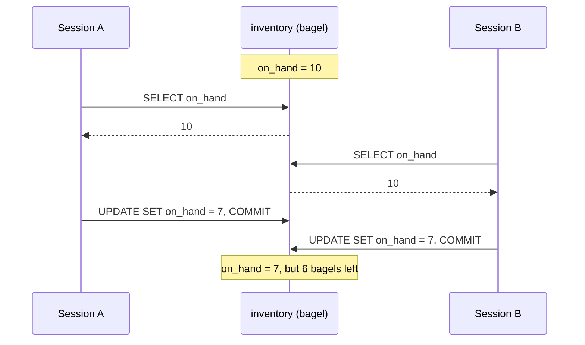
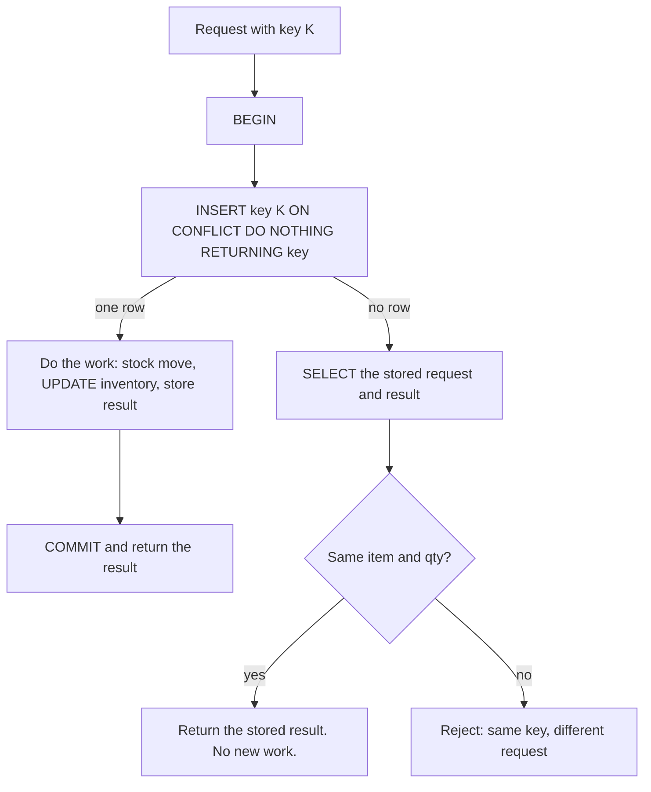

## 1. The question this idea answers

[L1](/notes/databases/postgres/02-transactions/l1-transactions) showed one transaction alone. A real service is never alone. A web service runs many workers, and two requests can change the same row at the same moment: two shipments of the same item, two saves for the same chat, or a retry of a request that already succeeded.

Each transaction can be correct by itself, and the result can still be wrong. This lesson answers three questions with real results from PostgreSQL 16.15:

1. What does a transaction see while another transaction changes the same rows?
2. How do two correct transactions lose an update, and what are the three standard fixes?
3. How do you insert-or-update in one safe statement, and how do you make a retried request write only once?

## 2. Mental model

> [!analogy] A number on a shared whiteboard
> The stock of bagels is a number on a whiteboard. Two clerks must each take 3 bagels. Each clerk copies the number into a notebook (10), subtracts 3 in the notebook (7), and writes 7 on the board. The board shows 7, but 6 bagels left the shelf. The second clerk erased the work of the first clerk.
>
> There are three fixes. A clerk can write "subtract 3 from the number on the board now" (an atomic update). A clerk can take the only marker before reading, so the other clerk waits (a row lock). Or a referee can watch both clerks and cancel the work of one of them if they overlapped, and that clerk starts again (Serializable).
>
> **Where it stops working:** a whiteboard has one copy of the number. PostgreSQL keeps several versions of a row. A plain reader does not wait for a writer: it reads an older committed version, called a snapshot. Only writers and locking reads wait for writers.

## 3. Terms

| Term | Plain meaning |
|---|---|
| concurrent transactions | Two or more transactions that are open at the same time. |
| isolation level | The rule that decides which changes of other transactions a transaction can see. |
| snapshot | The set of committed data that a statement or a transaction sees. |
| Repeatable Read | An isolation level in which all statements of a transaction see one snapshot, taken at its first statement. |
| Serializable | The strictest isolation level. The result must equal some one-at-a-time order of the transactions, or one transaction fails. |
| read-modify-write | Code that reads a value, computes a new value in the application, and writes the new value. |
| lost update | A write that disappears because another transaction overwrote it, based on an old read. |
| row lock | A lock on one row. Other writers of that row wait until the lock holder ends its transaction. |
| `SELECT ... FOR UPDATE` | A read that also takes a row lock on every row that it returns. |
| serialization failure | The error (SQLSTATE `40001`) that Repeatable Read or Serializable raises to prevent a wrong result. The fix is to retry the whole transaction. |
| upsert | One statement that inserts a row, or updates it if a row with the same key exists. |
| `EXCLUDED` | The special table name for the row that `INSERT ... ON CONFLICT DO UPDATE` proposed to insert. |
| cardinality violation | The error when one `ON CONFLICT DO UPDATE` statement would change the same row twice. |
| idempotency key | An id that the client makes before the first attempt, so that the server can detect a retry and not do the work twice. |

## 4. Method and math

### 4.1 What Read Committed promises

Read Committed is the default isolation level (L1). The PostgreSQL 16 docs, §13.2.1 (checked on 2026-10-13), say what one statement sees:

> "a `SELECT` query (without a `FOR UPDATE/SHARE` clause) sees only data committed before the query began; it never sees either uncommitted data or changes committed by concurrent transactions during the query's execution."

The snapshot belongs to the **statement**, not to the transaction: "two successive `SELECT` commands can see different data, even though they are within a single transaction, if other transactions commit changes after the first `SELECT` starts and before the second `SELECT` starts."

The docs list four effects that concurrent transactions can cause, and which level allows each one in PostgreSQL (Table 13.1):

| Isolation level | Dirty read | Nonrepeatable read | Phantom read | Serialization anomaly |
|---|---|---|---|---|
| Read Committed (default) | Not possible | Possible | Possible | Possible |
| Repeatable Read | Not possible | Not possible | "Allowed, but not in PG" | Possible |
| Serializable | Not possible | Not possible | Not possible | Not possible |

A **nonrepeatable read** means "A transaction re-reads data it has previously read and finds that data has been modified by another transaction (that committed since the initial read)." A **serialization anomaly** means "The result of successfully committing a group of transactions is inconsistent with all possible orderings of running those transactions one at a time." The table omits Read Uncommitted because "PostgreSQL's Read Uncommitted mode behaves like Read Committed."

### 4.2 Two sessions, scripted

The test uses the tables of L1: `inventory (item, on_hand)` with `('bagel', 10)`. Session A runs `BEGIN ISOLATION LEVEL ...` and reads `on_hand`. Session B, in autocommit mode, sets `on_hand` to 7. Then session A reads again and commits.

| Level of A | First read | Second read (after B's commit) | Read after A's COMMIT |
|---|---|---|---|
| READ COMMITTED | 10 | **7** | 7 |
| REPEATABLE READ | 10 | **10** | 7 |

Under Read Committed, the second statement took a new snapshot and saw B's commit. Under Repeatable Read, the whole transaction kept the snapshot of its first statement.

### 4.3 The lost update

Two workers each take 3 bagels with read-modify-write code. Each one runs in its own transaction, and each one is correct alone.



The scripted test ran exactly this order with two connections. Result: `A read 10 B read 10 -> final on_hand: 7 (expected 4)`.

The order does not need a script. A second test started 20 threads with a barrier. Each thread read `on_hand`, waited 10 ms in Python, and wrote `value - 1`. The start value was 100, so the correct result was 80. Three runs gave **99, 99 and 99**. Nineteen of twenty updates were lost each time, because all threads read 100 before any thread wrote.

> [!trap] Read Committed does not prevent lost updates
> A transaction does not protect a value that you read and then compute with in Python. Read Committed lets the read see 10 while another transaction is about to change it. The `BEGIN` around the two statements changes nothing in this case.

### 4.4 Fix 1: an atomic UPDATE

Do the arithmetic in the database, in the `UPDATE` itself:

```sql
UPDATE inventory SET on_hand = on_hand - 3 WHERE item = 'bagel';
```

Why is this safe under Read Committed? The docs (§13.2.1) describe what happens when a row was changed by a concurrent transaction: "the would-be updater will wait for the first updating transaction to commit or roll back". If the first one commits, the second updater "will attempt to apply its operation to the updated version of the row. The search condition of the command (the `WHERE` clause) is re-evaluated to see if the updated version of the row still matches".

The tests confirm each part:

| Test | Result |
|---|---|
| 20 threads, each `SET on_hand = on_hand - 1`, from 100 | 80, correct |
| A updates and holds the transaction for 1 s. B runs the same `UPDATE ... RETURNING on_hand`. | B waited 1.004 s, then returned 4 |
| Start at 5. A and B each run `... SET on_hand = on_hand - 3 WHERE item = 'bagel' AND on_hand >= 3 RETURNING on_hand` | A returned 2. B returned no row, because 2 >= 3 is false after the re-check. Final 2. |

The third test is the important pattern: the `WHERE` clause holds the business rule. The statement returns no row when the stock is too low, and the code treats "no row" as "rejected".

### 4.5 Fix 2: SELECT ... FOR UPDATE

Sometimes the new value needs logic that is hard to write in SQL. Then lock the row when you read it. The docs (§13.3.2): "`FOR UPDATE` causes the rows retrieved by the `SELECT` statement to be locked as though for update. This prevents them from being locked, modified or deleted by other transactions until the current transaction ends."

```sql
BEGIN;
SELECT on_hand FROM inventory WHERE item = 'bagel' FOR UPDATE;   -- lock, then compute in Python
UPDATE inventory SET on_hand = $new_value WHERE item = 'bagel';
COMMIT;
```

Test: A read 10 with `FOR UPDATE` and held the lock for 1 s. B's `SELECT ... FOR UPDATE` waited 1.010 s, then read **7**, not 10. Final value 4. The docs explain why B read 7: `SELECT FOR UPDATE` "will wait for a concurrent transaction that has run any of those commands on the same row, and will then lock and return the updated row".

> [!trap] Lock order and lock time
> Two transactions that lock rows A then B, and B then A, can wait for each other forever. PostgreSQL detects this deadlock and aborts one of them. The docs (§13.3.4): "The best defense against deadlocks is generally to avoid them by being certain that all applications using a database acquire locks on multiple objects in a consistent order." Also, a row lock lasts until the transaction ends. Never call a model or a slow service while you hold one.

### 4.6 Fix 3: Serializable with a retry loop

Serializable lets you keep plain read-modify-write code. PostgreSQL watches the transactions and fails one of them when the result could be wrong. The scripted lost update under Serializable gave session B `psycopg.errors.SerializationFailure`, SQLSTATE `40001`, with the message "could not serialize access due to concurrent update". The stock stayed 7, which is correct for one committed take of 3. B must now run again from the start.

Serializable also catches **write skew**: two transactions read the same rows, and each one changes a different row. A rule says that shift 1 needs at least one person. Ana and Ben are on the shift. Two transactions each count the staff (2), and each removes a different person. Under Read Committed, both commits succeeded and the shift had **0** people. Under Serializable, B failed at `COMMIT` and Ben stayed on the shift.

The Serializable error, with all its fields from `e.diag`:

```text
could not serialize access due to read/write dependencies among transactions
DETAIL:  Reason code: Canceled on identification as a pivot, during commit attempt.
HINT:  The transaction might succeed if retried.
```

The docs (§13.5, checked on 2026-10-13) set the rules for the retry: "It is important to retry the complete transaction, including all logic that decides which SQL to issue and/or which values to use. Therefore, PostgreSQL does not offer an automatic retry facility". They recommend to retry `40001` "unconditionally". They add that it "may also be advisable to retry deadlock failures" (`40P01`), and that unique-key failures (`23505`) need "more care", because "they might represent persistent error conditions rather than transient failures."

A short retry loop in psycopg 3. The function `work` must read its inputs again on every attempt:

```python
import random, time
import psycopg
from psycopg import IsolationLevel
from psycopg.errors import SerializationFailure

conn = psycopg.connect(DSN, autocommit=True)
conn.isolation_level = IsolationLevel.SERIALIZABLE   # applies to conn.transaction() blocks

for attempt in range(1, 11):
    try:
        with conn.transaction():
            work(conn)                 # all reads and decisions happen in here
        break
    except SerializationFailure:
        if attempt == 10:
            raise
        time.sleep(random.uniform(0, 0.01 * 2 ** attempt))   # backoff with jitter
```

> [!example] Worked example: the cost of each fix
> 20 threads take 1 bagel each from 100. Each thread opens its own connection. Times include the connection setup. The FOR UPDATE and Serializable versions wait 10 ms in Python between the read and the write.
>
> | Fix | Final value | Transaction attempts | Wall time (3 runs) |
> |---|---|---|---|
> | Atomic `UPDATE` | 80 | 20 | 0.084 to 0.093 s |
> | `FOR UPDATE` | 80 | 20 | 0.294 to 0.314 s |
> | Serializable + retry | 80 | 85 to 86 | 0.588 to 0.685 s |
>
> All three are correct. Serializable ran about 86 / 20 = 4.3 transactions for each useful one. Under high contention on one row, retries cost the most. The `FOR UPDATE` time is close to 20 × 10 ms = 0.2 s plus overhead, because the threads wait in a line for the lock.

### 4.7 Choose a fix

| Situation | Fix |
|---|---|
| The new value is a simple expression of the old value | Atomic `UPDATE`, with the rule in the `WHERE` clause |
| The new value needs application logic, and you know which rows to lock | `SELECT ... FOR UPDATE`, in a short transaction, in a fixed lock order |
| The rule spans many rows (counts, sums, "at least one"), or the logic is complex and contention is low | Serializable with a retry loop |

> [!key] A read in Python is already old
> Under Read Committed, a value that your code read is a copy. Another transaction can change the row before your write. Either let the database compute the new value, lock the row before you read it, or let Serializable detect the conflict and retry.

### 4.8 INSERT ... ON CONFLICT

The PostgreSQL 16 docs for `INSERT` (checked on 2026-10-13): "`ON CONFLICT` can be used to specify an alternative action to raising a unique constraint or exclusion constraint violation error." `ON CONFLICT DO NOTHING` "simply avoids inserting a row as its alternative action". `ON CONFLICT DO UPDATE` "updates the existing row that conflicts with the row proposed for insertion".

The rules for the target: "For `ON CONFLICT DO NOTHING`, it is optional to specify a `conflict_target`; when omitted, conflicts with all usable constraints (and unique indexes) are handled. For `ON CONFLICT DO UPDATE`, a `conflict_target` *must* be provided." The `SET` clause can read the existing row by the table name and "the row proposed for insertion using the special `excluded` table."

The test table counts the units that a plant produced per day:

```sql
CREATE TABLE plant_daily_output (
    plant_id bigint  NOT NULL,
    day      date    NOT NULL,
    units    integer NOT NULL,
    PRIMARY KEY (plant_id, day)
);
INSERT INTO plant_daily_output VALUES (1, '2026-10-12', 500);
```

Each statement below ran after the one before it:

| Statement | Output |
|---|---|
| `INSERT ... VALUES (1, '2026-10-12', 120);` | `ERROR: duplicate key value violates unique constraint "plant_daily_output_pkey"` |
| `... ON CONFLICT DO NOTHING RETURNING *;` | 0 rows, `INSERT 0 0` |
| `... ON CONFLICT (plant_id, day) DO UPDATE SET units = plant_daily_output.units + EXCLUDED.units RETURNING *;` | `(1, 2026-10-12, 620)`, `INSERT 0 1` |
| `... ON CONFLICT DO UPDATE SET units = EXCLUDED.units;` | `ERROR: ON CONFLICT DO UPDATE requires inference specification or constraint name` |
| `INSERT ... VALUES (1, '2026-10-12', 100) ON CONFLICT (plant_id, day) DO UPDATE SET units = EXCLUDED.units WHERE EXCLUDED.units > plant_daily_output.units RETURNING *;` | 0 rows, `INSERT 0 0`, because 100 > 620 is false |
| `... ON CONFLICT (units) DO NOTHING;` | `ERROR: there is no unique or exclusion constraint matching the ON CONFLICT specification` |

> [!example] Worked example: EXCLUDED
> The existing row has `units = 500`. The proposed row has `units = 120`. In the `SET` clause, `plant_daily_output.units` is 500 and `EXCLUDED.units` is 120. So the new value is 500 + 120 = 620. The command tag is `INSERT 0 1`: the docs say that the count "is the number of rows inserted or updated".

### 4.9 Upsert vs check-then-insert under concurrency

A common pattern reads first: "if the row exists, update it, else insert it". Two transactions can both read "no row" and both insert. The test ran 20 trials. In each trial, 10 threads added 1 unit to the same new key at the same moment.

| Pattern | `UniqueViolation` errors | Trials with a wrong total |
|---|---|---|
| `SELECT`, then `INSERT` or `UPDATE` | 149 | 20 of 20 |
| One `INSERT ... ON CONFLICT DO UPDATE` | 0 | 0 of 20 |

The docs give the reason: "`ON CONFLICT DO UPDATE` guarantees an atomic `INSERT` or `UPDATE` outcome; provided there is no independent error, one of those two outcomes is guaranteed, even under high concurrency."

### 4.10 The cardinality violation

One statement must not upsert the same key twice. The docs: "the command will not be allowed to affect any single existing row more than once; a cardinality violation error will be raised when this situation arises."

```sql
INSERT INTO plant_daily_output VALUES (3, '2026-10-12', 10), (3, '2026-10-12', 15)
ON CONFLICT (plant_id, day) DO UPDATE
   SET units = plant_daily_output.units + EXCLUDED.units;
```

```text
ERROR:  ON CONFLICT DO UPDATE command cannot affect row a second time
HINT:  Ensure that no rows proposed for insertion within the same command have duplicate constrained values.
```

In psycopg, this is `psycopg.errors.CardinalityViolation`, SQLSTATE `21000`. The same batch with `DO NOTHING` gave no error: `INSERT 0 1`, and the table held 10. It kept one row and silently dropped the 15.

The fix is to combine the duplicates before the upsert: insert from `SELECT plant_id, day, sum(units) FROM (VALUES ...) AS batch (plant_id, day, units) GROUP BY plant_id, day`, with the same `ON CONFLICT` clause. The test stored one row with 10 + 15 = 25.

### 4.11 Idempotency keys for retried requests

L1 (section 4.9) described the problem: the client sends a request, the server commits, and the answer is lost. The client retries. Without protection, the work happens twice.

The fix: the client makes a uuid, the **idempotency key**, before the first attempt and sends it with every attempt. The server stores the key in a table with a primary key, in the same transaction as the work.

```sql
CREATE TABLE stock_requests (
    idempotency_key uuid PRIMARY KEY,
    item       text    NOT NULL,
    qty        integer NOT NULL,
    result     jsonb,
    created_at timestamptz NOT NULL DEFAULT now()
);
```



The tests ran this flow:

| Call | Result |
|---|---|
| Attempt 1, key K, take 3 | `done`, `on_hand` 7 |
| Attempt 2, same key K, take 3 | `replayed`, `on_hand` 7. Still 1 stock move. |
| Attempt 3, same key K, take 5 | Rejected: same key, different request |
| Two requests with key K2 at the same moment. The first holds its transaction for 1.0 s. The second starts 0.2 s later. | The second call took 0.816 s, almost all of it waiting in its `INSERT` on the first one's key. Then it got no row and replayed `on_hand` 5. 2 moves in total, not 3. |
| The first transaction ends with `ROLLBACK` instead | The waiting `INSERT` returned one row after 0.496 s. The second request did the work. |

The waiting is the useful part. A unique index makes a second insert of the same key wait until the first transaction ends. Then the second insert either conflicts (the first committed) or succeeds (the first ended with `ROLLBACK`). No duplicate work is possible in either case.

> [!note] The same idea in the chat store
> [Chats, messages and parts](/notes/ai/conversation-state/02-chat-history-model/l1-chats-messages-and-parts) uses client-made message ids as idempotency keys, with `ON CONFLICT (id) DO NOTHING`.

### 4.12 Production view

| Concern | What to do |
|---|---|
| Correctness | Never compute a new value in Python from an unlocked read. Use an atomic `UPDATE`, `FOR UPDATE`, or Serializable. |
| Reliability | Retry `40001` (and usually `40P01`) by re-running the whole transaction, with a limit and jittered backoff. |
| Latency | Keep locking transactions short. Every waiter waits for the slowest holder. One hot row, such as a global counter, makes all its writers wait in a line. |
| Upserts | Use `ON CONFLICT` with an explicit target. Remove duplicate keys from a batch first. |
| Retries from clients | Require an idempotency key for every write that a client can retry. Store it in the same transaction as the work. |
| Observability | Count serialization failures, deadlocks and lock waits. A rising retry rate means contention. |

## 5. Code

These exercises use your local PostgreSQL 16 server and `psycopg` 3. Put the work in `postgres/05-isolation-upserts.ipynb`.

**Exercise 2.1: see the lost update.** Reproduce sections 4.2 and 4.3 with two connections in one notebook cell, then with 20 threads and a barrier.

Acceptance tests:

- The scripted version ends at 7, not 4.
- The threaded version ends above 80. Record the value from three runs.

**Exercise 2.2: three correct takers.** Write `take_atomic`, `take_for_update` and `take_serializable`. Each takes `qty` units of one item and never lets the stock fall below zero. The Serializable version retries with a maximum number of attempts and returns the number of attempts it used.

Acceptance tests:

- With 20 threads from 100, each version ends at exactly 80.
- With a start of 5 and two takes of 3, exactly one take succeeds, and the stock is 2.
- A fake `work` function that raises `SerializationFailure` twice, then succeeds, returns 3 attempts. One that always raises fails after the limit.

**Exercise 2.3: a batch upsert.** Write `add_output(conn, rows)`, where `rows` is a list of `(plant_id, day, units)` that can hold the same key twice.

Acceptance tests:

- A batch with a repeated key raises no `CardinalityViolation`, and the stored total is the sum.
- 10 threads that each call `add_output` with `(9, day, 1)` give exactly 10.

**Exercise 2.4: an idempotent endpoint.** Write `ship(conn, key, item, qty)` with the flow of section 4.11.

Acceptance tests:

- Two calls with the same key create one stock move and return equal results.
- A call with the same key and a different `qty` raises your own error.
- Two threads with the same key at the same moment create one stock move.

## 6. Common mistakes

1. **"BEGIN protects my read."** Under Read Committed, another transaction can change the row between your read and your write. Lock it, compute in SQL, or use Serializable.
2. **Serializable with no retry loop.** The level works by raising `40001`. Code that does not retry turns a safe conflict into a failed request.
3. **Retrying only the last statement.** Retry the whole transaction, including the reads and the decisions.
4. **`SELECT`, then `INSERT` for "create if missing".** Two requests both insert. Use `ON CONFLICT`.
5. **`DO UPDATE` on a batch with duplicate keys.** It raises a cardinality violation. Combine duplicates first.
6. **Idempotency keys stored after the work, in a second transaction.** A crash between the two writes repeats the work on retry. Store the key in the same transaction.

## 7. One-minute explanation

Under Read Committed, the default, each statement sees the data committed before it started, so two reads in one transaction can differ. A read-modify-write in application code can therefore lose updates: two transactions read 10, both write 7, and one take of stock disappears. In a test with 20 threads, 19 of 20 updates were lost. There are three fixes. An atomic `UPDATE ... SET x = x - 3 WHERE x >= 3` lets the database wait for the other writer and re-check the row. `SELECT ... FOR UPDATE` locks the row before you read it. Serializable fails one of two conflicting transactions with SQLSTATE `40001`, and you retry the whole transaction. For insert-or-update, use one `INSERT ... ON CONFLICT DO UPDATE` with `EXCLUDED`, which is atomic even under concurrency, and remove duplicate keys from a batch to avoid the cardinality violation. For client retries, store a client-made idempotency key with a primary key in the same transaction as the work.

## 8. Check questions

```check
{
  "question": "Two workers each run, in their own transaction under Read Committed: SELECT on_hand (they both get 10), then UPDATE inventory SET on_hand = 7 in Python terms (10 - 3). What is the final value, and which single-statement change fixes it?",
  "answer": "The final value is 7 instead of 4, because the second write is based on an old read and overwrites the first. The fix is an atomic UPDATE: UPDATE inventory SET on_hand = on_hand - 3 WHERE item = 'bagel' (plus AND on_hand >= 3 for the stock rule). The second updater waits for the first to commit, then applies its change to the new row version and re-checks the WHERE clause."
}
```

```check
{
  "question": "Your service runs a transaction at Serializable and sometimes gets 'could not serialize access due to read/write dependencies among transactions'. What exactly must the code do?",
  "hint": "Section 13.5 of the docs.",
  "answer": "Run ROLLBACK, then run the complete transaction again, including the reads and every decision based on them, because the SQLSTATE is 40001 (serialization_failure). PostgreSQL does not retry automatically. Use a loop with a maximum number of attempts and jittered backoff."
}
```

```check
{
  "question": "A batch upsert of [(3, '2026-10-12', 10), (3, '2026-10-12', 15)] with ON CONFLICT (plant_id, day) DO UPDATE fails. What is the error and how do you fix the statement?",
  "answer": "ON CONFLICT DO UPDATE command cannot affect row a second time (a cardinality violation, SQLSTATE 21000). One statement may not change the same row twice. Combine the duplicates first, for example with SELECT plant_id, day, sum(units) ... GROUP BY plant_id, day, and upsert the combined rows."
}
```

```check
{
  "question": "Two copies of the same request, with the same idempotency key, arrive at the same moment. Explain step by step why only one does the work.",
  "answer": "Both run INSERT INTO stock_requests (key, ...) ON CONFLICT DO NOTHING RETURNING key in a transaction. The unique index makes the second insert wait until the first transaction ends. If the first commits, the second insert conflicts, returns no row, and the code returns the stored result. If the first ends with ROLLBACK, the second insert succeeds and that request does the work. In both cases the work happens once."
}
```

## 9. Links

- Previous: [L1: Transactions](/notes/databases/postgres/02-transactions/l1-transactions)
- Next: [psycopg 3 basics](/notes/databases/postgres/03-python-driver/l1-psycopg-basics)
- Idempotent message ids: [Chats, messages and parts](/notes/ai/conversation-state/02-chat-history-model/l1-chats-messages-and-parts)
- [Glossary](/notes/databases/postgres/glossary)
