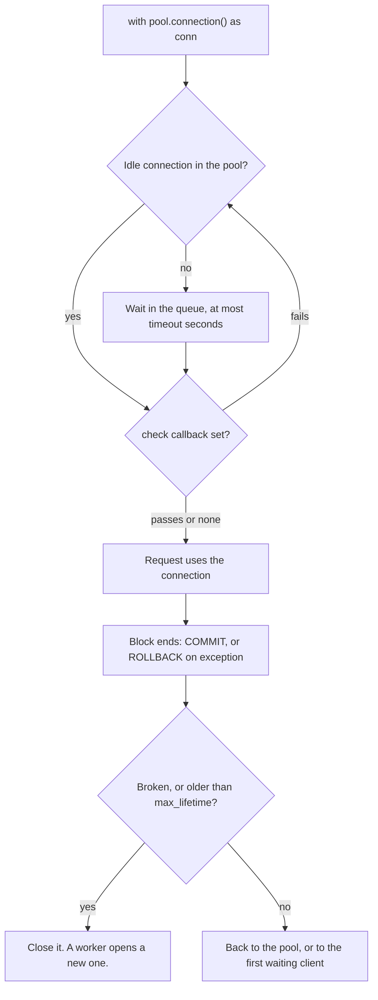

## 1. The question this idea answers

A chat service handles many requests at once. Each request needs a database connection to load a chat or save a turn. [L1](/notes/databases/postgres/03-python-driver/l1-psycopg-basics) opened a new connection for each piece of work. That has two costs.

1. **Time.** Each `connect()` starts a new server process and authenticates. A request pays this before its first query.
2. **A hard limit.** The server accepts only `max_connections` sessions. Many workers that each open their own connections can reach the limit, and new sessions then fail.

A **connection pool** fixes both. It keeps some connections open, lends one to each request, and receives it again afterwards. It also caps the number of connections. This lesson shows how the psycopg pool does this and how to size it. It also shows how to keep the pool working when the password is a token that expires every hour, as with Lakebase.

## 2. Mental model

> [!analogy] A rental desk with a fixed fleet of cars
> The desk owns a few cars, with their engines already running. A customer borrows a car, drives, and returns it. If every car is in use, the customer waits in a line, but only for a fixed time. Then the desk says "no car available". The desk retires old cars after some hours, and it checks a car before it lends it if you ask it to.
>
> **Where it stops working:** a returned car is clean. A returned connection can carry state: an open transaction, a changed session setting. The pool must end the transaction on return, and you must not leave session settings that the next borrower does not expect. And the key can expire: the database checks the password only when a car starts. A car that already runs keeps running after its key expires, but the desk needs a fresh key for every new car.

## 3. Terms

| Term | Plain meaning |
|---|---|
| connection pool | An object that keeps database connections open and lends them to requests, with a maximum count. |
| checkout | Borrowing a connection from the pool. In psycopg: entering `with pool.connection() as conn:`. |
| `min_size` | The number of connections that the pool keeps open even when idle. Default 4. |
| `max_size` | The largest number of connections that the pool opens under load. Default `None`, which means equal to `min_size`. |
| `timeout` | How long a checkout waits for a free connection before it raises `PoolTimeout`. Default 30 s. |
| `max_waiting` | The longest queue of waiting checkouts. Beyond it, `TooManyRequests`. Default 0, no limit. |
| `max_lifetime` | The age after which the pool closes a connection and opens a new one. Default 1 hour. |
| `max_idle` | How long an extra connection, above `min_size`, can stay unused before the pool closes it. Default 10 minutes. |
| `check` | A function that the pool runs on a connection before it lends it. |
| `reconnect_timeout` | How long the pool retries a failed connection attempt before it calls `reconnect_failed`. Default 5 minutes. |
| `max_connections` | The server setting that caps the number of sessions. Default typically 100. |
| worker process | One operating-system process of a web server. Each process has its own memory and its own pool. |
| short-lived token | A password that is valid for a short time, for example an OAuth token that expires after one hour. |

## 4. Method and math

### 4.1 What a new connection costs

The psycopg docs: "Because the time to establish a new connection can be relatively long, keeping connections open can reduce latency." The test measured it on the sandbox server, with 300 repetitions:

| Path | `connect()` + `SELECT 1` + close, median | Pooled checkout + `SELECT 1`, median |
|---|---|---|
| Unix socket, no password | 6.29 to 6.43 ms | 0.14 to 0.28 ms |
| TCP `127.0.0.1`, no password | 7.24 to 7.94 ms | 0.35 to 0.38 ms |

A second test measured `connect()` alone on a server that requires a password with `scram-sha-256`:

| Path | `connect()` only, median |
|---|---|
| Unix socket, no password | 4.60 ms |
| TCP `127.0.0.1`, `scram-sha-256` password | 13.63 ms |

> [!example] Worked example: the cost per request
> A request that opens its own password connection pays about 13.6 ms before its first query. A pooled checkout costs about 0.3 ms. That is 13.6 / 0.3 ≈ 45 times less. These numbers are for one machine with no network and no TLS. A managed database such as Lakebase adds network round trips and TLS to every new connection. Those costs were not measured here, and they make the gap larger, not smaller.

### 4.2 How the pool lends and receives connections

The pool page (checked on 2026-10-13) describes the life cycle. When the pool needs a connection, "it uses a background pool worker to prepare it in the background", "calling something similar to `connection_class(conninfo, **kwargs)`". When a client asks: "if there is a connection available in the pool, it is served to the client immediately", else "the client is put in a queue". When the client finishes: "if there is a transaction open, the transaction is committed (if the block is exited normally) or rolled back (if it is exited with an exception)".



```python
from psycopg_pool import ConnectionPool

pool = ConnectionPool(DSN, min_size=2, max_size=10, open=True, kwargs={"autocommit": True})

def load_chat_titles(owner_id: str) -> list[tuple]:
    with pool.connection() as conn:          # checkout
        return conn.execute(
            "SELECT title FROM chats WHERE owner_id = %s ORDER BY updated_at DESC LIMIT 50",
            (owner_id,)).fetchall()
    # the connection is back in the pool here
```

> [!trap] Never keep a pooled connection after the block
> A variable that still refers to `conn` after the `with` block refers to a connection that another request may now use. Do all the work inside the block. `getconn()` and `putconn()` exist, but the docs say you "*must* call a corresponding `putconn()`: failing to do so will deplete the pool."

### 4.3 The ConnectionPool parameters

The signature in psycopg_pool 3.3.3 (installed source, checked on 2026-10-13):

| Parameter | Default | Meaning |
|---|---|---|
| `conninfo` | `""` | The connection string. Since 3.3 it can be a callable, "called at every connection attempt". |
| `connection_class` | `psycopg.Connection` | The class whose `connect()` the pool calls. |
| `kwargs` | `None` | Extra `connect()` arguments, as "*one dict argument*". Since 3.3 it can be a callable. |
| `min_size` | `4` | Connections the pool keeps open. |
| `max_size` | `None` | Upper limit. `None` or equal to `min_size` means a fixed size. |
| `open` | `None` (acts as `True` today) | Open the pool in the constructor. |
| `configure` | `None` | Runs once on each new connection, for example to register adapters. |
| `check` | `None` | Runs before each checkout. `ConnectionPool.check_connection` is a ready one. |
| `reset` | `None` | Runs on each returned connection. It must leave the connection idle. |
| `name` | `None` | A name for the logs, else `pool-1`, `pool-2`, and so on. |
| `close_returns` | `False` | `conn.close()` returns the connection to the pool. For SQLAlchemy. |
| `timeout` | `30.0` | Seconds a checkout waits. |
| `max_waiting` | `0` | Queue limit. 0 means no limit. |
| `max_lifetime` | `3600.0` | Seconds before a connection is replaced. "reduced by a random amount up to 5% to avoid mass eviction." |
| `max_idle` | `600.0` | Seconds before an unused extra connection is closed. |
| `reconnect_timeout` | `300.0` | Seconds of failed attempts before `reconnect_failed` runs. |
| `reconnect_failed` | `None` | Callback, for example to alert or to exit the process. |
| `num_workers` | `3` | Background threads that open and clean connections. |

### 4.4 Open the pool explicitly

The docs: "The current default for the `open` parameter is `True`. However this proved to be not the best idea and, in future releases, the default might be changed to `False`. As a consequence, if you rely on the pool to be opened on creation, you should specify `open=True` explicitly." The test created a pool with no `open` argument and got:

```text
DeprecationWarning: the default for the ConnectionPool 'open' parameter will become 'False' in a
future release. Please use open={True|False} explicitly, or use the pool as context manager ...
```

Three correct patterns:

1. `with ConnectionPool(DSN, ...) as pool:` opens on entry and closes on exit. Good for scripts and tests.
2. `ConnectionPool(DSN, ..., open=True)` as a module-level object. Call `pool.close()` at exit.
3. `ConnectionPool(DSN, ..., open=False)`, then `pool.open()` in the start-up hook of the web framework.

After opening, `pool.wait()` "will block until `min_size` connections have been acquired, or fail with a `PoolTimeout`". Call it at start-up, so that a wrong password fails the deployment instead of the first user request.

### 4.5 Sizing for a web service

The psycopg docs answer the size question with "Big question. Who knows. However, probably not as large as you imagine." They link to the HikariCP pool-sizing page, which gives a starting point "provided by the PostgreSQL project":

$$
\text{connections} = (\text{core\_count} \times 2) + \text{effective\_spindle\_count}
$$

That page adds: "You want a small pool, saturated with threads waiting for connections." Then test under realistic load and tune with `pool.get_stats()`.

A second way to estimate is the average number of connections in use: the request rate times the time that each request holds a connection.

> [!example] Worked example: how many connections does a chat service use?
> A service saves 40 turns per second at peak. Each save holds a connection for 25 ms: one short transaction ([chat store, 4.5](/notes/ai/conversation-state/02-chat-history-model/l1-chats-messages-and-parts)). On average, 40 × 0.025 = 1.0 connection is busy. A pool of 5 gives room for bursts. If the code held the connection during a 20 s agent run, the same load would need 40 × 20 = 800 connections. So take the connection only for the database work, never around the model call.

Too small a pool makes requests wait. The test ran 20 requests at once, each holding a connection for 50 ms:

| `min_size` = `max_size` | Total time | Checkout wait, median | Checkout wait, max |
|---|---|---|---|
| 5 | 0.211 s | 64.8 ms | 134.4 ms |
| 20 | 0.066 s | 0.0 ms | 0.3 ms |

A second test used a pool of 2 and a timeout of 0.5 s. Three requests each held a connection for 1 s, and the third request got `PoolTimeout: couldn't get a connection after 0.50 sec`. Turn this error into an HTTP 503 response, not a crash.

**The server limit.** Every pool of every process of every instance counts against one server limit. The PostgreSQL docs: the default `max_connections` "is typically 100", and `superuser_reserved_connections` defaults to "three connections". The test started a server with `max_connections=8`. A normal role could open 5 sessions. The sixth failed with:

```text
FATAL:  remaining connection slots are reserved for roles with the SUPERUSER attribute
```

Two pools of `max_size=4` then ran against that server. The first opened 4 connections. The second logged this error for each attempt, and its `pool.wait(timeout=3)` raised `PoolTimeout: pool initialization incomplete after 3 sec`.

> [!key] Count every pool against the server limit
> The worst case is: instances × worker processes per instance × `max_size`. It must stay below `max_connections`, minus the reserved slots, minus the connections of every other client: migrations, notebooks, admin tools. Check the connection limit of a managed database in its own documentation.

### 4.6 One pool per process

The concurrency page warns: "*Connections are not process-safe* and cannot be shared across processes". For "a web server that implements concurrency using multiprocessing, you should make sure that the database connections are created after the worker process is forked."

So each worker process creates its own pool, in its own start-up hook. A pool that opens at import time in the parent process, before the fork, gives every child a copy of the same sockets: a bug. Inside one process, use one pool for one database and share it between all threads or tasks.

### 4.7 max_lifetime, max_idle and checks

**max_lifetime.** The installed source closes an expired connection in two places: when a client returns it, and in `pool.check()`. It does not close an idle expired connection in the background. The test set `max_lifetime=1.0` with one connection. After 1.5 s idle, the next checkout received the **same** server process. When that block ended, the pool closed it, and the following checkout received a new process. So "expired" means "replaced at its next return", not "closed at that second".

**max_idle.** The docs: "If a pool grows above `min_size`, but its usage decreases afterwards, a number of connections are eventually closed: one every time a connection is unused after the `max_idle` time". It never closes connections below `min_size`.

**check.** The docs: "The pool doesn't actively check the state of the connections held in its state." The test killed the server process of an idle pooled connection with `pg_terminate_backend`, then borrowed it:

| `check` | Result of the next checkout |
|---|---|
| `None` | The query raised `AdminShutdown: terminating connection due to administrator command`. Stats: `returns_bad` 1. |
| `ConnectionPool.check_connection` | The request received a new working connection. Stats: `connections_lost` 1. |

`check_connection` runs an empty statement, so each checkout costs one extra round trip. It is worth it when the server or a proxy closes idle sessions, for example with `idle_session_timeout`.

**reconnect.** "If an attempt to create a connection fails, a new attempt will be made soon after, using an exponential backoff ... until a maximum of `reconnect_timeout` is reached." Then the pool calls `reconnect_failed`, if you gave one, "and just start a new connection attempt."

### 4.8 Passwords that expire

Lakebase, the managed PostgreSQL of Databricks, authenticates with OAuth tokens. The Databricks docs (page updated on 2026-09-11, checked on 2026-10-13): "OAuth tokens expire after one hour." And: "Token expiration is enforced only at login. Open connections remain active even after the token expires."

So a pool needs a fresh token for every **new** connection, and only then. The test simulated this on a local server: a fake token service set a new random password for a role with `VALID UNTIL` three seconds later.

| Pool setup | After the first token expired |
|---|---|
| `kwargs={"password": token}`, captured once | The open connection still worked, with the same server process. A new `connect()` failed: `FATAL: password authentication failed for user "app_user"`. The server log said `User "app_user" has an expired password.` When three requests arrived at once, the pool could not grow: one request got `PoolTimeout`, and `connections_errors` was 2. |
| `kwargs=` a function that returns `{"password": fresh_token()}` | The function ran 3 times, once per new connection. All three requests succeeded. `connections_errors` was 0. |
| `connection_class=` a subclass whose `connect()` sets a fresh token | `connect()` ran 3 times. All three requests succeeded. |

The two working patterns:

```python
# Pattern A: kwargs as a callable (psycopg_pool 3.3 and later)
pool = ConnectionPool(CONNINFO, kwargs=lambda: {"password": token_provider()}, open=True)

# Pattern B: a connection class (the pattern in the Lakebase authentication docs)
class TokenConnection(psycopg.Connection):
    @classmethod
    def connect(cls, conninfo="", **kwargs):
        kwargs["password"] = token_provider()
        return super().connect(conninfo, **kwargs)

pool = ConnectionPool(CONNINFO, connection_class=TokenConnection, open=True)
```

`token_provider()` must be fast and safe to call from the pool's worker threads. Cache the token and fetch a new one shortly before it expires. [Lakebase L3](/notes/platforms/databricks/05-lakebase/l3-lakebase-pool) covers the ready-made Databricks pool that does this.

> [!trap] A long max_lifetime is not a token problem
> A connection that is older than its token keeps working, because the token is checked only at login. You do not need `max_lifetime` shorter than one hour for the token. You need a fresh token in every new connection attempt, including the reconnects after a network failure.

### 4.9 AsyncConnectionPool

`AsyncConnectionPool` has the same parameters. Its methods are coroutines, and it lends `AsyncConnection` objects. Do not open it in the constructor. The test did, and got: `RuntimeWarning: opening the async pool AsyncConnectionPool in the constructor is deprecated`. The docs give this FastAPI pattern. The `pool.wait()` line is an addition from section 4.4:

```python
pool = AsyncConnectionPool(DSN, open=False, kwargs={"autocommit": True})

@asynccontextmanager
async def lifespan(app: FastAPI):
    await pool.open()
    await pool.wait()          # fail at start-up if the database is unreachable
    yield
    await pool.close()

app = FastAPI(lifespan=lifespan)
```

Inside a request handler: `async with pool.connection() as conn: await conn.execute(...)`. For async token providers, `kwargs` can also be an async function.

### 4.10 Production view

| Concern | What to do |
|---|---|
| Latency | One pool per process, opened at start-up. Measure `requests_wait_ms` in `get_stats()`. |
| Capacity | instances × processes × `max_size` below `max_connections` minus reserved slots and other clients. |
| Holding time | Borrow only for the database work. Never hold a connection during a model call. |
| Overload | Set `timeout` and maybe `max_waiting`. Map `PoolTimeout` and `TooManyRequests` to HTTP 503. |
| Broken connections | Use `check=ConnectionPool.check_connection` when idle sessions can be closed by the server or a proxy. |
| Expiring passwords | Pass a callable `kwargs` or a `connection_class` that fetches a fresh token per connection. |
| Start-up | `pool.wait()` in the start-up hook, so that a bad configuration fails the deployment. |
| Observability | Log `get_stats()` and enable the `psycopg.pool` logger at `INFO` when you debug. |

## 5. Code

Put the work in `postgres/07-pools.ipynb`.

**Exercise 2.1: measure the gap.** Time 300 rounds of `connect()` + `SELECT 1` + close, and 300 pooled checkouts + `SELECT 1`, over TCP.

Acceptance tests:

- Report the median and the 95th percentile of both.
- The pooled median is at least 10 times smaller. If not, explain why.

**Exercise 2.2: make the pool say no.** Create a pool with `min_size=max_size=2` and `timeout=0.5`. Start three threads that each hold a connection for 1 s.

Acceptance tests:

- Exactly one thread receives `PoolTimeout`.
- `get_stats()` shows `requests_errors` of at least 1 and `requests_queued` of at least 1.

**Exercise 2.3: rotating passwords.** On a local server with `scram-sha-256` for TCP, write a fake `token_provider()` that sets a new password with `VALID UNTIL` 5 seconds ahead.

Acceptance tests:

- A pool with a fixed password cannot open a new connection after 6 seconds.
- A pool with a callable `kwargs` can still grow to 3 connections after 6 seconds.
- An old connection from before the expiry still runs `SELECT 1`.

**Exercise 2.4: an async service.** Build a minimal FastAPI app with an `AsyncConnectionPool` in a lifespan function and one endpoint that returns a user's chat titles.

Acceptance tests:

- With a wrong password, the app fails at start-up, not at the first request.
- Twenty concurrent requests to the endpoint all succeed with `max_size=5`.

## 6. Common mistakes

1. **A new connection per request.** Each request pays the full connect cost, and many workers can exhaust `max_connections`.
2. **A huge pool "to be safe".** Every process gets one, and the total can exceed the server limit. Start small and measure.
3. **Holding a pooled connection during a model call.** The pool empties while the model thinks.
4. **Opening the pool at import time in a forking server.** Child processes share one set of sockets. Open it after the fork.
5. **Relying on the implicit `open=True`.** The default will change. Write `open=True` or use the start-up hook.
6. **A token captured once in `kwargs`.** The pool works for an hour, then cannot open new connections.
7. **Believing `max_lifetime` closes idle connections on time.** The pool replaces an expired connection when it is returned or checked.

## 7. One-minute explanation

A new PostgreSQL connection starts a server process and authenticates. In a local test, this cost 4.6 to 13.6 ms per connect, before any network or TLS. A pool keeps connections open and lends them to requests: a pooled checkout cost about 0.3 ms. In psycopg you create a `ConnectionPool` with `open=True` or in a start-up hook. You borrow with `with pool.connection() as conn:`, which ends the transaction with `COMMIT` or `ROLLBACK` and returns the connection. `min_size` and `max_size` set the size, `timeout` limits the wait, and `max_lifetime`, `max_idle` and `check` keep the connections fresh and working. Size the pool from the request rate times the holding time, and count every process of every instance against the server's `max_connections`. Create one pool per process, after any fork. With a short-lived token as the password, as with Lakebase, open connections keep working after expiry. So give the pool a callable `kwargs` or a connection class that fetches a fresh token for every new connection.

## 8. Check questions

```check
{
  "question": "A service runs on 3 instances, each with 4 worker processes, and each process has a pool with max_size 10. The server has max_connections = 100 and the default reserved slots. Is this safe? Show the calculation.",
  "answer": "The worst case is 3 × 4 × 10 = 120 connections. A normal role can use at most 100 - 3 = 97, and other clients (migrations, notebooks, admin tools) also need some. 120 > 97, so it is not safe. Reduce max_size, for example to 6 (3 × 4 × 6 = 72), or reduce the processes."
}
```

```check
{
  "question": "A pool uses kwargs={\"password\": token} with a Lakebase OAuth token fetched at start-up. For about an hour everything works. Then some requests fail with PoolTimeout and the logs show password authentication failed. Explain, and give the fix.",
  "hint": "When is a token checked?",
  "answer": "The token is checked only at login. The existing connections keep working after it expires, but every new connection that the pool opens (to grow, to replace an expired or broken connection) uses the old token and fails. The fix is to pass a callable as kwargs, or a connection_class whose connect() fetches a fresh token, so that every new connection attempt gets a valid token."
}
```

```check
{
  "question": "A chat service holds one pooled connection for the whole request, including a 20 s agent run. At 10 requests per second, how many connections does it need on average? What should it do instead?",
  "answer": "10 × 20 = 200 connections on average, far above a normal pool and probably above max_connections. It should borrow a connection only for the short database work: load the history, release it, run the agent, then borrow again to save the turn in one short transaction."
}
```

```check
{
  "question": "With max_lifetime = 3600, a connection was created 61 minutes ago and has been idle in the pool. Will the next request receive it?",
  "answer": "It can. The pool checks the expiry when a connection is returned or when pool.check() runs, not while it sits idle. In the test, an expired idle connection was served once more, and the pool replaced it when it came back."
}
```

## 9. Links

- Previous: [L1: psycopg 3 basics](/notes/databases/postgres/03-python-driver/l1-psycopg-basics)
- Next: [ALTER TABLE ADD COLUMN](/notes/databases/postgres/04-schema-changes/l1-alter-table-add-column)
- The Lakebase pool: [LakebasePool](/notes/platforms/databricks/05-lakebase/l3-lakebase-pool)
- Async basics: [Event loop and coroutines](/notes/software-engineering/python/01-asyncio/l1-event-loop-and-coroutines)
- [Glossary](/notes/databases/postgres/glossary)
