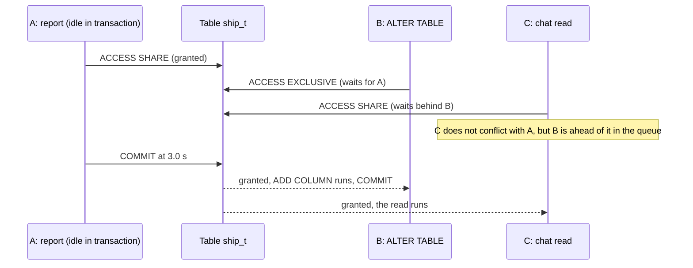

## 1. The question this idea answers

A chat store goes live. A month later, the product needs a new field: a thumbs-up value on each answer, or a status on each shipment. The table has millions of rows, and users read and write it every second.

A schema change on a live table has two risks:

1. **The change takes a long time,** because PostgreSQL rewrites every row.
2. **The change blocks all traffic,** because it needs a lock that no other session may share. This can happen even when the change itself takes 2 ms.

The second risk surprises most engineers. This lesson measures both risks on one million rows and shows the safe pattern for each common change: a new column, a `NOT NULL` rule, a new constraint, and a new index.

## 2. Mental model

> [!analogy] Road works on a one-lane bridge
> A repair crew must close the whole bridge for a moment (the `ACCESS EXCLUSIVE` lock). The job is quick: two minutes. But a slow tractor is on the bridge (a long transaction). The crew waits at the entrance, and the flagger stops every car behind the crew. Cars could cross next to the tractor, but they must stay behind the crew. A two-minute job now closes the road for as long as the tractor takes.
>
> The fix: the crew waits only a short time (`lock_timeout`). If the bridge is not free, the crew leaves the line, the cars move, and the crew tries again later.
>
> **Where it stops working:** on a real bridge, you can see the tractor. In PostgreSQL, the long transaction can be invisible: a report that is still running, or a forgotten connection that is `idle in transaction` and holds its lock for hours.

## 3. Terms

| Term | Plain meaning |
|---|---|
| DDL lock | The table lock that a schema change takes. Its mode decides what other sessions can still do. |
| `ACCESS EXCLUSIVE` | The strongest table lock. It conflicts with every other lock, also with a plain `SELECT`. |
| `ACCESS SHARE` | The weakest table lock. A plain `SELECT` takes it. |
| `SHARE UPDATE EXCLUSIVE` | A lock that allows reads and writes but blocks other schema changes. |
| `SHARE` | The lock of `CREATE INDEX`. It allows reads and blocks writes. |
| table rewrite | PostgreSQL writes a new copy of every row and every index of the table. |
| fast default | A default value that PostgreSQL stores once in the catalog, so old rows need no rewrite. |
| volatile function | A function that can return a different value on each call, such as `clock_timestamp()` or `gen_random_uuid()`. |
| stable function | A function that returns the same value within one statement, such as `now()`. |
| lock queue | The line of sessions that wait for a lock on the same object. A waiting request blocks later requests that conflict with it. |
| `lock_timeout` | A setting that cancels a statement that waits longer than this time for a lock. |
| `NOT VALID` | A constraint option: check new rows now, but do not scan the old rows yet. |
| `VALIDATE CONSTRAINT` | The command that scans the old rows later, with a weaker lock. |
| `CREATE INDEX CONCURRENTLY` | An index build that does not block writes. It cannot run inside a transaction block. |
| invalid index | An index that a failed concurrent build left behind. Queries ignore it, but writes still update it. |

## 4. Method and math

### 4.1 What ADD COLUMN does

The PostgreSQL 16 docs, §5.6.1 (checked on 2026-10-13):

> "From PostgreSQL 11, adding a column with a constant default value no longer means that each row of the table needs to be updated when the `ALTER TABLE` statement is executed. Instead, the default value will be returned the next time the row is accessed, and applied when the table is rewritten, making the `ALTER TABLE` very fast even on large tables."
>
> "However, if the default value is volatile (e.g., `clock_timestamp()`) each row will need to be updated with the value calculated at the time `ALTER TABLE` is executed."

The `ALTER TABLE` page adds: "Adding a column with a volatile `DEFAULT` or changing the type of an existing column will require the entire table and its indexes to be rewritten." Such a rebuild "may take a significant amount of time for a large table; and will temporarily require as much as double the disk space."

### 4.2 Measured on one million rows

The test copied a table of 1,000,000 shipments (50 MB) for each case and ran one `ALTER TABLE ... ADD COLUMN`. A changed `pg_relation_filenode` proves a rewrite: PostgreSQL wrote the table into a new file.

| New column | Round 1 | Round 2 | Rewritten? | `atthasmissing` |
|---|---|---|---|---|
| `note text` (no default) | 2.2 ms | 1.6 ms | No | false |
| `status text NOT NULL DEFAULT 'planned'` | 11.5 ms | 7.6 ms | No | true, value `{planned}` |
| `noted_at timestamptz NOT NULL DEFAULT now()` | 1.4 ms | 1.3 ms | No | true, one time stamp |
| `checked_at timestamptz NOT NULL DEFAULT clock_timestamp()` | 1,229 ms | 1,388 ms | **Yes** | false |
| `request_id uuid NOT NULL DEFAULT gen_random_uuid()` | 3,528 ms | 2,841 ms | **Yes** | false |

The `atthasmissing` and `attmissingval` columns of the catalog table `pg_attribute` hold the fast default. Old rows do not contain the value. PostgreSQL returns `attmissingval` when it reads an old row.

> [!example] Worked example: why now() is fast and clock_timestamp() is slow
> The catalog `pg_proc` gives the volatility of each function: `now` is `s` (stable), while `clock_timestamp`, `gen_random_uuid` and `random` are `v` (volatile). A stable function gives one value for the whole statement, so PostgreSQL computes it once and stores it as the missing value. After the `now()` column, `count(DISTINCT noted_at)` over 1,000,000 rows was **1**. After the `clock_timestamp()` column, it was **667,301**: PostgreSQL computed a value for each row, so it had to write each row. The count is below 1,000,000 because some rows got the same microsecond. The time grows with the table: 1,000,000 rows took about 1.2 to 3.5 s here. A table with 100 times more rows would take roughly 100 times longer. That is an estimate, not a measurement.

For a volatile value, the docs suggest a different path: "add the column with no default, insert the correct values using `UPDATE`, and then add any desired default". Run the `UPDATE` in small batches, each in its own short transaction.

### 4.3 The lock that every ALTER TABLE takes

The `ALTER TABLE` page: "An `ACCESS EXCLUSIVE` lock is acquired unless explicitly noted." The locking chapter, §13.3.1: this mode "guarantees that the holder is the only transaction accessing the table in any way", and "Only an `ACCESS EXCLUSIVE` lock blocks a `SELECT` (without `FOR UPDATE/SHARE`) statement."

The test ran each statement in an open transaction and read the lock mode from `pg_locks`. A second session with `lock_timeout = '300ms'` then tried a read and a write:

| Statement | Lock mode in `pg_locks` | Other session: SELECT | Other session: INSERT |
|---|---|---|---|
| `ADD COLUMN flag boolean` | `AccessExclusiveLock` | blocked | blocked |
| `ADD CONSTRAINT ... CHECK (...) NOT VALID` | `AccessExclusiveLock` | blocked | blocked |
| `VALIDATE CONSTRAINT ...` | `ShareUpdateExclusiveLock` | ok | ok |
| `ALTER COLUMN status SET NOT NULL` | `AccessExclusiveLock` | blocked | blocked |
| `CREATE INDEX ... (plant_id)` | `ShareLock` | ok | blocked |

A lock lasts until the end of the transaction: "Once acquired, a lock is normally held until the end of the transaction." So a fast `ADD COLUMN` is safe only if it gets its lock at once and commits at once.

### 4.4 The lock queue

Can a 2 ms `ALTER TABLE` stop a whole service? The test used three sessions on the table `ship_t`:

1. **A, a report**, ran `SELECT count(*)` in a transaction and stayed open (`idle in transaction`). It holds `ACCESS SHARE`.
2. **B, the migration**, ran `ALTER TABLE ship_t ADD COLUMN flag boolean`. It needs `ACCESS EXCLUSIVE`, which conflicts with A, so it waits.
3. **C, a chat read**, ran `SELECT * FROM ship_t WHERE shipment_id = 1`. It needs only `ACCESS SHARE`, which does not conflict with A.

`pg_locks` 0.7 s into the test:

```text
('A_report', 'AccessShareLock', True, 'idle in transaction', 'Client')
('B_migration', 'AccessExclusiveLock', False, 'active', 'Lock')
('C_chat_read', 'AccessShareLock', False, 'active', 'Lock')
```

C waits. `pg_blocking_pids()` named the cause: A blocked by nobody, B blocked by A, and **C blocked by B**. The docs define this case: a process blocks another if it "is waiting for a lock that would conflict with the blocked process's lock request and is ahead of it in the wait queue (soft block)."

A committed at 3.0 s. Then B finished (3.01 s after it started) and C finished (2.71 s after it started). Every read that arrived during those 3 seconds waited. A busy service would pile up hundreds of waiting requests, and its pool would empty.



### 4.5 lock_timeout

The docs (§20.11, checked on 2026-10-13): `lock_timeout` aborts "any statement that waits longer than the specified amount of time while attempting to acquire a lock on a table, index, row, or other database object." "A value of zero (the default) disables the timeout." The docs also warn: "Setting `lock_timeout` in `postgresql.conf` is not recommended because it would affect all sessions."

The test repeated section 4.4 with `lock_timeout = '1s'` in session B only:

| | B (the migration) | C (the chat read) |
|---|---|---|
| `lock_timeout = 0` | done after 3.01 s | done after 2.71 s |
| `lock_timeout = '1s'` | `LockNotAvailable` (SQLSTATE `55P03`) after 1.00 s: `canceling statement due to lock timeout` | done after 0.70 s |

With the timeout, the migration failed fast and the readers waited at most 1 s. The migration tool then retries after a pause.

> [!key] Every DDL statement on a live table runs with lock_timeout
> Set `lock_timeout` to a short value (for example `2s`) in the migration session, and retry with a pause when it fails. A failed attempt costs the users at most that short wait. A missing timeout can cost them minutes. Also find and end long transactions first: `pg_stat_activity` shows them as `idle in transaction`, and `idle_in_transaction_session_timeout` closes them automatically.

### 4.6 Add NOT NULL without a long lock

For a **new** column, write `ADD COLUMN ... NOT NULL DEFAULT 'x'`. It is instant (section 4.2). For an **existing** column, `SET NOT NULL` must prove that no row holds `NULL`. The docs: "Ordinarily this is checked during the `ALTER TABLE` by scanning the entire table; however, if a valid `CHECK` constraint exists (and is not dropped in the same command) which proves no `NULL` can exist, then the table scan is skipped."

The test on 1,000,000 rows:

| Step | Time | Lock |
|---|---|---|
| Direct: `ALTER COLUMN status SET NOT NULL` | 109.7 ms | `ACCESS EXCLUSIVE` for the whole scan |
| Safe 1: `ADD CONSTRAINT ship_t_status_not_null CHECK (status IS NOT NULL) NOT VALID` | 4.7 ms | `ACCESS EXCLUSIVE`, short |
| Safe 2: `VALIDATE CONSTRAINT ship_t_status_not_null` | 101.4 ms | `SHARE UPDATE EXCLUSIVE`: reads and writes continue |
| Safe 3: `ALTER COLUMN status SET NOT NULL` | 0.9 ms | `ACCESS EXCLUSIVE`, short |
| Safe 4: `DROP CONSTRAINT ship_t_status_not_null` | 0.7 ms | `ACCESS EXCLUSIVE`, short |

With `client_min_messages = debug1`, step 3 printed the proof: `DEBUG: existing constraints on column "ship_t.status" are sufficient to prove that it does not contain nulls`. The scan still happened, in step 2, but under a lock that lets traffic continue. On 1,000,000 rows the direct path blocked traffic for about 110 ms. On a table 100 times larger, an estimate is 100 × 110 ms = 11 s of blocked traffic.

### 4.7 Constraints: NOT VALID, then VALIDATE CONSTRAINT

The same split works for any `CHECK` or foreign key. The `ALTER TABLE` page: with `NOT VALID`, "this potentially-lengthy scan is skipped. The constraint will still be enforced against subsequent inserts or updates". `VALIDATE CONSTRAINT` validates "by scanning the table to ensure there are no rows for which the constraint is not satisfied", and "This command acquires a `SHARE UPDATE EXCLUSIVE` lock."

The test set two old rows to `quantity = 0`, then:

```sql
ALTER TABLE ship_t ADD CONSTRAINT ship_t_quantity_positive CHECK (quantity > 0) NOT VALID;  -- 4.0 ms
INSERT INTO ship_t (shipment_id, plant_id, shipped_on, quantity, status)
VALUES (2000001, 1, '2026-10-13', 0, 'planned');
-- ERROR:  new row for relation "ship_t" violates check constraint "ship_t_quantity_positive"
ALTER TABLE ship_t VALIDATE CONSTRAINT ship_t_quantity_positive;
-- ERROR:  check constraint "ship_t_quantity_positive" of relation "ship_t" is violated by some row
UPDATE ship_t SET quantity = 1 WHERE quantity <= 0;                                          -- UPDATE 2
ALTER TABLE ship_t VALIDATE CONSTRAINT ship_t_quantity_positive;                            -- 84.0 ms, ok
```

So `NOT VALID` protects new data at once. The old bad rows can be repaired in the meantime, and the scan runs later without blocking traffic. For foreign keys, the docs note that `ADD FOREIGN KEY` "requires only a `SHARE ROW EXCLUSIVE` lock", also on the referenced table.

### 4.8 CREATE INDEX CONCURRENTLY

A normal `CREATE INDEX` takes a `SHARE` lock. The docs: other transactions "can still read the table, but if they try to insert, update, or delete rows in the table they will block until the index build is finished." With `CONCURRENTLY`, "PostgreSQL will build the index without taking any locks that prevent concurrent inserts, updates, or deletes", at a price: it "must perform two scans of the table, and in addition it must wait for all existing transactions that could potentially modify or use the index to terminate."

| Test | Result |
|---|---|
| `CREATE INDEX` on `(plant_id, shipped_on)`, 1,000,000 rows | 1,021 ms, writes blocked |
| `CREATE INDEX CONCURRENTLY` on the same columns | 1,332 ms, writes allowed |
| `CONCURRENTLY` inside `BEGIN` | `ERROR: CREATE INDEX CONCURRENTLY cannot run inside a transaction block` |
| `CONCURRENTLY` while another session holds an open transaction that updated one row | It waited (`wait_event` = `virtualxid`), and finished 4.99 s after it started. The other session committed at about 3.0 s. Another writer still ran its update in 16.3 ms meanwhile. |
| `CREATE UNIQUE INDEX CONCURRENTLY` on a column with duplicates | `ERROR: could not create unique index "ship_t_plant_unique"`, `DETAIL: Key (plant_id)=(86) is duplicated.` |

The failed build left an index behind. `\d ship_t` showed it as `"ship_t_plant_unique" UNIQUE, btree (plant_id) INVALID`, and `pg_index.indisvalid` was false. The docs: such an index "will be ignored for querying purposes because it might be incomplete; however it will still consume update overhead." The recovery: "drop the index and try again to perform `CREATE INDEX CONCURRENTLY`".

> [!trap] An invalid index costs writes and helps no read
> After any failed concurrent build, query `pg_index` for `indisvalid = false` and drop those indexes. A migration tool must check this, because the error alone does not remove the index.

### 4.9 Production view

| Concern | What to do |
|---|---|
| Locks | Run every DDL statement with a short `lock_timeout` and a retry loop. |
| Long transactions | Before a migration, check `pg_stat_activity` for old transactions. Set `idle_in_transaction_session_timeout` for application roles. |
| Rewrites | Avoid volatile defaults and type changes on big tables. Add the column with no default, fill it in batches, then set the default. |
| NOT NULL | `CHECK (col IS NOT NULL) NOT VALID`, then `VALIDATE`, then `SET NOT NULL`, then drop the check. |
| New constraints | `NOT VALID`, repair old rows, then `VALIDATE CONSTRAINT`. |
| Indexes | `CREATE INDEX CONCURRENTLY`, outside a transaction. Check for invalid indexes after a failure. |
| Disk | A rewrite can need about double the table size until it finishes. |
| Observability | Watch lock waits during deploys: `pg_stat_activity.wait_event_type = 'Lock'` and `pg_blocking_pids()`. |

## 5. Video

```video
{
  "src": "/notes/media/postgres/manim/m02-lock-queue.mp4",
  "caption": "A 2 ms ALTER TABLE waits behind a long transaction, and every later read waits behind the ALTER. With lock_timeout, the ALTER stops waiting after 1 s and the reads continue."
}
```

## 6. Code

Put the work in `postgres/08-alter-table.ipynb`, with your local PostgreSQL 16 server.

**Exercise 1.1: fast or rewrite?** Create a table with 1,000,000 rows. Add one column of each kind from section 4.2, each on a fresh copy.

Acceptance tests:

- For each case, report the time and whether `pg_relation_filenode` changed.
- Predict the result of `count(DISTINCT ...)` for the `now()` and the `clock_timestamp()` columns before you run it.

**Exercise 1.2: see the lock queue.** Reproduce section 4.4 with three connections in three threads, and print `pg_blocking_pids()` for each one while they wait.

Acceptance tests:

- The reader C is blocked by B, not by A.
- With `lock_timeout = '1s'` in B, B raises `LockNotAvailable` and C finishes in under 1.5 s.

**Exercise 1.3: a safe DDL runner.** Write `run_ddl(conn, statement, lock_timeout="2s", attempts=5)`. It sets the timeout for its own session only, runs the statement, and retries with a growing pause on `LockNotAvailable`.

Acceptance tests:

- With no blocker, it succeeds on attempt 1.
- With a blocker that ends after 3 s, it succeeds on a later attempt. A reader thread never waits longer than about 2 s.
- With a blocker that never ends, it raises after 5 attempts.

**Exercise 1.4: recover from a failed concurrent index.** Build a `CREATE UNIQUE INDEX CONCURRENTLY` on a column with duplicates.

Acceptance tests:

- Your code finds the invalid index through `pg_index.indisvalid`.
- It drops the index, removes the duplicates, and builds the index again with `indisvalid = true`.

## 7. Common mistakes

1. **"ADD COLUMN is instant, so it is safe."** It is instant only after it gets its lock. Behind a long transaction it waits, and every reader waits behind it. Use `lock_timeout`.
2. **A volatile default on a big table.** `clock_timestamp()` or `gen_random_uuid()` rewrites every row. `now()` does not.
3. **`SET NOT NULL` directly on a big table.** It scans the whole table under `ACCESS EXCLUSIVE`. Validate a `CHECK` constraint first.
4. **Adding a constraint without `NOT VALID`.** The scan of all old rows runs under `ACCESS EXCLUSIVE`.
5. **`CREATE INDEX` without `CONCURRENTLY` on a live table.** Writes stop until the build ends.
6. **Running `CREATE INDEX CONCURRENTLY` inside a migration transaction.** It fails. It needs its own step, outside any transaction block.
7. **Ignoring an invalid index after a failed build.** It slows every write and serves no query.

## 8. One-minute explanation

Since PostgreSQL 11, `ADD COLUMN` with a constant or stable default stores the value once in the catalog, so it is instant: 1 to 12 ms on one million rows in the test. A volatile default, such as `clock_timestamp()` or `gen_random_uuid()`, rewrites every row: 1.2 to 3.5 s on the same table. But every `ALTER TABLE` first needs an `ACCESS EXCLUSIVE` lock, and the lock request waits in a queue. Behind a long transaction, even a 2 ms `ALTER` waits, and every later `SELECT` waits behind it: in the test, a plain read waited 2.7 s. So run each DDL statement with a short `lock_timeout` and retry. For rules on existing data, split the work: add a `CHECK` constraint `NOT VALID`, then `VALIDATE CONSTRAINT` under a lock that allows reads and writes, then `SET NOT NULL`, which then skips its scan. Build indexes with `CREATE INDEX CONCURRENTLY`, outside a transaction, and drop any invalid index that a failed build leaves.

## 9. Check questions

```check
{
  "question": "Which of these ADD COLUMN statements rewrite a large table: DEFAULT 'none', DEFAULT now(), DEFAULT clock_timestamp(), DEFAULT gen_random_uuid(), no default? Why?",
  "answer": "Only clock_timestamp() and gen_random_uuid(). They are volatile, so each row needs its own value, and PostgreSQL must write every row. A constant and now() (stable: one value per statement) are stored once as the missing value in pg_attribute, and no default means NULL, so those three need no rewrite."
}
```

```check
{
  "question": "A migration runs ALTER TABLE messages ADD COLUMN feedback text, which normally takes 2 ms. During the deploy, chat reads fail with timeouts for 40 seconds. What happened, and what prevents it?",
  "hint": "Think of a queue.",
  "answer": "A long transaction held a lock on messages (for example an idle in transaction session). The ALTER waited for its ACCESS EXCLUSIVE lock, and every later read queued behind the waiting ALTER, because a waiting request blocks later conflicting requests. When the long transaction ended, everything ran. Prevent it with a short lock_timeout in the migration session and a retry loop, and by finding and ending long transactions."
}
```

```check
{
  "question": "Give the four statements that add NOT NULL to an existing column of a large table without a long ACCESS EXCLUSIVE lock, with the lock of the slow step.",
  "answer": "1. ALTER TABLE t ADD CONSTRAINT t_c_not_null CHECK (c IS NOT NULL) NOT VALID. 2. ALTER TABLE t VALIDATE CONSTRAINT t_c_not_null, which scans the table under SHARE UPDATE EXCLUSIVE, so reads and writes continue. 3. ALTER TABLE t ALTER COLUMN c SET NOT NULL, which skips the scan because a valid CHECK proves there are no NULLs. 4. ALTER TABLE t DROP CONSTRAINT t_c_not_null."
}
```

```check
{
  "question": "A CREATE UNIQUE INDEX CONCURRENTLY fails on duplicates. What is left in the database, why does it matter, and what do you do?",
  "answer": "An invalid index: pg_index.indisvalid is false and psql shows INVALID. Queries ignore it, but every write still updates it, so it costs write time and disk for nothing. Drop it (DROP INDEX CONCURRENTLY), fix the duplicates, and run CREATE UNIQUE INDEX CONCURRENTLY again."
}
```

## 10. Links

- Previous: [Part 3, L2: Connection pools](/notes/databases/postgres/03-python-driver/l2-connection-pools)
- Next: [L2: Migrations as code](/notes/databases/postgres/04-schema-changes/l2-migrations-as-code)
- The table that grows: [Chats, messages and parts](/notes/ai/conversation-state/02-chat-history-model/l1-chats-messages-and-parts)
- Index basics: [L3: Indexes](/notes/databases/postgres/01-relational-basics/l3-indexes)
- [Glossary](/notes/databases/postgres/glossary)
