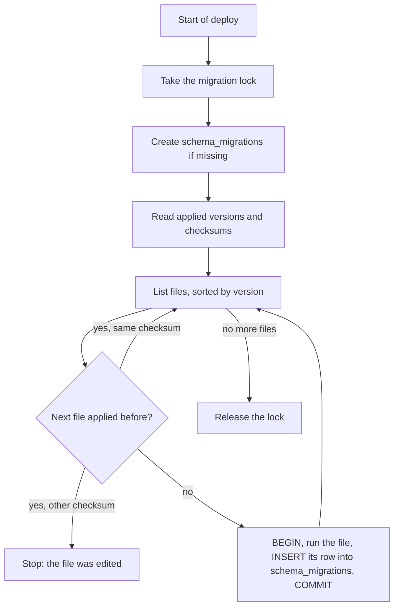

## 1. The question this idea answers

The chat store will change many times: new tables, new columns, new constraints, new indexes. The same schema must exist on a laptop, in the test database, in staging and in production on Lakebase. Each change must run in every environment, in the same order, exactly once.

Changes typed by hand into a SQL console fail this test. Someone forgets a step in staging, or runs two steps in a different order, and nobody can say which changes a database already has. The fix is to treat schema changes as code. Keep numbered files in Git and a table in each database that records what ran. A program, the **runner**, applies the missing files during a deploy. This lesson builds that design and tests its failure modes.

## 2. Mental model

> [!analogy] A building's renovation logbook
> Every renovation of a building has a numbered work order: "0001 build the walls", "0002 add the wiring". The building keeps its own logbook of finished work orders. A contractor arrives and compares the list of work orders with the logbook. The contractor does only the missing ones, in number order, and signs the logbook after each one.
>
> If a renovation fails halfway, the contractor restores everything as it was and does not sign. If a work order is changed after it was done, the contractor refuses to continue. If two contractors arrive at the same moment, only the one with the key to the building works.
>
> **Where it stops working:** a contractor can remove new wiring, but a database cannot always undo a change. A "down" migration that drops a column also drops the data written into it since the change. So most teams only move forward.

## 3. Terms

| Term | Plain meaning |
|---|---|
| migration | One schema change, written as a file that a program can run. |
| version | The number of a migration, for example `0003`. It sets the order. |
| `schema_migrations` | The table in each database that records which versions ran, when, and with which checksum. |
| runner | The program that applies the missing migrations, in order, once each. |
| checksum | A hash of the file content, stored when the file ran, to detect a later edit. |
| transactional DDL | Schema changes that obey `BEGIN` and `ROLLBACK` like data changes. PostgreSQL has it for most statements. |
| forward-only | A policy: a migration is never undone. A mistake is fixed by a new migration. |
| down migration | A script that undoes one migration. |
| expand-contract | A way to make an incompatible change in safe steps: add the new form, move to it, then remove the old form. |
| backfill | Filling a new column for the old rows, usually in batches. |
| advisory lock | A lock with a meaning that the application decides. PostgreSQL only records who holds it. |
| schema drift | A database whose schema differs from what its migrations describe. |

## 4. Method and math

### 4.1 The three parts

**1. Numbered files.** One folder, one file per change, with a fixed name pattern. A runner can sort them by name.

```text
migrations/
  0001_create_chats.sql
  0002_create_messages.sql
  0003_add_feedback.sql
  0004_index_chats_owner.sql
```

**2. A history table in each database.**

```sql
CREATE TABLE IF NOT EXISTS schema_migrations (
    version    text PRIMARY KEY,
    name       text NOT NULL,
    checksum   text NOT NULL,
    applied_at timestamptz NOT NULL DEFAULT now()
);
```

**3. A runner.** It runs these steps:



The test runner applied the three files on an empty database, and a second run applied nothing:

```text
first ['0001', '0002', '0003']
second []
```

```text
 version |           name           |   checksum   |          applied_at
---------+--------------------------+--------------+-------------------------------
 0001    | 0001_create_chats.sql    | 9f89367fb0b7 | 2026-10-13 09:39:03.833888-04
 0002    | 0002_create_messages.sql | 8626d4ca10e1 | 2026-10-13 09:39:04.151514-04
 0003    | 0003_add_feedback.sql    | d732a3b39a6e | 2026-10-13 09:39:04.468846-04
```

A file can hold several statements. psycopg sends a query with no parameters with the simple query protocol, which runs all of them ([psycopg basics, 4.4](/notes/databases/postgres/03-python-driver/l1-psycopg-basics)).

### 4.2 One file, one transaction

In PostgreSQL, most DDL obeys transactions. The test ran:

```sql
BEGIN;
CREATE TABLE plants_new (plant_id bigint PRIMARY KEY);
ALTER TABLE chats ADD COLUMN plant_id bigint;
ROLLBACK;
```

After the `ROLLBACK`, `to_regclass('plants_new')` was null and `chats` had no `plant_id` column. Both changes were gone.

So the runner wraps each file **and** its `schema_migrations` row in one transaction. A file either runs completely and is recorded, or leaves no trace. The test added a bad file `0004_bad.sql`: it added a column `archived`, created an index, then added `archived` again. The runner stopped with:

```text
psycopg.errors.DuplicateColumn: column "archived" of relation "chats" already exists
```

Afterwards, `schema_migrations` still had 3 rows, the column `archived` did not exist, and the index did not exist. The fix is a corrected file and a new deploy. Nothing needs manual cleanup.

> [!note] Locks last for the whole file
> A file runs in one transaction, so every lock that its statements take is held until its `COMMIT`. Keep each file short, and run the migration session with `lock_timeout` ([L1, section 4.5](/notes/databases/postgres/04-schema-changes/l1-alter-table-add-column)).

### 4.3 Files that cannot run in a transaction

Some statements refuse a transaction block. [L1](/notes/databases/postgres/04-schema-changes/l1-alter-table-add-column) showed `CREATE INDEX CONCURRENTLY`. The psycopg docs name others: `CREATE DATABASE`, `VACUUM`, and `CALL` on procedures with transaction control. The test runner, given `0004_index.sql` with `CREATE INDEX CONCURRENTLY`, failed with:

```text
psycopg.errors.ActiveSqlTransaction: CREATE INDEX CONCURRENTLY cannot run inside a transaction block
```

So the runner needs a marker, for example a first line `-- no-transaction`. For such a file, it runs the statement in autocommit mode, then records the version. With the marker, the test applied `0004`.

> [!trap] One statement per no-transaction file
> The protocol docs (§55.2.2.1): when a simple query "contains more than one SQL statement (separated by semicolons), those statements are executed as a single transaction". The test sent `SELECT 1; CREATE INDEX CONCURRENTLY ...` in autocommit mode and got the same `cannot run inside a transaction block` error. Put each such statement in its own file. Also, a crash between the statement and the history insert leaves the index without a record. Make these statements safe to repeat, for example with `CREATE INDEX CONCURRENTLY IF NOT EXISTS`. But `IF NOT EXISTS` also skips an invalid index that an earlier failed build left. The test got `NOTICE: relation "ship_t_plant_unique" already exists, skipping`, and `indisvalid` stayed false. So check `pg_index.indisvalid` too.

### 4.4 Checksums

The runner stores a SHA-256 hash of each file. The test appended a comment to `0003_add_feedback.sql` after it ran. The next run stopped with:

```text
RuntimeError: 0003_add_feedback.sql changed after it was applied
```

Flyway uses the same idea. Its docs (checked on 2026-10-13): "Each versioned migration has a *version*, a *description* and a *checksum*." "The checksum is there to detect accidental changes." The rule follows: **never edit a migration that has run anywhere.** Write a new migration instead.

### 4.5 Two runners at once

A deploy can start several instances of a service at the same moment, and each one may run the migrations. The test started two runner processes together, for each of three lock designs.

| Design | Result |
|---|---|
| No lock | One runner failed on its first statement: `UniqueViolation: duplicate key value violates unique constraint "pg_type_typname_nsp_index"`, `Key (typname, typnamespace)=(schema_migrations, 2200) already exists.` Two `CREATE TABLE IF NOT EXISTS` raced. |
| `pg_advisory_lock()`, which waits | The second runner waited for the lock while the first ran `CREATE INDEX CONCURRENTLY`. PostgreSQL reported `DeadlockDetected` and cancelled the second runner (details below). |
| `pg_try_advisory_lock()` in a loop with a 0.2 s pause | Both runs were correct. The second runner got the lock after 1.04 s and 1.27 s, found nothing to do, and returned `[]`. |

The deadlock details:

```text
DETAIL:  Process 11624 waits for ExclusiveLock on advisory lock [24913,0,7243001,1]; blocked by process 11623.
Process 11623 waits for ShareLock on virtual transaction 5/191; blocked by process 11624.
```

Process 11623 held the advisory lock and built an index concurrently. A concurrent build waits for every older transaction to end. Process 11624's waiting `SELECT pg_advisory_lock(...)` was such a transaction. Each waited for the other.

The docs (§9.27.10, checked on 2026-10-13): `pg_advisory_lock` "Obtains an exclusive session-level advisory lock, waiting if necessary." `pg_try_advisory_lock` "will either obtain the lock immediately and return `true`, or return `false` without waiting". And from §13.3.5: advisory locks have "application-defined meanings", and a session-level lock "is held until explicitly released or the session ends."

> [!key] Lock first, then do everything
> Take the migration lock before any other statement, including `CREATE TABLE IF NOT EXISTS schema_migrations`. If any migration builds an index concurrently, wait for the lock with `pg_try_advisory_lock` in a loop, not with the blocking `pg_advisory_lock`. Use one fixed lock key for the whole schema.

### 4.6 Forward-only or down migrations

| Tool | What it offers for undo (docs, checked on 2026-10-13) |
|---|---|
| Alembic | Each revision file has `upgrade()` and `downgrade()`. The tutorial shows `alembic upgrade head` and `alembic downgrade -1`. |
| Flyway | "An undo migration is responsible for undoing the effects of the versioned migration with the same version." |

A down migration looks like safety, but it has limits:

1. **It can lose data.** The down step of `ADD COLUMN feedback` is `DROP COLUMN feedback`. Every thumbs-up that users gave since the deploy is gone.
2. **It is rarely tested.** Teams run the up steps in every environment, and the down steps almost never.
3. **The old code must still work.** After a down step, the previous app version must run against the old schema. With expand-contract (section 4.7), the old app version already works with the new schema, so the schema does not need to return to its old form.

Many production teams therefore work **forward-only**: a mistake is fixed by a new migration. Down scripts remain useful on a laptop, to repeat a migration while you write it.

### 4.7 Expand-contract for zero downtime

During a deploy, the old and the new app version can run at the same time, for example while old instances finish their requests. A schema change must work with both. Danilo Sato describes the pattern on martinfowler.com: "Parallel change, also known as expand and contract, is a pattern to implement backward-incompatible changes to an interface in a safe manner, by breaking the change into three distinct phases: expand, migrate, and contract."

> [!example] Worked example: rename chats.title to chats.name
> A plain `ALTER TABLE chats RENAME COLUMN title TO name` breaks every running instance that still reads `title`. The safe path has five steps. The test ran the SQL steps on 20,000 chats.
>
> | Step | Schema change | App version that runs | Time in the test |
> |---|---|---|---|
> | 1. Expand | `ALTER TABLE chats ADD COLUMN name text;` | v1: reads and writes `title` | 1.3 ms |
> | 2. Dual write | none | v2: writes `title` and `name`, reads `coalesce(name, title)` | |
> | 3. Migrate | Backfill in batches: `UPDATE chats SET name = title WHERE id IN (SELECT id FROM chats WHERE name IS NULL LIMIT 5000);` until `UPDATE 0`. Then `NOT NULL` by the safe path of L1. | v2 | 4 batches of 5,000 rows: 165, 85, 50 and 64 ms, then `UPDATE 0` |
> | 4. Switch | none | v3: reads and writes only `name` | |
> | 5. Contract | `ALTER TABLE chats DROP COLUMN title;` | v3 | 0.7 ms |
>
> At every step, every running app version finds the columns that it needs. The contract step is fast because, as the docs say, `DROP COLUMN` "does not physically remove the column, but simply makes it invisible to SQL operations."

Each step is a separate deploy, and steps 1, 3 and 5 each have their own migration file. The order matters. The migration of an expand step runs **before** the new app version starts. The migration of a contract step runs **after** no running code uses the old form.

### 4.8 Tools

All three tools below use the idea of this lesson: ordered changes and a history table. One line each from their docs (checked on 2026-10-13):

| Tool | What its docs say | History |
|---|---|---|
| Alembic (docs for 1.20) | "Alembic is a lightweight database migration tool for usage with the SQLAlchemy Database Toolkit for Python." | Table `alembic_version`, which holds the current revision |
| Flyway (Redgate) | "*Versioned migrations* are applied to a target database in order exactly once." | "Flyway adds a schema history table to your schema." |
| Sqitch | "Sqitch is not tied to any framework, ORM, or platform." "Changes are implemented as scripts native to your selected database engine." | "Sqitch manages changes and dependencies via a plan file." |

A small service with plain SQL files can use its own runner of about 50 lines, as in the exercise. A team that uses SQLAlchemy models usually takes Alembic, because its autogenerate feature compares the database with the models and writes "candidate migrations". Its docs add: "It is always necessary to manually review and correct the candidate migrations that autogenerate produces."

### 4.9 Running migrations at deploy time

| Option | How | Risk |
|---|---|---|
| A separate deploy step | A job runs the runner once. The new app version starts only if it succeeds. | Needs a pipeline step. This is the cleanest option. |
| At app start-up | Each instance runs the runner before it serves requests. The advisory lock lets one instance work. | Every instance needs DDL rights, and a slow migration delays every start. |
| By hand | A person runs the runner. | Forgotten environments and drift. Use it only on a laptop. |

Three rules apply to every option:

1. **Separate roles.** The migration role owns the tables and may change them. The app role may only read and write rows. A bug or an injection in the app then cannot drop a table.
2. **Short locks.** Run with `lock_timeout`, and retry the whole run on `LockNotAvailable`.
3. **Check for drift.** In tests, build a fresh database from all migrations and compare its schema with the expected one.

### 4.10 Production view

| Concern | What to do |
|---|---|
| Correctness | One transaction per file, with its history row. Never edit an applied file. |
| Concurrency | Take a `pg_try_advisory_lock` loop before anything else. |
| Locks | `lock_timeout` in the migration session. Short files. `CONCURRENTLY` in its own no-transaction file. |
| Zero downtime | Expand, dual write, backfill in batches, switch, then contract in a later deploy. |
| Rollback | Prefer fix-forward. A down step that drops a column drops data. |
| Security | A separate migration role. The app role has no DDL rights. |
| Observability | Log each version, its duration and the lock wait. Alert on a failed migration step. |

## 5. Code

Put the work in `postgres/09-migrations/` as a small Python package with `pytest` tests ([pytest fixtures](/notes/software-engineering/python/03-tooling/l2-pytest-fixtures-and-monkeypatch)). Use a fresh test database for each test.

**Exercise 2.1: a tiny runner.** Write `migrate(dsn, folder) -> list[str]` that applies the missing files and returns their versions.

Acceptance tests:

- On an empty database it applies `0001` to `0003` in order. A second call returns `[]`.
- A file with an error raises, leaves no new table or column, adds no `schema_migrations` row, and stops before later files.
- An edited applied file raises your own error and applies nothing.
- A file name such as `3_add.sql` or `0003-add.sql` is rejected before anything runs.
- A file that starts with `-- no-transaction` and holds `CREATE INDEX CONCURRENTLY` succeeds.

**Exercise 2.2: two runners.** Start two processes that call `migrate` at the same moment, with a no-transaction index file in the folder.

Acceptance tests:

- Each version appears exactly once in `schema_migrations`.
- Neither process raises `UniqueViolation` or `DeadlockDetected` in 10 repeated runs.

**Exercise 2.3: plan an expand-contract change.** Plan the change "move `session_id` from `chats` into a new table `chat_sessions (chat_id, harness, session_id)`".

Acceptance tests:

- You list each migration file and each app version in deploy order.
- For every step, you state which app versions can run and why each one finds its columns.
- Your contract step runs only after no app version reads `chats.session_id`.

## 6. Common mistakes

1. **Editing a migration that already ran.** Other databases keep the old version. Write a new migration.
2. **No transaction around a file and its history row.** A failure leaves half a change and no record.
3. **`CREATE INDEX CONCURRENTLY` in a normal migration.** It fails inside a transaction. Give it its own no-transaction file.
4. **No lock, or a blocking lock.** Two runners race on `CREATE TABLE IF NOT EXISTS`, and a blocking `pg_advisory_lock` can deadlock with a concurrent index build.
5. **Rename or drop in one step.** Running app instances break. Use expand-contract.
6. **Trusting down migrations as a rollback plan.** They can drop data and are rarely tested. Fix forward.
7. **Migrations with the app role.** The app then has rights to drop tables.

## 7. One-minute explanation

Migrations as code make every schema change a numbered file in Git, so that every database reaches the same schema in the same order. Each database has a `schema_migrations` table with the versions that ran and a checksum of each file. A runner takes a migration lock, reads that table, and applies each missing file in order. Each file runs in one transaction together with its history row, so a failing file leaves no trace. Statements such as `CREATE INDEX CONCURRENTLY` cannot run in a transaction, so they need their own file and autocommit. The runner refuses an edited file. It takes the lock first, with `pg_try_advisory_lock` in a loop: in the test, no lock caused a race, and a blocking lock deadlocked with a concurrent index build. For changes that would break running code, such as a rename, use expand-contract: add the new column, write both, backfill in batches, switch the reads, and drop the old column in a later deploy. Most teams fix forward instead of running down migrations, because a down step can drop data.

## 8. Check questions

```check
{
  "question": "A migration file creates a table, adds a column, and then fails on its third statement. With a correct runner, what is in the database afterwards, and why?",
  "answer": "Nothing from that file: no new table, no new column, and no schema_migrations row. The runner runs the file and its history insert in one transaction, PostgreSQL DDL is transactional, so the failure undoes all of it. The next deploy runs the corrected file from the start."
}
```

```check
{
  "question": "Two instances start at the same time and both run the migrations. The second one fails with a unique violation on pg_type_typname_nsp_index for schema_migrations. Explain and fix.",
  "answer": "Both ran CREATE TABLE IF NOT EXISTS schema_migrations at the same moment. IF NOT EXISTS is not safe against a concurrent create, so the second create hit the catalog's unique index. Fix: take an advisory lock before any other statement, and use pg_try_advisory_lock in a loop so that a concurrent index build cannot deadlock with the waiting runner."
}
```

```check
{
  "question": "You must rename messages.feedback to messages.rating on a live service. List the steps of a zero-downtime change.",
  "answer": "1. Expand: add the column rating. 2. Deploy app code that writes both columns and reads coalesce(rating, feedback). 3. Backfill rating from feedback in small batches, then add any NOT NULL rule with the NOT VALID and VALIDATE path. 4. Deploy app code that reads and writes only rating. 5. Contract: in a later deploy, drop feedback."
}
```

```check
{
  "question": "Why do many teams prefer forward-only migrations to down migrations in production?",
  "answer": "A down migration can destroy data, for example DROP COLUMN removes every value written since the up step. Down steps are rarely tested. And with expand-contract the previous app version already works with the new schema, so a bad app deploy can return to the previous app version without a schema change. A schema mistake is fixed by a new forward migration."
}
```

## 9. Links

- Previous: [L1: ALTER TABLE ADD COLUMN](/notes/databases/postgres/04-schema-changes/l1-alter-table-add-column)
- Next: [Local PostgreSQL with Docker](/notes/databases/postgres/05-local-setup/l1-local-postgres-with-docker)
- The schema being migrated: [Chats, messages and parts](/notes/ai/conversation-state/02-chat-history-model/l1-chats-messages-and-parts)
- [Glossary](/notes/databases/postgres/glossary)
