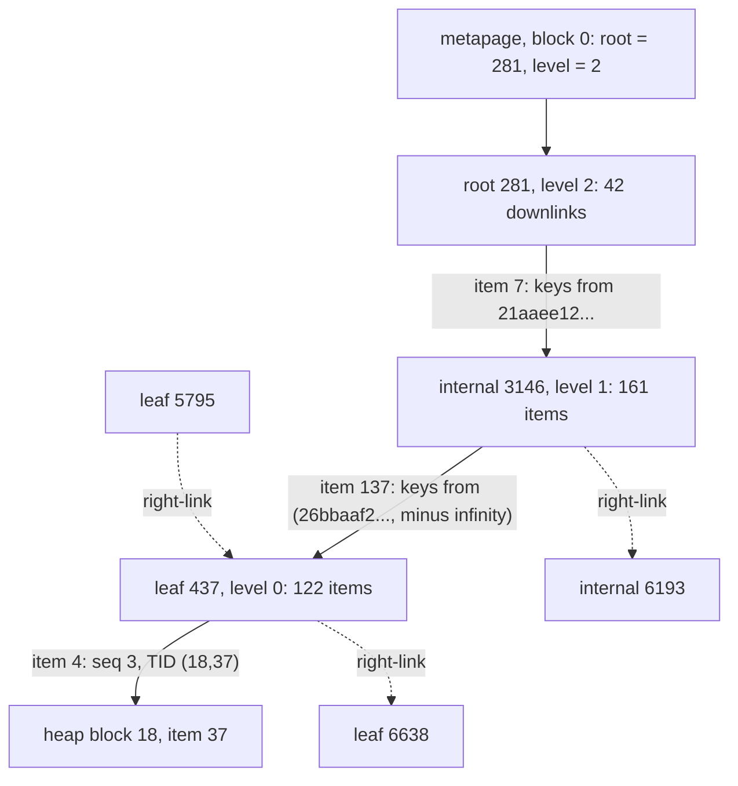

## 1. The question this idea answers

A chat service asks one question thousands of times per minute: "give me message 3 of chat 42". The example chat store holds 1,049,965 messages in 23,863 table pages. Without an index, PostgreSQL reads every page to find one row. With the B-tree index `messages_chat_seq_key`, it reads 4 pages. The test measured both on PostgreSQL 16.15:

| Access path | Pages read (buffers) | Rows checked | Execution time |
|---|---|---|---|
| Seq Scan | 23,863 | 1,049,965 | 173.7 ms |
| Index Scan using `messages_chat_seq_key` | 4 | 1 | 0.016 ms |

[Lesson 1.3](/notes/databases/postgres/01-relational-basics/l3-indexes) showed what an index is and how to choose its columns. This lesson opens the B-tree itself, page by page. It answers three questions. Why are 4 pages enough? What happens to the tree when rows arrive? What does the tree cost in space?

Every number comes from the example chat store on two servers: PostgreSQL 16.15 and PostgreSQL 18.6. The current manual is version 18 (checked on 2026-10-14). PostgreSQL 19 is not released: the roadmap page says it "is planned for October 2026" (checked on 2026-10-14). The B-tree storage format is the same on 16, 17 and 18. Both servers produced identical page counts in every repeatable test. Version differences are marked where they exist.

## 2. Mental model

> [!analogy] The register binder of a parts warehouse
> A warehouse has 23,863 shelves. Pallets go on any shelf with free space, so the shelves have no order. To find one pallet fast, the clerk keeps a register binder sorted by pallet number. Each register sheet lists about 150 pallet numbers, each with its shelf and slot. A tab sheet at the front names the first pallet number of each section. Each section sheet names the first pallet number of each register sheet. The clerk reads three sheets, then visits one shelf. To list a range of pallets, the clerk reads register sheets in order, because each sheet names the next sheet.
>
> **Where it stops working:** the binder does not record whether a pallet was removed or replaced, so the clerk must still check the shelf. When a register sheet is full, PostgreSQL splits it into two sheets and adds a tab entry, while other clerks read the same binder. And one binder line can never use more than about a third of a sheet.

## 3. Terms

| Term | Plain meaning |
|---|---|
| page (block) | The unit of storage and caching: 8 kB by default. Tables and indexes are files of pages. |
| heap | The table file. Rows go into any page with free space, so the heap has no order. |
| TID | Tuple identifier, also called `ctid`: the address of a row as (block number, item offset). |
| B-tree | A balanced tree of sorted pages. All leaf pages are at the same depth. |
| fan-out | The number of child pages that one internal page refers to. A high fan-out makes a short tree. |
| metapage | Block 0 of the index. It stores the block number of the root page. |
| internal page | A page above the leaf level. Its items are downlinks. The top internal page is the root page. |
| leaf page | A page on the lowest level. Its items are index keys, each with the TID of a heap row. |
| downlink | An internal item: a separator key plus the block number of a child page. |
| high key | The first item of a page that has a right sibling. It is an upper bound for all keys on the page. |
| right-link | The pointer from each page to its right sibling on the same level. A left-link also exists. |
| page split | The operation that moves part of a full page to a new page and adds a downlink in the parent. |
| fillfactor | The percentage to which an index build fills leaf pages. The B-tree default is 90. |
| posting list | One leaf item that stores a key once, followed by a sorted array of TIDs. Deduplication creates it. |
| operator class | The set of comparison operators and functions that defines the sort order of an indexed column. |

## 4. Method and math

### 4.1 From disk pages to a sorted structure

PostgreSQL stores tables and indexes as pages: "Every table and index is stored as an array of *pages* of a fixed size (usually 8 kB, although a different page size can be selected when compiling the server)" (PostgreSQL 18 docs §66.6, checked on 2026-10-14). The server reads and caches whole pages, never single rows. So the cost of a search is the number of pages that it touches.

A page has a 24-byte header, an array of 4-byte item identifiers, free space, the items, and a "special space" at the end (Table 66.2). "In a table, an item is a row; in an index, an item is an index entry." Each item has a stable address: "every pointer to an item (`ItemPointer`, also known as `CTID`) created by PostgreSQL consists of a page number and the index of an item identifier." This address is the TID. The TID (18,37) means block 18, item identifier 37.

The heap has no order: "In a table, all the pages are logically equivalent, so a particular item (row) can be stored in any page." The `messages` heap has 23,863 pages for 1,049,965 rows, so 1,049,965 / 23,863 = 44.0 rows per page. To find one row by value in an unordered heap, the server must read all 23,863 pages.

A sorted structure solves this. Binary search halves the candidates at each comparison. For $N$ keys it needs at most $\lceil \log_2(N+1) \rceil$ comparisons. For $N = 1{,}049{,}965$: $2^{20} = 1{,}048{,}576$ is too small, so the worst case is 21 comparisons.

A sorted array is a bad file format for a growing table, because an insert in the middle moves every later entry. A binary search tree fixes the insert problem, but each node holds one key. On disk, each node can sit on a different page, so a balanced binary tree over 1,049,965 keys can cost 21 page reads. A B-tree puts hundreds of keys into each node, and each node is one 8 kB page. So the height grows with $\log_f N$ instead of $\log_2 N$, where the fan-out $f$ is in the hundreds.

> [!example] Worked example: the B-tree saves page reads, not comparisons
> PostgreSQL uses binary search inside each page (`_bt_binsrch`, "Do a binary search for a key on a particular page", `src/backend/access/nbtree/nbtsearch.c`). The search for chat 42 in section 4.4 visits three index pages:
>
> | Page | Items on the page | Comparisons, $\lceil \log_2 \text{items} \rceil$ |
> |---|---|---|
> | root 281 | 42 | 6 |
> | internal 3146 | 161 | 8 |
> | leaf 437 | 122 | 7 |
> | **Total** | 3 pages | 21 |
>
> A binary tree needs 21 comparisons and up to 21 page reads. The B-tree needs about 21 comparisons and 3 page reads. A comparison in memory is cheap. A page read can mean disk I/O.

### 4.2 The structure of a PostgreSQL B-tree

The docs describe the shape (PostgreSQL 18 docs §65.1.4.1, checked on 2026-10-14): "PostgreSQL B-Tree indexes are multi-level tree structures, where each level of the tree can be used as a doubly-linked list of pages. A single metapage is stored in a fixed position at the start of the first segment file of the index. All other pages are either leaf pages or internal pages." And: "Typically, over 99% of all pages are leaf pages."

The source README (`src/backend/access/nbtree/README`, PostgreSQL 18.6) names the algorithm: "a correct implementation of Lehman and Yao's high-concurrency B-tree management algorithm". It adds two things to a classic B-tree: "a right-link pointer to each page, to the page's right sibling" and "a 'high key' to each page, which is an upper bound on the keys that are allowed on that page". Section 4.6 shows why these two additions matter. The parts, with the rules from the README and the pageinspect docs (§F.23.3):

1. **Metapage.** "Page zero of every btree is a meta-data page. This page stores the location of the root page." Backends cache it, so a search does not read block 0 every time.
2. **Levels.** "The page level counts upwards from zero at the leaf level, to the tree depth minus 1 at the root." A root at level 2 means a tree with 3 levels.
3. **Leaf items.** "On a leaf page, the data items are simply links to (TIDs of) tuples in the relation being indexed, with the associated key values."
4. **Internal items.** Each one is a separator key plus a downlink. "The key in each data item is a strict lower bound for keys on that child page." The first data item has no key: it means minus infinity.
5. **High key.** "On a page that is not rightmost in its tree level, the 'high key' is kept in the page's first item, and real data items start at item 2." A rightmost page has no high key.
6. **Sibling links.** They live in the special space: "b-tree indexes store links to the page's left and right siblings" (§66.6).
7. **TID as tiebreaker.** "The requirement that all btree keys be unique is satisfied by treating heap TID as a tiebreaker attribute. Logical duplicates are sorted in heap TID order."
8. **Suffix truncation.** When a leaf page splits, the new separator keeps only the key columns that it needs. Truncated columns count as minus infinity. Shorter separators let internal pages hold more of them.

The real path of the search in section 4.4 (block numbers from the test):



### 4.3 The real tree of the example chat store

`pageinspect` reads raw index pages. "All of these functions may be used only by superusers" (PostgreSQL 18 docs §F.23, checked on 2026-10-14). The test ran `CREATE EXTENSION pageinspect;` in its own database. First the metapage:

```sql
SELECT * FROM bt_metap('messages_chat_seq_key');
```

```text
 magic  | version | root | level | fastroot | fastlevel | last_cleanup_num_delpages | last_cleanup_num_tuples | allequalimage
--------+---------+------+-------+----------+-----------+---------------------------+-------------------------+---------------
 340322 |       4 |  281 |     2 |      281 |         2 |                         0 |                      -1 | t
```

The root is block 281 at level 2, so the tree has 3 levels. `bt_multi_page_stats(index, 1, -1)` returns one row per page. Grouped by level, the two indexes of `messages` look like this. PostgreSQL 16.15 and 18.6 returned identical numbers.

| Index | Level | Pages | Items | Avg items per page | Max items | Avg item size (bytes) |
|---|---|---|---|---|---|---|
| `messages_chat_seq_key` (chat_id, seq) | 2 (root) | 1 | 42 | 42.0 | 42 | 23.0 |
| | 1 | 42 | 6,957 | 165.6 | 276 | 24.9 |
| | 0 (leaf) | 6,916 | 1,056,880 | 152.8 | 226 | 31.2 |
| `messages_pkey` (id) | 2 (root) | 1 | 23 | 23.0 | 23 | 23.0 |
| | 1 | 23 | 5,052 | 219.7 | 272 | 23.0 |
| | 0 (leaf) | 5,030 | 1,054,994 | 209.7 | 291 | 24.0 |

The counts of `messages_chat_seq_key` close exactly. Pages: 1 metapage + 1 root + 42 internal + 6,916 leaf = 6,960 = `relpages`. Leaf items: 1,049,965 rows + 6,915 high keys (every leaf except the rightmost) = 1,056,880. Level-1 items: 6,916 downlinks + 41 high keys = 6,957. The root holds 42 downlinks and no high key.

> [!example] Worked example: fan-out and height from the real numbers
> For `messages_chat_seq_key`:
>
> 1. Data items per leaf: 1,049,965 / 6,916 = 151.8.
> 2. Downlinks per level-1 page (the fan-out $F$): 6,916 / 42 = 164.7.
> 3. Levels above the leaves: $\lceil \ln 6{,}916 / \ln 164.7 \rceil = \lceil 8.842 / 5.104 \rceil = \lceil 1.73 \rceil = 2$.
> 4. Height: 1 leaf level + 2 = 3. This matches `level = 2` in the metapage.
> 5. For `messages_pkey`: 5,030 / 23 = 218.7 downlinks per page, and $\lceil 8.523 / 5.388 \rceil = \lceil 1.58 \rceil = 2$. So it also has 3 levels.
>
> When does a fourth level appear? A root item of 24 bytes plus its item identifier uses 28 bytes. So a root page holds at most 8,152 / 28 = 291 downlinks. At today's average fill: 291 × 164.7 × 151.8 ≈ 7.3 million rows. That is an estimate, about 7 times today's row count. Each extra level multiplies the capacity by about 165.

Where do 226 and 291 (the maximum items per leaf) come from? The usable space of a page is 8,192 − 24 (page header) − 16 (B-tree special space) = 8,152 bytes. An index item starts with an 8-byte header: a 6-byte TID plus 2 bytes of flags and length. Then comes the key, and the total is rounded to the next multiple of 8. Each item also needs a 4-byte item identifier.

| Index | Item | Bytes per entry | Max per page |
|---|---|---|---|
| `messages_pkey` | 8 + 16 (uuid) = 24 | 24 + 4 = 28 | 8,152 / 28 = 291.1, so 291 |
| `messages_chat_seq_key` | 8 + 16 + 4 (integer) = 28, rounded to 32 | 32 + 4 = 36 | 8,152 / 36 = 226.4, so 226 |

The observed maximums are exactly 291 and 226.

### 4.4 One search, page by page

The search for `chat_id = md5('chat42')::uuid` (the value `26bbaaf2-4bcc-2996-f5ec-2ef4ee48a5ec`) and `seq = 3` follows the downlinks. The test decoded the `data` bytes with a small helper function. The first 16 bytes are the uuid, and the next 4 bytes are `seq` in little-endian order. In the root, the search takes the last item whose key is smaller than the search key:

```text
-- bt_page_items('messages_chat_seq_key', 281): root, items 7 and 8
 itemoffset |   ctid   | itemlen |             chat_id_key
------------+----------+---------+--------------------------------------
          7 | (3146,1) |      24 | 21aaee12-21eb-7496-9e98-19d83c3d4c7e
          8 | (6193,1) |      24 | 279a76c6-4f75-141e-c82f-e5be693e45ee
```

The target `26bbaaf2...` sorts between the two keys, so the search follows item 7 to block 3146. In an internal item, the block part of `ctid` is the downlink. The offset part (`1`) stores the number of key columns kept: suffix truncation removed `seq`. Block 3146 is an internal page at level 1:

```text
-- bt_page_stats: blkno 3146, type i, live_items 161, btpo_prev 6596, btpo_next 6193, btpo_level 1
 itemoffset |   ctid    | itemlen |             chat_id_key              | seq
------------+-----------+---------+--------------------------------------+-----
          1 | (5348,1)  |      24 | 279a76c6-4f75-141e-c82f-e5be693e45ee |
          2 | (2809,0)  |       8 |                                      |
        ...
        136 | (5795,2)  |      32 | 26b43746-4243-a28a-fe66-87aae63801f7 |  15
        137 | (437,1)   |      24 | 26bbaaf2-4bcc-2996-f5ec-2ef4ee48a5ec |
```

(The test shortened this output to five rows.) Item 1 is the high key. It equals root item 8, and the right-link `btpo_next = 6193` is the downlink of root item 8. Item 2 is the minus-infinity downlink, 8 bytes with no key. Item 137 is chat 42 with `seq` truncated, so all of chat 42 starts in leaf 437. Item 136 kept both columns, because a split happened inside one chat. Leaf 437:

```text
-- bt_page_stats: blkno 437, type l, live_items 122, btpo_prev 5795, btpo_next 6638, btpo_level 0
 itemoffset |   ctid    | itemlen |               chat_id                | seq |  htid
------------+-----------+---------+--------------------------------------+-----+---------
          1 | (22861,1) |      24 | 26c365d7-578b-784e-70a7-005844ca67b9 |     |
          2 | (18,35)   |      32 | 26bbaaf2-4bcc-2996-f5ec-2ef4ee48a5ec |   1 | (18,35)
          3 | (18,36)   |      32 | 26bbaaf2-4bcc-2996-f5ec-2ef4ee48a5ec |   2 | (18,36)
          4 | (18,37)   |      32 | 26bbaaf2-4bcc-2996-f5ec-2ef4ee48a5ec |   3 | (18,37)
          5 | (18,38)   |      32 | 26bbaaf2-4bcc-2996-f5ec-2ef4ee48a5ec |   4 | (18,38)
          6 | (18,39)   |      32 | 26bbaaf2-4bcc-2996-f5ec-2ef4ee48a5ec |   5 | (18,39)
```

(Shortened to six of 122 rows, without the `data` column.) Item 4 holds the key (chat 42, 3) and the TID (18,37). The raw bytes of item 2 are `26 bb ... a5 ec 01 00 00 00 00 00 00 00`: the uuid, then `seq = 1`, then 4 bytes of padding. Leaf 437 holds 121 entries of 9 chats. `SELECT ... FROM messages WHERE ctid = '(18,37)'` returns chat 42, `seq` 3, role `user`.

`EXPLAIN (ANALYZE, BUFFERS)` confirms the page count. PostgreSQL 18.6:

```text
 Index Scan using messages_chat_seq_key on messages (actual time=0.008..0.009 rows=1.00 loops=1)
   Index Cond: ((chat_id = '26bbaaf2-4bcc-2996-f5ec-2ef4ee48a5ec'::uuid) AND (seq = 3))
   Index Searches: 1
   Buffers: shared hit=4
```

PostgreSQL 16.15 printed the same plan with `rows=1` and no `Index Searches` line, also with `Buffers: shared hit=4`. 4 buffers = root 281 + internal 3146 + leaf 437 + heap block 18. The metapage does not appear, because "we cache a copy of the meta-data information in the index's relcache entry" (README).

> [!note] Version difference
> PostgreSQL 18 adds the line `Index Searches`: "In EXPLAIN ANALYZE, report the number of index lookups used per index scan node" (PostgreSQL 18 release notes §E.6.3.2.3, checked on 2026-10-14). It counts descents from the root. [L4](/notes/databases/postgres/06-indexes-and-query-plans/l4-explain-and-explain-analyze) covers the other PostgreSQL 18 changes in `EXPLAIN`.

### 4.5 Range scans follow the leaf level

A range scan descends once, to the first matching leaf. Then it reads leaf after leaf through the right-links. The README: "once we have descended the tree to the correct start point for the scan, the scan looks only at leaf pages and never at higher tree levels." The test followed `btpo_next` from leaf 437:

| Leaf # | Block | Data items | Running total | Right-link |
|---|---|---|---|---|
| 1 | 437 | 121 | 121 | 6638 |
| 2 | 6638 | 121 | 242 | 4497 |
| 3 | 4497 | 152 | 394 | 2088 |
| 4 | 2088 | 223 | 617 | 2715 |
| 5 | 2715 | 122 | 739 | 6022 |
| 6 | 6022 | 113 | 852 | 824 |
| 7 | 824 | 152 | 1,004 | 3760 |

The neighbor blocks are not adjacent in the file: 437, 6638, 4497. The order lives in the links, not in the block numbers. The query `SELECT chat_id, seq FROM messages WHERE chat_id >= md5('chat42')::uuid ORDER BY chat_id, seq LIMIT n` proves the walk. With `n` = 121, 122 and 1000, PostgreSQL 18.6 chose an Index Only Scan with `Heap Fetches: 0` and `Index Searches: 1`. It reported 4, 5 and 10 buffers.

121 rows fit in leaf 437, so 4 buffers: root, internal page, leaf 437, and one visibility map page. Row 122 needs the right sibling, so 5. For 1,000 rows: 2 upper pages + 7 leaves + 1 visibility map page = 10. PostgreSQL 16.15 also reported 10 buffers. An index-only scan reads the visibility map instead of the heap. [L3](/notes/databases/postgres/06-indexes-and-query-plans/l3-index-scan-vs-sequential-scan) explains it.

Backward scans use the left-link: "To support scans in the backward direction, we also store a 'left sibling' link much like the 'right sibling'" (README). On both servers, `ORDER BY id DESC LIMIT 5` became `Index Only Scan Backward using messages_pkey`, with no Sort node.

> [!trap] Index order is not heap order
> The leftmost leaf of `messages_pkey` (block 1) starts with these keys and TIDs (shortened):
>
> ```text
>  itemoffset |    ctid    |                id_key                |    htid
> ------------+------------+--------------------------------------+------------
>           2 | (20375,17) | 00001f35-ffb0-d96d-dfab-ad696dfac0e0 | (20375,17)
>           3 | (2836,39)  | 00001f50-80f9-fba7-8975-0e1077c4fe45 | (2836,39)
>           4 | (8891,19)  | 00004058-5535-61a1-b3ad-4fe1a00af836 | (8891,19)
>           5 | (20403,37) | 00004fe4-531e-ca54-ea86-e967323aa6d4 | (20403,37)
> ```
>
> Four neighbors in the index live in four distant heap blocks. On both servers, `ORDER BY id LIMIT 1000` with an Index Scan read 1,008 buffers, and the 1,000 rows sat on 975 distinct heap pages. The leaf walk is cheap. The heap visits are the expensive part. L3 measures this with the `correlation` statistic.

### 4.6 Inserts, page splits and fillfactor

An insert descends to the correct leaf and adds the entry. If the leaf is full, the page splits (PostgreSQL 18 docs §65.1.4.1, checked on 2026-10-14). "A *page split* operation makes room for items that originally belonged on the overflowing page by moving a portion of the items to a new page. Page splits must also insert a new *downlink* to the new page in the parent page, which may cause the parent to split in turn." When the root splits, a new root appears "one level above the original root page". So a B-tree grows at the top, and all leaves stay at the same depth.

How full does each half stay? The comment in `src/include/access/nbtree.h` (PostgreSQL 18.6):

> "The leaf-page fillfactor defaults to 90% but is user-adjustable. For pages above the leaf level, we use a fixed 70% fillfactor. The fillfactor is applied during index build and when splitting a rightmost page; when splitting non-rightmost pages we try to divide the data equally. When splitting a page that's entirely filled with a single value (duplicates), the effective leaf-page fillfactor is 96%, regardless of whether the page is a rightmost page."

The test inserted the numbers 1 to 200,000 into two tables with a `bigint` index. `lab_asc` received them in ascending order, `lab_rand` in hashed order. A `bigint` entry uses 8 + 8 + 4 = 20 bytes, so a leaf holds at most 8,152 / 20 = 407 entries.

| Index | Leaf pages | Avg items per leaf | Fill |
|---|---|---|---|
| `lab_asc_k` (ascending inserts) | 547 | 366.6 | 366.6 / 407 = 90% |
| `lab_rand_k` (random inserts) | 675 | 297.3 | 297.3 / 407 = 73% |

Ascending inserts always split the rightmost page, so each left half keeps 90%. Random inserts split pages in the middle, so most pages hold between about half and all of their capacity. The README also describes a fast path for ascending keys. The backend caches the rightmost leaf and skips the descent when the new key still belongs there.

The seed of the example chat store creates the indexes before it loads the rows. So its indexes grew by random inserts, because `md5` values arrive in random order. The test rebuilt the same index with `CREATE UNIQUE INDEX` and three fillfactors (identical on both servers):

| Index on `messages (chat_id, seq)` | Pages | Leaf pages | Avg items per leaf | Size |
|---|---|---|---|---|
| Grown by inserts (`messages_chat_seq_key`) | 6,960 | 6,916 | 152.8 | 54 MB |
| `CREATE INDEX`, fillfactor 90 (default) | 5,208 | 5,173 | 204.0 | 41 MB |
| `CREATE INDEX`, fillfactor 100 | 4,699 | 4,667 | 226.0 | 37 MB |
| `CREATE INDEX`, fillfactor 70 | 6,732 | 6,688 | 158.0 | 53 MB |

> [!example] Worked example: predicting 204 items per leaf
> The build code (`nbtsort.c`) treats a page as full when its free space drops below `BLCKSZ * (100 - fillfactor) / 100` = 8,192 × 10 / 100 = 819 bytes.
>
> 1. After 203 entries of 36 bytes: 8,152 − 203 × 36 = 844 bytes free. 844 ≥ 819, so the build adds one more.
> 2. After 204 entries: 8,152 − 204 × 36 = 808 bytes free. 808 < 819, so the page is closed.
> 3. 204 items = 1 high key + 203 data items. Leaf pages: 1,049,965 / 203 = 5,172.2, so 5,173. The measurement shows 5,173.
>
> The grown index is 6,960 / 5,208 = 1.34 times the size of a fresh build.

The CREATE INDEX page defines the parameter (PostgreSQL 18 docs, CREATE INDEX, checked on 2026-10-14). "For B-trees, leaf pages are filled to this percentage during initial index builds, and also when extending the index at the right (adding new largest key values)." The range is 10 to 100. The docs warn about 100: "You should only consider this when you are completely sure that the table is static". Otherwise "even a few updates or inserts will cause a sudden flood of page splits."

The key type decides the insert pattern. On PostgreSQL 18.6, the test inserted 200,000 keys into two `uuid` primary keys (one run):

| Key generator (version) | Index pages | Avg items per leaf |
|---|---|---|
| `gen_random_uuid()`, random (16, 17, 18) | 1,049 | 193.1 (66% of 291) |
| `uuidv7()`, time-ordered (18 only) | 773 | 261.8 (90% of 291) |

The PostgreSQL 18 release notes (§E.6.3.4, checked on 2026-10-14): "Add UUID version 7 generation function uuidv7() ... This UUID value is temporally sortable". On 16 and 17, a `bigint` identity column gives the same ascending pattern.

Why do the right-links and high keys matter during splits? A reader can read the parent, then a writer can split the child before the reader arrives. The README: "If the search key is greater than the high key, the page must've been split concurrently, and you must follow the right-link to find the new page containing the key range you're looking for." So readers hold no lock on the parent while they descend. They lock one page at a time, only while they read it.

### 4.7 Deduplication: posting lists

The docs (PostgreSQL 18 docs §65.1.4.3, checked on 2026-10-14): "A duplicate is a leaf page tuple (a tuple that points to a table row) where *all* indexed key columns have values that match corresponding column values from at least one other leaf page tuple in the same index." Deduplication merges a group of duplicates "forming a single *posting list* tuple for each group. The column key value(s) only appear once in this representation." It "is enabled by default", and the storage parameter `deduplicate_items` controls it.

The test built two extra indexes on `messages (chat_id)`. A chat has 1,049,965 / 50,000 = 21.0 messages on average, so each key has about 21 duplicates. Identical on both servers:

| Index | Pages | Size |
|---|---|---|
| `(chat_id)`, deduplication on (default) | 1,071 | 8,568 kB |
| `(chat_id) WITH (deduplicate_items = off)` | 4,051 | 32 MB |

The deduplicated index is 4,051 / 1,071 = 3.8 times smaller. Chat 42 is one leaf item:

```text
 blkno | itemoffset |   ctid    | itemlen |  htid   |                        tids
-------+------------+-----------+---------+---------+-----------------------------------------------------
   163 |         22 | (24,8197) |      56 | (18,35) | {"(18,35)","(18,36)","(18,37)","(18,38)","(18,39)"}
```

> [!example] Worked example: 5 entries in 56 bytes
> Posting list: 8 (header) + 16 (uuid) + 5 × 6 (TIDs) = 54 bytes, rounded to 56. With its item identifier: 60 bytes.
>
> Without deduplication: 5 items × (24 + 4) = 140 bytes. The `deduplicate_items = off` index stored exactly 5 items of 24 bytes for chat 42.

Deduplication does not help the three indexes of the example chat store. In `messages_chat_seq_key`, every (chat_id, seq) pair is distinct. The test counted 0 posting-list tuples in each of the three indexes, for example among the 1,056,880 leaf items of `messages_chat_seq_key`. A composite key with a distinct last column has no duplicates.

Some types cannot use deduplication at all. The docs list `numeric`, `jsonb`, `float4` and `float8`, and container types (composite, array, range). Text types are excluded only with a nondeterministic collation. Every `INCLUDE` index is also excluded. The metapage field `allequalimage` shows the result. The test indexed one column of each type: `numeric` gave `f`, `jsonb` gave `f`, `text` with the database collation gave `t`.

Unique indexes are a special case. A unique index has no logical duplicates, but MVCC creates physical ones. An `UPDATE` that cannot use the HOT optimization adds a second entry with the same key. The docs: "It is sometimes possible for unique indexes (as well as unique constraints) to use deduplication. This allows leaf pages to temporarily 'absorb' extra version churn duplicates." The test table was `lab_churn (id int PRIMARY KEY, v int)` with an extra index on `v`, so updates of `v` are not HOT. In one transaction, the test updated ids 1 to 100 eight times:

```text
 posting_tuples | max_tids | items
----------------+----------+-------
             58 |        9 |   107
```

Leaf 1 of the primary key now held 58 posting-list tuples with up to 9 TIDs each: the original row plus 8 versions. The open transaction kept every old version alive, so no deletion could free space. The index grew from 57 to 59 pages. Both servers gave identical numbers. Normally PostgreSQL first tries to delete such entries before a split. "Bottom-up index deletion" targets version duplicates (PostgreSQL 18 docs §65.1.4.2): "Each deletion pass is triggered in reaction to an anticipated 'version churn page split'." Deduplication is the last step before the split.

> [!note] Version difference
> Deduplication arrived in PostgreSQL 13: "More efficiently store duplicates in B-tree indexes ... Users upgrading with pg_upgrade will need to use REINDEX to make an existing index use this feature" (PostgreSQL 13 release notes §E.24.3.1.2, checked on 2026-10-14). Bottom-up deletion arrived in 14: "Allow btree index additions to remove expired index entries to prevent page splits" (PostgreSQL 14 release notes §E.25.3.1.3). Both are present on 16, 17 and 18.

### 4.8 MVCC: index entries have no visibility information

The docs (PostgreSQL 18 docs §11.9, checked on 2026-10-14): "Visibility information is not stored in index entries, only in heap entries". So an ordinary index scan visits the heap for every candidate row and checks it there. The test deleted message 5 of chat 42 inside an open transaction:

```sql
BEGIN;
DELETE FROM messages WHERE chat_id = md5('chat42')::uuid AND seq = 5;
SELECT count(*) FROM messages WHERE chat_id = md5('chat42')::uuid;  -- 4
-- bt_page_items on leaf 437: still 5 entries, item 6 = seq 5, TID (18,39), dead = f
ROLLBACK;
```

The index still held all 5 entries, but the query counted 4 rows. The delete changed only the heap tuple (18,39): `heap_page_items` showed its `t_xmax` set to the id of the deleting transaction. After a committed delete, the index entry stays until `VACUUM` or an index deletion pass removes it. Unique checks also visit the heap (section 4.10). An index-only scan avoids heap visits only for pages that the visibility map marks as all-visible. L3 covers this.

### 4.9 What a B-tree can answer

The docs (PostgreSQL 18 docs §11.2.1, checked on 2026-10-14): "the PostgreSQL query planner will consider using a B-tree index whenever an indexed column is involved in a comparison using one of these operators: `<   <=   =   >=   >`". Also: "Constructs equivalent to combinations of these operators, such as `BETWEEN` and `IN`, can also be implemented with a B-tree index search. Also, an `IS NULL` or `IS NOT NULL` condition on an index column can be used with a B-tree index."

`<>` is not in the operator class. The reason (§65.1.2): "it would almost never be useful to use a `<>` WHERE clause in an index search".

Prefix `LIKE` needs care: it works "*if* the pattern is a constant and is anchored to the beginning of the string". And "if your database does not use the C locale you will need to create the index with a special operator class". The test database uses the libc locale `C.UTF-8`. Each clause ran on both servers with the same plan shape:

| Clause | Plan |
|---|---|
| `chat_id = X AND seq BETWEEN 2 AND 4` | Index Only Scan, `Index Cond: ... (seq >= 2) AND (seq <= 4)` |
| `chat_id = X AND seq IN (1,2,3,4,5)` | Index Scan, `seq = ANY ('{1,2,3,4,5}'::integer[])` in `Index Cond` |
| `k IS NULL` (nullable `bigint`, `lab_rand`) | Index Only Scan, `Index Cond: (k IS NULL)` |
| `id <> X` | Seq Scan with `Filter` |
| `owner_id LIKE 'user-004%'`, default index | Seq Scan |
| the same, index with `text_pattern_ops` | Index Scan, `Index Cond: ((owner_id ~>=~ 'user-004'::text) AND (owner_id ~<~ 'user-005'::text))` |
| the same, index with `COLLATE "C"` | Index Scan, `Index Cond: ((owner_id >= 'user-004'::text) AND (owner_id < 'user-005'::text))` |
| `owner_id LIKE '%-0042'` | Seq Scan, also with the `COLLATE "C"` index |

The planner turns an anchored prefix into a range: from `user-004` (inclusive) to `user-005` (exclusive). The `Filter` line that follows checks the real pattern. A `text_pattern_ops` index cannot serve `<`: with it present, `owner_id < 'user-0002'` still used the default index. The docs agree: "Such queries cannot use the `xxx_pattern_ops` operator classes" (§11.10).

> [!trap] C.UTF-8 is not the C locale for LIKE
> The database `C.UTF-8` locale (libc provider) did not let the default index serve `LIKE 'user-004%'`, on 16.15 and on 18.6. Do not assume that a "C-like" locale is enough. Test the plan, or create the index with `text_pattern_ops` or `COLLATE "C"`.

> [!note] Version difference: IN lists and IS NULL
> PostgreSQL 17: "Allow btree indexes to more efficiently find a set of values, such as those supplied by `IN` clauses using constants" (PostgreSQL 17 release notes §E.12.3.1.2, checked on 2026-10-14). The test ran `chat_id = X AND seq IN (1,2,3,4,5)` with the same Index Scan plan on both servers:
>
> | Server | Descents | Buffers |
> |---|---|---|
> | 16.15 | 5 (`idx_scan` grew from 11 to 16) | 19 (hit 15, read 4) |
> | 18.6 | 1 (`Index Searches: 1`) | 4 |
>
> PostgreSQL 16 descended once per array value. PostgreSQL 18 found all five values in one descent, because they sit on one leaf. Also from 17: the planner removes `IS NULL` scans on `NOT NULL` columns (§E.12.3.1.1). `WHERE id IS NULL` on `messages` became `One-Time Filter: false` on 18.6, but an Index Only Scan on 16.15.

PostgreSQL 18 also adds **skip scan**: "This allows multi-column btree indexes to be used in more cases such as when there are no restrictions on the first or early indexed columns" (§E.6.3.1.2). [L2](/notes/databases/postgres/06-indexes-and-query-plans/l2-multicolumn-indexes) demonstrates it.

### 4.10 Uniqueness

"Currently, only B-tree indexes can be declared unique" (PostgreSQL 18 docs §11.6, checked on 2026-10-14). A primary key or unique constraint creates a unique index, which "is the mechanism that enforces the constraint". By default, "null values in a unique column are not considered equal, allowing multiple nulls". `NULLS NOT DISTINCT` changes this. On both servers, a second (chat 42, 3) failed:

```text
ERROR:  duplicate key value violates unique constraint "messages_chat_seq_key"
DETAIL:  Key (chat_id, seq)=(26bbaaf2-4bcc-2996-f5ec-2ef4ee48a5ec, 3) already exists.
```

The check happens inside the index insert, and it must consult the heap (PostgreSQL 18 docs §63.5): "Because of MVCC, it is always necessary to allow duplicate entries to exist physically in an index: the entries might refer to successive versions of a single logical row." So the index "must reach into the heap to check the commit status of any row that is shown to have a duplicate key". If the conflicting row comes from a transaction that is still open, "the would-be inserter must wait to see if that transaction commits."

### 4.11 The size limit of an index entry

The docs (§65.1.1): "an index entry cannot exceed approximately one-third of a page (after TOAST compression, if applicable)." The README gives the reason: "The algorithm assumes we can fit at least three items per page (a 'high key' and two real data items)." The macro `BTMaxItemSize` in `nbtree.h` computes the exact value for 8 kB pages:

$$
\left\lfloor \frac{8192 - 40 - 16}{3} \right\rfloor_{8} - 8 = 2712 - 8 = 2704 \text{ bytes}
$$

The 40 is the page header plus three item identifiers: 24 + 12 = 36, rounded to 40. The 16 is the special space. $\lfloor\cdot\rfloor_8$ rounds to the lower multiple of 8, and the last 8 bytes are room for a heap TID. The test inserted incompressible text into a table with an index on `t`. On both servers, 2,692 characters gave an entry of exactly 2,704 bytes (8 + 4-byte length header + 2,692). One more character failed:

```text
ERROR:  index row size 2712 exceeds btree version 4 maximum 2704 for index "lab_big_t"
DETAIL:  Index row references tuple (0,2) in relation "lab_big".
HINT:  Values larger than 1/3 of a buffer page cannot be indexed.
Consider a function index of an MD5 hash of the value, or use full text indexing.
```

A repetitive 18,000-character value succeeded: compression made its entry 240 bytes. So the limit applies after compression, and an index on free text can fail on one unusual row in production.

### 4.12 Index size versus table size

The example chat store after the seed (identical on both servers):

| Table | Heap | Index | Index size | Share of heap |
|---|---|---|---|---|
| `chats` | 4,464 kB | `chats_owner_updated_idx` | 2,368 kB | 53% |
| `messages` | 186 MB | `messages_chat_seq_key` | 54 MB | 29% |
| `messages` | 186 MB | `messages_pkey` | 39 MB | 21% |
| `message_feedback` | 3,400 kB | `message_feedback_message_created_idx` | 2,504 kB | 74% |

The two indexes of `messages` use 54 + 39 = 93 MB, half the size of the heap. Narrow tables pay more. Per row, `message_feedback` uses 3,481,600 / 50,985 = 68 heap bytes and 2,564,096 / 50,985 = 50 index bytes. Every index must also change on every insert. [Lesson 1.3](/notes/databases/postgres/01-relational-basics/l3-indexes) measured that write cost.

> [!key] A B-tree trades page reads for fan-out
> One 8 kB page holds 150 to 290 entries, so each level multiplies the reach by about 165. For 1,049,965 rows, a search reads 3 index pages and then 1 heap page. A range scan descends once and then follows the right-links. The price is space (half the heap here) and work on every write. Every match also costs a heap visit, because the index does not know which rows are visible.

### 4.13 Production view

| Concern | What to do |
|---|---|
| Key choice | Prefer ascending keys (identity, `uuidv7()` on 18). Random keys fill leaves to about 66 to 73% and spread inserts over the whole index. |
| Size after a bulk load | Create indexes after the load, or rebuild them. In the test, the index grown by inserts was 1.34 times the fresh build. |
| Rebuilds | `REINDEX ... CONCURRENTLY` rebuilds "without taking any locks that prevent concurrent inserts, updates, or deletes" (PostgreSQL 18 docs, REINDEX). |
| Fillfactor | Keep 90 for tables with inserts and updates. Use 100 only for static tables. A change takes full effect after `REINDEX`. |
| Long values | Never index free text with a plain B-tree. Entries above 2,704 bytes fail the insert. Index a hash expression instead. |
| Upgrades | Indexes from PostgreSQL 12 or older need `REINDEX` after `pg_upgrade` to use deduplication. |
| Inspection | `pageinspect` needs a superuser. If a managed service does not allow it, inspect a local copy of the schema and data. |

## 5. Video

```video
{
  "src": "/notes/media/postgres/manim/m03-btree-descent.mp4",
  "caption": "The real 3-level tree of messages_chat_seq_key: one search reads root 281, internal page 3146, leaf 437 and heap block 18 (4 buffers), a range scan follows right-links across leaves, and a full leaf splits."
}
```

## 6. Code

These exercises use your local PostgreSQL server with the example chat store loaded ([lesson 5.1](/notes/databases/postgres/05-local-setup/l1-local-postgres-with-docker) creates the server). Put the work in `postgres/11-btree.ipynb` in the lab folder `C:\Users\ASohi\Downloads\AI\agent-harness-lab`. Run `CREATE EXTENSION pageinspect;` first, as a superuser.

**Exercise 1.1: map the two trees.** Use `bt_metap` and `bt_multi_page_stats` on `messages_pkey` and `messages_chat_seq_key`. Build a table with one row per level: pages, items, average items per page, average free space.

Acceptance tests:

- The page counts of each index sum to `relpages` minus 1 (the metapage).
- Leaf items = row count + leaf pages − 1, for each index.
- Your fan-out and height calculation predicts `bt_metap(...).level + 1`.

**Exercise 1.2: trace one descent by hand.** Choose chat 7 (`md5('chat7')::uuid`). Start at the root block from `bt_metap`. Use `bt_page_items` to find the downlink on each level, then the leaf item, then the heap row by `ctid`. Write a helper that decodes the first 16 bytes of `data` as a uuid.

Acceptance tests:

- Your notebook prints the block number of each page on the path and the TID of `seq = 1`.
- `SELECT ... WHERE ctid = '<your TID>'` returns chat 7, `seq` 1.
- `EXPLAIN (ANALYZE, BUFFERS)` for `chat_id = ... AND seq = 1` reports levels + 1 buffers. Explain in one sentence why the metapage does not count.

**Exercise 1.3: predict, then measure, the leaf fill.** Create a table with one `integer` column and an index. Before you insert, predict the items per leaf for: ascending inserts, random inserts, and `REINDEX` with fillfactor 90 and 100. Show the arithmetic with the 8,152-byte and 819-byte rules from section 4.6. Then insert 300,000 values and measure.

Acceptance tests:

- Your predictions for ascending inserts and both rebuilds are within 1 item of the measurement.
- The random-insert average falls between 50% and 100% of the maximum, and you explain why in two sentences.
- Bonus test: your notebook records the longest incompressible `text` value that a B-tree index accepts, and the exact error for one more character.

## 7. Common mistakes

1. **"An index lookup reads the whole index."** It reads one page per level: 3 pages for 1,049,965 rows here. A range scan then reads only the leaves that it needs.
2. **"The index entry tells whether the row exists."** Index entries have no visibility information. Every match is checked in the heap or the visibility map.
3. **"The same rows always give the same index size."** The index that grew by random inserts had 6,960 pages. A fresh build of the same keys had 5,208.
4. **"Fillfactor 100 saves space, so use it everywhere."** The docs reserve it for static tables. Any later insert into a full page causes a split.
5. **"Deduplication shrinks every index."** It helps only when all key columns repeat. The composite unique index of the example has 0 posting lists.
6. **"`LIKE 'abc%'` always uses a B-tree index."** With the libc `C.UTF-8` locale, it did not. It needs `text_pattern_ops` or the C collation.
7. **"Any text column can carry a B-tree index."** An entry above 2,704 bytes after compression fails the insert.

## 8. One-minute explanation

PostgreSQL stores tables and indexes in 8 kB pages, and the table file, the heap, has no order. A B-tree index keeps keys sorted in pages and links the pages into a tree. A leaf item holds a key and the TID of a heap row. An internal item holds a separator key and the block number of a child page. Because one page holds about 150 to 290 entries, each level multiplies the reach by about 165. So the 1,049,965 messages of the example need only 3 levels, and one lookup reads 3 index pages plus 1 heap page. A range scan descends once and then follows right-links from leaf to leaf. Each page also has a high key, so a reader that arrives after a concurrent split detects it and follows the right-link. When a leaf is full, it splits and a new downlink goes into the parent. Ascending keys keep leaves 90% full, and random keys leave them about 70% full. Duplicates can share one posting list, but only when every key column repeats. The index never stores visibility, so each match is checked in the heap or the visibility map.

## 9. Check questions

```check
{
  "question": "A B-tree has 9,853 leaf pages and an average of 165 downlinks per internal page. How many levels does it have? Show the calculation.",
  "hint": "Count the pages needed on each level above the leaves until one page is enough.",
  "answer": "Level 1 needs 9,853 / 165 = 59.7, so 60 internal pages. 60 downlinks fit on one page, so the root is on level 2. The tree has 3 levels: leaf, internal, root. With logarithms: ln 9,853 / ln 165 = 9.196 / 5.106 = 1.80. The next whole number is 2 levels above the leaves, plus the leaf level."
}
```

```check
{
  "question": "Inside an open transaction you delete message 5 of chat 42. The leaf page still shows an entry for it with dead = f, but your count returns 4 rows. Explain both facts.",
  "answer": "The delete changes only the heap tuple: it sets its xmax. Index entries have no visibility information, so the entry stays until VACUUM or an index deletion pass removes it. The index scan visits the heap for each candidate and checks visibility there. The deleted row is invisible to the statement after the delete, so the count is 4."
}
```

```check
{
  "question": "An index on messages (chat_id) shrinks from 4,051 to 1,071 pages with deduplication. Why does the unique index on messages (chat_id, seq) gain nothing from it?",
  "answer": "Deduplication merges only leaf items in which all key columns are equal. Each chat has about 21 messages, so chat_id alone repeats about 21 times. In (chat_id, seq), every pair is distinct, so there are no duplicates to merge. The test found 0 posting-list tuples in that index. A unique index can use posting lists only for temporary version duplicates from updates."
}
```

## 10. Links

- Previous: [L3: Indexes](/notes/databases/postgres/01-relational-basics/l3-indexes) (the overview of indexes)
- Next: [L2: Multicolumn indexes](/notes/databases/postgres/06-indexes-and-query-plans/l2-multicolumn-indexes)
- Index-only scans, the visibility map and heap order: [L3: Index scan vs sequential scan](/notes/databases/postgres/06-indexes-and-query-plans/l3-index-scan-vs-sequential-scan)
- Reading the plans in this lesson: [L4: EXPLAIN and EXPLAIN ANALYZE](/notes/databases/postgres/06-indexes-and-query-plans/l4-explain-and-explain-analyze)
- MVCC and open transactions: [L1: Transactions](/notes/databases/postgres/02-transactions/l1-transactions)
- The part: [Indexes and query plans](/notes/databases/postgres/06-indexes-and-query-plans)
- [Glossary](/notes/databases/postgres/glossary)
