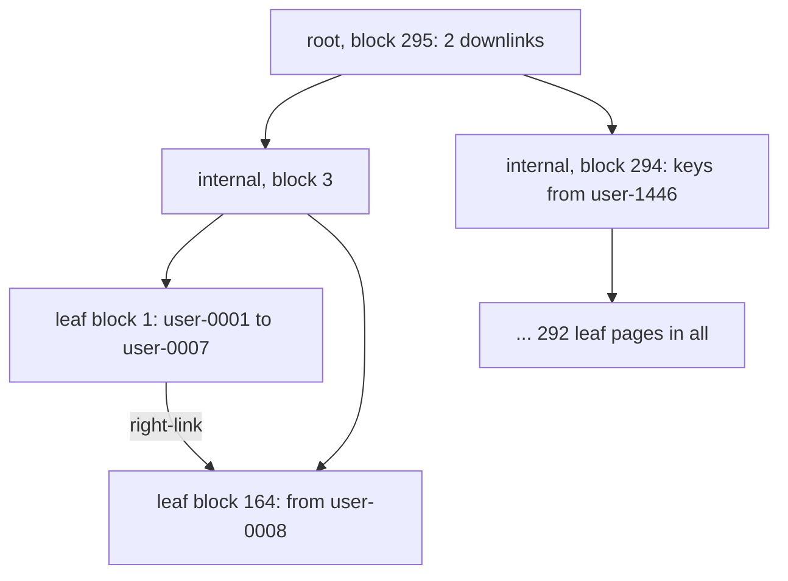

## 1. The question this idea answers

All three indexes of the example chat store have two columns: `chats (owner_id, updated_at DESC)`, `messages (chat_id, seq)` and `message_feedback (message_id, created_at)`. Each one exists for one main query. "The newest chats of one user." "The messages of one chat in order." "The feedback on one message."

A two-column index is not two indexes. It is one sorted list, and the column order decides what that list can do. With the right order, a query for one user's recent chats reads 16 pages. With the two columns swapped, the same query reads 128 pages. With no usable index at all, a query reads every page of the table.

This lesson answers four questions. Which conditions of a query limit the part of the index that PostgreSQL reads? Which `ORDER BY` clauses need no sort? How do you read results page by page with an index? What changed in PostgreSQL 17 and 18? Every number comes from tests on PostgreSQL 16.15 and 18.6.

## 2. Mental model

> [!analogy] A phone book sorted by last name, then first name
> A phone book lists people by last name. Inside one last name, it lists them by first name. To find "Smith, Anna", you open the book at "Smith" and then find "Anna" inside that section. To find every "Smith", you read one section from its start to its end.
>
> To find every "Anna", the sort order does not help. "Anna" appears inside every last-name section, so you must read the whole book. But if the book has only three last names, you can open each section and find "Anna" directly inside it. That trick is the skip scan of PostgreSQL 18.
>
> **Where it stops working:** you read a phone book line by line. A database reads whole 8 kB pages, so the cost is the number of pages, not the number of lines. Also, an index entry holds only the key columns and a pointer to the row. To return other columns, PostgreSQL must visit the table, unless the index covers them.

## 3. Terms

| Term | Plain meaning |
|---|---|
| multicolumn index | An index whose key has two or more columns. Also called a composite index. |
| key column | A column that is part of the sort order of the index. |
| leading column | The first key column, or the first few. The index is sorted by it before anything else. |
| lexicographic order | Sort by the first column. Use the second column only to order entries with equal first columns, and so on. |
| scanned range | The part of the leaf level that one index scan reads from its start position to its stop position. |
| `Index Cond` | The plan line that lists the conditions an index scan applies to index entries. |
| `Filter` | The plan line that lists the conditions checked on each fetched table row. |
| backward scan | An index scan from the high end to the low end. It returns the reverse order. |
| keyset pagination | Paging that asks for the rows after the last row of the previous page, instead of skipping N rows. |
| row comparison | A comparison of two lists of values, such as `(a, b) < (1, 2)`, done column by column from the left. |
| skip scan | A PostgreSQL 18 B-tree technique: one search per value of a leading column that the query does not constrain. |
| index search | One descent from the root page to a leaf page. PostgreSQL 18 reports the count as "Index Searches". |
| `BitmapAnd` | A plan node that combines the row lists of two index scans and keeps only the rows found in both. |
| covering index | An index that holds every column a query needs, so the query does not visit the table. |
| redundant index | An index whose work another index already does, for example `(a)` next to `(a, b)`. |

## 4. Method and math

### 4.1 The test setup

Two servers ran every example: PostgreSQL 16.15 and PostgreSQL 18.6. The current manual is version 18 (checked on 2026-10-14). Managed services run 16, 17 or 18, so this lesson marks each difference between versions. The sandbox has no PostgreSQL 17 server. For changes that the release notes put in 17, the tests compare 16 with 18.

The data is the example chat store of this part: 50,000 chats of 2,000 owners (25 chats each), 1,049,965 messages and 50,985 feedback rows. The sessions used `TimeZone = UTC`, and PostgreSQL 16 used `jit = off`. Most plans come from `EXPLAIN (ANALYZE, BUFFERS, COSTS OFF)`. The tests added these objects:

- `messages_role_created_idx ON messages (role, created_at)`, for the skip scan test. `role` has exactly two values.
- `chats_split`, a copy of `chats` with two single-column indexes, for the `BitmapAnd` test.
- Short-lived indexes inside `BEGIN` ... `ROLLBACK`, to compare column orders on the same data.

> [!note] Read buffers, not milliseconds
> "Buffers: shared hit=23" means that the plan node accessed 23 pages of 8 kB. Page counts are stable from run to run. Sandbox timings are small and noisy, so use them only for ratios. An index-only scan also reads 1 page of the visibility map, a small per-table map that [L3](/notes/databases/postgres/06-indexes-and-query-plans/l3-index-scan-vs-sequential-scan) explains.

### 4.2 Lexicographic order, with real rows

`chats_owner_updated_idx` sorts its entries by `owner_id` ascending. Inside one owner, it sorts them by `updated_at` descending. The `pageinspect` function `bt_page_items` lists the entries of leaf block 1. This query joins each entry's heap pointer (`htid`) to its row (PostgreSQL 16.15, and 18.6 returns the same rows):

```sql
SELECT i.itemoffset, i.htid, c.owner_id, c.updated_at
FROM bt_page_items('chats_owner_updated_idx', 1) i
LEFT JOIN chats c ON c.ctid = i.htid
WHERE i.itemoffset <= 4 OR i.itemoffset BETWEEN 25 AND 28
ORDER BY i.itemoffset;
```

```text
 itemoffset |   htid   | owner_id  |       updated_at
------------+----------+-----------+------------------------
          1 |          |           |
          2 | (330,32) | user-0001 | 2026-09-28 20:11:00+00
          3 | (171,24) | user-0001 | 2026-09-13 13:32:00+00
          4 | (512,16) | user-0001 | 2026-09-06 15:01:00+00
         25 | (148,48) | user-0001 | 2026-01-16 07:20:00+00
         26 | (489,40) | user-0001 | 2026-01-09 08:10:00+00
         27 | (326,63) | user-0002 | 2026-09-27 21:49:00+00
         28 | (167,55) | user-0002 | 2026-09-12 15:10:00+00
```

Three facts are visible:

1. The 25 chats of `user-0001` are adjacent (offsets 2 to 26), newest first. The entries of `user-0002` start at offset 27.
2. The heap pointers jump: block 330, then 171, then 512. The index has an order. The table does not.
3. Offset 1 has no row. It is the high key of the page, its upper bound ([L1](/notes/databases/postgres/06-indexes-and-query-plans/l1-b-tree-indexes)). Its stored value is only `user-0008`. PostgreSQL removed `updated_at` from it because the first column alone separates this page from the next one.

> [!example] Worked example: one index entry, byte by byte
> `bt_page_items` reports `itemlen = 32` for offset 2, with the data bytes `15 75 73 65 72 2d 30 30 30 31 00 00 00 00 00 00 00 3d ef 6e 8f ff 02 00`.
>
> 1. Entry header: 8 bytes, the 6-byte heap pointer plus 2 bytes of flags and size.
> 2. `owner_id`: the first byte is `0x15` = 21. Its low bit is 1, which marks a 1-byte text header. 21 / 2 = 10 (integer division) is the length with the header: 1 byte + 9 characters of `user-0001`.
> 3. Padding: a `timestamptz` starts at a multiple of 8. 8 + 10 = 18, the next multiple of 8 is 24, so 6 zero bytes follow.
> 4. `updated_at`: the 8 bytes, read little-endian, are `0x0002FF8F6EEF3D00` = 843,941,460,000,000 microseconds after 2000-01-01. That is 9,767.84 days, which gives 2026-09-28 20:11:00 UTC.
> 5. Total: 8 + 10 + 6 + 8 = 32 bytes.
>
> `DESC` does not change the stored bytes. It changes only the comparison that orders the entries.

The whole index has 296 pages: 1 metapage, 1 root, 2 internal pages and 292 leaf pages. The leaf pages hold 50,291 items, and 291 of them are high keys (the rightmost page has none). Leaf block 1 holds exactly 7 owners: 7 × 25 = 175 entries plus 1 high key = 176 items. On average:

$$
\frac{50{,}291 - 291}{292} = \frac{50{,}000}{292} \approx 171.2 \text{ entries per leaf page}, \qquad \frac{171.2}{25} \approx 6.8 \text{ owners per leaf page}
$$



### 4.3 The rule: which conditions limit the scanned range

The PostgreSQL 18 manual gives the exact rule (PostgreSQL 18 docs §11.3, checked on 2026-10-14):

> "The exact rule is that equality constraints on leading columns, plus any inequality constraints on the first column that does not have an equality constraint, will always be used to limit the portion of the index that is scanned. Constraints on columns to the right of these columns are checked in the index, so they'll always save visits to the table proper, but they do not necessarily reduce the portion of the index that has to be scanned."

The PostgreSQL 16 and 17 text is stricter: such constraints "do not reduce the portion of the index that has to be scanned" (PostgreSQL 16 and 17 docs §11.3, checked on 2026-10-14). The word "necessarily" arrived in the version 18 manual, together with skip scan (section 4.10). A condition can act at three places:

| Where it acts | Which conditions | Effect | Plan line |
|---|---|---|---|
| Bound of the scanned range | `=` on leading columns, plus `<`, `<=`, `>`, `>=` on the first column without `=` | The scan starts and stops at these values. | `Index Cond` |
| Check inside the index | Conditions on later key columns | Rejects entries before the table visit. The scan reads the same index pages. | `Index Cond` |
| Check on the table row | Columns not in the index, or expressions the index cannot evaluate | Rejects rows after the table visit. | `Filter` |

**Bound of the range.** `WHERE owner_id = 'user-0042' AND updated_at >= '2026-06-01'` has `=` on the first column and `>=` on the second. Both bound the range. The bitmap index scan read 3 index pages: root, internal and leaf. The heap scan read 13 table pages for the 13 rows. That is 16 buffers on both versions.

**Check inside the index.** These two queries are index-only scans. So every buffer is an index page or the visibility map (PostgreSQL 16.15, shortened):

```text
-- B1: WHERE owner_id BETWEEN 'user-0001' AND 'user-0500'
 Index Only Scan using chats_owner_updated_idx on chats (actual time=0.033..7.842 rows=12500 loops=1)
   Index Cond: ((owner_id >= 'user-0001'::text) AND (owner_id <= 'user-0500'::text))
   Heap Fetches: 0
   Buffers: shared hit=5 read=67

-- B2: the same, plus AND updated_at >= '2026-10-01'
 Index Only Scan using chats_owner_updated_idx on chats (actual time=0.055..2.294 rows=207 loops=1)
   Index Cond: ((owner_id >= 'user-0001'::text) AND (owner_id <= 'user-0500'::text) AND (updated_at >= '2026-10-01 00:00:00+00'::timestamp with time zone))
   Heap Fetches: 0
   Buffers: shared hit=72
```

> [!example] Worked example: why both read 72 pages
> `pageinspect` shows that the owners `user-0001` to `user-0500` occupy 69 leaf pages. Each scan reads 1 root + 1 internal page + 69 leaf pages + 1 visibility map page = 72. The `updated_at` condition removed 12,500 − 207 = 12,293 entries, but it removed them inside the 69 leaf pages. It did not move the start or the stop of the scan. `owner_id` has a range, so `updated_at` is to the right of "the first column that does not have an equality constraint".

**Check on the row.** `title` is not in the index. A cast of `updated_at` to `date` is not an operator of the index. Both go to `Filter` (PostgreSQL 16.15, shortened):

```text
 Bitmap Heap Scan on chats (actual time=0.019..0.037 rows=5 loops=1)
   Recheck Cond: (owner_id = 'user-0042'::text)
   Filter: (title ~~ 'Chat 1%'::text)
   Rows Removed by Filter: 20
   Heap Blocks: exact=25
   Buffers: shared hit=28
```

The scan fetched all 25 chats of the owner (3 index pages + 25 table pages = 28) and then discarded 20. With `updated_at::date = '2026-06-23'`, it fetched 25 rows and discarded 24.

> [!trap] `Index Cond` does not mean "narrow"
> EXPLAIN prints range bounds and checks inside the index on the same `Index Cond` line. B2 lists `updated_at` in `Index Cond`, yet it reads exactly the pages of B1. To learn which conditions bound the range, apply the rule of §11.3, then confirm it with the buffer counts.

> [!note] Version difference: B2 on PostgreSQL 18
> PostgreSQL 18.6 reported `Index Searches: 1` and 80 buffers for B2. On a cold cache, both versions read the same 68 pages from disk (`read=68`). The 8 extra accesses on 18 are repeated accesses to pages already in memory. Their cause was not traced in the source.

### 4.4 What each example index serves

The table uses `?` for a parameter. Both versions chose the same plan type for every row.

| Index | Query | Verdict | Evidence (buffers) |
|---|---|---|---|
| `chats (owner_id, updated_at DESC)` | `owner_id = ? ORDER BY updated_at DESC LIMIT 20` | Well | Index Scan, no Sort: 3 index + 20 table = 23 |
| same | `owner_id = ? ORDER BY updated_at ASC LIMIT 20` | Well | Index Scan Backward, no Sort: 23 |
| same | `owner_id = ? AND updated_at >= ?` | Well | Both columns bound the range: 3 index + 13 table = 16 |
| same | `owner_id IN (?, ?) ORDER BY updated_at DESC LIMIT 20` | Partly | The index finds 50 rows, then a top-N Sort keeps 20 |
| same | `ORDER BY updated_at DESC LIMIT 20` for all owners | Not at all | Seq Scan of all 558 table pages, then Sort |
| same | `updated_at >= '2026-10-01'` | Not at all | Seq Scan, 558 pages, also on 18 |
| `messages (chat_id, seq)` | `chat_id = ? ORDER BY seq DESC LIMIT 10` | Well | Index Scan Backward: 3 index + 1 table = 4 |
| same | `chat_id = ?` (the foreign key lookup) | Well | 3 index pages (section 4.9) |
| same | `seq = 1` for all chats | Not at all | Parallel Seq Scan of all 23,863 table pages, also on 18 |
| `message_feedback (message_id, created_at)` | `message_id = ? ORDER BY created_at DESC LIMIT 1` | Well | Index Scan Backward: 4 |
| same | `created_at` inside one day | Not at all | Seq Scan of all 425 table pages |

"Last 10 messages of a chat" is the query that loads recent history into a model's context. It costs 4 page reads on a table of 23,863 pages.

### 4.5 ORDER BY, DESC and backward scans

The manual describes the stored order (PostgreSQL 18 docs §11.4, checked on 2026-10-14): "By default, B-tree indexes store their entries in ascending order with nulls last (table TID is treated as a tiebreaker column among otherwise equal entries)." A forward scan returns that order. A backward scan returns its exact reverse. For two columns, §11.4 adds: "There is no way to get that ordering from a plain index, but it is possible if the index is defined as `(x ASC, y DESC)` or `(x DESC, y ASC)`." The ordering in that quote is `ORDER BY x ASC, y DESC`.

The example index is `(owner_id ASC, updated_at DESC)`. These queries read two owners, 50 entries (both versions):

| ORDER BY | Plan | Sort step |
|---|---|---|
| `owner_id, updated_at DESC` | Index Only Scan, 4 buffers | None |
| `owner_id DESC, updated_at` | Index Only Scan Backward, 4 buffers | None |
| `owner_id, updated_at` | Index Only Scan, then Incremental Sort with `Presorted Key: owner_id` | Sorts inside each owner |

With `owner_id = ?`, the first column is a constant. The remaining order is only `updated_at`, so both `DESC` (forward) and `ASC` (backward) need no sort.

So for its main query, the `DESC` in the index is not needed. A plain `(owner_id, updated_at)` index serves `ORDER BY updated_at DESC` of one owner with a backward scan. The CREATE INDEX page says the same for one column: "it is not normally useful to create a single-column `DESC` index" (PostgreSQL 18 docs, CREATE INDEX, checked on 2026-10-14). `DESC` matters only for an order across several owners, such as an admin page grouped by owner, newest chat first.

### 4.6 Keyset pagination

A chat sidebar shows 20 chats, then "the next 20". The first idea is `OFFSET`. `OFFSET n` still reads the first n rows and discards them. Each example owner has only 25 chats, so the tests use pages of 10.

| Query for page 2 | Index entries read | Buffers |
|---|---|---|
| `ORDER BY updated_at DESC LIMIT 10 OFFSET 10` | 20 | 23 = 3 index + 20 table |
| `AND updated_at < '2026-07-08 10:40:00+00' ORDER BY updated_at DESC LIMIT 10` | 10 | 13 = 3 index + 10 table |

With `OFFSET`, page $k$ of size $n$ reads $k \times n$ rows. Page 50 of size 20 reads 50 × 20 = 1,000 rows to return 20. With a key condition, every page reads $n$ rows. That second form is keyset pagination: the client sends the sort key of the last row it saw.

**Ties break the simple form.** The test inserted a 26th chat for `user-0042`, inside a transaction that was rolled back. It had the same `updated_at` as row 10 (`2026-07-08 10:40:00+00`). Row 10 had id `9789b833-...`. The tied row, id `00000000-...-000000000042`, became row 11.

| Page 2 condition | Rows on page 2 | Tied row present |
|---|---|---|
| `updated_at < t` | 15 | No: 10 + 15 = 25 of 26 rows |
| `(updated_at, id) < (t, '9789b833-...')` | 16 | Yes: 10 + 16 = 26 of 26 rows |

The fix is a unique tie-breaker column in the `ORDER BY` and in the condition. A row comparison expresses it in one term (PostgreSQL 18 docs §9.25.5, checked on 2026-10-14): "For the `<`, `<=`, `>` and `>=` cases, the row elements are compared left-to-right, stopping as soon as an unequal or null pair of elements is found."

The plan depends on the index. With the shared example index `(owner_id, updated_at DESC)`, PostgreSQL derives a bound from the first element of the row. It checks the full row in `Filter` (PostgreSQL 18.6, shortened):

```text
 Limit (actual time=0.112..0.113 rows=10.00 loops=1)
   ->  Incremental Sort (actual time=0.111..0.112 rows=10.00 loops=1)
         Sort Key: updated_at DESC, id DESC
         Presorted Key: updated_at
         ->  Index Scan using chats_owner_updated_idx on chats (actual time=0.017..0.101 rows=11.00 loops=1)
               Index Cond: ((owner_id = 'user-0042'::text) AND (updated_at <= '2026-07-08 10:40:00+00'::timestamp with time zone))
               Filter: (ROW(updated_at, id) < ROW('2026-07-08 10:40:00+00'::timestamp with time zone, '9789b833-8188-d22f-e91b-beedb7da0e5a'::uuid))
               Rows Removed by Filter: 1
```

With a test index `(owner_id, updated_at DESC, id DESC)`, the whole row comparison moves into `Index Cond`, and the sort disappears (PostgreSQL 18.6, shortened):

```text
 Limit (actual time=0.044..0.058 rows=10.00 loops=1)
   ->  Index Scan using chats_owner_updated_id_idx on chats (actual time=0.042..0.055 rows=10.00 loops=1)
         Index Cond: ((owner_id = 'user-0042'::text) AND (ROW(updated_at, id) < ROW('2026-07-08 10:40:00+00'::timestamp with time zone, '9789b833-8188-d22f-e91b-beedb7da0e5a'::uuid)))
         Index Searches: 1
         Buffers: shared hit=10 read=3
```

The same condition written with `OR` (`updated_at < t OR (updated_at = t AND id < i)`) kept only `owner_id` in `Index Cond`. It read 20 rows and removed 10 by `Filter`: 23 buffers instead of 13. Both versions gave the same plans.

> [!key] Equality first, then one range or sort column
> A multicolumn B-tree is one sorted list. Equality conditions on the leading columns choose one contiguous part of it. The next column can then bound that part with a range, or deliver it in order. Every column after the first range is only a check inside the index.

### 4.7 "Most selective column first" is not the rule

A common rule of thumb says: put the column with the most distinct values first. In the example, `pg_stats` reports `n_distinct = -1` for `updated_at` (every value distinct) and `2000` for `owner_id`. The rule of thumb would put `updated_at` first. A test inside `BEGIN` ... `ROLLBACK` replaced the index with `(updated_at, owner_id)` and ran the 13-row query of section 4.3.

| Index | `Index Cond` | Buffers (PostgreSQL 16.15) |
|---|---|---|
| `(owner_id, updated_at DESC)` | Both columns bound the range | 16 = 3 index + 13 table |
| `(updated_at, owner_id)` | `updated_at` bounds the range, `owner_id` is a check inside the index | 128 = 115 index + 13 table |

> [!example] Worked example: 115 index pages
> 22,814 of the 50,000 chats have `updated_at >= '2026-06-01'` (45.6 %). The test index had 247 leaf pages, so it held 50,000 / 247 ≈ 202.4 entries per leaf page. The scan starts at June 1 and reads to the end: 22,814 / 202.4 ≈ 112.7, so 113 or 114 leaf pages. Add the root: about 115 pages. It checked `owner_id` in all 22,814 entries to keep 13. PostgreSQL 18.6 gave the same plan with `Index Searches: 1` and 131 buffers.

For two equality conditions, the order hardly matters. `owner_id = ? AND updated_at = ?` read 3 buffers with `(updated_at, owner_id)` and 4 with `(owner_id, updated_at DESC)`. The difference is one tree level: this test index had 2 levels, and the original has 3.

So choose the order from the query shapes. Columns with `=` come first. Then comes one column with a range or an `ORDER BY`. Among the `=` columns, put first the column that other queries use alone.

### 4.8 One multicolumn index or two single-column indexes

The manual (PostgreSQL 18 docs §11.5, checked on 2026-10-14) explains index combination: "the system scans each needed index and prepares a *bitmap* in memory giving the locations of table rows that are reported as matching that index's conditions. The bitmaps are then ANDed and ORed together as needed by the query." It adds that "any ordering of the original indexes is lost, and so a separate sort step will be needed if the query has an `ORDER BY` clause."

The test table `chats_split` holds the same 50,000 rows. Design A has two indexes, `(owner_id)` and `(updated_at)`. Design B has one index, `(owner_id, updated_at DESC)`. All three indexes were built fresh with `CREATE INDEX`.

| Query on `chats_split` | A: two single-column indexes | B: one multicolumn index |
|---|---|---|
| `owner_id = 'user-0042' AND updated_at >= '2026-06-01'` | Only the `owner_id` index, then `Filter` removes 12 rows: 27 buffers | Both columns in `Index Cond`: 16 buffers |
| `owner_id = 'user-0042' ORDER BY updated_at DESC LIMIT 20` | Bitmap scan, then Sort: 30 buffers | Index Scan, no Sort: 23 buffers |
| 200 owners (`BETWEEN`) and one week of `updated_at` | `BitmapAnd`: 11 index + 125 table = 136 buffers | 27 index + 125 table = 152 buffers |
| Index size | 51 + 139 = 190 pages (1,520 kB) | 251 pages (2,008 kB) |

The planner chose `BitmapAnd` only for the third query (PostgreSQL 16.15, shortened):

```text
 Bitmap Heap Scan on chats_split (actual time=0.486..0.716 rows=125 loops=1)
   Heap Blocks: exact=125
   Buffers: shared hit=132 read=4
   ->  BitmapAnd (actual time=0.468..0.469 rows=0 loops=1)
         ->  Bitmap Index Scan on chats_split_updated_idx (actual time=0.153..0.153 rows=1260 loops=1)
               Buffers: shared hit=5
         ->  Bitmap Index Scan on chats_split_owner_idx (actual time=0.292..0.292 rows=5000 loops=1)
               Buffers: shared hit=2 read=4
```

The two bitmaps held 1,260 and 5,000 rows. Their intersection held 125 rows. The `rows=0` on `BitmapAnd` is expected. The manual (§14.1) says: "BitmapAnd and BitmapOr nodes always report their actual row counts as zero, due to implementation limitations."

In the third query, the multicolumn index lost. `owner_id` has a range there, so the scan read all 5,000 entries of 200 owners (27 index pages). It checked `updated_at` inside the index, as the rule of section 4.3 predicts. The manual says that the multicolumn index "would typically be more efficient than index combination for queries involving both columns". The test confirms it for `=` on the leading column. With a range on the leading column, it can fail.

The `owner_id` index is small (51 pages for 50,000 entries) because B-tree deduplication stores each owner once with a list of 25 heap pointers ([L1](/notes/databases/postgres/06-indexes-and-query-plans/l1-b-tree-indexes)).

### 4.9 Redundant indexes and the foreign key

An index on `(a)` is redundant next to an index on `(a, b)` for reads. Every condition on `a` is a condition on the leading column of `(a, b)`. The reverse is false. `(a, b)` does not replace an index on `(b)`, except with skip scan and few values of `a` (section 4.10).

This is why `messages` needs no separate index on `chat_id`. The unique constraint `messages_chat_seq_key (chat_id, seq)` serves the main query and every lookup by `chat_id` alone. A foreign key check or a cascade delete runs such a lookup ([L5](/notes/databases/postgres/06-indexes-and-query-plans/l5-foreign-keys-and-on-delete-cascade) shows the exact queries). For a chat with 40 messages (PostgreSQL 16.15, shortened):

```text
 Bitmap Heap Scan on messages (actual time=0.043..0.050 rows=40 loops=1)
   Heap Blocks: exact=2
   ->  Bitmap Index Scan on messages_chat_seq_key (actual time=0.034..0.034 rows=40 loops=1)
         Index Cond: (chat_id = 'b415938d-5c9e-e56d-6117-b4b3b150637b'::uuid)
         Buffers: shared read=3
```

A test inside `BEGIN` ... `ROLLBACK` added `messages_chat_id_idx ON messages (chat_id)`. The planner used it, and it read the same 3 index pages, because both trees have 3 levels. The extra index cost 1,071 pages (8,568 kB) and one more index insert for every new message. It saved no page reads for this lookup.

### 4.10 PostgreSQL 18: skip scan

> [!note] Version difference: skip scan is new in PostgreSQL 18
> The PostgreSQL 18 release notes (checked on 2026-10-14): "Allow skip scans of btree indexes". They continue: "This allows multi-column btree indexes to be used in more cases such as when there are no restrictions on the first or early indexed columns (or there are non-equality ones), and there are useful restrictions on later indexed columns." PostgreSQL 16 and 17 do not have it.

The manual explains the mechanism (PostgreSQL 18 docs §11.3, checked on 2026-10-14): "Skip scan works by generating a dynamic equality constraint internally, that matches every possible value in an index column". For an index on `(x, y)` and `WHERE y = 7700`, it performs "repeated `WHERE x = N AND y = 7700` searches for every possible value of `N`". A comment in the 18.6 source (`src/backend/access/nbtree/nbtpreprocesskeys.c`) states the old behavior: "Prior to Postgres 18, a qual like "WHERE y = 4" always resulted in a full scan."

The test counts the messages of one hour, with no condition on `role`, using `messages_role_created_idx (role, created_at)`. That index has 3,840 pages: 1 metapage, 1 root, 22 internal pages and 3,816 leaf pages. `role` has two values, `assistant` and `user`. Warm-cache plans:

```text
-- PostgreSQL 16.15
 Aggregate (actual time=40.470..40.472 rows=1 loops=1)
   Buffers: shared hit=3819
   ->  Index Only Scan using messages_role_created_idx on messages (actual time=10.548..40.444 rows=160 loops=1)
         Index Cond: ((created_at >= '2026-06-01 08:00:00+00'::timestamp with time zone) AND (created_at < '2026-06-01 09:00:00+00'::timestamp with time zone))
         Heap Fetches: 0
 Execution Time: 40.533 ms

-- PostgreSQL 18.6
 Aggregate (actual time=0.145..0.146 rows=1.00 loops=1)
   Buffers: shared hit=26
   ->  Index Only Scan using messages_role_created_idx on messages (actual time=0.083..0.133 rows=160.00 loops=1)
         Index Cond: ((created_at >= '2026-06-01 08:00:00+00'::timestamp with time zone) AND (created_at < '2026-06-01 09:00:00+00'::timestamp with time zone))
         Heap Fetches: 0
         Index Searches: 5
 Execution Time: 0.225 ms
```

(Both shortened: the planning lines and the inner `Buffers` lines are omitted.) The node types and the `Index Cond` are identical. Only the buffer counts and "Index Searches" show the difference.

> [!example] Worked example: 3,819 versus 26 pages
> PostgreSQL 16 read the whole leaf level: 1 root + 1 internal page + 3,816 leaf pages + 1 visibility map page = 3,819. PostgreSQL 18 made 5 index searches and accessed 26 pages. 3,819 / 26 ≈ 147 times fewer page accesses. The time ratio, 40.533 / 0.225 ≈ 180, is noisy, but it has the same order of magnitude.

Why 5 searches for 2 values? In 18.6, the B-tree operator class for `text` has no skip support function. The file `src/include/catalog/pg_amproc.dat` lists one only for `bool`, `"char"`, `date`, `timestamp`, `timestamptz`, `int2`, `int4`, `int8`, `oid` and `uuid`. For the other types, the source says (`nbtutils.c`): "The true next value is determined by repositioning to the first index tuple > existing sk_argument/current array element."

A reading of the source (not a documented fact) gives this sequence. Search 1 finds the first `role`. Search 2 reads the hour of `assistant`. Search 3 finds the next value, `user`. Search 4 reads the hour of `user`. Search 5 finds the end. Two more tests agree with this reading. With `role >= 'assistant'`, the count was 4. With `role IN ('assistant', 'user')`, it was 2, with 8 buffers.

**When skip scan does not help.** The manual (§11.3): "If there are many distinct `x` values, then the entire index will have to be scanned, so in most cases the planner will prefer a sequential table scan over using the index."

| Index, query without the leading column | Distinct leading values | Plan on 18.6 | When forced with `enable_seqscan = off` |
|---|---|---|---|
| `messages (role, created_at)`, one hour | 2 | Index Only Scan | (already chosen) 5 searches, 26 buffers |
| `chats (owner_id, updated_at DESC)`, `updated_at >= '2026-10-01'` | 2,000 | Seq Scan | 1 search, 303 buffers: every leaf page |
| `messages (chat_id, seq)`, `seq = 1` | 50,000 | Parallel Seq Scan | 1 search, 6,928 buffers: every leaf page |

A rough estimate shows why. Each search descends 3 levels. 2,000 owners × 3 pages = 6,000 page accesses, but the whole `chats` index has only 292 leaf pages, with about 7 owners on each. A new search cannot avoid a page when the next owner is on the same page. In both forced runs, the scan read the leaf level in one pass (1 search).

> [!note] Version difference: the same effect on 16 and 17
> When a `CHECK` constraint guarantees a short list of values, write the list. `role IN ('assistant', 'user') AND created_at ...` read 11 buffers on PostgreSQL 16.15 and 8 on 18.6 (2 searches). Without the list, PostgreSQL 16 read 3,819.

### 4.11 IN lists: the PostgreSQL 17 change

> [!note] Version difference: IN lists in PostgreSQL 17
> The PostgreSQL 17 release notes (checked on 2026-10-14): "Allow btree indexes to more efficiently find a set of values, such as those supplied by `IN` clauses using constants". The sandbox has no 17 server, so the test compares 16 with 18.

The manual's EXPLAIN section describes the effect (PostgreSQL 18 docs §14.1, checked on 2026-10-14). Its example `IN` query "performed only 1 index search", because "its `IN` construct uses values matching index tuples stored next to each other, on the same `tenk1_thous_tenthous` index leaf page." The test counted the chats of 100 owners with a literal `IN` list (index-only scan):

| Owners in the `IN` list | 16.15 buffers | 18.6 buffers | 18.6 Index Searches |
|---|---|---|---|
| `user-0001` to `user-0100` (adjacent, 14 leaf pages) | 301 = 100 × 3 + 1 | 17 = 2 + 14 + 1 | 1 |
| Every 20th owner (one per leaf page) | 301 | 301 | 100 |

PostgreSQL 16 descended from the root once per value. PostgreSQL 18 descended once and then read the 14 leaf pages in order. When every value is on a different leaf page, both versions need one descent per value. The "Partly" row of section 4.4 shows the same effect at small scale. Its bitmap index scan read 6 index pages on 16 and 3 on 18.

### 4.12 Covering indexes with INCLUDE

The chat list needs `id`, `title` and `updated_at`. The example index holds only `owner_id` and `updated_at`, so each row costs a table visit: 20 table pages for 20 chats. The CREATE INDEX page (PostgreSQL 18 docs, checked on 2026-10-14) describes the alternative: "The optional `INCLUDE` clause specifies a list of columns which will be included in the index as *non-key* columns. A non-key column cannot be used in an index scan search qualification". An index-only scan can return these columns "without having to visit the index's table".

A test inside `BEGIN` ... `ROLLBACK` built `(owner_id, updated_at DESC) INCLUDE (id, title)` and dropped the original:

| Index (fresh build) | Size | Leaf entry | Chat list query |
|---|---|---|---|
| `(owner_id, updated_at DESC)` | 251 pages | 32 bytes | Index Scan: 23 buffers |
| `... INCLUDE (id, title)` | 473 pages | 64 bytes | Index Only Scan, `Heap Fetches: 0`: 4 buffers |

> [!example] Worked example: the 64-byte entry
> The first chat of `user-0001` has the title `Chat 30000` (10 characters). Its entry holds the 32 bytes of section 4.2 and 16 bytes of `uuid`. The `title` adds 1 + 10 = 11 bytes. So 32 + 16 + 11 = 59 bytes, rounded to a multiple of 8: 64. The high key of that page is 32 bytes, because it holds only the key columns. The manual (§11.9) explains: "Suffix truncation always removes non-key columns from upper B-Tree levels."

The price is 473 / 251 ≈ 1.9 times the size. The manual adds: "B-tree deduplication is never used with indexes that have a non-key column." For a unique index with `INCLUDE`, uniqueness covers only the key columns (§11.9). An index-only scan needs pages that the visibility map marks as all-visible. [L3](/notes/databases/postgres/06-indexes-and-query-plans/l3-index-scan-vs-sequential-scan) explains when that holds.

### 4.13 The limit of 32 columns

The manual (PostgreSQL 18 docs §11.3, checked on 2026-10-14): "Indexes can have up to 32 columns, including `INCLUDE` columns. (This limit can be altered when building PostgreSQL; see the file `pg_config_manual.h`.)" In the 18.6 source, that file has `#define INDEX_MAX_KEYS 32`. The test on both servers:

```text
CREATE INDEX wide_32 ON wide (c1, ..., c32)                  -- CREATE INDEX
CREATE INDEX wide_33 ON wide (c1, ..., c33)                  -- ERROR:  cannot use more than 32 columns in an index
CREATE INDEX wide_31_2 ON wide (c1, ..., c31) INCLUDE (c33, c34)  -- ERROR:  cannot use more than 32 columns in an index
```

(Column lists shortened.) `SHOW max_index_keys` returned 32 on both servers. The limit is rarely the problem. §11.3 says: "Indexes with more than three columns are unlikely to be helpful unless the usage of the table is extremely stylized."

### 4.14 Production view

| Concern | What to do |
|---|---|
| Design | Start from the query. `=` columns first, then one range or `ORDER BY` column. Ignore "most selective first". |
| Proof | Read buffers, not only node names. `Index Cond` can hide a wide scan. Compare with and without each condition. |
| Version | On 18, read "Index Searches". On 16 and 17, do not count on skip scan. Write a short known list as `IN (...)`. |
| Pagination | Use keyset pagination with a unique tie-breaker in `ORDER BY`, in the condition and at the end of the index. |
| Write cost | Each index adds an insert to every row insert. Drop an index that is a prefix of another index. |
| Covering | Use `INCLUDE` only for hot, read-mostly queries. In the test it made the index 1.9 times larger. |
| Monitoring | The manual (§27.2.2): "The per-index statistics are particularly useful to determine which indexes are being used". Read `idx_scan` in `pg_stat_user_indexes`. |

## 5. Video

```video
{
  "src": "/notes/media/postgres/manim/m04-composite-index-order.mp4",
  "caption": "One index list sorted by owner, then by date: which conditions narrow the scan, why the most selective column is the wrong first column, and how PostgreSQL 18 skips a missing leading column with few values."
}
```

## 6. Code

These exercises use PostgreSQL with the example chat store. Put the work in `postgres/12-multicolumn.ipynb` in `C:\Users\ASohi\Downloads\AI\agent-harness-lab`. If you can, run them on a PostgreSQL 16 and a PostgreSQL 18 container ([lesson 5.1](/notes/databases/postgres/05-local-setup/l1-local-postgres-with-docker) shows the Docker setup).

**Exercise 2.1: read the order of the leaf level.** With `pageinspect`, find the leaf page that holds the entries of `user-0042` in `chats_owner_updated_idx`. Join `htid` to `chats.ctid` as in section 4.2.

Acceptance tests:

- Your output lists the 25 entries of `user-0042` in descending `updated_at` order.
- You state which owners share that leaf page, and you compare the count with the 6.8 owners per page of section 4.2.

**Exercise 2.2: prove the rule of §11.3 with buffers.** Run B1 and B2 of section 4.3 as index-only scans. Then, inside `BEGIN` ... `ROLLBACK`, replace the index with `(updated_at, owner_id)` and run the query of section 4.7.

Acceptance tests:

- B1 and B2 report the same buffer count, and you explain it with the rule in two sentences.
- You estimate the leaf pages that the swapped index must read, from its `relpages` and the number of matching rows. Your estimate is within 10 % of the measured count.

**Exercise 2.3: keyset pagination in Python.** Write `chat_page(conn, owner_id, after=None, size=10)` with psycopg 3. It returns the rows and a cursor for the next page. Use a row comparison on `(updated_at, id)`.

Acceptance tests:

- Inside a transaction, insert a chat whose `updated_at` equals that of row 10. Reading all pages returns all 26 chats exactly once.
- `EXPLAIN` of the page query on an index that ends with `id DESC` shows the `ROW(...)` comparison in `Index Cond` and no Sort node.

**Exercise 2.4: skip scan or IN list.** Create `messages_role_created_idx` as in section 4.1. Run the one-hour count with no `role` condition and with `role IN ('assistant', 'user')`.

Acceptance tests:

- You record buffers and, on 18, "Index Searches" for both forms on each version you have.
- You explain in two sentences why the `IN` form is safe here, using the `CHECK` constraint on `role`.

## 7. Common mistakes

1. **"An index on (a, b) also serves queries on b."** Only `a` leads. Without a condition on `a`, PostgreSQL 16 and 17 read the whole index or the table. PostgreSQL 18 skips only when `a` has few distinct values.
2. **"Most selective column first."** A range column first makes the scan read the whole range. Put `=` columns first, then one range or sort column.
3. **"It is in Index Cond, so it narrows the scan."** Conditions after the first range are checks inside the index. Compare buffer counts to learn the scanned range.
4. **Keyset pagination without a tie-breaker.** Rows with an equal sort key vanish between pages. Add a unique column to the `ORDER BY`, to the row comparison and to the index.
5. **A single-column index next to a composite one with the same first column.** In the test it saved no page reads for lookups, and it adds work to every insert. Drop it.
6. **`DESC` on every timestamp column "for newest first".** A backward scan already gives the reverse order. `DESC` matters only for a mixed order such as `ORDER BY owner_id, updated_at DESC`.
7. **`INCLUDE` of wide columns.** Each payload column makes every leaf entry larger and disables deduplication. Include only small columns of hot queries.

## 8. One-minute explanation

A multicolumn B-tree index is one list, sorted by the first column, then by the second column inside equal firsts. Equality conditions on the leading columns select one contiguous part of that list. The next column can bound that part with a range or return it in order with no sort, forward or backward. Every condition after the first range is only a check inside the index: it saves table visits, but the scan still reads the whole range. So put the `=` columns first and the range or `ORDER BY` column last, not the most selective column first. In the example, the right order read 16 pages and the swapped order read 128. For paging, use a key condition with a unique tie-breaker, not `OFFSET`. PostgreSQL 18 skip scan searches once per value of a leading column with few values: 26 page reads instead of 3,819 in one test. On 16 and 17, an explicit `IN` list gives the same effect. Prove every index with buffer counts.

## 9. Check questions

```check
{
  "question": "The index is (owner_id, updated_at DESC). The query has WHERE owner_id BETWEEN 'user-0001' AND 'user-0500' AND updated_at >= '2026-10-01'. Which condition limits the scanned range, which one is only checked inside the index, and how did the buffer counts prove it?",
  "hint": "Find the first column without an equality condition.",
  "answer": "owner_id has no equality condition, so its range bounds the scan. updated_at is to the right of it, so it is only checked inside the index. The query read 72 pages with and without the updated_at condition: 1 root, 1 internal, 69 leaf and 1 visibility map page. Only the rows changed, from 12,500 to 207."
}
```

```check
{
  "question": "For owner_id = 'user-0042' AND updated_at >= '2026-06-01', the index (updated_at, owner_id) read 128 buffers. The index (owner_id, updated_at DESC) read 16. Why, when updated_at is the more selective column?",
  "answer": "With updated_at first, the range on updated_at bounds the scan. The scan reads every entry from June 1 to the end: 22,814 entries on about 114 leaf pages. owner_id is only checked inside those entries. With owner_id first, the equality selects the 25 entries of one owner. The range on updated_at then narrows them inside that group. 3 index pages and 13 table pages suffice."
}
```

```check
{
  "question": "Page 1 of a chat list ends with a chat whose updated_at is t. Page 2 uses WHERE owner_id = ? AND updated_at < t ORDER BY updated_at DESC LIMIT 20. What can go wrong, and what is the fix?",
  "answer": "Page 2 excludes every row with updated_at = t. So a second chat with updated_at = t that did not fit on page 1 is lost. The fix is a unique tie-breaker: ORDER BY updated_at DESC, id DESC with the row comparison (updated_at, id) < (t, last_id). An index on (owner_id, updated_at DESC, id DESC) makes the whole comparison an Index Cond, with no sort."
}
```

```check
{
  "question": "On PostgreSQL 18, a query without a condition on role used the index (role, created_at) with Index Searches: 5 and 26 buffers. On PostgreSQL 16 it read 3,819 buffers. Why the difference, and how do you get a similar result on PostgreSQL 16?",
  "answer": "PostgreSQL 18 skip scan generates an internal equality on role for each existing value. It searches the created_at range once per role and does not read the whole index. PostgreSQL 16 had no condition on the leading column, so it read all 3,816 leaf pages. On 16, write the known values explicitly: role IN ('assistant', 'user'). That gave 11 buffers on 16. It is safe because a CHECK constraint allows only these two values."
}
```

## 10. Links

- Previous: [L1: B-tree indexes](/notes/databases/postgres/06-indexes-and-query-plans/l1-b-tree-indexes)
- Next: [L3: Index scan vs sequential scan](/notes/databases/postgres/06-indexes-and-query-plans/l3-index-scan-vs-sequential-scan)
- Reading the plans in detail: [L4: EXPLAIN and EXPLAIN ANALYZE](/notes/databases/postgres/06-indexes-and-query-plans/l4-explain-and-explain-analyze)
- The foreign key lookups: [L5: Foreign keys and ON DELETE CASCADE](/notes/databases/postgres/06-indexes-and-query-plans/l5-foreign-keys-and-on-delete-cascade)
- The overview this lesson deepens: [Indexes](/notes/databases/postgres/01-relational-basics/l3-indexes)
- Applied: [Chats, messages and parts](/notes/ai/conversation-state/02-chat-history-model/l1-chats-messages-and-parts)
- [Part 06: Indexes and query plans](/notes/databases/postgres/06-indexes-and-query-plans)
- [Glossary](/notes/databases/postgres/glossary)
