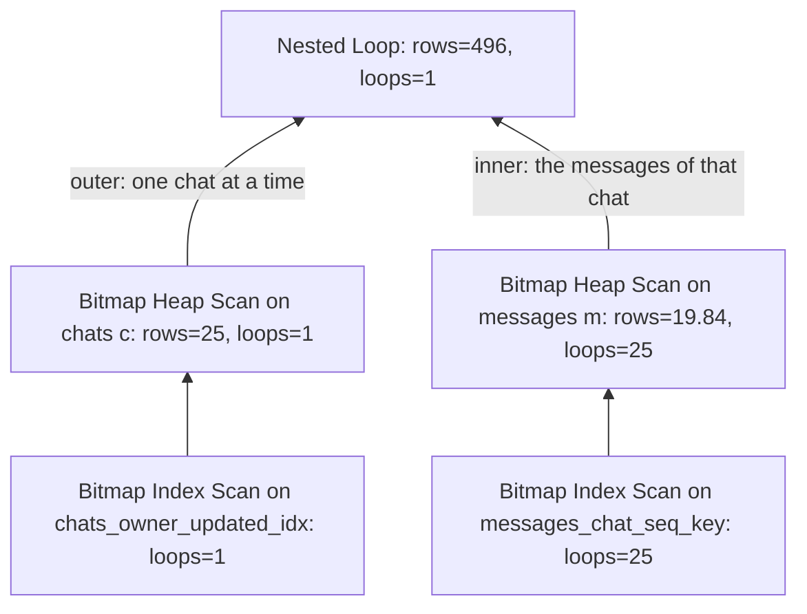

## 1. The question this idea answers

The lessons before this one make claims such as "the index `(chat_id, seq)` serves this query" and "a sequential scan reads every page". How do you prove a claim like that for your own query on your own data? You must see the chosen plan, what each step really did, and where the time and the page reads went.

`EXPLAIN` shows the plan before anything runs. `EXPLAIN ANALYZE` runs the statement and records what happened in each step. This lesson teaches you to read both, field by field, on the example chat store: 50,000 chats, 1,049,965 messages and 50,985 feedback rows. Every plan below is real output from PostgreSQL 16.15 or PostgreSQL 18.6 in a sandbox.

The current manual is PostgreSQL 18 (checked on 2026-10-14). Managed Postgres services can run 16, 17 or 18. The output of `EXPLAIN` changed in 17 and in 18, so the lesson marks every difference. PostgreSQL 19 is a release candidate, and this lesson does not cover it. Timings in the sandbox are small and noisy, so use them for ratios only. Row counts and buffer counts are stable, and the lesson prefers them as evidence.

## 2. Mental model

> [!analogy] A route plan and a trip log
> Before a delivery van leaves, a navigation app plans the route. It shows each leg with an estimated effort and an estimated number of parcels. That is `EXPLAIN`: a plan with estimates, and nothing has moved yet.
>
> Then the driver drives the route, and a trip log records the real minutes and the real parcels of each leg next to the estimate. That is `EXPLAIN ANALYZE`. If one leg repeats, for example one stop at each of 25 shops, the log shows the average per stop and the number of stops. You multiply to get the total.
>
> **Where it stops working:** the app's effort is in its own units, not in minutes, so you cannot compare it with the real minutes. The drive is real: if the route says "unload the goods", the goods are unloaded, and a `DELETE` under `EXPLAIN ANALYZE` really deletes. And the log slows the drive, because it reads the clock at every step.

## 3. Terms

| Term | Plain meaning |
|---|---|
| plan | The steps that PostgreSQL chooses to run one statement. The planner builds it, and the executor runs it. |
| node | One step of a plan, for example a scan, a join or a sort. The manual calls it a plan node. The nodes form a tree, and rows flow from the lowest nodes to the top node. |
| cost | The planner's estimate of the work of a node and its children, in arbitrary units, written `startup..total`. |
| startup cost | The estimated work before a node can return its first row. |
| estimated rows | The `rows` value inside the cost parentheses: how many rows the planner expects the node to return. |
| `EXPLAIN ANALYZE` | `EXPLAIN` with the `ANALYZE` option. It runs the statement and adds the real time, rows and loops of each node. |
| actual time | Real milliseconds for one loop of a node: the time to its first row, then the time to its last row. |
| loop | One execution of a node. The inner node of a nested loop join runs one loop for each outer row. |
| per-loop value | A value that `EXPLAIN ANALYZE` shows as an average over all loops. Multiply it by `loops` to get the total. |
| buffer | One 8 kB page in PostgreSQL's shared memory cache. `hit` means that the page was already there. `read` means that PostgreSQL asked the operating system for it. |
| filter | A condition that a node checks on each row after it reads the row. The node discards the rows that fail it. |
| `auto_explain` | A module that writes the plans of slow statements to the server log automatically. |
| `pg_stat_statements` | A module that keeps statistics, such as calls and total time, for each normalized statement. |

## 4. Method and math

### 4.1 From SQL to a plan tree

For each statement, the planner considers many possible plans, estimates the cost of each one, and keeps the cheapest. The executor then runs that plan. `EXPLAIN` prints the chosen plan without running it. The manual (PostgreSQL 18 docs §14.1.1, checked on 2026-10-14):

> "The structure of a query plan is a tree of plan nodes. Nodes at the bottom level of the tree are scan nodes: they return raw rows from a table. ... If the query requires joining, aggregation, sorting, or other operations on the raw rows, then there will be additional nodes above the scan nodes to perform these operations."

The first example is "the 20 newest chats of one user". PostgreSQL 16 printed this plan, and PostgreSQL 18 printed the same three lines:

```sql
EXPLAIN SELECT id, title, updated_at FROM chats
WHERE owner_id = 'user-0042' ORDER BY updated_at DESC LIMIT 20;
```

```text
Limit  (cost=0.41..83.96 rows=20 width=34)
  ->  Index Scan using chats_owner_updated_idx on chats  (cost=0.41..104.85 rows=25 width=34)
        Index Cond: (owner_id = 'user-0042'::text)
```

Three rules let you read any plan in text format:

1. **Each node has one summary line.** The first line is the top node. Each other node line starts with `->` and is indented below its parent. The manual: "The indentation of the node summary lines reflects the plan tree structure."
2. **Indented lines without `->` describe the node above them.** Here `Index Cond` belongs to the Index Scan.
3. **Read from the most indented node outward.** Rows flow upward. The Index Scan returns the chats of `user-0042` in index order, and the Limit stops after 20 rows.

The second example joins two tables: the messages of all 25 chats of `user-0042`. Section 4.3 shows its full output. This is its tree, with the rows flowing upward:



The executor works on demand. The Nested Loop asks its outer child for one chat. For each chat, it runs its inner child once to get the messages of that chat. So the inner nodes run 25 times, and the plan shows `loops=25` for them.

### 4.2 The estimate: cost, rows and width

Each node line carries four estimates in parentheses. The manual (§14.1.1) lists them "left to right":

> - "Estimated start-up cost. This is the time expended before the output phase can begin, e.g., time to do the sorting in a sort node."
> - "Estimated total cost. This is stated on the assumption that the plan node is run to completion, i.e., all available rows are retrieved."
> - "Estimated number of rows output by this plan node. Again, the node is assumed to be run to completion."
> - "Estimated average width of rows output by this plan node (in bytes)."

Three more facts from the same section decide how you read these numbers:

| Fact (quoted from §14.1.1) | What it means for you |
|---|---|
| "The costs are measured in arbitrary units determined by the planner's cost parameters" and "Traditional practice is to measure the costs in units of disk page fetches" | Cost is not milliseconds. Compare a cost only with other costs. |
| "the cost of an upper-level node includes the cost of all its child nodes" | The top line holds the cost of the whole plan. The planner keeps the plan with the lowest top cost. |
| `rows` "is not the number of rows processed or scanned by the plan node, but rather the number emitted by the node" | A scan with a filter can read 1,000,000 rows and emit 5. |

[L3](/notes/databases/postgres/06-indexes-and-query-plans/l3-index-scan-vs-sequential-scan) recomputes the cost of a sequential scan by hand. Here are two other costs from the plan above.

> [!example] Worked example: the startup cost 0.41 and the Limit cost 83.96
> **Startup cost of the Index Scan.** The B-tree cost function (`btcostestimate` in `src/backend/utils/adt/selfuncs.c`, PostgreSQL 18.6) charges the descent from the root to the first leaf before the first row. It charges one `cpu_operator_cost` (default 0.0025) per comparison, and 50 × `cpu_operator_cost` per page on the path.
>
> Step 1: comparisons $= \lceil \log_2 50{,}000 \rceil = \lceil 15.61 \rceil = 16$, so $16 \times 0.0025 = 0.04$. Step 2: the index has 3 levels (root level 2 in `bt_metap`), so 3 pages: $3 \times 50 \times 0.0025 = 0.375$. Step 3: $0.04 + 0.375 = 0.415$, printed as 0.41.
>
> **Total cost of the Limit.** The Index Scan expects 25 rows at a total cost of 104.85. The Limit needs only 20 of them. The function `adjust_limit_rows_costs` (`src/backend/optimizer/util/pathnode.c`) charges only the share of the work for 20 rows:
>
> $$\text{total} = \text{startup} + (\text{child total} - \text{child startup}) \times \frac{\text{limit rows}}{\text{child rows}}$$
>
> Step 1: $104.85 - 0.41 = 104.44$. Step 2: $20 / 25 = 0.8$. Step 3: $104.44 \times 0.8 = 83.552$. Step 4: $0.41 + 83.552 = 83.962$, printed as 83.96.

### 4.3 EXPLAIN ANALYZE: actual time, rows and loops

The manual (§14.1.2): "With this option, `EXPLAIN` actually executes the query, and then displays the true row counts and true run time accumulated within each plan node, along with the same estimates that a plain `EXPLAIN` shows." The actual times are "milliseconds of real time", and the costs are in arbitrary units, so the two never match.

Each node gets a second parenthesis: `(actual time=first..last rows=R loops=L)`. The first time is the time until the node returned its first row. The second time is the time until it returned its last row. Both include the time of the node's children, because the clock runs around the whole call of a node (`ExecProcNodeInstr` in `src/backend/executor/execProcnode.c`).

The most important rule of this lesson is about `loops`. The manual (§14.1.2):

> "In such cases, the `loops` value reports the total number of executions of the node, and the actual time and rows values shown are averages per-execution. This is done to make the numbers comparable with the way that the cost estimates are shown. Multiply by the `loops` value to get the total time actually spent in the node."

The source agrees. `explain.c` (PostgreSQL 18.6) divides the time and the rows by `nloops` before it prints them. It also prints "Rows Removed by Filter" as `nfiltered / nloops`. Other counters are totals over all loops:

| Shown per loop (multiply by `loops`) | Shown as a total over all loops |
|---|---|
| `actual time`, actual `rows`, `Rows Removed by Filter`, `Rows Removed by Index Recheck` | `Buffers`, `Heap Blocks`, `Heap Fetches`, `Index Searches`, trigger `time` and `calls` |

This is the join from section 4.1 on PostgreSQL 18.6: `EXPLAIN ANALYZE SELECT c.title, m.seq, m.role FROM chats c JOIN messages m ON m.chat_id = c.id WHERE c.owner_id = 'user-0042'`. The test ran it twice and shows the second run:

```text
Nested Loop  (cost=9.24..2755.03 rows=525 width=21) (actual time=0.096..0.518 rows=496.00 loops=1)
  Buffers: shared hit=141
  ->  Bitmap Heap Scan on chats c  (cost=4.61..89.05 rows=25 width=26) (actual time=0.077..0.122 rows=25.00 loops=1)
        Recheck Cond: (owner_id = 'user-0042'::text)
        Heap Blocks: exact=25
        Buffers: shared hit=28
        ->  Bitmap Index Scan on chats_owner_updated_idx  (cost=0.00..4.60 rows=25 width=0) (actual time=0.066..0.066 rows=25.00 loops=1)
              Index Cond: (owner_id = 'user-0042'::text)
              Index Searches: 1
              Buffers: shared hit=3
  ->  Bitmap Heap Scan on messages m  (cost=4.63..106.38 rows=26 width=27) (actual time=0.011..0.013 rows=19.84 loops=25)
        Recheck Cond: (c.id = chat_id)
        Heap Blocks: exact=38
        Buffers: shared hit=113
        ->  Bitmap Index Scan on messages_chat_seq_key  (cost=0.00..4.62 rows=26 width=0) (actual time=0.007..0.007 rows=19.84 loops=25)
              Index Cond: (chat_id = c.id)
              Index Searches: 25
              Buffers: shared hit=75
Planning:
  Buffers: shared hit=303
Planning Time: 1.021 ms
Execution Time: 0.623 ms
```

> [!example] Worked example: turn per-loop values into totals
> **Rows.** The inner Bitmap Heap Scan shows `rows=19.84 loops=25`. Total: $19.84 \times 25 = 496.0$ messages. The Nested Loop returns `rows=496.00`, and `SELECT count(*)` on the same join returned 496. The numbers agree.
>
> **Time.** The inner node takes 0.013 ms per loop. Total: $0.013 \times 25 = 0.325$ ms. The outer node takes 0.122 ms once. The Nested Loop takes 0.518 ms, and that includes both children. So the join's own work is $0.518 - 0.325 - 0.122 = 0.071$ ms. The per-loop times are rounded to 3 decimals, so these totals are approximate.
>
> **Buffers are totals.** Inner side: the Bitmap Index Scan read 75 pages over 25 searches, so $75 / 25 = 3$ pages per search. That is one root page, one internal page and one leaf page, because `bt_metap` reports root level 2 for `messages_chat_seq_key`. The heap node adds its 38 heap pages: $75 + 38 = 113$. Outer side: $3 + 25 = 28$. Top: $28 + 113 = 141$. Each parent includes its children.
>
> **Index Searches is a total too.** `Index Searches: 25` means one descent of the index for each loop, not 25 per loop.

The two summary lines measure different things. The manual (§14.1.2): "The `Planning time` shown by `EXPLAIN ANALYZE` is the time it took to generate the query plan from the parsed query and optimize it. It does not include parsing or rewriting." And: "The `Execution time` shown by `EXPLAIN ANALYZE` includes executor start-up and shut-down time, as well as the time to run any triggers that are fired, but it does not include parsing, rewriting, or planning time." Above, Execution Time is 0.623 ms and the top node is 0.518 ms. The difference, 0.105 ms, is work outside the nodes. Neither line includes sending the rows to the client.

Parallel plans use the same rule, with one twist: each process (the leader and each worker) counts as one loop. This PostgreSQL 18 plan counts the messages with `role = 'user' AND seq = 2` (shortened):

```text
...
  ->  Gather  (cost=31452.95..31453.16 rows=2 width=8) (actual time=113.031..113.415 rows=3.00 loops=1)
        Workers Planned: 2
        Workers Launched: 2
...
              ->  Parallel Seq Scan on messages  (cost=0.00..30425.28 rows=11069 width=0) (actual time=106.889..106.890 rows=0.00 loops=3)
                    Filter: ((role = 'user'::text) AND (seq = 2))
                    Rows Removed by Filter: 349988
                    Buffers: shared hit=38 read=23825
Execution Time: 113.456 ms
```

> [!example] Worked example: per-loop values in a parallel plan
> **Rows removed.** $349{,}988 \times 3 = 1{,}049{,}964$. The table has 1,049,965 rows, and none matched. The exact average is $1{,}049{,}965 / 3 = 349{,}988.33$, and `EXPLAIN` printed it rounded. So a product of a per-loop value can differ from the true total by a few rows.
>
> **Time.** $106.890 \times 3 = 320.67$ ms of work, summed over 3 processes. The statement took only 113.456 ms, because the 3 processes ran at the same time. In a parallel plan, "multiply by loops" gives the work of all processes, not the wall-clock time.
>
> **Pages.** $38 + 23{,}825 = 23{,}863$ pages, and `relpages` of `messages` is 23,863. The scan touched every page of the table exactly once.

### 4.4 Estimated rows versus actual rows

The manual (§14.1.2): "The thing that's usually most important to look for is whether the estimated row counts are reasonably close to reality." The planner chose the plan from its estimated rows. If the estimate of a low node is wrong, every cost above it is wrong. Then the planner can choose the wrong scan or the wrong join.

Compare the two numbers per node, and per loop on both sides. The estimate of an inner node is also per loop: in section 4.3, the inner node expects `rows=26` per loop and gets 19.84. That is close. The parallel plan is not close: it expects 11,069 rows per process and gets 0.

> [!example] Worked example: where 11,069 comes from
> The planner keeps statistics per column in `pg_stats`. On the PostgreSQL 18 server at the time of the test, `role = 'user'` had the frequency 0.51493335, and `seq = 2` had 0.049133334.
>
> Step 1: the planner multiplies the two frequencies: $0.51493335 \times 0.049133334 = 0.0253004$. Step 2: it multiplies by the table rows: $0.0253004 \times 1{,}049{,}965 = 26{,}564.5$. Step 3: a node below `Gather` shows the rows per process. With 2 workers, the source (`get_parallel_divisor` in `costsize.c`) uses $2 + (1 - 0.3 \times 2) = 2.4$ processes: $26{,}564.5 / 2.4 = 11{,}068.6$, printed as 11069.
>
> The real answer is 0. In this data, odd `seq` values are user messages and even ones are assistant messages, so `seq = 2` is always an assistant message. Step 1 assumed that the two conditions are independent. The manual (§14.2.2): "The planner normally assumes that multiple conditions are independent of each other, an assumption that does not hold when column values are correlated."

On both servers, the test then created extended statistics with `CREATE STATISTICS messages_role_seq_mcv (mcv) ON role, seq FROM messages` and ran `ANALYZE messages`. After that, plain `EXPLAIN` estimated `rows=1` for the same query on both versions. For `role = 'assistant' AND seq = 2`, PostgreSQL 16 estimated 20,212 rows per process, so $20{,}212 \times 2.4 = 48{,}509$ rows, against 50,000 real rows. The test then dropped the statistics object.

Not every gap is an error. The manual (§14.1.3) describes the `LIMIT` case: the child is "shown as though it were run to completion. But in reality the Limit node stopped requesting rows". In section 4.1, the Index Scan expects 25 rows, and under `EXPLAIN ANALYZE` it returns 20. That is the Limit, not a bad estimate.

The manual gives no fixed threshold for a bad estimate. This lesson uses a factor of 10 per loop as a signal to investigate. Start at the lowest node with a large gap, because the nodes above it inherit the error.

### 4.5 The detail lines under a node

Indented lines without `->` describe their node. These are the ones you meet most often. "Total" and "per loop" refer to the table in section 4.3.

| Line | What it means |
|---|---|
| `Index Cond` | The condition used to search the index. Only the matching part of the index is read. |
| `Recheck Cond`, `Heap Blocks` | The condition that a Bitmap Heap Scan checks again on the rows of a lossy page, and the heap pages it visited (total). [L3](/notes/databases/postgres/06-indexes-and-query-plans/l3-index-scan-vs-sequential-scan) explains both. |
| `Filter` | A condition checked on each row that the node read. It does not reduce the rows read. |
| `Rows Removed by Filter` | Rows that failed the filter. Per loop. The manual: it "only appears when at least one scanned row ... is rejected by the filter condition." |
| `Heap Fetches` | Heap visits by an Index Only Scan, for pages that are not all-visible ([L3](/notes/databases/postgres/06-indexes-and-query-plans/l3-index-scan-vs-sequential-scan)). Total. |
| `Index Searches` | PostgreSQL 18 only. The number of index descents "across *all* node executions/`loops`" (§14.1.2). |
| `Sort Method` | How a Sort node sorted: `quicksort` in memory, or `external merge` on disk, with the memory or disk used. |
| `(never executed)` | The node never ran, so it has no actual numbers. |

**Index Cond versus Filter.** This PostgreSQL 18 plan finds the chats of `user-0042` with more than 30 messages, `last_seq > 30` (shortened):

```text
Bitmap Heap Scan on chats  (cost=4.60..89.10 rows=6 width=26) (actual time=0.054..0.105 rows=6.00 loops=1)
  Recheck Cond: (owner_id = 'user-0042'::text)
  Filter: (last_seq > 30)
  Rows Removed by Filter: 19
...
  ->  Bitmap Index Scan on chats_owner_updated_idx  (cost=0.00..4.60 rows=25 width=0) (actual time=0.031..0.031 rows=25.00 loops=1)
        Index Cond: (owner_id = 'user-0042'::text)
```

The index found 25 rows. The heap node read all 25 and removed 19 with the filter: $25 - 19 = 6$ rows returned. The index has no `last_seq` column, so that condition can only be a filter. A large "Rows Removed by Filter" next to a small result is a sign that a condition is missing from an index.

**never executed.** The join of section 4.3 for a user who does not exist printed `(never executed)` on the inner Index Only Scan. On PostgreSQL 18 it also printed `Index Searches: 0`. The outer side returned 0 chats, so the inner side never ran. Its estimate (`rows=26`) cost no real time.

**Sort Method.** A sort of all 50,000 chats by title on PostgreSQL 18, with `work_mem` set to `1MB` for the session (shortened):

```text
Sort (actual time=37.760..46.812 rows=50000.00 loops=1)
  Sort Key: title
  Sort Method: external merge  Disk: 1816kB
  Buffers: shared hit=28 read=533, temp read=227 written=230
```

The sort did not fit in 1 MB, so it wrote sorted runs to a temporary file. The temp blocks agree with the disk size: $227 \times 8 \text{ kB} = 1{,}816$ kB. With the default `work_mem`, the same sort showed `Sort Method: quicksort  Memory: 3709kB` and no temp blocks.

### 4.6 Buffers: the stable evidence

The `BUFFERS` option counts page accesses. The EXPLAIN reference page (PostgreSQL 18 docs, checked on 2026-10-14):

> "A *hit* means that a read was avoided because the block was found already in cache when needed. Shared blocks contain data from regular tables and indexes; local blocks contain data from temporary tables and indexes; while temporary blocks contain short-term working data used in sorts, hashes, Materialize plan nodes, and similar cases. The number of blocks *dirtied* indicates the number of previously unmodified blocks that were changed by this query; while the number of blocks *written* indicates the number of previously-dirtied blocks evicted from cache by this backend during query processing. The number of blocks shown for an upper-level node includes those used by all its child nodes. In text format, only non-zero values are printed."

A `read` is not always a disk read, because the operating system can serve it from its own file cache. The manual (§27.2.2) says that PostgreSQL's I/O statistics "do not differentiate between data which had to be fetched from disk and that which already resided in the kernel page cache."

Buffers are better evidence than time for three reasons. They do not depend on the load of the machine. They show the work directly: 23,863 pages for a full scan, 3 pages for one index search. And they show a cold cache.

On PostgreSQL 18, the first run of the join in section 4.3 showed `shared hit=56 read=85` at the top, and the Nested Loop took 6.417 ms. The run in section 4.3 showed `shared hit=141` and took 0.518 ms. The page count did not change: $56 + 85 = 141$. Only the source of the pages changed.

### 4.7 The same query on PostgreSQL 16 and 18

This is the join of section 4.3 on PostgreSQL 16.15, with the same command and no option except `ANALYZE`. The outer side is shortened, and it has no `Buffers` lines either:

```text
Nested Loop  (cost=9.24..2755.03 rows=525 width=21) (actual time=0.052..0.637 rows=496 loops=1)
...
  ->  Bitmap Heap Scan on messages m  (cost=4.63..106.38 rows=26 width=27) (actual time=0.015..0.018 rows=20 loops=25)
        Recheck Cond: (c.id = chat_id)
        Heap Blocks: exact=38
        ->  Bitmap Index Scan on messages_chat_seq_key  (cost=0.00..4.62 rows=26 width=0) (actual time=0.009..0.009 rows=20 loops=25)
              Index Cond: (chat_id = c.id)
Planning Time: 1.044 ms
Execution Time: 0.757 ms
```

The plan and the costs are identical to PostgreSQL 18. The output differs in four places:

| What | PostgreSQL 16 | PostgreSQL 18 |
|---|---|---|
| `Buffers` lines with plain `EXPLAIN ANALYZE` | None. You must add `BUFFERS`. | Present for each node, and for planning. |
| Actual rows | Rounded: `rows=20 loops=25`, so $20 \times 25 = 500$, which is wrong by 4 | Two decimals: `rows=19.84 loops=25`, so $19.84 \times 25 = 496$ |
| `Index Searches` | Not shown | `Index Searches: 1` and `Index Searches: 25` |
| JSON keys | `"Actual Rows": 20` | `"Actual Rows": 20.00` and a new `"Disabled": false` key |

> [!note] Version difference
> These are the release-note items, all in the EXPLAIN section of the PostgreSQL 18.0 release notes (§E.6.3.2.3, checked on 2026-10-14): "Automatically include `BUFFERS` output in `EXPLAIN ANALYZE`", "In `EXPLAIN ANALYZE`, report the number of index lookups used per index scan node", "Modify `EXPLAIN` to output fractional row counts" and "Indicate disabled nodes in `EXPLAIN ANALYZE` output". PostgreSQL 17 behaves like 16 for all four: its reference page says that `BUFFERS` "defaults to `FALSE`". If you read plans from several services, write `EXPLAIN (ANALYZE, BUFFERS)` every time. Then 16, 17 and 18 print the same lines.

The "disabled" item also changes the costs. With `SET enable_seqscan = off`, a query that has no usable index still needs a sequential scan. PostgreSQL 16 printed `Seq Scan on chats  (cost=10000000000.00..10000001183.00 ...)`. PostgreSQL 18 printed `(cost=0.00..1183.00 ...)` and a separate line `Disabled: true`.

> [!trap] A huge cost can trigger JIT compilation
> On PostgreSQL 16, that cost of 10,000,000,000 is above `jit_above_cost`, whose default is 100000 (§19.7.2). So the plan was JIT-compiled. A count of the negative ratings in the 50,985 feedback rows with `enable_seqscan = off` showed a `JIT:` section with `Total 124.749 ms`, and Execution Time was 156.578 ms. The same query with the default settings took 5.915 ms. The sandbox's PostgreSQL 18 was built without JIT, so it shows no `JIT:` section. Read the `JIT:` section whenever it appears.

### 4.8 The trap: EXPLAIN ANALYZE runs the statement

The EXPLAIN reference page (PostgreSQL 18 docs, checked on 2026-10-14):

> "Keep in mind that the statement is actually executed when the `ANALYZE` option is used. Although `EXPLAIN` will discard any output that a `SELECT` would return, other side effects of the statement will happen as usual. If you wish to use `EXPLAIN ANALYZE` on an `INSERT`, `UPDATE`, `DELETE`, `MERGE`, `CREATE TABLE AS`, or `EXECUTE` statement without letting the command affect your data, use this approach:"

```sql
BEGIN;
EXPLAIN (ANALYZE, BUFFERS) DELETE FROM chats WHERE owner_id = 'user-0042';
ROLLBACK;
```

PostgreSQL 18.6 printed (shortened):

```text
Delete on chats  (cost=4.61..89.05 rows=0 width=0) (actual time=0.584..0.585 rows=0.00 loops=1)
  Buffers: shared hit=104 read=2 dirtied=26
  ->  Bitmap Heap Scan on chats  (cost=4.61..89.05 rows=25 width=6) (actual time=0.073..0.111 rows=25.00 loops=1)
...
Planning Time: 0.055 ms
Trigger for constraint messages_chat_id_fkey on chats: time=1.568 calls=25
Trigger for constraint message_feedback_message_id_fkey on messages: time=4.005 calls=496
Execution Time: 7.320 ms
```

After the `ROLLBACK`, the user still had 25 chats with 496 messages. PostgreSQL 16 printed the same plan and the same calls, 25 and 496. Its trigger times were 5.315 ms and 4.139 ms, the Delete node took 0.436 ms, and Execution Time was 11.040 ms.

> [!example] Worked example: where the DELETE spent its time
> **Calls.** The first trigger ran once for each deleted chat: 25 calls. Each call deleted that chat's messages through `ON DELETE CASCADE`. The second trigger ran once for each deleted message: 496 calls, the same 496 rows as the join in section 4.3.
>
> **Time.** The manual (§14.1.2): "time spent executing `AFTER` triggers is not counted there because `AFTER` triggers are fired after completion of the whole plan." So the Delete node shows only 0.585 ms. On PostgreSQL 18: $0.585 + 1.568 + 4.005 = 6.158$ ms. The rest, $7.320 - 6.158 = 1.162$ ms, is other executor work. The trigger times do not overlap: the foreign key code runs its cascade query with `fire_triggers = false`, which the SPI source describes as "any AFTER triggers are postponed to end of outer query" (`src/backend/executor/spi.c`).
>
> On a real delete, most of the time sits in the trigger lines, not in the plan tree. [L5](/notes/databases/postgres/06-indexes-and-query-plans/l5-foreign-keys-and-on-delete-cascade) shows these lines when the child table has no index on the foreign key.

`ROLLBACK` undoes the rows, but not everything:

| Effect of `EXPLAIN ANALYZE` on a write | Undone by `ROLLBACK`? |
|---|---|
| Inserted, updated and deleted rows | Yes |
| Values taken from a sequence, also for identity columns | No. A test inserted 40 feedback rows inside `BEGIN` ... `ROLLBACK`. The sequence of `message_feedback.id` moved from 50985 to 51025 and stayed there. The CREATE SEQUENCE page: "`nextval` and `setval` calls are never rolled back". |
| Row locks | Held until the `ROLLBACK`, so other writers of those rows wait. §13.3.2: "Row-level locks are released at transaction end or during savepoint rollback". |
| Actions outside the database, such as a trigger that notifies another system | No |

### 4.9 The options and their versions

The syntax is `EXPLAIN (option, option, ...) statement`. The descriptions come from the EXPLAIN reference pages of PostgreSQL 16, 17 and 18 (checked on 2026-10-14). The last column comes from a comparison of the three option lists.

| Option | What it adds | Default | Needs `ANALYZE`? | Versions |
|---|---|---|---|---|
| `ANALYZE` | Runs the statement and shows actual times, rows and loops | off | | 16, 17, 18 |
| `VERBOSE` | Output columns of each node, schema-qualified names, trigger names, query identifier | off | no | 16, 17, 18 |
| `COSTS` | The estimates in parentheses | on | no | 16, 17, 18 |
| `SETTINGS` | Planner settings that differ from the built-in defaults | off | no | 16, 17, 18 |
| `GENERIC_PLAN` | A plan for a statement with `$1` placeholders | off | cannot be used with it | 16, 17, 18 (new in 16) |
| `BUFFERS` | Page hits, reads, dirtied and written pages, temp blocks | off on 16 and 17, on with `ANALYZE` on 18 | no | 16, 17, 18 |
| `SERIALIZE` | The time and size of converting the result to text or binary | `NONE` | yes | 17, 18 |
| `WAL` | WAL records, full page images and bytes | off | yes | 16, 17, 18 (18 adds "buffers full") |
| `TIMING` | Per-node actual times | on | yes | 16, 17, 18 |
| `SUMMARY` | Planning Time (and Execution Time with `ANALYZE`) | on with `ANALYZE`, else off | no | 16, 17, 18 |
| `MEMORY` | Memory used by the planner | off | no | 17, 18 |
| `FORMAT` | `TEXT`, `XML`, `JSON` or `YAML` | `TEXT` | no | 16, 17, 18 |

The release notes confirm the new ones: `GENERIC_PLAN` in PostgreSQL 16 (§E.16.3.3), `MEMORY` and `SERIALIZE` in PostgreSQL 17 (§E.12.3.2.1), and "Add full WAL buffer count to `EXPLAIN (WAL)` output" in PostgreSQL 18. Real lines from the chat store (each comment names the test and the server):

```text
-- GENERIC_PLAN together with ANALYZE, PG16 and PG18:
ERROR:  EXPLAIN options ANALYZE and GENERIC_PLAN cannot be used together
-- WAL, an UPDATE of 25 chat titles inside BEGIN ... ROLLBACK. PG16, then PG18:
  WAL: records=100 fpi=25 bytes=143759
  WAL: records=100 fpi=51 bytes=355349 buffers full=30
-- SERIALIZE, the 40 messages of one chat with their parts. PG18, then PG16:
Serialization: time=0.049 ms  output=5kB  format=text
ERROR:  unrecognized EXPLAIN option "serialize"
-- MEMORY, PG18:
  Memory: used=16kB  allocated=16kB
```

`GENERIC_PLAN` answers a real question for a chat service. A driver that uses prepared statements can run a generic plan, which does not know the value of `$1`. On the chat store, `EXPLAIN (GENERIC_PLAN)` of the messages query showed `Index Cond: (chat_id = $1)` on both versions. `SERIALIZE` closes the gap of section 4.3: the manual says the top node time excludes "any time needed to convert the query's output data into displayable form".

`FORMAT JSON` gives the same data as a tree of objects, for scripts. Each node has keys such as `"Node Type"`, `"Plan Rows"`, `"Actual Rows"` and `"Actual Loops"`, and its children are in `"Plans"`. Code that reads it must accept a float for `"Actual Rows"`, because PostgreSQL 18 writes `20.00` where PostgreSQL 16 wrote `20`.

### 4.10 The cost of measuring: timing overhead

The EXPLAIN reference page describes `TIMING`: "The overhead of repeatedly reading the system clock can slow down the query significantly on some systems, so it may be useful to set this parameter to `FALSE` when only actual row counts, and not exact times, are needed." The caveats (§14.1.3) add: "You can use the pg_test_timing tool to measure the overhead of timing on your system."

The source shows why. With timing on, each call of a node reads the clock twice: when the call starts and when it ends (`InstrStartNode` and `InstrStopNode` in `instrument.c`). A node gets one call for each row that it returns, plus one final call. So the overhead grows with the rows that flow through the nodes, not with the pages. For an index lookup that returns 20 rows, it is about 100 clock reads, a few microseconds. When you need only the row counts, use `TIMING OFF`.

> [!example] Worked example: predict and measure the overhead
> The test counted all messages with parallel workers disabled: one Seq Scan below one Aggregate. On this sandbox, `pg_test_timing` (PostgreSQL 18) reported "Per loop time including overhead: 28.43 ns".
>
> **Prediction.** The Seq Scan returns 1,049,965 rows, so it gets 1,049,966 calls. The Aggregate gets 2 calls. Clock reads: $2 \times (1{,}049{,}966 + 2) = 2{,}099{,}936$. Cost: $2{,}099{,}936 \times 28.43 \text{ ns} = 59.7$ ms.
>
> **Measurement.** Five interleaved runs of each form on PostgreSQL 18, Execution Time sorted. `TIMING OFF`: 98.0, 110.9, 127.1, 145.5, 155.5 ms, median 127.1 ms. `TIMING ON`: 129.3, 171.1, 183.6, 190.0, 205.9 ms, median 183.6 ms. Both with `BUFFERS OFF`.
>
> The difference of the medians is $183.6 - 127.1 = 56.5$ ms, close to the prediction of 59.7 ms. On PostgreSQL 16, the medians were 136.6 ms and 182.7 ms, a difference of 46.0 ms. The runs vary by 50% or more, so trust the order of magnitude only.

### 4.11 Plans in production: auto_explain and pg_stat_statements

You cannot run `EXPLAIN ANALYZE` by hand on the query that was slow at 03:00 last night. Two modules fill this gap.

**auto_explain** (PostgreSQL 18 docs §F.3, checked on 2026-10-14) "provides a means for logging execution plans of slow statements automatically, without having to run EXPLAIN by hand." A superuser can load it into one session with `LOAD 'auto_explain'`. The docs call it "More typical usage" to preload it with `session_preload_libraries` or `shared_preload_libraries`. "Note that the default behavior is to do nothing, so you must set at least `auto_explain.log_min_duration` if you want any results."

| Setting | Default | What it does |
|---|---|---|
| `auto_explain.log_min_duration` | -1 (off) | Logs the plan of each statement that runs at least this many milliseconds. 0 logs all. |
| `auto_explain.log_analyze` | off | Logs `EXPLAIN ANALYZE` output instead of `EXPLAIN` output. |
| `auto_explain.log_buffers` | off | Adds buffer counts. No effect unless `log_analyze` is on. |
| `auto_explain.log_timing` | on | Per-node times. No effect unless `log_analyze` is on. |
| `auto_explain.log_triggers` | off | Adds trigger statistics, such as the foreign key lines. No effect unless `log_analyze` is on. |
| `auto_explain.sample_rate` | 1 | The fraction of statements to explain in each session. |

The docs warn about `log_analyze`: "per-plan-node timing occurs for all statements executed, whether or not they run long enough to actually get logged. This can have an extremely negative impact on performance." So pair `log_analyze = on` with `log_timing = off`, or with a `sample_rate` below 1.

A test on PostgreSQL 18 set `log_min_duration` to 50 ms and `auto_explain.log_level = notice`, so the log line also appeared in `psql`. A count of the 25 chats of `user-0042` took less than 50 ms, and auto_explain logged nothing for it. The slow count of messages was logged (shortened):

```text
NOTICE:  duration: 121.350 ms  plan:
Query Text: SELECT count(*) FROM messages WHERE role = 'user' AND seq = 2;
Finalize Aggregate  (cost=31453.17..31453.18 rows=1 width=8) (actual time=121.179..121.340 rows=1.00 loops=1)
...
```

**pg_stat_statements** (PostgreSQL 18 docs §F.32) "provides a means for tracking planning and execution statistics of all SQL statements executed by a server." It "must be loaded by adding `pg_stat_statements` to shared_preload_libraries", and "a server restart is needed". The sandbox servers do not preload it, so this part comes from the docs only. The view has "one row for each distinct combination of database ID, user ID, query ID and whether it's a top-level statement or not". Statements that differ only in constants share one row, and the constant "is replaced by a parameter symbol, such as `$1`". Its columns include `calls`, `total_exec_time`, `mean_exec_time`, `rows`, `shared_blks_hit` and `shared_blks_read`.

The two modules work together. `pg_stat_statements` tells you **which** statement costs the most total time. `EXPLAIN (ANALYZE, BUFFERS)` and `auto_explain` tell you **why**.

### 4.12 A method for reading any plan

1. **Check the version and the options.** On 16 and 17, add `BUFFERS`. Wrap every write in `BEGIN` ... `ROLLBACK`.
2. **Read the summary lines.** Is the time in planning, in execution, or in the trigger lines?
3. **Draw the tree.** Find the most indented nodes. Note the outer side and the inner side of each join.
4. **Convert per-loop values to totals.** Multiply actual time and rows by `loops`. Leave buffers, heap blocks and index searches as they are.
5. **Find the expensive node.** Subtract the children's total time from each node's total time. The node with the largest remainder is the place to work on.
6. **Compare estimated rows with actual rows**, per loop, from the bottom upward. Stop at the lowest node with a large gap. A gap below a `Limit` is not an error.
7. **Read the detail lines of the expensive node.** A large "Rows Removed by Filter", an `external merge`, many `read` buffers or many `Heap Fetches` each name a different fix.
8. **Change one thing and measure again.** Compare buffers first and time second.

> [!key] Estimates, then evidence, then multiply by loops
> `EXPLAIN` shows what the planner expects: cost in arbitrary units and estimated rows. `EXPLAIN ANALYZE` runs the statement and shows what happened: real milliseconds, real rows and buffers. Time and rows are averages per loop, so multiply them by `loops`. Buffers, index searches and trigger calls are already totals. Check first whether estimated rows match actual rows, and trust buffer counts more than times. Because `EXPLAIN ANALYZE` runs the statement, every write belongs inside `BEGIN` ... `ROLLBACK`.

### 4.13 Production view

| Concern | What to do |
|---|---|
| Proof of an index | `EXPLAIN (ANALYZE, BUFFERS)` on production-like data. Confirm the expected Index Cond and a small buffer count. |
| Writes | Never run `EXPLAIN ANALYZE` on a write outside `BEGIN` ... `ROLLBACK`. Expect sequence gaps and held row locks. On deletes with cascades, read the `Trigger for constraint` lines. In section 4.8 they held most of the time. |
| Mixed versions | Always write `BUFFERS` explicitly. Parse `"Actual Rows"` as a float. |
| Slow queries in production | `pg_stat_statements` to rank statements by total time, then `auto_explain` with a duration threshold. With `log_analyze`, use `log_timing = off` or a `sample_rate` below 1. |
| Bad estimates | Run `ANALYZE` after large loads. For correlated columns, create extended statistics and check the new estimate. |

## 5. Video

```video
{
  "src": "/notes/media/postgres/manim/m06-reading-explain-analyze.mp4",
  "caption": "Reading EXPLAIN ANALYZE: estimates against actual values, 19.84 rows x 25 loops = 496, buffers as totals, and a DELETE that really deletes."
}
```

## 6. Code

These exercises use the example chat store on your local PostgreSQL server, and on a PostgreSQL 18 server if you have one. Put the work in `postgres/14-explain.ipynb` in the lab folder.

**Exercise 4.1: totals and bad estimates from a JSON plan.** Run the join of section 4.3 with `EXPLAIN (ANALYZE, BUFFERS, FORMAT JSON)` from Python with psycopg. Write a function that walks the `"Plans"` tree and prints, for each node, the total rows ($\text{Actual Rows} \times \text{Actual Loops}$), the total time and the shared buffers. It also flags each node whose estimated and actual rows differ by a factor of 10 or more, per loop. It skips nodes below a `Limit`.

Acceptance tests:

- The total rows of the inner Bitmap Heap Scan are within 1% of `SELECT count(*)` of the same join. No node of that join is flagged.
- For each node, its shared buffers are greater than or equal to the sum of its children's shared buffers.
- The function accepts integer `"Actual Rows"` (PostgreSQL 16) and float `"Actual Rows"` (PostgreSQL 18).
- It flags the Parallel Seq Scan of `role = 'user' AND seq = 2`. After `CREATE STATISTICS ... (mcv) ON role, seq FROM messages` and `ANALYZE`, it does not flag that scan. Drop the statistics object at the end.

**Exercise 4.2: a safe EXPLAIN ANALYZE for writes.** Write `explain_write(conn, sql)`. It runs `EXPLAIN (ANALYZE, BUFFERS)` on a write inside a transaction that always ends with `ROLLBACK`, also when the statement fails. It returns the plan text and the trigger lines.

Acceptance tests:

- After `explain_write` of the `DELETE` of section 4.8, `user-0042` still has 25 chats and 496 messages, and the trigger lines include `calls=25` and `calls=496`.
- After `explain_write` of an `INSERT` into `message_feedback`, the row count is unchanged. The notebook records the identity sequence value before and after.
- A statement with a syntax error raises an exception, and the connection is usable afterward.

## 7. Common mistakes

1. **Reading inner-node rows and times as totals.** They are averages per loop. Multiply by `loops`. Buffers and index searches are already totals.
2. **Comparing cost with milliseconds.** Cost is in arbitrary units. Compare a cost only with another cost.
3. **Running `EXPLAIN ANALYZE` on a `DELETE` outside a transaction.** It deletes the rows. Use `BEGIN` ... `ROLLBACK`.
4. **Believing that `ROLLBACK` undoes everything.** Sequence values stay used, and row locks are held until the end.
5. **Calling a `LIMIT` gap a bad estimate.** The child of a Limit stops early by design.
6. **Expecting buffers on 16 and 17 without the option.** Only PostgreSQL 18 adds `BUFFERS` to `ANALYZE` by default.
7. **Trusting one timing and ignoring the trigger lines.** Times varied by 50% between runs in the sandbox, so compare buffers and rows first. On a cascading delete, most of the time can be in the trigger lines.

## 8. One-minute explanation

`EXPLAIN` prints the chosen plan as a tree of nodes, each with an estimated cost in arbitrary units and estimated rows. Read it from the most indented node outward. `EXPLAIN ANALYZE` runs the statement and adds the real milliseconds, rows and loops of each node. Time and rows are averages per loop, so an inner node with 19.84 rows and 25 loops returned 496 rows, but buffers are totals. The first check is whether estimated rows match actual rows, from the lowest node upward, because a wrong estimate makes every cost above it wrong. Buffer counts are the most stable evidence, because they do not change with machine load. PostgreSQL 18 shows buffers by default and prints rows with two decimals, but 16 and 17 need `BUFFERS` written explicitly. Because `EXPLAIN ANALYZE` really runs the statement, wrap every write in `BEGIN` and `ROLLBACK`, and remember that sequence values are not returned. In production, `pg_stat_statements` shows which statement is expensive, and `auto_explain` logs the plans of slow ones.

## 9. Check questions

```check
{
  "question": "An inner node on PostgreSQL 18 shows (actual time=0.011..0.013 rows=19.84 loops=25). How many rows did it return in total, and how much time did it spend in total? On PostgreSQL 16 the same node shows rows=20 loops=25. Why does 20 x 25 not match the 496 rows of the join?",
  "hint": "Actual time and rows are averages per loop.",
  "answer": "Rows: 19.84 x 25 = 496. Time: 0.013 ms x 25 = 0.325 ms, approximately, because the per-loop time is rounded to 3 decimals. Both values are per-loop averages, so you multiply them by loops. PostgreSQL 16 rounds the per-loop average 19.84 to a whole number, 20, so 20 x 25 = 500 is a rounding artifact. PostgreSQL 18 prints fractional row counts."
}
```

```check
{
  "question": "In autocommit mode, you run EXPLAIN ANALYZE DELETE FROM chats WHERE owner_id = 'user-0042' to check the plan. What happens to the data? What do the lines 'Trigger for constraint messages_chat_id_fkey on chats: calls=25' and '... on messages: calls=496' mean?",
  "answer": "The 25 chats are really deleted, and ON DELETE CASCADE also deletes their 496 messages and the feedback on them. EXPLAIN ANALYZE executes the statement, and autocommit commits it. Run it inside BEGIN ... ROLLBACK instead. The first trigger line means that the foreign key trigger ran once for each of the 25 deleted chats. The second means that the trigger on messages ran once for each of the 496 deleted messages."
}
```

```check
{
  "question": "A Parallel Seq Scan shows (cost=... rows=11069 ...) (actual ... rows=0.00 loops=3) with Filter: ((role = 'user'::text) AND (seq = 2)). In the data, seq = 2 is always an assistant message. Explain the estimate and name one fix.",
  "answer": "The planner assumes that conditions are independent. So it multiplied the frequency of role = 'user' (about 0.515) by the frequency of seq = 2 (about 0.049). Times 1,049,965 rows, that is about 26,565 rows. Divided by 2.4 processes, that is 11,069 per process. The columns are correlated, so the real count is 0. One fix is CREATE STATISTICS ... (mcv) ON role, seq FROM messages, then ANALYZE. In the test, the estimate then became 1 row."
}
```

## 10. Links

- Previous: [L3: Index scan vs sequential scan](/notes/databases/postgres/06-indexes-and-query-plans/l3-index-scan-vs-sequential-scan)
- Next: [L5: Foreign keys and ON DELETE CASCADE](/notes/databases/postgres/06-indexes-and-query-plans/l5-foreign-keys-and-on-delete-cascade)
- B-tree pages and levels: [L1: B-tree indexes](/notes/databases/postgres/06-indexes-and-query-plans/l1-b-tree-indexes)
- `BEGIN` and `ROLLBACK`: [Transactions](/notes/databases/postgres/02-transactions/l1-transactions)
- Deleting chats in a real service: [Retention and deletion](/notes/ai/conversation-state/03-lifecycle/l2-retention-and-deletion)
- [Glossary](/notes/databases/postgres/glossary)
