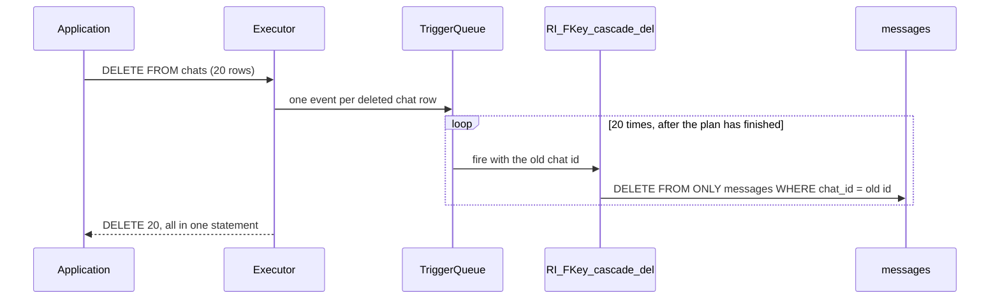

## 1. The question this idea answers

A user deletes a chat. The service sends one statement: `DELETE FROM chats WHERE id = $1`. The chat has about 21 messages, and some messages have feedback rows. With `ON DELETE CASCADE`, PostgreSQL deletes all of them in the same statement. But how does it find them? The table `messages` has 1,049,965 rows on 23,863 pages of 8 kB, and the heap has no order ([L1](/notes/databases/postgres/06-indexes-and-query-plans/l1-b-tree-indexes)).

[Lesson 1.1](/notes/databases/postgres/01-relational-basics/l1-tables-keys-and-constraints) said that a foreign key does not create an index on the referencing column. This lesson shows the mechanism behind that sentence and its cost in numbers. The main measurement uses the example chat store. A delete of 20 chats spent **2,706 ms** in the cascade trigger without an index on `messages.chat_id`. With the index, it spent **1.1 ms**. Without the index, PostgreSQL read the whole `messages` table 20 times, once per deleted chat.

Every result ran on PostgreSQL 16.15 and 18.6. The quotes come from the PostgreSQL 18 manual, the current version (checked on 2026-10-14). PostgreSQL 19 is a release candidate, so this lesson does not teach it. Managed services run 16, 17 or 18, so version differences are marked. Version 17 was not tested.

## 2. Mental model

> [!analogy] Cancelled orders in a warehouse of labeled boxes
> A plant warehouse holds about one million boxes. Each box has a label with an order number. When an order is cancelled, a clerk must remove every box with that number. The clerk receives the cancelled orders one at a time.
>
> With a binder sorted by order number (the index), the clerk opens it at the right page and walks only to the listed shelves. Without the binder, the clerk walks every aisle and reads every label. For 20 cancelled orders, the clerk walks the whole warehouse 20 times.
>
> **Where it stops working:** a person would collect the 20 order numbers and walk the aisles once. PostgreSQL does not. Its trigger runs once per deleted parent row, with one key each time, so the walks never combine. Also, a real warehouse cannot stop a new box with a cancelled number from arriving during the walk. PostgreSQL can: a row lock on the parent row.

## 3. Terms

| Term | Plain meaning |
|---|---|
| referential integrity | The rule that every non-null reference in the child table matches a row in the parent table. |
| referencing table | The table with the foreign key, the child. In the example: `messages`. |
| referenced table | The table that the foreign key refers to, the parent. In the example: `chats`. |
| RI trigger | An internal trigger that PostgreSQL creates for a foreign key. It runs one SQL query to check or apply the rule. |
| `AFTER ROW` trigger | A trigger that runs once for each changed row, after the statement has changed all its rows. |
| referential action | What happens to the child rows when their parent row is deleted or its key changes. |
| `NO ACTION` | The default action. A delete fails if referencing rows still exist when the constraint is checked. |
| `RESTRICT` | Like `NO ACTION`, but the check cannot wait until commit, and a new parent row with the same key does not help. |
| `CASCADE` | Delete the child rows of a deleted parent row, or copy a changed key into them. |
| `SET NULL`, `SET DEFAULT` | Set the referencing columns of the child rows to null or to their default value. |
| deferrable constraint | A constraint whose check can wait until `COMMIT`. |
| `MATCH FULL` | A match type that rejects a multicolumn reference with some null and some non-null columns. |
| `FOR KEY SHARE` | The weakest row lock. The child check takes it on the parent row. It blocks a delete of that row, not a normal update. |
| cascade chain | A cascade that causes another cascade: `chats` to `messages` to `message_feedback`. |
| `NOT VALID` | A constraint option: enforce the rule for new rows now, and check the old rows later with `VALIDATE CONSTRAINT`. |

## 4. Method and math

### 4.1 What the manual promises, and what it does not

The manual defines the constraint: "A foreign key constraint specifies that the values in a column (or a group of columns) must match the values appearing in some row of another table. We say this maintains the *referential integrity* between two related tables." The same section then explains why the two sides are not equal (PostgreSQL 18 docs §5.5.5, checked on 2026-10-14):

> "A foreign key must reference columns that either are a primary key or form a unique constraint, or are columns from a non-partial unique index. This means that the referenced columns always have an index to allow efficient lookups on whether a referencing row has a match. Since a `DELETE` of a row from the referenced table or an `UPDATE` of a referenced column will require a scan of the referencing table for rows matching the old value, it is often a good idea to index the referencing columns too. Because this is not always needed, and there are many choices available on how to index, the declaration of a foreign key constraint does not automatically create an index on the referencing columns."

A test on both servers confirms the first rule. A foreign key to a column without a unique constraint fails at once: `there is no unique constraint matching given keys for referenced table "x_lines"`.

| Side | Example | Index | Who creates it |
|---|---|---|---|
| Referenced (parent) | `chats (id)` | `chats_pkey` | The primary key. The foreign key requires a unique index here. |
| Referencing (child) | `messages (chat_id)` | `messages_chat_seq_key (chat_id, seq)` | You |
| Referencing (child) | `message_feedback (message_id)` | `message_feedback_message_created_idx (message_id, created_at)` | You |

The unique constraint `(chat_id, seq)` starts with `chat_id`, so it also serves the foreign key. [L2](/notes/databases/postgres/06-indexes-and-query-plans/l2-multicolumn-indexes) explains why a leading column is enough.

### 4.2 The enforcement machine: four internal triggers

A foreign key is not a special storage structure. PostgreSQL enforces it with its trigger machinery. When it creates the constraint, it also creates internal triggers, marked `tgisinternal` in the catalog `pg_trigger`. This query lists them for `messages_chat_id_fkey`:

```sql
SELECT t.tgname, t.tgrelid::regclass AS on_table, t.tgfoid::regproc AS function,
       CASE WHEN t.tgtype & 4 > 0 THEN 'INSERT' WHEN t.tgtype & 8 > 0 THEN 'DELETE'
            WHEN t.tgtype & 16 > 0 THEN 'UPDATE' END AS event
FROM pg_trigger t JOIN pg_constraint c ON c.oid = t.tgconstraint
WHERE t.tgisinternal AND c.conname = 'messages_chat_id_fkey' ORDER BY 2, 1;
```

```text
            tgname            | on_table |        function        | event  
------------------------------+----------+------------------------+--------
 RI_ConstraintTrigger_a_17103 | chats    | "RI_FKey_cascade_del"  | DELETE
 RI_ConstraintTrigger_a_17104 | chats    | "RI_FKey_noaction_upd" | UPDATE
 RI_ConstraintTrigger_c_17105 | messages | "RI_FKey_check_ins"    | INSERT
 RI_ConstraintTrigger_c_17106 | messages | "RI_FKey_check_upd"    | UPDATE
```

That output came from PostgreSQL 18.6. Two triggers sit on the child and check it. Two sit on the parent and act on the child.

The source names them "`RI_ConstraintTrigger_a_NNNN` for the action triggers and `RI_ConstraintTrigger_c_NNNN` for the check triggers" (`src/backend/commands/tablecmds.c`, 18.6). The trigger functions live in `src/backend/utils/adt/ri_triggers.c`. Each function first verifies its context and refuses any other: `"function \"%s\" must be fired AFTER ROW"`. So each RI trigger runs **once per changed row**.

Each function builds its SQL query, prepares it once per session (`SPI_prepare`, then `SPI_keepplan`), and runs it with the key values of the row. These templates of the main queries are quoted from the source comments. `<pktable>` is the parent and `<fktable>` is the child:

| Function | Fires on | Query that it builds |
|---|---|---|
| `RI_FKey_check_ins`, `RI_FKey_check_upd` | insert into the child, update of its key | `SELECT 1 FROM [ONLY] <pktable> x WHERE pkatt1 = $1 [AND ...] FOR KEY SHARE OF x` |
| `RI_FKey_noaction_del`, `RI_FKey_restrict_del` | delete from the parent | `SELECT 1 FROM [ONLY] <fktable> x WHERE $1 = fkatt1 [AND ...] FOR KEY SHARE OF x` |
| `RI_FKey_cascade_del` | delete from the parent | `DELETE FROM [ONLY] <fktable> WHERE $1 = fkatt1 [AND ...]` |
| `RI_FKey_setnull_del`, `RI_FKey_setdefault_del` | delete from the parent | `UPDATE [ONLY] <fktable> SET fkatt1 = NULL [, ...] WHERE $1 = fkatt1 [AND ...]` (`DEFAULT` instead of `NULL` for the second one) |
| `RI_FKey_cascade_upd` | update of a parent key | `UPDATE [ONLY] <fktable> SET fkatt1 = $1 [, ...] WHERE $n = fkatt1 [AND ...]` |

Every query on the child filters by the foreign key columns. That is the whole reason for the index.



### 4.3 The trigger queries, seen live

A plain `EXPLAIN` does not show the plans of trigger queries. The module `auto_explain` can log them, and `auto_explain.log_nested_statements = on` includes statements that run inside triggers. With `auto_explain.log_level = notice`, the log arrives in the client. This test deleted one chat with 12 messages on PostgreSQL 16.15:

```sql
LOAD 'auto_explain';
SET auto_explain.log_min_duration = 0;  SET auto_explain.log_analyze = on;
SET auto_explain.log_buffers = on;      SET auto_explain.log_level = notice;
SET auto_explain.log_nested_statements = on;
BEGIN;
DELETE FROM chats WHERE id = (SELECT id FROM chats ORDER BY id LIMIT 1 OFFSET 1);
ROLLBACK;
```

The first logged plan is the cascade query, with the index in place:

```text
Query Text: DELETE FROM ONLY "public"."messages" WHERE $1 OPERATOR(pg_catalog.=) "chat_id"
Query Parameters: $1 = '00005906-d0ef-ee63-bb1d-196e05a6b193'
Delete on messages  (cost=4.63..106.38 rows=0 width=0) (actual time=0.071..0.072 rows=0 loops=1)
  Buffers: shared hit=30
  ->  Bitmap Heap Scan on messages  (cost=4.63..106.38 rows=26 width=6) (actual time=0.029..0.031 rows=12 loops=1)
        Recheck Cond: ('00005906-d0ef-ee63-bb1d-196e05a6b193'::uuid = chat_id)
        Heap Blocks: exact=1
        Buffers: shared hit=4
        ->  Bitmap Index Scan on messages_chat_seq_key  (cost=0.00..4.62 rows=26 width=0) (actual time=0.010..0.010 rows=12 loops=1)
              Index Cond: (chat_id = '00005906-d0ef-ee63-bb1d-196e05a6b193'::uuid)
              Buffers: shared hit=3
```

The second test ran `ALTER TABLE messages DROP CONSTRAINT messages_chat_seq_key` first, in the same transaction. The `ROLLBACK` at the end restored the constraint and its index:

```text
Query Text: DELETE FROM ONLY "public"."messages" WHERE $1 OPERATOR(pg_catalog.=) "chat_id"
Query Parameters: $1 = '00005906-d0ef-ee63-bb1d-196e05a6b193'
Delete on messages  (cost=0.00..36987.56 rows=0 width=0) (actual time=163.397..163.399 rows=0 loops=1)
  Buffers: shared hit=1298 read=22589
  ->  Seq Scan on messages  (cost=0.00..36987.56 rows=26 width=6) (actual time=140.868..163.366 rows=12 loops=1)
        Filter: ('00005906-d0ef-ee63-bb1d-196e05a6b193'::uuid = chat_id)
        Rows Removed by Filter: 1049953
        Buffers: shared hit=1274 read=22589
```

Same query, same 12 rows. With the index: 3 index pages, 1 heap page, 0.07 ms. Without it: 1,274 + 22,589 = 23,863 pages, 1,049,953 rows read and discarded, 163 ms. [L3](/notes/databases/postgres/06-indexes-and-query-plans/l3-index-scan-vs-sequential-scan) explains the two access paths, and [L4](/notes/databases/postgres/06-indexes-and-query-plans/l4-explain-and-explain-analyze) explains each line. The trigger keeps its prepared plan, so the rule of PREPARE applies: "the first five executions are done with custom plans" (PostgreSQL 18 docs, PREPARE, checked on 2026-10-14). The log confirms it: from the sixth feedback delete, the plan reads `Index Cond: (message_id = $1)`.

### 4.4 Insert into the child: the parent side is always indexed

Each new message runs the check query against `chats`. auto_explain on PostgreSQL 18.6 logged its text, `SELECT 1 FROM ONLY "public"."chats" x WHERE "id" OPERATOR(pg_catalog.=) $1 FOR KEY SHARE OF x`. Its plan was `LockRows` above `Index Scan using chats_pkey on chats x`, with `Buffers: shared hit=3` on the scan and an actual time of 0.017 ms.

This lookup always has an index, because the foreign key requires one. An insert of 1,000 messages into 1,000 chats on PostgreSQL 16.15 printed `Trigger for constraint messages_chat_id_fkey: time=12.626 calls=1000`. That is one check per inserted row, and 12.626 / 1,000 = 0.0126 ms per check.

Updates of other parent columns cost nothing extra. The manual: "If the row is updated, but the referenced column is not actually changed, no action is done." (PostgreSQL 18 docs, CREATE TABLE, checked on 2026-10-14). The source function `RI_FKey_pk_upd_check_required` skips the trigger when "all old and new key values are equal". An update of `updated_at` on 1,000 chats printed no `Trigger for constraint` line at all.

### 4.5 The referential actions, tested

| Action | Function on delete | What the tests showed |
|---|---|---|
| `NO ACTION` (default) | `RI_FKey_noaction_del` | First it searches the parent for a new row with the same key (`ri_Check_Pk_Match`). Then it runs `SELECT 1 ... FOR KEY SHARE` on the child with a limit of one row: 12 rows matched, the plan returned 1. Error: `Key (id)=(...) is still referenced from table "messages".` |
| `RESTRICT` | `RI_FKey_restrict_del` | No search for a replacement parent. The check runs in the statement, also when the constraint is declared `DEFERRABLE INITIALLY DEFERRED`. |
| `CASCADE` | `RI_FKey_cascade_del` | One `DELETE FROM ONLY` on the child per deleted parent row (section 4.6). |
| `SET NULL` | `RI_FKey_setnull_del` | One `UPDATE ONLY` on the child per deleted parent row. |
| `SET DEFAULT` | `RI_FKey_setdefault_del` | The child row got the default 0. A delete of parent row 0 then failed, because the function runs the `NO ACTION` check after its update. |

The source explains the first two rows: "This appears to be the only difference between "NO ACTION" and "RESTRICT". In Postgres we still implement this as an AFTER trigger, but it's non-deferrable."

**The column list of `SET NULL`.** The test used the example from §5.5.5: posts refer to users with `FOREIGN KEY (tenant_id, author_id) REFERENCES users ON DELETE SET NULL (author_id)`. A delete of the user set only `author_id` to null, and `tenant_id` stayed 1. Without the list, the same delete failed with `null value in column "tenant_id" ... violates not-null constraint`. The error context showed the generated query: `UPDATE ONLY "public"."x_posts" SET "tenant_id" = NULL, "author_id" = NULL WHERE ...`.

**Deferrable constraints.** "If the constraint is `INITIALLY DEFERRED`, it is checked only at the end of the transaction" (PostgreSQL 18 docs, CREATE TABLE, checked on 2026-10-14). The tests on PostgreSQL 16.15 gave four results:

1. Not deferrable: a child row inserted before its parent failed at the insert.
2. `DEFERRABLE INITIALLY DEFERRED`: child first, then parent, then `COMMIT` succeeded. A child with no parent failed at `COMMIT`, not at the insert.
3. Deferred `NO ACTION`: a delete of parent 10 and a new insert of parent 10 in one transaction committed with no error.
4. A deferred constraint does not defer the action. The manual: "Referential actions are executed as part of the data changing command, even if the constraint is deferred." After a delete with a deferred `CASCADE`, the child count was already 0 in the same transaction.

**Match types.** "`MATCH SIMPLE` allows any of the foreign key columns to be null; if any of them are null, the row is not required to have a match" (PostgreSQL 18 docs, CREATE TABLE, checked on 2026-10-14). With a two-column key, the row `(99, NULL)` passed, although plant 99 does not exist. With `MATCH FULL`, the same row failed with `DETAIL:  MATCH FULL does not allow mixing of null and nonnull key values.`, and `(NULL, NULL)` passed. `MATCH PARTIAL` "is not yet implemented". If every child needs a parent, declare the referencing columns `NOT NULL`.

> [!note] Version difference: the error of RESTRICT
> PostgreSQL 16.15 reports a `RESTRICT` violation as an ordinary foreign key error: SQLSTATE `23503`, `violates foreign key constraint`. PostgreSQL 18.6 reports SQLSTATE `23001` (`restrict_violation`): `update or delete on table "x_parent" violates RESTRICT setting of foreign key constraint "x_child_parent_id_fkey" on table "x_child"`. The release notes of 17 and 18 do not mention this change (checked on 2026-10-14), and 17 was not tested. Code that handles errors by SQLSTATE must accept both codes.

### 4.6 The main experiment: delete N chats with and without the index

Each run opened a new connection and ran these statements, with the first `ALTER TABLE` only in the "without index" case:

```sql
BEGIN;
ALTER TABLE messages DROP CONSTRAINT messages_chat_seq_key;   -- "without index" only
EXPLAIN (ANALYZE, BUFFERS)
DELETE FROM chats WHERE id IN (SELECT id FROM chats ORDER BY id LIMIT 20);
SELECT relname, seq_scan, seq_tup_read, idx_scan, n_tup_del
FROM pg_stat_xact_user_tables WHERE relname = 'messages';
SELECT pg_stat_get_xact_blocks_fetched('messages'::regclass);
ROLLBACK;
```

`pg_stat_xact_user_tables` "counts actions taken so far within the current transaction" (PostgreSQL 18 docs §27.2, checked on 2026-10-14). `pg_stat_get_xact_blocks_fetched` counts every buffer request for the table, hits included. The source says the per-relation stats "always count them" (`bufmgr.c`). This lesson calls these requests **page accesses**. Each run needs a new connection: in a quick loop on one connection, the counters of the second run also held the first run. The manual says these views show statistics "not yet flushed out to the shared memory statistics".

The PostgreSQL 18.6 plans for N = 20, shortened at the `...` lines:

```text
-- without an index on messages.chat_id
 Delete on chats  (cost=1.57..167.63 rows=0 width=0) (actual time=0.395..0.397 rows=0.00 loops=1)
   Buffers: shared hit=105 read=20 dirtied=20
   ...
 Trigger for constraint messages_chat_id_fkey on chats: time=2706.147 calls=20
 Trigger for constraint message_feedback_message_id_fkey on messages: time=10.677 calls=437
 Execution Time: 2717.387 ms

-- with messages_chat_seq_key
 Delete on chats  (cost=1.57..167.63 rows=0 width=0) (actual time=0.147..0.148 rows=0.00 loops=1)
   Buffers: shared hit=123
   ...
 Trigger for constraint messages_chat_id_fkey on chats: time=1.101 calls=20
 Trigger for constraint message_feedback_message_id_fkey on messages: time=2.963 calls=437
 Execution Time: 4.286 ms
```

The trigger lines read as follows:

- `calls=20`: the cascade trigger fired once per deleted chat.
- `calls=437`: the 20 chats had 437 messages, and each deleted message fired the feedback trigger once.
- The times are additive. §14.1.2 says that "time spent executing `AFTER` triggers is not counted there because `AFTER` triggers are fired after completion of the whole plan", and "The total time spent in each trigger ... is also shown separately" (PostgreSQL 18 docs, checked on 2026-10-14). Check: 0.397 + 2,706.147 + 10.677 = 2,717.221 ms of the 2,717.387 ms.
- The second-level line exists because the cascade query does not fire its own triggers. The source passes `fire_triggers = false`, and `spi.c` explains: "false means any AFTER triggers are postponed to end of outer query".

> [!trap] The Buffers lines do not include trigger work
> The `Delete on chats` node reports 105 + 20 = 125 buffers. The triggers of the same statement requested 478,571 pages of `messages`. Trigger queries are not plan nodes, so their buffers appear nowhere in the plan. Measure them with `auto_explain.log_nested_statements` or with `pg_stat_xact_user_tables`. Also, `EXPLAIN ANALYZE` really deletes the rows, so always wrap it in `BEGIN` and `ROLLBACK`.

The growth table follows. Without the index, `seq_scan` of `messages` was exactly N in every run, and `idx_scan` was 0. With the index, `seq_scan` was 0.

The counts were identical on both servers and in every repeat. The times are the `messages_chat_id_fkey` line in ms. Sandbox timings are small and noisy, so use them for ratios only. The N = 20 plans above come from a separate run. "Page accesses, with index" sums the heap of `messages` and the index `messages_chat_seq_key`.

| N chats | Messages deleted | Rows read, no index | Page accesses, no index | Page accesses, with index | ms no index, PG 16 / 18 | ms with index, PG 16 / 18 |
|---|---|---|---|---|---|---|
| 1 | 40 | 1,049,965 | 23,983 | 125 | 163.2 / 132.9 | 0.60 / 0.40 |
| 2 | 52 | 2,099,890 | 47,882 | 165 | 269.0 / 268.0 | 0.95 / 0.81 |
| 5 | 144 | 5,249,553 | 119,747 | 457 | 719.2 / 803.5 | 0.78 / 0.64 |
| 10 | 246 | 10,498,595 | 239,368 | 785 | 1,472.7 / 1,263.6 | 1.35 / 3.95 |
| 20 | 437 | 20,994,854 | 478,571 | 1,403 | 2,634.1 / 2,868.0 | 1.28 / 1.15 |
| 50 | 1,076 | 52,469,876 | 1,196,928 | 3,454 | 7,596.0 / 7,271.1 | 2.60 / 2.70 |

```plot
{
  "title": "Page accesses on messages when N chats are deleted: no index on chat_id (red), with messages_chat_seq_key (blue)",
  "xAxis": { "label": "chats deleted N", "domain": [0, 52] },
  "yAxis": { "label": "page accesses (thousands)", "domain": [0, 1250] },
  "disableZoom": true,
  "data": [
    { "points": [[1, 23.983], [2, 47.882], [5, 119.747], [10, 239.368], [20, 478.571], [50, 1196.928]], "fnType": "points", "graphType": "polyline", "color": "#C81D25", "skipTip": true },
    { "points": [[1, 0.125], [2, 0.165], [5, 0.457], [10, 0.785], [20, 1.403], [50, 3.454]], "fnType": "points", "graphType": "polyline", "color": "#1E6091", "skipTip": true }
  ]
}
```

A simple model explains both lines. $P$ is the number of heap pages of the child table, and $L$ is the level of its B-tree. $M$ is the number of deleted child rows, and $c$ is a small number of page accesses per deleted row:

$$
A_{\text{no index}} \approx N \cdot P + c \cdot M, \qquad A_{\text{index}} \approx N \cdot (L + 1) + c \cdot M
$$

`bt_metap('messages_chat_seq_key')` gives `level = 2`, so one descent reads $L + 1 = 3$ pages: root, internal page, leaf.

> [!example] Worked example: 20 chats on PostgreSQL 18.6
> Without the index, each of the 20 calls scans $P$ = 23,863 pages: 20 × 23,863 = 477,260. The measured total is 478,571, and 478,571 − 477,260 = 1,311 = 3 × 437, so $c$ = 3 here.
>
> In bytes: 477,260 × 8 kB = 3,818,080 kB, and 3,818,080 / 1,048,576 = 3.64 GiB, read to delete 437 rows.
>
> Rows read: 20 × 1,049,965 = 20,999,300. The counter shows 20,994,854, which is 4,446 fewer. Each later scan no longer sees the rows that earlier calls of the same statement deleted.
>
> Time: 2,706.147 ms / 20 = 135.3 ms per call.
>
> With the index: 20 × 3 = 60 index pages, measured 63. Heap accesses: 1,340, close to 3 × 437 = 1,311. Time: 1.101 ms / 20 = 0.055 ms per call.
>
> Ratios: page accesses 478,571 / 1,403 = 341, trigger time 2,706.147 / 1.101 = 2,458.
>
> Consider a retention job that deletes the 5,616 chats older than 2026-02-01 in one transaction. Without the index, it would need about 5,616 × 135.3 ms = 759,845 ms, about 12.7 minutes. That is an estimate from the per-call time, not a measurement.

> [!note] Why most pages were "read", not "hit"
> A sequential scan of a table larger than a quarter of `shared_buffers` uses a small ring of buffers (`heapam.c`: `scan->rs_nblocks > NBuffers / 4`). With the sandbox setting of 128 MB (the default), the limit is 16,384 / 4 = 4,096 pages. The source README: "For sequential scans, a 256KB ring is used." `messages` has 23,863 pages, so each scan read most pages again from outside the shared buffers. `message_feedback` has 425 pages, so its scans in section 4.7 were all hits.

> [!key] One child lookup per deleted parent row
> `ON DELETE CASCADE` runs one query on the child table for each deleted parent row. Without an index whose leading columns are the foreign key columns, each query reads the whole child table. The cost is then N × (size of the child table). With the index, it is N short descents plus the rows that really go.

### 4.7 The cascade chain, and the column order of the child index

The chain is `chats` → `messages` → `message_feedback`. Every deleted message fires `message_feedback_message_id_fkey`, whose query is `DELETE FROM ONLY "public"."message_feedback" WHERE $1 OPERATOR(pg_catalog.=) "message_id"`. So the second level runs once per message: 20 chats gave 437 calls, and 100 chats gave 2,044. The number of lookups multiplies down the chain.

The test replaced the feedback index inside `BEGIN` and `ROLLBACK`. Times are the `message_feedback_message_id_fkey` line, in ms:

| Index on `message_feedback` | 10 chats, 246 calls, PG 16 / 18 | 100 chats, 2,044 calls, PG 16 / 18 | Plan of each call |
|---|---|---|---|
| `(message_id, created_at)`, the example | 2.8 / 7.6 | 31.2 / 21.6 | Index Scan, 3 index pages |
| none | 2,182.9 / 1,129.9 | 12,020.6 / 9,696.0 | Seq Scan of 425 pages |
| `(created_at, message_id)` | 1,455.1 / 1,058.2 | 13,820.3 / 11,035.5 | Seq Scan, the index was not used |

Without a usable index, the 2,044 calls read 104,089,934 rows and 868,820 pages. That is 2,044 × 425 = 868,700, plus a few accesses for the deleted rows. The reversed index did not help on either server. It is sorted by `created_at` first, so the entries of one `message_id` are spread over the whole index ([L2](/notes/databases/postgres/06-indexes-and-query-plans/l2-multicolumn-indexes)). PostgreSQL 18 skip scan does not save it, because `created_at` has 49,266 distinct values in 50,985 rows. The manual: "If there are many distinct `x` values, then the entire index will have to be scanned, so in most cases the planner will prefer a sequential table scan over using the index." (PostgreSQL 18 docs §11.3, checked on 2026-10-14)

### 4.8 Find foreign keys with no matching index

An index serves the lookup when its leading columns are the foreign key columns, in any order, and when it is valid and not partial. This query lists every foreign key that has no such index:

```sql
SELECT c.conrelid::regclass AS referencing_table, c.conname AS foreign_key,
       pg_get_constraintdef(c.oid) AS definition
FROM pg_constraint c
WHERE c.contype = 'f'
  AND NOT EXISTS (
        SELECT 1 FROM pg_index i
        WHERE i.indrelid = c.conrelid AND i.indisvalid AND i.indpred IS NULL
          AND (i.indkey::int2[])[0:cardinality(c.conkey) - 1] @> c.conkey)
ORDER BY 1, 2;
```

How it works. `conkey` holds the column numbers of the foreign key. `indkey` holds the column numbers of the index, and as an array it starts at position 0. The slice `[0:n - 1]` takes the first $n$ index columns, where $n$ is the number of foreign key columns. `@>` means "contains".

Both sides have $n$ distinct columns, so containment means the same set. An expression column has the number 0, so it never matches.

On the example as loaded, the query returned 0 rows on both servers. In a transaction that dropped `messages_chat_seq_key` and replaced the feedback index with `(created_at, message_id)`, it returned both foreign keys:

```text
 referencing_table |           foreign_key            |                             definition                             
-------------------+----------------------------------+--------------------------------------------------------------------
 messages          | messages_chat_id_fkey            | FOREIGN KEY (chat_id) REFERENCES chats(id) ON DELETE CASCADE
 message_feedback  | message_feedback_message_id_fkey | FOREIGN KEY (message_id) REFERENCES messages(id) ON DELETE CASCADE
```

### 4.9 Locks: FOR KEY SHARE on the parent row

The insert check ends with `FOR KEY SHARE OF x`. The manual describes this lock: "A key-shared lock blocks other transactions from performing `DELETE` or any `UPDATE` that changes the key values, but not other `UPDATE`" (PostgreSQL 18 docs §13.3.2, checked on 2026-10-14). The same section says that a `DELETE` takes `FOR UPDATE`, and an `UPDATE` that changes no key column takes `FOR NO KEY UPDATE`. The conflict table from §13.3.2, where X marks a conflict:

| Requested lock | Held `FOR KEY SHARE` | Held `FOR SHARE` | Held `FOR NO KEY UPDATE` | Held `FOR UPDATE` |
|---|---|---|---|---|
| `FOR KEY SHARE` | | | | X |
| `FOR SHARE` | | | X | X |
| `FOR NO KEY UPDATE` | | X | X | X |
| `FOR UPDATE` | X | X | X | X |

The test: session A ran `BEGIN` and inserted one message into chat X, and stayed open. On PostgreSQL 16.15, `pgrowlocks('chats')` showed `('(36,52)', False, ['For Key Share'])`, and `pg_locks` showed A's table lock `RowShareLock` on `chats`. The source comment explains that lock: "pk_rel is opened in RowShareLock mode since that's what our eventual SELECT FOR KEY SHARE will get on it". Session B then tried three statements on chat X with `lock_timeout = '1s'`:

| Session B | Row lock it needs | PG 16.15 | PG 18.6 |
|---|---|---|---|
| `UPDATE chats SET updated_at = now()` | `FOR NO KEY UPDATE` | done, 1.4 ms | done, 2.0 ms |
| `UPDATE chats SET title = 'x'` | `FOR NO KEY UPDATE` | done, 0.4 ms | done, 0.4 ms |
| `DELETE FROM chats` | `FOR UPDATE` | `LockNotAvailable` after 1,001 ms | `LockNotAvailable` after 1,001 ms |

The failed delete reported `CONTEXT:  while deleting tuple (36,52) in relation "chats"`. This design matters in a chat store. Every turn updates `chats.updated_at`, and every turn inserts messages. The key-share lock of an insert never blocks that update.

The lock also closes a race. On two small test tables (`lk_chats`, `lk_messages`), session A deleted chat 1 and stayed open. Session B inserted a message for chat 1 and waited: `wait_event` was `transactionid`, and `pg_blocking_pids` named A. When A committed at 2.01 s, B failed on both servers with `Key (chat_id)=(1) is not present in table "lk_chats".` Without the lock, B could have inserted an orphan row.

### 4.10 Large cascades: one statement, one transaction

A delete of 1,000 chats with all indexes in place removed 1,000 chats, 20,813 messages and 1,069 feedback rows. The trigger lines showed `calls=1000` and `calls=20813`. The execution time was 776.3 ms on PostgreSQL 16.15 and 475.8 ms on 18.6. All of it is one transaction: every deleted row stays locked until `COMMIT`, and an error undoes everything ([Lesson 2.1](/notes/databases/postgres/02-transactions/l1-transactions)). The manual adds that PostgreSQL "doesn't remember any information about modified rows in memory, so there is no limit on the number of rows locked at one time." So nothing stops a huge cascade. It only holds its locks longer.

For a retention job, delete in batches, one short transaction per batch:

```python
def delete_old_chats(conn, cutoff, batch_size=500):
    """Delete chats older than cutoff, at most batch_size chats per transaction."""
    total = 0
    while True:
        with conn.transaction():
            cur = conn.execute(
                """DELETE FROM b_chats WHERE id IN (SELECT id FROM b_chats
                   WHERE updated_at < %s ORDER BY updated_at LIMIT %s)""",
                (cutoff, batch_size))
        if cur.rowcount == 0:
            return total
        total += cur.rowcount
```

The test ran it with psycopg 3 on PostgreSQL 16.15. It used narrow copies of the example: `b_chats (id, updated_at)`, and `b_messages (id, chat_id, seq)` with the cascade foreign key and an index on `chat_id`. It deleted the 5,616 chats older than 2026-02-01 and their 117,333 messages in 12 batches, in 0.36 s in total. Afterwards, 44,384 chats and 932,632 messages remained, and no old chat. [Retention and deletion](/notes/ai/conversation-state/03-lifecycle/l2-retention-and-deletion) covers the product side of this job.

### 4.11 Adding a foreign key to a big table: NOT VALID, then VALIDATE

[Lesson 4.1](/notes/databases/postgres/04-schema-changes/l1-alter-table-add-column) showed `NOT VALID` with a `CHECK` constraint. A foreign key differs because it locks two tables. The manual: "`ADD FOREIGN KEY` requires only a `SHARE ROW EXCLUSIVE` lock. Note that `ADD FOREIGN KEY` also acquires a `SHARE ROW EXCLUSIVE` lock on the referenced table". That mode "protects a table against concurrent data changes". For validation: "validation acquires only a `SHARE UPDATE EXCLUSIVE` lock on the table being altered. (If the constraint is a foreign key then a `ROW SHARE` lock is also required on the table referenced by the constraint.)" (PostgreSQL 18 docs, ALTER TABLE and §13.3.1, checked on 2026-10-14)

The test dropped `messages_chat_id_fkey`, added it back in three ways, and read `pg_locks` before each `COMMIT`:

| Step | PG 16.15 | PG 18.6 | Lock on `messages` | Lock on `chats` |
|---|---|---|---|---|
| `ADD FOREIGN KEY`, with the check | 244.4 ms | 336.9 ms | `SHARE ROW EXCLUSIVE` | `SHARE ROW EXCLUSIVE`, `ROW SHARE` |
| `ADD FOREIGN KEY ... NOT VALID` | under 1 ms | under 1 ms | `SHARE ROW EXCLUSIVE` | `SHARE ROW EXCLUSIVE` |
| `VALIDATE CONSTRAINT` | 255.2 ms | 330.7 ms | `SHARE UPDATE EXCLUSIVE` | `ROW SHARE` |

All three steps also held `ACCESS SHARE` on both tables. With the direct `ADD`, writes to **both** tables wait for the whole scan. With `NOT VALID`, they wait for under 1 ms. `VALIDATE CONSTRAINT` blocks no insert, update or delete: `ROW SHARE` "Conflicts with the `EXCLUSIVE` and `ACCESS EXCLUSIVE` lock modes" only (§13.3.1). The check is one query (`RI_Initial_Check` in the source), logged here by auto_explain on PostgreSQL 16.15, shortened at `...`:

```text
Query Text: SELECT fk."chat_id" FROM ONLY "public"."messages" fk LEFT OUTER JOIN ONLY "public"."chats" pk ON ( pk."id" OPERATOR(pg_catalog.=) fk."chat_id") WHERE pk."id" IS NULL AND (fk."chat_id" IS NOT NULL)
Hash Anti Join  (cost=1716.19..40033.86 rows=1 width=16) (actual time=291.420..291.425 rows=0 loops=1)
  ->  Seq Scan on messages fk  (cost=0.00..34378.49 rows=1050449 width=16) (actual time=0.019..157.753 rows=1049965 loops=1)
  ...
        ->  Seq Scan on chats pk  (cost=0.00..1078.86 rows=50986 width=16) (actual time=0.006..5.738 rows=50000 loops=1)
```

One join over the whole child, not one lookup per row. The source runs it with `work_mem` set to `maintenance_work_mem`. The safe order for a live table has three steps. First, `CREATE INDEX CONCURRENTLY` on the referencing columns, because from the moment the constraint exists, every parent delete runs the child lookup. Second, `ADD CONSTRAINT ... FOREIGN KEY ... NOT VALID` with a short `lock_timeout` and a retry. Third, `VALIDATE CONSTRAINT`.

### 4.12 PostgreSQL 18 additions

> [!note] Version difference: new in PostgreSQL 18
> **`NOT ENFORCED`.** The release notes: "Allow CHECK and foreign key constraints to be specified as NOT ENFORCED". The manual: "If the constraint is `NOT ENFORCED`, the database system will not check the constraint." On 18.6, such a foreign key had 0 RI triggers and accepted an orphan row. `ALTER CONSTRAINT ... ENFORCED` then failed on that row. After a delete of the row, the same command succeeded, and the constraint had 4 triggers. PostgreSQL 16.15 rejects the syntax.
>
> **Temporal foreign keys.** A `PERIOD` column in the key makes the constraint "satisfied if the referenced table has matching records ... whose combined `PERIOD` values completely cover the referencing record's". `CASCADE`, `SET NULL`, `SET DEFAULT` and `RESTRICT` are "not supported" there. This lesson did not run a temporal example. For partitioned tables, 18 adds: "Allow NOT VALID foreign key constraints on partitioned tables".

### 4.13 Production view

| Concern | What to do |
|---|---|
| Delete latency | Index the referencing columns of every foreign key whose parent rows are deleted or whose keys change. The foreign key columns must be the leading index columns. |
| Detection | Run the query of section 4.8 in CI against the migrated schema, and fail the build on any row. |
| Observability | Read `Trigger for constraint ... calls=` in `EXPLAIN ANALYZE`, inside `BEGIN` and `ROLLBACK`. Measure trigger work with `auto_explain.log_nested_statements` or `pg_stat_xact_user_tables`, not with the plan's Buffers lines. |
| Locks | A cascade locks every deleted row until `COMMIT`. Delete in batches of a few hundred parent rows per transaction. |
| Migrations | `CREATE INDEX CONCURRENTLY`, then `ADD FOREIGN KEY ... NOT VALID` with `lock_timeout`, then `VALIDATE CONSTRAINT`. |
| Error handling | Handle SQLSTATE `23503` for foreign key errors, and `23001` for `RESTRICT` on PostgreSQL 18. |
| Design | Use `CASCADE` only when the child "cannot exist independently" (§5.5.5). Use `NO ACTION` or `RESTRICT` for independent objects. |

## 5. Video

```video
{
  "src": "/notes/media/postgres/manim/m07-cascade-delete-fk-index.mp4",
  "caption": "A DELETE of 20 chats fires the cascade trigger 20 times. Without an index on messages.chat_id, each call reads all 23,863 pages. With it, each call reads 3 index pages."
}
```

## 6. Code

Use the example chat store on your local server. Put the work in `postgres/15-foreign-keys.ipynb` in the lab folder `C:\Users\ASohi\Downloads\AI\agent-harness-lab`. Wrap every delete in `BEGIN` and `ROLLBACK`.

**Exercise 5.1: measure the growth.** Write `measure(dsn, n, with_index)`. It opens a new connection, runs the transaction of section 4.6, and returns the trigger lines and the counters for `messages`. Run it for N = 1, 5 and 20, with and without the index, and draw both lines.

Acceptance tests:

- Without the index, `seq_scan` equals N and `seq_tup_read` is within 1% of N × 1,049,965.
- With the index, `seq_scan` is 0, and the page accesses on `messages_chat_seq_key` are at most 4 × N.
- The parsed `calls=` of `messages_chat_id_fkey` equals N in every run.

**Exercise 5.2: a guard for missing indexes.** Write `unindexed_foreign_keys(conn) -> list[str]` with the query of section 4.8, and test it with pytest.

Acceptance tests:

- It returns an empty list on the example.
- Inside a transaction that drops `messages_chat_seq_key`, it returns `["messages_chat_id_fkey"]`.
- A partial index `ON messages (chat_id) WHERE chat_id IS NOT NULL` does not count.
- For a two-column foreign key `(a, b)` on a test table, an index on `(b, a, c)` counts and an index on `(a, c, b)` does not.

**Exercise 5.3: a retention job.** Build narrow copies of `chats` and `messages` with a cascade foreign key. Delete all chats older than a cutoff with the batch function of section 4.10, and log the time of each batch.

Acceptance tests:

- No transaction deletes more than `batch_size` chats.
- Afterwards, no chat older than the cutoff remains, and an anti-join from messages to chats returns 0 rows.
- Drop the index and run one batch with `batch_size = 5`. Record its time next to the indexed time, and explain the ratio with the model of section 4.6.

## 7. Common mistakes

1. **"The foreign key is indexed, because the parent has a primary key."** Only the referenced side must have an index. The referencing side has one only if you create it.
2. **"An index that contains the foreign key column is enough."** The foreign key columns must be the leading columns. An index on `(created_at, message_id)` did not serve `message_id` on either server.
3. **"The plan of a DELETE shows all its work."** Trigger work appears only in the `Trigger for constraint` lines, and the Buffers lines exclude it.
4. **"A deferred foreign key also defers the cascade."** Referential actions run inside the statement. Only the check waits.
5. **"NO ACTION and RESTRICT are the same."** `RESTRICT` cannot wait for commit and ignores a replacement parent row. On PostgreSQL 18 it also has its own SQLSTATE, `23001`.
6. **"One DELETE is the fastest retention job."** One statement is one transaction that locks every deleted row until `COMMIT`. Delete in batches.
7. **"Adding a foreign key is a catalog change."** It scans the child table while writes to both tables wait, unless you use `NOT VALID` and then `VALIDATE CONSTRAINT`.

## 8. One-minute explanation

A foreign key makes every non-null reference in a child table match a row in the parent table. PostgreSQL enforces it with four internal triggers that run once per changed row, after the statement. An insert into the child runs `SELECT 1 FROM parent WHERE key = $1 FOR KEY SHARE`, which always has an index, because the parent key must be unique. A delete from the parent runs one query on the child per deleted row: `DELETE` for `CASCADE`, `UPDATE` for `SET NULL`, `SELECT` for `NO ACTION`. PostgreSQL never creates an index on the child columns. Without one, each of those queries reads the whole child table. In the test, 20 chats cost 20 full scans of 23,863 pages and 2.7 s, against 1.1 ms with the index. The index must start with the foreign key columns, and chains multiply the lookups: 20 chats fired the feedback trigger 437 times. The key-share lock keeps a parent alive while a child insert is open, but allows normal updates of the parent. Delete in batches, and add new foreign keys with `NOT VALID` and `VALIDATE CONSTRAINT`.

## 9. Check questions

```check
{
  "question": "A DELETE of 50 parent rows prints Trigger for constraint orders_plant_id_fkey on plants: time=7400 calls=50. The child table has 2 million rows and no index on plant_id. What does each of the 50 calls do, and what is the first thing you check?",
  "hint": "Write the query that RI_FKey_cascade_del builds.",
  "answer": "Each call runs DELETE FROM ONLY orders WHERE plant_id equals the id of one deleted plant. No index has plant_id as its leading column, so every call is a sequential scan of all 2 million rows. The statement reads the child table 50 times, about 148 ms per call. First run the query that lists foreign keys without a matching index. Then create the index, with CONCURRENTLY on a live table."
}
```

```check
{
  "question": "Session A has inserted a message into chat 7 and has not committed. Session B runs UPDATE chats SET updated_at = now() WHERE id = 7, and session C runs DELETE FROM chats WHERE id = 7. Which one waits, and why?",
  "answer": "Only C waits. A's insert ran the check query with FOR KEY SHARE on chat 7. B's update changes no key column, so it needs FOR NO KEY UPDATE, which does not conflict with FOR KEY SHARE. C's delete needs FOR UPDATE, which conflicts with it, so C waits until A ends."
}
```

```check
{
  "question": "message_feedback has an index on (created_at, message_id). The foreign key is message_id. Is the cascade from messages fast on PostgreSQL 18, which has skip scan?",
  "answer": "No. The index is sorted by created_at first, so the entries of one message_id are spread over the whole index. Skip scan helps only when the leading column has few distinct values, and created_at has 49,266 distinct values in 50,985 rows. In the test, every call on both servers was a Seq Scan. The index needs message_id as its leading column."
}
```

```check
{
  "question": "Why does ALTER TABLE messages ADD FOREIGN KEY (chat_id) REFERENCES chats on a live database block writes to chats too, and what is the safer sequence?",
  "answer": "ADD FOREIGN KEY takes SHARE ROW EXCLUSIVE on the child and on the referenced table. That mode conflicts with the ROW EXCLUSIVE lock of INSERT, UPDATE and DELETE, so writes to both tables wait while the check scans the child. The safer sequence has three steps. First, CREATE INDEX CONCURRENTLY on messages (chat_id). Second, add the constraint with NOT VALID (under 1 ms in the test). Third, run VALIDATE CONSTRAINT, which takes only SHARE UPDATE EXCLUSIVE on messages and ROW SHARE on chats."
}
```

## 10. Links

- Previous: [L4: EXPLAIN and EXPLAIN ANALYZE](/notes/databases/postgres/06-indexes-and-query-plans/l4-explain-and-explain-analyze)
- The part: [Indexes and query plans](/notes/databases/postgres/06-indexes-and-query-plans)
- Foreign keys introduced: [L1: Tables, keys and constraints](/notes/databases/postgres/01-relational-basics/l1-tables-keys-and-constraints)
- Leading columns and skip scan: [L2: Multicolumn indexes](/notes/databases/postgres/06-indexes-and-query-plans/l2-multicolumn-indexes)
- Locks and NOT VALID: [Lesson 4.1: ALTER TABLE ADD COLUMN](/notes/databases/postgres/04-schema-changes/l1-alter-table-add-column)
- Applied: [Retention and deletion](/notes/ai/conversation-state/03-lifecycle/l2-retention-and-deletion), [Chats, messages and parts](/notes/ai/conversation-state/02-chat-history-model/l1-chats-messages-and-parts)
- [Glossary](/notes/databases/postgres/glossary)
