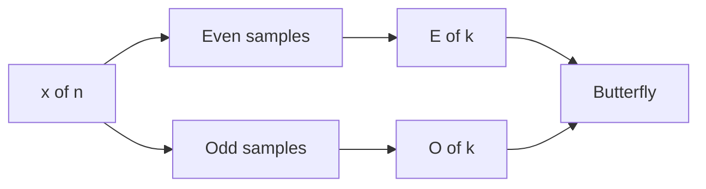

This page is private. It shows in `npm run dev` only. The build check searches `dist/` for this marker: PRIVATE-CHECK-7731.

## Math (KaTeX)

Inline: the DFT bin $k$ has frequency $f_k = k f_s / N$.

Block:

$$
X[k] = \sum_{n=0}^{N-1} x[n]\, e^{-i 2\pi k n / N}
$$

## Mermaid



## Plot

```plot
{
  "title": "A sine and a cosine",
  "xAxis": { "domain": [-6.5, 6.5] },
  "yAxis": { "domain": [-1.5, 1.5] },
  "data": [{ "fn": "sin(x)" }, { "fn": "cos(x)" }]
}
```

## Video

```video
{
  "src": "/notes/media/fft-signal-processing/course/09_The_FFT_Butterfly_Algorithm.mp4",
  "start": "1:19",
  "end": "2:01",
  "caption": "The butterfly: trace k = 1, 2, 3 with real numbers."
}
```

A clip that uses seconds and no end:

```video
{
  "src": "/notes/media/fft-signal-processing/course/01_The_Mystery_of_a_Signal.mp4",
  "start": 20,
  "caption": "Chapter 1 from 0:20."
}
```

Bad JSON shows an error box with the raw text:

```video
{ "src": "/notes/media/x.mp4", "start": 1:19 }
```

## Check

```check
{
  "question": "Why does the FFT need only $\\frac{N}{2}\\log_2 N$ butterflies?",
  "hint": "Count the stages, then count the butterflies in one stage.",
  "answer": "There are $\\log_2 N$ stages. Each stage has $N/2$ butterflies. So the total is $\\frac{N}{2}\\log_2 N$."
}
```

```check
{
  "question": "What is $W_8^{4}$?",
  "answer": "$W_8^4 = e^{-i 2\\pi \\cdot 4/8} = e^{-i\\pi} = -1$."
}
```

## Callouts

> [!key]
> A gate passes only when the answer is correct in my own words.

> [!trap] Phase reference
> The DFT measures phase from a cosine, not a sine.

> [!mistake]
> One stored number is one **sample**, not the pitch.

> [!analogy]
> The DFT probe is like a tuning fork. It answers "how much of my frequency is here?"

> [!example]
> With $f_s = 8$ Hz and $N = 8$, bin $k = 1$ is $1$ Hz.

> [!note]
> A normal blockquote without a marker stays a normal blockquote:

> This is a plain blockquote.

## Task list

- [x] Copy the course videos
- [x] Write the demo note
- [ ] Compute a 4-point FFT by hand
  - [ ] Nested item with math: $W_4 = -i$

## Code

```python
import numpy as np

def dft(x):
    N = len(x)
    n = np.arange(N)
    k = n.reshape((N, 1))
    W = np.exp(-2j * np.pi * k * n / N)
    return W @ x

x = np.array([0, 1, 0, -1])
assert np.allclose(dft(x), np.fft.fft(x))
```
