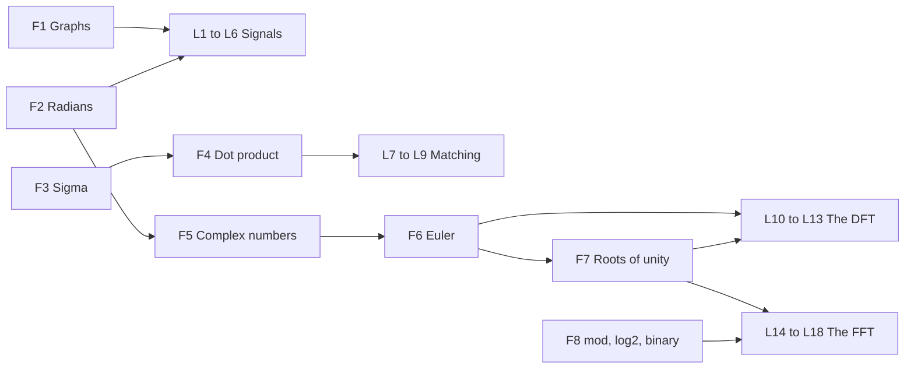

This part rebuilds the school math that the FFT story needs, from zero to full depth. Each lesson names the later lessons that use it. Study a lesson just before its first use. If you already know the idea, one check question is enough.

| Code | Lesson | Core idea | Course video | Status |
|---|---|---|---|---|
| F1 | [Graphs](/notes/maths/fft-signal-processing/01-math-foundations/f1-graphs) | Read a value-against-time graph | ch 2, 0:05–0:20 (practice only) | not started |
| F2 | [Radians and the unit circle](/notes/maths/fft-signal-processing/01-math-foundations/f2-radians-and-the-unit-circle) | One turn is 2π radians. sin and cos are the coordinates of a point on the circle. | ch 5, 0:11–0:26 | not started |
| F3 | [Σ notation](/notes/maths/fft-signal-processing/01-math-foundations/f3-sigma-notation) | Read Σ as a for-loop | none | not started |
| F4 | [Vectors and the dot product](/notes/maths/fft-signal-processing/01-math-foundations/f4-vectors-and-the-dot-product) | Orthogonal means dot product 0 | ch 4, 0:05–0:25 | not started |
| F5 | [Complex numbers](/notes/maths/fft-signal-processing/01-math-foundations/f5-complex-numbers) | Multiplication = scale and rotate | ch 5, 0:03–0:11 and 0:45–0:52. Preview: ch 9, 1:19–1:34 | not started |
| F6 | [Euler's formula](/notes/maths/fft-signal-processing/01-math-foundations/f6-eulers-formula) | $e^{i\theta}$ is a rotation. RoPE uses the same rotation. | ch 5, 0:11–0:45 | not started |
| F7 | [Roots of unity](/notes/maths/fft-signal-processing/01-math-foundations/f7-roots-of-unity) | $W_N = e^{-i2\pi/N}$, $W^N = 1$, and all N roots add to 0 | ch 9, 0:16–0:24 and 1:06–1:14 | not started |
| F8 | [Clock arithmetic, log₂, binary](/notes/maths/fft-signal-processing/01-math-foundations/f8-clock-arithmetic-log-binary) | 12 mod 8 = 4, log₂ 1024 = 10, 6 = 110 in binary | ch 9, 2:08–2:23. ch 10, 0:42–0:58 | not started |

## How the lessons connect

F1 and F2 prepare part 02. F3 and F4 prepare the matching score of part 03. F5, F6 and F7 prepare the complex DFT. F7 and F8 prepare the FFT of part 04.
