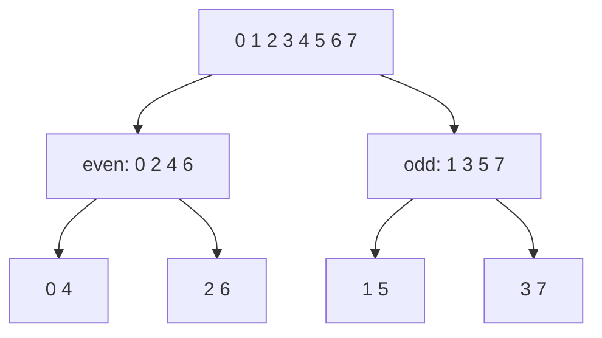

## 1. The question this idea answers

The FFT needs three small tools. Each answers one question:

1. **Clock arithmetic.** $W_8^{15}$ is the same number as $W_8^7$ ([F7](/notes/maths/fft-signal-processing/01-math-foundations/f7-roots-of-unity)). How do you find the small exponent quickly?
2. **log₂.** The FFT halves the problem again and again. How many halvings take 1024 samples down to 1 sample? This count is the number of stages of the FFT ([L18](/notes/maths/fft-signal-processing/04-fft/l18-recursion-and-the-network)) and the "log N" in its cost $N \log_2 N$ ([L21](/notes/maths/fft-signal-processing/04-fft/l21-why-it-is-fast)).
3. **Binary.** The FFT network takes its inputs in the order 0, 4, 2, 6, 1, 5, 3, 7. Where does this order come from? It comes from the binary digits of the sample numbers ([L18](/notes/maths/fft-signal-processing/04-fft/l18-recursion-and-the-network), [L20](/notes/maths/fft-signal-processing/04-fft/l20-iterative-fft-and-bugs)).

The previous lesson, [F7](/notes/maths/fft-signal-processing/01-math-foundations/f7-roots-of-unity), showed that the powers of $W_N$ repeat with period $N$. This lesson gives the tools to count with that repeat. It is the last lesson of part 01.

## 2. Mental model

> [!analogy] A binary counter with three wheels
> Picture the distance counter of a car, but each wheel shows only 0 or 1. With three wheels, it counts 000, 001, 010, 011, 100, 101, 110, 111. Then it shows 000 again: after 8 counts it starts again. So the counter shows the count mod 8. The number of wheels is $\log_2 8 = 3$.
>
> **Where it stops working:** a counter only counts. It cannot read its own digits backwards, but the FFT needs the reversed digits (section 7). Also, for a size such as 1000, no whole number of wheels fits exactly: $\log_2 1000 \approx 9.97$.

## 3. Terms

| Term | Plain meaning |
|---|---|
| remainder | What is left after a division by a whole number. 12 ÷ 8 = 1, with the remainder 4. |
| quotient | The whole number of times that the divisor fits. For 12 ÷ 8, the quotient is 1. |
| modulo ($n \bmod N$) | The remainder of $n$ after division by $N$. It is always between 0 and $N - 1$. |
| clock arithmetic | Arithmetic where you keep only $n \bmod N$, as on a clock with $N$ positions. |
| power of two | A number $2^m$ for a whole number $m$: 1, 2, 4, 8, 16, … |
| logarithm base 2 ($\log_2 N$) | The power $m$ with $2^m = N$. For a power of two, it is the number of halvings from $N$ to 1. |
| binary | Writing numbers with the two digits 0 and 1. The place values are 1, 2, 4, 8, … |
| bit | One binary digit: 0 or 1. |
| least significant bit | The last (rightmost) bit. Its place value is 1. It tells if a number is even or odd. |
| most significant bit | The first (leftmost) bit. It has the largest place value. |
| bit reversal | Write $n$ with a fixed number of bits, read the bits backwards, and read the result as a number. |
| bit-reversed order | The list of $n = 0, \dots, N-1$ after bit reversal. For $N = 8$: 0, 4, 2, 6, 1, 5, 3, 7. |
| radix-2 | An FFT that splits every problem into 2 halves. It needs $N = 2^m$. |

## 4. Clock arithmetic

### The remainder

Divide $n$ by $N$. The quotient $q$ counts the full groups of $N$. The remainder $r$ is what is left:

$$
n = q \cdot N + r, \qquad 0 \le r \le N - 1, \qquad n \bmod N = r
$$

> [!example] 12 mod 8
> 8 fits once into 12, with 4 left. So $12 = 1 \cdot 8 + 4$, and $12 \bmod 8 = 4$.

| $n$ | Division | $n \bmod 8$ |
|---|---|---|
| 7 | $0 \cdot 8 + 7$ | 7 |
| 9 | $1 \cdot 8 + 1$ | 1 |
| 12 | $1 \cdot 8 + 4$ | 4 |
| 15 | $1 \cdot 8 + 7$ | 7 |
| 16 | $2 \cdot 8 + 0$ | 0 |
| 63 | $7 \cdot 8 + 7$ | 7 |
| 100 | $12 \cdot 8 + 4$ | 4 |

On a clock with 8 positions, $n \bmod 8$ is the position after $n$ steps from 0. The full turns (the quotient) do not change the position.


```plot
{
  "title": "n mod 8 (ink) for n = 0 to 20: the value climbs to 7, then wraps to 0",
  "xAxis": { "label": "n", "domain": [-0.5, 20.5] },
  "yAxis": { "label": "n mod 8", "domain": [-0.5, 8] },
  "disableZoom": true,
  "data": [
    { "points": [[0, 0], [1, 1], [2, 2], [3, 3], [4, 4], [5, 5], [6, 6], [7, 7], [8, 0], [9, 1], [10, 2], [11, 3], [12, 4], [13, 5], [14, 6], [15, 7], [16, 0], [17, 1], [18, 2], [19, 3], [20, 4]], "fnType": "points", "graphType": "polyline", "color": "#100D12", "skipTip": true },
    { "points": [[0, 0], [1, 1], [2, 2], [3, 3], [4, 4], [5, 5], [6, 6], [7, 7], [8, 0], [9, 1], [10, 2], [11, 3], [12, 4], [13, 5], [14, 6], [15, 7], [16, 0], [17, 1], [18, 2], [19, 3], [20, 4]], "fnType": "points", "graphType": "scatter", "attr": {"r": 3}, "color": "#100D12", "skipTip": true }
  ]
}
```

### Negative numbers

One step back from position 0 is position 7. So $-1 \bmod 8 = 7$, because $-1 = (-1) \cdot 8 + 7$. Also $-3 \bmod 8 = 5$.

> [!trap] Languages disagree for negative numbers
> Python gives `-1 % 8 == 7`, and `np.mod(-1, 8)` also gives 7. JavaScript and C give −1 for `-1 % 8`, and Python's `math.fmod(-1, 8)` gives −1.0. For indices on a clock, you want the value from 0 to $N - 1$. Check your language before you use `%` with negative numbers.

### Why the exponents of W are taken mod N

[F7](/notes/maths/fft-signal-processing/01-math-foundations/f7-roots-of-unity) showed that $W_N^N = 1$. Write the exponent as $a = qN + r$:

$$
W_N^a = (W_N^N)^q \cdot W_N^r = 1 \cdot W_N^r = W_N^{a \bmod N}
$$

So you can always replace the exponent with its remainder. For example, $W_8^{15} = W_8^{7}$ and $W_8^{21} = W_8^5$. The same idea works for the powers of $i$, which repeat with period 4 ([F5](/notes/maths/fft-signal-processing/01-math-foundations/f5-complex-numbers)): $i^{103} = i^{103 \bmod 4} = i^3 = -i$.

The 8-point DFT uses the exponents $kn$. Their remainders mod 8 fill this table:

| $k$ \ $n$ | 0 | 1 | 2 | 3 | 4 | 5 | 6 | 7 |
|---|---|---|---|---|---|---|---|---|
| 0 | 0 | 0 | 0 | 0 | 0 | 0 | 0 | 0 |
| 1 | 0 | 1 | 2 | 3 | 4 | 5 | 6 | 7 |
| 2 | 0 | 2 | 4 | 6 | 0 | 2 | 4 | 6 |
| 3 | 0 | 3 | 6 | 1 | 4 | 7 | 2 | 5 |
| 4 | 0 | 4 | 0 | 4 | 0 | 4 | 0 | 4 |
| 5 | 0 | 5 | 2 | 7 | 4 | 1 | 6 | 3 |
| 6 | 0 | 6 | 4 | 2 | 0 | 6 | 4 | 2 |
| 7 | 0 | 7 | 6 | 5 | 4 | 3 | 2 | 1 |

The 64 cells hold only the 8 values 0 to 7. So the direct DFT uses only 8 different twiddle factors ([L14](/notes/maths/fft-signal-processing/04-fft/l14-cost-of-the-direct-dft)). Row $k = 2$ uses only the even values, because $W_8^2 = W_4$ (F7, Rule 3).

### Spectra repeat too

The same rule makes the DFT repeat with period $N$: $X[k + N] = X[k]$, because $W_N^{(k+N)n} = W_N^{kn} \cdot W_N^{Nn} = W_N^{kn}$. A 4-point DFT repeats with period 4. [L16](/notes/maths/fft-signal-processing/04-fft/l16-two-facts) uses this as Fact 1: $E[k + 4] = E[k]$ and $O[k + 4] = O[k]$.

## 5. log₂: how many halvings

### The definition

$\log_2 N$ is the power $m$ with $2^m = N$:

$$
2^m = N \quad \Longleftrightarrow \quad m = \log_2 N
$$

For a power of two, there is a counting rule. Halve $N$ again and again, and count the halvings until you reach 1:

1. $N = 8$: 8 → 4 → 2 → 1. Three halvings, so $\log_2 8 = 3$. Check: $2^3 = 8$.
2. $N = 1024$: 1024 → 512 → 256 → 128 → 64 → 32 → 16 → 8 → 4 → 2 → 1. Ten halvings, so $\log_2 1024 = 10$. Check: $2^{10} = 1024$.

| $m$ | 0 | 1 | 2 | 3 | 4 | 5 | 6 | 7 | 8 | 9 | 10 |
|---|---|---|---|---|---|---|---|---|---|---|---|
| $2^m$ | 1 | 2 | 4 | 8 | 16 | 32 | 64 | 128 | 256 | 512 | 1024 |

### Numbers that are not powers of two

$\log_2 1000 \approx 9.966$. It is not a whole number. The halvings show why: 1000 → 500 → 250 → 125. The number 125 is odd, so it has no whole half. You cannot halve a list of 1000 samples all the way to single samples.

### Doubling adds one

$\log_2(2N) = \log_2 N + 1$. One more doubling of $N$ needs one more halving. So when $N$ doubles, the FFT gets one more stage, not twice as many stages ([L21](/notes/maths/fft-signal-processing/04-fft/l21-why-it-is-fast)).

### Why log₂ appears in the cost of the FFT

The FFT does about $N$ operations in each stage, and it has $\log_2 N$ stages. So its cost grows like $N \log_2 N$. The direct DFT costs $N^2$:

| $N$ | $N^2$ | $N \log_2 N$ | Ratio |
|---|---|---|---|
| 8 | 64 | 8 × 3 = 24 | about 2.7 |
| 16 | 256 | 16 × 4 = 64 | 4 |
| 1024 | 1,048,576 | 1024 × 10 = 10,240 | about 102 |

These are operation counts, not measured times. [L21](/notes/maths/fft-signal-processing/04-fft/l21-why-it-is-fast) derives them.

```plot
{
  "title": "log2 N (ink dots) for N = 1, 2, 4, ..., 1024: N grows 1024 times, log2 N grows only from 0 to 10",
  "xAxis": { "label": "N", "domain": [-20, 1100] },
  "yAxis": { "label": "log2 N", "domain": [-0.5, 11] },
  "disableZoom": true,
  "data": [
    { "points": [[1, 0], [2, 1], [4, 2], [8, 3], [16, 4], [32, 5], [64, 6], [128, 7], [256, 8], [512, 9], [1024, 10]], "fnType": "points", "graphType": "polyline", "color": "#100D12", "skipTip": true },
    { "points": [[1, 0], [2, 1], [4, 2], [8, 3], [16, 4], [32, 5], [64, 6], [128, 7], [256, 8], [512, 9], [1024, 10]], "fnType": "points", "graphType": "scatter", "attr": {"r": 3}, "color": "#100D12", "skipTip": true }
  ]
}
```

> [!trap] np.log is not log₂
> `np.log(8)` gives about 2.079. That is the natural logarithm (base $e$). `np.log10(8)` gives about 0.903 (base 10). Use `np.log2(8)`, which gives 3.0.

## 6. Binary numbers

### Place values

In decimal, the places are worth 1, 10, 100, … In binary, the places are worth 1, 2, 4, 8, … Each digit is 0 or 1. For example:

$$
110_2 = 1 \cdot 4 + 1 \cdot 2 + 0 \cdot 1 = 6
$$

The small 2 marks a binary number. With 3 bits, you can write the 8 numbers 0 to 7. In general, $m$ bits write $2^m$ numbers. So the sample numbers $0, \dots, N - 1$ of an $N = 2^m$ point FFT need exactly $m = \log_2 N$ bits.

| Decimal | 0 | 1 | 2 | 3 | 4 | 5 | 6 | 7 |
|---|---|---|---|---|---|---|---|---|
| 3-bit binary | 000 | 001 | 010 | 011 | 100 | 101 | 110 | 111 |

### Decimal to binary: divide by 2 again and again

Each division by 2 gives one bit as its remainder, which is $n \bmod 2$. The first remainder is the last bit.

> [!example] 6 in binary
> 1. 6 ÷ 2 = 3, remainder 0. This is the last bit.
> 2. 3 ÷ 2 = 1, remainder 1.
> 3. 1 ÷ 2 = 0, remainder 1. This is the first bit.
>
> Read the remainders from the bottom to the top: $6 = 110_2$.

### The last bit tells even or odd

The last bit has the place value 1. All other places are even. So $n$ is even when its last bit is 0, and odd when its last bit is 1. The even samples of the FFT, $x[0], x[2], x[4], x[6]$, are the samples whose number ends in 0 ([L15](/notes/maths/fft-signal-processing/04-fft/l15-even-odd-split)).

## 7. Bit reversal

Write $n$ with exactly $m$ bits. Read the bits backwards. Read the result as a number.

| $n$ | 3 bits | Reversed | Result |
|---|---|---|---|
| 0 | 000 | 000 | 0 |
| 1 | 001 | 100 | 4 |
| 2 | 010 | 010 | 2 |
| 3 | 011 | 110 | 6 |
| 4 | 100 | 001 | 1 |
| 5 | 101 | 101 | 5 |
| 6 | 110 | 011 | 3 |
| 7 | 111 | 111 | 7 |

So the bit-reversed order for $N = 8$ is 0, 4, 2, 6, 1, 5, 3, 7. The FFT network of the course takes its inputs in this order and gives its outputs in natural order ([L18](/notes/maths/fft-signal-processing/04-fft/l18-recursion-and-the-network)).

```plot
{
  "title": "Bit-reversed order for N = 8 (ink): input slot n holds sample rev(n): 0, 4, 2, 6, 1, 5, 3, 7",
  "xAxis": { "label": "slot n", "domain": [-0.5, 7.5] },
  "yAxis": { "label": "sample number rev(n)", "domain": [-0.5, 7.5] },
  "disableZoom": true,
  "data": [
    { "points": [[0, 0], [1, 4], [2, 2], [3, 6], [4, 1], [5, 5], [6, 3], [7, 7]], "fnType": "points", "graphType": "polyline", "color": "#100D12", "skipTip": true },
    { "points": [[0, 0], [1, 4], [2, 2], [3, 6], [4, 1], [5, 5], [6, 3], [7, 7]], "fnType": "points", "graphType": "scatter", "attr": {"r": 3}, "color": "#100D12", "skipTip": true }
  ]
}
```

> [!trap] The number of bits matters
> With 3 bits, $1 = 001$ reverses to $100 = 4$. With 4 bits, $1 = 0001$ reverses to $1000 = 8$. Always use $m = \log_2 N$ bits.

Two more facts:

1. **Reversal twice gives the start.** Reading backwards two times restores the order of the bits. So the bit-reversed order is its own undo.
2. **Some numbers do not move.** A bit pattern that reads the same in both directions stays in place: 0, 2, 5 and 7 for $N = 8$.

### Why the FFT needs this order

The FFT splits the samples into even and odd numbers, then splits each half again ([L15](/notes/maths/fft-signal-processing/04-fft/l15-even-odd-split), [L18](/notes/maths/fft-signal-processing/04-fft/l18-recursion-and-the-network)). Follow the sample numbers through the splits:



Read the bottom row from left to right: 0, 4, 2, 6, 1, 5, 3, 7. This is the bit-reversed order. The reason:

1. The first split sorts by the last bit. Numbers with last bit 0 go to the left half.
2. The second split sorts each half by the middle bit.
3. The third split sorts each pair by the first bit.

So the last bit decides the most, and the first bit decides the least. That is the place order of the reversed bits. For example, $6 = 110_2$: last bit 0 (left half), middle bit 1 (right quarter of that half), first bit 1 (right of the pair). The slot is $0 \cdot 4 + 1 \cdot 2 + 1 \cdot 1 = 3 = 011_2$.

## 8. Powers of two and radix-2

A radix-2 FFT splits each problem into 2 halves of equal size. Each half must again split into 2 halves, down to single samples. So every size on the way must be even: $N$, $N/2$, $N/4$, …, 2. This holds exactly when $N = 2^m$.

> [!example] N = 12 fails
> 12 → 6 → 3. The size 3 is odd, so the next even–odd split has no equal halves. A radix-2 FFT cannot handle $N = 12$ alone.

For a size that is not a power of two, there are two common answers:

1. **Zero padding.** Add zeros to the end of the list up to the next power of two. For example, 400 samples become 512 = $2^9$. Zero padding gives more points in the spectrum, but not more resolution ([L25](/notes/maths/fft-signal-processing/05-reading-spectra/l25-leakage-and-windows)).
2. **Other FFTs.** Other algorithms split into 3, 5 or other factors, or handle any size ([L22](/notes/maths/fft-signal-processing/04-fft/l22-other-ffts)).

## 9. Video

The first clip shows the end of the recursion and the bottom row of the FFT. Look for the binary digits read backwards.

```video
{
  "src": "/notes/media/fft-signal-processing/course/09_The_FFT_Butterfly_Algorithm.mp4",
  "start": "2:08",
  "end": "2:23",
  "caption": "The recursion stops at 1-point DFTs. The bottom row is in bit-reversed order."
}
```

The second clip shows why the levels count is log₂ N: each level halves the problem size until it reaches 1.

```video
{
  "src": "/notes/media/fft-signal-processing/course/10_Why_the_FFT_Is_Fast.mp4",
  "start": "0:42",
  "end": "0:58",
  "caption": "Every level does about N work, and halving N down to 1 takes log2 N levels."
}
```

## 10. Code

Build the three tools with integer operations. Do not use `math.log2` or `np.log2` inside your functions.

1. Write `log2_exact(N)`. It halves `N` with a loop and counts the halvings. It raises `ValueError` when `N` is not a power of two (and for `N < 1`).
2. Write `bit_reverse(n, bits)`. It returns the number whose `bits` binary digits are the digits of `n` in reverse order. Use `% 2` and `// 2`, or the bit operators `& 1` and `>> 1`.
3. Write `bit_reversed_order(N)`. It returns `[bit_reverse(n, log2_exact(N)) for n in range(N)]`.

Acceptance tests:

- `log2_exact(1) == 0`, `log2_exact(8) == 3` and `log2_exact(1024) == 10`.
- `log2_exact(12)` and `log2_exact(1000)` raise `ValueError`.
- `[bit_reverse(n, 3) for n in range(8)] == [0, 4, 2, 6, 1, 5, 3, 7]`.
- `bit_reverse(1, 4) == 8` and `bit_reverse(6, 4) == 6`.
- For bits = 1 to 10 and every `n < 2**bits`, `bit_reverse(bit_reverse(n, bits), bits) == n`.
- `bit_reversed_order(16) == [0, 8, 4, 12, 2, 10, 6, 14, 1, 9, 5, 13, 3, 11, 7, 15]`.
- Bonus: write `even_odd_order(lst)` that splits a list into even and odd positions again and again, down to single items. Then `even_odd_order(list(range(16))) == bit_reversed_order(16)`.

[Open a lab for this lesson](/labs/new?note=maths/fft-signal-processing/01-math-foundations/f8-clock-arithmetic-log-binary)

```check
{
  "question": "Stuck on `bit_reverse`?",
  "hint": "`n % 2` gives the last bit of n, and `n // 2` removes it. Run this `bits` times.",
  "answer": "Start with result = 0. Repeat `bits` times: take the last bit of n, multiply the result by 2, and add the bit. Then remove the last bit from n. The first bit that you remove becomes the most significant bit of the result."
}
```

## 11. Common mistakes

1. **`%` with negative numbers.** Python gives `-1 % 8 == 7`. JavaScript and C give −1. A clock index must be from 0 to $N - 1$.
2. **The wrong logarithm.** `np.log` is the natural logarithm. Use `np.log2`.
3. **$\log_2$ of any size as a whole number.** $\log_2 1000 \approx 9.97$. Only a power of two has a whole $\log_2$.
4. **Bit reversal with the wrong number of bits.** With $N = 8$, use 3 bits. The reversal of 1 is 4 with 3 bits, but 8 with 4 bits.
5. **Bit-reversed outputs.** In the course network, the inputs are in bit-reversed order, and the outputs are in natural order.
6. **Bit reversal as sorting.** The order 0, 4, 2, 6, 1, 5, 3, 7 is not sorted. It comes from the reversed bits, or from repeated even–odd splits.

## 12. One-minute explanation

$n \bmod N$ is the remainder after division by $N$, the position after $n$ steps on a clock with $N$ positions: $12 \bmod 8 = 4$. Because $W_N^N = 1$, you can always replace an exponent of $W_N$ with its remainder mod $N$. $\log_2 N$ counts the halvings from $N$ down to 1, for example $\log_2 1024 = 10$, and this count is the number of FFT stages. In binary, $6 = 110$, and the last bit tells even or odd, so repeated even–odd splits sort the samples by their last bit first. That gives the bit-reversed input order of the FFT: 0, 4, 2, 6, 1, 5, 3, 7. All of this works only when $N$ is a power of two.

## 13. Check questions

```check
{
  "question": "Compute 12 mod 8, 16 mod 8 and −1 mod 8 (the clock answer from 0 to 7).",
  "hint": "Write each number as q · 8 + r with r from 0 to 7.",
  "answer": "12 = 1 · 8 + 4, so 4. 16 = 2 · 8 + 0, so 0. −1 = (−1) · 8 + 7, so 7."
}
```

```check
{
  "question": "Write 13 in 4-bit binary. Then bit-reverse it with 4 bits.",
  "hint": "Divide by 2 again and again, and keep the remainders.",
  "answer": "13 ÷ 2 = 6 r 1, 6 ÷ 2 = 3 r 0, 3 ÷ 2 = 1 r 1, 1 ÷ 2 = 0 r 1. Bottom to top: $13 = 1101_2$. Reversed: $1011_2 = 8 + 2 + 1 = 11$."
}
```

```check
{
  "question": "Write 6 in 3-bit binary and reverse it. Which slot of the 8-point FFT network holds sample 6?",
  "hint": "6 = 4 + 2.",
  "answer": "$6 = 110_2$. Reversed: $011_2 = 3$. The bit-reversed order 0, 4, 2, 6, 1, 5, 3, 7 has sample 6 in slot 3."
}
```

```check
{
  "question": "Why does a radix-2 FFT need N to be a power of two? Use N = 12 as an example.",
  "hint": "Follow the sizes of the halves.",
  "answer": "Each step splits a problem into two equal halves, so every size on the way must be even, down to size 1. That is true only for N = 2^m. For N = 12: 12 → 6 → 3, and 3 is odd, so the next split has no equal halves."
}
```

```check
{
  "question": "An FFT has N = 16. How many halvings take 16 down to 1? Compare $N^2$ and $N \\log_2 N$.",
  "hint": "16 → 8 → 4 → 2 → 1.",
  "answer": "4 halvings, so $\\log_2 16 = 4$ stages. $N^2 = 256$. $N \\log_2 N = 16 \\times 4 = 64$. The ratio is 4."
}
```

```check
{
  "question": "Reduce the exponents: $W_8^{21}$ and $i^{103}$.",
  "hint": "$W_8$ repeats with period 8. The powers of i repeat with period 4.",
  "answer": "21 = 2 · 8 + 5, so $W_8^{21} = W_8^5 \\approx -0.71 + 0.71i$ (0.71 is $\\sqrt{2}/2 \\approx 0.7071$, rounded). 103 = 25 · 4 + 3, so $i^{103} = i^3 = -i$."
}
```

## 14. Links

- Previous lesson: [F7: Roots of unity](/notes/maths/fft-signal-processing/01-math-foundations/f7-roots-of-unity)
- Next part: [02 Signals and frequency](/notes/maths/fft-signal-processing/02-signals-and-frequency), starting with [L1: What a signal is](/notes/maths/fft-signal-processing/02-signals-and-frequency/l1-what-a-signal-is)
- Used in: [L14: The cost of the direct DFT](/notes/maths/fft-signal-processing/04-fft/l14-cost-of-the-direct-dft), [L16: Two facts that make the FFT fast](/notes/maths/fft-signal-processing/04-fft/l16-two-facts), [L18: Recursion and the network](/notes/maths/fft-signal-processing/04-fft/l18-recursion-and-the-network), [L20: Iterative FFT and bugs](/notes/maths/fft-signal-processing/04-fft/l20-iterative-fft-and-bugs), [L21: Why the FFT is fast](/notes/maths/fft-signal-processing/04-fft/l21-why-it-is-fast), [L22: Other FFTs](/notes/maths/fft-signal-processing/04-fft/l22-other-ffts)
- [01 Math foundations](/notes/maths/fft-signal-processing/01-math-foundations)
- [Glossary](/notes/maths/fft-signal-processing/glossary)
