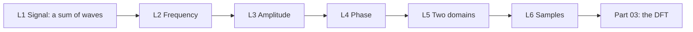

This part builds the words and the pictures that every later part uses.

One pure wave has three numbers: frequency, amplitude and phase. A signal can be a sum of such waves, and a computer keeps it only as samples. Each lesson adds one of these ideas, with small number examples that you can check by hand.

| Code | Lesson | Core idea | Course video | Status |
|---|---|---|---|---|
| L1 | [What a signal is](/notes/maths/fft-signal-processing/02-signals-and-frequency/l1-what-a-signal-is) | A value that changes over time. Waves add point by point. | ch 1, 0:00–0:47 | not started |
| L2 | [Period and frequency](/notes/maths/fft-signal-processing/02-signals-and-frequency/l2-period-and-frequency) | $f = 1/T$. Count the cycles in a list of samples. | ch 2, 0:00–0:20 | in progress |
| L3 | [Amplitude](/notes/maths/fft-signal-processing/02-signals-and-frequency/l3-amplitude) | Height. It changes strength, not speed. | ch 2, 0:20–0:29 | not started |
| L4 | [Phase](/notes/maths/fft-signal-processing/02-signals-and-frequency/l4-phase) | The position in the cycle at t = 0 | ch 2, 0:29–0:43 | not started |
| L5 | [Two domains](/notes/maths/fft-signal-processing/02-signals-and-frequency/l5-two-domains) | The time domain and the frequency domain describe one signal. | ch 2, 0:43–0:58 | not started |
| L6 | [Samples](/notes/maths/fft-signal-processing/02-signals-and-frequency/l6-samples) | $x[n] = x(n/f_s)$. A signal is not the same as its samples. | none | not started |

### How the lessons connect

L1 asks the question of the whole course: which waves make a mixture? L2, L3 and L4 give the three numbers of one wave. L5 writes a signal as a list of those numbers. L6 shows what a computer actually keeps. Part 03 then computes the numbers of L5 from the samples of L6.

> [!note]
> L2 started before L1. The diagnostic showed that counting cycles was the first gap.

> [!trap] Phase reference
> Chapter 2 measures phase on a sine: $A\sin(2\pi f t + \varphi)$. The DFT measures phase from a cosine. So the DFT reports a pure sine as phase −90°. Both are correct. They use different reference waves.
