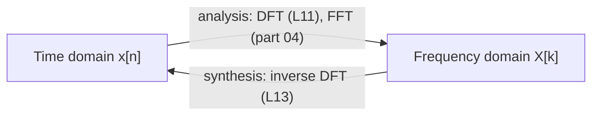

## 1. The question this idea answers

Lesson L1 built the mystery signal from three sine waves. Lessons L2, L3 and L4 gave the three numbers of one sine wave: frequency, amplitude and phase. So we can write the same signal in two ways. We can list its value at each instant. Or we can list the frequency, amplitude and phase of each component.

Which description is better? It depends on the question. This lesson shows what each description makes easy to see. It also shows why a speech system wants the second one, and why the second one needs the phase. The previous lesson is [L4: Phase](/notes/maths/fft-signal-processing/02-signals-and-frequency/l4-phase).

## 2. Mental model

> [!analogy] A smoothie and its recipe card
> You can describe a smoothie in two ways. You can taste it, sip by sip, and write what each sip is like. Or you can read the recipe card: 1.0 cup of banana, 0.6 cup of mango, 0.4 cup of berries. Both describe the same drink. The sips are the **time domain**. The recipe card is the **frequency domain**.
>
> The sips answer some questions easily, for example "Is the last sip too cold?". The card answers other questions easily, for example "How much mango is in it?".
>
> **Where it stops working:** you cannot un-blend a real smoothie. A signal can be un-mixed exactly, and the DFT does it (part 03). Also, a recipe card needs no timing for each fruit. A wave recipe needs one more number for each component: its phase.

## 3. Terms

| Term | Plain meaning |
|---|---|
| time domain | A description of a signal as its value at each instant: $x(t)$, or the samples $x[n]$. |
| frequency domain | A description of a signal as the amplitude and the phase of each frequency in it. |
| spectrum | The frequency-domain description of a signal. Lesson L11 computes it from samples. |
| amplitude spectrum | The amplitude of each frequency, often drawn as bars against frequency. |
| phase spectrum | The phase of each frequency. |
| synthesis | The change from the frequency domain to the time domain: build each component and add. |
| analysis | The change from the time domain to the frequency domain: find the components of a signal. |
| transform | A fixed rule that changes one description of a signal into the other. The DFT is a transform. |

## 4. One signal, two descriptions

Here is the mystery signal of lesson L1 in both descriptions.

**Time domain.** The value at each instant. At a sample rate of $f_s$ = 128 Hz, the 0.5 s of the signal give 64 samples. The table shows the first eight. The times are exact. The table rounds the values to four decimals.

| $n$ | 0 | 1 | 2 | 3 | 4 | 5 | 6 | 7 |
|---|---|---|---|---|---|---|---|---|
| $t$ (ms) | 0 | 7.8125 | 15.625 | 23.4375 | 31.25 | 39.0625 | 46.875 | 54.6875 |
| $x[n]$ | 0 | 1.0405 | 1.4269 | 1.1491 | 0.7535 | 0.6679 | 0.7647 | 0.6544 |

**Frequency domain.** The recipe: three components, each with three numbers.

| Frequency $f$ | Amplitude $A$ | Phase $\varphi$ (on a sine) |
|---|---|---|
| 6 Hz | 1.0 | 0 |
| 14 Hz | 0.6 | 0 |
| 24 Hz | 0.4 | 0 |
| every other frequency | 0 | none |

The time domain needs 64 numbers. The frequency domain needs only 9 numbers, plus the fact that every other amplitude is 0. Both describe exactly the same 0.5 s of signal.


> [!key] Two descriptions, one signal
> The time domain and the frequency domain are not two signals. They are two descriptions of the same signal. A transform changes one description into the other, and the inverse transform changes it back.

## 5. From the frequency domain to the time domain

This direction is **synthesis**. It is easy. You already did it in lesson L1:

1. For each component, compute $A\sin(2\pi f t + \varphi)$ at the instant $t$.
2. Add the results.

> [!example] Worked example: $x[2]$ from the recipe
> Sample 2 is at $t = 2/128 = 0.015625$ s.
>
> 1. 6 Hz: angle $2\pi \cdot 6 \cdot 0.015625 = 3\pi/16 \approx 0.5890$. Value $1.0 \times \sin(0.5890) \approx 0.5556$.
> 2. 14 Hz: angle $2\pi \cdot 14 \cdot 0.015625 = 7\pi/16 \approx 1.3744$. Value $0.6 \times 0.9808 \approx 0.5885$.
> 3. 24 Hz: angle $2\pi \cdot 24 \cdot 0.015625 = 3\pi/4$. Value $0.4 \times 0.7071 \approx 0.2828$.
> 4. Add: $0.5556 + 0.5885 + 0.2828 = 1.4269$.
>
> This is the value in the time-domain table at $n = 2$.

Synthesis is one loop over the components. Lesson L13 does the same with the inverse DFT, for $N$ components at once.

## 6. From the time domain to the frequency domain

This direction is **analysis**. It is the hard direction. You have 64 numbers. Which frequencies are inside? Lesson L1 showed that the shape of the sum hides its components. You cannot read 6, 14 and 24 Hz from the curve.

Parts 03 and 04 build the method, one step at a time:



1. The matching score measures how much of one probe wave a signal holds (lesson L7).
2. A sweep over many probes finds the frequencies (lesson L8).
3. The DFT does the sweep with complex probes, so it finds the amplitude and the phase together (lesson L11).
4. The FFT computes the same DFT much faster (part 04).

> [!trap] The course bars are the recipe, not a DFT result
> The bar chart in chapter 2 of the course shows the recipe that built the signal. Nobody computed it from samples. The DFT of the 64 samples reports different numbers for the same three components. Lessons L23 and L24 explain each difference.

| Recipe | What the DFT reports ($N = 64$, $f_s$ = 128 Hz) |
|---|---|
| 6 Hz, $A = 1.0$, $\varphi = 0$ | bin 3, magnitude 32, phase −90° |
| 14 Hz, $A = 0.6$, $\varphi = 0$ | bin 7, magnitude 19.2, phase −90° |
| 24 Hz, $A = 0.4$, $\varphi = 0$ | bin 12, magnitude 12.8, phase −90° |
| no other entries | a mirror copy at bins 61, 57 and 52 |

Three things differ. The DFT counts in bins, 2 Hz apart here. It reports $A \cdot N/2$ instead of $A$ (lesson L3). It measures phase from a cosine, so a sine reports −90° (lesson L4). The mirror copy comes from real input (lesson L24).

## 7. What each domain makes easy to see

| Question | Easier domain | Why |
|---|---|---|
| When does the sound start? | Time | The values change from about 0 at that instant. |
| What is the largest value? Does it clip? | Time | Read the largest absolute value of the samples. |
| How strong is the signal overall? | Both | RMS of the samples: 0.8718. From the recipe: $\sqrt{(1.0^2 + 0.6^2 + 0.4^2)/2} = \sqrt{0.76} = 0.8718$. |
| Which frequencies are present? | Frequency | Each component is one bar. |
| How strong is the 14 Hz component? | Frequency | Read its bar: 0.6. In the time domain it is hidden in every value. |
| Is there a 50 Hz hum? | Frequency | A hum is one bar at 50 Hz. |
| How do I remove one component? | Frequency | Change one number to 0, then rebuild. |

> [!example] Worked example: remove the 24 Hz component
> 1. **Frequency domain:** change one number. The amplitude of 24 Hz becomes 0. The recipe keeps 6 Hz (1.0) and 14 Hz (0.6).
> 2. **Time domain:** you must change all 64 values. For example, at $t = 0.01$ s the value changes from 1.2296 to $1.2296 - 0.3992 = 0.8304$.
> 3. **Check with the RMS:** the new RMS is $\sqrt{(1.0^2 + 0.6^2)/2} = \sqrt{0.68} \approx 0.8246$. The RMS of the 64 new samples gives the same number.
>
> This is the idea of a filter. Lesson L32 does it with the convolution theorem.

> [!note] Neither domain is "the real one"
> Time questions are easy in the time domain. Frequency questions are easy in the frequency domain. Engineers move between the two as the question changes. The FFT makes that move cheap.

## 8. The frequency description needs the phase

Take the mystery signal again. Change only the phase of the 14 Hz component, from 0 to $\pi/2$. The amplitude bars stay exactly the same: 1.0, 0.6 and 0.4 at 6, 14 and 24 Hz.

| Property | Signal 1: all phases 0 | Signal 2: 14 Hz phase $\pi/2$ |
|---|---|---|
| Amplitude bars | 1.0, 0.6, 0.4 | 1.0, 0.6, 0.4 |
| Value at $t = 0$ | 0 | $0.6\sin(\pi/2) = 0.6$ |
| Largest value | about 1.81 | about 1.92 |
| RMS | 0.8718 | 0.8718 |

The two signals have the same amplitude bars and the same RMS. But they are different signals: the values differ at almost every instant. So a bar chart of amplitudes alone cannot rebuild a signal.

> [!key] A complete frequency description has two parts
> For each frequency, you need the amplitude **and** the phase. The amplitude spectrum tells how strong each component is. The phase spectrum tells where each component starts. The DFT gives both as one complex number per bin (lesson L11).

## 9. Why speech systems want the frequency domain

1. **Vowels differ by frequency.** Each vowel puts strong energy at a different set of frequencies. Two recordings of the same vowel can have very different values at each instant. Their strengths per frequency are much more alike.
2. **Noise often has its own frequencies.** A mains hum sits at 50 Hz or 60 Hz and its multiples. In the frequency domain, it is a few bars that you can remove.
3. **The time domain is long and hard to read.** One second of speech at 16,000 samples per second is 16,000 numbers. No single value tells which sound it is (lesson L1).

Speech changes all the time. So a speech system does not take one spectrum of the whole recording. It takes one spectrum for each short piece, about 25 ms long. The result is a picture of frequency against time: the spectrogram (lesson L34).

> [!note] Source: the Whisper speech recognizer
> The Whisper paper (Radford et al., 2022, "Robust Speech Recognition via Large-Scale Weak Supervision", section 2.2) states the front end of the original models. All audio is re-sampled to 16,000 Hz. Then the model computes an 80-channel log-magnitude mel spectrogram on 25 ms windows with a stride of 10 ms. "Log-magnitude" means that it keeps the strength of each frequency and drops the phase. Lessons L34 to L36 build each of these steps.

## 10. Graphs

The first graph is the time domain of the mystery signal: its value at each instant.

```plot
{
  "title": "Time domain: the mystery signal x(t) (blue)",
  "xAxis": { "label": "time (s)", "domain": [0, 0.5] },
  "yAxis": { "label": "value", "domain": [-2.2, 2.2] },
  "disableZoom": true,
  "data": [
    { "fn": "sin(37.699*x)+0.6*sin(87.965*x)+0.4*sin(150.796*x)", "color": "#1E6091" }
  ]
}
```

The second graph is the frequency domain of the same signal: the recipe as bars. Each bar stands at one frequency. Its height is the amplitude.

```plot
{
  "title": "Frequency domain: the recipe of the same signal (blue). Bars at 6, 14, 24 Hz",
  "xAxis": { "label": "frequency (Hz)", "domain": [0, 32] },
  "yAxis": { "label": "amplitude", "domain": [0, 1.2] },
  "disableZoom": true,
  "data": [
    { "points": [[6, 0], [6, 1.0]], "fnType": "points", "graphType": "polyline", "color": "#1E6091", "skipTip": true },
    { "points": [[14, 0], [14, 0.6]], "fnType": "points", "graphType": "polyline", "color": "#1E6091", "skipTip": true },
    { "points": [[24, 0], [24, 0.4]], "fnType": "points", "graphType": "polyline", "color": "#1E6091", "skipTip": true },
    { "points": [[6, 1.0], [14, 0.6], [24, 0.4]], "fnType": "points", "graphType": "scatter", "attr": {"r": 3}, "color": "#1E6091", "skipTip": true }
  ]
}
```

The third graph shows two signals with the same amplitude bars. Only the phase of the 14 Hz component differs.

```plot
{
  "title": "Same amplitudes, different 14 Hz phase: φ = 0 (blue) and φ = π/2 (purple)",
  "xAxis": { "label": "time (s)", "domain": [0, 0.5] },
  "yAxis": { "label": "value", "domain": [-2.2, 2.2] },
  "disableZoom": true,
  "data": [
    { "fn": "sin(37.699*x)+0.6*sin(87.965*x)+0.4*sin(150.796*x)", "color": "#1E6091" },
    { "fn": "sin(37.699*x)+0.6*sin(87.965*x+1.5708)+0.4*sin(150.796*x)", "color": "#6A4C93" }
  ]
}
```

## 11. Video

Watch the screen split into two descriptions of one signal.

```video
{
  "src": "/notes/media/fft-signal-processing/course/02_What_Frequency_Means.mp4",
  "start": "0:43",
  "end": "0:50",
  "caption": "One signal, two descriptions: the value at each moment, and how much of each frequency."
}
```

Notice that the bars are the recipe that the course used. The rest of the course computes them from the samples.

```video
{
  "src": "/notes/media/fft-signal-processing/course/02_What_Frequency_Means.mp4",
  "start": "0:50",
  "end": "0:58",
  "caption": "The bar chart is the recipe. The rest of the course computes the right side from the left."
}
```

## 12. Code

Write synthesis: a function that builds the time domain from a recipe. Then use NumPy for a first test of analysis.

[Open a lab for this lesson](/labs/new?note=maths/fft-signal-processing/02-signals-and-frequency/l5-two-domains)

### Exercise 1: synthesis

Write `synthesize(recipe, t)`. The `recipe` is a list of `(f, A, phi)` tuples. The function returns the sum of $A\sin(2\pi f t + \varphi)$ over all components, at the times `t`.

Acceptance tests, with `t = np.arange(64) / 128` and `recipe = [(6, 1.0, 0), (14, 0.6, 0), (24, 0.4, 0)]`:

1. `synthesize(recipe, t).shape == (64,)` is True.
2. `np.isclose(synthesize(recipe, t)[2], 1.4269, atol=1e-4)` is True.
3. The result matches your `mystery(128, 64)` from lesson L1 (use `np.allclose`).
4. `synthesize([], t)` returns 64 zeros.
5. With `recipe2 = [(6, 1.0, 0), (14, 0.6, np.pi / 2), (24, 0.4, 0)]`: the two signals are different (`np.allclose` is False), but their RMS values are equal (`np.isclose` is True).
6. Without the 24 Hz component, the RMS is close to `np.sqrt(0.68)`.

### Exercise 2: a first test of analysis

NumPy can compute the frequency domain from the samples. This line gives one complex number for each bin:

```python
X = np.fft.fft(x)
```

Print the bins where `np.abs(X) > 1`. The test: the list equals `[3, 7, 12, 52, 57, 61]`. Multiply the first three bins by $f_s/N = 2$ Hz, and compare with the recipe. Do not try to explain the other numbers yet. Lessons L23 and L24 explain them. The [FFT explorer lab](/labs/new?template=fft-explorer) lets you change the frequencies with sliders.

```check
{
  "question": "Stuck on `synthesize`? Reveal a hint.",
  "hint": "Start with an array of zeros with the same shape as `t`.",
  "answer": "Make `x` as zeros with the shape of `t`. Loop over the recipe. For each `(f, A, phi)`, add `A * np.sin(2 * np.pi * f * t + phi)` to `x`. Return `x`. An empty recipe then gives zeros without extra code."
}
```

## 13. Common mistakes

1. **The two domains are two signals.** They are two descriptions of one signal. A transform moves between them without loss.
2. **Amplitude bars alone describe the signal.** Different phases give different signals with the same bars. You need the amplitude and the phase of each frequency.
3. **The course bar chart is a DFT result.** It is the recipe that built the signal. The DFT reports bins, $A \cdot N/2$, phases from a cosine, and a mirror copy.
4. **The frequency domain shows when a sound happens.** One spectrum of a whole recording hides the timing inside the phases. To see timing and frequency together, use one spectrum per short piece: the spectrogram (lesson L34).
5. **One domain is always better.** Each domain makes some questions easy. Pick the domain from the question.

## 14. One-minute explanation

A signal has two descriptions. The time domain lists the value at each instant: for the mystery signal, 64 samples. The frequency domain lists the components: for the mystery signal, 6, 14 and 24 Hz with amplitudes 1.0, 0.6 and 0.4, all with phase 0. Both describe exactly the same signal. Going from the frequency domain to the time domain is easy: build each wave and add. Going the other way is hard, and the DFT and the FFT do it. The time domain makes timing and clipping easy to see. The frequency domain makes the components, a hum, or a filter easy. Amplitudes alone are not enough to rebuild the signal: you also need the phase of each component. Speech systems use the frequency domain, one short piece at a time, because the sounds of speech differ mainly by frequency.

## 15. Check questions

```check
{
  "question": "Define the time domain and the frequency domain. Describe the mystery signal in each.",
  "hint": "One lists values at instants. The other lists components.",
  "answer": "The time domain describes a signal by its value at each instant. For the mystery signal: the 64 samples at $f_s$ = 128 Hz, starting 0, 1.0405, 1.4269, ... The frequency domain describes a signal by the amplitude and phase of each frequency. For the mystery signal: 6 Hz with $A = 1.0$, 14 Hz with $A = 0.6$ and 24 Hz with $A = 0.4$. All three have phase 0 on a sine. Every other frequency has amplitude 0."
}
```

```check
{
  "question": "A recipe holds two components: 2 Hz with $A = 1$, $\\varphi = 0$, and 4 Hz with $A = 0.5$, $\\varphi = \\pi/2$. Compute the signal at $t = 0$, $t = 0.0625$ s and $t = 0.125$ s.",
  "hint": "Compute $\\sin(2\\pi \\cdot 2t)$ and $0.5\\sin(2\\pi \\cdot 4t + \\pi/2)$ at each instant, then add.",
  "answer": "$t = 0$: $\\sin(0) + 0.5\\sin(\\pi/2) = 0 + 0.5 = 0.5$. $t = 0.0625$: $\\sin(\\pi/4) + 0.5\\sin(\\pi/2 + \\pi/2) = 0.7071 + 0.5\\sin(\\pi) = 0.7071 + 0 = 0.7071$. $t = 0.125$: $\\sin(\\pi/2) + 0.5\\sin(\\pi + \\pi/2) = 1 + 0.5 \\times (-1) = 0.5$."
}
```

```check
{
  "question": "Two signals have exactly the same amplitude bars. Must they be the same signal? Give the reason and an example.",
  "hint": "Which number of each component does a bar chart of amplitudes not show?",
  "answer": "No. The amplitude bars do not show the phases. Example: the mystery signal with all phases 0, and the same signal with the 14 Hz phase changed to $\\pi/2$. Both have bars 1.0, 0.6 and 0.4 at 6, 14 and 24 Hz. But the first starts at 0 and the second at 0.6, and their largest values are about 1.81 and 1.92. A complete frequency description needs the amplitude and the phase of each component."
}
```

```check
{
  "question": "Pick the easier domain for each task, and give the reason. (a) Find the instant when a speaker starts. (b) Find a 60 Hz hum. (c) Check whether a recording clips. (d) Measure the strength of the 1 kHz part of a tone.",
  "hint": "Ask whether the task is about an instant or about a frequency.",
  "answer": "(a) Time domain: the start is an instant, where the values change from about 0. (b) Frequency domain: a hum is a bar at 60 Hz (and its multiples). (c) Time domain: clipping shows as samples at the limit of the range. (d) Frequency domain: read the amplitude at 1 kHz. In the time domain, that part hides inside every value."
}
```

```check
{
  "question": "The DFT of the 64 mystery samples gives a magnitude of 19.2 at bin 7. The course bar for 14 Hz has height 0.6. Is one of them wrong?",
  "hint": "Which picture is the recipe, and which is a computed result?",
  "answer": "Neither is wrong. The bar of height 0.6 is the recipe that built the signal. The DFT reports $A \\cdot N/2 = 0.6 \\times 64/2 = 19.2$, at bin 7, because the bins are $f_s/N = 128/64 = 2$ Hz apart and $7 \\times 2 = 14$ Hz. Lesson L23 changes the DFT numbers back into hertz and amplitudes."
}
```

## 16. Links

- Previous: [L4: Phase](/notes/maths/fft-signal-processing/02-signals-and-frequency/l4-phase)
- Next: [L6: Samples](/notes/maths/fft-signal-processing/02-signals-and-frequency/l6-samples)
- The mystery signal: [L1: What a signal is](/notes/maths/fft-signal-processing/02-signals-and-frequency/l1-what-a-signal-is)
- The start of analysis: [L7: The matching score](/notes/maths/fft-signal-processing/03-matching-to-dft/l7-matching-score)
- The DFT: [L11: The DFT formula](/notes/maths/fft-signal-processing/03-matching-to-dft/l11-the-dft-formula)
- Synthesis with the DFT: [L13: The inverse DFT](/notes/maths/fft-signal-processing/03-matching-to-dft/l13-inverse-dft)
- From bins to hertz: [L23: Hertz and amplitude](/notes/maths/fft-signal-processing/05-reading-spectra/l23-hertz-and-amplitude)
- The mirror copy: [L24: The mirror](/notes/maths/fft-signal-processing/05-reading-spectra/l24-the-mirror)
- Filters: [L32: The convolution theorem](/notes/maths/fft-signal-processing/06-fourier-family-and-duality/l32-convolution-theorem)
- Frequency against time: [L34: The STFT and the spectrogram](/notes/maths/fft-signal-processing/07-speech-time-frequency/l34-stft-and-spectrogram)
- [02 Signals and frequency](/notes/maths/fft-signal-processing/02-signals-and-frequency)
- [Glossary](/notes/maths/fft-signal-processing/glossary)
