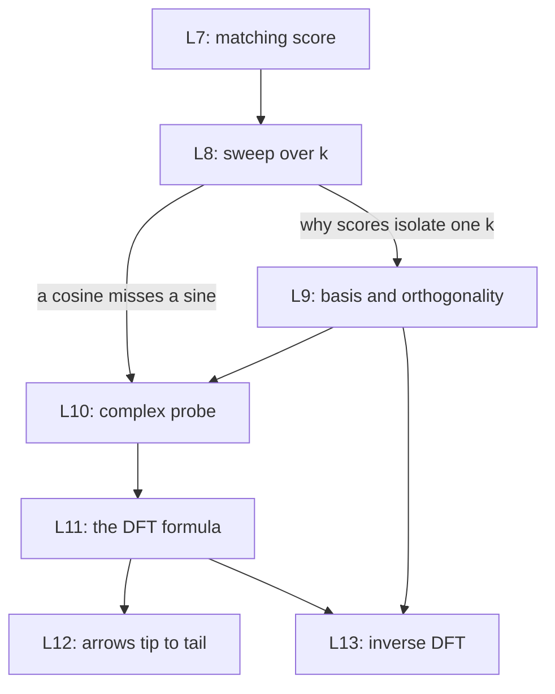

This part answers one question: which frequencies are inside a list of samples? It builds the DFT from one operation, the matching score, one step at a time. Every lesson uses the teaching signal $x[n] = \cos(2\pi n/8) + 0.5\sin(2\pi \cdot 2n/8)$ with N = 8, and its spectrum X = [0, 4, −2i, 0, 0, 0, 2i, 4].

| Code | Lesson | Core idea | Course video | Status |
|---|---|---|---|---|
| L7 | [The matching score](/notes/maths/fft-signal-processing/03-matching-to-dft/l7-matching-score) | Multiply point by point, then add. | ch 3, 0:00–0:33 | not started |
| L8 | [Sweep and cancellation](/notes/maths/fft-signal-processing/03-matching-to-dft/l8-sweep-and-cancellation) | A cosine probe misses a sine. | ch 3, 0:33–1:40 | not started |
| L9 | [Basis and orthogonality](/notes/maths/fft-signal-processing/03-matching-to-dft/l9-basis-and-orthogonality) | Two coordinate systems for one vector | ch 4, full | not started |
| L10 | [The complex probe](/notes/maths/fft-signal-processing/03-matching-to-dft/l10-the-complex-probe) | One complex sum = cosine score − i·sine score | ch 5, full | not started |
| L11 | [The DFT formula](/notes/maths/fft-signal-processing/03-matching-to-dft/l11-the-dft-formula) | Every symbol, and the k = 1, 2, 3 table by hand | ch 6, full | not started |
| L12 | [Rotating vectors](/notes/maths/fft-signal-processing/03-matching-to-dft/l12-rotating-vectors) | Terms as arrows, added tip to tail | ch 7, full | not started |
| L13 | [Inverse DFT](/notes/maths/fft-signal-processing/03-matching-to-dft/l13-inverse-dft) | Rebuild x[n] from X[k]. | ch 4, 1:02–1:10 | not started |

## How the lessons connect

L7 and L8 give the operation and its two weak points. L9 explains why each score sees only one frequency. L10 joins the cosine probe and the sine probe into one complex probe. L11 writes the result as the DFT formula, and L12 draws it. L13 returns from the coefficients to the samples.
