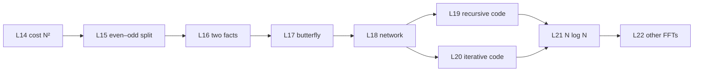

This part turns the direct DFT of part 03 into the fast Fourier transform. It starts with the cost of the direct method and ends with the FFT in code, its speed, and the FFTs that libraries use. The teaching signal $x[n] = \cos(2\pi n/8) + 0.5\sin(2\pi \cdot 2n/8)$ with N = 8 runs through every lesson, so each step has real numbers.

| Code | Lesson | Core idea | Course video | Status |
|---|---|---|---|---|
| L14 | [The cost of the direct DFT](/notes/maths/fft-signal-processing/04-fft/l14-cost-of-the-direct-dft) | N² multiplications, but only N different W values | ch 8, full | not started |
| L15 | [The even–odd split](/notes/maths/fft-signal-processing/04-fft/l15-even-odd-split) | E[k] and O[k] of the teaching signal by hand, then $X[k] = E[k] + W_8^k O[k]$ | ch 9, 0:00–0:50 | not started |
| L16 | [Two facts that make the FFT fast](/notes/maths/fft-signal-processing/04-fft/l16-two-facts) | E and O repeat with period N/2. $W^{k+N/2} = -W^k$. | ch 9, 0:50–1:19 | not started |
| L17 | [The butterfly](/notes/maths/fft-signal-processing/04-fft/l17-the-butterfly) | Trace k = 0, 1, 2, 3 with real numbers. | ch 9, 1:19–2:01 | not started |
| L18 | [Recursion and the network](/notes/maths/fft-signal-processing/04-fft/l18-recursion-and-the-network) | Bit reversal and all 3 stages | ch 9, 2:01–3:30 | not started |
| L19 | [Recursive FFT code](/notes/maths/fft-signal-processing/04-fft/l19-recursive-fft-code) | Write `fft_recursive(x)`. | ch 9, 2:01–2:15 (review) | not started |
| L20 | [Iterative FFT and bugs](/notes/maths/fft-signal-processing/04-fft/l20-iterative-fft-and-bugs) | In-place FFT. Fix 3 buggy versions. | ch 9, 2:23–3:01 (review) | not started |
| L21 | [Why the FFT is fast](/notes/maths/fft-signal-processing/04-fft/l21-why-it-is-fast) | $T(N) = 2T(N/2) + cN$ gives $N \log_2 N$. | ch 10, full | not started |
| L22 | [Other FFTs](/notes/maths/fft-signal-processing/04-fft/l22-other-ffts) | Overview: other radixes, sizes that are not a power of 2, real-input FFT | none | not started |

## How the lessons connect

L14 finds the waste in the direct DFT. L15 and L16 derive the formulas that remove it. L17 computes one combining step with numbers, and L18 repeats the split down to single samples. L19 and L20 turn the network into code. L21 proves the speed, and L22 shows the wider family.

