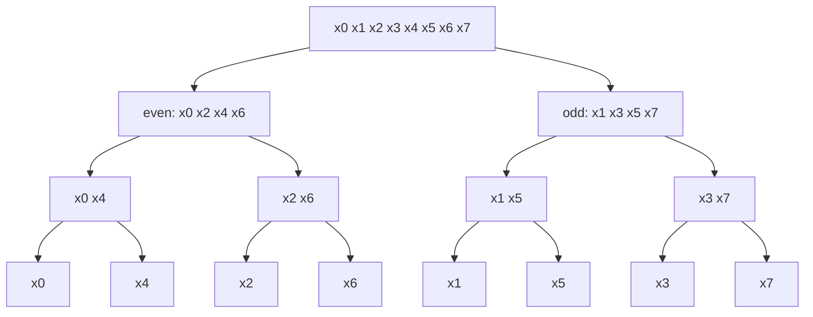

## 1. The question this idea answers

Lesson [L17](/notes/maths/fft-signal-processing/04-fft/l17-the-butterfly) joined E and O with 4 butterflies. But E and O came from two direct 4-point DFTs, and those cost 2 × 16 = 32 multiplications. Can we make E and O cheaper too?

Yes. E is a DFT of 4 samples, so the even–odd split works inside E as well, and also inside O. Split again and again, until each DFT has one sample. This lesson follows that recursion to its end. The result is a fixed network. The inputs stand in a special order on the left, 3 stages of butterflies follow, and X[0] to X[7] leave on the right.

## 2. Mental model

> [!analogy] A tournament bracket, played backwards
> A tournament with 8 players has 3 rounds: 4 matches, then 2, then 1. The FFT network also has 3 rounds, called stages. Each stage joins pairs of small results into larger results. The bracket also fixes where each player starts, so that the right players meet in each round.
>
> **Where it stops working:** in a tournament, half of the players leave after each round. In the FFT, every butterfly keeps both of its results: the sum and the difference. So each stage has 4 butterflies and 8 values. No information is lost.

## 3. Terms

| Term | Plain meaning |
|---|---|
| recursion | A method that solves a problem with smaller copies of the same problem. |
| base case | The smallest problem. It has a direct answer, so the recursion stops there. Here: a DFT of one sample. |
| 2-point DFT | The DFT of two samples a and b: $X[0] = a + b$, $X[1] = a - b$. |
| stage | One column of butterflies in the network. Stage s builds DFTs of $2^s$ points. |
| network | The diagram of all stages: which values each butterfly reads and writes, and which twiddle it uses. Also called a signal-flow graph. |
| row | One position (memory cell) in the network, numbered 0 to N − 1 from the top. |
| bit-reversed order | The order 0, 4, 2, 6, 1, 5, 3, 7 for N = 8. Write each index in binary and read the bits backwards. |
| natural order | The order 0, 1, 2, ..., N − 1. |
| span | The distance between the two rows of a butterfly: 1 in stage 1, 2 in stage 2, 4 in stage 3. |

> [!note] Rounding on this page
> $1/\sqrt{2} = 0.70710\ldots$ and $\sqrt{2} = 1.41421\ldots$. Tables show four decimals. The text, the course and the figure round to two decimals: 0.71 and 1.41.

## 4. Split again until one sample is left

### 4.1 The 4-point DFTs split into 2-point DFTs

The even half e = [x0, x2, x4, x6] is a 4-sample signal. Apply the even–odd split of lesson [L15](/notes/maths/fft-signal-processing/04-fft/l15-even-odd-split) to it:

1. Its even samples are e[0] and e[2], which are x[0] and x[4].
2. Its odd samples are e[1] and e[3], which are x[2] and x[6].
3. The twiddle is now $W_4^k$, with k = 0, 1.

$$
E[k] = A[k] + W_4^{k}\, B[k], \qquad E[k+2] = A[k] - W_4^{k}\, B[k], \qquad k = 0, 1,
$$

where A is the 2-point DFT of [x0, x4] and B is the 2-point DFT of [x2, x6]. In the same way, O splits into the 2-point DFTs of [x1, x5] and [x3, x7].

### 4.2 The 2-point DFT is one butterfly

For two samples a and b, N = 2 and $W_2 = e^{-i2\pi/2} = e^{-i\pi} = -1$. The definition gives

$$
X[0] = a\,W_2^{0} + b\,W_2^{0} = a + b, \qquad X[1] = a\,W_2^{0} + b\,W_2^{1} = a - b.
$$

This is a butterfly with the twiddle $W_2^0 = 1$: a sum and a difference, with no real multiplication.

### 4.3 The 1-point DFT is the sample

Split a 2-point DFT once more, and each half has one sample. For N = 1, the sum has one term, n = 0, and $W_1^{0} = 1$:

$$
X[0] = \sum_{n=0}^{0} x[n]\, W_1^{0 \cdot n} = x[0].
$$

A 1-point DFT is the sample itself. No work is left, so the recursion stops here. This is the base case.

### 4.4 The recursion tree

Each level of the tree splits every group into its even and odd members.



Read the bottom row from left to right: x0, x4, x2, x6, x1, x5, x3, x7. The network starts with the samples in this order.

## 5. Bit-reversed order

Write each index in 3-bit binary (lesson [F8](/notes/maths/fft-signal-processing/01-math-foundations/f8-clock-arithmetic-log-binary)). Then read the bits backwards.

| index i | binary | bits reversed | value | sample in row i of the network |
|---|---|---|---|---|
| 0 | 000 | 000 | 0 | x[0] |
| 1 | 001 | 100 | 4 | x[4] |
| 2 | 010 | 010 | 2 | x[2] |
| 3 | 011 | 110 | 6 | x[6] |
| 4 | 100 | 001 | 1 | x[1] |
| 5 | 101 | 101 | 5 | x[5] |
| 6 | 110 | 011 | 3 | x[3] |
| 7 | 111 | 111 | 7 | x[7] |

Row i holds the sample whose index is i with its bits reversed. The pairing works in both directions: x[6] sits in row 3, and x[3] sits in row 6.

Why does binary appear? Write an index i with the bits $b_2 b_1 b_0$, so $i = 4b_2 + 2b_1 + b_0$.

1. The first split sorts by $b_0$. Even samples ($b_0 = 0$) go to the top half. So $b_0$ decides the top bit of the row number.
2. The second split sorts by $b_1$ inside each half. So $b_1$ decides the middle bit of the row number.
3. The third split sorts by $b_2$. So $b_2$ decides the last bit of the row number.

The row number is $4b_0 + 2b_1 + b_2$: the same bits in reverse order.

> [!example] Worked example: where does x[6] go?
> 6 = 110 in binary, so $b_2 = 1$, $b_1 = 1$, $b_0 = 0$.
> 1. $b_0 = 0$: x[6] is even, so it goes to the top half (rows 0 to 3).
> 2. $b_1 = 1$: inside the even half, x[6] goes with x[2] to the second pair (rows 2 and 3).
> 3. $b_2 = 1$: inside that pair, x[6] comes second (row 3).
>
> Row 3 = 011 in binary. This is 110 read backwards.

The graph shows the same 8 values in natural order and in bit-reversed order.

```plot
{
  "title": "Natural order (blue) and bit-reversed order (ink)",
  "xAxis": {"label": "row (position in memory)", "domain": [-0.5, 7.5]},
  "yAxis": {"label": "value in that row", "domain": [-1.6, 1.6]},
  "disableZoom": true,
  "data": [
    {"points": [[0.0, 1.0], [1.0, 1.2071], [2.0, 0.0], [3.0, -1.2071], [4.0, -1.0], [5.0, -0.2071], [6.0, 0.0], [7.0, 0.2071]], "fnType": "points", "graphType": "polyline", "color": "#1E6091", "skipTip": true},
    {"points": [[0.0, 1.0], [1.0, 1.2071], [2.0, 0.0], [3.0, -1.2071], [4.0, -1.0], [5.0, -0.2071], [6.0, 0.0], [7.0, 0.2071]], "fnType": "points", "graphType": "scatter", "attr": {"r": 3}, "color": "#1E6091", "skipTip": true},
    {"points": [[0.0, 1.0], [1.0, -1.0], [2.0, 0.0], [3.0, 0.0], [4.0, 1.2071], [5.0, -0.2071], [6.0, -1.2071], [7.0, 0.2071]], "fnType": "points", "graphType": "polyline", "color": "#100D12", "skipTip": true},
    {"points": [[0.0, 1.0], [1.0, -1.0], [2.0, 0.0], [3.0, 0.0], [4.0, 1.2071], [5.0, -0.2071], [6.0, -1.2071], [7.0, 0.2071]], "fnType": "points", "graphType": "scatter", "attr": {"r": 3}, "color": "#100D12", "skipTip": true}
  ]
}
```

## 6. The network, stage by stage

The network computes the tree from the bottom up. Each stage reads the values of the previous stage and writes 8 new values.

### 6.1 Stage 1: four 2-point DFTs

Stage 1 joins neighbor rows: (0, 1), (2, 3), (4, 5), (6, 7). The twiddle is $W_2^0 = 1$, so each butterfly is a sum and a difference.

| rows | inputs | sum (top row) | difference (bottom row) |
|---|---|---|---|
| 0, 1 | x[0] = 1, x[4] = −1 | 1 + (−1) = 0 | 1 − (−1) = 2 |
| 2, 3 | x[2] = 0, x[6] = 0 | 0 | 0 |
| 4, 5 | x[1] = 1.2071, x[5] = −0.2071 | 1 | 1.4142 |
| 6, 7 | x[3] = −1.2071, x[7] = 0.2071 | −1 | −1.4142 |

The exact forms show why rows 4 and 5 are so clean: $x[1] + x[5] = \left(\tfrac{1}{\sqrt2} + \tfrac12\right) + \left(-\tfrac{1}{\sqrt2} + \tfrac12\right) = 1$ and $x[1] - x[5] = \tfrac{2}{\sqrt2} = \sqrt2$.

Stage 1 = [0, 2, 0, 0, 1, 1.41, −1, −1.41].

### 6.2 Stage 2: two 4-point DFTs

Stage 2 joins rows at distance 2: (0, 2), (1, 3), (4, 6), (5, 7). Lesson L15 used the twiddle of the full size of the DFT that it builds. Stage 2 builds 4-point DFTs, so the twiddles are $W_4^0 = 1$ and $W_4^1 = -i$.

| rows | top | bottom | twiddle | t = twiddle × bottom | top + t | top − t |
|---|---|---|---|---|---|---|
| 0, 2 | 0 | 0 | $W_4^0 = 1$ | 0 | row 0: 0 | row 2: 0 |
| 1, 3 | 2 | 0 | $W_4^1 = -i$ | 0 | row 1: 2 | row 3: 2 |
| 4, 6 | 1 | −1 | $W_4^0 = 1$ | −1 | row 4: 0 | row 6: 2 |
| 5, 7 | 1.4142 | −1.4142 | $W_4^1 = -i$ | 1.4142i | row 5: 1.4142 + 1.4142i | row 7: 1.4142 − 1.4142i |

Stage 2 = [0, 2, 0, 2, 0, 1.41 + 1.41i, 2, 1.41 − 1.41i].

> [!key] Stage 2 holds E and O
> Rows 0 to 3 are exactly E[0] to E[3] = [0, 2, 0, 2]. Rows 4 to 7 are exactly O[0] to O[3] = [0, 1.41 + 1.41i, 2, 1.41 − 1.41i]. These are the values that lesson L15 computed with two direct 4-point DFTs.

### 6.3 Stage 3: one 8-point DFT

Stage 3 joins rows at distance 4: (0, 4), (1, 5), (2, 6), (3, 7). The twiddles are $W_8^0$ to $W_8^3$. These are the four butterflies of lesson L17:

| rows | E[k] (top) | O[k] (bottom) | twiddle | t | top row | bottom row |
|---|---|---|---|---|---|---|
| 0, 4 | 0 | 0 | $W_8^0 = 1$ | 0 | X[0] = 0 | X[4] = 0 |
| 1, 5 | 2 | 1.41 + 1.41i | $W_8^1 = 0.71 - 0.71i$ | 2 | X[1] = 4 | X[5] = 0 |
| 2, 6 | 0 | 2 | $W_8^2 = -i$ | −2i | X[2] = −2i | X[6] = 2i |
| 3, 7 | 2 | 1.41 − 1.41i | $W_8^3 = -0.71 - 0.71i$ | −2 | X[3] = 0 | X[7] = 4 |

Stage 3 = [0, 4, −2i, 0, 0, 0, 2i, 4]. Row r holds X[r]. So the outputs leave the network in natural order.

### 6.4 All columns together

| row | input | stage 1 | stage 2 | stage 3 |
|---|---|---|---|---|
| 0 | x[0] = 1 | 0 | 0 = E[0] | 0 = X[0] |
| 1 | x[4] = −1 | 2 | 2 = E[1] | 4 = X[1] |
| 2 | x[2] = 0 | 0 | 0 = E[2] | −2i = X[2] |
| 3 | x[6] = 0 | 0 | 2 = E[3] | 0 = X[3] |
| 4 | x[1] = 1.21 | 1 | 0 = O[0] | 0 = X[4] |
| 5 | x[5] = −0.21 | 1.41 | 1.41 + 1.41i = O[1] | 0 = X[5] |
| 6 | x[3] = −1.21 | −1 | 2 = O[2] | 2i = X[6] |
| 7 | x[7] = 0.21 | −1.41 | 1.41 − 1.41i = O[3] | 4 = X[7] |

![Alt text: the 8-point FFT network with bit-reversed inputs, three stages of butterflies with values and twiddles, and outputs X[0] to X[7]](/notes/media/fft-signal-processing/figures/l18-network-8.svg)

## 7. Which twiddles each stage uses

| stage | builds DFTs of | butterflies | span | twiddles |
|---|---|---|---|---|
| 1 | 2 points | 4 | 1 | $W_2^0 = 1$ in all 4 |
| 2 | 4 points | 4 | 2 | $W_4^0 = 1$ in 2, $W_4^1 = -i$ in 2 |
| 3 | 8 points | 4 | 4 | $W_8^0, W_8^1, W_8^2, W_8^3$, one each |

The rule: a stage that builds DFTs of size M uses the twiddles $W_M^j$ for j = 0 to M/2 − 1. The span is M/2.

## 8. Count the work and see the reuse

N = 8 has $\log_2 8 = 3$ stages, because each split halves the size: 8 → 4 → 2 → 1. Each stage has N/2 = 4 butterflies, because each butterfly writes 2 of the 8 values. So the network has

$$
3 \text{ stages} \times 4 \text{ butterflies} = 12 \text{ butterflies} = 12 \text{ twiddle multiplications},
$$

against 64 for the direct DFT. Many of these twiddles are 1 or −i, and they cost even less. Only $W_8^1$ and $W_8^3$ need real multiplications.

| N | stages $\log_2 N$ | butterflies per stage N/2 | butterflies in total |
|---|---|---|---|
| 8 | 3 | 4 | 12 |
| 16 | 4 | 8 | 32 |
| 1024 | 10 | 512 | 5,120 |

> [!key] Reuse is the trick
> Each value in a stage feeds exactly two outputs of the next stage: one sum and one difference. The network computes every intermediate value once and uses it twice. The direct DFT computes each output from scratch.

> [!trap] The outputs are not bit-reversed
> In this network the inputs are in bit-reversed order and the outputs are in natural order. Other FFT variants (decimation in frequency) do the opposite. This subject uses radix-2 decimation in time only.

## 9. Video

The first clip applies the split again and reaches the 1-point DFT. Then it reads the bottom row in bit-reversed order.

```video
{
  "src": "/notes/media/fft-signal-processing/course/09_The_FFT_Butterfly_Algorithm.mp4",
  "start": "2:01",
  "end": "2:23",
  "caption": "Each 4-point DFT splits into two 2-point DFTs, then into single samples. The bottom row is in bit-reversed order."
}
```

The second clip builds the network stage by stage. Find the butterfly that makes X[1] = 4 and X[5] = 0.

```video
{
  "src": "/notes/media/fft-signal-processing/course/09_The_FFT_Butterfly_Algorithm.mp4",
  "start": "2:23",
  "end": "3:09",
  "caption": "Stage 1 makes 2-point DFTs, stage 2 makes E and O, stage 3 makes X[0] to X[7] in natural order."
}
```

The third clip explains the reuse and the count: N/2 butterflies per stage, log₂N stages.

```video
{
  "src": "/notes/media/fft-signal-processing/course/09_The_FFT_Butterfly_Algorithm.mp4",
  "start": "3:09",
  "end": "3:30",
  "caption": "The network computes every intermediate value once and uses it for two outputs. 3 stages × 4 butterflies."
}
```

## 10. Code

Build these in a lab. Use your `butterfly(e, o, w)` from lesson L17.

1. **Bit reversal.** Write `bit_reverse_indices(N)` for N a power of 2. It returns the list of N indices in bit-reversed order.
2. **One stage.** Write `apply_stage(a, M)`. The list `a` has length N. The function applies the stage that builds DFTs of size M: blocks of M rows, butterflies at span M/2, twiddles $W_M^j$. It returns a new list.
3. **The whole network.** Put the samples in bit-reversed order, then apply the stages for M = 2, 4, ..., N. Keep the list after each stage.

Acceptance tests:

- `bit_reverse_indices(1) == [0]`, `bit_reverse_indices(2) == [0, 1]`, `bit_reverse_indices(8) == [0, 4, 2, 6, 1, 5, 3, 7]`.
- `bit_reverse_indices(16) == [0, 8, 4, 12, 2, 10, 6, 14, 1, 9, 5, 13, 3, 11, 7, 15]`.
- Apply the reversal twice: for `r = np.array(bit_reverse_indices(N))`, `r[r]` equals `np.arange(N)` for N = 8, 16 and 1024.
- For the teaching signal, the three stage lists match the table in section 6.4 (use `np.allclose`).
- For random x with N = 16 and N = 64, the last list is close to `np.fft.fft(x)`.

One Python call that helps with task 1 (a 3-bit binary string, then reversed):

```python
format(6, "03b")[::-1]   # "110" reversed is "011"
```

[Open a lab for this lesson](/labs/new?note=maths/fft-signal-processing/04-fft/l18-recursion-and-the-network)

```check
{
  "question": "Hint for `apply_stage(a, M)`: which rows does each butterfly join?",
  "hint": "Hint level 1 (idea): cut the N rows into blocks of M rows. Inside a block, row j joins row j + M/2.",
  "answer": "Hint level 2 (pseudocode): h = M/2. For each block start s = 0, M, 2M, ...: for j = 0 .. h − 1: w = exp(−i·2π·j/M). Then (new[s + j], new[s + j + h]) = butterfly(a[s + j], a[s + j + h], w). Return new."
}
```

## 11. Common mistakes

1. **"The outputs are bit-reversed."** In this network the inputs are bit-reversed. The outputs are in natural order.
2. **The full-size twiddle in every stage.** A stage that builds DFTs of size M uses $W_M^j$, not $W_N^j$. Stage 1 uses only $W_2^0 = 1$.
3. **The wrong row pairs.** The span doubles in each stage: 1, then 2, then 4.
4. **Reversed digits of the decimal number.** Reverse the bits of the binary form with a fixed width of $\log_2 N$ bits. For N = 8, 1 = 001 becomes 100 = 4.
5. **"The recursion stops at 2 points."** It can stop at 1 point, because a 1-point DFT is the sample itself.

## 12. One-minute explanation

The even–odd split works on any DFT with an even length, so split E and O again, until each DFT has one sample. A 1-point DFT is the sample itself, so the recursion stops there. The splits leave the samples in bit-reversed order: 0, 4, 2, 6, 1, 5, 3, 7, which is each index in binary, read backwards. The network then runs in 3 stages: four 2-point DFTs, then E and O, then X[0] to X[7] in natural order. Each stage has 4 butterflies, so the network needs 12 twiddle multiplications instead of 64. The network computes every value once and uses it for two outputs.

## 13. Check questions

```check
{
  "question": "N = 8. Write 6 in 3-bit binary and reverse it. Which sample sits in row 6 of the network?",
  "hint": "Reverse the bits, then read the result as a number.",
  "answer": "6 = 110. Reversed: 011 = 3. So row 6 holds x[3]."
}
```

```check
{
  "question": "Compute the 4-point network for x = [1, 2, 3, 4] by hand. Give the bit-reversed input, stage 1 and stage 2.",
  "hint": "Bit-reversed order for N = 4 is 0, 2, 1, 3. Stage 2 uses $W_4^0 = 1$ for rows (0, 2) and $W_4^1 = -i$ for rows (1, 3).",
  "answer": "Input in rows: [x0, x2, x1, x3] = [1, 3, 2, 4]. Stage 1: rows (0,1): 1 + 3 = 4, 1 − 3 = −2. Rows (2,3): 2 + 4 = 6, 2 − 4 = −2. Stage 1 = [4, −2, 6, −2]. Stage 2: rows (0,2): 4 + 6 = 10, 4 − 6 = −2. Rows (1,3): t = (−i)(−2) = 2i, so −2 + 2i and −2 − 2i. X = [10, −2 + 2i, −2, −2 − 2i], the same as `np.fft.fft([1, 2, 3, 4])`."
}
```

```check
{
  "question": "Why must the inputs of this network be in bit-reversed order?",
  "hint": "Which two samples does the first butterfly of stage 1 join?",
  "answer": "Stage 1 joins neighbor rows into 2-point DFTs. The recursion needs the 2-point DFTs of [x0, x4], [x2, x6], [x1, x5] and [x3, x7]. So these pairs must be neighbors. Each split sorts by the lowest remaining bit first, so the row number is the index with its bits reversed."
}
```

```check
{
  "question": "N = 16. How many stages and how many butterflies per stage does the network have? In which row does x[11] start?",
  "hint": "Use 4-bit binary for N = 16.",
  "answer": "$\\log_2 16 = 4$ stages, 16/2 = 8 butterflies per stage, 32 in total. 11 = 1011, reversed 1101 = 13. So x[11] starts in row 13."
}
```

```check
{
  "question": "In the 8-point network, which butterfly makes X[1] and X[5]? Give the stage, the rows and the twiddle.",
  "hint": "X[k] and X[k + 4] come from the same butterfly.",
  "answer": "Stage 3, rows 1 and 5, twiddle $W_8^1 = 0.71 - 0.71i$. Its inputs are E[1] = 2 (row 1) and O[1] = 1.41 + 1.41i (row 5). It is the butterfly of lesson L17."
}
```

## 14. Links

- Previous: [L17: The butterfly](/notes/maths/fft-signal-processing/04-fft/l17-the-butterfly)
- Next: [L19: Recursive FFT code](/notes/maths/fft-signal-processing/04-fft/l19-recursive-fft-code)
- The split that this lesson repeats: [L15: The even–odd split](/notes/maths/fft-signal-processing/04-fft/l15-even-odd-split)
- Binary numbers: [F8: Clock arithmetic, log₂ and binary](/notes/maths/fft-signal-processing/01-math-foundations/f8-clock-arithmetic-log-binary)
- The network in code, in place: [L20: Iterative FFT and bugs](/notes/maths/fft-signal-processing/04-fft/l20-iterative-fft-and-bugs)
- [04 FFT](/notes/maths/fft-signal-processing/04-fft)
- [Glossary](/notes/maths/fft-signal-processing/glossary)
