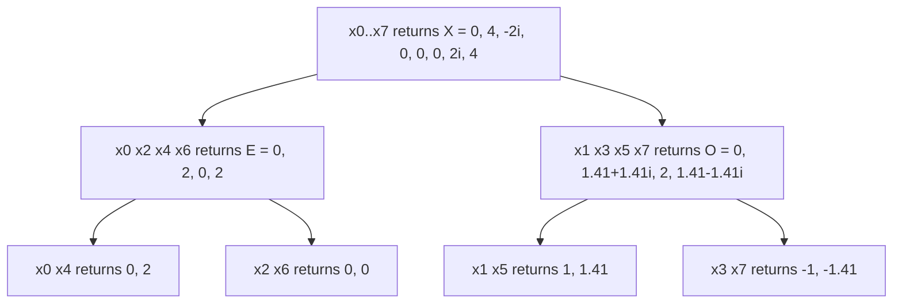

## 1. The question this idea answers

Lessons [L15](/notes/maths/fft-signal-processing/04-fft/l15-even-odd-split) to [L18](/notes/maths/fft-signal-processing/04-fft/l18-recursion-and-the-network) built the FFT on paper. Can you turn that math into a working function with no help? This lesson gives the structure in words, the acceptance tests and graded hints. You write the code.

The recursive form is the closest copy of the math. The function splits its input into even and odd halves, calls itself on each half, and joins the two results with butterflies. Lesson [L20](/notes/maths/fft-signal-processing/04-fft/l20-iterative-fft-and-bugs) then writes the same algorithm without recursion.

## 2. Mental model

> [!analogy] A manager who delegates
> A manager gets a job of N items. She cuts it into two halves and gives each half to an assistant. Each assistant does the same with a half-size job. A person with a job of one item answers at once. Then each manager joins the two reports from her assistants into one report.
>
> **Where it stops working:** a real manager can cut a job of 6 items into two jobs of 3, and then into 2 and 1. This FFT cannot: both halves must have the same size at every level, so N must be a power of 2. Also, each call in Python costs time of its own. The operation count does not show this cost.

## 3. Terms

| Term | Plain meaning |
|---|---|
| recursive function | A function that calls itself on a smaller input. |
| base case | The input that the function answers without a call to itself. Here: one sample. |
| recursive call | A call of the function to itself, here on the even half or the odd half. |
| call tree | The diagram of all calls: each call has two children, until the base case. |
| depth | The number of levels in the call tree. For N = 8: sizes 8, 4, 2, 1, so 4 levels. |
| power of 2 | A number $2^s$ with a whole number s ≥ 0: 1, 2, 4, 8, ... |
| slice with a step | `x[0::2]` takes every second element from index 0. `x[1::2]` starts at index 1. |
| `ValueError` | The Python error for an argument with the right type but a wrong value, for example a length of 6. |
| acceptance test | A test that the code must pass before you call it finished. |
| overhead | Time that the program spends on work outside the arithmetic, for example on function calls and new arrays. |

> [!note] Rounding on this page
> $\sqrt{2} = 1.41421\ldots$ appears below as 1.41. The tests compare values with `np.allclose`, so rounding does not affect them.

## 4. The contract

Before you write code, fix what the function promises.

| Item | Rule |
|---|---|
| name and signature | `fft_recursive(x)` |
| input | A 1-D sequence of N real or complex numbers. N is a power of 2: 1, 2, 4, 8, ... |
| output | A complex NumPy array of length N. It equals `np.fft.fft(x)` up to rounding. |
| bad input | If N is not a power of 2 (also N = 0), raise `ValueError` with a clear message. |
| side effects | None. The function does not change its input. |
| forbidden | Do not call `np.fft` inside the function. |

## 5. The structure in words

The function has five parts. Each part matches one idea from the earlier lessons.

1. **Convert and check.** Change the input into a complex NumPy array. Complex results need a complex array. Find N. If N is not a power of 2, raise `ValueError`.
2. **Base case.** If N = 1, return the array as it is. A 1-point DFT is the sample itself (lesson L18).
3. **Split.** Make the even half and the odd half with slices that have a step of 2 (lesson L15).
4. **Recursive calls.** Call the function on the even half to get E. Call it on the odd half to get O. Each has length N/2.
5. **Combine.** For k = 0 to N/2 − 1, compute the twiddle $W_N^k = e^{-i2\pi k/N}$ and the product $t_k = W_N^k O[k]$. The first half of the output is $E[k] + t_k$. The second half is $E[k] - t_k$ (lessons L16 and L17).

> [!key] The recursion is the math
> Part 4 trusts the function to be correct for size N/2. Part 5 is correct if E and O are correct. Part 2 is correct for size 1. So the function is correct for sizes 1, 2, 4, 8, and every power of 2 after them.

### 5.1 How to test for a power of 2

You can halve N while it is even and check that you reach 1. A faster test uses binary (lesson [F8](/notes/maths/fft-signal-processing/01-math-foundations/f8-clock-arithmetic-log-binary)). A power of 2 has exactly one bit set: 8 = 1000. Subtract 1 and every lower bit becomes 1: 7 = 0111. So the two numbers have no common bit.

| N | binary of N | binary of N − 1 | common bits | power of 2? |
|---|---|---|---|---|
| 8 | 1000 | 0111 | none | yes |
| 12 | 1100 | 1011 | 1000 | no |
| 1 | 1 | 0 | none | yes |

The test must also reject N = 0. Python's operator `&` gives the common bits of two whole numbers.

### 5.2 Why the check matters

Without the check, a wrong length gives a confusing result. One version without the check behaved like this:

1. N = 6: the halves have 3 samples, then 2 and 1. In each call of size 3, E and O get different lengths, and the call returns 4 values. Then the top call has 3 twiddles for 4 values of O, and NumPy raises a broadcast error.
2. N = 3: no error at all, but the output has 4 values instead of 3.
3. N = 0: the function calls itself again and again until Python raises `RecursionError`.

A clear `ValueError` at the start is much easier to understand.

## 6. Trace the calls

For the teaching signal, the calls form this tree. Each box shows the input of one call and the array that it returns.



The leaves under each 2-sample call are the 1-sample calls. They return the sample itself. The tree has 1 + 2 + 4 + 8 = 15 calls for N = 8. In general, it has $1 + 2 + 4 + \dots + N = 2N - 1$ calls and $\log_2 N + 1$ levels.

| N | calls $2N - 1$ | levels $\log_2 N + 1$ |
|---|---|---|
| 8 | 15 | 4 |
| 16 | 31 | 5 |
| 1024 | 2,047 | 11 |

Python stops a recursion at a depth of 1000 by default. The FFT for N = 1024 reaches a depth of only 11, so the limit is no problem.

The values in the tree are the stage values of lesson L18. The calls of size 2 return stage 1. The calls of size 4 return stage 2. The top call returns stage 3.

The graph shows the target for the teaching signal: the real part and the imaginary part of each output.

```plot
{
  "title": "Target X[k]: real part (ink), imaginary part (red)",
  "xAxis": {"label": "bin k", "domain": [-0.5, 7.5]},
  "yAxis": {"label": "value", "domain": [-2.6, 4.6]},
  "disableZoom": true,
  "data": [
    {"points": [[0.0, 0.0], [1.0, 4.0], [2.0, 0.0], [3.0, 0.0], [4.0, 0.0], [5.0, 0.0], [6.0, 0.0], [7.0, 4.0]], "fnType": "points", "graphType": "polyline", "color": "#100D12", "skipTip": true},
    {"points": [[0.0, 0.0], [1.0, 4.0], [2.0, 0.0], [3.0, 0.0], [4.0, 0.0], [5.0, 0.0], [6.0, 0.0], [7.0, 4.0]], "fnType": "points", "graphType": "scatter", "attr": {"r": 3}, "color": "#100D12", "skipTip": true},
    {"points": [[0.0, 0.0], [1.0, 0.0], [2.0, -2.0], [3.0, 0.0], [4.0, 0.0], [5.0, 0.0], [6.0, 2.0], [7.0, 0.0]], "fnType": "points", "graphType": "polyline", "color": "#C81D25", "skipTip": true},
    {"points": [[0.0, 0.0], [1.0, 0.0], [2.0, -2.0], [3.0, 0.0], [4.0, 0.0], [5.0, 0.0], [6.0, 2.0], [7.0, 0.0]], "fnType": "points", "graphType": "scatter", "attr": {"r": 3}, "color": "#C81D25", "skipTip": true}
  ]
}
```

## 7. Video

This clip shows the idea of part 4 and part 2: split each DFT again, until one sample is left.

```video
{
  "src": "/notes/media/fft-signal-processing/course/09_The_FFT_Butterfly_Algorithm.mp4",
  "start": "2:01",
  "end": "2:15",
  "caption": "Each 4-point DFT splits into two 2-point DFTs, then into single samples. A 1-point DFT is the sample."
}
```

## 8. Code

Write `fft_recursive(x)` in a lab, with the contract of section 4. Do not read other FFT code while you write it.

Acceptance tests:

1. **Sizes.** For N = 1, 2, 8, 64 and 1024, with `x = np.random.default_rng(N).standard_normal(N)`, `np.allclose(fft_recursive(x), np.fft.fft(x))` is True.
2. **Complex input.** The same test passes for a random complex x with N = 64.
3. **The teaching signal.** `fft_recursive(x)` is close to [0, 4, −2j, 0, 0, 0, 2j, 4].
4. **Small cases by hand.** `fft_recursive([5])` is close to [5]. `fft_recursive([1, 2])` is close to [3, −1]. `fft_recursive([1, 2, 3, 4])` is close to [10, −2+2j, −2, −2−2j].
5. **Bad lengths.** `fft_recursive` raises `ValueError` for N = 0, 3, 6, 12 and 100.
6. **No side effects.** After a call, the input array still has its old values.
7. **Speed.** Time `my_dft(x)` (your loop version from lesson L11) and `fft_recursive(x)` for N = 1024. Use `time.perf_counter()`. Write the ratio of the two times.

A test for the error case can use `pytest.raises`, or a plain `try` block:

```python
try:
    fft_recursive(np.ones(6))
    print("FAIL: no error")
except ValueError:
    print("ok")
```

What to expect in the speed test: one run for these notes used Python with NumPy on a server. The loop DFT took about 0.47 s, and the recursive FFT took about 5 to 9 ms. This is about 50 to 90 times faster. Your lab runs Python in the browser, so your numbers will differ. The direction must be the same.

Then time `np.fft.fft(x)` for N = 1024 too. In the same runs it took about 11 to 19 µs, several hundred times faster than the recursive FFT. Both use $N\log_2 N$ work. NumPy runs compiled code with no Python calls and no new arrays at each level (lesson [L22](/notes/maths/fft-signal-processing/04-fft/l22-other-ffts)).

[Open a lab for this lesson](/labs/new?note=maths/fft-signal-processing/04-fft/l19-recursive-fft-code)

Use the hints only after a real attempt. Open them in order.

```check
{
  "question": "Hint 1 for `fft_recursive(x)`: I do not know how to start.",
  "hint": "Hint level 1 (idea): write the base case and the length check first. Test them with N = 1 and N = 6. Then add the split and the two calls. Last, add the combine step.",
  "answer": "The function returns early in two places: the error for a bad N, and the base case for N = 1. Everything else runs only for N ≥ 2. The two recursive calls get arrays of length N/2, and you can trust them to return the DFTs E and O."
}
```

```check
{
  "question": "Hint 2 for `fft_recursive(x)`: show me the steps as pseudocode.",
  "hint": "Hint level 2 (pseudocode): read it, close it, then write the code from memory.",
  "answer": "function fft_recursive(x):\n\n1. x ← x as a complex array. N ← length of x.\n2. if N is not a power of 2: raise ValueError.\n3. if N = 1: return a copy of x.\n4. E ← fft_recursive(even half of x). O ← fft_recursive(odd half of x).\n5. for k = 0 .. N/2 − 1: w_k ← exp(−i·2π·k/N).\n6. t ← w × O (element by element).\n7. return the first half E + t, followed by the second half E − t."
}
```

```check
{
  "question": "My function runs, but the output is wrong. Where do I look first?",
  "hint": "Test N = 2, then N = 4, then N = 8. Find the smallest N that fails.",
  "answer": "N = 2 tests the base case and one butterfly with twiddle 1. N = 4 is the first size with a twiddle of −i. Check the sign of the exponent (−i·2π·k/N) and the size in the twiddle (N, not N/2). Then check the order of the two halves: sums first, then differences."
}
```

## 9. Common mistakes

1. **The base case returns a number.** The combine step needs arrays. Return an array of length 1.
2. **An integer array.** An integer input gives an integer array. Complex sums need a complex array, so convert at the start.
3. **The twiddle of the half size.** The twiddle is $e^{-i2\pi k/N}$ with the full N of this call, not N/2.
4. **The halves in the wrong order.** The sums $E + t$ go first (bins 0 to N/2 − 1). The differences $E - t$ go second.
5. **No length check.** A length of 3 or 6 gives a wrong result or a confusing error deep inside the recursion.
6. **A time from one tiny run.** Small inputs and single runs give noisy times. Time N = 1024 and repeat the run.

## 10. One-minute explanation

The recursive FFT copies the math. First it checks that N is a power of 2, because both halves must have the same size at every level. For N = 1 it returns the sample, because a 1-point DFT is the sample itself. Otherwise it calls itself on the even samples and on the odd samples, and these calls return E and O. Then it turns each O[k] by the twiddle $e^{-i2\pi k/N}$ and returns E + t followed by E − t. For N = 1024 it makes 2,047 calls, matches `np.fft.fft`, and is much faster than the direct DFT.

## 11. Check questions

```check
{
  "question": "Name the five parts of `fft_recursive` in order.",
  "hint": "Two parts can end the function early.",
  "answer": "1. Convert to a complex array and check that N is a power of 2. 2. Base case: N = 1 returns the sample. 3. Split into the even and the odd half. 4. Two recursive calls give E and O. 5. Combine with the twiddles: E + t first, E − t second."
}
```

```check
{
  "question": "How many calls does `fft_recursive` make for N = 16? How many levels does the call tree have?",
  "hint": "Count the calls on each level: 1, 2, 4, ...",
  "answer": "1 + 2 + 4 + 8 + 16 = 31 calls, which is 2N − 1. The sizes are 16, 8, 4, 2, 1, so the tree has 5 levels, which is $\\log_2 16 + 1$."
}
```

```check
{
  "question": "Trace `fft_recursive([1, 2, 3, 4])` by hand. What does each call of size 2 return? What is the final result?",
  "hint": "The even half is [1, 3]. The odd half is [2, 4]. A 2-point DFT of [a, b] is [a + b, a − b].",
  "answer": "Even half [1, 3] returns E = [4, −2]. Odd half [2, 4] returns O = [6, −2]. Twiddles: $W_4^0 = 1$, $W_4^1 = -i$. t = [6, (−i)(−2)] = [6, 2i]. Result: [4 + 6, −2 + 2i, 4 − 6, −2 − 2i] = [10, −2 + 2i, −2, −2 − 2i]."
}
```

```check
{
  "question": "Why must N be a power of 2 for this function? What goes wrong for N = 6?",
  "hint": "Follow the sizes of the halves down the call tree.",
  "answer": "Each split needs two halves of the same size, at every level, down to size 1. That is possible only when N is a power of 2. For N = 6, the halves have 3 samples. A half of 3 splits into 2 and 1, so E and O have different lengths and the butterflies cannot pair them."
}
```

```check
{
  "question": "Your `fft_recursive` and `np.fft.fft` both do about $N\\log_2 N$ work. Why is NumPy hundreds of times faster?",
  "hint": "What does the operation count not include?",
  "answer": "The operation count counts arithmetic only. Your function also pays overhead: 2N − 1 Python calls, a new array at each level, and Python itself. NumPy runs compiled code (the pocketfft library) with no Python calls inside the transform."
}
```

## 12. Links

- Previous: [L18: Recursion and the network](/notes/maths/fft-signal-processing/04-fft/l18-recursion-and-the-network)
- Next: [L20: Iterative FFT and bugs](/notes/maths/fft-signal-processing/04-fft/l20-iterative-fft-and-bugs)
- The direct DFT to compare against: [L11: The DFT formula](/notes/maths/fft-signal-processing/03-matching-to-dft/l11-the-dft-formula)
- The combining step: [L17: The butterfly](/notes/maths/fft-signal-processing/04-fft/l17-the-butterfly)
- The speed in numbers: [L21: Why the FFT is fast](/notes/maths/fft-signal-processing/04-fft/l21-why-it-is-fast)
- [04 FFT](/notes/maths/fft-signal-processing/04-fft)
- [Glossary](/notes/maths/fft-signal-processing/glossary)
